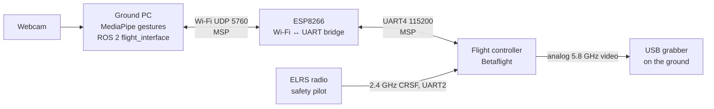

# ESP8266 AT Commands and TCP/UDP for the SEA:ME Drone

## Overview

This document turns our ESP8266 testing (picocom, AT firmware) into the design of the drone's Wi-Fi link: how to talk to the module, how it connects to the flight controller, which network it uses in tests and in production, and which data goes over UDP or TCP.

Project context (decided in the documentation vault, see the ADRs):

| Item | Value |
|---|---|
| Wi-Fi module | ESP-12F (`ESP8266MOD`, ESP8266EX, 4 MB flash) on a **D1 mini-format board** with an FTDI FT232R and micro-USB |
| ESP firmware | AT 1.7.4.0 (SDK 3.0.5) for now; custom firmware later (ADR-007) |
| Flight controller | OddityRC F7 AIO, **Betaflight 4.5.1** (upgrade to 2026.6.2 planned, ADR-014) |
| Protocol to the FC | **MSP** over UART4 at 115200 baud (ADR-009, ADR-011), not MAVLink |
| Manual control and kill | ELRS 2.4 GHz radio, always wins over the Wi-Fi link |
| Gestures | **Ground webcam** + MediaPipe on the ground PC (ADR-015), not the drone camera |
| Drone video | Analog 5.8 GHz VTX → USB grabber on the ground; not over Wi-Fi |

The design in one line: the drone carries no companion computer, the ground PC runs the gesture loop, and the ESP8266 is only a **Wi-Fi ↔ UART bridge** between the ground PC and the flight controller.

## Hardware setup

### Our board (D1 mini format)

The board already has the 3.3 V regulator, the boot pull-ups/downs (EN, GPIO0, GPIO15) and the USB-serial chip, so it works as soon as it is plugged in by USB.

| Pin | Use |
|---|---|
| `5V` | 5 V in (from USB or the FC 5 V pad); the on-board regulator makes 3.3 V |
| `3V3` | 3.3 V **output** of the regulator. Never feed 5 V here |
| `G` | Ground |
| `TX` (GPIO1) / `RX` (GPIO3) | UART0: AT commands, and the link to the FC. **Shared with the USB-serial chip** |
| `D3` (GPIO0), `D4` (GPIO2), `D8` (GPIO15) | Boot pins: leave unconnected |
| `D1`, `D2`, `D5`, `D6`, `D7` | Free for later (I2C, flow sensor experiment) |
| `RST`, `A0`, `D0` | Not used |

### Bare ESP8266 / ESP-12 module (reference)

Only needed if a bare module is ever used with an external USB-serial adapter.

| ESP8266 pin | Connect to |
|---|---|
| VCC | 3.3 V, 250–500 mA (never 5 V) |
| GND | GND |
| TX | RX of the USB-serial adapter |
| RX | TX of the USB-serial adapter |
| CH_PD / EN | 3.3 V |
| RST | 3.3 V or floating |
| GPIO0 | 3.3 V for normal boot (GND = flash mode) |
| GPIO15 | GND (usually on-board on ESP-12) |

### Connecting the ESP to the drone

```text
   FC (OddityRC F7, UART4)            ESP board (D1 mini format)
   T4 (TX) ─────────────────────────► RX  (GPIO3)
   R4 (RX) ◄───────────────────────── TX  (GPIO1)
   5V ──────────────────────────────► 5V
   GND ─────────────────────────────► G
```

Rules:

1. **Crossed TX/RX.** Both sides use 3.3 V logic, so no level shifter is needed.
2. **Power through `5V`, never `3V3`.** Check how much current the FC 5 V pad can give (open item FC-05): the ESP draws peaks of about 300 mA when transmitting.
3. **Never the ESP USB and the FC at the same time.** The FT232R is wired to the same TX/RX pins and the two would drive the same line. Configure the ESP by USB first, unplug it, then wire it to the FC.
4. **Before soldering:** instructor approval (the drone belongs to the lab), then the checks in `ESP_to_FC` §10: T4/R4 continuity to the MCU, no shorts to neighbouring pads, 5 V rail.
5. **ELRS (UART2) and the VTX (UART3) are not touched.** Confirmed with the Betaflight `serial` command on 2026-10-13.
6. **Props off** for every test until the bridge has passed cycles 1a and 1b.

Betaflight side: UART4 must run MSP at 115200 (`serial 3 1 115200 57600 0 115200`, then `save`). The script does this with a backup first: `python3 scripts/fc_cli.py --write enable-esp-uart`.

When the ESP boots, its ROM prints a few bytes at 74880 baud on TX. The FC sees them as noise: they have no MSP header, so the MSP parser ignores them.

## Talking to the module: picocom

Start picocom with Enter mapped to CR+LF, because AT commands require it:

```bash
picocom -b 115200 --omap crcrlf --imap lfcrlf /dev/ttyUSB0
```

- Do not add `--echo`: the module already echoes your typing, so you would see double characters.
- Exit with Ctrl+A then Ctrl+X. Help is Ctrl+A then Ctrl+H. **Only one program can use the port**: close picocom before running the scripts.
- Permission denied on the port: `sudo usermod -aG dialout $USER`, then log out and back in.
- Boot messages print at 74880 baud, so garbage at 115200 right after power-up is normal.

Command syntax:

| Form | Meaning |
|---|---|
| `AT+CMD` | Execute |
| `AT+CMD?` | Query the current value |
| `AT+CMD=?` | Show supported parameters |
| `AT+CMD=value` | Set |
| `_CUR` suffix | Applies now, not saved to flash |
| `_DEF` suffix | Saved to flash, survives a reboot |
| No suffix (`AT+CWMODE`, `AT+CWJAP`, `AT+CWSAP`) | Deprecated on AT 1.7: behaves like `_DEF`, so **it is saved to flash** |

> [!warning] Passwords are saved in the module's flash
> `AT+CWJAP`, `AT+CWJAP_DEF`, `AT+CWSAP` and `AT+CWSAP_DEF` store the SSID and password in flash. We confirmed it on 2026-10-13: a full flash backup contained the SEAME password. Consequences:
> - **Never publish a flash backup** (GitHub, chat, shared drive). Backups live in `~/Projects/SEAME/backups/`.
> - Before handing the module to someone else: `AT+RESTORE`.
> - Use the `_CUR` forms for one-off tests.

## AT command reference

Commands vary by firmware version, so run `AT+GMR` first. Everything below exists on our AT 1.7.4.

### General

| Command | What it does |
|---|---|
| `AT` | Test. Replies `OK` |
| `AT+RST` | Restart the module |
| `AT+GMR` | Show AT firmware and SDK version |
| `ATE0` / `ATE1` | Turn command echo off / on |
| `AT+RESTORE` | Factory reset, erases saved settings (including Wi-Fi passwords) |
| `AT+UART_CUR=<baud>,<bits>,<stop>,<parity>,<flow>` | Set the UART temporarily (`UART_DEF` saves it). Keep 115200 8N1: the FC expects it |
| `AT+GSLP=<ms>` | Deep sleep for N ms (GPIO16 must be wired to RST to wake) |
| `AT+SLEEP=<0-2>` | Sleep mode: 0 off, 1 light, 2 modem. Use 0 for the drone (lower latency) |
| `AT+RFPOWER=<0-82>` | Maximum TX power in steps of 0.25 dBm (82 = 20.5 dBm) |
| `AT+SYSRAM?` | Show free heap memory |

### Wi-Fi

| Command | What it does |
|---|---|
| `AT+CWMODE_CUR=<1/2/3>` | 1 = station, 2 = access point, 3 = both |
| `AT+CWLAP` | Scan networks (encryption, SSID, RSSI, MAC, channel) |
| `AT+CWJAP_CUR="ssid","pass"` | Connect to a network (not saved) |
| `AT+CWJAP_DEF?` | Show the saved network (`No AP` if none) |
| `AT+CWQAP` | Disconnect from the network |
| `AT+CWSAP_CUR="ssid","pass",<ch>,<enc>[,<max>]` | Configure the access point. enc 0 = open, 3 = WPA2-PSK. max = clients, 1–4 |
| `AT+CWLIF` | List clients connected to the AP |
| `AT+CWDHCP_CUR=<mode>,<en>` | DHCP on/off. mode 0 = AP, 1 = station, 2 = both |
| `AT+CWAUTOCONN=<0/1>` | Auto-connect to the saved network on boot |
| `AT+CIPSTA_CUR="ip","gw","mask"` | Static station IP |
| `AT+CIPAP_CUR="ip","gw","mask"` | AP IP (default 192.168.4.1) |
| `AT+CIPSTAMAC_CUR?` / `AT+CIPAPMAC_CUR?` | Station / AP MAC address |
| `AT+CWHOSTNAME="name"` | Station hostname |

### TCP/IP

| Command | What it does |
|---|---|
| `AT+CIFSR` | Local IP and MAC addresses |
| `AT+CIPSTATUS` | Connection status: 2 = got IP, 3 = connected, 4 = disconnected, 5 = no Wi-Fi |
| `AT+CIPMUX=<0/1>` | 0 = single connection, 1 = multiple (required for server mode) |
| `AT+CIPSTART="TCP","host",port` | Open a TCP connection (single mode) |
| `AT+CIPSTART=<id>,"TCP","host",port` | Same, multi mode |
| `AT+CIPSTART="UDP","host",port,localport,mode` | Open a UDP link bound to a local port |
| `AT+CIPSEND=<len>` | Prepare to send N bytes, then type exactly N bytes after `>` |
| `AT+CIPSEND=<id>,<len>` | Same, multi mode |
| `AT+CIPCLOSE` / `AT+CIPCLOSE=<id>` | Close a connection |
| `AT+CIPSERVER=<1/0>,<port>` | Start or stop a TCP server (needs `CIPMUX=1`) |
| `AT+CIPSTO=<sec>` | Server idle timeout |
| `AT+CIPMODE=<0/1>` | 1 = transparent passthrough |
| `AT+SAVETRANSLINK=1,"ip",port,"UDP",localport` | Enter passthrough **automatically at boot** (see below) |
| `AT+CIPDINFO=<0/1>` | Show sender IP and port in `+IPD` lines |
| `AT+CIPDOMAIN="host"` | Resolve a name to an IP |
| `AT+PING="host"` | Ping. The answer `+22` means 22 ms |
| `AT+CIPDNS_CUR=<en>,"dns1"` | Custom DNS server |

Received data appears as `+IPD,<len>:<data>` in single mode or `+IPD,<id>,<len>:<data>` in multi mode.

## Step-by-step tutorial

Follow these steps in order; each one builds on the previous result.

1. **Sanity check.** `AT` → `OK`.
2. **Firmware.** `AT+GMR` → version lines ending in `OK`.
3. **Optional: echo off.** `ATE0`. `ATE1` restores it.
4. **Station mode and scan.** `AT+CWMODE_CUR=1`, then `AT+CWLAP`. The ESP8266 only sees 2.4 GHz networks.
5. **Connect.** `AT+CWJAP_CUR="<ssid>","<password>"` → `WIFI CONNECTED`, `WIFI GOT IP`, `OK`. A `FAIL` comes with a code: 1 = timeout, 2 = wrong password, 3 = AP not found, 4 = connect failed.
6. **IP.** `AT+CIFSR` and `AT+CIPSTATUS` → station IP and `STATUS:2`.
7. **Connectivity.** `AT+PING="8.8.8.8"` (a number means success) and `AT+CIPDOMAIN="example.com"` (DNS).
8. **TCP client.** `AT+CIPMUX=0`, `AT+CIPSTART="TCP","<host>",<port>`, `AT+CIPSEND=<len>`, then exactly that many bytes.
9. **TCP server.** `AT+CIPMUX=1`, `AT+CIPSERVER=1,8080`, then `AT+CIFSR` for the IP. Stop it with `AT+CIPSERVER=0`: on the SEAME network other machines (and scanners) connect to it within minutes.
10. **Access point.** `AT+CWMODE_CUR=2`, `AT+CWSAP_CUR="<name>","<8+ char password>",6,3`, then `AT+CWLIF` once a phone has joined.
11. **Clean up.** `AT+CWQAP` to disconnect, `AT+RESTORE` to erase everything (including saved passwords).

The TCP server test we ran: from another computer on the same network, `nc <ESP_IP> 8080`. picocom shows `+IPD,0,<len>:<your text>`; reply with `AT+CIPSEND=0,5` followed by `hello` (no Enter, since 5 bytes is exactly the word).

A reliable first data test is a listener on your own laptop, because it never times out the connection:

```bash
nc -lk 8080
```

```
AT+CIPMUX=0
AT+CIPSTART="TCP","<laptop-ip>",8080
AT+CIPSEND=5
```

Then type `hello` with no Enter. It appears in the `nc` terminal.

## Problems we hit and their fixes

Most trouble came from `AT+CIPSEND`: after it, the module waits for exactly the number of bytes you announced, and any mismatch leaves it stuck or sends the wrong data.

| Symptom | Cause | Fix |
|---|---|---|
| Connection closes after `AT+CIPSEND=18` | Public servers drop idle connections within seconds, and typing by hand is too slow | Open the connection right before sending, or test against `nc -lk 8080` on your own machine |
| Nothing visible after typing following `>` | The module does not echo in data mode | Toggle picocom local echo with Ctrl+A Ctrl+C, and turn it off again afterwards |
| `ERROR` after the send, or no answer | `\r\n` typed literally is 4 characters, so the request is 22 bytes, not 18 | Press Enter instead. With `--omap crcrlf`, each Enter is 2 bytes |
| `busy s...` | Still inside a previous `CIPSEND`, waiting for the rest of the bytes | Type the missing bytes, or send `+++` with no Enter and 1 s of silence before and after, or `AT+RST` |
| `busy p...` | Still processing the previous command | Wait and retry |
| `link is not valid` | The TCP link already closed | `AT+CIPSTATUS` (needs `STATUS:3`) and reconnect |
| `link is builded` on `AT+CIPMUX=0` | A connection or server is still open | `AT+CIPSERVER=0`, `AT+CIPCLOSE=<id>`, then retry |
| `ERROR` on `AT+CWMODE=2` and similar | Typos or invisible characters from editing in picocom (backspace) | Retype the whole command; picocom does not edit lines |
| Output looks doubled | Local echo on in picocom while the module echoes too | Remove `--echo` |
| `AT+PING` returns `ERROR` | No IP, or stuck in `CIPSEND` | `AT+CIFSR`, then reset if busy |
| Scripts say the port is busy | picocom (or another program) still has it open | Close it (Ctrl+A Ctrl+X) |

The correct HTTP/1.0 request over TCP is 18 bytes when you press Enter twice:

```
AT+CIPSEND=18
GET / HTTP/1.0<Enter>
<Enter>
```

`GET / HTTP/1.0` is 14 characters, plus 2 for each Enter. Many servers require a Host header, so the more reliable form is HTTP/1.1 with `Host:` and `Connection: close`, which totals 56 bytes for example.com.

To use escape sequences, send from a shell with `printf` instead of typing in picocom (close picocom first):

```bash
stty -F /dev/ttyUSB0 115200 raw -echo
cat /dev/ttyUSB0 &
printf 'AT+CIPSTART="TCP","example.com",80\r\n' > /dev/ttyUSB0; sleep 2
printf 'AT+CIPSEND=18\r\n' > /dev/ttyUSB0; sleep 0.5
printf 'GET / HTTP/1.0\r\n\r\n' > /dev/ttyUSB0
```

## Network: test on SEAME, production on the drone's own network

**Team decision (2026-10-13):** during development the ESP joins the **SEAME** network as a station, so laptops keep internet. Only in production (cage tests, flights) does the ESP create its **own network**.

| | Test: station on SEAME | Production: ESP access point |
|---|---|---|
| Script | `scripts/setup_test.py` | `scripts/setup_production.py` |
| ESP mode | `CWMODE_DEF=1`, joins SEAME, DHCP | `CWMODE_DEF=2`, SoftAP `seame-drone-xxxx`, WPA2, 1 client |
| Addresses | ESP and PC get DHCP addresses in `10.20.0.0/16` | ESP `192.168.4.1`, PC `192.168.4.2` (static) |
| Laptop internet | Kept | Lost while connected (unless on a cable) |
| Who can reach the bridge | **Anybody on SEAME** | Only the client that knows the WPA2 password |
| Allowed use | Bench, props off | Cage and flights |
| If the PC changes IP | Run `setup_test.py` again (ESP on USB) | Not affected |

Why the test scenario is bench-only:

- The transparent bridge has no authentication. On SEAME any machine could send MSP frames to the FC, and scanners connected to our test TCP server within minutes.
- SEAME is shared and busy: latency and loss are not representative of the drone's own network.
- DHCP can give the ESP or the PC a new address. The setup script saves both, and `setup_test.py status` warns when they changed.

Avoid AP+station mode (`CWMODE=3`) in flight: the radio is shared, both interfaces are forced onto one channel, throughput drops, and if the station side loses its router the AP channel can move and drop the ground link.

Channel: pick a fixed channel (1, 6 or 11) and measure it against ELRS. Both use 2.4 GHz; the coexistence test (Wi-Fi channels 1/6/11 while watching ELRS LQ in the OSD) is planned in week 2.

## UDP with AT commands

UDP is set up separately from the TCP server: `AT+CIPSERVER` is TCP only, and a UDP link is opened with `AT+CIPSTART` and bound to a local port.

```
AT+CIPMUX=0
AT+CIPSTART="UDP","192.168.4.2",9000,8000,2
```

Parameters: protocol, remote IP and port (where the ESP sends by default), local port (where the ESP listens), and mode:

| Mode | Behaviour |
|---|---|
| 0 | Peer fixed to the remote IP and port you gave (default) |
| 1 | Peer changes once, to the sender of the first packet received, then stays fixed |
| 2 | Peer changes on every received packet, so the ESP replies to whoever sent last |

UDP and the TCP server can coexist in multi-link mode, where all links share up to 5 IDs:

```
AT+CIPMUX=1
AT+CIPSERVER=1,80
AT+CIPSTART=4,"UDP","192.168.4.2",9000,8000,2
```

### Sending and receiving

- Single link: `AT+CIPSEND=5`, then `hello` (no Enter).
- To a specific address without changing the peer: `AT+CIPSEND=5,"192.168.4.2",9000`.
- Multi link: add the link ID, for example `AT+CIPSEND=4,5`.
- With `AT+CIPDINFO=1` the sender is included: `+IPD,4,5,192.168.4.2,9000:hello`.

### Testing from a laptop

```bash
nc -u -l 9000                 # receive what the ESP sends (its remote port)
nc -u 192.168.4.1 8000        # send to the ESP (its local port)
```

Some `nc` versions only learn the peer after the first packet. A Python alternative:

```python
import socket
s = socket.socket(socket.AF_INET, socket.SOCK_DGRAM)
s.bind(("0.0.0.0", 9000))
s.sendto(b"ping", ("192.168.4.1", 8000))
print(s.recvfrom(1024))
```

## Transparent mode: the bridge to the flight controller

The flight controller speaks MSP, not AT commands, so the ESP has to forward bytes without any AT framing:

```
AT+CIPMODE=1
AT+CIPSEND
```

Everything that arrives on the UART then goes out as UDP, and incoming UDP comes out raw on the UART, with no `+IPD` framing. Exit with `+++` (1 s of silence before and after). It needs `CIPMUX=0` and a single link.

**`AT+SAVETRANSLINK` makes it start at boot**, which is what the drone needs (nobody can type AT commands to an ESP wired to the FC):

```
AT+SAVETRANSLINK=1,"<PC IP>",5760,"UDP",5760
```

- The remote peer is **fixed** (no mode 2 here): the ESP always sends to that PC IP and port. In the test scenario the PC address comes from DHCP, which is why `setup_test.py` reads it and must be run again if it changes.
- To undo: `+++`, then `AT+SAVETRANSLINK=0` (`python3 scripts/esp_at.py exit-bridge`).
- The ESP groups UART bytes into UDP packets by timing (about 20 ms of silence ends a packet). MSP requests and replies are small (under 100 bytes), so each usually travels in one packet; the scripts' MSP parser also handles split or merged packets.
- Keep each datagram under about 1400 bytes; a single `CIPSEND` is capped at 2048 bytes.

This bridge is a **test spike**: no authentication, no session, no link-loss failsafe on the ESP. The flight version is the custom firmware of ADR-007 (HMAC, sessions, 250 ms failsafe, command allow-list).

## TCP vs UDP for the drone

Use UDP for anything that is continuously refreshed, and TCP for things that must arrive intact and are not time-critical. TCP retransmits and holds back later data until the lost part arrives, so on a weak link it stalls and then delivers old data; UDP drops what is lost and moves on. This matches ADR-005 (session over TCP, liveness over UDP) and ADR-008 (state over UDP; events, logs and acks over TCP).

| Data | Protocol | Why |
|---|---|---|
| Setpoints (gesture → velocity or attitude), 10–50 Hz | UDP | A newer command supersedes an old one |
| Telemetry (attitude, battery, link state) | UDP | Stale data is worthless |
| Heartbeat (ground ↔ drone) | UDP | Its absence triggers the failsafe |
| Critical one-shot commands (start/stop override, land request) | TCP, or UDP with ack and retry | Must arrive exactly once |
| Configuration, logs | TCP | Reliability and order, no deadline |
| Firmware update (OTA, signed) | TCP/HTTP | Must be complete and correct (Module 3) |
| Drone video | **Not over Wi-Fi** | Analog 5.8 GHz VTX to a USB grabber on the ground |

### Why the ESP8266 carries no video

The ESP8266 has no camera interface, and a 115200-baud UART carries about 11 KB/s, far less than any video stream. In our project:

- **Gestures** come from a webcam on the ground PC (ADR-015), so they do not depend on the Wi-Fi link at all.
- **The drone camera** goes through the analog VTX at 5.8 GHz to the MS210x USB grabber (UVC) on the ground. It is used later for a detector (Module 2).

If a digital camera is ever needed on the drone, it needs its own board and radio (for example an ESP32-CAM). Splitting frames into UDP chunks (`[frame_id][chunk_index][chunk_count][JPEG bytes]`) and dropping incomplete frames is the right approach there. TCP/MJPEG only works for a first prototype: on a weak link it builds up seconds of latency.

## Architecture and safety



The ground PC sends setpoints through the ESP to the flight controller (MSP Override, ADR-010). The ELRS radio stays the primary receiver: the safety pilot can take back control or disarm at any moment, whatever happens on Wi-Fi.

### Latency budget

Webcam capture, gesture inference, ROS 2, Wi-Fi, ESP and UART must stay under about 200–300 ms in total. Gestures are high-level intents (hover, move left, land request); the flight controller stabilises by itself. No tight control loop is closed over Wi-Fi. Measured so far (2026-10-13): MSP over USB, mean 6 ms round trip; through the bridge: to be measured in cycles 1a and 1b.

### Safety measures

- **The radio always wins.** ELRS on its own UART, failsafe tested before any flight; MSP Override only on a pilot switch (ADR-010).
- **Link failsafe:** in the custom firmware, 250 ms without valid control → failsafe, explicit resume (ADR-004). The AT transparent bridge has **no** failsafe, so it is props-off only.
- **Betaflight 4.5.1 caveat:** MSP Override holds the last values if the ESP stops sending. Never switch override on before the ESP is streaming; upgrade to 2026.6.2 (300 ms freshness guard) before override flights (ADR-014).
- **Gesture debouncing:** the same gesture over several frames before acting. Gestures never arm or disarm.
- **Integrity:** truncated HMAC-SHA256, session ID and sequence numbers on every message in the custom protocol (ADR-002, ADR-003).
- **Range:** ESP8266 range is typically 30–100 m line of sight and degrades with 2.4 GHz interference. We fly in the netted cage.

### Scripts

All of the above is automated in `scripts/` (see `scripts/README.md`):

| Task | Command |
|---|---|
| ESP on SEAME (test) | `python3 scripts/setup_test.py` |
| ESP own network (production) | `python3 scripts/setup_production.py`, then `connect` / `disconnect` |
| Bridge test without the drone (cycle 1a) | `python3 scripts/msp_check.py cycle1a` |
| Bridge test with the FC (cycle 1b) | `python3 scripts/msp_check.py info`, `ping`, `attitude` |
| Back to AT mode | `python3 scripts/esp_at.py exit-bridge` |

### Answered questions

| Question | Answer |
|---|---|
| Camera hardware? | Gestures: ground webcam (ADR-015). Drone: analog camera + VTX, not over Wi-Fi |
| Flight controller and software stack? | OddityRC F7 AIO, Betaflight 4.5.1 → 2026.6.2. PX4 only in simulation |
| Own messages or MAVLink? | MSP to the FC; our own protocol (Protocol Spec v0) between the ground and the ESP once the custom firmware exists |
| Which network? | Test: SEAME (station). Production: the ESP's own WPA2 network |

### Still open

- How much current the FC 5 V pad can give the ESP (FC-05).
- Which Wi-Fi channel coexists best with ELRS (week 2 test).
- Instructor approval for soldering on the lab drone and for reflashing (Open Questions).
