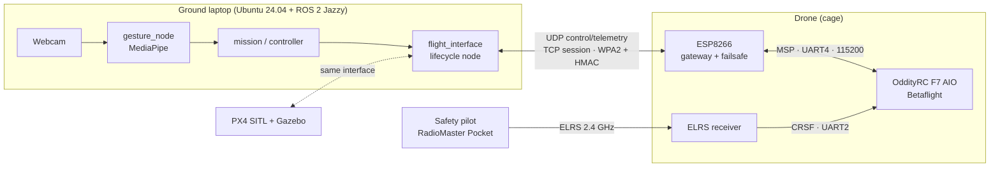

# SEA:ME Team 1: ROS Rangers

Autonomous indoor drone for SEA:ME 2026/2027 (Portugal). A 2.5" Betaflight
cinewhoop is controlled from a ground laptop running ROS 2 over Wi-Fi, through
a ESP8266 soldered to the flight controller. The goal is
**gesture control**: a ground webcam and MediaPipe turn hand gestures into
flight commands. The safety pilot's radio always has the last word.

This repo holds the firmware, protocol library, ROS 2 nodes, simulation, tests,
CI and the full project documentation.

> [!WARNING]
> Read [Safety Rules](./docs/PraticalPlan/05%20Hardware/Safety%20Rules.md)
> before any hardware task. Props off on the bench. The ELRS radio and the
> safety pilot always win over code. Gestures never arm the drone.

## Architecture

Authority order: safety pilot (ELRS) > Betaflight failsafe > ESP link failsafe >
`flight_interface` watchdog > mission/gestures. Details in
[System Overview](./docs/PraticalPlan/03%20Architecture/System%20Overview.md).

## Hardware

| Part | Model |
|---|---|
| Frame | Pilotix Brook 2.5" Cinewhoop 4S |
| FC + ESC | OddityRC F7 40A AIO (STM32F722), Betaflight 4.5.1 |
| Wi-Fi bridge | ESP8266 (ESP-12F) on FC UART4 |
| Radio | BETAFPV ELRS Nano + RadioMaster Pocket |
| Video | Ratel 2 camera, PandaRC VT5804 VTX |
| Battery | CNHL 4S 850 mAh |

Full list: [Hardware Inventory](./docs/PraticalPlan/05%20Hardware/Hardware%20Inventory.md).

## Repository layout

| Path | What |
|---|---|
| [`docs/`](./docs) | Documentation vault (plan, ADRs, architecture, hardware, process) |
| [`scripts/`](./scripts) | Bench tools for the FC, the ESP and the Wi-Fi bridge |
| [`firmware/esp8266/`](./firmware/esp8266) | Backup of the stock ESP8266 AT firmware |
| [`drone/firmware/esp8266/`](./drone/firmware/esp8266) | Custom ESP firmware (PlatformIO, `esp`) |
| [`drone/lib/protocol/`](./drone/lib/protocol) | C++ ground ↔ drone protocol library, shared with the firmware |
| [`drone/ground/src/`](./drone/ground/src) | ROS 2 packages: `flight_interface`, `gesture_node`, `sd_protocol_py` |
| [`drone/config/betaflight/`](./drone/config/betaflight) | Betaflight `diff all` / `status` baselines per version |
| [`drone/simulation/`](./drone/simulation), [`simulation/px4/`](./simulation/px4) | PX4 SITL / Gazebo setup |
| [`drone/tests/`](./drone/tests), [`tests/`](./tests) | SITL, HIL, golden vectors and script tests |

Several `drone/` folders are still placeholders (`info.md`) and fill up as
Module 1 progresses.

## Documentation

The project documentation (plan, decisions, architecture, hardware notes and
team process) lives in [`docs/`](./docs) on the `dev` branch. It is an
[Obsidian](https://obsidian.md) vault, so it reads best in Obsidian, where
wikilinks, embeds and diagrams render.

To open it:

1. Check out `dev`: `git checkout dev && git pull`.
2. In Obsidian, choose **Open folder as vault** and select the `docs/` folder.
3. Start at `PraticalPlan/00 Start/Home.md`, the map of everything.

Recommended plugins are listed in `docs/-Must Have Plugins/`. Don't commit
your `.obsidian/` workspace files.

## Contributing

- Tasks live in [GitHub Issues](../../issues) and on the
  [project board](https://github.com/orgs/SEAME-pt/projects/111). Open issues
  with the issue forms.
- `main` and `dev` are protected. Branch from `dev` as
  `feature/<issue>-<topic>` or `bugfix/<issue>-<topic>`, then open a PR into
  `dev` with `Closes #N`.
- PRs need two reviewers from outside the author's track.
- Run `pre-commit run --all-files` before pushing.
- To change a design decision, update or supersede its ADR first.

## CI

[`ci.yaml`](./.github/workflows/ci.yaml) always runs lint (pre-commit) and
turns on the C++, Python, firmware and SITL jobs as each component appears.
[`hil.yaml`](./.github/workflows/hil.yaml) runs hardware-in-the-loop tests on a
self-hosted bench runner (no LiPo, ever). See
[CI-CD Overview](./docs/PraticalPlan/04%20CI-CD/CI-CD%20Overview.md).
