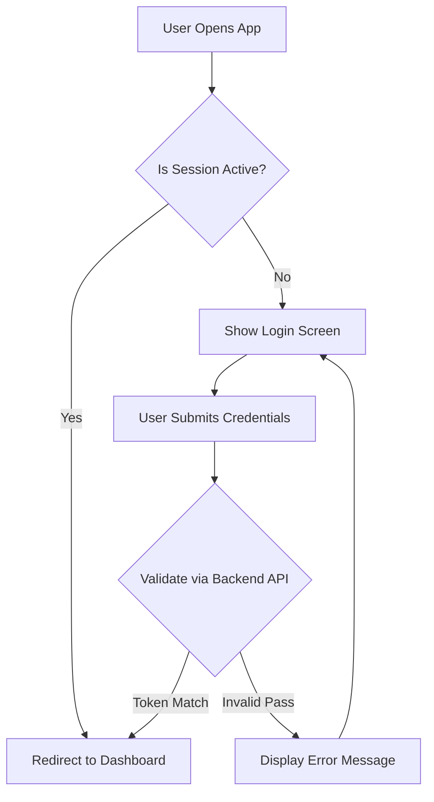
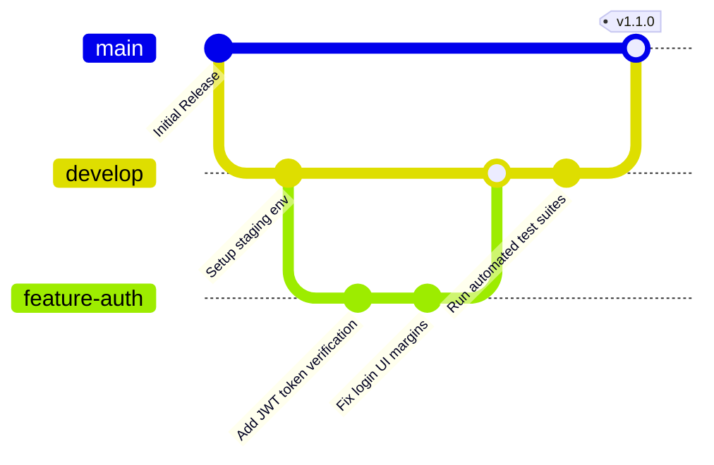
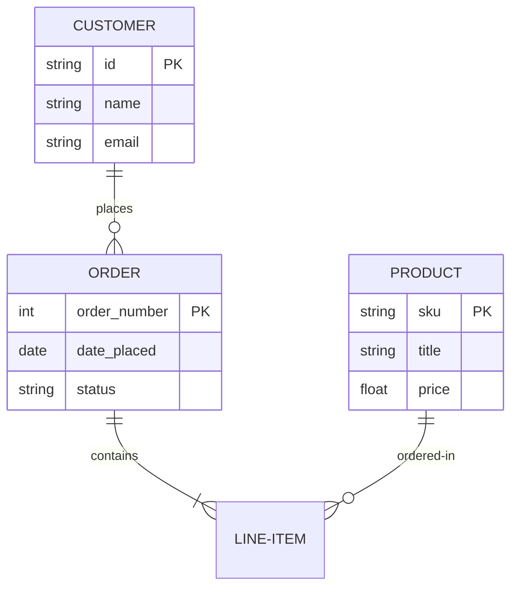

# 🧬 System Architecture & Mermaid Diagrams

This file showcases how Obsidian natively compiles code-based text into dynamic visual flowcharts using the Mermaid framework.

---

## 🔄 User Authentication Pipeline
This flowchart tracks a user logging into a web application from the frontend UI down to database validation.

---

## 🗓️ Agile Git Branching Strategy
This timeline represents a standard development workflow, tracking feature development, integration testing, and production deployment.

---

## 🏛️ Database Relationship Framework (ER Diagram)
An Entity-Relationship map detailing the connections between customers, orders, and products.

## Glossary

| Term | Meaning |
| --- | --- |
| **API** | Application Programming Interface: a defined way for software components to communicate. |
| **Branch** | An independent line of development in version control. |
| **Commit** | A recorded snapshot of changes in a version-control repository. |
| **Mermaid** | A text-based diagram syntax rendered by compatible Markdown tools. |
