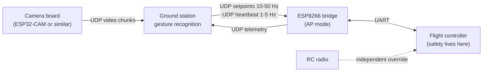
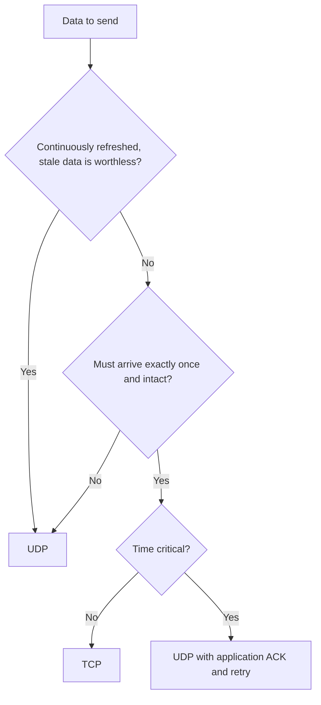
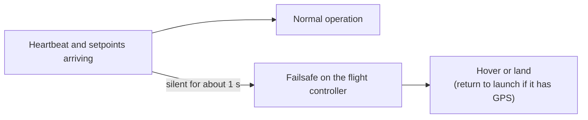

# ESP8266 AT Commands and TCP/UDP for the Autonomous Drone

> [!summary] In one sentence
> We tested an **ESP8266 running AT firmware** with picocom and turned the results into a drone design: **AP mode** as the default WiFi mode, **UDP** for anything that is continuously refreshed, and **TCP** for anything that must arrive once and intact.

> [!info] About this document
> This is a purely informative guide. It explains **how to talk to the module** (wiring, picocom, AT commands), **what went wrong while testing**, and **which protocol to use for which drone data**, with examples. Related note: [[2.5Drone|Hardware README]] (the Brook flight controller and the ELRS receiver).

> [!warning] Firmware versions differ
> AT commands vary by firmware version, so always run `AT+GMR` first. The `_CUR` and `_DEF` forms used below need **AT 1.3 or newer**. On older firmware, drop the suffix (for example `AT+CWMODE=1`).

> [!important] What is original and what is added
> Sections 1 to 11 come from our ESP8266 test notes. **Section 12 ("Project notes for the Brook drone")** is new: it connects those notes to the hardware we actually have. Everything in it is a **suggestion to verify**, not something we have tested.

---

## Index

```table-of-contents
style: nestedList
minLevel: 2
maxLevel: 3
includeLinks: true
```

---

## 1. Project context

| Item           | Description                                                                          |
| -------------- | ------------------------------------------------------------------------------------ |
| **Module**     | ESP8266 running AT firmware, tested from a PC through picocom                        |
| **Vehicle**    | An autonomous drone that **cannot carry a companion computer**                       |
| **Payload**    | A camera whose images are used to **recognize gestures**                             |
| **Processing** | The **ground station** runs the gesture-recognition program and sends commands back  |

---

## 2. The core idea

The drone creates its **own WiFi network** (AP mode). The ground station joins it and does all the heavy work. The drone only **streams video out** and **accepts setpoints in**.



> [!note] Key rule
> **Safety must live on the flight controller, never on the WiFi link.** The WiFi link only carries *intents*. The flight controller stabilizes the drone and handles failures by itself.

### Why these choices

| Choice                     | Why                                                                                       |
| -------------------------- | ----------------------------------------------------------------------------------------- |
| **AP mode by default**     | No router needed in the field, and the ground station joins the drone directly            |
| **UDP for refreshed data** | A lost packet is dropped and the link moves on. Newer data replaces older data            |
| **TCP for one-shot data**  | It retransmits and keeps order, so it suits things that must arrive exactly once          |
| **Ground station does the heavy work** | The drone has no companion computer, so it only moves data                    |

---

## 3. Setup

### Wiring

The module needs **3.3 V** (never 5 V) with **250 to 500 mA**, a **crossed TX/RX** connection, and `CH_PD`/`EN` pulled high before it answers AT commands.

| ESP8266 pin      | Connect to                                       |
| ---------------- | ------------------------------------------------ |
| `VCC`            | 3.3 V, 250 to 500 mA                             |
| `GND`            | `GND`                                            |
| `TX`             | `RX` of the USB-serial adapter                   |
| `RX`             | `TX` of the USB-serial adapter                   |
| `CH_PD` / `EN`   | 3.3 V                                            |
| `RST`            | 3.3 V or floating                                |
| `GPIO0`          | 3.3 V for normal boot (`GND` = flash mode)       |
| `GPIO15`         | `GND` (usually on-board on the ESP-12)           |

> [!danger] 3.3 V only
> **Never apply 5 V** to the module's `VCC` or to its UART pins. Also check that your USB-serial adapter is set to 3.3 V logic.

### Start picocom

Map Enter to CR+LF, because AT commands require it:

```bash
picocom -b 115200 --omap crcrlf --imap lfcrlf /dev/ttyUSB0
```

| Tip                                        | Detail                                                                                   |
| ------------------------------------------ | ---------------------------------------------------------------------------------------- |
| **Do not add `--echo`**                    | The module already echoes your typing, so you would see double characters                |
| **Exit**                                   | Ctrl+A then Ctrl+X                                                                       |
| **Help**                                   | Ctrl+A then Ctrl+H                                                                       |
| **Permission denied on the port**          | `sudo usermod -aG dialout $USER`, then log out and back in                               |
| **Garbage right after power-up**           | Normal. Boot messages print at **74880 baud**, not 115200                                |

### Command syntax conventions

| Form             | Meaning                                  |
| ---------------- | ---------------------------------------- |
| `AT+CMD`         | Execute                                  |
| `AT+CMD?`        | Query the current value                  |
| `AT+CMD=?`       | Show supported parameters                |
| `AT+CMD=value`   | Set                                      |
| `_CUR` suffix    | Applies now, **not saved** to flash      |
| `_DEF` suffix    | **Saved to flash**, applies after reboot |

---

## 4. AT command reference

### General

| Command                                                   | What it does                                                    |
| --------------------------------------------------------- | --------------------------------------------------------------- |
| `AT`                                                      | Test. Replies `OK`                                              |
| `AT+RST`                                                  | Restart the module                                              |
| `AT+GMR`                                                  | Show AT firmware and SDK version                                |
| `ATE0` / `ATE1`                                           | Turn command echo off / on                                      |
| `AT+RESTORE`                                              | Factory reset, **erases saved settings**                        |
| `AT+UART_CUR=<baud>,<bits>,<stop>,<parity>,<flow>`        | Set UART configuration temporarily (`UART_DEF` saves it)        |
| `AT+GSLP=<ms>`                                            | Deep sleep for N ms (GPIO16 must be wired to RST to wake)       |
| `AT+SLEEP=<0-2>`                                          | Sleep mode: 0 off, 1 light, 2 modem                             |
| `AT+RFPOWER=<dBm>`                                        | Set maximum TX power                                            |
| `AT+SYSRAM?`                                              | Show free heap memory                                           |

### WiFi

| Command                                    | What it does                                                    |
| ------------------------------------------ | --------------------------------------------------------------- |
| `AT+CWMODE_CUR=<1/2/3>`                    | 1 = station, 2 = access point, 3 = both                         |
| `AT+CWLAP`                                 | Scan networks (encryption, SSID, RSSI, MAC, channel)            |
| `AT+CWJAP_CUR="ssid","pass"`               | Connect to a network                                            |
| `AT+CWJAP_CUR?`                            | Show the network you are connected to                           |
| `AT+CWQAP`                                 | Disconnect from the network                                     |
| `AT+CWSAP_CUR="ssid","pass",<ch>,<enc>`    | Configure the access point (enc 3 = WPA2-PSK)                   |
| `AT+CWLIF`                                 | List clients connected to your AP                               |
| `AT+CWDHCP_CUR=<mode>,<en>`                | Enable or disable DHCP (0 = AP, 1 = station, 2 = both)          |
| `AT+CWAUTOCONN=<0/1>`                      | Auto-connect to the last network on boot                        |
| `AT+CIPSTA_CUR="ip","gw","mask"`           | Set a static station IP                                         |
| `AT+CIPAP_CUR="ip","gw","mask"`            | Set the AP IP (default usually `192.168.4.1`)                   |
| `AT+CIPSTAMAC_CUR?` / `AT+CIPAPMAC_CUR?`   | Show station / AP MAC address                                   |
| `AT+CWHOSTNAME="name"`                     | Set the station hostname                                        |

### TCP/IP

| Command                                            | What it does                                                                 |
| -------------------------------------------------- | ---------------------------------------------------------------------------- |
| `AT+CIFSR`                                         | Show local IP and MAC addresses                                              |
| `AT+CIPSTATUS`                                     | Connection status: 2 = got IP, 3 = connected, 4 = disconnected, 5 = no WiFi  |
| `AT+CIPMUX=<0/1>`                                  | 0 = single connection, 1 = multiple (required for server mode)               |
| `AT+CIPSTART="TCP","host",port`                    | Open a TCP connection (single mode)                                          |
| `AT+CIPSTART=<id>,"TCP","host",port`               | Same, multi mode                                                             |
| `AT+CIPSTART="UDP","host",port,localport,mode`     | Open a UDP link bound to a local port                                        |
| `AT+CIPSEND=<len>`                                 | Prepare to send N bytes, then type **exactly N bytes** after the `>` prompt  |
| `AT+CIPSEND=<id>,<len>`                            | Same, multi mode                                                             |
| `AT+CIPCLOSE` / `AT+CIPCLOSE=<id>`                 | Close a connection                                                           |
| `AT+CIPSERVER=<1/0>,<port>`                        | Start or stop a TCP server (needs `CIPMUX=1`)                                |
| `AT+CIPSTO=<sec>`                                  | Server idle timeout                                                          |
| `AT+CIPMODE=<0/1>`                                 | 1 = transparent passthrough mode                                             |
| `AT+CIPDINFO=<0/1>`                                | Show sender IP and port in `+IPD` lines                                      |
| `AT+CIPDOMAIN="host"`                              | Resolve a domain name to an IP                                               |
| `AT+PING="host"`                                   | Ping a host or IP                                                            |
| `AT+CIPDNS_CUR=<en>,"dns1"`                        | Set a custom DNS server                                                      |

> [!note] How received data looks
> Received data appears as `+IPD,<len>:<data>` in **single mode** or `+IPD,<id>,<len>:<data>` in **multi mode**.

---

## 5. Step-by-step tutorial

Follow these steps **in order**. Each one builds on the previous result.

### First contact and WiFi

| #   | Step                    | Send                                       | Expected                                                                           |
| --- | ----------------------- | ------------------------------------------ | ---------------------------------------------------------------------------------- |
| 1   | **Sanity check**        | `AT`                                       | `OK`                                                                               |
| 2   | **Check the firmware**  | `AT+GMR`                                   | Version lines ending in `OK`                                                       |
| 3   | **Echo off** (optional) | `ATE0`                                     | `OK`. Use `ATE1` to restore it                                                     |
| 4   | **Station mode, scan**  | `AT+CWMODE_CUR=1` then `AT+CWLAP`          | List of networks. The ESP8266 only sees **2.4 GHz** networks                       |
| 5   | **Connect to WiFi**     | `AT+CWJAP_CUR="MyWiFi","mypassword"`       | `WIFI CONNECTED`, `WIFI GOT IP`, `OK`                                              |
| 6   | **Verify the IP**       | `AT+CIFSR` and `AT+CIPSTATUS`              | Your station IP and `STATUS:2`                                                     |
| 7   | **Test connectivity**   | `AT+PING="8.8.8.8"` and `AT+CIPDOMAIN="example.com"` | A number in ms means success. The second command tests DNS               |

If step 5 ends in `FAIL`, it can carry an **error code**:

| Code | Meaning          |
| ---- | ---------------- |
| 1    | Timeout          |
| 2    | Wrong password   |
| 3    | AP not found     |
| 4    | Connect failed   |

### TCP client

```text
AT+CIPMUX=0
AT+CIPSTART="TCP","<host>",<port>
AT+CIPSEND=<len>
```

Then type **exactly that many bytes** after the `>` prompt.

### TCP server

```text
AT+CIPMUX=1
AT+CIPSERVER=1,8080
AT+CIFSR
```

`AT+CIFSR` gives you the IP. From **another computer on the same network**:

```bash
nc <ESP_IP> 8080
```

In picocom you see `+IPD,0,<len>:<your text>`. Reply with `AT+CIPSEND=0,5` followed by `hello` (**no Enter**, since 5 bytes is exactly the word). Stop the server with `AT+CIPSERVER=0`.

### A reliable first data test

A **local listener** never times out the connection, so it is the best first test:

```bash
nc -lk 8080
```

```text
AT+CIPMUX=0
AT+CIPSTART="TCP","<laptop-ip>",8080
AT+CIPSEND=5
```

Then type `hello` with **no Enter**. It should appear in the `nc` terminal.

### Access point

```text
AT+CWMODE_CUR=2
AT+CWSAP_CUR="TestAP","12345678",5,3
AT+CWLIF
```

Run `AT+CWLIF` once a phone has joined.

### Clean up

Run `AT+CWQAP` to disconnect, or `AT+RESTORE` to reset everything.

---

## 6. Problems we hit and their fixes

> [!note] Where most trouble came from
> Most problems came from `AT+CIPSEND`. After it, the module waits for **exactly the number of bytes you announced**. Any mismatch leaves it stuck or sends the wrong data.

| Symptom                                           | Cause                                                                                              | Fix                                                                                                         |
| ------------------------------------------------- | -------------------------------------------------------------------------------------------------- | ----------------------------------------------------------------------------------------------------------- |
| Connection closes after `AT+CIPSEND=18`           | Public servers such as example.com drop idle connections within seconds, and typing by hand is too slow | Open the connection right before sending, or test against `nc -lk 8080` on your own machine            |
| Nothing visible after typing following `>`        | The module does not echo in data mode                                                              | Toggle picocom local echo with Ctrl+A Ctrl+E, and turn it off again afterward                               |
| `ERROR` after the send, or the request is never answered | `\r\n` typed literally is 4 characters (backslash, r, backslash, n), so the request is 22 bytes, not 18 | Press Enter instead. With `--omap crcrlf`, each Enter is 2 bytes                                     |
| `busy s...`                                       | Still inside a previous `CIPSEND`, waiting for the rest of the bytes                               | Type the missing bytes, or send `+++` with no Enter and about 1 second of silence before and after, or `AT+RST` |
| `busy p...`                                       | Still processing the previous command                                                              | Wait and retry                                                                                              |
| `link is not valid`                               | The TCP link already closed                                                                        | Check `AT+CIPSTATUS` (needs `STATUS:3`) and reconnect                                                       |
| Output looks doubled                              | Local echo on in picocom while the module echoes too                                               | Remove `--echo`                                                                                             |
| `AT+PING` returns `ERROR`                         | Old firmware without `AT+PING`, no IP, or stuck in `CIPSEND`                                       | Check `AT+GMR` and `AT+CIFSR`, then reset if busy                                                           |

### Counting bytes for an HTTP request

The correct HTTP/1.0 request over TCP is **18 bytes** when you press Enter twice:

```text
AT+CIPSEND=18
GET / HTTP/1.0<Enter>
<Enter>
```

`GET / HTTP/1.0` is 14 characters, plus 2 for each Enter. Many servers require a `Host` header, so the more reliable form is **HTTP/1.1** with `Host:` and `Connection: close`, which totals **56 bytes** for example.com.

### Sending from a shell instead

If you want escape sequences to work, send the request from a shell with `printf` instead of typing in picocom (**close picocom first**):

```bash
stty -F /dev/ttyUSB0 115200 raw -echo
cat /dev/ttyUSB0 &
printf 'AT+CIPSTART="TCP","example.com",80\r\n' > /dev/ttyUSB0; sleep 2
printf 'AT+CIPSEND=18\r\n' > /dev/ttyUSB0; sleep 0.5
printf 'GET / HTTP/1.0\r\n\r\n' > /dev/ttyUSB0
```

---

## 7. AP mode vs station mode for the drone

**Use AP mode as the default.** The drone creates its own network, so no router is needed in the field and the ground station joins it directly.

| Aspect                     | AP mode                                          | Station mode                                      |
| -------------------------- | ------------------------------------------------ | ------------------------------------------------- |
| **Infrastructure**         | None                                             | Router or phone hotspot                           |
| **Outdoors**               | Works anywhere                                   | Only near a hotspot                               |
| **Drone IP**               | Fixed (`192.168.4.1` by default)                 | DHCP, can change                                  |
| **After a dropout**        | Ground station rejoins the drone                 | Drone must rescan and rejoin. Roaming is poor     |
| **Ground-station internet**| Lost while connected to the drone                | Kept                                              |
| **Simultaneous clients**   | Few (default 4, up to 8 on newer firmware)       | Whatever the router supports                      |

### When station mode makes sense

- **Indoor lab testing**
- **A cloud uplink** through a phone hotspot (give the drone a static IP with `AT+CIPSTA_CUR`)
- **Several drones** on one network

### Avoid AP+STA in flight

> [!warning] Do not use `CWMODE=3` in flight
> The radio is shared and both interfaces are forced onto **one channel**, so throughput and stability drop. If the station side loses its router, the AP channel can also shift and **drop the ground link**.

Pick a **fixed AP channel (1, 6 or 11)** that is quiet where you fly, and set `AT+RFPOWER` appropriately.

---

## 8. Using UDP with AT commands

UDP is a **separate setup** from the TCP server. `AT+CIPSERVER` is **TCP only**, and a UDP link is opened with `AT+CIPSTART` and bound to a local port.

```text
AT+CIPMUX=0
AT+CIPSTART="UDP","192.168.4.2",9000,8000,2
```

| Parameter       | Meaning                                                                      |
| --------------- | ---------------------------------------------------------------------------- |
| `"UDP"`         | The protocol                                                                 |
| `192.168.4.2`   | Remote IP (where the ESP sends by default)                                   |
| `9000`          | Remote port                                                                  |
| `8000`          | **Local port** the ESP listens on                                            |
| `2`             | The **mode** (see below)                                                     |

### UDP modes

| Mode | Behavior                                                                          |
| ---- | --------------------------------------------------------------------------------- |
| 0    | Peer fixed to the remote IP and port you gave (default)                           |
| 1    | Peer changes **once**, to the sender of the first packet received, then stays fixed |
| 2    | Peer changes on **every received packet**, so the ESP replies to whoever sent last |

For a drone, **mode 2 is convenient**, because the ground station can change IP or port and the link keeps working. If the ground station's IP is unknown, use `0.0.0.0` as the remote IP with mode 2.

> [!tip] UDP and the TCP server together
> They can coexist in **multi-link mode**, where all links share up to **5 IDs**:
> ```text
> AT+CIPMUX=1
> AT+CIPSERVER=1,80
> AT+CIPSTART=4,"UDP","192.168.4.2",9000,8000,2
> ```

### Sending and receiving

| Goal                                         | Command                                                                              |
| -------------------------------------------- | ------------------------------------------------------------------------------------ |
| **Single link**                              | `AT+CIPSEND=5`, then type `hello` (no Enter) after `>`                               |
| **Send to a specific address** (peer unchanged) | `AT+CIPSEND=5,"192.168.4.2",9000`                                                 |
| **Multi link**                               | Add the link ID, for example `AT+CIPSEND=4,5`                                        |
| **Incoming data**                            | `+IPD,<len>:<data>` (single) or `+IPD,<id>,<len>:<data>` (multi)                     |
| **Incoming data with the sender**            | With `AT+CIPDINFO=1`: `+IPD,4,5,192.168.4.2,9000:hello`                              |

### Testing from a laptop

```bash
# Receive what the ESP sends (listen on the remote port you used)
nc -u -l 9000

# Send to the ESP (its IP and the local port you chose)
nc -u 192.168.4.1 8000
```

Some `nc` versions only learn the peer after the first packet, so **send something from the laptop first**. A Python alternative:

```python
import socket
s = socket.socket(socket.AF_INET, socket.SOCK_DGRAM)
s.bind(("0.0.0.0", 9000))
s.sendto(b"ping", ("192.168.4.1", 8000))
print(s.recvfrom(1024))
```

### Transparent mode for continuous data

The byte-count prompt in `CIPSEND` suits **manual testing**, not a flight computer. For continuous data use transparent mode:

```text
AT+CIPMODE=1
AT+CIPSEND
```

- Everything the flight controller writes to the UART goes out as UDP, and incoming UDP comes out **raw** on the UART, with no `+IPD` framing.
- Exit with `+++` (one second of silence before and after).
- It requires `CIPMUX=0` and a **single link**.
- Packet boundaries follow **UART timing and size**, not your application. It suits a **byte stream** (such as MAVLink) better than message-per-packet protocols.
- Keep each datagram **under about 1400 bytes**. A single `CIPSEND` is capped at **2048 bytes**.

> [!warning] Check this on your firmware
> Section 8 recommends **UDP mode 2** and also **transparent mode**. As far as I know, the AT documentation says transparent mode only works with a **fixed peer** (UDP mode 0), so the two may not combine. This has **not been tested**. Try it on your firmware before designing around it.

---

## 9. TCP vs UDP in the drone use case

**Use UDP for anything continuously refreshed, and TCP for things that must arrive intact and are not time-critical.**

TCP retransmits lost data and holds back later data until it arrives, so on a weak link it **stalls and then delivers old data**. UDP just drops what is lost and moves on.



| Data                                                         | Protocol                                              | Why                                                              |
| ------------------------------------------------------------ | ----------------------------------------------------- | ---------------------------------------------------------------- |
| **Video frames**                                             | UDP (MJPEG over HTTP/TCP only for a first prototype)  | Gesture recognition needs the **latest** frame, not every frame  |
| **Real-time commands** (gesture to velocity or attitude setpoints) | UDP, repeated at 10-50 Hz                        | A newer command supersedes an old one, so a lost packet costs nothing |
| **Telemetry** (attitude, battery, GPS)                       | UDP                                                   | Stale data is worthless                                          |
| **Heartbeat** (ground and drone)                             | UDP, 1-5 Hz                                           | Triggers the failsafe when it stops                              |
| **Critical one-shot commands** (arm, land, mode change, takeoff) | TCP, or UDP with application-level ACK and retry  | Must arrive **exactly once**                                     |
| **Configuration, mission or parameter upload, logs**         | TCP                                                   | Needs reliability and ordering, no deadline                      |
| **Firmware update (OTA)**                                    | TCP/HTTP                                              | Must be complete and correct                                     |

### Why not TCP for video

On a marginal WiFi link, a TCP video stream stalls and then delivers a **burst of old frames**, so latency can climb to **seconds**. A gesture-controlled drone would then react to something you did two seconds ago.

TCP's one advantage is simplicity: MJPEG over HTTP opens directly in OpenCV with `cv2.VideoCapture("http://<ip>/stream")`, which makes it a reasonable **first prototype**.

### Video over UDP

A JPEG frame at 320x240 or 640x480 is roughly **5-30 KB**, which exceeds one datagram. Each frame is split into **chunks** with a small header:

```text
[frame_id (2B)] [chunk_index (1B)] [chunk_count (1B)] [JPEG bytes...]
```

| Header field    | Size    | Purpose                                         |
| --------------- | ------- | ----------------------------------------------- |
| `frame_id`      | 2 bytes | Which frame the chunk belongs to                |
| `chunk_index`   | 1 byte  | Position of the chunk in the frame              |
| `chunk_count`   | 1 byte  | Total chunks in the frame                       |
| JPEG bytes      | rest    | The image data                                  |

- The ground station reassembles chunks by `frame_id`.
- If any chunk is missing when a newer frame starts, **drop the whole frame** and move on. Do not wait or request a retransmit.
- A rough budget for QVGA JPEG at 10-15 fps is **50-150 KB/s (0.4-1.2 Mbps)**, which is feasible over WiFi.
- Lower resolution at a higher frame rate usually beats the reverse for latency.
- Include a **sequence number or timestamp** in every UDP message so the receiver can discard stale data.

---

## 10. Architecture and safety

The ground station runs the **entire gesture loop**. The drone only streams video out and accepts setpoints in.

Video flows from the camera board to the ground station over UDP. Setpoints, telemetry and heartbeats travel over UDP between the ground station and the ESP8266 bridge.

### Hardware caveat

> [!danger] The ESP8266 cannot carry video
> The ESP8266 has **no camera interface**, and a 115200 baud UART carries only about **11 KB/s**. The camera needs its **own board and radio path**.

| Option                          | Notes                                                                                                                       |
| ------------------------------- | --------------------------------------------------------------------------------------------------------------------------- |
| **ESP32-CAM or similar**        | Camera plus WiFi on one board, streaming JPEG over UDP or HTTP. Using it **in place of** the ESP8266 gives one AP, one link, and custom firmware instead of AT commands |
| **Analog or digital FPV video** | Lowest latency, digitized at the ground station with a capture card                                                         |
| **Dedicated WiFi camera module**| Heavier and usually limited to fixed protocols such as RTSP                                                                 |

> [!note] Two modules, one ground station
> If you keep the ESP8266 beside a separate camera board, the ground station can join **only one network at a time**, so one module has to join the other's AP as a station.

### Latency and control

The loop covers **camera capture, encode, WiFi, decode, inference and the command path back**. Target **under about 200-300 ms in total**, and **do not close a tight control loop on it**.

Treat gestures as **high-level intents** (move left, land, follow) that the flight controller executes with its own stabilization.

### Safety measures



| Measure                          | Detail                                                                                                                                         |
| -------------------------------- | ---------------------------------------------------------------------------------------------------------------------------------------------- |
| **Heartbeat with timeout**       | If commands or heartbeats stop for about 1 second, the flight controller hovers or lands, and returns to launch if it has GPS                  |
| **Gesture debouncing**           | Require the **same gesture over several consecutive frames** before acting                                                                     |
| **Confirmed critical actions**   | Land and arm need an **explicit gesture plus an ACK**, not a single frame                                                                      |
| **Manual override**              | Keep an **RC radio that works independently of WiFi**                                                                                          |
| **Separate long-range link**     | ESP8266 range is typically **30-100 m line of sight** and degrades with 2.4 GHz interference, especially if the RC link is also on 2.4 GHz. Use 915/868 MHz telemetry or ELRS for failsafe and override |
| **MAVLink bridging**             | If you bridge ArduPilot or PX4, dedicated firmware such as MAVESP8266 has lower latency and overhead than AT firmware                          |

---

## 11. Open questions from the test notes

- [ ] Which camera hardware will be used: an ESP32-CAM or another module?
- [ ] Which flight controller and software stack (ArduPilot, PX4, other)? *(See section 12: our board runs Betaflight.)*
- [ ] Will the links carry your own structured messages or an existing protocol such as MAVLink?

---

## 12. Project notes for the Brook drone

> [!warning] Suggestions to verify
> This section is **new**. It connects the ESP8266 notes to the hardware described in the [[README.en|Hardware README]]. None of it has been tested on the Brook.

### What our hardware already tells us

| Fact (from the Hardware README)                                    | Consequence for the ESP8266 link                                                              |
| ------------------------------------------------------------------ | --------------------------------------------------------------------------------------------- |
| The flight controller is an **OddityRC F7 40A AIO** running **Betaflight 4.5.1** | Answers open question 2: it is **Betaflight**, not ArduPilot or PX4                  |
| `R1` and `T1` are **free pads** (high certainty). `R3` and `T3` are also on the silkscreen | Candidate UART for the ESP8266. `R2` and `T2` are **already used** by the ELRS receiver |
| The radio receiver is an **ELRS 2.4 GHz** (BETAFPV Nano)           | It **shares the 2.4 GHz band** with the ESP8266 WiFi                                          |
| The VTX is analog 5.8 GHz                                          | No conflict with 2.4 GHz WiFi                                                                 |
| No GPS is listed among the components                              | No return-to-launch or position hold (see below)                                              |

### Likely issues

> [!danger] Betaflight is not an autonomous flight stack
> The safety table in section 10 assumes the flight controller can **hover, land or return to launch**. Betaflight does **not do position hold**, and its GPS Rescue needs a GPS module. The Brook has none listed. So a "heartbeat timeout → hover" behaviour would **not exist** on this setup. Decide what failsafe the drone should do (for example disarm, or a controlled low-throttle descent) and **test it with the propellers removed first**.

> [!warning] ELRS 2.4 GHz and WiFi share the band
> The doc's own caveat says to use ELRS or 915/868 MHz for failsafe because the ESP8266 uses 2.4 GHz. Our ELRS is the **2.4 GHz** version, so both links are in the same band. ELRS hops across frequencies and the AP stays on one fixed channel, but they can still disturb each other. **Test the RC range with the ESP8266 powered on**, and keep the two antennas apart.

> [!note] Betaflight speaks MSP, not MAVLink
> Betaflight has no native MAVLink. The usual serial protocol is **MSP**. Check that Betaflight can accept setpoints or RC channels over MSP on a spare UART before planning the bridge. **MSP's exact capabilities have not been verified here.**

### Power and signal suggestions

| Suggestion                                                  | Why                                                                                                      |
| ----------------------------------------------------------- | -------------------------------------------------------------------------------------------------------- |
| **Power the ESP8266 from a dedicated 3.3 V regulator** fed from a 5 V pad | It needs 250 to 500 mA peaks. The small 3.3 V regulator on the flight controller (probably the one marked `LG33`) may not supply that, and is not confirmed |
| Add a **bulk capacitor near the module** (for example 100 to 470 µF)       | WiFi transmit bursts cause current spikes that can reset the module                          |
| Keep the **ESP8266 antenna away** from the flight controller and the ELRS receiver | Reduces interference                                                                  |
| Match the **UART baud rate** on both sides                  | The AT default is 115200. It can be raised with `AT+UART_DEF`, as long as the flight controller UART matches |
| Use a **WPA2 passphrase of at least 8 characters**, and never the tutorial's `12345678` | Anyone who joins the AP could otherwise send setpoints                           |
| Accept commands **only from the ground station**, with a **sequence number** | Protects against stale, replayed or foreign packets                                              |

---

## 13. Cheat sheet

| Goal                                      | Command                                                              |
| ----------------------------------------- | -------------------------------------------------------------------- |
| Open the serial console                   | `picocom -b 115200 --omap crcrlf --imap lfcrlf /dev/ttyUSB0`         |
| Test the module                           | `AT`                                                                 |
| Show the firmware                         | `AT+GMR`                                                             |
| Factory reset                             | `AT+RESTORE`                                                         |
| Station mode                              | `AT+CWMODE_CUR=1`                                                    |
| Access point mode                         | `AT+CWMODE_CUR=2`                                                    |
| Configure the AP                          | `AT+CWSAP_CUR="name","password",<ch>,3`                              |
| List AP clients                           | `AT+CWLIF`                                                           |
| Show the IP                               | `AT+CIFSR`                                                           |
| Connection status                         | `AT+CIPSTATUS`                                                       |
| Single link UDP, replies to last sender   | `AT+CIPMUX=0` then `AT+CIPSTART="UDP","0.0.0.0",9000,8000,2`         |
| Send 5 bytes                              | `AT+CIPSEND=5`, then the 5 bytes                                     |
| Include the sender in received data       | `AT+CIPDINFO=1`                                                      |
| Start a TCP server                        | `AT+CIPMUX=1` then `AT+CIPSERVER=1,8080`                             |
| Leave transparent mode                    | `+++` (no Enter, 1 s of silence before and after)                    |
| Escape a stuck `CIPSEND`                  | `+++` or `AT+RST`                                                    |
| Laptop UDP listener                       | `nc -u -l 9000`                                                      |
| Laptop TCP listener                       | `nc -lk 8080`                                                        |

---

## 14. Checklists

### Before the first test

- [ ] Module powered from **3.3 V** (never 5 V) with enough current
- [ ] TX/RX **crossed**, grounds connected
- [ ] `CH_PD`/`EN` pulled high
- [ ] picocom started with `--omap crcrlf --imap lfcrlf` and **without** `--echo`
- [ ] `AT` answers `OK`
- [ ] `AT+GMR` checked, so you know which command forms work

### Before putting it on the drone

- [ ] AP mode configured, with a **fixed channel** (1, 6 or 11) and a strong passphrase
- [ ] UDP link opened and tested from the laptop in **both directions**
- [ ] Heartbeat timeout tested, **propellers removed**
- [ ] Manual RC override works **with the ESP8266 powered on**
- [ ] Range tested, with and without 2.4 GHz interference
- [ ] Failsafe behaviour decided and tested (see section 12)

---

> [!abstract] Basically
> **AP mode, UDP for anything refreshed, TCP for anything that must arrive once.** The ESP8266 is a **data bridge**, not a camera: video needs its own board. **Safety lives on the flight controller**, so decide what the Brook's failsafe really does, because Betaflight cannot hover by itself.

## Related

- [[2.5Drone|Hardware README]]
- [[ESP_to_FC|ESP to FC interface]]
- [[PC_to_ESP|Ground computer to ESP]]

---

## 15. Glossary

| Term                | Meaning                                                                              |
| ------------------- | ------------------------------------------------------------------------------------ |
| **AT commands**     | Text commands (`AT+...`) used to control the module over a serial port               |
| **AP mode**         | Access point: the module creates its own WiFi network                                |
| **Station mode**    | The module joins an existing WiFi network                                            |
| **UDP**             | Fast, connectionless protocol. Lost packets are simply dropped                       |
| **TCP**             | Reliable, ordered protocol. Lost data is retransmitted, which can add delay          |
| **`+IPD`**          | The prefix the module puts in front of received data                                 |
| **Transparent mode**| UART bytes pass straight to the network and back, with no AT framing                 |
| **Setpoint**        | A target value sent to the flight controller (for example a velocity)                |
| **Heartbeat**       | A small periodic message that proves the link is alive                               |
| **Failsafe**        | What the drone does automatically when the link or the signal is lost                |
| **ACK**             | Acknowledgement: a reply confirming a message arrived                                |
| **MJPEG**           | Video sent as a stream of separate JPEG images                                       |
| **MAVLink**         | A common messaging protocol between drones and ground stations                       |
| **MSP**             | MultiWii Serial Protocol, the serial protocol Betaflight uses                        |
| **ELRS**            | ExpressLRS, the open source radio-control link used on our receiver                  |
| **AT command** | Text command used to configure or control a modem or microcontroller module. |
| **ESP8266** | A WiFi-enabled microcontroller used as the drone communication module. |
| **FC** | Flight Controller: the onboard controller responsible for stabilization and control. |
| **Mermaid** | A text-based diagram syntax rendered by compatible Markdown tools. |
| **Telemetry** | Periodic data sent from a system to report state, measurements, or health. |
| **UART** | Universal Asynchronous Receiver/Transmitter: an asynchronous serial interface. |
| **VTX** | Video transmitter: hardware that sends the aircraft video feed. |
