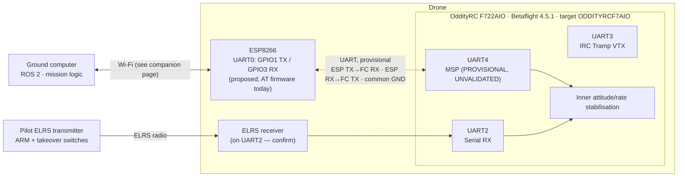

# ESP8266 ↔ Flight Controller Serial Interface (Proposed)

> [!warning] Status: DRAFT / PROPOSED / PROVISIONAL
> This page describes a **proposed** serial link. **No wiring or firmware change has been approved based solely on this proposal.** Nothing here has been physically validated: not UART4, not MSP override, not any pin or pad connection. Pad locations, protocol payloads, baud rate and timeout values are deliberately **not** specified and appear as open decisions in [§12](#12-acceptance-criteria-and-unresolved-decisions).

> [!info] Update 2026-10-20: hardware state
> The banner above is the 2026-10-12 state. Since 2026-10-19 the ESP-12F (ESP8266) is **soldered to FC UART4** with wires that are easy to remove ([[ADR-021 Removable ESP Connector|ADR-021]]: connector to follow), and S2-01 passed on it (the FC answers MSP). Not validated yet: the §10 evidence on the soldered joints, MSP override, the ESP failsafe and the ELRS failsafe re-test ([[ESP Bench Test Plan]] §4).

> [!success] Update 2026-10-12: team decisions recorded as ADRs
> The team accepted the proposals on this page. Rows marked **Accepted (ADR-0xx)** below are decided. See the linked ADR for the reasoning, and the [[Decision Register]] for the full list. Where an ADR differs from the earlier "Recommended" text, **the ADR wins** (it supersedes it).

## Contents

1. [Purpose and scope](#1-purpose-and-scope)
2. [Current hardware and firmware facts](#2-current-hardware-and-firmware-facts)
3. [Confirmed facts vs. proposed choices](#3-confirmed-facts-vs-proposed-choices)
4. [UART roles and proposed connection (provisional)](#4-uart-roles-and-proposed-connection-provisional)
5. [MSP override: intended role and limitations](#5-msp-override-intended-role-and-limitations)
6. [Mapping high-level commands to RC-like channel values](#6-mapping-high-level-commands-to-rc-like-channel-values)
7. [Telemetry requirements and candidate MSP responsibilities](#7-telemetry-requirements-and-candidate-msp-responsibilities)
8. [ELRS independence, arming and pilot takeover](#8-elrs-independence-arming-and-pilot-takeover)
9. [Failure scenarios](#9-failure-scenarios)
10. [Physical wiring and electrical verification checklist](#10-physical-wiring-and-electrical-verification-checklist)
11. [Props-off validation plan](#11-props-off-validation-plan)
12. [Acceptance criteria and unresolved decisions](#12-acceptance-criteria-and-unresolved-decisions)
13. [Decision summary and remaining questions](#13-decision-summary-and-remaining-questions)

---

## 1. Purpose and scope

### Purpose

Describe the **proposed** serial link between the ESP8266 Wi-Fi bridge and the OddityRC F722AIO flight controller (FC), so the team has a shared, reviewable reference before any wiring or configuration is attempted.

### In scope

- The UART physical link between ESP8266 and FC (logical mapping only; physical pad identification is a separate, unfinished task).
- Betaflight MSP override as the current protocol candidate for control-related channel values.
- Candidate MSP telemetry responsibilities.
- Safety requirements around ELRS independence, arming and pilot takeover.
- Failure scenarios, an electrical verification checklist and a **props-off** validation plan.

### Out of scope

- The Wi-Fi link between the ground computer and the ESP8266. See [[PC_to_ESP]] *(the companion page)*.
- Flight control law design, perception, mission logic, ROS 2 architecture.
- Flashing firmware to the FC or ESP8266, and **any powered flight test**. This page does not recommend either.
- Installation and interfacing of the ThoneFlow-3901U optical-flow sensor (available, not installed). A separate page would be needed.

---

## 2. Current hardware and firmware facts

> [!note]
> Facts below are as supplied by the team from inspection of the current configuration. They have not been re-verified for this page.

| Item | Value |
|---|---|
| Flight controller | OddityRC F722AIO |
| Betaflight target | `ODDITYRCF7AIO` |
| FC MCU | STM32F722 |
| Installed FC firmware | Betaflight 4.5.1 |
| FC role | Inner attitude/rate stabilisation |
| ESP8266 board | ESP-12F (ESP8266) dev board |
| ESP8266 firmware | AT firmware version 1.7.4.0, SDK 3.0.5 |
| Ground computer | Intended to run ROS 2 and higher-level control logic |
| FC CLI: UART2 | Configured for Serial RX |
| FC CLI: UART3 | Configured for IRC Tramp VTX |
| FC CLI: UART1, UART4, UART6 | Appeared unassigned |
| Manual control | ELRS; must remain independent and retain pilot takeover authority |
| Optical-flow sensor | ThoneFlow-3901U, available, **not installed** |
| Exposed pads (team, 2026-10-12) | T1, R1, R2, R3, T4, R4, CAM, SCL, SDA, 5V ×2, GND ×3, 3.3V, DV5V |
| ELRS wiring | 5V, G, R2, T2 (Medium certainty, [[2.5Drone]] #22) |
| MSP API (4.5.1) | 1.46 ([[2.5Drone]]) |

---

## 3. Confirmed facts vs. proposed choices

### 3.1 Confirmed (from the supplied context)

- Hardware and firmware identifiers in §2.
- UART2 = Serial RX and UART3 = IRC Tramp VTX *in the CLI configuration that was viewed*.
- UART1, UART4 and UART6 *appeared unassigned* in that configuration.
- The official Betaflight MSP companion-computer guide states that on Betaflight 4.5.x, **MSP override values can remain held if the sender stops**. Pilot takeover by switching MSP override off is therefore essential.

### 3.2 Proposed (not approved)

| # | Proposal |
|---|---|
| P1 | UART is the physical link between the ESP8266 and the FC. |
| P2 | Betaflight MSP override is the current protocol *candidate* for sending control-related channel values. |
| P3 | UART4 on the FC is the leading candidate (because it appeared unassigned). |
| P4 | ESP8266 UART0 (GPIO1 = TX, GPIO3 = RX) is the main full-duplex hardware UART and is the proposed ESP-side port. |
| P5 | Connection scheme: ESP TX → FC RX, ESP RX → FC TX, common ground, compatible 3.3 V logic levels. |

### 3.3 Not established

- Which physical pads on the FC correspond to UART4 (or whether UART4 is broken out at all).
- That UART4 works as a Betaflight serial port for MSP on this board.
- That MSP override behaves acceptably for this application (see §5, §9).
- That the ESP8266 can be wired and operated on UART0 without electrical contention (see §4.3).
- Any baud rate, protocol payload, update rate or timeout value.

> [!important]
> "Appeared unassigned in the CLI" is **not** the same as "physically available". A UART can be unassigned in software yet have no accessible pads, or its pads may be shared with other board functions. Confirm against the manufacturer's board documentation and by inspection (§10).

---

## 4. UART roles and proposed connection (provisional)

### 4.1 Architecture overview (provisional)

> [!note]
> The ELRS receiver being on UART2 is an *inference* from "UART2 configured for Serial RX"; the team should confirm it. The path from the pilot to the FC is drawn as independent of the ESP8266 deliberately (§8).

### 4.2 Logical UART mapping vs. physical pads

Two different things are easily conflated. Keep them separate:

| | Logical mapping | Physical pad identification |
|---|---|---|
| **What it is** | Which Betaflight serial port (UART number) carries which function | Which actual solder pad/connector pin on the board connects to that UART's TX/RX |
| **Status** | UART4 is the *leading candidate* | **Not confirmed. No pads identified by this page.** |
| **Source of truth** | Betaflight configuration (CLI/Configurator) and the target definition | Manufacturer documentation, board inspection, continuity/measurement |
| **Risk if wrong** | Port not available for MSP, or function conflicts | Wrong pad connected, damaging the FC or ESP8266, or silently talking to the wrong peripheral |

Betaflight UART numbering and board silkscreen labels may not match; do not assume they do.

### 4.3 ESP8266 side

- **Proposed port:** UART0 on GPIO1 (TX) and GPIO3 (RX). This is the main full-duplex hardware UART.
- **Shared with USB-to-serial:** on an ESP8266 dev board the onboard USB-to-serial adapter shares these UART0 pins. If both the adapter (USB connected) and the FC drive the line, **electrical contention may occur**. How to avoid this during bench work and in the final installation is an open decision (§10, §12). Do not connect the FC to UART0 while USB is connected until the team has decided and verified how to handle this.
- **Boot-time behaviour (to verify):** ESP8266 modules are generally understood to emit boot-time output on UART0 at start-up, which could present unexpected bytes to the FC's UART during ESP power-up or reset. Verify on the actual board by observation, and confirm the FC tolerates it.
- **Alternative to consider (not decided):** ESP8266 UART0 pins can reportedly be remapped to alternate GPIOs. Whether that is useful for avoiding USB contention should be investigated against the ESP8266 documentation; it is listed only as an option.
- **Firmware implication (observation, not a decision):** the ESP8266's current AT firmware is built around the ESP acting as a *peripheral controlled by an AT host* over UART0. An FC speaking MSP is not an AT host. Whether the AT firmware can serve as a bridge to the FC at all is therefore **unverified**, and may bear on the AT-vs-custom-C++ decision tracked on the companion page.

### 4.4 FC side (provisional)

- UART4 is the candidate port. For it to carry MSP, the FC's serial-port configuration would need to enable MSP on that port; this is a configuration change that is **not approved**.
- MSP baud rate, and any other port settings, are **not defined here**.
- UART1 and UART6 appeared unassigned too and are fallback candidates *if* UART4 proves unsuitable. Their physical availability is equally unconfirmed.

### 4.5 Electrical assumptions to be verified (not assumed true)

- ESP8266 GPIO is a 3.3 V device and is not generally considered 5 V tolerant. FC UART logic level must be **measured/confirmed**, not assumed (§10).
- A common ground between ESP8266 and FC is required for reliable single-ended UART signalling.
- How the ESP8266 is powered (from the FC, from a separate regulator, from USB on the bench) is **undecided**. A supply decision needs the FC's available rail and the ESP8266's actual consumption, neither of which is stated here.

---

## 5. MSP override: intended role and limitations

### 5.1 Intended role (proposed)

Betaflight's MSP override feature is the current candidate for letting an external computer (via the ESP8266) supply **RC-like channel values** to the FC, so the FC's inner loops continue to do attitude/rate stabilisation while outer-loop intent comes from the ground computer.

> [!question] Needs verification against the official Betaflight documentation and the target build
> Exact behaviour in Betaflight 4.5.1 (including which channels may be overridden, how override is enabled and which flight-mode switch controls it) must be confirmed from the official guide and on the actual target. This page records no payload formats.

### 5.2 Critical behaviour and limitations

> [!danger] Held values after sender stops
> The official Betaflight MSP companion-computer guide states that on Betaflight 4.5.x, **MSP override values can remain held if the sender stops**. If the ESP8266 crashes, the UART is disconnected or the ground link is lost, the FC may keep acting on the **last** overridden values.
>
> **Consequence:** pilot takeover by switching MSP override **off** is essential, and **MSP override must not be assumed safe for autonomous flight** until its failure behaviour has been tested with propellers removed (§11).

Further limitations to treat as open until verified:

- Whether and how MSP override interacts with the **receiver failsafe** (e.g. what happens when the ELRS link is lost while override is active). **Unknown; to be tested.**
- Whether override is a switchable flight mode and what happens to non-overridden channels. Expected to come from the receiver; confirm.
- MSP is a request/response-style serial protocol; message framing, rates and CPU/bandwidth limits on both ends are **not defined here**.
- Override does not by itself provide the ESP8266 with knowledge of whether the FC accepted values; **readback** (e.g. MSP_RC, §7, §11) is the intended way to confirm effective values.

### 5.3 Alternatives (context only, none selected)

This page does not evaluate alternatives in depth. If testing shows MSP override cannot meet the failure-behaviour requirements, other FC-side mechanisms (e.g. a different control-input path) would need a separate evaluation. No alternative is proposed here.

---

## 6. Mapping high-level commands to RC-like channel values

> [!warning] Unresolved interface-design task
> **No mapping is defined.** This section lists the questions that must be answered, and who/what should own the mapping. Do not invent channel orders, ranges or scalings.

### 6.1 Context

The ground computer produces high-level control commands (see companion page for the Wi-Fi side). MSP override takes RC-like channel values. A defined translation between the two is required.

### 6.2 Open questions

| # | Question |
|---|---|
| M1 | Which channels (roll, pitch, yaw, throttle, aux/mode) will MSP override supply, and which remain under the ELRS receiver? |
| M2 | What is the channel order and numbering expected by the FC for overrides? |
| M3 | What numeric range/scaling maps a high-level command to each channel value, and what are the neutral/idle values? |
| M4 | What command semantics does the ground computer use (attitude angles, rates, throttle fraction, velocity, ...) and does a given Betaflight mode (angle/rate) match them? |
| M5 | Where does mapping live: ground computer, ESP8266, or both (e.g. ground sends engineering units; ESP converts)? |
| M6 | Where are **safety clamps** enforced (ground, ESP, FC-side configuration), and what are their limits? |
| M7 | How are mode/aux channels (including the one controlling MSP override) handled so they can never be commanded by the ESP8266 in a way that removes pilot authority? (See §8.) |
| M8 | How are command units, calibration and trims documented so the mapping is reproducible and testable? |
| M9 | What is the **update rate** and what happens between updates? (Held values behaviour, §5.2.) |

### 6.3 Proposed principles (recommendations)

- The mapping should be a **single, documented, versioned table** with a reference implementation that can be tested off-target.
- The mapping must **never** be able to arm the FC or disable pilot takeover (§8).
- Out-of-range or malformed inputs must be rejected or clamped before reaching the UART.

---

## 7. Telemetry requirements and candidate MSP communication responsibilities

### 7.1 Requirements (proposed)

- **TEL-01**: The ground computer shall be able to observe, with known freshness, the values the FC is *actually using* for control, to confirm override took effect (readback).
- **TEL-02**: The ground computer shall be able to observe FC arming/mode state sufficiently to know whether MSP override is active and whether the pilot has taken over.
- **TEL-03**: The ground computer shall be able to observe basic vehicle state needed by outer loops (e.g. attitude and battery state). The precise set is open.
- **TEL-04**: Telemetry shall carry a timestamp or freshness indicator so stale data can be recognised.
- **TEL-05**: Telemetry polling shall not interfere with sending override values (bandwidth/timing budget on the single UART is TBD).

### 7.2 Candidate MSP responsibilities

> [!question] Candidates only
> Names below are *candidates* drawn from Betaflight's MSP message set. Their availability and behaviour in 4.5.1, and payload layouts, must be verified against the official documentation. **No payloads are defined here.**

| Responsibility | Candidate MSP message(s) | Purpose |
|---|---|---|
| Control readback | MSP_RC | Confirm effective channel values seen by the FC (central to §11) |
| Sending override values | MSP override mechanism (e.g. raw-RC set message) | Control-related channel values (see §5, §6) |
| FC status / mode / arming | MSP_STATUS (or equivalent) | Observe armed state and active modes |
| Attitude | MSP_ATTITUDE | Outer-loop state |
| Battery/analog | MSP_ANALOG (or equivalent) | Monitor battery |
| Other sensors (future) | TBD | e.g. optical-flow data if the sensor is later integrated (interface not assessed here) |

### 7.3 Open telemetry questions

- Which items are required, at what rates and with what latency budget?
- Does the ESP8266 poll the FC and forward, or does it only forward on request from the ground computer?
- How is the UART shared between sending overrides and polling? (Scheduling/priority.)

---

## 8. ELRS independence, arming and pilot takeover

> [!danger] Non-negotiable requirements
> These are design requirements, not recommendations. They must hold before any thought of autonomous operation, and must be verified (§11).

- **REQ-SAF-001 (was SAF-01) — Independent receiver path.** The ELRS receiver → FC path (UART2 per the CLI) shall remain independent of the ESP8266. Nothing about the ESP8266 link may be required for the pilot to control the aircraft.
- **REQ-SAF-002 (was SAF-02) — Pilot retains takeover authority.** The pilot must be able to take over at any time by switching MSP override **off** using an ELRS transmitter switch.
- **REQ-SAF-003 (was SAF-03) — Independent ARM.** ARM shall be controlled by a receiver-originated channel. The ESP8266/MSP path must not be able to arm the FC. Whether the FC configuration can actually *guarantee* this must be confirmed by test.
- **REQ-SAF-004 (was SAF-04) — Takeover channel not overridable.** The channel(s) used for ARM and for the MSP-override switch must not be among those overridable via MSP (see M7). How this is enforced in configuration is TBD and must be verified.
- **REQ-SAF-005 (was SAF-05) — Takeover is effective when the ESP8266 is misbehaving.** Switching override off must restore pilot control even if the ESP8266 is still sending, has crashed, or is flooding the UART. To be demonstrated, not assumed.
- **REQ-SAF-006 (was SAF-06) — Takeover works across link events.** The behaviour of takeover during ESP8266 reboot, UART disconnection and receiver loss must be known (§9).
- **REQ-SAF-007 (was SAF-07) — Pilot awareness.** The pilot (or safety observer) must be able to tell whether override is active. Mechanism (OSD, switch position convention, other) is TBD.
- **REQ-SAF-008 (was SAF-08) — Unchanged ELRS configuration.** Adding the ESP8266 link must not require disabling or weakening any receiver failsafe or arming safeguard. Any proposed change must be explicitly reviewed.

---

## 9. Failure scenarios

> [!important]
> The "Expected/required behaviour" column states the **requirement**. The "Known?" column shows whether the actual behaviour is known. At this stage almost all of it is **unknown** and must be established by props-off testing (§11). No behaviour here has been observed.

| # | Scenario | What may happen (risk) | Required behaviour | Known? |
|---|---|---|---|---|
| F1 | **ESP8266 crash/hang** | Override values may remain held (§5.2) | Pilot can take over by switching override off (REQ-SAF-002, REQ-SAF-005); the held values must not prevent takeover; the system must not rely on the ESP8266 recovering | Unknown; test |
| F2 | **UART disconnection** (wire fault, connector, solder joint) | Same as F1 for the FC; ESP8266 may not realise | Pilot takeover remains effective; ESP8266 detects missing FC responses (readback/poll) and reports to the ground | Unknown; test |
| F3 | **Stale commands** (ground link lost, ESP8266 keeps replaying last values, or ground stops sending) | FC may keep acting on outdated values | ESP8266 shall not keep forwarding unrefreshed commands as if current (companion page §6/§7); behaviour on loss must be agreed with the FC-side behaviour here | Unknown; policy undecided |
| F4 | **Receiver (ELRS) loss** while override active | Interaction between receiver failsafe and MSP override is unknown | Behaviour must be understood and acceptable; must not leave the aircraft acting unexpectedly on held override values | **Unknown; highest priority to test** |
| F5 | **ESP8266 reboot** | Boot-time bytes on UART; override may be left held; ESP8266 returns with no state | ESP8266 shall not resume control automatically; resumption requires the handshake defined on the companion page; FC behaviour during the reboot window must be known | Unknown; test |
| F6 | **FC reboot / brown-out** | ESP8266 may keep sending into a restarted FC | ESP8266 detects loss of FC responses and does not assume prior override state persists; arming does not occur without the pilot's ARM | Unknown; test |
| F7 | **Wrong/garbled data on UART** (noise, baud mismatch, boot garbage) | FC could parse malformed frames | FC rejects malformed frames (to be confirmed); ESP8266 validates before sending | Unknown; test |
| F8 | **Power loss on ESP8266 only** | Same as F1/F2 | Same as F1 | Unknown; test |
| F9 | **Brief UART contention (USB-to-serial attached)** | Corrupted frames | Not permitted in operation; prevented by procedure/hardware (§10) | Decision needed |

### 9.1 Principles (proposed)

- **Link-loss safe state (team, 2026-10-20, [[ADR-004 ESP Failsafe|ADR-004]]):** when the ground link is lost (F3), the ESP streams neutral sticks so the drone holds its position, and the pilot takes over with the radio. This is separate from Betaflight's own receiver failsafe (F4, DROP on ELRS loss), which is not changed.
- **Assume the worst case for held values** until tested otherwise: the FC may continue acting on the last override.
- **Pilot takeover must not depend on any component on the ESP8266 path.**
- Every failure scenario above must have a recorded props-off test result before the design is considered acceptable (§12).

---

## 10. Physical wiring and electrical verification checklist

> [!warning]
> This is a **verification checklist**, not an approval to wire. Pad identification is not done. No part of this checklist has been performed. Proceed only with explicit team approval, with propellers removed and with **no battery connected until each step permits**.

> [!info] Update 2026-10-12: test before soldering
> Before any step in §10.3, run Stages 1–2 of the [[ESP Bench Test Plan]] (ESP alone, then with the FC on temporary wires). A removable connector is proposed in [[ADR-021 Removable ESP Connector|ADR-021]].

### 10.1 Identification (documentation first)

- [x] Obtain manufacturer documentation/wiring diagram for the OddityRC F722AIO and cross-check with the `ODDITYRCF7AIO` target definition. (2026-10-16: vendor diagram matches the target pad list, see [[Wiring and Pinout]] §1.)
- [ ] Identify, from documentation **and** physical inspection, which pads correspond to the intended UART (UART4 candidate): TX pad, RX pad, ground, and available power pads. Record them in [[Wiring and Pinout]].
- [ ] Confirm that silkscreen label ↔ Betaflight UART number ↔ MCU pin are consistent; do not assume.
- [ ] Confirm the pads are not shared with another function (e.g. a peripheral, buzzer, LED strip) that would conflict.
- [ ] Record photographs of the board before any change.

### 10.2 Electrical verification (before any signal connection)

- [ ] Measure/confirm the FC's UART logic level at the candidate pads (unpowered checks first by continuity/documentation; powered checks only per team procedure).
- [ ] Confirm the logic level is compatible with the ESP8266's 3.3 V GPIO. If it is not or is uncertain, stop and decide on level handling.
- [ ] Verify ground continuity between FC and ESP8266 and that there is a common ground reference.
- [ ] Decide and document how the ESP8266 is powered; confirm available current and voltage of any FC rail used *before* connecting.
- [ ] Verify no unintended connection to battery voltage or any higher-voltage net on the signal pads.

### 10.3 Wiring correctness

- [ ] Crossover confirmed: **ESP TX → FC RX** and **ESP RX → FC TX** (not TX↔TX or RX↔RX).
- [ ] Continuity-check each connection after soldering/attaching, and check for shorts between adjacent pads.
- [ ] Strain relief and insulation reviewed; connections mechanically secure.

### 10.4 UART0 / USB-to-serial contention

- [ ] Decide how contention is avoided: e.g. USB disconnected whenever the FC is connected to UART0, an alternate ESP8266 pin mapping, or another approach. *(Open decision.)*
- [ ] Verify by observation that the chosen approach prevents two drivers on the same line.
- [ ] Observe ESP8266 boot-time output on its TX and confirm it is acceptable to the FC (§4.3).

### 10.5 Configuration changes (require explicit approval)

- [ ] Any change to the FC's serial-port configuration (enabling MSP on UART4) and to modes (MSP override switch) is documented, reviewed and approved **before** being made, and the pre-change configuration is saved for rollback.
- [ ] No firmware flashing of either device is part of this checklist.

---

## 11. Props-off validation plan

> [!danger] Propellers removed
> All steps below are **bench tests with propellers removed**. This page does not recommend flashing firmware or any powered flight test. How the FC and ESP8266 are powered on the bench (USB, battery, bench supply) is a decision for the team and must be made conservatively with the propeller-free condition verified before each session.

> [!note]
> Pass/fail thresholds and timing values are not defined here; they depend on open decisions (§12). Record observed values rather than assuming them.

### Phase 0 — Preconditions

- [ ] Checklist §10 complete and approved.
- [ ] Propellers physically removed and verified by a second team member.
- [ ] Pilot's ELRS transmitter bound and working; ARM and MSP-override-off switches identified and exercised **before** the ESP8266 link is involved.
- [ ] Pre-change FC configuration saved.
- [ ] [[ESP Bench Test Plan]] Stage 1 passed (ESP alone).

### Phase 1 — Baseline without the ESP8266 link

- [ ] Confirm the ELRS receiver path works normally on UART2 (e.g. stick inputs visible in Betaflight Configurator).
- [ ] Confirm ARM works via the receiver switch only (bench-safe conditions).
- [ ] Record baseline FC behaviour for receiver loss (failsafe) with no MSP override. This is the reference for F4.

### Phase 2 — Passive link check

- [ ] Connect ESP8266 ↔ FC per §10 and confirm the serial port is recognised and idle.
- [ ] Observe ESP8266 boot-time output and confirm no unexpected effects at the FC.
- [ ] Confirm basic MSP request/response works on the chosen port **without** enabling override (e.g. read-only queries).

### Phase 3 — MSP_RC readback

- [ ] With override **not** active, read back RC values via MSP_RC and compare against known receiver stick positions. Confirms the readback path itself.
- [ ] Enable override in the approved configuration, send known test values via the ESP8266, and read back via MSP_RC. Confirm the FC reports the values actually in effect.
- [ ] Verify channels **not** overridden continue to reflect the receiver.
- [ ] Record latency and update behaviour observed. Do not assume figures.

### Phase 4 — Pilot takeover

- [ ] With override active and test values being sent, switch override **off** from the transmitter. Confirm via MSP_RC that the FC values return to receiver values, and that the ESP8266's continued sending has no effect.
- [ ] Repeat with the ESP8266 flooding or sending conflicting values (REQ-SAF-005).
- [ ] Confirm ARM and the override-off switch **cannot** be driven from MSP (REQ-SAF-003, REQ-SAF-004).
- [ ] Confirm that arming cannot be achieved via the ESP8266 path.

### Phase 5 — Failure scenarios (§9), each with readback

For each of F1–F9 that can be safely reproduced on the bench:

- [ ] Reproduce the failure (e.g. stop sending, disconnect the UART wire in a controlled way, reset the ESP8266, power-cycle the FC, power off the ESP8266, power off the transmitter to simulate receiver loss).
- [ ] Observe via MSP_RC/Configurator **what the FC does with held values**, and record it.
- [ ] Confirm pilot takeover works in the failure state (REQ-SAF-002, REQ-SAF-006).
- [ ] Record results in a table: scenario, observation, takeover works (y/n), notes.

### Phase 6 — Review

- [ ] Compare observed failure behaviour with the requirements in §8/§9.
- [ ] If MSP override failure behaviour is not acceptable, **stop**: do not proceed toward autonomous use; revisit the design (§5.3).
- [ ] Record findings; update this page's status only on evidence.

> [!important]
> Completing this plan does not authorise flight. Any step beyond props-off bench validation is outside this page and requires separate team review.

---

## 12. Acceptance criteria and unresolved decisions

### 12.1 Acceptance criteria (for this interface to be considered acceptable for further development)

Evidence (logs, test records, photographs) is required for each.

**Hardware / electrical**

- [ ] Physical pads for the chosen UART are identified from documentation and inspection, and recorded.
- [ ] Logic levels verified compatible; common ground confirmed; power arrangement decided and verified.
- [ ] UART0/USB contention is resolved by a verified method.

**Functional**

- [ ] MSP communication works on the chosen FC port (read-only first, then override).
- [ ] MSP_RC readback confirms override values and non-overridden channels.

**Safety**

- [ ] ELRS path independent of the ESP8266 (REQ-SAF-001).
- [ ] Pilot takeover by override-off works in normal and failure states (REQ-SAF-002, REQ-SAF-005, REQ-SAF-006).
- [ ] ARM cannot be commanded via MSP/ESP8266 (REQ-SAF-003, REQ-SAF-004).
- [ ] Behaviour for each failure scenario F1–F9 is observed, recorded and judged acceptable, in particular **held override values** and **receiver loss with override active**.
- [ ] Any unacceptable behaviour has a documented mitigation and has been re-tested.

**Documentation**

- [ ] The command-to-channel mapping (§6) is specified, versioned and tested off-target.
- [ ] Open decisions below that block this interface are resolved and recorded.

### 12.2 Unresolved decisions

> [!note] Status key (updated 2026-10-12)
> **Open** = unresolved. **Recommended** = proposed resolution from the 2026-10-12 review; *not yet approved by the team*, so treat it as the working assumption until approved or changed. **Method recommended** = how to choose the value is proposed, but the value itself must come from measurement. **Partly resolved** = documentation checked or approach proposed, verification or detail still needed. Nothing here has been implemented or tested.

| # | Decision | Blocks | Owner | Status | Proposed resolution |
|---|---|---|---|---|---|
| FC-01 | Physical pads for the chosen UART (documentation + inspection) | Any wiring |  | Resolved (2026-10-16) | **T4/R4 pads exposed** (team pad list, 2026-10-12). Continuity to the MCU side OK and no shorts to neighbours (multimeter, 2026-10-16, GitHub #16). Vendor wiring diagram cross-checked. See [[Wiring and Pinout]]. |
| FC-02 | Confirm UART4 is usable for MSP on this target; otherwise choose fallback (UART1/UART6) | Any wiring/config |  | Accepted | UART4 for the ESP; UART1 (T1/R1, free) is the fallback. ELRS stays on UART2, Tramp on UART3. [[ADR-011 FC UART Allocation\|ADR-011]] |
| FC-03 | MSP baud rate and port settings | Bench testing |  | Accepted | 115200 8N1 (Betaflight MSP default); change only on measured need. [[ADR-009 ESP to FC Link\|ADR-009]] |
| FC-04 | FC logic level and level-compatibility handling | Any wiring |  | Partly resolved | Both MCUs are 3.3 V logic devices; **measure** the T4 idle level before connecting. [[ADR-013 Wiring and Power\|ADR-013]] |
| FC-05 | ESP8266 power source and supply arrangement | Any wiring |  | Partly resolved | FC 5V pad → ESP 5V pin; the FC 5V rail current is still to be measured. [[ADR-013 Wiring and Power\|ADR-013]] |
| FC-06 | How UART0/USB-serial contention is avoided (procedure vs alternate pins vs other) | Any wiring |  | Accepted | Procedure: USB and FC never connected to UART0 together; OTA for the HIL bench; `Serial.swap()` rejected (GPIO15 boot strap). [[ADR-012 ESP UART Pins\|ADR-012]] |
| FC-07 | ESP8266 firmware path: whether AT firmware can bridge MSP, or custom firmware is needed (shared with companion page OD-01) | Implementation |  | Accepted | Custom ESP8266 firmware. [[ADR-007 Portable Protocol Library and Custom ESP Firmware\|ADR-007]] |
| FC-08 | Command-to-channel mapping (M1–M9) | Implementation |  | Partly resolved | Normalised commands → 1000–2000 µs, 8 channels in AETR order, AUX never driven, clamps on ground and ESP: [[Protocol Spec v0]] §5. |
| FC-09 | Which channels are overridden; how ARM/takeover channels are protected | Bench testing |  | Accepted | Staged masks 8 → 11 → 15; ARM/modes/override switch never masked; all 8 channels in every frame. [[ADR-010 MSP Override\|ADR-010]] |
| FC-10 | Interaction of receiver failsafe with MSP override | Bench testing |  | Partly resolved | Source-verified (4.5.1): with `msp_override_failsafe` = OFF (default), ELRS loss triggers the normal failsafe, and Stage 2 replaces the flight channels. **Bench test F4 still required.** |
| FC-11 | Held-value behaviour: what mitigation, if any, is acceptable beyond pilot takeover | Bench testing |  | Accepted (mitigation) | Pilot takeover stays primary. Upgrade to 2026.6.2, whose 300 ms freshness guard falls back to ELRS values [[ADR-014 Betaflight Version\|ADR-014]]; ESP neutral streaming [[ADR-004 ESP Failsafe\|ADR-004]]. |
| FC-12 | Telemetry set, rates and polling/forwarding scheme (§7) | Implementation |  | Open | — |
| FC-13 | Update rate and timeout values for the ESP8266↔FC link | Implementation |  | Method + initial value | `MSP_SET_RAW_RC` at 50 Hz, link timeout 250 ms; confirm by measurement. [[ADR-009 ESP to FC Link\|ADR-009]] |
| FC-14 | Mechanism for pilot/observer to know override is active | Bench testing |  | Recommended | Telemetry `override_active` (from `MSP_STATUS`) + a fixed switch-position convention; an OSD element is still to be chosen. |
| FC-15 | Whether MSP override is acceptable for autonomous use at all, pending test evidence | Any autonomous use |  | Recommended | Go/no-go rule: acceptable only if pilot takeover works in every failure scenario F1 to F9 and receiver-loss behaviour is acceptable, judged on test evidence. |
| FC-16 | Interface to the ThoneFlow-3901U sensor (separate page, not assessed here) | Sensor integration |  | Partly resolved | See [[ThoneFlow]] and [[ADR-016 Flow Sensor Path\|ADR-016]]. |
| FC-17 | Power-up procedure and who approves each configuration change | Bench testing |  | Open | — |

### Suggested related pages *(none confirmed to exist unless stated)*

- [[PC_to_ESP]]: companion page on the Wi-Fi link *(exists)*.
- [[Wiring and Pinout]] *(exists; pad identification)*
- `[[MSP Override Test Log]]` *(suggested; record Phase 3–5 results)*
- [[Protocol Spec v0]] §5 *(exists; command → channel mapping, FC-08)*

---

## 13. Decision summary and remaining questions

### Decided / confirmed

- Hardware and firmware facts in §2 (as supplied).
- ELRS manual control must remain independent and retain pilot takeover authority.
- The Betaflight guide states that on 4.5.x, MSP override values can remain held if the sender stops, so pilot takeover by switching override off is essential.
- MSP override must not be assumed safe for autonomous flight until failure behaviour is tested props-off.

### Proposed (not approved)

- UART link between ESP8266 UART0 (GPIO1/GPIO3) and the FC.
- UART4 as the leading FC-side candidate.
- ESP TX → FC RX, ESP RX → FC TX, common ground, 3.3 V logic compatibility.
- Betaflight MSP override as the protocol candidate, with MSP_RC readback for validation.

### Not done

- No physical pad identified; no wiring, configuration or firmware change approved; no validation performed.

### Remaining questions (highest priority first)

1. Which physical pads are the FC's UART4 (or fallback), and is it truly available?
2. How does the FC behave with held override values on ESP crash, UART loss, ESP reboot and, above all, **receiver loss with override active**?
3. Can ARM and the takeover switch be guaranteed to stay out of MSP's reach? Betaflight's documented override-mask mechanism is intended to do this (FC-09); bench verification is still required.
4. Custom ESP8266 firmware is recommended (pending approval; see companion page OD-01), because AT firmware cannot run on-device validation and loss detection. Still to confirm: that the chosen firmware meets the timing needs of the MSP link.
5. How are UART0/USB contention, power supply and logic-level compatibility handled?
6. What is the command-to-channel mapping, and where are safety clamps enforced?

## 14. Glossary

| Term | Meaning |
| --- | --- |
| **ADR** | Architecture Decision Record: a documented decision and its rationale. |
| **API** | Application Programming Interface: a defined way for software components to communicate. |
| **ESP8266** | The Wi-Fi microcontroller of the drone's ESP module (an ESP-12F). It bridges the ground PC to the FC over UART4. |
| **Failsafe** | An automatic safe response when control, communication, or a sensor fails. |
| **FC** | Flight Controller: on this project the OddityRC F7 AIO (STM32F722, Betaflight target `ODDITYRCF7AIO`) of the 2.5" drone. It stabilises the aircraft and takes MSP from the ESP on UART4. |
| **HIL** | Hardware-in-the-Loop: testing that connects real or emulated hardware to a simulator. |
| **Mermaid** | A text-based diagram syntax rendered by compatible Markdown tools. |
| **MSP** | MultiWii Serial Protocol, used for communication with Betaflight flight controllers. |
| **ROS 2** | The second-generation Robot Operating System middleware used for robotics integration. |
| **Telemetry** | Periodic data sent from a system to report state, measurements, or health. |
| **UART** | Universal Asynchronous Receiver/Transmitter: an asynchronous serial interface. |
| **VTX** | Video transmitter: hardware that sends the aircraft video feed. |
| **ELRS** | ExpressLRS: the open-source radio-control link between the RadioMaster Pocket and the BETAFPV Nano receiver on the drone. |
| **OTA** | Over-the-air update: flashing firmware through Wi-Fi instead of USB. |
| **CLI** | Command-line interface: here the Betaflight CLI in the Configurator, used for `diff all` and `status`. |
| **OSD** | On-Screen Display: the chip that draws flight data over the analog camera video. |
| **MCU** | Microcontroller unit: the processor chip (STM32F722 on the FC, ESP8266 on the ESP module). |
| **GPIO** | General-purpose input/output: a configurable pin on a microcontroller. |
| **USB** | Universal Serial Bus: used to flash the ESP and to power or configure the FC from a PC. |
| **ARM** | Arming: enabling the motors. Only the pilot arms, never code or gestures. |
| **AT** | The Hayes-style AT command set of the stock ESP8266 firmware (1.7.4.0), replaced by custom firmware (ADR-007). |
| **REQ-SAF-001 to 008** | Safety requirements (were REQ-SAF-001 to REQ-SAF-008) defined in ESP_to_FC section 8 and registered in Requirements (independent ELRS path, pilot takeover, no arming from code). |
| **OD-xx / FC-xx / TF-xx** | Open-decision IDs in PC_to_ESP, ESP_to_FC and ThoneFlow. The Decision Register shows which ADR resolves each one. |
