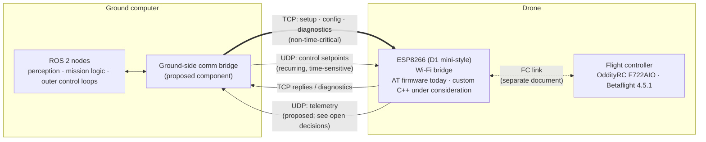

# Ground Computer ↔ ESP8266 Communication Architecture

> [!warning] Status: DRAFT / PROPOSED
> This page records agreed design directions and *proposes* further detail. Nothing described here has been implemented or tested. Exact packet formats, port numbers, timeouts, rates and numerical limits are deliberately **not** specified and are listed as open decisions in [§12](#12-open-decisions).

> [!success] Update 2026-10-12: team decisions recorded as ADRs
> The team accepted the proposals on this page. Rows marked **Accepted (ADR-0xx)** below are decided. See the linked ADR for the reasoning, and the [[Decision Register]] for the full list. Where an ADR differs from the earlier "Recommended" text, **the ADR wins** (it supersedes it).

## Contents

1. [Purpose and scope](#1-purpose-and-scope)
2. [Context and component responsibilities](#2-context-and-component-responsibilities)
3. [Decision status: agreed vs. proposed vs. open](#3-decision-status-agreed-vs-proposed-vs-open)
4. [TCP and UDP responsibilities](#4-tcp-and-udp-responsibilities)
5. [Logical message categories](#5-logical-message-categories)
6. [Message validation requirements](#6-message-validation-requirements)
7. [Connection loss, reconnection and failure handling](#7-connection-loss-reconnection-and-failure-handling)
8. [Security considerations](#8-security-considerations)
9. [Testing requirements](#9-testing-requirements)
10. [Alternatives considered and trade-offs](#10-alternatives-considered-and-trade-offs)
11. [Acceptance criteria](#11-acceptance-criteria)
12. [Open decisions](#12-open-decisions)
13. [Summary](#13-summary)

---

## 1. Purpose and scope

### Purpose

Define the architecture and requirements for communication between the **ground computer** and the **ESP8266** Wi-Fi bridge on the drone, so that the team can implement, test and review it against a shared reference.

### In scope

- The Wi-Fi link between the ground computer and the ESP8266.
- The roles of TCP and UDP on that link.
- Logical message categories and their delivery requirements.
- Validation, freshness, duplicate/reorder handling and loss detection requirements.
- Connection-loss and reconnection behaviour *at the ground↔ESP8266 level*.
- Security considerations for a private drone control network.
- Test strategy and acceptance criteria for this link.

### Out of scope

- **Communication between the ESP8266 and the flight controller (FC).** Hardware-specific FC details (OddityRC F722AIO, Betaflight 4.5.1, wiring, UART configuration, FC-side protocol, FC-side failsafe configuration) belong in a separate document. See [[ESP_to_FC]].
- Perception, mission logic and control-loop design on the ground computer, except where they constrain this link.
- Flight-safety case, regulatory matters and operational procedures.

---

## 2. Context and component responsibilities

### System context

| Component | Role in this link |
|---|---|
| **Ground computer** | Runs ROS 2, perception, mission logic and outer control loops. Originates control setpoints, configuration and diagnostic requests; consumes telemetry. |
| **ESP8266** (D1 mini-style board) | Bridges Wi-Fi communication to the flight controller. Receives and validates messages from the ground computer, detects loss of valid control updates, and relays data to/from the FC. |
| **Flight controller** | OddityRC F722AIO running Betaflight 4.5.1. Its interface to the ESP8266 is documented separately. |

### Architecture overview

> [!note]
> The "ground-side comm bridge" is a *proposed* separation between ROS 2 application code and the wire protocol. Whether it is a single ROS 2 node, a library, or something else is an open decision.

### Responsibilities

**Ground computer / ground-side bridge (proposed)**

- Generate control setpoints and send them over UDP with sequencing information.
- Perform setup, configuration and diagnostics over TCP.
- Track link health (e.g. telemetry freshness) and surface it to mission logic.
- Never assume a UDP datagram was delivered or ordered.

**ESP8266**

- Accept TCP and UDP traffic from the ground computer.
- Validate every received control message (see [§6](#6-message-validation-requirements)).
- Detect when valid control updates stop arriving and react per [§7](#7-connection-loss-reconnection-and-failure-handling).
- Forward valid data to the FC and relay FC data back to the ground (details in the separate FC document).
- Report its own health and link statistics via diagnostics/telemetry.

**Shared**

- Both ends use the same versioned message definitions (single source of truth; location is an open decision).

---

## 3. Decision status: agreed vs. proposed vs. open

> [!important] How to read this section
> **Agreed** = discussed and accepted by the team. **Proposed** = a recommendation in this page, not yet accepted. **Open** = unresolved; must not be assumed by implementers.

### 3.1 Agreed decisions

| # | Decision |
|---|---|
| A1 | TCP is intended for setup, configuration, diagnostics and other non-time-critical communication. |
| A2 | UDP is intended for recurring, time-sensitive control-setpoint updates. |
| A3 | UDP messages must be validated. The application must account for **missing, stale, duplicate, reordered and malformed** packets. |
| A4 | The ESP8266 must detect when valid control updates stop arriving. |
| A5 | The design must **not** assume that UDP guarantees delivery or ordering. |

### 3.2 Project facts (context, not design decisions)

- Ground computer runs ROS 2, perception, mission logic and outer control loops.
- ESP8266 is a D1 mini-style board intended to bridge Wi-Fi to the FC.
- FC is an OddityRC F722AIO running Betaflight 4.5.1.
- ESP8266 currently runs AT firmware; custom C++ firmware is *being considered* (not decided).
- Development spans six months with a small team.

### 3.3 Proposed (recommendations in this page, not yet agreed)

| # | Proposal | Where |
|---|---|---|
| P1 | Four logical message categories: configuration, diagnostics, control setpoints, telemetry. **→ Accepted as five categories, [[ADR-001 Message Categories\|ADR-001]].** | [§5](#5-logical-message-categories) |
| P2 | Every UDP message carries a protocol version, message type and sequence number, plus integrity protection. | [§6](#6-message-validation-requirements) |
| P3 | Receiver accepts only messages newer than the latest accepted control sequence; stale, duplicate and out-of-order messages are discarded rather than replayed. | [§6](#6-message-validation-requirements) |
| P4 | Loss of valid control updates triggers a defined ESP8266 failsafe state; recovery requires explicit, validated resumption rather than silent auto-resume. | [§7](#7-connection-loss-reconnection-and-failure-handling) |
| P5 | A TCP session is a prerequisite for enabling control (a "session" concept binding config state to control traffic). | [§7](#7-connection-loss-reconnection-and-failure-handling) |
| P6 | Isolated private Wi-Fi network with WPA2-class protection at minimum, plus application-level validation. | [§8](#8-security-considerations) |
| P7 | Hardware-independent protocol logic is developed as a portable library testable off-target. | [§9](#9-testing-requirements) |
| P8 | Telemetry travels over UDP by default, with TCP as the fallback for non-time-critical data. **→ Superseded by [[ADR-008 Telemetry Transport\|ADR-008]].** | [§4](#4-tcp-and-udp-responsibilities), [§5](#5-logical-message-categories) |

### 3.4 Unresolved questions

See [§12](#12-open-decisions) for the full list, including proposed resolutions from the 2026-10-12 review (recommended, not yet approved by the team). Still genuinely open: exact packet fields, port values, rate and timeout values, the definition of the failsafe safe output, and whether a message authentication code is needed.

---

## 4. TCP and UDP responsibilities

### 4.1 TCP: setup, configuration, diagnostics *(agreed, A1)*

**Why TCP**

- Reliable, ordered byte stream: configuration changes and diagnostic exchanges should not silently lose or reorder messages.
- Built-in connection state gives a natural "session" and a connection-loss signal.
- Latency is not critical for these exchanges, so retransmission delay is acceptable.

**Used for**

- Session establishment and capability/version negotiation.
- Reading and writing configuration.
- Diagnostics requests and responses (status, counters, logs).
- Any other non-time-critical exchange where completeness matters more than timeliness.

**Cautions**

- TCP is a *stream*, not a message protocol: the application must define message framing.
- TCP retransmission can delay later data (head-of-line blocking), which is exactly why it is **not** used for control setpoints.
- A TCP connection can appear alive while the peer is unreachable; application-level liveness checks may be needed (see [§7](#7-connection-loss-reconnection-and-failure-handling)).

### 4.2 UDP: recurring control setpoints *(agreed, A2)*

**Why UDP**

- A control setpoint that is late is usually less useful than the next one. UDP lets the sender keep sending fresh values without waiting for retransmission of old ones.
- No head-of-line blocking: a lost datagram does not delay later datagrams.
- Message boundaries are preserved per datagram.

**What UDP does *not* provide *(agreed, A5)***

- No delivery guarantee, no ordering guarantee, no duplicate suppression, no built-in freshness or session semantics.
- Datagrams may also be corrupted or injected. Basic checksums are not sufficient as an integrity or authenticity mechanism.

Therefore all reliability-relevant behaviour for control traffic must be handled **in the application layer** per [§6](#6-message-validation-requirements) and [§7](#7-connection-loss-reconnection-and-failure-handling).

### 4.3 Summary matrix

| Aspect | TCP | UDP |
|---|---|---|
| Primary use | Setup, config, diagnostics | Control setpoints (and, proposed, telemetry) |
| Delivery / order | Provided by transport | **Not** provided; application must cope |
| Timeliness | Secondary | Primary |
| Message boundaries | Application must frame | Per datagram |
| Loss signal | Connection state (plus app liveness) | Absence of valid, fresh messages |
| Status | Agreed | Agreed |

---

## 5. Logical message categories

> [!note]
> These categories are **proposed** (P1). Field layouts, encodings and IDs are intentionally not defined here and are an open decision.

| Category | Direction | Proposed transport | Delivery needs | Notes |
|---|---|---|---|---|
| **Configuration** | Ground → ESP8266 (with acknowledgements back) | TCP | Reliable, ordered, acknowledged | Changes bridge/link behaviour. Should be rejected or restricted while control is active (restriction policy is an open decision). |
| **Diagnostics** | Both directions, request/response | TCP | Reliable; latency not critical | Status, counters, error reports, version info. |
| **Control setpoints** | Ground → ESP8266 | UDP *(agreed)* | Timely and fresh; loss tolerated; stale/duplicate/reordered discarded | Highest-criticality traffic. Subject to full validation. |
| **Telemetry** | ESP8266 → Ground | UDP *(proposed default)*, TCP for non-time-critical items | Timely; occasional loss tolerable | Includes link-health data (e.g. last accepted sequence, rejection counters). Transport for each telemetry item is an open decision. |

### Design guidance (proposed)

- Each message carries a **message type** so the receiver can dispatch and reject unknown types.
- The message set is **versioned**; peers detect and reject incompatible versions at session setup.
- Control and configuration are logically separate: a configuration message must never be interpretable as a control setpoint, or vice versa.
- Telemetry should expose enough counters to let the ground side *observe* the link problems that [§6](#6-message-validation-requirements) defends against (e.g. count of discarded stale/duplicate/malformed packets).

---

## 6. Message validation requirements

All requirements apply to **control-setpoint UDP traffic** unless stated otherwise. IDs are for traceability. Numerical values are intentionally left as named parameters (see [§12](#12-open-decisions)).

### 6.1 Malformed packets *(agreed: must be handled)*

- **REQ-VAL-01**: The receiver shall check every datagram for structural validity (e.g. length consistent with declared type, recognised protocol version, recognised message type) *before* interpreting its contents.
- **REQ-VAL-02**: The receiver shall check field-level validity (values within the allowed range for that field) before any value is passed on toward the FC. Range limits are TBD.
- **REQ-VAL-03**: The receiver shall verify an integrity check on each datagram. The mechanism (checksum/CRC vs. cryptographic authentication) is an open decision; see [§8](#8-security-considerations).
- **REQ-VAL-04**: Datagrams failing any check shall be discarded without side effects on control state, and counted in a diagnostic counter (by failure category where practical).
- **REQ-VAL-05**: Malformed input shall never cause a crash, hang, buffer overrun or undefined behaviour on the ESP8266.

### 6.2 Sequence numbers

- **REQ-SEQ-01** *(proposed)*: Each control-setpoint message shall carry a sequence number assigned by the sender, advancing for each new setpoint sent.
- **REQ-SEQ-02**: The receiver shall track the sequence number of the most recently accepted control message.
- **REQ-SEQ-03**: Sequence-number width and wrap-around behaviour shall be defined, and comparison shall be correct across wrap-around. Width is TBD.
- **REQ-SEQ-04**: Sequence-number state shall be associated with a session so that a restarted sender is not confused with replayed old traffic. Session/epoch mechanism is TBD.

### 6.3 Duplicates and reordering

- **REQ-ORD-01** *(proposed, P3)*: The receiver shall accept a control message only if it is *newer* than the latest accepted one under the wrap-aware comparison in REQ-SEQ-03.
- **REQ-ORD-02**: A duplicate (same sequence as the latest accepted, or already seen) shall be discarded and counted.
- **REQ-ORD-03**: A reordered (older) message arriving after a newer one has been accepted shall be discarded and counted. Control setpoints are state-like: old values are **not** replayed to "fill in" order.
- **REQ-ORD-04**: Gaps in sequence numbers (missing packets) shall be detected and counted. A gap alone is not an error; the newest valid message is simply used. Whether a gap *size* triggers any action is an open decision.

### 6.4 Freshness / staleness

- **REQ-FRESH-01**: A control setpoint is only usable while it is *fresh*. The receiver shall treat a setpoint as stale once an age limit (`T_fresh`, TBD) has elapsed since it was accepted, and shall not keep forwarding an unrefreshed setpoint indefinitely.
- **REQ-FRESH-02**: Freshness shall be determined using a time source the ESP8266 controls (e.g. its own receive-time clock). Whether sender timestamps are carried at all, and how clock offset would be handled, is an open decision.
- **REQ-FRESH-03**: Timing evaluation shall not depend on the TCP connection being alive; control freshness is judged from valid UDP control traffic.

### 6.5 Relationship to loss detection

Validation yields a stream of **accepted** control messages. [§7](#7-connection-loss-reconnection-and-failure-handling) defines what happens when that stream stops. Packets that are discarded under §6 do **not** count as valid updates and must not reset any loss-detection timer.

### 6.6 TCP messages

- **REQ-TCP-01**: TCP messages shall use explicit framing (length-delimited or equivalent) and be validated for structure, version and type before use.
- **REQ-TCP-02**: Configuration requests shall be acknowledged, with success/failure reported to the ground side.
- **REQ-TCP-03**: Malformed TCP input shall be rejected without corrupting state; handling of repeated malformed input (e.g. closing the connection) is TBD.

---

## 7. Connection loss, reconnection and failure handling

### 7.1 Detecting loss *(agreed: A4)*

- **REQ-LOSS-01**: The ESP8266 shall detect when **valid** control updates stop arriving, using a loss timeout (`T_loss`, TBD) measured from the last *accepted* control message.
- **REQ-LOSS-02**: Loss detection shall not rely solely on Wi-Fi association status or TCP connection state, since either can be healthy while UDP control traffic has stopped (and vice versa).
- **REQ-LOSS-03**: Reception of invalid, stale, duplicate or out-of-order packets shall not reset the loss timer.
- **REQ-LOSS-04**: The ground side shall independently detect loss of link (e.g. telemetry freshness or TCP liveness) and inform mission logic, so that the system does not depend on the drone-side check alone.

### 7.2 Failsafe behaviour (proposed, P4)

- **REQ-FS-01**: When loss is detected the ESP8266 shall enter a defined **failsafe state** and shall stop forwarding the last control setpoint as if it were current.
- **REQ-FS-02**: The *action* taken in failsafe (what the ESP8266 tells or does toward the FC) is **an open decision** and must be coordinated with the FC-side failsafe configuration documented separately. This page does not prescribe it.
- **REQ-FS-03**: The failsafe state shall be observable by the ground side (diagnostics/telemetry) when the link allows.
- **REQ-FS-04**: The ESP8266 shall behave safely and deterministically at power-up, after a reset, and after a watchdog event: control forwarding must not start until the conditions in §7.3 are met.

### 7.3 Reconnection and resumption (proposed)

- **REQ-RECON-01**: After loss, control shall **not** resume merely because packets start arriving again. Resumption requires a defined, validated handshake (e.g. a fresh session established over TCP, then control traffic starting under that session). Exact handshake is TBD.
- **REQ-RECON-02**: On reconnection the receiver shall not be fooled by replayed or old traffic (see REQ-SEQ-04).
- **REQ-RECON-03**: The ground side shall be able to re-establish the TCP session and re-synchronise state (e.g. read back current configuration) after a Wi-Fi or TCP interruption.
- **REQ-RECON-04**: Wi-Fi re-association behaviour of the ESP8266 (retry policy, backoff) shall be defined and shall not block the loss-detection logic from running.

### 7.4 Other failure cases to specify

| Failure | Required handling (to be detailed) |
|---|---|
| Wi-Fi link drops | Loss detection per §7.1; failsafe per §7.2 |
| TCP drops, UDP continues | Defined policy needed: is control still valid without a session? *(open)* |
| UDP stops, TCP alive | Loss detection and failsafe must still trigger |
| Ground computer or ROS 2 process crashes/stalls | Ground bridge should stop sending (or send explicit "no control") rather than repeat stale setpoints; drone-side loss detection is the backstop |
| ESP8266 resets/brown-outs | Safe start-up; no automatic control resume |
| Burst of malformed/flooded traffic | Bounded processing so loss detection and FC link remain serviced |
| ESP8266 overloaded (CPU/RAM/network buffers) | Behaviour under overload must be tested; control traffic should not be starved by diagnostics (priority/limits TBD) |

---

## 8. Security considerations

The network is intended to be a **private drone control network**. "Private" reduces exposure but does not remove the need for protection; a drone accepting control input over Wi-Fi is a safety-relevant attack surface.

### 8.1 Threats considered

- Unauthorised device joining the network and sending control or configuration messages.
- Replay of previously captured valid control packets.
- Spoofed or injected packets (UDP has no source authenticity).
- Eavesdropping on telemetry or configuration (including any credentials or keys).
- Denial of service by traffic flooding or deauthentication-style attacks against the Wi-Fi link.
- Accidental interference: another process or device on the network sending to the same endpoint.

### 8.2 Proposed measures (P6)

- **Dedicated, isolated network** for the drone and ground computer; no bridging to general-purpose networks during operation.
- **Wi-Fi encryption** with a strong, non-default pre-shared key. Confirm what security modes the chosen ESP8266 firmware/SDK actually supports before relying on any specific mode *(to be verified)*.
- **No default or hard-coded shared secrets** committed to the repository.
- **Application-level validation is mandatory regardless of Wi-Fi security** (§6): Wi-Fi encryption is not a substitute for message validation or freshness checking.
- **Replay resistance**: sequence numbers plus session/epoch binding (REQ-SEQ-04); optionally combined with message authentication.
- **Separation of privileges**: configuration commands should require an established TCP session; restriction of configuration while control is active is TBD.
- **Minimal exposed surface**: only the endpoints required are open; unused services are disabled.
- **Source restriction** (e.g. accept control only from the expected peer): useful as hygiene but **not** authentication, since addresses can be spoofed.

### 8.3 Open security questions

- Is a message authentication code (MAC) on control packets required? The ESP8266's CPU and RAM budget, and whether the AT firmware can support it at all, must be assessed.
- How are keys/credentials provisioned and rotated?
- Is encryption of the application payload required in addition to Wi-Fi encryption?
- What is the policy for firmware updates, and how are they authenticated? *(Not defined; may need its own page.)*

> [!note]
> This section is intentionally scoped to the project's context (small team, private network, development over six months). A formal threat model is not claimed; it may be a suggested future page: `[[Drone Link Threat Model]]` *(suggested; does not yet exist)*.

---

## 9. Testing requirements

> [!important]
> No tests described below have been written or run. This section defines **what must be tested**, not results.

### 9.1 Hardware-independent tests

Goal: verify protocol logic without any ESP8266 or FC. Achieved by keeping the protocol logic (parsing, validation, sequence/freshness handling, loss-detection state machine) as portable code separated from Wi-Fi/socket/hardware APIs (P7).

| Area | What to verify |
|---|---|
| Parsing / serialisation | Round-trip of every message type; rejection of wrong length, unknown type, wrong version |
| Malformed input | Truncated, oversized, zero-length, random and fuzzed inputs never crash or alter control state (REQ-VAL-05) |
| Field validation | Out-of-range values rejected (REQ-VAL-02) |
| Integrity check | Corrupted packets rejected; valid ones accepted (REQ-VAL-03) |
| Sequence handling | In-order, duplicate, reordered, gapped and **wrap-around** sequences behave per §6 |
| Freshness | Stale setpoints are not treated as current (REQ-FRESH-01) using a **controllable/mock clock** |
| Loss detection | State machine enters/exits failsafe correctly; invalid packets don't reset the timer (REQ-LOSS-03) |
| Reconnection | Resumption only via defined handshake (REQ-RECON-01) |
| Impaired-link simulation | A test harness that injects loss, delay, duplication, reordering and corruption between a simulated sender and receiver |
| Ground-side bridge | ROS 2 ↔ wire-protocol mapping; behaviour when ROS 2 inputs stop |

These tests should run on the development computer and be suitable for automated execution on every change.

### 9.2 ESP8266 integration tests

> [!info] Update 2026-10-12
> The first concrete version of these tests is Stage 1 of the [[ESP Bench Test Plan]].

Goal: verify behaviour on the real target with the real network stack. Hardware-in-the-loop with the FC is covered in the separate FC document; tests here use the ESP8266 with a **stand-in** for the FC side (e.g. a logging endpoint) where possible.

| Area | What to verify |
|---|---|
| Basic connectivity | Wi-Fi association, TCP session establishment, UDP reception on the target |
| Protocol conformance | The on-target implementation behaves identically to the hardware-independent reference for the same input vectors |
| Loss detection on target | Actual `T_loss` behaviour measured on hardware, including when the Wi-Fi link is interrupted |
| Resource limits | CPU load, RAM use and buffer behaviour under sustained control traffic plus diagnostics traffic; behaviour under flood/malformed bursts |
| Real-network impairments | Behaviour with weak signal, interference, distance, obstacles, and Wi-Fi re-association |
| Reset/brown-out | Safe start-up behaviour (REQ-FS-04) |
| Watchdog | Confirm firmware cannot hang silently with control still forwarded |
| Soak testing | Long-duration runs to expose leaks, counter wrap-around and timing drift |
| Latency/jitter characterisation | Measure end-to-end behaviour so that `T_fresh`, `T_loss` and rates can be chosen from evidence, not guesswork |
| Security checks | Replay of captured packets rejected; unauthorised sender cannot issue control/configuration |

### 9.3 Test gating (proposed)

- Hardware-independent tests pass before any on-target integration testing.
- Integration tests with the ESP8266 pass (bench, no propellers/flight) before any flight test.
- Failsafe behaviour must be demonstrated on the bench before any flight test (see §11 and §12).

---

## 10. Alternatives considered and trade-offs

> [!note]
> This section records trade-offs for the team's reference. It does not reopen agreed decisions A1–A5; alternatives are listed so the rationale is traceable.

### 10.1 Transport choices

| Alternative | Pros | Cons / why not (currently) |
|---|---|---|
| **TCP for everything** | One protocol; reliable and ordered; simple mental model | Retransmission and head-of-line blocking can delay *fresh* control data behind *old* lost data; poor fit for time-critical setpoints. |
| **UDP for everything** | Single transport; low overhead | Configuration/diagnostics would need a custom reliability layer (acks, retries, ordering), duplicating TCP. |
| **TCP + UDP split** *(agreed)* | Each protocol used for what it does well | Two channels to manage; need to define how they relate (session binding, §7) and how failure of one affects the other. |
| Other ESP8266-capable links (e.g. proprietary peer-to-peer Wi-Fi modes) | Might avoid a router/access-point dependency | Not evaluated in detail; would change the architecture. *(Not pursued; listed for completeness.)* |
| Non-Wi-Fi long-range/dedicated radio link | Potentially better range/robustness for control | Outside the current project direction (Wi-Fi via ESP8266); would change hardware scope. *(Listed for completeness only.)* |

### 10.2 ESP8266 firmware

| Option | Pros | Cons / unknowns |
|---|---|---|
| **AT firmware (current)** | Already running; quick to get started; no custom firmware effort | Limited control over timing, buffering, validation logic and loss-detection behaviour; AT command interface adds overhead and indirection; whether it can satisfy §6/§7 requirements is **unverified**. |
| **Custom C++ firmware (under consideration)** | Full control of validation, freshness, loss-detection and failsafe logic; can host portable protocol code (P7); easier to unit-test the logic | More development and maintenance effort for a small team within six months; risk of bugs in network/timing code; requires careful resource management on a constrained device. |

> [!tip] Recommended (pending team approval)
> Custom C++ firmware. Agreed decision A4 requires the ESP8266 to run its own validation and loss-detection logic, and AT firmware is a host-driven command interpreter that cannot run it. Keep the protocol logic portable and tested off-target to contain the schedule risk. See OD-01.

### 10.3 Validation approach

| Option | Trade-off |
|---|---|
| Checksum/CRC only | Cheap; detects accidental corruption; offers no protection against a deliberate sender |
| Cryptographic MAC | Protects against spoofing/replay modification; costs CPU/RAM/complexity on the ESP8266 and key management effort |
| Sequence numbers only | Handles duplicates/reordering; does not protect against forged messages |

The choice is open (§12); the requirements in §6 hold either way.

### 10.4 Failsafe on loss

| Option | Trade-off |
|---|---|
| Hold last setpoint for a period | Smooth under brief dropouts; risks acting on outdated intent |
| Stop forwarding and signal failsafe immediately | Clear semantics; may be sensitive to brief dropouts |
| Escalating response (hold → failsafe) | Balances both; more states to specify and test |

The chosen behaviour must be agreed together with the FC-side failsafe configuration (separate document). It is **not** decided here.

---

## 11. Acceptance criteria

The communication design is accepted for a given phase only when the relevant criteria are met **and evidenced** (test records, logs). Criteria are stated qualitatively; numerical thresholds are to be set once the open decisions in §12 are resolved.

### 11.1 Before implementation begins

- [ ] Open decisions marked **blocking-for-implementation** in §12 are resolved and recorded.
- [ ] Message format specification exists, is versioned and is reviewed.
- [ ] Parameters `T_fresh`, `T_loss` and update-rate targets have named owners and a plan for being chosen from measurement.
- [ ] Decision on firmware path (AT vs custom C++) is recorded.

### 11.2 Protocol logic (hardware-independent)

- [ ] All requirements in §6 have corresponding automated tests, and those tests pass.
- [ ] Malformed, duplicate, reordered, stale and missing-packet scenarios are covered, including sequence wrap-around.
- [ ] Loss-detection state machine is tested, including that invalid packets do not reset the timer.
- [ ] Fuzzing of the parser shows no crashes or undefined behaviour.

### 11.3 ESP8266 integration (bench)

- [ ] Real-target behaviour matches the reference implementation for the same inputs.
- [ ] The ESP8266 detects loss of valid control updates and enters the defined failsafe state on hardware.
- [ ] Control does not resume without the defined resumption handshake.
- [ ] Safe start-up after reset/power cycle is demonstrated.
- [ ] Behaviour under malformed/flood traffic and sustained load is characterised and does not defeat loss detection.
- [ ] Wi-Fi interruption and re-association behaviour is demonstrated and documented.
- [ ] Replay and unauthorised-sender tests are run and results recorded.

### 11.4 Before any flight testing

- [ ] All §11.1–11.3 criteria are met.
- [ ] Failsafe behaviour is agreed jointly with the FC-side configuration (separate document) and demonstrated on the bench.
- [ ] Ground-side loss detection is implemented and tested (REQ-LOSS-04).
- [ ] Known limitations are written down and accepted by the team.
- [ ] Open decisions marked **blocking-for-flight** in §12 are resolved.

> [!warning]
> Meeting these criteria is a precondition for flight testing, not a safety guarantee. Flight-safety procedures belong in separate operational documentation.

---

## 12. Open decisions

> [!important]
> Items still marked **Open** must **not** be assumed by implementers. "Blocks" indicates the earliest milestone that cannot proceed without a decision. Owners and dates are intentionally blank for the team to fill in.

> [!note] Status key (updated 2026-10-12)
> **Open** = unresolved. **Recommended** = proposed resolution from the 2026-10-12 review; *not yet approved by the team*, so treat it as the working assumption until approved or changed. **Method recommended** = how to choose the value is proposed, but the value itself must come from measurement. **Partly resolved** = documentation checked or approach proposed, verification or detail still needed. Nothing here has been implemented or tested.

| # | Decision | Blocks | Owner | Status | Proposed resolution |
|---|---|---|---|---|---|
| OD-01 | ESP8266 firmware path: keep AT firmware or move to custom C++ | Implementation |  | Accepted | Custom ESP8266 firmware; portable protocol library tested off-target. [[ADR-007 Portable Protocol Library and Custom ESP Firmware\|ADR-007]] |
| OD-02 | Wire message format: encoding, field layout, message IDs, versioning scheme | Implementation |  | Accepted (draft spec) | Fixed-layout binary, 20-byte header + 8-byte tag: [[Protocol Spec v0]] (to freeze in week 3). |
| OD-03 | TCP framing method | Implementation |  | Accepted | Length-prefixed: the header `payload_len` field frames TCP messages ([[Protocol Spec v0]] §1). |
| OD-04 | Port numbers and addressing scheme (static IP / discovery) | Implementation |  | Partly resolved | Static IPs on the ESP SoftAP [[ADR-006 Network\|ADR-006]]. Port numbers still to pick in [[Protocol Spec v0]]. |
| OD-05 | Control-setpoint update rate (and acceptable jitter) | Implementation |  | Method + initial value | Start at 50 Hz; confirm by measurement ([[Testing Strategy]]). |
| OD-06 | Freshness age limit `T_fresh` | Bench testing |  | Method + initial value | Initial `T_fresh` = `T_loss` = 250 ms [[ADR-004 ESP Failsafe\|ADR-004]]; refine from measurement. |
| OD-07 | Loss timeout `T_loss` | Bench testing |  | Method + initial value | Initial `T_loss` = 250 ms [[ADR-004 ESP Failsafe\|ADR-004]]; set just above the worst measured gap. |
| OD-08 | Sequence-number width, wrap handling, and session/epoch mechanism | Implementation |  | Accepted | 32-bit seq per sender per session + random 32-bit session ID; seq ≥ 2^31 forces a new session. [[ADR-003 Sequence Acceptance\|ADR-003]] |
| OD-09 | Whether a gap in sequence numbers (size/rate) triggers any action | Bench testing |  | Accepted | Count gaps, no action on a gap alone. [[ADR-003 Sequence Acceptance\|ADR-003]] |
| OD-10 | Whether sender timestamps are carried, and clock-offset handling | Implementation |  | Accepted | Freshness by the ESP receive clock. `t_send_us` is carried for latency logging only ([[Protocol Spec v0]]). |
| OD-11 | Integrity/authentication mechanism (CRC only vs MAC) | Implementation |  | Accepted (supersedes earlier rec.) | Truncated HMAC-SHA256 (8 bytes) from the first bench test; CPU cost to be measured. [[ADR-002 Message Integrity\|ADR-002]] |
| OD-12 | Failsafe action on loss, coordinated with FC-side failsafe configuration | Flight testing |  | Partly resolved | Pilot takeover is the only guaranteed mitigation. ESP action per Betaflight version (neutral stream / stop). [[ADR-004 ESP Failsafe\|ADR-004]] |
| OD-13 | Resumption handshake after loss | Bench testing |  | Accepted | No automatic resume: `RESUME_REQUEST` in a valid session + ≥ 500 ms neutral stream; new session needs `ARM_CONTROL_REQUEST`. [[ADR-004 ESP Failsafe\|ADR-004]] |
| OD-14 | Policy when TCP drops but UDP continues (and vice versa) | Bench testing |  | Accepted (supersedes earlier rec.) | UDP decides liveness. TCP loss alone blocks new arming/config but does not failsafe. [[ADR-005 TCP Session\|ADR-005]] |
| OD-15 | Telemetry transport per item (UDP vs TCP) and telemetry content/rate | Implementation |  | Accepted | Periodic state over UDP; events, logs, acks over TCP. [[ADR-008 Telemetry Transport\|ADR-008]] |
| OD-16 | Restrictions on configuration while control is active | Bench testing |  | Accepted | Reject configuration while control is enabled, except disable-control ([[Protocol Spec v0]]). |
| OD-17 | Wi-Fi topology (ESP8266 as access point vs station on a ground-side access point) and supported security mode | Implementation |  | Accepted (supersedes earlier rec.) | ESP8266 SoftAP, WPA2-PSK, static IPs, Wi-Fi sleep off; revisit if > 4 clients. [[ADR-006 Network\|ADR-006]] |
| OD-18 | Key/credential provisioning and rotation | Bench testing |  | Partly resolved | PSK injected at build time from a secret, never committed. Rotation still open. [[ADR-002 Message Integrity\|ADR-002]] |
| OD-19 | Where the shared message definitions live and how both ends stay in sync | Implementation |  | Accepted | Spec in this vault ([[Protocol Spec v0]]); code in `lib/protocol` of the software repo + shared golden vectors ([[Repository Layout]]). |
| OD-20 | ESP8266 behaviour under overload (priorities, limits on non-control traffic) | Bench testing |  | Open | — |
| OD-21 | Ground-side bridge form (ROS 2 node, library, other) | Implementation |  | Accepted | `flight_interface` ROS 2 lifecycle node ([[System Overview]]). |
| OD-22 | Numerical acceptance thresholds for §11 | Bench testing |  | Open | — |
| OD-23 | Firmware update mechanism and authentication | Flight testing |  | Recommended | Signed OTA (RSA-2048 + SHA256, supported by the ESP8266 core) in Module 3 ([[Roadmap to April 2027]]). |

### Suggested related pages *(none confirmed to exist)*

- [[ESP_to_FC]] *(exists; hardware-specific FC details)*
- `[[Drone Link Threat Model]]` *(suggested)*
- [[Protocol Spec v0]] *(exists; resolves OD-02/OD-03/OD-08)*
- [[Testing Strategy]] *(exists; expands §9)*

---

## 13. Summary

**Decided (agreed):**

- TCP for setup, configuration, diagnostics and other non-time-critical communication.
- UDP for recurring, time-sensitive control-setpoint updates.
- UDP control messages must be validated, handling missing, stale, duplicate, reordered and malformed packets.
- The ESP8266 must detect when valid control updates stop arriving.
- The design must not assume UDP delivers reliably or in order.

**Proposed in this draft (not yet agreed):**

- Four message categories (configuration, diagnostics, control setpoints, telemetry).
- Sequence numbers, freshness checks and an integrity check on control messages; discard-don't-replay handling of stale/duplicate/out-of-order packets.
- A defined failsafe state on loss and an explicit resumption handshake.
- An isolated, encrypted private Wi-Fi network plus mandatory application-level validation.
- Portable, hardware-independent protocol logic tested separately from ESP8266 integration tests.

**Still open (must be resolved before implementation or flight testing):**

- Exact packet fields, port values, update rate and `T_fresh`/`T_loss` values (to be derived from measurement), the definition of the failsafe safe output (coordinated with the FC document), whether a message authentication code is needed, telemetry transport, key management, overload policy, shared-definition location, ground-side bridge form, acceptance thresholds and firmware update mechanism. See [§12](#12-open-decisions).

**Recommended in the 2026-10-12 review (pending team approval):** custom ESP8266 firmware (OD-01); fixed-layout binary messages with length-prefixed TCP framing (OD-02/03); static addressing on a dedicated ground-side access point (OD-04/17); wrap-aware sequence numbers with a per-session ID and ESP-side receive-clock freshness (OD-08/10); gaps counted but not acted on (OD-09); no automatic resume, control valid only within a session, and configuration rejected while control is enabled (OD-13/14/16).

**Not covered here:** the ESP8266 ↔ flight controller interface, which belongs in a separate document.

## 14. Glossary

| Term | Meaning |
| --- | --- |
| **ADR** | Architecture Decision Record: a documented decision and its rationale. |
| **AT command** | Text command used to configure or control a modem or microcontroller module. |
| **ESP8266** | A WiFi-enabled microcontroller used as the drone communication module. |
| **Failsafe** | An automatic safe response when control, communication, or a sensor fails. |
| **FC** | Flight Controller: the onboard controller responsible for stabilization and control. |
| **Mermaid** | A text-based diagram syntax rendered by compatible Markdown tools. |
| **ROS 2** | The second-generation Robot Operating System middleware used for robotics integration. |
| **TCP** | Transmission Control Protocol: reliable, ordered, connection-oriented transport. |
| **Telemetry** | Periodic data sent from a system to report state, measurements, or health. |
| **UDP** | User Datagram Protocol: connectionless transport suited to refreshed, time-sensitive data. |
| **UART** | Universal Asynchronous Receiver/Transmitter: an asynchronous serial interface. |
| **API** | Application Programming Interface: a defined way for software components to communicate. |
