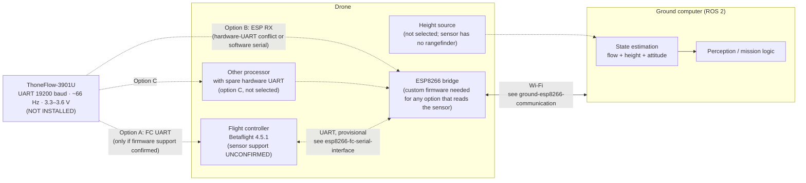

# ThoneFlow-3901U Optical-Flow Sensor Integration (Planned)

> [!warning] Status: DRAFT / PLANNED. Sensor NOT installed.
> The ThoneFlow-3901U is an unsoldered, separate module and is **not installed** on the drone. No wiring exists. It is **not confirmed** that Betaflight 4.5.1 supports this sensor. Everything under "Proposed" below is an architectural option, not a validated design. Datasheet facts are marked **[DS]**; proposals are marked **[PROPOSED]**; items the datasheet does not state are marked **[NOT STATED]**.

> [!success] Update 2026-10-12: team decisions recorded as ADRs
> The team accepted the proposals on this page. Rows marked **Accepted (ADR-0xx)** below are decided. See the linked ADR for the reasoning, and the [[Decision Register]] for the full list. Where an ADR differs from the earlier "Recommended" text, **the ADR wins** (it supersedes it).

## Contents

1. [Purpose and current installation status](#1-purpose-and-current-installation-status)
2. [Verified electrical and serial facts (datasheet)](#2-verified-electrical-and-serial-facts-datasheet)
3. [Frame format and parsing requirements](#3-frame-format-and-parsing-requirements)
4. [Optical flow vs. video camera vs. position estimation](#4-optical-flow-vs-video-camera-vs-position-estimation)
5. [Potential integration architectures](#5-potential-integration-architectures)
6. [ESP8266 serial-port limitations](#6-esp8266-serial-port-limitations)
7. [Height information and state estimation](#7-height-information-and-state-estimation)
8. [Data validity and fault handling](#8-data-validity-and-fault-handling)
9. [Testing plan](#9-testing-plan)
10. [Acceptance criteria and open decisions](#10-acceptance-criteria-and-open-decisions)
11. [Current recommendation and remaining decisions](#11-current-recommendation-and-remaining-decisions)
12. [Sources](#sources)

---

## 1. Purpose and current installation status

### Purpose

Record what is known about the ThoneFlow-3901U's communication interface and describe how it *could* fit the project's software architecture, so the team can choose an integration path deliberately and test it before relying on it.

### Current status

| Item | Status |
|---|---|
| Sensor availability | Available as a separate, unsoldered module |
| Installed on the drone | **No** |
| Wired to anything | **No** |
| Tested | **No**; nothing on this page has been tested |
| Betaflight 4.5.1 support | **Unconfirmed** |
| Integration path chosen | **No**; see §5 and §11 |

### Scope

This page covers the sensor's **communication interface and integration options** only. It does not cover mounting, the whole drone architecture, flight control design, or flight testing. Related pages:

- [[PC_to_ESP|ground-esp8266-communication]]: Wi-Fi link between the ground computer and the ESP8266.
- [[ESP_to_FC|esp8266-fc-serial-interface]]: proposed ESP8266 ↔ flight-controller UART link (provisional).

### Not the FPV camera

The drone's existing **CADDXFPV analog FPV camera is a different device** and is unrelated to this sensor. This page does not describe the camera; how (or whether) its video reaches the ground computer is out of scope.

---

## 2. Verified electrical and serial facts (datasheet)

Source: the Seeed Studio/DigiKey datasheet for SKU 101990480 (see [Sources](#sources)), read on 2026-10-12. The retrieved text is brief; figures in the original (e.g. the "Flow Frame" and "Test Chart" images) were not available as text and are not reflected here.

### 2.1 Stated in the datasheet **[DS]**

| Parameter | Datasheet value |
|---|---|
| Product | ThoneFlow-3901U, UART version of a PMW3901 optical-flow module |
| Interface | UART |
| Baud rate | 19200 |
| Output rate | "FPS: 66 Hz" (treated here as the nominal frame output rate) |
| Supply voltage | 3.3 to 3.6 V |
| Current | 10 mA |
| Dimensions | 14 × 11 × 5 mm |
| Weight | 0.6 g |
| Frame length / structure | 9 bytes; see §3 |
| Compatibility claim | Data format said to be compatible with the discontinued CX-OF module, which the datasheet says ArduCopter already supports |
| Mechanical note | Module replaces the original PMW3901 lens (datasheet cites dust and vibration protection) |

Notes on interpretation:

- The compatibility claim is the manufacturer's statement. It says nothing about Betaflight. It does **not** mean Betaflight 4.5.1 supports the sensor. The documented byte layout also differs from ArduPilot's CX-OF driver description (see §3.2).
- The datasheet frame has **no range/distance field**, which is consistent with the team's understanding that the module does **not** include a rangefinder.

### 2.2 **Not stated** in the retrieved datasheet text **[NOT STATED]**

These must be determined (from further documentation, a reference driver, or measurement), not assumed:

- Data bits, parity and stop bits (8N1 is a common default but is **not** confirmed).
- Whether the sensor's TX output swings to 3.3 V, and whether the module has any usable RX input.
- Pin names, pin order and connector details. **No pinout is recorded on this page, deliberately.** Use the physical module markings and the manufacturer's product page, and verify by inspection (see §9).
- Checksum algorithm (see §3).
- Whether X/Y values are signed, and their units/scaling.
- Whether X/Y values are per-frame deltas or accumulated counts.
- Meaning, range and thresholds of the surface-quality field.
- Valid operating conditions (height range, lighting, surface types, field of view/lens parameters).
- Start-up behaviour, time to first frame, and behaviour when no surface is tracked.
- Whether the 66 Hz rate is exact, fixed, or varies.
- Recommended power-supply conditioning.

### 2.3 Derived timing (arithmetic, assumptions flagged)

If the serial format is 8N1 (**assumed, not stated**), then:

- one bit ≈ 52 µs at 19200 baud;
- one 9-byte frame = 90 bit times ≈ 4.7 ms;
- at ~66 frames/s the nominal frame period ≈ 15 ms, so the line is busy roughly 31% of the time.

These numbers matter for the software-serial discussion in §6, but must be confirmed by measurement.

---

## 3. Frame format and parsing requirements

### 3.1 Frame format **[DS]**

| Byte | Content | Datasheet value / note |
|---|---|---|
| 0 | Header | `0xFE` |
| 1 | Number of data bytes | `0x04` |
| 2 | X-motion high byte | |
| 3 | X-motion low byte | |
| 4 | Y-motion high byte | |
| 5 | Y-motion low byte | |
| 6 | Checksum | Algorithm **not stated** |
| 7 | Surface quality | Range/meaning **not stated** |
| 8 | Footer | `0xAA` |

Observations that follow directly from the table:

- The checksum is at byte 6, **before** the surface-quality byte at byte 7.
- The length byte (`0x04`) counts the four motion bytes. It does not count the whole frame.
- X and Y are each assembled from a high byte followed by a low byte.

### 3.2 Items to establish before the parser is trusted

> [!warning] Discrepancy found 2026-10-12 against ArduPilot's CX-OF driver
> The datasheet says the format is compatible with CX-OF, but ArduPilot's CX-OF driver describes the frame differently: X/Y low byte first (datasheet: high byte first), byte 1 reserved (datasheet: length `0x04`), byte 6 time motion (datasheet: checksum), and 25 Hz output (datasheet: 66 Hz). That driver reads X/Y as signed 16-bit values and checks only header, footer and length, with no checksum. The compatibility claim should therefore not be relied on. Byte order, checksum and signedness must be determined from bench captures (§9.2).

| Item | How to establish |
|---|---|
| Checksum algorithm and which bytes it covers | Not resolved by the ArduPilot CX-OF driver (it does not validate a checksum). Determine from captured frames (§9.2) and any further manufacturer documentation. Not asserted here. |
| X/Y signedness | Bench observation (move the sensor in both directions), cross-checked with the reference. |
| Units and scaling | Calibration measurement (§7); not available from the datasheet text. |
| Meaning/range of surface quality | Bench observation across surfaces, cross-checked with the reference. |
| Serial framing (data/parity/stop bits) | Logic-analyser/oscilloscope or serial-capture check (§9.2). |

### 3.3 Parsing requirements [PROPOSED]

- **PAR-01**: Parsing shall operate on a **byte stream**, not assume that reads align with frame boundaries.
- **PAR-02**: A frame is accepted only if **all** of these hold: header byte matches, length byte matches the expected value, footer byte matches at the expected position, and the checksum validates (once the algorithm is confirmed).
- **PAR-03**: The parser shall **not** resynchronise on a header byte alone. `0xFE` and `0xAA` could also occur as motion, checksum or quality values, so alignment must be confirmed by structure (length, footer, checksum).
- **PAR-04**: After corrupted or partial input, the parser shall recover and resynchronise to the next valid frame without manual intervention.
- **PAR-05**: The parser shall be a **portable, hardware-independent library** (no dependence on a specific UART driver or board) so the same logic can run wherever the sensor is read and be tested off-target.
- **PAR-06**: Each parse result shall expose: X, Y, surface quality, a validity/status indicator (§8), a receive timestamp from a clock the reader controls, and a local sequence counter. The field layout for forwarding data elsewhere is an open decision.
- **PAR-07**: Parser counters (frames accepted, header/length/footer/checksum rejects, resync events) shall be kept and exposable for diagnostics.
- **PAR-08**: The parser shall never emit "zero motion" to represent "no valid data" (see §8).
- **PAR-09**: No silent clamping or sign assumptions; signedness and scaling follow §3.2 once established.

---

## 4. Optical flow vs. video camera vs. position estimation

These three are easily conflated. They are different things with different outputs.

| | **Optical-flow sensor (ThoneFlow-3901U)** | **Video camera (e.g. the CADDXFPV analog FPV camera)** | **Position estimate** |
|---|---|---|---|
| What it is | A module that tracks surface motion and outputs motion values over UART | An image source | A derived quantity (where the drone is) |
| Output | Small frames: X/Y motion values + surface-quality field | Video images | Position (and often velocity) with an uncertainty |
| Provides images to perception? | **No**; it outputs no image data | Yes (video) | n/a |
| Absolute position? | **No**; relative motion only | No by itself | Requires a reference and/or fusion |
| Height/range? | **No rangefinder**, no range field in the frame | No | Needs height information from elsewhere |
| In this project | Planned, not installed | Existing, separate device | Not provided by any single sensor here |

Key consequences:

- The sensor reports **relative motion measurements**. They are **not** a position and **not** a physical velocity until combined with height and attitude information (§7).
- Integrating motion over time accumulates drift; with no absolute reference, **long-term position cannot be obtained from this sensor alone**.
- The sensor is **not** a substitute for video-based perception on the ground computer; they serve different functions and neither replaces the other.

---

## 5. Potential integration architectures

> [!note]
> All options below are **proposals**. None is selected, built or validated. Pin assignments are intentionally absent.

### 5.1 Overview diagram

### 5.2 Option A: sensor connected to a supported FC interface

**Idea [PROPOSED]:** connect the sensor to a spare FC UART and let Betaflight consume it; flow-derived data reaches the ground computer, if at all, via FC telemetry.

| Aspect | Notes |
|---|---|
| Precondition | **Betaflight 4.5.1 (or the ODDITYRCF7AIO target build) must be confirmed to support this sensor/format on a UART.** Unconfirmed; do not assume. |
| What to check | Official Betaflight 4.5.x documentation and release notes for optical-flow / rangefinder sensor support and supported frame formats; the target's build options and serial-port function list. Whether any supported optical-flow input is by UART frame, by MSP message, or not at all is **unknown**. |
| FC UART availability | Earlier configuration inspection showed UART1, UART4 and UART6 appearing unassigned, with UART4 the leading candidate for the ESP link (see [[ESP_to_FC|esp8266-fc-serial-interface]]). Physical pad availability is **unconfirmed**, so any sensor UART would need its own confirmation. |
| Pros | Hardware UART on the FC; no ESP8266 serial-port constraint; parsing handled by firmware if supported. |
| Cons / unknowns | May simply be unsupported; even if flow input is supported, it is unknown what Betaflight does with it and what is exposed to the ground computer; changes to FC configuration need explicit approval; no way for ground-side estimation to see raw flow values unless exposed through MSP. |
| Validation needed | Confirm support from documentation first; then props-off bench check that the FC recognises frames and exposes the data. |

### 5.3 Option B: sensor read by custom ESP8266 firmware

**Idea [PROPOSED]:** the ESP8266 receives the sensor's UART stream, validates frames with the shared parser library (§3.3), and forwards timestamped, validated measurements over Wi-Fi to the ground computer (and/or onward to the FC if ever useful).

| Aspect | Notes |
|---|---|
| Precondition | **Custom ESP8266 firmware.** The current AT firmware (v1.7.4.0, SDK 3.0.5) is not a platform for a sensor parser; whether it could be used at all is not assessed here. This ties into the AT vs. custom C++ decision on [[PC_to_ESP|ground-esp8266-communication]] (OD-01). |
| Serial constraint | See §6: the ESP8266 has **one** full-duplex hardware UART (UART0), which is already proposed for the FC link; UART1 is transmit-only. A second receive path would be **software serial**, which needs validation. |
| Pros | No extra processor; data enters the same Wi-Fi path the ground computer already uses; ground-side estimator sees raw flow values. |
| Cons / risks | Software-serial reliability under Wi-Fi load is **unproven**; ESP8266 CPU/timing budget is shared with Wi-Fi, FC link and command validation; any ESP8266 fault affects both the flow data and the FC link. |
| Validation needed | §9.3 serial reception under load; measure frame error and loss rates, not assumed. |

### 5.4 Option C: sensor read by another suitable processor

> [!warning] Rejected on 2026-10-14 (TF-11, [[ADR-016 Flow Sensor Path|ADR-016]]). Kept for the record.

**Idea [PROPOSED]:** a processor with a free hardware UART receives and validates frames, then passes measurements onward (e.g. to the ESP8266 over a link with spare capacity, or by replacing the ESP8266 bridge with a part that has more hardware UARTs). No specific part is selected or evaluated here.

| Aspect | Notes |
|---|---|
| Pros | Hardware UART reception, isolating timing-sensitive serial reading from Wi-Fi activity; parser library reusable. |
| Cons / unknowns | Extra hardware, wiring, power, weight and firmware to maintain; another hop (latency, failure point); small team and six-month schedule; the link from this processor onward needs its own design. |
| Validation needed | Selection criteria, power budget, and a test plan; none defined yet. |

### 5.5 Qualitative comparison (not a decision)

| Criterion | A: FC UART | B: ESP8266 | C: Other processor |
|---|---|---|---|
| Depends on unconfirmed firmware support | **Yes** | No | No |
| Needs custom ESP8266 firmware | Not for the sensor | **Yes** | Likely, for forwarding |
| Hardware UART available for the sensor | Probably, once pads confirmed | **No** hardware RX free in current proposal | Yes by selection |
| Raw flow data reaches the ground computer | Only if FC exposes it | Yes (by design) | Yes (by design) |
| Added hardware | None | None | **Yes** |
| Main risk | Unsupported | Software-serial reliability | Complexity |

---

## 6. ESP8266 serial-port limitations

### 6.1 Facts used

- ESP8266 **UART0** supports full-duplex serial (GPIO1 = TX, GPIO3 = RX).
- ESP8266 **UART1 is transmit-only**.
- UART0 is the **proposed** port for the FC link (see [[ESP_to_FC|esp8266-fc-serial-interface]], provisional).
- The sensor is a **data source**: the host must be able to **receive** its UART stream.

### 6.2 What follows

- The ESP8266 effectively has **one** hardware serial receive path. If UART0 serves the FC link (which needs both TX and RX for MSP), then **no hardware RX remains** for the sensor.
- Options on the ESP8266 are therefore limited to: (i) a **software-serial** receiver on a spare GPIO, (ii) sharing UART0 (conflicts with the proposed FC link, **not proposed**), or (iii) moving the sensor to a different processor or the FC (§5.2, §5.4). Remapping UART0's pins would not create a second hardware receiver.
- The USB-to-serial adapter on a D1 mini-style board shares UART0 pins (see the FC-interface page); that issue is separate and unchanged by the sensor.

### 6.3 Software-serial risk under Wi-Fi load

> [!danger] Treat as an option requiring validation, not a proven design
> Receiving a UART stream by software on the ESP8266 while the Wi-Fi stack is active is **not demonstrated** for this project. This page makes no claim that it works.

Why it is a risk:

- Software serial depends on precise bit timing. Wi-Fi activity and other interrupts can delay sampling, risking corrupted or missed bytes.
- The ESP8266 is also handling Wi-Fi traffic, command validation and, if proposed, the FC link; CPU contention is plausible.
- Failures would look like garbled frames, checksum errors and dropped frames, exactly the kind of data corruption the sensor-handling in §8 must catch.

Points that may help but guarantee nothing:

- The sensor's baud rate (19200, ≈52 µs per bit) is comparatively slow.
- The sensor transmits only a short frame at a modest rate (§2.3).
- Checksum validation and resynchronisation (§3.3) bound the damage from errors, but they cannot recover bytes that were never sampled.

What would justify using it: measured results (§9.3) showing acceptable frame-error and frame-loss rates **with the Wi-Fi link and FC link running at realistic load**, with the acceptance threshold agreed in advance.

---

## 7. Height information and state estimation

### 7.1 Why flow alone is not enough

Optical flow reports apparent motion of the surface in the sensor's image plane. To turn that into physical motion:

- **Height above the surface** is required to convert image-plane motion into metres per second. **This sensor has no rangefinder and its frame has no range field**, so height must come from another source.
- **Rotation compensation** is required, because tilting or rotating the drone produces apparent flow that is not translation. Attitude/angular-rate information from the FC must be time-aligned with the flow samples.
- **Scaling/units** of the X/Y values are not stated in the datasheet text and must be calibrated (§3.2).
- **Position** requires integrating velocity, which **drifts** and has no absolute reference without something else (e.g. perception, mission-level correction).

### 7.2 Needs [PROPOSED]

- **EST-01**: A height source must be selected before flow data can produce physical velocity. Candidates are **not evaluated** here and none is chosen.
- **EST-02**: Flow, height and attitude/rate data must carry timestamps from known clocks, with a defined way to align them. Requirements for time alignment are TBD.
- **EST-03**: The state estimator must treat flow as a measurement with an uncertainty and a validity flag (§8), not as truth.
- **EST-04**: Where the estimator runs (ground computer in ROS 2, FC, other) is **open**. Running it on the ground computer implies Wi-Fi latency and jitter in the loop, which has not been quantified.
- **EST-05**: The estimator's output must not be used for control until its behaviour is tested; this page does not define that testing.

> [!note]
> Betaflight's ability, if any, to fuse flow with height is **unconfirmed** and is not assumed here.

---

## 8. Data validity and fault handling

All requirements are **proposed**. Thresholds and timeouts are **not defined**; they depend on measured behaviour (§9) and open decisions (§10).

### 8.1 Suggested status outputs

Each measurement should carry a status, so consumers never guess:

| Status | Meaning |
|---|---|
| `OK` | Frame valid, quality acceptable, fresh |
| `LOW_QUALITY` | Frame structurally valid, but surface quality is below the accepted threshold (threshold TBD) |
| `INVALID_FRAME` | Header, length, footer or checksum failed |
| `STALE` | No new valid frame within the allowed interval (interval TBD) |
| `NO_DATA` | No bytes received at all (sensor absent or disconnected) |

### 8.2 Conditions and handling

| Condition | Detection | Required handling |
|---|---|---|
| **Checksum failure** | Checksum mismatch (algorithm to be confirmed, §3.2) | Discard frame; count it; do not use values; do not reset freshness timer |
| **Malformed frame** | Header/length/footer mismatch | Discard; count; resynchronise (PAR-03/04) |
| **Low surface quality** | Quality field below threshold (threshold and semantics TBD) | Mark `LOW_QUALITY`; consumer must not treat motion values as reliable |
| **Stale frames** | No valid frame within a staleness interval (TBD, chosen from the measured rate, not assumed) | Mark `STALE`; stop publishing last values as current |
| **Duplicate / repeated frames** | Same content could be genuine (no motion) or a repeat; datasheet gives no frame counter | Do not infer staleness from identical values; use arrival timing and sequence counters on the reader's side |
| **Sensor disconnection** | No bytes (`NO_DATA`), or only invalid bytes for a period (TBD) | Report fault; do not output motion; require valid frames again before resuming |
| **Frame-rate drop** | Measured rate falls well below nominal ~66 Hz (limit TBD) | Report degraded data; log |
| **Reader overload** (e.g. dropped bytes under load) | Rising reject counters, rate drop | Surface in diagnostics; may indicate unsuitable reception method (§6.3) |
| **Power fault / brown-out** | Sensor stops or restarts | Treat as disconnection; do not use data until valid frames resume |
| **Reader restart** | Reader reboots | Start with `NO_DATA`/`STALE`; no carried-over values |

### 8.3 Cross-cutting rules

- **VAL-01**: "No valid measurement" is **never** represented as zero motion.
- **VAL-02**: Stale or invalid data must not be forwarded as if current.
- **VAL-03**: Counters (accepted, rejected by cause, resyncs, stale events) shall be available for diagnostics on the ground side.
- **VAL-04**: The estimator (§7) must handle missing flow gracefully; its behaviour when flow is unavailable is a design item.

---

## 9. Testing plan

> [!important]
> No test below has been written or run. This is a plan. All tests are **bench** tests; no flight testing is proposed. Do not connect anything to the FC until the team has approved wiring (see the FC-interface page).

### 9.1 Hardware-independent tests (parser and logic)

| Area | What to verify |
|---|---|
| Valid frames | Correct decoding of X, Y and quality for known byte sequences |
| Bad frames | Wrong header, length, footer, checksum → rejected and counted |
| Stream handling | Frames split across reads; several frames in one read; leading garbage; truncated frame |
| False headers | `0xFE`/`0xAA` appearing inside payload/checksum/quality does not cause mis-alignment (PAR-03) |
| Resync | Recovery after corruption without manual action (PAR-04) |
| Endianness / signedness | High/low byte composition per datasheet; signedness per what is established (§3.2) |
| Status logic | `OK`, `LOW_QUALITY`, `STALE`, `NO_DATA` transitions with a mock clock |
| Robustness | Fuzzed random byte streams never crash, hang or over-read |
| Replay | Parser output from recorded raw captures (§9.2) matches expectations |

Gate: these pass before any hardware-specific work relies on the parser.

### 9.2 Sensor bench characterisation (sensor alone, off the drone)

Purpose: establish the facts the datasheet text does not state, and record real data for replay.

- [ ] Power the sensor within **3.3–3.6 V** from a source whose voltage has been measured. Wiring/pins taken from physical module markings and manufacturer documentation, verified by inspection; **no pinout is assumed here**.
- [ ] Confirm the serial parameters (baud, data/parity/stop bits) and the TX logic level with a scope or logic analyser.
- [ ] Capture raw output on a computer using a serial adapter whose logic level is compatible with the sensor; store the raw bytes.
- [ ] Verify frame structure against §3.1 and measure the actual frame rate and its variation against the nominal ~66 Hz.
- [ ] Determine the checksum algorithm from the captures and the reference documentation (§3.2); confirm every captured frame validates.
- [ ] Determine X/Y signedness and sign conventions by moving the sensor in known directions.
- [ ] Characterise the surface-quality field over different surfaces and conditions, and note behaviour when no surface is tracked.
- [ ] Observe start-up behaviour and behaviour on power interruption.
- [ ] Record datasets for offline replay in tests §9.1 and §9.5.

### 9.3 Serial reception and timing tests (on the candidate reader)

Depending on the selected option:

- **Option B (ESP8266 software serial)**: if pursued, measure frame-accept rate, framing/checksum rejects, missed frames and timing jitter with (a) Wi-Fi idle, (b) realistic Wi-Fi traffic, (c) Wi-Fi traffic plus the FC UART link active, (d) a stress case. Compare to a hardware-UART baseline from the same sensor.
- **Option C (another processor)**: same measurements on a hardware UART as a reference.
- Record timestamp quality (resolution, jitter) at the reader, since estimation depends on it (§7).

### 9.4 Fault-handling tests

- [ ] Inject checksum errors, truncated frames and noise; verify rejection and counters.
- [ ] Unplug/power-cycle the sensor; verify `NO_DATA`/`STALE` and clean recovery.
- [ ] Cover the sensor / present a poor surface; verify `LOW_QUALITY` behaviour.
- [ ] Restart the reader; verify no stale carry-over.

### 9.5 Integration tests

| Stage | What to verify | Preconditions |
|---|---|---|
| Reader → ground computer | Flow measurements arrive with timestamps, sequence counters and status; ROS 2 side represents invalid/stale data correctly | Reader option chosen; Wi-Fi message definition agreed |
| Latency/jitter | End-to-end timing characterised, not assumed | Previous stage working |
| Estimator offline | Flow + height + attitude replayed through the estimator (recorded data) | Height source chosen (EST-01) |
| Option A only | FC recognises frames and exposes data; props-off bench | Documentation confirms support; wiring and configuration changes **explicitly approved** |
| Coexistence | Flow reception does not disturb the FC link, command validation or loss detection described in the companion pages | Both links implemented |

---

## 10. Acceptance criteria and open decisions

### 10.1 Acceptance criteria (for this integration to be considered ready for further development)

Evidence (captures, logs, test records) is required for each.

**Sensor facts**

- [ ] Serial parameters, TX logic level, checksum algorithm, signedness and quality-field behaviour are established and written into §2–§3.
- [ ] Pin assignments are recorded from verified sources (physical inspection and manufacturer documentation), on a separate wiring page.

**Parsing**

- [ ] §9.1 tests pass, including false-header, resync and fuzz cases.
- [ ] Parser reproduces expected results on recorded real captures.

**Reception**

- [ ] The chosen reception method meets an agreed frame-loss/error threshold at realistic load (threshold to be defined **before** testing).
- [ ] If software serial is used, the above is demonstrated with Wi-Fi and FC link running, not just in isolation.

**Fault handling**

- [ ] Checksum failures, stale frames, low quality and disconnection each produce the defined status and never zero-motion output (VAL-01/02).

**Architecture**

- [ ] The integration option is chosen and recorded with the reason.
- [ ] If Option A: Betaflight 4.5.1 support confirmed from official documentation **and** on the bench.
- [ ] A height source and the state-estimation approach are selected before flow data is used for physical velocity.
- [ ] Interaction with the ESP8266↔FC link and the ground link is tested and shown not to degrade them.

### 10.2 Open decisions

> [!note] Status key (updated 2026-10-12)
> **Open** = unresolved. **Recommended** = proposed resolution from the 2026-10-12 review; *not yet approved by the team*, so treat it as the working assumption until approved or changed. **Method recommended** = how to choose the value is proposed, but the value itself must come from measurement. **Partly resolved** = documentation checked or approach proposed, verification or detail still needed. Nothing here has been implemented or tested.

| # | Decision | Blocks | Owner | Status | Proposed resolution |
|---|---|---|---|---|---|
| TF-01 | Does Betaflight 4.5.1 / the ODDITYRCF7AIO target support this sensor, and in what form (UART frame, MSP, none)? | Option A |  | Resolved | **Unsupported.** Betaflight 4.5.1 has no optical-flow driver at all; 2026.6.2 supports MT and UPT1 only (not CX-OF); INAV has CX-OF but no `ODDITYRCF7AIO` target (source-verified). Option A dropped. [[ADR-016 Flow Sensor Path\|ADR-016]] |
| TF-02 | Which integration option (A, B, C) | Any wiring |  | Accepted | Characterise first → time-boxed Option B experiment with a threshold agreed beforehand → if it fails, ADR-016 is re-opened (Option C, an extra MCU, was rejected on 2026-10-14, TF-11). [[ADR-016 Flow Sensor Path\|ADR-016]] |
| TF-03 | Serial framing (data/parity/stop bits), TX logic level, whether the sensor RX pin is usable | Bench setup |  | Open | — |
| TF-04 | Checksum algorithm and covered bytes | Parser acceptance |  | Open | Not resolved by ArduPilot's CX-OF driver, which does not validate a checksum (its byte 6 is time motion). Determine from bench captures (§9.2). |
| TF-05 | X/Y signedness, units, scaling; delta vs. accumulated | Estimation |  | Open | Datasheet order (high byte first) conflicts with ArduPilot's CX-OF driver (low byte first, signed 16-bit). ArduPilot uses an empirical scale factor. Determine byte order and signedness from bench captures; calibrate scaling. |
| TF-06 | Surface-quality meaning and threshold | Fault handling |  | Open | ArduPilot's driver uses an empirical quality window for CX-OF; nothing is specified for the ThoneFlow. Do not adopt it blindly; characterise on the bench. |
| TF-07 | Staleness interval, disconnection timeout, frame-rate-drop limit (from measurement) | Fault handling |  | Open | — |
| TF-08 | Pin assignments and physical wiring (verified separately) | Any wiring |  | Open | — |
| TF-09 | Sensor power source and supply conditioning within 3.3–3.6 V | Any wiring |  | Open | — |
| TF-10 | Acceptable software-serial error/loss threshold, if Option B is pursued | Option B |  | Method recommended | Agree the acceptable error/loss threshold before testing, not after. |
| TF-11 | Selection of another processor, if Option C is pursued | Option C |  | Rejected | No second processor on the drone (companion-computer rule), 2026-10-14. [[ADR-016 Flow Sensor Path\|ADR-016]] |
| TF-12 | Height source selection | Physical velocity |  | Accepted | FC DPS310 baro, relative to takeoff, fused with the accelerometer (2026-10-14). No rangefinder in the lab. [[ADR-016 Flow Sensor Path\|ADR-016]] |
| TF-13 | Where state estimation runs (ground computer, FC, other) | Estimation |  | Accepted | Ground computer first, as recommended; measure latency ([[System Overview]]). |
| TF-14 | Time-alignment method for flow, height and attitude data | Estimation |  | Open | — |
| TF-15 | Message format for forwarding flow data to the ground computer | Integration |  | Open | — |
| TF-16 | Sensor mounting, orientation and field-of-view requirements (outside this page's scope) | Installation |  | Open | — |
| TF-17 | Whether the ESP8266 firmware path (AT vs. custom C++) is decided in time for Option B | Option B |  | Open | — |

### Suggested related pages *(do not exist unless stated)*

- [[PC_to_ESP|ground-esp8266-communication]] *(exists)*
- [[ESP_to_FC|esp8266-fc-serial-interface]] *(exists)*
- `[[ThoneFlow Raw Capture Log]]` *(suggested; results of §9.2)*
- `[[Height Sensing Options]]` *(suggested; resolves TF-12)*
- `[[State Estimation Design]]` *(suggested; resolves TF-14; TF-13 is decided)*
- `[[ThoneFlow Wiring Notes]]` *(suggested; resolves TF-08)*

---

## 11. Current recommendation and remaining decisions

### Current recommendation (proposed, not decided)

1. **Do not design around ESP8266 software serial.** Keep it as an experiment that must pass §9.3 before anyone depends on it.
2. **Characterise the sensor first, on a bench, with no drone integration** (§9.2): confirm serial parameters, logic level, checksum, signedness and quality behaviour, and record raw data. This costs little and removes the main unknowns.
3. **Build and test the parser as a portable, hardware-independent library** (§3.3, §9.1) so it works whichever option is chosen.
4. **Check Betaflight 4.5.1 support from official documentation before spending effort on Option A.** If support is absent or unclear, drop Option A.
5. **Lean, tentatively, toward a hardware-UART reader that forwards validated, timestamped flow data to the ground computer**, which would be the FC (if supported) or another processor (Option C), rather than software serial on the ESP8266. This is a leaning based on the serial-port limits in §6 and the schedule/complexity trade-offs, **not** a validated conclusion; measurement may change it.
6. **Defer using flow for physical velocity until a height source and a state-estimation approach are chosen** (§7). Without height, the sensor does not provide metric velocity.

### Decisions still open (most important first)

1. Does Betaflight 4.5.1 support this sensor at all, and how? (TF-01)
2. Which reader: FC, ESP8266, or another processor? (TF-02; recommendation, pending approval: not ESP8266 software serial first, prefer a hardware-UART reader)
3. What do the unstated sensor parameters turn out to be (serial framing, logic level, checksum, signedness, units, quality field)? (TF-03 to TF-06)
4. What height source will be used? (TF-12)
5. Where does state estimation run, and how are flow, height and attitude time-aligned? (TF-13, TF-14)
6. If the ESP8266 reads the sensor, is software serial reliable enough under Wi-Fi load, and what threshold counts as acceptable? (TF-10)

---

## Sources

- [ThoneFlow-3901U UART Serial Version PMW3901 Optical Flow Sensor, datasheet (SKU 101990480), via DigiKey/Seeed Studio](https://media.digikey.com/pdf/Data%20Sheets/Seeed%20Technology/101990480_Web.pdf)
- Manufacturer product page referenced in the datasheet: Seeed Studio, ThoneFlow-3901U (not retrieved for this page)

## 12. Glossary

| Term | Meaning |
| --- | --- |
| **ADR** | Architecture Decision Record: a documented decision and its rationale. |
| **ESP8266** | A WiFi-enabled microcontroller used as the drone communication module. |
| **FC** | Flight Controller: the onboard controller responsible for stabilization and control. |
| **Mermaid** | A text-based diagram syntax rendered by compatible Markdown tools. |
| **MSP** | MultiWii Serial Protocol, used for communication with Betaflight flight controllers. |
| **ROS 2** | The second-generation Robot Operating System middleware used for robotics integration. |
| **Telemetry** | Periodic data sent from a system to report state, measurements, or health. |
| **UART** | Universal Asynchronous Receiver/Transmitter: an asynchronous serial interface. |
| **AT** | The Hayes-style AT command set of the stock ESP8266 firmware (1.7.4.0), replaced by custom firmware (ADR-007). |
| **OD-xx / FC-xx / TF-xx** | Open-decision IDs in PC_to_ESP, ESP_to_FC and ThoneFlow. The Decision Register shows which ADR resolves each one. |
