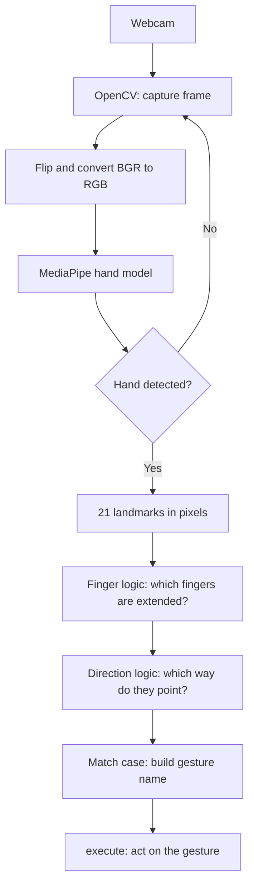
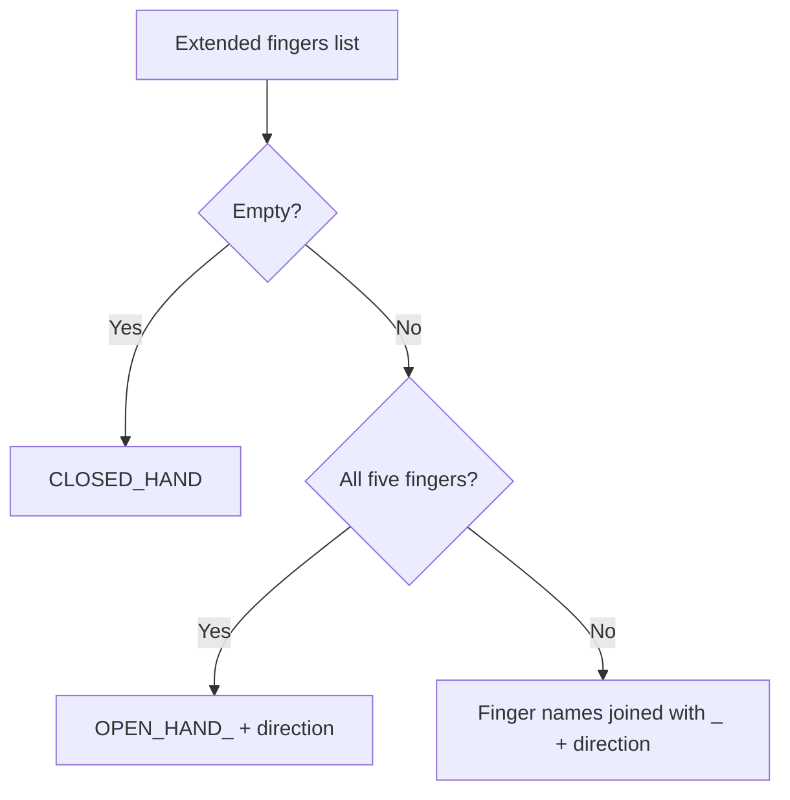

---

title: Gesture Recognition Program
tags:

- technical-spec
- python/mediapipe
aliases:
- Hand gestures

---
# 🖐️ Hand Gesture Detector: MediaPipe + OpenCV

This note documents how to install, build and run a webcam hand-gesture detector in Python on Linux. It covers **static gestures**: which fingers are extended and which way they point (for example `THUMB_UP` or `INDEX_MIDDLE_LEFT`). The code is divided into 2 files: `hand_processing.py` (MediaPipe and the math) and `gestures.py` (OpenCV and the actions). For now, `execute()` only prints what each gesture would do.

> [!info] Update 2026-10-12: integration with the drone
> How this program connects to the drone (ROS 2 node, dead-man gesture, safety limits) is in [[Gesture Pipeline]]. Decision: [[ADR-015 Gesture Input Source|ADR-015]] (ground webcam).
>
> **Keep `mediapipe==0.10.21` pinned.** MediaPipe **1.1.0** (released 6 Oct 2026) **removed** the legacy `mp.solutions` API used below (verified in the wheel), so upgrading needs a port to the Tasks API (`HandLandmarker`). The "no package above 3.12" limit applies to 0.10.21 only: 1.1.0 supports Python 3.9–3.14 and ships Linux aarch64 wheels (Raspberry Pi 5).

---
**
## 📌 Overview

- **MediaPipe** is an open-source framework developed by Google for machine learning solutions. It helps us recognize gestures through an image. It ships pretrained models for hand tracking, face detection, pose estimation and gesture recognition, and runs in real time on the CPU.
- For every frame it finds the hand and saves its key points as **21 landmarks** (wrist, knuckles and fingertips), each with `x`, `y` and `z` coordinates.
- MediaPipe only gives us the landmarks. It does **not** recognize gestures by itself, so the program we write does the logic.
- **OpenCV** captures the webcam frames and shows the video window.
- More info: [MediaPipe on GitHub](https://github.com/google-ai-edge/mediapipe)

> [!NOTE] No compiling needed
> MediaPipe's official C++ API can only be built from source with Bazel, which is slow and fragile. In Python we only need to install the prebuilt `mediapipe` package with pip, so nothing is compiled.

---

## 🔄 Pipeline



---

## ⚠️ Known Limitations

- Thumb detection is the least reliable part. `THUMB_OUT_RATIO` is a guess and needs tuning.
- Lighting and camera quality affect accuracy.
- Up to 2 hands are detected (`max_num_hands=2`), but only the **first** hand is recognized and drawn.
- Gestures that depend on more than "extended or not" (such as pinch or the OK sign) need extra logic using distances between landmarks.

---

## 🛠️ Build

### 📋 Requirements

1. Linux (with X11 or Wayland)
2. Python 3.10 to 3.12 (3.10+ because we use the `match` statement as the switch case; MediaPipe has no prebuilt package above 3.12)
3. A webcam that shows up as `/dev/video*`
4. Packages: `mediapipe` and `opencv-python`

### ✅ Install Checklist

- [ ] Install system packages
- [ ] Check the webcam is detected
- [ ] Create the virtual environment
- [ ] Install `mediapipe` and `opencv-python`
- [ ] Verify the install
- [ ] Create `hand_processing.py` and `gestures.py`, then run `gestures.py`

---

### 📦 Setup

#### 1. Install Python tooling and shared libraries

```bash
sudo apt update
sudo apt install python3 python3-venv python3-pip libgl1 libglib2.0-0 v4l-utils
```

#### 2. Check webcam access

```bash
v4l2-ctl --list-devices
ls /dev/video*
```

> [!TIP] Permission denied on the camera?
> Add your user to the `video` group, then log out and back in: `sudo usermod -aG video $USER`

#### 3. Create the Python environment

MediaPipe comes prebuilt this way, nothing needs compiling.

```bash
mkdir gesture-detector && cd gesture-detector
python3 -m venv gesture-env
source gesture-env/bin/activate
pip install --upgrade pip
pip install mediapipe==0.10.21 opencv-python
pip freeze > requirements.txt
```

> [!WARNING] Pip starts "building wheel"?
> That means pip could not find a prebuilt MediaPipe package for your Python version. Check you are on Python 3.10 to 3.12 inside the virtual environment (`python --version`).

#### 4. Verify the install

```bash
python3 -c "import cv2, mediapipe; print(cv2.__version__, mediapipe.__version__)"
```

---

### 🗂️ Project Structure

```text
gesture-detector/
├── gestures.py          # OpenCV: camera loop, window, execute()
├── hand_processing.py   # MediaPipe + math + finger logic + gesture names
├── requirements.txt     # mediapipe, opencv-python
└── README.md
```

The code is divided into **2 files**, so the MediaPipe part does not depend on OpenCV:

|File|What it does|
|:--|:--|
|`hand_processing.py`|Everything that uses MediaPipe, plus the math, the finger logic and the gesture names. It never imports OpenCV, so it accepts any RGB image.|
|`gestures.py`|The OpenCV part: camera loop, window and `execute()`. It imports `create_hands`, `detect_gesture` and `draw_hand` from `hand_processing.py`.|

The three functions `gestures.py` uses:

- `create_hands(static_image_mode=False)`: creates the MediaPipe detector.
- `detect_gesture(hands, rgb_image)`: takes an RGB image and returns `(gesture, hand)`: the gesture name and the hand (needed for drawing), or `(None, None)` if no hand was found.
- `draw_hand(image, hand)`: draws the landmarks on an image.

Both `.py` files must be in the same folder.

---

### ⚙️ How the Program Works

1. **Capture** (`gestures.py`): OpenCV reads a frame from the webcam.
2. **Preprocess** (`gestures.py`): the frame is flipped (mirror view) and converted from BGR to RGB (MediaPipe uses RGB, OpenCV uses BGR).
3. **Detect** (`hand_processing.py`): `detect_gesture` runs `hands.process(...)` on the RGB image, which returns the 21 landmarks of each detected hand.
4. **Convert** (`hand_processing.py`): the landmarks of the first hand are converted from normalized values (0 to 1) to **pixel** coordinates, so angles and distances are not distorted by the frame's aspect ratio.
5. **Interpret** (`hand_processing.py`): the code decides which fingers are extended (`is_finger_extended`).
6. **Direction** (`hand_processing.py`): the code works out which way the extended fingers point (`pointing_direction`).
7. **Classify** (`hand_processing.py`): `recognize` builds the gesture name with a `match` statement.
8. **Output** (`gestures.py`): `draw_hand` draws the landmarks on the frame, and `execute()` is called with the gesture, only when it changes. For now `execute()` only prints.

#### 🖼️ Frames and NumPy

A **frame** is one image from the camera. In Python it is stored as a **NumPy array**, which is a grid of numbers with one number per pixel color value.

| Property | Value |
| :--- | :--- |
| Shape | `(height, width, 3)`, for example `(480, 640, 3)` |
| Data type | `uint8` (each value is 0 to 255) |
| Channel order | OpenCV gives **BGR**, MediaPipe needs **RGB** |

In `gestures.py` there are two versions of the same image:
* `frame`: the BGR image from OpenCV, used for drawing and showing the window.
* `rgb`: a converted RGB copy of it, the one passed to MediaPipe.

#### Connecting other software
`hand_processing.py` never imports OpenCV. Its main function, `detect_gesture(hands, rgb_image)`, accepts **any RGB, `uint8`, `(height, width, 3)` NumPy array**. So any software that can produce that array can feed the program:

| Source | How to get the array |
| :--- | :--- |
| OpenCV (camera, video file, `imread`) | `cv2.cvtColor(frame, cv2.COLOR_BGR2RGB)` |
| Pillow (image file) | `np.array(Image.open("hand.jpg").convert("RGB"))` |
| Other (screen capture, other camera libraries) | Convert the output to an RGB `uint8` array |

> [!WARNING] Things to check when connecting a new source
> * **Channel order:** BGR passed in as RGB does not crash, but detection gets worse. Make sure the array is RGB.
> * **Grayscale or float images** must be converted to 3 channels and `uint8` first.
> * **Single images:** create the detector with `create_hands(static_image_mode=True)`. For video, keep the default (`False`) so the hand is tracked between frames.
> * **Mirroring:** the webcam loop flips the frame so `LEFT` and `RIGHT` match your own left and right. Other sources are not flipped unless you do it.

#### 🦴 Landmarks used for finger detection

|Finger|Knuckle (MCP)|Middle joint (PIP / IP)|Tip|
|:--|:-:|:-:|:-:|
|Thumb|2|3|4|
|Index|5|6|8|
|Middle|9|10|12|
|Ring|13|14|16|
|Pinky|17|18|20|

Landmark **0** is the wrist. In the code each finger is a tuple `(MCP, PIP, tip)`, for example `INDEX = (5, 6, 8)`, and the `FINGERS` dictionary maps each name to its tuple.

> [!NOTE] Image coordinates
> `x` grows to the right and `y` grows **downward**, so "up" on screen means a smaller `y`.

---

### 📐 The Math

#### Finger extended? (index, middle, ring, pinky)

The program measures the angle at the middle joint (PIP) $b$, between the knuckle $a$ and the tip $c$:

$$\vec{v_1} = a - b, \qquad \vec{v_2} = c - b$$

$$\theta = \arccos\left(\frac{\vec{v_1} \cdot \vec{v_2}}{\lVert\vec{v_1}\rVert \, \lVert\vec{v_2}\rVert}\right)$$

A straight finger gives an angle close to $180^\circ$, a curled finger a much smaller one. The finger counts as **extended** when $\theta > 140^\circ$ (`EXTENDED_ANGLE`).

Because this uses an angle and not "tip above joint", it works no matter which way the hand is turned (pointing up, down, left or right).

#### Thumb extended?

The thumb bends sideways, so the angle check does not work well for it. Instead the program measures how far the thumb tip $P_4$ sticks out past the index knuckle $P_5$, along the palm's width axis (from the pinky knuckle $P_{17}$ toward the index knuckle):

$$\vec{u} = P_5 - P_{17}$$

$$t = \frac{(P_4 - P_5) \cdot \vec{u}}{\lVert\vec{u}\rVert} \cdot \frac{1}{\lVert P_9 - P_0 \rVert}$$

Dividing by the hand size $\lVert P_9 - P_0 \rVert$ (wrist to middle knuckle) makes the value the same whether the hand is close to or far from the camera. Negative or near 0 means the thumb is tucked in. The thumb counts as **extended** when $t > 0.5$ (`THUMB_OUT_RATIO`).

#### Pointing direction

The program adds together the knuckle-to-tip vectors of all extended fingers:

$$d_x = \sum (x_{tip} - x_{mcp}), \qquad d_y = \sum (y_{tip} - y_{mcp})$$

$$\alpha = \operatorname{atan2}(d_x, -d_y)$$

$-d_y$ is used because `y` grows downward. This gives $0^\circ$ = up, $90^\circ$ = right, $-90^\circ$ = left, $180^\circ$ = down:

|Angle $\alpha$|Direction|
|:-:|:-:|
|$-45^\circ$ to $45^\circ$|`UP`|
|$45^\circ$ to $135^\circ$|`RIGHT`|
|$-135^\circ$ to $-45^\circ$|`LEFT`|
|anything else|`DOWN`|

---

### 🏷️ Gesture Names

`recognize` turns the list of extended fingers and the direction into a name:



| Hand pose                                 | Gesture name        |
| :---------------------------------------- | :------------------ |
| Fist                                      | `CLOSED_HAND`       |
| All fingers out, pointing up              | `OPEN_HAND_UP`      |
| Thumbs up                                 | `THUMB_UP`          |
| Thumbs down                               | `THUMB_DOWN`        |
| Index finger pointing right               | `INDEX_RIGHT`       |
| Index and middle (peace sign) pointing up | `INDEX_MIDDLE_UP`   |
| Index and middle pointing left            | `INDEX_MIDDLE_LEFT` |

Finger names always appear in the order thumb, index, middle, ring, pinky, because they follow the order of the `FINGERS` dictionary.

---

### 💻 The Program

#### `hand_processing.py`

```python
import math

import mediapipe as mp

mp_hands = mp.solutions.hands
mp_draw = mp.solutions.drawing_utils

# Landmark cheat sheet (MCP = knuckle, PIP = middle joint):
#   0 wrist
#   thumb:  2 MCP, 3 IP,  4 tip
#   index:  5 MCP, 6 PIP, 8 tip
#   middle: 9 MCP, 10 PIP, 12 tip
#   ring:   13 MCP, 14 PIP, 16 tip
#   pinky:  17 MCP, 18 PIP, 20 tip

THUMB = (2, 3, 4)
INDEX = (5, 6, 8)
MIDDLE = (9, 10, 12)
RING = (13, 14, 16)
PINKY = (17, 18, 20)

FINGERS = {"THUMB": THUMB, "INDEX": INDEX, "MIDDLE": MIDDLE, "RING": RING, "PINKY": PINKY}

EXTENDED_ANGLE = 140     # degrees at the middle joint; above this the finger is extended
THUMB_OUT_RATIO = 0.5    # how far the thumb tip sticks out past the palm edge, in hand sizes (a guess)


# ---------- MediaPipe ----------
def create_hands(static_image_mode=False):
    """False = video (tracks the hand between frames), True = single unrelated images."""
    return mp_hands.Hands(
        static_image_mode=static_image_mode,
        max_num_hands=2,
        min_detection_confidence=0.7,
        min_tracking_confidence=0.5,
    )


def detect_gesture(hands, rgb_image):
    """rgb_image: NumPy array, shape (height, width, 3), dtype uint8, RGB order.
    Returns (gesture, hand): the gesture string and the MediaPipe hand object
    (needed for drawing), or (None, None) if no hand was found."""
    results = hands.process(rgb_image)
    if not results.multi_hand_landmarks:
        return None, None

    hand = results.multi_hand_landmarks[0]
    height, width = rgb_image.shape[:2]
    lm = [(p.x * width, p.y * height) for p in hand.landmark]
    return recognize(lm), hand


def draw_hand(image, hand):
    """Draw the landmarks and connections onto the image (in place)."""
    mp_draw.draw_landmarks(image, hand, mp_hands.HAND_CONNECTIONS)


# ---------- Math ----------
def dist(a, b):
    return math.hypot(a[0] - b[0], a[1] - b[1])


def angle(a, b, c):
    """Angle in degrees at point b, between the lines b->a and b->c."""
    v1 = (a[0] - b[0], a[1] - b[1])
    v2 = (c[0] - b[0], c[1] - b[1])
    norm = math.hypot(*v1) * math.hypot(*v2)
    if norm == 0:
        return 0
    cos = (v1[0] * v2[0] + v1[1] * v2[1]) / norm
    return math.degrees(math.acos(max(-1, min(1, cos))))


def hand_size(lm):
    return max(dist(lm[0], lm[9]), 1e-6)  # wrist to middle knuckle


def thumb_out(lm):
    """How far the thumb tip sticks out past the index knuckle, along the palm's width axis.
    Negative or near 0 = tucked, clearly positive = out."""
    ux = lm[5][0] - lm[17][0]   # axis from the pinky knuckle toward the index knuckle
    uy = lm[5][1] - lm[17][1]
    palm_width = max(math.hypot(ux, uy), 1e-6)
    along = ((lm[4][0] - lm[5][0]) * ux + (lm[4][1] - lm[5][1]) * uy) / palm_width
    return along / hand_size(lm)


def is_finger_extended(lm, finger):
    """finger is one of THUMB, INDEX, MIDDLE, RING, PINKY."""
    mcp, pip, tip = finger

    if finger == THUMB:
        return thumb_out(lm) > THUMB_OUT_RATIO

    return angle(lm[mcp], lm[pip], lm[tip]) > EXTENDED_ANGLE


def pointing_direction(lm, fingers):
    """Direction the given fingers point (knuckle to tip, added together):
    UP, DOWN, LEFT or RIGHT."""
    dx = sum(lm[tip][0] - lm[mcp][0] for mcp, pip, tip in fingers)
    dy = sum(lm[tip][1] - lm[mcp][1] for mcp, pip, tip in fingers)
    a = math.degrees(math.atan2(dx, -dy))  # 0 = up, 90 = right, -90 = left, 180 = down
    if -45 <= a < 45:
        return "UP"
    if 45 <= a < 135:
        return "RIGHT"
    if -135 <= a < -45:
        return "LEFT"
    return "DOWN"


# ---------- Gesture recognition ----------
def recognize(lm):
    # Names of the fingers that are extended, e.g. ["INDEX", "MIDDLE"]
    extended = [name for name, finger in FINGERS.items() if is_finger_extended(lm, finger)]

    # Which way the extended fingers point (not used when the hand is closed)
    direction = pointing_direction(lm, [FINGERS[name] for name in extended])

    match extended:
        case []:
            return "CLOSED_HAND"
        case ["THUMB", "INDEX", "MIDDLE", "RING", "PINKY"]:
            return "OPEN_HAND_" + direction
        case _:
            return "_".join(extended) + "_" + direction  # e.g. "INDEX_MIDDLE_LEFT"
```

#### `gestures.py`

```python
import cv2

from hand_processing import create_hands, detect_gesture, draw_hand


def execute(gesture):
    match gesture:
        case "OPEN_HAND_UP":
            print("Gesture: Open Hand Up -> Enable / Hold Position (check doc)")
        case "CLOSED_HAND":
            print("Gesture: Closed Hand -> Stop / Hover in place")
        case "THUMB_UP":
            print("Gesture: Thumb-up -> Climb Slowly")
        case "THUMB_DOWN":
            print("Gesture: Thumb-down -> Descend Slowly / Land Request")
        case "INDEX_LEFT":
            print("Gesture: Index Left -> Move Left")
        case "INDEX_RIGHT":
            print("Gesture: Index Right -> Move Right")
        case "INDEX_MIDDLE_LEFT":
            print("Gesture: Index Middle Left -> Yaw Left")
        case "INDEX_MIDDLE_RIGHT":
            print("Gesture: Index Middle Right -> Yaw Right")


def main():
    cap = cv2.VideoCapture(0)  # 0 = /dev/video0
    last_gesture = None

    with create_hands() as hands:
        while cap.isOpened():
            ok, frame = cap.read()
            if not ok:
                break

            frame = cv2.flip(frame, 1)  # mirror view
            rgb = cv2.cvtColor(frame, cv2.COLOR_BGR2RGB)

            gesture, hand = detect_gesture(hands, rgb)
            if hand:
                draw_hand(frame, hand)

            # Only act when the gesture changes
            if gesture and gesture != last_gesture:
                execute(gesture)
            last_gesture = gesture

            cv2.imshow("Gestures", frame)  # window showing the camera and landmarks
            if cv2.waitKey(1) & 0xFF == ord("q"):
                break

    cap.release()
    cv2.destroyAllWindows()


if __name__ == "__main__":
    main()
```

> [!NOTE] Reading the code
>
> - `dist`, `angle` and `hand_size` are small geometry helpers used by the finger logic.
> - The `match` statement is the switch case. `case _` is the default for every pattern not listed above it.
> - `recognize` matches on the **list of finger names**, so a case like `["THUMB", "INDEX", "MIDDLE", "RING", "PINKY"]` must list them in the same order as `FINGERS`.
> - Without the "only act when the gesture changes" check, `execute()` would run about 30 times per second.

#### 🎬 The `execute()` function

`execute()` in `gestures.py` is where each gesture triggers an action. `main()` calls it only when the gesture changes. For now every `case` only prints the action it will trigger, and a gesture without a `case` does nothing. To give a new gesture an action, add a `case` with its name.

---

### ▶️ Running the Program

With the virtual environment active, from the project folder:

```bash
source gesture-env/bin/activate
python3 gestures.py
```

Press `q` in the video window to quit, or `Ctrl+C` in the terminal.

---

### 🎚️ Tuning Static Detection

|Setting|Default|Effect|
|:--|:-:|:--|
|`EXTENDED_ANGLE`|`140`|Angle in degrees at the middle joint above which a finger counts as extended. Lower makes fingers count as extended more easily.|
|`THUMB_OUT_RATIO`|`0.5`|How far (in hand sizes) the thumb tip must stick out past the index knuckle. Lower makes the thumb count as out more easily.|
|`min_detection_confidence`|`0.7`|How sure MediaPipe must be before it reports a new hand.|
|`min_tracking_confidence`|`0.5`|How sure MediaPipe must be to keep tracking a hand between frames.|

`EXTENDED_ANGLE` and `THUMB_OUT_RATIO` are at the top of `hand_processing.py`. The two confidence settings are in `create_hands()`, in the same file.

> [!WARNING] Starting values
> `THUMB_OUT_RATIO` in particular is a guess. To tune it, temporarily add `print(thumb_out(lm))` inside `detect_gesture`, right after the line that builds `lm`, and watch the value with the thumb tucked and stretched out, then pick a value between the two.

---

## 🧯 Troubleshooting

|Problem|Likely cause / fix|
|:--|:--|
|`ModuleNotFoundError: No module named 'hand_processing'`|`gestures.py` and `hand_processing.py` must be in the same folder, and you must run `python3 gestures.py` from that folder.|
|Pip tries to build mediapipe|Unsupported Python version. Use 3.10 to 3.12.|
|`SyntaxError` on the `match` line|Python is older than 3.10. Check `python --version` inside the virtual environment.|
|`ImportError: libGL.so.1`|Install `libgl1` and `libglib2.0-0`.|
|Camera won't open or empty frames|Check `ls /dev/video*`. Try `VideoCapture(1)` or `(2)`. Make sure no other app is using it.|
|Permission denied on `/dev/video0`|Add your user to the `video` group, then log out and back in.|
|`Could not load the Qt platform plugin "xcb"`|Install `libxcb-cursor0`. On Wayland run with `QT_QPA_PLATFORM=xcb python3 gestures.py`.|
|Thumb counted as out when it is tucked (or the other way)|Tune `THUMB_OUT_RATIO` (see [[#🎚️ Tuning Static Detection]]).|
|Bent fingers counted as extended|Raise `EXTENDED_ANGLE`.|
|Gesture name flickers between two values|The hand is near a threshold or near a 45° direction boundary. Hold the pose more clearly, or tune the thresholds.|
|No hand detected|Improve lighting, face the palm at the camera, lower `min_detection_confidence`.|
|`mp.solutions` error|Version difference. Check `pip show mediapipe`.|

---

## ➕ Adding New Gestures

1. **Static:** hold the gesture and read its name in the terminal (for example `INDEX_PINKY_UP`). Then add a `case` with that name in `execute()` (`gestures.py`) to give it an action. If it needs a special name, add a `case` to `recognize()` (`hand_processing.py`) above `case _`.
2. **Distance based (pinch, OK sign):** compare the distance between two landmarks with the `dist()` helper, for example thumb tip (4) and index tip (8), divided by `hand_size(lm)` so it does not depend on the distance to the camera:

$$d = \frac{\sqrt{(x_8 - x_4)^2 + (y_8 - y_4)^2}}{\lVert P_9 - P_0 \rVert}$$

---

_Note: Python 3.10.12 on my laptop supports the `match` statement used in this project._

---

## Glossary

| Term | Meaning |
| --- | --- |
| **MediaPipe** | A framework used here for detecting and interpreting hand landmarks and gestures. |
| **Landmark** | One of the 21 tracked points on a hand (wrist, knuckles, finger joints and tips). |
| **Static gesture** | A gesture recognised from a single frame: which fingers are extended and where they point. |
| **OpenCV** | A computer-vision library used here to read the webcam and draw the video window. |
| **NumPy array** | The image format passed to MediaPipe: RGB, `uint8`, shape `(height, width, 3)`. |
| **venv** | A Python virtual environment that keeps this project's packages separate from the system. |
| **Tasks API** | MediaPipe's newer API (`HandLandmarker`) that replaces the removed `mp.solutions`. |
| **ROS 2** | The second-generation Robot Operating System middleware used for robotics integration. |
