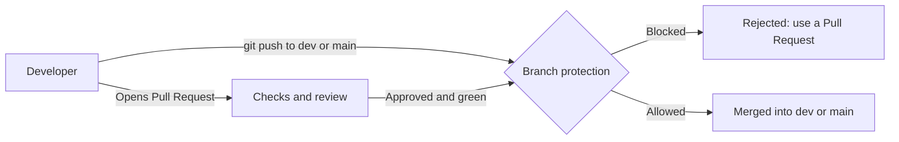
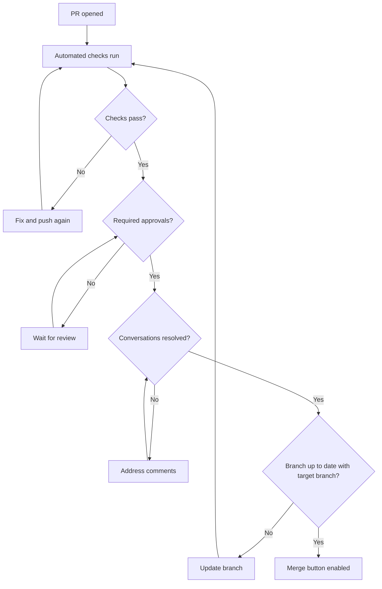

# Branch Protection

> [!summary] In one sentence
> **Branch protection** is a set of rules, enforced by the Git platform, that **prevents risky actions on important branches** (in our project `main` and `dev`), such as pushing directly, force-pushing, deleting the branch, or merging without review and passing tests.

> [!info] About this document
> This is a purely informative guide. It explains **what** branch protection is, **why** we use it, and **which rules** exist, with examples. It builds on [[Feature_and_Bugfix_Branches|Feature and Bug-Fix Branches]], [[Pull_Request_Workflow|Pull Request Workflow]], [[Rebase_Policy|Rebase Policy]] and [[Merge_Strategy|Merge Strategy]]. Those notes describe **good habits**, and branch protection **enforces** them.

> [!warning] About the "recommended" parts
> Section 6 follows the rules decided in Dev_Strategy (section 9). If the team decides on different rules later, adjust that section. Exact menu names differ between platforms (GitHub, GitLab, Bitbucket, Azure DevOps), but the concepts are the same.

---

> [!important] How this applies to our project (SEA:ME Autonomous Drone)
> We protect **both permanent branches**, with **stricter rules on `main`**:
> - **`dev`**: PR required, CI must pass, at least 1 reviewer where practical, no force pushes, **squash merge only**
> - **`main`**: PR required, CI must pass, **2 approvals**, conversations resolved, no force pushes, **merge commit only**, plus simulation/hardware validation when appropriate
>
> Feature and bug-fix branches are **not** protected, so they can be rebased. See [[Dev_Strategy]].

---

## 1. The core idea

Habits and written rules are good, but people get tired, rush, or make mistakes. Branch protection turns **"please don't"** into **"you can't"**.

Think of `main` and `dev` as a **bank vault**. Guidelines say "be careful with the vault." Branch protection is the **lock on the door**: it works even when someone forgets the guidelines.



> [!note] Key point
> Protection rules live **on the server** (the hosting platform), not on your computer. You can't bypass them with a local Git setting, which is exactly why they are reliable.

---

## 2. Why should we use it?

| Benefit                     | What it means in practice                                                                                |
| --------------------------- | -------------------------------------------------------------------------------------------------------- |
| **`dev` and `main` stay healthy**     | Broken or untested code can't slip in                                                                    |
| **Review is guaranteed**    | Every change gets a second pair of eyes ([[Pull_Request_Workflow\|Pull Request Workflow]])               |
| **Tests always run**        | Failing builds block the merge automatically                                                             |
| **No accidental disasters** | Nobody can force-push over history or delete `dev` or `main` by mistake                                           |
| **Consistent process**      | The agreed [[Merge_Strategy\|Merge Strategy]] and [[Rebase_Policy\|Rebase Policy]] are actually followed |
| **Audit trail**             | Every change to `dev` or `main` is traceable to an approved PR                                                    |
| **Security and compliance** | Helps meet requirements for change control and approvals                                                 |
| **Peace of mind**           | New team members can't break things while they learn                                                     |

### What happens without protection

> [!failure] `dev` and `main` are open to everyone
> - Someone pushes broken code straight to `dev` or `main`
> - A force-push erases teammates' commits
> - `dev` or `main` is deleted by accident
> - Untested or unreviewed code goes live
> - Rules exist only on paper, and get ignored under pressure

### What happens with protection

> [!success] `dev` and `main` are guarded
> - Every change arrives through a reviewed, tested PR
> - History can't be rewritten or deleted
> - Mistakes are stopped **before** they happen, not fixed afterwards

---

## 3. Which branches should be protected?

| Branch                     | Protect it?  | Why                                                                                                                    |
| -------------------------- | ------------ | ---------------------------------------------------------------------------------------------------------------------- |
| `main`                     | ✅ Always     | The last stable state of `dev`. Strictest rules (2 approvals, merge commit only)                                       |
| `dev`                      | ✅ Always     | Integrated development branch. Every feature and bug-fix PR lands here (squash merge only)                             |
| `feature/*`, `bugfix/*`    | ❌ Usually no | Personal and short-lived; developers need freedom here ([[Feature_and_Bugfix_Branches\|Feature and Bug-Fix Branches]]) |

> [!tip] Patterns
> Platforms support **wildcards**, so one rule like `release/*` could protect all current and future release branches if we ever add them.

---

## 4. The protection rules explained

### 4.1 Pull request rules

| Rule                                      | What it does                                                                  |
| ----------------------------------------- | ----------------------------------------------------------------------------- |
| **Require a pull request before merging** | Direct pushes to the branch are blocked. Changes must come through a PR       |
| **Require approvals**                     | A set number of reviewers (e.g. 1 or 2) must approve                          |
| **Dismiss stale approvals**               | New commits pushed after approval **cancel** the approval, so it's re-reviewed |
| **Require review from code owners**       | Files with a `CODEOWNERS` entry need approval from the listed owners          |
| **Require approval of the latest push**   | The person who pushed last can't approve their own latest changes             |
| **Require conversation resolution**       | All review comments must be resolved before merging                           |
| **Allowed merge methods** *(rulesets)*    | Limits which merge buttons exist on this branch, e.g. squash only on `dev`, merge commit only on `main` ([[Merge_Strategy\|Merge Strategy]]) |

### 4.2 Status check rules

| Rule                                         | What it does                                                              |
| -------------------------------------------- | ------------------------------------------------------------------------- |
| **Require status checks to pass**            | Selected CI jobs (build, tests, lint, security scan) must be green        |
| **Require branches to be up to date**        | The PR branch must include the latest target branch (`dev` or `main`) before merging               |
| **Require deployments to succeed** *(optional)* | A staging deployment must succeed first                                |

### 4.3 History and safety rules

| Rule                         | What it does                                                                                            |
| ---------------------------- | ------------------------------------------------------------------------------------------------------- |
| **Block force pushes**       | Nobody can rewrite history on this branch ([[Rebase_Policy\|Rebase Policy]] golden rule)                |
| **Block deletions**          | The branch can't be deleted                                                                             |
| **Require linear history**   | Forbids merge commits, so only squash or rebase merges are allowed ([[Merge_Strategy\|Merge Strategy]]). **We use it on `dev` only**: `dev` → `main` is a merge commit |
| **Require signed commits**   | Every commit must carry a verified signature (GPG, SSH or S/MIME)                                       |
| **Restrict who can push**    | Only specific people or teams can push to the branch                                                    |
| **Restrict who can merge**   | Only specific people or teams can complete a merge                                                      |
| **Merge queue** *(not used initially)* | Approved PRs are tested together in order, so the target branch is never broken by races (Dev_Strategy, section 23) |

### 4.4 Rules for administrators

| Rule                                 | What it does                                                               |
| ------------------------------------ | -------------------------------------------------------------------------- |
| **Include administrators / no bypass** | Admins must follow the same rules as everyone else                        |
| **Allow specific bypass**            | Only named people or roles (e.g. a release manager) may bypass, in emergencies |

> [!warning] "Admins are exempt" is a trap
> If admins can bypass the rules by default, the **most powerful accounts** are the ones allowed to skip review. Prefer rules that apply to everyone, with a small, explicit, audited bypass list for real emergencies.

---

## 5. How the rules work together



> [!example] Example in action
> 1. Alex opens a PR from `feature/42-gps-interface` to `dev`. The **build and tests** start automatically.
> 2. Tests pass ✅, but **1 approval** is required, so the merge button is greyed out.
> 3. Sam reviews and requests changes. Alex pushes a fix, so the old approval would be **dismissed** (if enabled).
> 4. Sam approves again, **all conversations are resolved**, and `dev` hasn't moved (or Alex has rebased onto it).
> 5. The merge button turns green. Alex squash-merges (see [[Merge_Strategy|Merge Strategy]]).
> 6. Meanwhile, anyone who tries `git push origin dev` or `git push --force` is **rejected**.

### What a blocked push looks like

```text
$ git push origin main
remote: error: GH006: Protected branch update failed for refs/heads/main.
remote: error: Changes must be made through a pull request.
 ! [remote rejected] main -> main (protected branch hook declined)
```

> [!tip] Not an error, a guide
> This message isn't a bug. It is the system working. The fix is to create a branch and open a PR:
> ```bash
> git checkout -b bugfix/my-change
> git push -u origin bugfix/my-change
> ```

---

## 6. Our configuration

> [!abstract] Decided in Dev_Strategy (section 9)
> `dev` and `main` are both protected. The stronger review requirement belongs on `main`, because two reviewers on every `dev` PR would slow a small team down. Adjust if team size or workload changes.

### Two protected branches

| Setting                                        | `dev`                  | `main`                 | Notes                                                              |
| ---------------------------------------------- | ---------------------- | ---------------------- | ------------------------------------------------------------------ |
| Require a pull request                         | ✅ On                  | ✅ On                  | Direct pushes disabled on both                                     |
| Required approvals                             | **1** (where practical)| **2**                  | Stronger review on `main`                                          |
| Dismiss stale approvals on new commits         | ✅ On                  | ✅ On                  | Prevents "approve, then sneak in changes"                          |
| Require conversation resolution                | ✅ On                  | ✅ On                  | No forgotten review comments                                       |
| Require status checks to pass                  | ✅ On                  | ✅ On                  | Build, unit tests, integration tests, static analysis, formatting  |
| Require branch to be up to date                | ✅ On                  | ❌ **Off**             | See the note below the table                                       |
| Block force pushes                             | ✅ On                  | ✅ On                  | Protects history (Rebase Policy golden rule)                       |
| Block deletions                                | ✅ On                  | ✅ On                  | Protects the branch itself                                         |
| Allowed merge methods *(rulesets)*             | **Squash only**        | **Merge commit only**  | Matches the Merge Strategy                                         |
| Require linear history                         | ✅ On                  | ❌ **Off**             | `main` receives merge commits from promotions                      |
| Apply rules to administrators                  | ✅ On                  | ✅ On                  | Everyone follows the same rules                                    |
| Simulation / hardware validation               | n/a                    | When appropriate       | GitHub can't enforce this automatically: use the PR checklist and the reviewers |
| Require signed commits                         | ⚠️ Optional            | ⚠️ Optional            | Not in the initial scope                                           |
| Require review from code owners                | ⚠️ Optional            | ⚠️ Optional            | Not in the initial scope (see section 8)                           |
| Automatically delete head branches after merge | ✅ On                  | n/a                    | Repository setting, keeps branches tidy                            |

> [!warning] Why "up to date" is off on `main` and linear history is off on `main`
> `dev` → `main` is merged with a **merge commit**. That commit exists on `main` but not on `dev`, so a rule requiring the PR branch to be **up to date** would force a back-merge of `main` into `dev` before every promotion. Since only `dev` ever merges into `main`, the two can't really diverge, so the rule adds work without adding safety. For the same reason, **require linear history** must stay off on `main`, or the promotion merge commit would be rejected.

> [!note] Default branch
> GitHub's closing keywords (`Closes #42`) only close issues when the PR is merged into the repository's **default branch**. Decide whether `dev` should be the default branch (feature PRs then close their issues) or whether issues are closed manually at promotion. See [[Pull_Request_Workflow|Pull Request Workflow]].

### Matching the other documents

| Document                                                      | Decision                                              | Enforced by this setting                                          |
| ------------------------------------------------------------- | ----------------------------------------------------- | ----------------------------------------------------------------- |
| [[Pull_Request_Workflow\|Pull Request Workflow]]              | Every change goes through a reviewed PR (1 or 2 reviewers) | Require PR + approvals + conversation resolution              |
| [[Rebase_Policy\|Rebase Policy]]                              | Never rebase or force-push `dev` and `main`; feature branches are rebased | Block force pushes on `dev` and `main` (feature branches stay unprotected) |
| [[Merge_Strategy\|Merge Strategy]]                            | Squash into `dev`, merge commit into `main`          | Allowed merge methods per branch + linear history on `dev` only   |
| [[Feature_and_Bugfix_Branches\|Feature and Bug-Fix Branches]] | Always work on a branch                               | Require PR on both permanent branches (direct pushes blocked)     |

---

## 7. Step-by-step: setting it up (GitHub example)

> [!note] Platform names
> GitHub offers two systems: classic **branch protection rules** and newer **rulesets**. Both can do the job. GitLab calls them **protected branches** and **merge request approval rules**. The settings below map almost one-to-one.

### Step 1: Open the settings

1. Go to the repository → **Settings**
2. Choose **Branches** (for protection rules) or **Rules → Rulesets**
3. Click **Add rule** / **New ruleset**

### Step 2: Choose the target

Enter the branch name or pattern, e.g. `dev` or `main`. Create one rule for each.

### Step 3: Turn on the rules

Use the table in section 6 as your checklist.

### Step 4: Pick the required status checks

Select the CI jobs that must pass (e.g. `build`, `test`, `lint`).

> [!warning] Checks must have run once
> Most platforms only list a status check **after it has run at least once** in the repository. If your check isn't in the list, open a test PR to trigger it.

### Step 5: Save and test it

- [ ] Try to push directly to `dev` and to `main` → should be **rejected**
- [ ] Open a PR with a failing check → merge should be **blocked**
- [ ] Open a PR without approval → merge should be **blocked**
- [ ] Check that `dev` offers only **squash merge** and `main` only **merge commit**
- [ ] Try to force-push → should be **rejected**

> [!tip] Test with a harmless change
> Test the rules with a small, throwaway change (like a typo in a doc), not during a real release.

### Optional: with the GitHub CLI

```bash
# View the classic protection rules (rulesets are shown under Settings → Rules)
gh api repos/OWNER/REPO/branches/main/protection
gh api repos/OWNER/REPO/branches/dev/protection
```

> [!info] Permissions
> Only repository **admins** (or people with a specific role) can change these rules. If you can't see the settings, ask an admin.

---

## 8. Related tools: CODEOWNERS

> [!note] Optional
> `CODEOWNERS` is not part of our initial setup. It becomes useful if the team grows or some areas (for example safety-critical flight code) need a specific reviewer.

A `CODEOWNERS` file says **who must review which files**. Combined with "Require review from code owners", it makes sure the right experts see the right changes.

```text
# .github/CODEOWNERS

# Default owners for everything
*                   @team-leads

# Frontend code
/src/components/    @frontend-team

# Infrastructure and CI configuration
/.github/           @devops-team
/infra/             @devops-team

# Security-sensitive code
/src/auth/          @security-team
```

| Pattern          | Meaning                                          |
| ---------------- | ------------------------------------------------ |
| `*`              | Every file (a fallback)                          |
| `/src/auth/`     | A specific folder                                |
| `*.sql`          | All files with an extension                      |
| `@team-name`     | A team (or `@username` for a person)             |

> [!tip] Order matters
> The **last matching pattern wins**, so put general rules first and specific ones after.

---

## 9. Emergencies and bypasses

Production is down and a fix can't wait for the normal process. What now?

> [!tip] Keep the fast path inside the rules
> Most emergencies **don't need a bypass**. A small `bugfix/` branch from `dev`, a quick review from one person, and automated checks can be done in minutes (we don't use `hotfix/` branches initially). Plan for this ahead of time (see [[Feature_and_Bugfix_Branches|Feature and Bug-Fix Branches]]).

### If a real bypass is needed

- [x] Limit bypass to a **small named group** (e.g. the project lead)
- [x] Keep an **audit trail**: who bypassed, when, and why
- [x] **Follow up** with a normal PR afterwards if the change wasn't reviewed
- [x] **Restore** any rule that was temporarily disabled immediately
- [ ] Never leave protection switched off "just for now"

> [!danger] Temporary exceptions become permanent
> A rule disabled "for a quick fix" is often forgotten. Always put a reminder to turn it back on, and check the settings after the incident.

---

## 10. Common mistakes and how to avoid them

| Mistake                                          | Why it's a problem                                  | How to avoid it                                         |
| ------------------------------------------------ | --------------------------------------------------- | ------------------------------------------------------- |
| **No protection on `dev` or `main`**             | Anyone can push, force-push or delete               | Protect both from day one                               |
| **Admins exempt from the rules**                 | The riskiest accounts skip review                   | Apply rules to everyone; keep a small bypass list       |
| **Approvals not dismissed after new commits**    | Unreviewed code sneaks in after approval            | Enable "dismiss stale approvals"                        |
| **Required checks that don't exist or never run**| Merge is blocked forever, or the check is ignored   | Pick checks that actually run on every PR               |
| **Flaky tests as required checks**               | People rerun until green or bypass the rules        | Fix or remove flaky tests                               |
| **Too strict for a tiny team**                   | Constant blockage and workarounds                   | 1 approval on `dev`, 2 on `main`; adjust as the team grows        |
| **Protecting feature branches too**              | Slows down normal work                              | Protect shared, long-lived branches only                |
| **Rules not matching the documented process**    | Confusion: "the docs say X, the system does Y"      | Keep section 6 and the platform settings in sync        |
| **Leaving rules disabled after an emergency**    | `dev` or `main` is unprotected without anyone noticing       | Re-enable immediately and review settings afterwards    |
| **Not testing the rules**                        | A typo in a pattern leaves `dev` or `main` open     | Test with a throwaway PR (section 7, step 5)            |
| **Linear history required on `main`**            | Blocks the `dev` → `main` promotion merge commit    | Keep it off on `main`, on only for `dev`                |
| **"Up to date" required on `main`**              | Forces a back-merge of `main` into `dev` every time | Keep it off on `main`                                   |

---

## 11. Cheat sheet

| I want to ...                                      | Setting                                         |
| -------------------------------------------------- | ----------------------------------------------- |
| Stop direct pushes to `dev` and `main`                       | Require a pull request before merging           |
| Make sure someone reviews every change             | Require approvals (1 or more)                   |
| Make re-review happen after new commits            | Dismiss stale approvals                         |
| Make sure experts review sensitive files           | Code owners + require code owner review         |
| Block broken code                                  | Require status checks to pass                   |
| Prevent "works alone, breaks together"             | Require branch to be up to date (or merge queue)|
| Make sure feedback is not ignored                  | Require conversation resolution                 |
| Protect history from being rewritten               | Block force pushes                              |
| Protect the branch from being removed              | Block deletions                                 |
| Enforce squash or rebase merges only (`dev`)       | Require linear history + allowed merge methods  |
| Verify who authored commits                        | Require signed commits                          |
| Make admins follow the rules too                   | Include administrators / no bypass              |
| Keep the repo tidy                                 | Auto-delete head branches after merge           |

---

## 12. Checklists

### Setting up protection on a new repository

- [x] Rules created for **both** `dev` and `main`
- [x] `dev`: 1 approval where practical. `main`: 2 approvals
- [x] Pull request required, direct pushes blocked
- [x] Approvals required, stale approvals dismissed
- [x] Required status checks selected
- [x] Branch must be up to date before merging
- [x] Conversations must be resolved
- [x] Force pushes and deletions blocked
- [x] Merge methods match the [[Merge_Strategy|Merge Strategy]] (squash only on `dev`, merge commit only on `main`)
- [x] Linear history and "up to date" are **off** on `main`
- [x] Admins included in the rules
- [x] Auto-delete merged branches enabled
- [x] `CODEOWNERS` file added (if used)
- [x] Tested with a throwaway PR

### Reviewing protection regularly (e.g. every quarter)

- [ ] Rules still match the documented process
- [ ] Required checks still exist and are reliable
- [ ] Bypass list is small and up to date
- [ ] No rules left disabled after past incidents
- [ ] New long-lived branches are covered

---

> [!abstract] Basically
> **Branch protection makes the good habits mandatory.** Protect `dev` and `main` (stricter on `main`), require reviewed and tested Pull Requests, block force pushes and deletions, apply the rules to admins too, and keep a small, audited path for real emergencies.

## Related

- [[Feature_and_Bugfix_Branches|Feature and Bug-Fix Branches]]
- [[Pull_Request_Workflow|Pull Request Workflow]]
- [[Rebase_Policy|Rebase Policy]]
- [[Merge_Strategy|Merge Strategy]]

---

## 13. Glossary

| Term                      | Meaning                                                                          |
| ------------------------- | -------------------------------------------------------------------------------- |
| **Protected branch**      | A branch with rules that restrict how it can be changed                          |
| **Branch protection rule**| A platform setting that enforces conditions on a branch                          |
| **Ruleset**               | GitHub's newer, more flexible way to define branch (and tag) rules               |
| **Status check**          | An automated result (e.g. build or test) reported on a commit or PR              |
| **CI**                    | Continuous Integration: automatic builds and tests on every change               |
| **Required approval**     | A review sign-off that must be given before merging                              |
| **Stale approval**        | An approval given before new commits were pushed                                 |
| **CODEOWNERS**            | A file listing who must review changes to which files                            |
| **Linear history**        | A history without merge commits                                                  |
| **Signed commit**         | A commit with a cryptographic signature proving who made it                      |
| **Merge queue**           | A system that tests and merges approved PRs one at a time, in order              |
| **Bypass**                | Permission for specific people to skip a rule                                    |
| **Force push**            | A push that overwrites remote history                                            |
| **Direct push**           | Pushing commits straight to a branch without a Pull Request                      |
| **API** | Application Programming Interface: a defined way for software components to communicate. |
| **Branch** | An independent line of development in version control. |
| **Commit** | A recorded snapshot of changes in a version-control repository. |
| **Mermaid** | A text-based diagram syntax rendered by compatible Markdown tools. |
| **PR** | Pull Request: a proposed change submitted for review before merging. |
