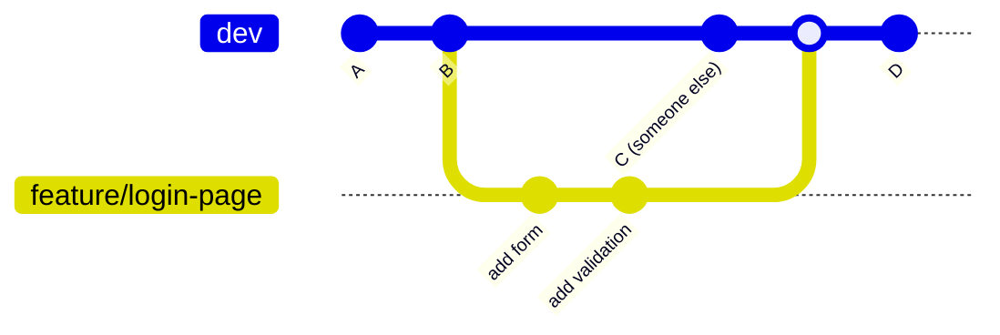
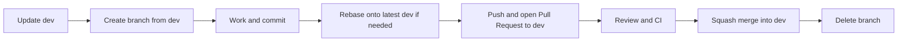
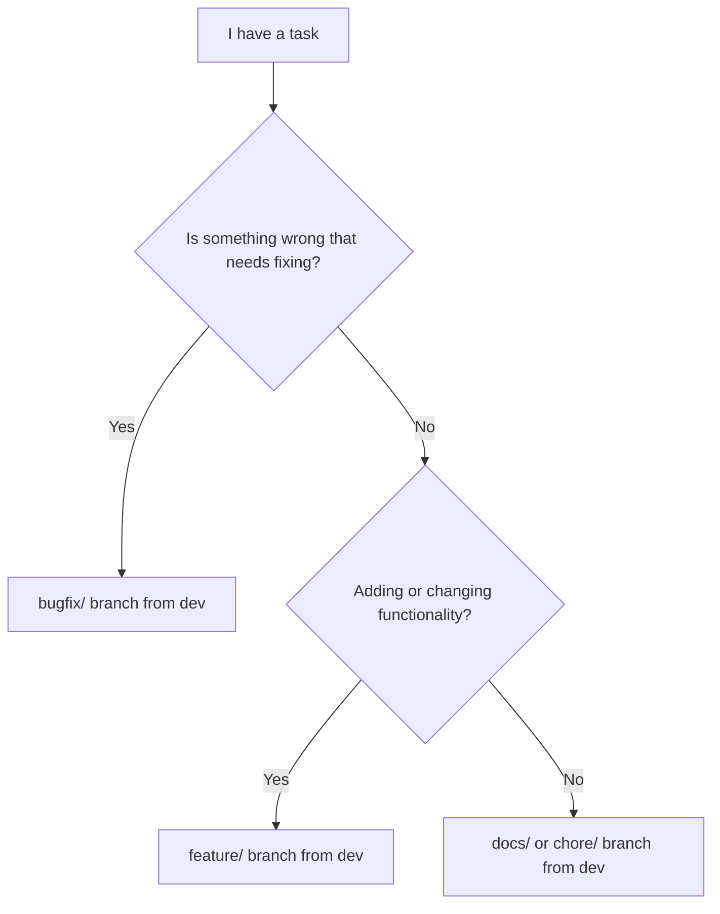

# Feature and Bug-Fix Branches

> [!summary] In one sentence
> Never work directly on `main` or `dev`. For every new feature or bug fix, create a **short-lived branch**, do the work there, then bring it back through a Pull Request.

> [!info] About this document
> This is a purely informative guide. It explains **what** these branches are, **why** we use them, and **how** to use them with examples. Related topics have their own pages: [[Pull_Request_Workflow|Pull Request Workflow]], [[Rebase_Policy|Rebase Policy]], [[Merge_Strategy|Merge Strategy]], [[Branch_Protection|Branch Protection]].

---

> [!important] How this applies to our project (SEA:ME Autonomous Drone)
> We have **two permanent branches**:
> - **`main`** is the **last stable state of `dev`**. It only changes through a deliberate promotion Pull Request from `dev`. "Stable" means it passed the validation we have, so unknown errors can still exist.
> - **`dev`** is the **integrated development state** and the **base branch for all daily work**.
>
> Every `feature/*` and `bugfix/*` branch **starts from `dev`** and **returns to `dev`** through a Pull Request (squash merge). Nobody pushes directly to `main` or `dev`. See [[Dev_Strategy]] for the full process.

---

## 1. The core idea

A **branch** is an independent line of work. It is a movable pointer to a commit, so creating one is instant and cheap.

Think of `dev` as the **shared working draft** of a book, and a branch as your **personal copy** of it. You can scribble, rewrite and experiment in your copy. Only when it is good and reviewed does it get added to the shared draft. `main` is the **published edition**, updated only from a draft that has been validated.



> [!note] Key point
> While you work on `feature/login-page`, `dev` stays untouched and stable. Other people can keep working in parallel without being affected.

---

## 2. Why should we use them?

| Benefit                | What it means in practice                                                        |
| ---------------------- | -------------------------------------------------------------------------------- |
| **Protects `dev` and `main`**    | Half-finished or broken code never lands in the shared branches                    |
| **Parallel work**      | Several people (or you, on several tasks) can work at the same time              |
| **Easy review**        | One branch = one purpose = one clear Pull Request to review                      |
| **Easy rollback**      | If a change is bad, you drop or revert that one branch, not a pile of mixed work |
| **Clear history**      | You can see *why* each change was made and what belongs together                 |
| **Safe experiments**   | Try an idea; if it fails, delete the branch and nothing is lost                  |
| **Works with CI/CD**   | Automated tests can run on every branch before anything is merged                |

### What happens without branches

> [!failure] Everyone commits straight to `dev` or `main`
> - A broken commit blocks the whole team
> - Unfinished features get mixed with finished ones
> - Undoing one change means untangling many
> - No chance to review before code goes live

### What happens with branches

> [!success] Work in isolated branches
> - `dev` always builds and passes CI, and `main` stays stable
> - Each change is reviewed before it is merged
> - Mistakes stay contained in their branch

---

## 3. Branch types

| Type        | Prefix      | Purpose                                      | Example                          |
| ----------- | ----------- | -------------------------------------------- | -------------------------------- |
| **Feature** | `feature/`  | Add new functionality or improve something   | `feature/user-profile-page`      |
| **Bug-fix** | `bugfix/`   | Fix a bug (urgent or not)                    | `bugfix/gps-timeout`             |
| **Hotfix**  | `hotfix/`   | *Not used initially.* Urgent production fix  | `hotfix/payment-crash`           |
| **Docs**    | `docs/`     | *Optional.* Documentation only               | `docs/update-readme`             |
| **Chore**   | `chore/`    | *Optional.* Maintenance (dependencies, config) | `chore/update-dependencies`    |

> [!tip] Feature vs bug-fix, how to decide
> - Does it **add** or **change behaviour on purpose**? → `feature/`
> - Does it **repair behaviour that is wrong**? → `bugfix/`
> - Is it **urgent** (it blocks the team or a test flight)? → still a `bugfix/` branch, just reviewed quickly

> [!note] Our project
> We start with only **`feature/`** and **`bugfix/`** branches. Other short-lived branches (`docs/`, `chore/`) are fine when useful. We **do not use `hotfix/` branches initially**: we have no separate production environment and want to avoid extra branching (Dev_Strategy, section 23). An urgent fix is a normal `bugfix/` branch from `dev` with a fast review.

---

## 4. Naming convention

Good names tell you what the branch is about **without opening it**.

```text
<type>/<short-description>
<type>/<ticket-id>-<short-description>
```

### Rules

- [x] Use **lowercase**
- [x] Separate words with **hyphens** (`-`), not spaces or underscores
- [x] Start with the **type prefix**
- [x] Keep it **short but descriptive** (about 2 to 5 words)
- [x] Include the **ticket/issue number** if your team tracks work that way
- [ ] Don't use personal or vague names

### Examples

| ❌ Bad name         | ✅ Good name                          | Why                              |
| ------------------- | ------------------------------------- | -------------------------------- |
| `fix`               | `bugfix/login-button-unresponsive`    | Says what is being fixed         |
| `my-branch`         | `feature/dark-mode-toggle`            | Says what is being built         |
| `John_new_stuff`    | `feature/123-export-to-csv`           | Not tied to a person, has ticket |
| `Feature/NewPage!!` | `feature/new-landing-page`            | Lowercase, no special characters |
| `test2`             | `chore/add-linting-config`            | Describes the purpose            |


### Linking branches to GitHub Issues

Where appropriate, a branch corresponds to a **GitHub Issue** and carries its number:

```text
Issue #42 — Implement GPS interface
        ↓
feature/42-gps-interface
        ↓
Pull Request
        ↓
dev
```

More examples from our project: `feature/sensor-interface`, `feature/altitude-control`, `feature/telemetry`, `bugfix/gps-timeout`, `bugfix/motor-controller`.

---

## 5. The lifecycle of a branch



1. **Update** your local `dev`
2. **Create** a branch from `dev`
3. **Work** and commit in small steps
4. **Rebase** onto the latest `dev` if needed (see [[Rebase_Policy|Rebase Policy]])
5. **Push** the branch to the remote
6. **Open a Pull Request** into `dev` (see [[Pull_Request_Workflow|Pull Request Workflow]])
7. **Review** and let automated tests run
8. **Squash merge** into `dev` (see [[Merge_Strategy|Merge Strategy]])
9. **Delete** the branch, it has done its job

---

## 6. Step-by-step example: a feature

> [!example] Scenario
> We want to add a "dark mode" toggle to the app.

### Step 1: Start from an up-to-date `dev`

```bash
git checkout dev
git pull origin dev
```

### Step 2: Create the branch

```bash
git checkout -b feature/dark-mode-toggle
```

> [!note] Newer syntax
> `git switch -c feature/dark-mode-toggle` does the same thing.

### Step 3: Work and commit in small steps

```bash
git add src/theme.js
git commit -m "Add theme context with light and dark values"

git add src/components/ThemeToggle.jsx
git commit -m "Add ThemeToggle button component"

git add src/App.jsx
git commit -m "Wire ThemeToggle into the header"
```

### Step 4: Update your branch with the latest `dev` (rebase)

If `dev` moved while you were working, replay your commits on top of it. This is our **default way of updating a feature branch** (see [[Rebase_Policy|Rebase Policy]]).

```bash
git fetch origin
git rebase origin/dev
```

### Step 5: Push the branch

```bash
git push -u origin feature/dark-mode-toggle
```

> [!tip] What does `-u` do?
> It links your local branch to the remote one. After that, a plain `git push` or `git pull` is enough.

### Step 6: Open a Pull Request

Open the Pull Request on GitHub, **targeting `dev`**. See [[Pull_Request_Workflow|Pull Request Workflow]].

### Step 7: After the merge, clean up

```bash
git checkout dev
git pull origin dev
git branch -D feature/dark-mode-toggle        # delete local branch (-D, see note below)
git push origin --delete feature/dark-mode-toggle  # delete remote branch (if not auto-deleted)
```

> [!note] Why `-D` and not `-d`?
> After a **squash merge**, Git doesn't see your branch's commits as merged (the squashed commit has a new ID), so `git branch -d` refuses with "not fully merged". Once the PR is merged on GitHub, `-D` is the correct and safe command.

---

## 7. Step-by-step example: a bug fix

> [!example] Scenario
> Users report that the cart total is wrong when a discount code is applied.

```bash
# 1. Start from fresh dev
git checkout dev
git pull origin dev

# 2. Create the bugfix branch
git checkout -b bugfix/cart-total-with-discount

# 3. Reproduce, then fix, then commit
git add tests/cart.test.js
git commit -m "Add failing test for cart total with discount"

git add src/cart.js
git commit -m "Fix discount being applied before tax"

# 4. Push and open a Pull Request
git push -u origin bugfix/cart-total-with-discount
```

> [!tip] Good bug-fix habit
> Write a **test that fails first** (it reproduces the bug), then fix the code until the test passes. This proves the bug is fixed and stops it from coming back.

### Urgent fixes

We **don't use `hotfix/` branches initially**. An urgent fix follows the normal flow:

- Create a `bugfix/` branch from `dev`
- Keep it **small and focused**
- Ask for a **fast review**
- Squash merge into `dev`, then promote `dev` to `main` once it is validated

> [!note] Why no hotfix branch?
> `main` is only a validated snapshot of `dev`, so it is never fixed on its own. Patching `main` separately would make `main` and `dev` diverge. If this becomes a real need later, hotfix branches can be added (Dev_Strategy, section 23).

---

## 8. Good commit habits on a branch

| Do                                              | Don't                                        |
| ----------------------------------------------- | -------------------------------------------- |
| Commit **small, logical steps**                 | One giant commit with everything             |
| Write messages that explain **what and why**    | Messages like `fix`, `stuff`, `asdf`         |
| Commit **working** states when possible         | Commit code that does not even compile       |
| Keep **one purpose per branch**                 | Mix a feature, a bug fix and a refactor      |

### Example commit messages

| ❌ Bad          | ✅ Good                                           |
| --------------- | ------------------------------------------------- |
| `fix`           | `Fix crash when user email is empty`              |
| `update`        | `Update button color to meet contrast guidelines` |
| `wip wip wip`   | `Add validation to signup form`                   |

> [!note] Style tip
> Write the subject line in the imperative mood: "Add", "Fix", "Update", as if completing the sentence "This commit will ...".

---

## 9. Keep branches short-lived and small

> [!warning] The longer a branch lives, the more it hurts
> A branch that lives for weeks drifts away from `dev`. This leads to **merge conflicts**, **big hard-to-review Pull Requests**, and **surprises** at the end.

**Rules of thumb:**

- Aim for branches that live **days, not weeks**
- Aim for Pull Requests that can be reviewed in **under ~30 minutes**
- If a feature is big, **split it** into smaller branches that each deliver a working piece
- Merge small and often

### Staying in sync with `dev`

On a longer-running branch, regularly bring in the latest changes from `dev`. **Our team rebases the feature branch** onto `dev`:

```bash
git fetch origin
git rebase origin/dev
git push --force-with-lease   # only if the branch was already pushed
```

> [!info] Rebase, not merge
> Updating your own feature branch with **rebase** keeps its history clean, and the PR is **squash merged** anyway, so `dev` gets one commit. Details and safety rules: [[Rebase_Policy|Rebase Policy]] and [[Merge_Strategy|Merge Strategy]].

---

## 10. Common mistakes and how to avoid them

| Mistake                                      | Why it's a problem                          | How to avoid it                                   |
| -------------------------------------------- | ------------------------------------------- | ------------------------------------------------- |
| Branching from an **outdated** `dev`        | Extra conflicts later                       | Always `git pull` on `dev` before branching      |
| **Committing directly to `dev` or `main`**            | Skips review, can break everyone            | Use [[Branch_Protection\|Branch Protection]]; always branch first    |
| One branch for **many unrelated things**     | Hard to review, hard to revert              | One purpose per branch                            |
| **Never deleting** old branches              | Clutter, confusion about what is active     | Delete after merge (many platforms can automate)  |
| Vague **branch names**                       | Nobody knows what it is                     | Follow the naming convention in section 4         |
| Branch **lives too long**                    | Painful conflicts                           | Keep small; sync with `dev` regularly            |
| Pushing **secrets** (passwords, keys)        | Security leak, stays in history             | Use `.gitignore` and environment variables        |

---

## 11. Quick decision guide



---

## 12. Cheat sheet

| Goal                                  | Command                                              |
| ------------------------------------- | ---------------------------------------------------- |
| See all local branches                | `git branch`                                         |
| See local and remote branches         | `git branch -a`                                      |
| See which branch I'm on               | `git status`                                         |
| Create and switch to a new branch     | `git checkout -b feature/name`                       |
| Switch to an existing branch          | `git checkout feature/name`                          |
| Push a new branch for the first time  | `git push -u origin feature/name`                    |
| Get latest changes from remote        | `git fetch origin`                                   |
| Rename the current branch             | `git branch -m new-name`                             |
| Delete a local branch (after merge)   | `git branch -d feature/name`                         |
| Delete a local branch (force)         | `git branch -D feature/name`                         |
| Delete a remote branch                | `git push origin --delete feature/name`              |
| Remove stale remote-tracking refs     | `git fetch --prune`                                  |

---

## 13. Checklists

### Before starting a branch

- [ ] I understand the task
- [ ] My local `dev` is up to date
- [ ] I picked the right type (`feature/`, `bugfix/`, ...)
- [ ] The name is clear and follows the convention

### Before opening a Pull Request

- [ ] The branch does **one thing**
- [ ] Commits are small with clear messages
- [ ] The code builds and tests pass locally
- [ ] I synced with the latest `dev`
- [ ] No secrets, debug code or unrelated changes are included

### After the merge

- [ ] Remote branch deleted
- [ ] Local branch deleted
- [ ] Local `dev` updated

---

> [!abstract] Basically
> **One branch = one purpose.** Start from a fresh `dev`, name it clearly, commit in small steps, keep it short-lived, review it through a Pull Request, then delete it.

## Related

- [[Pull_Request_Workflow|Pull Request Workflow]]
- [[Rebase_Policy|Rebase Policy]]
- [[Merge_Strategy|Merge Strategy]]
- [[Branch_Protection|Branch Protection]]

---

## 14. Glossary

| Term                | Meaning                                                                       |
| ------------------- | ----------------------------------------------------------------------------- |
| **Branch**          | An independent line of development                                            |
| **`dev`**           | Integrated development branch, the base for all feature and bug-fix branches   |
| **`main`**          | The last stable state of `dev`, updated only by promotion Pull Requests        |
| **Remote**          | The shared copy of the repository (e.g. on GitHub), usually called `origin`   |
| **Commit**          | A saved snapshot of changes with a message                                    |
| **Pull Request**    | A request to merge your branch into another, used for review                  |
| **Merge**           | Combining the changes of one branch into another                              |
| **Merge conflict**  | When two branches changed the same lines and Git needs a human to decide      |
| **Hotfix**          | An urgent fix for a problem in production *(not used in our project initially)*                                     |
| **CI** | Continuous Integration: automated validation of proposed changes. |
| **Mermaid** | A text-based diagram syntax rendered by compatible Markdown tools. |
| **PR** | Pull Request: a proposed change submitted for review before merging. |
| **Telemetry** | Periodic data sent from a system to report state, measurements, or health. |
