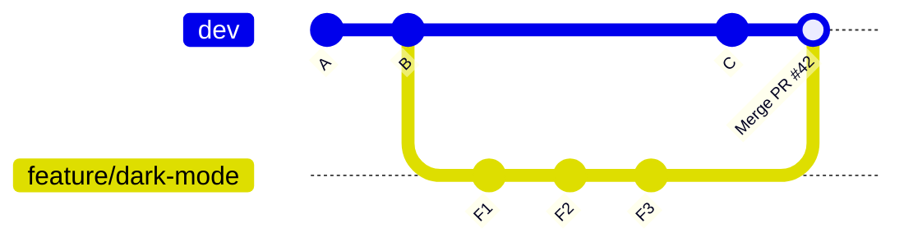
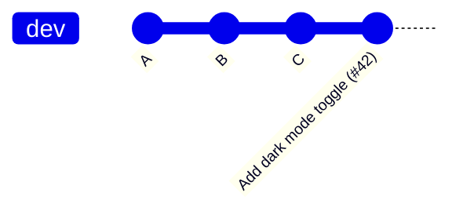
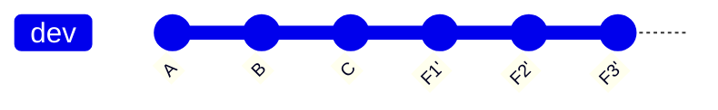
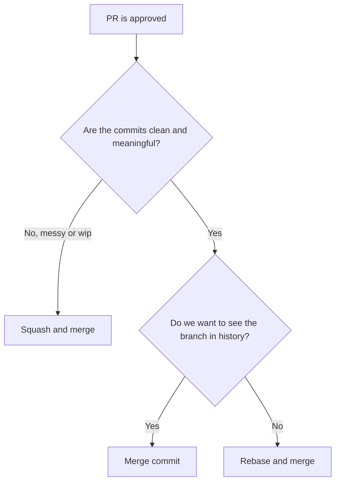
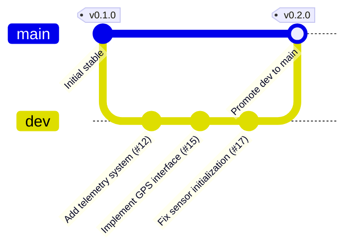

# Merge Strategy

> [!summary] In one sentence
> A **merge strategy** is the agreed way of bringing a finished branch into a shared branch (in our project: feature and bug-fix branches into `dev`, and `dev` into `main`). Git platforms offer three main methods (**merge commit**, **squash and merge**, **rebase and merge**), and each one leaves a **different shape of history**.

> [!info] About this document
> This is a purely informative guide. It explains **what** each merge method does, **why** the choice matters, and **how** to pick one, with examples. It builds on [[Feature_and_Bugfix_Branches|Feature and Bug-Fix Branches]], [[Pull_Request_Workflow|Pull Request Workflow]] and [[Rebase_Policy|Rebase Policy]]. Related topic: [[Branch_Protection|Branch Protection]].

> [!warning] About the "strategy" parts
> Section 8 follows the strategy decided in Dev_Strategy (section 8). If the team decides on different rules later, adjust that section. The rest of the document (concepts, commands, examples) stays valid either way.

> [!important] How this applies to our project (SEA:ME Autonomous Drone)
> We use **two different merge methods on purpose**:
>
> | Merge | Method | Why |
> | --- | --- | --- |
> | `feature/*` or `bugfix/*` → **`dev`** | **Squash merge** | One meaningful commit per change keeps `dev` easy to read and easy to revert |
> | **`dev`** → **`main`** | **Merge commit** | A deliberate, visible promotion point; milestones are easy to identify |
>
> `main` is the **last stable state of `dev`**. "Stable" means it passed the validation we have, so unknown errors can still exist. See [[Dev_Strategy]] for the full process.

---

## 1. The core idea

When a Pull Request is approved, its commits must end up in `dev`. **How** they get there is a choice, and it decides what `git log` looks like for years afterwards.

Imagine a branch with three commits:

```text
feature/dark-mode-toggle
  F1  Add theme context
  F2  fix typo
  F3  Add ThemeToggle component
```

Depending on the method, `dev` receives:

| Method                  | What lands in `dev`                                   |
| ----------------------- | ------------------------------------------------------ |
| **Merge commit**        | F1, F2, F3 **plus** one extra merge commit             |
| **Squash and merge**    | **One** new commit containing all the changes          |
| **Rebase and merge**    | F1', F2', F3' replayed in a straight line (no merge commit) |

> [!note] Key point
> The **code ends up the same** in all three cases. What differs is the **history**: how many commits, what they say, and whether you can still see the original branch.

---

## 2. Why does the strategy matter?

| Benefit of choosing one strategy      | What it means in practice                                                  |
| ------------------------------------- | -------------------------------------------------------------------------- |
| **Predictable history**               | Everyone knows what `dev` will look like                                  |
| **Easier debugging**                  | Finding the commit that introduced a bug is faster                         |
| **Easier rollback**                   | Undoing one feature is simple and clean                                    |
| **Readable changelog**                | Release notes can be built from the history                                |
| **Fewer arguments**                   | The team follows one rule instead of debating every PR                     |
| **Fits your tools**                   | CI/CD, `git bisect` and release tooling work best with a consistent history |

### What happens without a strategy

> [!failure] Everyone merges their own way
> - Some PRs squashed, some not, some with merge commits
> - Messy, inconsistent history
> - Hard to revert a feature cleanly
> - Confusion about which commits to trust

---

## 3. The three merge methods

### 3.1 Merge commit ("Create a merge commit")

Keeps **every commit** of the branch and adds **one merge commit** that joins the two histories.



```bash
git checkout dev
git merge --no-ff feature/dark-mode-toggle
```

| ✅ Pros                                             | ❌ Cons                                             |
| --------------------------------------------------- | --------------------------------------------------- |
| Preserves the **full, true history**                | History becomes a **graph**, harder to read         |
| Non-destructive, nothing is rewritten               | Extra merge commits add noise                       |
| The branch is **visible** in history                | Messy commits (`wip`, `fix typo`) stay forever      |
| Easy to revert the **whole PR** with one commit     | `git bisect` and `git log` are noisier              |

---

### 3.2 Squash and merge

Combines **all commits of the branch into one** new commit on `dev`.



```bash
git checkout dev
git merge --squash feature/dark-mode-toggle
git commit -m "Add dark mode toggle (#42)"
```

| ✅ Pros                                             | ❌ Cons                                             |
| --------------------------------------------------- | --------------------------------------------------- |
| **Very clean**, one commit per PR                   | Loses the **individual commits** of the branch      |
| Messy work-in-progress commits disappear            | A big PR becomes one big commit, harder to bisect inside it |
| Easy to **revert** a whole feature (one commit)     | The branch's original commits are no longer in `dev` |
| Authors don't need to tidy their commits            | Credit for multiple authors can get blurred         |

> [!warning] Don't reuse a squashed branch
> After a squash merge, Git doesn't know your branch was merged (the commit IDs are different). If you keep working on the same branch, you will get duplicate changes and conflicts. **Delete the branch** after squashing and start a new one.

---

### 3.3 Rebase and merge

Replays the branch's commits **one by one on top of `dev`**, with **no merge commit**. Each commit stays separate.



```bash
git checkout feature/dark-mode-toggle
git rebase dev
git checkout dev
git merge --ff-only feature/dark-mode-toggle
```

| ✅ Pros                                             | ❌ Cons                                             |
| --------------------------------------------------- | --------------------------------------------------- |
| **Linear history** with every commit preserved      | Commits are **rewritten** (new IDs)                 |
| No merge commits                                    | Original timestamps/context are lost                |
| Detailed, granular history for `git bisect`         | Requires **tidy commits** to be useful              |
| Each commit can be reverted individually            | Reverting a whole feature means reverting several commits |

> [!note] Related
> The platform's "Rebase and merge" button rewrites commits. The safety rules from the [[Rebase_Policy|Rebase Policy]] still apply to your branch before that point.

---

## 4. Fast-forward: the special case

A **fast-forward** happens when `dev` hasn't moved since you branched. Git simply **moves the `dev` pointer forward**, so no merge commit is needed.

```text
Before:   A -- B  (dev)
                \
                 F1 -- F2  (feature)

After:    A -- B -- F1 -- F2  (dev, feature)
```

| Flag            | Behavior                                                                  |
| --------------- | ------------------------------------------------------------------------- |
| *(default)*     | Fast-forwards if possible, otherwise creates a merge commit               |
| `--no-ff`       | **Always** creates a merge commit, even when a fast-forward is possible   |
| `--ff-only`     | **Only** merges if it can fast-forward; otherwise refuses                 |

> [!tip] Why `--no-ff` is popular
> Without it, a fast-forward merge leaves **no trace** that a branch ever existed. `--no-ff` keeps a visible "this feature was merged here" marker.

---

## 5. Comparison at a glance

| Aspect                         | Merge commit          | Squash and merge         | Rebase and merge          |
| ------------------------------ | --------------------- | ------------------------ | ------------------------- |
| **History shape**              | Graph (branches)      | Linear                   | Linear                    |
| **Commits per PR in `dev`**   | All + 1 merge commit  | **1**                    | All                       |
| **Rewrites history**           | ❌ No                 | ✅ Yes (new commit)      | ✅ Yes (new commits)      |
| **Keeps original commits**     | ✅ Yes                | ❌ No                    | ⚠️ Copies of them         |
| **Readability of `git log`**   | ⚠️ Noisy              | ✅ Very clean            | ✅ Clean                  |
| **Revert a whole PR**          | ✅ One revert         | ✅ One revert            | ⚠️ Several reverts        |
| **Hides messy commits**        | ❌ No                 | ✅ Yes                   | ❌ No                     |
| **Best for**                   | Preserving context    | Small, focused PRs       | Well-crafted commits      |

---

## 6. Step-by-step: merging a Pull Request

> [!example] Scenario
> The PR `Add dark mode toggle (#42)` is approved and all checks are green.

### Step 1: Confirm it is ready to merge

- [ ] Required **approvals** received
- [ ] All **checks** pass (build, tests, lint)
- [ ] All review **conversations resolved**
- [ ] Branch is **up to date** with `dev` (or conflicts resolved)

### Step 2: Choose the merge method

Use the method your team agreed on (see section 8). On most platforms it is a dropdown next to the green **Merge** button.

### Step 3: Write a good final message

For **squash and merge**, the final commit message is what stays in history forever, so write it well:

```text
Add dark mode toggle (#42)

Adds a theme context and a ThemeToggle button in the header.
The selected theme is saved in local storage.

Closes #42
```

### Step 4: Merge, then clean up

```bash
git checkout dev
git pull origin dev
git branch -D feature/dark-mode-toggle      # -D, because a squash merge changes the commit IDs
git push origin --delete feature/dark-mode-toggle   # if not auto-deleted
```

> [!tip] Automate cleanup
> Most platforms have a setting to **automatically delete the branch after merge**. Turn it on.

---

## 7. Choosing the right method



### Quick guidance

| Situation                                                    | Suggested method        |
| ------------------------------------------------------------ | ----------------------- |
| Small feature or bug fix with a few messy commits            | **Squash and merge**    |
| Large feature where each commit is meaningful and tested     | **Rebase and merge** or **Merge commit** |
| Promoting `dev` into `main` (our stable promotion)            | **Merge commit**        |
| Merging `main` back into `dev` (only if ever needed)           | **Merge commit**        |
| Urgent fix                                                   | **Squash and merge** (normal `bugfix/` PR into `dev`) |
| Contributor from outside the team (fork)                     | **Squash and merge**    |

---

## 8. Our team strategy

> [!abstract] Decided in Dev_Strategy
> These rules come from Dev_Strategy, section 8. Adjust them if the team decides otherwise.

### Our rules



1. **Feature and bug-fix PRs into `dev`: squash merge.** One PR = one meaningful commit on `dev`.
2. **`dev` → `main`: merge commit.** Never squash and never rebase-and-merge this PR.
3. **The PR title becomes the commit message.** Write it clearly (see [[Pull_Request_Workflow|Pull Request Workflow]]), and include the PR or issue number.
4. **Rebase and merge is not used initially.** It only makes sense for PRs with carefully crafted, individually meaningful commits.
5. **Never merge a PR with failing checks** or unresolved review comments.
6. **Delete feature and bug-fix branches after merge**, always. Never delete `dev` or `main`.
7. **Enforce it with settings:** GitHub rulesets can restrict the **allowed merge methods per branch** (`dev`: squash only, `main`: merge commit only). See [[Branch_Protection|Branch Protection]].
8. **When in doubt on a feature PR, squash.**

### Why squash into `dev` but a merge commit into `main`?

| Question | Answer |
| --- | --- |
| Why squash into `dev`? | Messy work-in-progress commits disappear, history stays readable, and a whole feature can be reverted with one commit |
| Why a merge commit into `main`? | It creates a **visible point in history** where a stable version was promoted, which makes milestones easy to find |
| Why **not** squash `dev` → `main`? | A squash creates a *new* commit that Git doesn't link to the originals, so `dev` and `main` drift apart and the next promotion shows old changes again (duplicates and conflicts) |

> [!warning] Heads-up: "up to date" rule on `main`
> After a merge-commit promotion, `main` has a merge commit that `dev` does not. If branch protection requires the PR branch to be **up to date**, the next promotion will ask you to update `dev` from `main` first. Since only `dev` ever merges into `main`, the two cannot really diverge, so we recommend **not** requiring "up to date" on `main` (see [[Branch_Protection|Branch Protection]]).

### Summary table

| Merge                                | Method                 | Notes                                          |
| ------------------------------------ | ---------------------- | ---------------------------------------------- |
| `feature/*` → `dev`                  | Squash and merge       | PR title = commit message                      |
| `bugfix/*` → `dev`                   | Squash and merge       | Include `Fixes #id`                            |
| `docs/*`, `chore/*` → `dev` (optional) | Squash and merge     | Keep it simple                                 |
| `dev` → `main`                        | **Merge commit**       | Promotion of a validated `dev`. Never squash   |
| Curated multi-commit PR              | Rebase and merge       | Not used initially                             |

---

## 9. Reverting a merge

If a merged change causes problems, **revert** it. This creates a **new commit that undoes** the change and doesn't rewrite history, so it is safe on shared branches like `dev` and `main`.

### Squash or rebase merge (normal commit)

```bash
git revert <commit-hash>
```

### Merge commit (needs the `-m` flag)

A merge commit has **two parents**, so Git needs to know which side to keep:

```bash
git revert -m 1 <merge-commit-hash>
```

> [!note] What does `-m 1` mean?
> Parent **1** is the branch you merged **into**. For a promotion that is `main`. `-m 1` says "keep the `main` side and undo what the branch brought in".

> [!note] In our project
> Reverting a **feature** in `dev` is just `git revert <hash>`, because squash merge gave it a single commit. Reverting a whole **promotion** into `main` needs `-m 1`, but it is usually better to fix the problem in `dev` and promote again.

> [!tip] Easy to forget
> This is a major reason many teams prefer **squash and merge**: reverting a feature is just `git revert <hash>`, with no `-m` flag and no multiple commits to undo.

> [!warning] Reverting a merge and re-merging later
> If you revert a merge commit and later want the **same branch** back, Git may think those changes are already handled. You'll need to **revert the revert** first. Ask for help if you run into this.

---

## 10. Common mistakes and how to avoid them

| Mistake                                      | Why it's a problem                              | How to avoid it                                                       |
| -------------------------------------------- | ----------------------------------------------- | --------------------------------------------------------------------- |
| **Everyone using a different method**        | Inconsistent, confusing history                 | Agree on one default; enforce in settings                             |
| **Bad squash commit message**                | Platform may auto-fill it with a list of `wip`s | Edit the message before merging                                       |
| **Reusing a branch after squash**            | Duplicate changes and conflicts                 | Delete the branch; start a new one                                    |
| **Squashing a huge PR**                      | One giant commit, hard to debug or revert part  | Keep PRs small (see [[Pull_Request_Workflow\|Pull Request Workflow]]) |
| **Merge commit for tiny changes**            | Clutters history with noise                     | Squash instead                                                        |
| **Squashing the `dev` → `main` promotion** | `dev` and `main` drift apart, duplicate changes next time | Always use a merge commit for promotions                |
| **Merging with failing checks**              | Breaks `dev` for everyone                      | Require passing checks via [[Branch_Protection\|Branch Protection]]   |
| **Forgetting `-m 1` when reverting a merge** | Git refuses or reverts the wrong side           | Remember merge commits have two parents                               |
| **Not deleting merged branches**             | Clutter, confusion about what's active          | Enable auto-delete after merge                                        |
| **Merging an out-of-date branch**            | Surprises when it combines with newer `dev`    | Require branches to be up to date before merging                      |

---

## 11. Cheat sheet

| Goal                                           | Command                                            |
| ---------------------------------------------- | -------------------------------------------------- |
| Merge, always creating a merge commit          | `git merge --no-ff <branch>`                       |
| Merge only if fast-forward is possible         | `git merge --ff-only <branch>`                     |
| Squash a branch into the working tree          | `git merge --squash <branch>` then `git commit`    |
| Abort a merge with conflicts                   | `git merge --abort`                                |
| See merged branches                            | `git branch --merged dev`                         |
| See branches **not** yet merged                | `git branch --no-merged dev`                      |
| Revert a normal commit                         | `git revert <hash>`                                |
| Revert a merge commit                          | `git revert -m 1 <hash>`                           |
| Show history as a graph                        | `git log --oneline --graph --decorate`             |
| Show only merge commits                        | `git log --merges`                                 |
| Show history without merge commits             | `git log --no-merges`                              |
| Delete a merged local branch                   | `git branch -d <branch>`                           |
| Delete a remote branch                         | `git push origin --delete <branch>`                |

---

## 12. Checklists

### Before merging

- [ ] Approvals received
- [ ] Checks are green
- [ ] Conversations resolved
- [ ] Branch is up to date with `dev`
- [ ] I picked the **agreed** merge method
- [ ] Final commit message is clear (for squash)

### After merging

- [ ] Remote branch deleted
- [ ] Local branch deleted
- [ ] Local `dev` updated
- [ ] Linked issue closed

---

> [!abstract] Basically
> **Three ways to merge: merge commit (keeps everything), squash (one clean commit), rebase (straight line).** Pick one default (we suggest **squash and merge**), write a clear final message, delete the branch afterwards, and enforce the rule with platform settings.

## Related

- [[Feature_and_Bugfix_Branches|Feature and Bug-Fix Branches]]
- [[Pull_Request_Workflow|Pull Request Workflow]]
- [[Rebase_Policy|Rebase Policy]]
- [[Branch_Protection|Branch Protection]]

---

## 13. Glossary

| Term                   | Meaning                                                                          |
| ---------------------- | -------------------------------------------------------------------------------- |
| **Merge**              | Combining the changes of one branch into another                                 |
| **Merge commit**       | A commit with **two parents** that joins two histories                           |
| **Squash**             | Combining many commits into a single commit                                      |
| **Fast-forward**       | Moving a branch pointer forward when no divergence exists, with no merge commit  |
| **`--no-ff`**          | Forces a merge commit even when a fast-forward is possible                       |
| **`--ff-only`**        | Refuses to merge unless a fast-forward is possible                               |
| **Linear history**     | A history with no merge commits, a straight line                                 |
| **Revert**             | Creating a new commit that undoes an earlier commit                              |
| **Promotion**          | Merging a validated `dev` into `main` to publish a new stable state            |
| **Parent (commit)**    | The commit(s) a commit is built on; a merge commit has two                       |
| **Branch** | An independent line of development in version control. |
| **CI** | Continuous Integration: automated validation of proposed changes. |
| **Commit** | A recorded snapshot of changes in a version-control repository. |
| **Mermaid** | A text-based diagram syntax rendered by compatible Markdown tools. |
| **PR** | Pull Request: a proposed change submitted for review before merging. |
| **Telemetry** | Periodic data sent from a system to report state, measurements, or health. |
