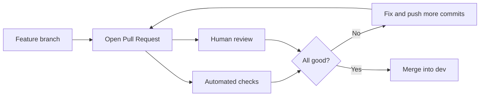
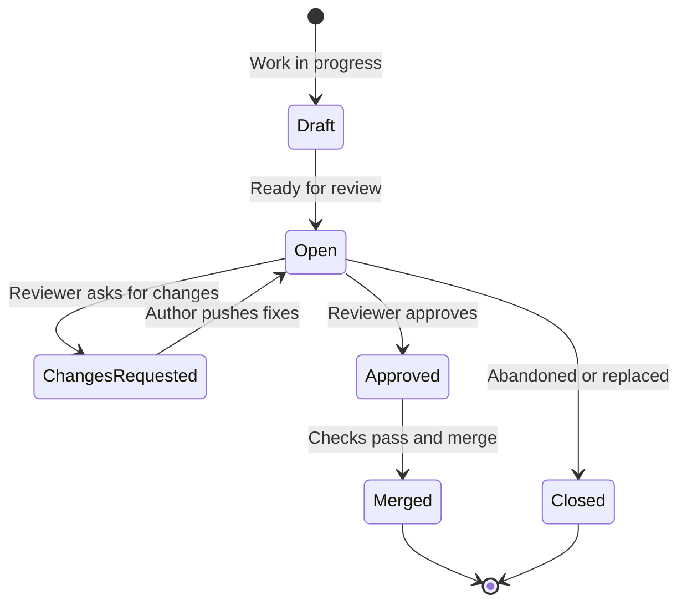

# Pull Request Workflow

> [!summary] In one sentence
> A **Pull Request (PR)** is a formal request to merge your branch into another (in our project: feature and bug-fix branches into `dev`, and `dev` into `main`), and it is the place where your changes are **discussed, reviewed, tested and approved** before they become part of the project.

> [!info] About this document
> This is a purely informative guide. It explains **what** a Pull Request is, **why** we use them, and **how** the full workflow goes, with examples. It builds on [[Feature_and_Bugfix_Branches|Feature and Bug-Fix Branches]]. Related topics: [[Rebase_Policy|Rebase Policy]], [[Merge_Strategy|Merge Strategy]], [[Branch_Protection|Branch Protection]].

> [!note] Naming
> GitHub and Bitbucket call it a **Pull Request (PR)**. GitLab calls the same thing a **Merge Request (MR)**. The idea is identical.

> [!important] How this applies to our project (SEA:ME Autonomous Drone)
> We have **two kinds of Pull Requests**, because we have two permanent branches: **`dev`** (integrated development) and **`main`** (the last stable state of `dev`).
>
> | | Feature / bug-fix PR | Promotion PR |
> | --- | --- | --- |
> | **Direction** | `feature/*` or `bugfix/*` → `dev` | `dev` → `main` |
> | **How often** | Daily, small and focused | Deliberate, when `dev` is validated |
> | **Merge method** | **Squash merge** | **Merge commit** (never squash) |
> | **Review** | At least 1 reviewer where practical | **2 approvals** |
> | **Checks** | CI (build, tests, static analysis, formatting) | CI + simulation / hardware validation as appropriate |
>
> See [[Dev_Strategy]] for the full process.

---

## 1. The core idea

You do your work on a branch. When it is ready, you don't just merge it yourself. You **open a Pull Request** that says: *"Here is my change. Please look at it, and if it's good, merge it."*

Think of it as handing your **draft to an editor** before it goes into the published book.



> [!note] Key point
> A Pull Request is **a conversation attached to a branch**. It stays open until the branch is merged or closed, and new commits pushed to the branch appear in it automatically.

---

## 2. Why should we use them?

| Benefit                  | What it means in practice                                                                       |
| ------------------------ | ----------------------------------------------------------------------------------------------- |
| **Catch bugs early**     | A second pair of eyes spots mistakes the author missed                                          |
| **Shared knowledge**     | Reviewers learn about parts of the code they don't normally touch                               |
| **Better code quality**  | People write cleaner code when they know it will be reviewed                                    |
| **Automated safety net** | Tests, linting and builds run on every PR before anything is merged                             |
| **Documented decisions** | The discussion explains *why* a change was made, long after it was merged                       |
| **Team consistency**     | Style, patterns and conventions are enforced through review                                     |
| **Protects `dev` and `main`** | Combined with [[Branch_Protection\|Branch Protection]], nothing reaches `dev` or `main` without approval |

### What happens without Pull Requests

> [!failure] Merging straight into `dev` or `main`
> - Nobody else sees the change before it goes live
> - Bugs and security problems slip through
> - No record of why something was changed
> - Knowledge stays in one person's head

### What happens with Pull Requests

> [!success] Every change is reviewed
> - Problems are found while they are still cheap to fix
> - Several people understand every change
> - There is a clear, searchable history of decisions

---

## 3. The lifecycle of a Pull Request



| State                 | Meaning                                                           |
| --------------------- | ----------------------------------------------------------------- |
| **Draft**             | Not ready yet. Shared early for feedback; cannot be merged        |
| **Open**              | Ready for review                                                  |
| **Changes requested** | A reviewer wants something changed before approving               |
| **Approved**          | A reviewer is happy with it                                       |
| **Merged**            | The branch has been combined into the target branch               |
| **Closed**            | Dropped without merging (abandoned, duplicate or replaced)        |

---

## 4. Step-by-step: the full workflow

### Step 1: Create a branch and do the work

```bash
git checkout dev
git pull origin dev
git checkout -b feature/dark-mode-toggle
# ... work and commit in small steps ...
```

See [[Feature_and_Bugfix_Branches|Feature and Bug-Fix Branches]] for naming and commit habits.

### Step 2: Self-check before pushing

- [ ] The code builds and tests pass locally
- [ ] I read through my own diff (`git diff dev...HEAD`)
- [ ] No debug code, leftover comments, secrets or unrelated changes
- [ ] The branch does **one thing**

> [!tip] Review your own PR first
> Most of the easy mistakes (a forgotten `console.log`, a stray file) are caught by simply reading your own diff before anyone else does.

### Step 3: Update your branch with the latest `dev` (rebase)

If `dev` moved while you were working, rebase your branch **before** opening the PR. This lets you resolve conflicts on your own branch instead of in the PR. See [[Rebase_Policy|Rebase Policy]].

```bash
git fetch origin
git rebase origin/dev
```

### Step 4: Push the branch

```bash
git push -u origin feature/dark-mode-toggle
```

### Step 5: Open the Pull Request

On GitHub:

1. **Base branch:** the branch you want to merge **into**. For feature and bug-fix PRs this is **`dev`** (not `main`)
2. **Compare branch:** your branch
3. Write a clear **title** and **description** (see sections 5 and 6)
4. Assign **reviewers** and add **labels**
5. Link the related **issue or ticket**
6. Choose **Draft** if it is not ready yet

### Step 6: Automated checks run

GitHub Actions runs the CI checks automatically (Dev_Strategy, sections 10 and 11):

| Check                  | Purpose                                                  |
| ---------------------- | -------------------------------------------------------- |
| **Build**              | Can the project be built?                                |
| **Unit tests**         | Do the individual components work?                       |
| **Integration tests**  | Do several components work together?                     |
| **Static analysis**    | Compiler warnings, `clang-tidy`, `cppcheck`              |
| **Formatting / style** | Does the code follow the formatting rules?               |

> [!warning] Red check = not ready
> If an automated check fails, fix it first. Don't ask humans to review a PR that doesn't pass.

### Step 7: Review and discussion

Reviewers leave comments on specific lines or on the PR as a whole, and finish with one of three verdicts:

| Verdict               | Meaning                                         |
| --------------------- | ----------------------------------------------- |
| **Comment**           | General feedback, no decision                   |
| **Approve**           | Looks good, OK to merge                         |
| **Request changes**   | Must be fixed before it can be merged           |

### Step 8: Address feedback

Make the changes on the **same branch** and push again. The PR updates automatically.

```bash
git add src/components/ThemeToggle.jsx
git commit -m "Address review: add aria-label to ThemeToggle"
git push
```

> [!tip] Respond to every comment
> Reply with "Done" or explain why you disagree. Mark conversations as **resolved** once handled, so the reviewer knows what is left.

### Step 9: Merge

Once it is approved and checks are green, the PR is merged. In our project:

- **Feature and bug-fix PRs into `dev`:** **squash merge**. The PR title becomes the commit message, so write it well (section 5).
- **Promotion PRs from `dev` into `main`:** **merge commit**, never squash.

The reasons are explained in [[Merge_Strategy|Merge Strategy]].

### Step 10: Clean up

```bash
git checkout dev
git pull origin dev
git branch -D feature/dark-mode-toggle      # -D, because squash merge changes the commit IDs
git push origin --delete feature/dark-mode-toggle   # if not auto-deleted
```

### Promotion PRs (`dev` → `main`)

A promotion PR is how a validated state of `dev` becomes the new stable `main`. It is rare and deliberate.

1. **Validate `dev`** to the level the changes require (CI, simulation, hardware bench test, flight test if appropriate)
2. **Open a PR** with base `main` and compare `dev`
3. **List what is included** (merged PRs, issues, requirement IDs) and what validation was done
4. Get **2 approvals** and resolve all conversations
5. Merge with a **merge commit**. **Never squash** this PR, or `dev` and `main` will diverge and the next promotion will conflict
6. Optionally **tag** the stable version (e.g. `v0.2.0`)

> [!note] "Stable" does not mean "bug-free"
> `main` is the last version of `dev` that **passed the validation we have**. Unknown errors can still exist, which is why the validation level (and the review) is stricter than for a feature PR.

> [!warning] Heads-up: "up to date" rule on `main`
> After a merge-commit promotion, `main` contains a merge commit that `dev` doesn't have. If branch protection requires the PR branch to be **up to date**, the next promotion will demand updating `dev` from `main` first. See [[Branch_Protection|Branch Protection]] and [[Merge_Strategy|Merge Strategy]] for the recommended setting.

---

## 5. Writing a good title

The title should say **what the PR does**, in a short sentence.

| ❌ Bad title        | ✅ Good title                                  | Why                                  |
| ------------------- | ---------------------------------------------- | ------------------------------------ |
| `Fix`               | `Fix cart total when discount code is applied` | Says what was fixed                  |
| `Update stuff`      | `Add dark mode toggle to header`               | Says what was added                  |
| `Changes`           | `Update dependencies to latest patch versions` | Describes the actual change          |
| `WIP`               | `[WIP] Add CSV export for reports`             | Clearly marked and still descriptive |

> [!tip] If your team tracks tickets
> Include the ticket number: `[#123] Add CSV export for reports`.

---

## 6. Writing a good description

A good description saves the reviewer time. It answers: **What? Why? How to check?**

### Template

Our template comes from Dev_Strategy (section 17) and lives in `.github/pull_request_template.md`, so GitHub pre-fills it for every PR.

```markdown
## Description

What was changed?

## Related Issue

Closes #XX

## Requirements

REQ-XXX-XXX

## Testing

- [ ] Build passes
- [ ] Unit tests pass
- [ ] Integration tests pass
- [ ] Simulation tested
- [ ] Hardware tested
- [ ] Flight tested

## Notes

Anything reviewers should know?
```

> [!tip] Not every change needs every test
> Tick only the validation that is **relevant**, and say briefly why the rest is skipped (for example "no motor output changed, so no hardware test").

### Example

> [!example] Filled-in description
> **Description:** Adds the first version of waypoint navigation: accepts a predefined waypoint, calculates the direction and handles the arrival tolerance.
> **Related Issue:** Closes #42
> **Requirements:** REQ-NAV-001
> **Testing:** ✅ build, ✅ unit tests, ✅ integration tests, ✅ simulation. Hardware and flight not relevant yet (no actuator output changed).
> **Notes:** The arrival tolerance is configurable in `config/`.

> [!warning] Closing keywords only work on the default branch
> `Closes #42` links the issue, but GitHub only **closes it automatically when the PR is merged into the repository's default branch**. If the default branch is `main`, feature PRs merged into `dev` will **not** close their issues. Decide as a team: either set **`dev` as the default branch** (feature PRs then close their issues), or close issues manually when `dev` is promoted to `main`.

---

## 7. Keep Pull Requests small

> [!warning] Big PRs get worse reviews
> Reviewers get tired. A 2000-line PR usually gets a quick "looks good" and hidden bugs. A 150-line PR gets real attention.

| PR size              | Typical result                  |
| -------------------- | ------------------------------- |
| **Under ~200 lines** | Fast, thorough review           |
| **200 to 500 lines** | Acceptable, but needs more time |
| **500+ lines**       | Slow, shallow review, high risk |

**Rules of thumb:**

- One PR = **one purpose**
- Aim for a review that takes **under ~30 minutes**
- Split big features into several PRs that each leave `dev` working
- Separate **refactoring** from **new behaviour** into different PRs

---

## 8. For the author: best practices

- [x] Open a **Draft PR** early if you want feedback on direction
- [x] Review **your own diff** before requesting review
- [x] Explain **why**, not only what
- [x] Add **screenshots** or recordings for UI changes
- [x] Add or update **tests**
- [x] Respond to **every** comment politely
- [x] Don't take feedback personally: the review is about the **code**, not you
- [ ] Don't push huge unrelated changes into an open PR
- [ ] Don't merge your own PR without review (unless the team rules allow it)

---

## 9. For the reviewer: best practices

### What to look at

| Area              | Questions to ask                                                       |
| ----------------- | ---------------------------------------------------------------------- |
| **Correctness**   | Does it do what it says? Any edge cases or bugs?                       |
| **Design**        | Is the approach reasonable? Is it too complex?                         |
| **Readability**   | Can I understand it without the author explaining?                     |
| **Tests**         | Are the important cases covered?                                       |
| **Security**      | Any user input, secrets or permissions handled unsafely?               |
| **Scope**         | Does it only do what the PR says?                                      |

### Extra questions for our drone project

Reviewers should not focus only on style. Because the code controls real hardware, also ask (Dev_Strategy, section 18):

- Does this solve the intended problem and satisfy the **requirement**?
- Could this **fail on real hardware**?
- What happens with **invalid input**?
- What happens when **communication is lost**?
- What happens when a **sensor provides bad data**?
- Are **failure modes** handled?
- Are the **tests sufficient**?

### How to give feedback

| ❌ Unhelpful                  | ✅ Helpful                                                              |
| ----------------------------- | ----------------------------------------------------------------------- |
| `This is wrong.`              | `This will crash if the list is empty. Could we add a check?`           |
| `Why did you do it like this?`| `Could you explain the reason for X? I would have expected Y.`          |
| `Bad naming.`                 | `Maybe rename 'data' to 'userProfile' to make the intent clearer?`      |

> [!tip] Label the importance of comments
> Prefixes help the author know what is blocking:
> - **`blocking:`** must be fixed before merge
> - **`suggestion:`** a good idea, but optional
> - **`nit:`** tiny style detail, ignore if you disagree
> - **`question:`** just asking to understand
> - **`praise:`** something done well. Positive feedback matters too.

### Reviewer habits

- [x] Review **promptly** (aim for within a working day) so the author isn't blocked
- [x] Be **kind and specific**
- [x] **Approve** when it is good enough, not only when it is perfect
- [ ] Don't rewrite the author's code in your style when theirs works
- [ ] Don't approve without actually reading it

---

## 10. Common mistakes and how to avoid them

| Mistake                                 | Why it's a problem                          | How to avoid it                                                      |
| --------------------------------------- | ------------------------------------------- | -------------------------------------------------------------------- |
| **Huge PR** with many unrelated changes | Impossible to review properly               | One purpose per PR; split work up                                    |
| **Empty description**                   | Reviewer has no context                     | Use the template in section 6                                        |
| **Opening PR with failing checks**      | Wastes reviewers' time                      | Fix CI first                                                         |
| **No self-review**                      | Silly mistakes reach the reviewer           | Read your own diff before requesting review                          |
| **PR sits unreviewed for days**         | Blocks work, branch drifts, conflicts grow  | Review quickly; ping reviewers politely                              |
| **Arguing in comments**                 | Slows everything, damages trust             | Move to a quick call, then summarize in the PR                       |
| **Rewriting the branch during review**  | Reviewer loses track of what changed        | Rebase **before** opening the PR. During review only rebase when needed (conflicts, `dev` moved), use `--force-with-lease` and tell the reviewer. No need to squash by hand, the squash merge does it (see [[Rebase_Policy\|Rebase Policy]]) |
| **Merging with unresolved comments**    | Valid concerns get forgotten                | Resolve or reply to every conversation                               |
| **Mixing refactor and feature**         | Hard to see what actually changed behaviour | Separate PRs                                                         |
| **Wrong base branch** (feature PR into `main`) | Unreviewed, untested code skips `dev` | Always set the base to `dev`. Only promotion PRs target `main` |

---

## 11. Handling merge conflicts

A **merge conflict** happens when your branch and the target branch changed the same lines. Git can't decide, so a human must.

```bash
# Bring the latest dev under your commits
git fetch origin
git rebase origin/dev
# Git stops at a conflicting commit. Edit the files, then:
git add <resolved-files>
git rebase --continue
# Push the rewritten branch (only if it was already pushed)
git push --force-with-lease
```

Conflict markers look like this:

```text
<<<<<<< HEAD
your version of the line
=======
the version from dev
>>>>>>> origin/dev
```

> [!tip] Reduce conflicts
> Keep branches **small and short-lived**, sync with `dev` often, and tell teammates when you're making large changes to shared files. Our default for updating a feature branch is **rebase** (see [[Rebase_Policy|Rebase Policy]]).

---

## 12. Quick example: a PR from start to finish

> [!example] Scenario
> Fix: cart total is wrong when a discount code is applied.

1. **Branch:** `bugfix/cart-total-with-discount`
2. **Commits:**
   - `Add failing test for cart total with discount`
   - `Fix discount being applied before tax`
3. **PR title:** `Fix cart total when discount code is applied`
4. **Description:** what was wrong, why, how to test, `Fixes #87`
5. **Checks:** build ✅ tests ✅ lint ✅
6. **Review:** reviewer asks: *"suggestion: extract the tax calculation into a helper"*
7. **Author:** pushes a follow-up commit, replies "Done", resolves the thread
8. **Approval:** reviewer approves
9. **Merge:** squash merged into `dev` (see [[Merge_Strategy|Merge Strategy]])
10. **Cleanup:** branch deleted, issue #87 closed (see the closing-keywords warning in section 6)

---

## 13. Quick reference

### Useful commands

| Goal                                      | Command                                         |
| ----------------------------------------- | ----------------------------------------------- |
| See what my PR will contain               | `git diff dev...HEAD`                          |
| See my commits not yet in `dev`          | `git log dev..HEAD --oneline`                  |
| Push new commits to update the PR         | `git push`                                      |
| Put my commits on top of the latest `dev` | `git fetch origin && git rebase origin/dev`       |
| Check out someone else's PR branch        | `git fetch origin && git checkout <branch-name>`|

> [!note] GitHub CLI (optional)
> If you use `gh`, you can create and manage PRs from the terminal:
> ```bash
> gh pr create --title "Add dark mode toggle" --body "Closes #42"
> gh pr list
> gh pr checkout 42
> gh pr merge 42
> ```

### Checklists

**Before opening a PR**

- [ ] Branch does one thing
- [ ] Builds and tests pass locally
- [ ] I reviewed my own diff
- [ ] Clear title and description
- [ ] Linked issue or ticket

**Before approving a PR**

- [ ] I read and understood the change
- [ ] Automated checks are green
- [ ] Tests cover the important cases
- [ ] My comments are clear and kind

**Before merging a PR**

- [ ] Required approvals received
- [ ] All conversations resolved
- [ ] Checks pass
- [ ] Up to date with the target branch

---

> [!abstract] Basically
> **Branch, push, open a PR, let checks run, get reviewed, fix feedback, merge, clean up.** Keep PRs small, explain the *why*, and review others the way you'd like to be reviewed.

## Related

- [[Feature_and_Bugfix_Branches|Feature and Bug-Fix Branches]]
- [[Rebase_Policy|Rebase Policy]]
- [[Merge_Strategy|Merge Strategy]]
- [[Branch_Protection|Branch Protection]]

---

## 14. Glossary

| Term                  | Meaning                                                                          |
| --------------------- | -------------------------------------------------------------------------------- |
| **Pull Request (PR)** | A request to merge one branch into another, used for review                      |
| **Merge Request (MR)**| GitLab's name for a Pull Request                                                 |
| **Base branch**       | The branch you want to merge **into** (e.g. `dev`)                               |
| **Promotion PR**      | A PR from `dev` into `main`, merged with a merge commit                      |
| **Compare branch**    | The branch with your changes                                                     |
| **Reviewer**          | A person asked to check the changes                                              |
| **Draft PR**          | A PR marked as not ready for merge or final review                               |
| **CI**                | Continuous Integration: automatic builds and tests on every change               |
| **Diff**              | The exact lines that were added, removed or changed                              |
| **Approve**           | A reviewer's sign-off that the change is good                                    |
| **Resolve**           | Marking a review conversation as handled                                         |
| **Merge conflict**    | When two branches changed the same lines and a human must decide                 |
| **Branch** | An independent line of development in version control. |
| **Commit** | A recorded snapshot of changes in a version-control repository. |
| **Mermaid** | A text-based diagram syntax rendered by compatible Markdown tools. |
| **PR** | Pull Request: a proposed change submitted for review before merging. |
| **REQ** | Requirement ID of the form `REQ-<SYS, NAV, SEN, COM, CTL, SAF, PWR, SW or HW>-NNN`, used for traceability. |
