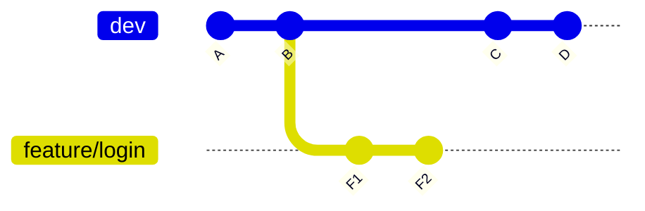
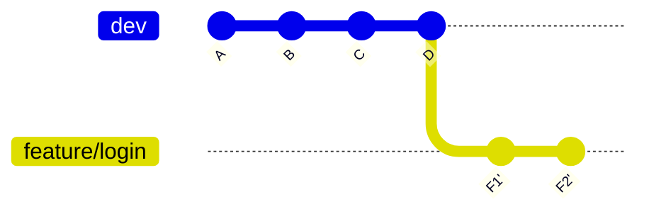
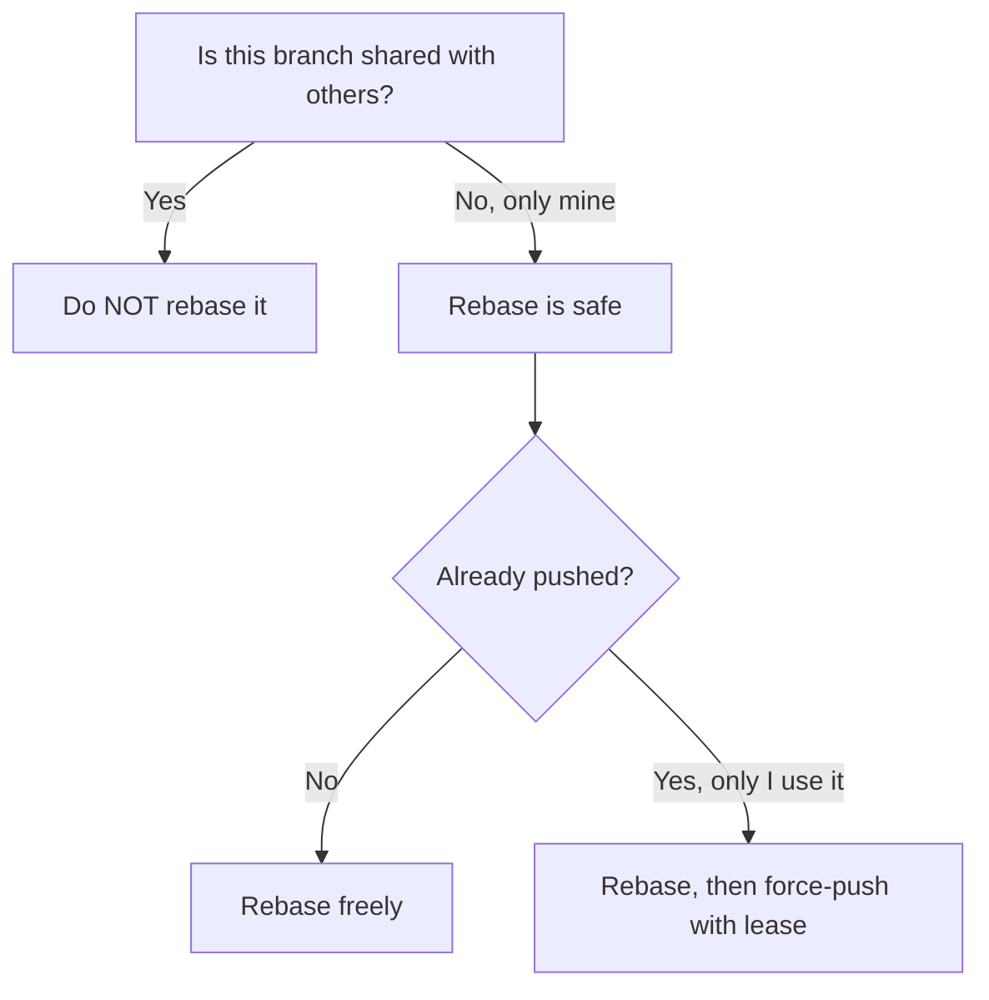
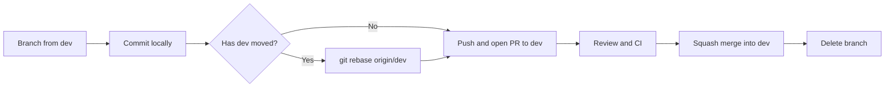

# Rebase Policy

> [!summary] In one sentence
> **Rebase** takes the commits of your branch and **replays them on top of a newer base**, giving you a clean, straight history. It **rewrites commits**, so it is powerful but must follow a few strict rules.

> [!info] About this document
> This is a purely informative guide. It explains **what** rebase is, **why** and **when** to use it, and **how** to do it safely, with examples. It builds on [[Feature_and_Bugfix_Branches|Feature and Bug-Fix Branches]] and [[Pull_Request_Workflow|Pull Request Workflow]]. Related topics: [[Merge_Strategy|Merge Strategy]], [[Branch_Protection|Branch Protection]].

> [!warning] About the "policy" parts
> Section 9 follows the rules decided in Dev_Strategy (section 7). If the team decides on different rules later, adjust that section. The rest of the document (concepts, commands, examples) stays valid either way.


> [!important] How this applies to our project (SEA:ME Autonomous Drone)
> - **We rebase feature and bug-fix branches onto the latest `dev`.** This keeps them up to date and lets conflicts be resolved on the branch *before* the Pull Request is merged.
> - **`dev` and `main` are never rebased.** They are shared and protected. `dev` → `main` is promoted with a merge commit (see [[Merge_Strategy|Merge Strategy]]).
> - Feature PRs are **squash merged** into `dev`, so you don't need to polish your commit history by hand.
>
> See [[Dev_Strategy]] for the full process.

---

## 1. The core idea

Say you branched off `dev`, and meanwhile `dev` moved forward. Your branch is now based on an **old** commit.



There are two ways to bring your branch up to date:

| Approach   | What it does                                                              |
| ---------- | ------------------------------------------------------------------------- |
| **Merge**  | Adds a new **merge commit** that joins the two histories                  |
| **Rebase** | **Moves** your commits so they start from the latest `dev`               |

### Rebase result



> [!note] Key point
> After a rebase, `F1` and `F2` become **new commits** (`F1'` and `F2'`). They have the same changes but **different commit IDs**. Rebase doesn't move commits. It **copies** them onto a new base and abandons the old ones.

> [!tip] Analogy
> Imagine you wrote a chapter based on version 1 of a book. Meanwhile the book moved to version 3. Rebasing means **rewriting your chapter as if you had started from version 3**.

---

## 2. Why use rebase?

| Benefit                  | What it means in practice                                                      |
| ------------------------ | ------------------------------------------------------------------------------ |
| **Linear history**       | `git log` reads like a straight line, easy to follow                           |
| **No noise commits**     | No "Merge branch 'dev' into feature" commits cluttering history               |
| **Cleaner Pull Requests**| Your branch contains only *your* commits, on top of the latest code            |
| **Easier debugging**     | Tools like `git bisect` work more smoothly on a linear history                 |
| **Tidy commits**         | Interactive rebase lets you clean up messy commits before review               |

### Merge vs rebase at a glance

| Aspect               | Merge                                      | Rebase                                          |
| -------------------- | ------------------------------------------ | ----------------------------------------------- |
| **History shape**    | Branches and merge commits (a graph)       | Straight line                                   |
| **Rewrites history** | ❌ No                                      | ✅ Yes (creates new commits)                    |
| **Safety**           | Very safe, non-destructive                 | Safe only if used correctly                     |
| **Conflicts**        | Resolved **once**                          | May be resolved **once per replayed commit**    |
| **Keeps true timeline** | ✅ Yes                                  | ❌ Original timing is lost                      |
| **Best for**         | Shared branches, preserving context        | Your own local or feature branch                |

> [!note] Neither is "better"
> Merge and rebase solve the same problem in different ways. Many teams use **both**: rebase to tidy a personal branch, merge to integrate it. How your team integrates PRs is covered in [[Merge_Strategy|Merge Strategy]].

---

## 3. The Golden Rule

> [!danger] Never rebase commits that other people are using
> **Only rebase commits that exist only on your own branch.** Never rebase `main`, `dev` or any shared branch that others have pulled.

### Why?

Rebase **replaces** commits with new ones. If a teammate has the old commits, their history and yours no longer match, and Git sees them as two different histories. This causes duplicate commits, confusing conflicts and lost work.



---

## 4. Basic rebase: step by step

> [!example] Scenario
> You are on `feature/dark-mode-toggle`. `dev` has new commits. You want your branch to start from the latest `dev`.

### Step 1: Make sure your work is committed

```bash
git status
```

The working tree should be clean. If not, commit or `git stash` first.

### Step 2: Fetch the latest changes

```bash
git fetch origin
```

### Step 3: Rebase onto `dev`

```bash
git rebase origin/dev
```

> [!tip] Shortcut
> `git pull --rebase origin dev` does the fetch and rebase in one step.

### Step 4: If conflicts appear, resolve them (see section 6)

### Step 5: Check the result

```bash
git log --oneline --graph -10
```

### Step 6: Push (history was rewritten)

If the branch was **already pushed**, a normal `git push` will be rejected because the histories differ. Use:

```bash
git push --force-with-lease
```

> [!warning] Never use plain `--force`
> `--force-with-lease` refuses to overwrite the remote if someone else has pushed new work you haven't seen. Plain `--force` blindly destroys it. See section 7.

---

## 5. Interactive rebase: cleaning up your commits

`git rebase -i` lets you **edit, reorder, combine or drop** your own commits, usually before opening or finishing a Pull Request.

> [!note] Optional in our project
> Because feature PRs are **squash merged** into `dev`, messy commits (`wip`, `fix typo`) never reach `dev`. Interactive rebase is therefore a **nice-to-have** for making review easier, not a requirement.

### Example: a messy branch

```text
a1b2c3 Add theme context
d4e5f6 oops forgot a file
g7h8i9 Add ThemeToggle component
j0k1l2 fix typo
m3n4o5 wip
```

### Start it

```bash
git rebase -i HEAD~5      # the last 5 commits
# or: git rebase -i origin/dev   # all commits since dev
```

Git opens an editor with a list:

```text
pick a1b2c3 Add theme context
pick d4e5f6 oops forgot a file
pick g7h8i9 Add ThemeToggle component
pick j0k1l2 fix typo
pick m3n4o5 wip
```

### Commands you can use

| Command       | Short | What it does                                                    |
| ------------- | ----- | --------------------------------------------------------------- |
| `pick`        | `p`   | Keep the commit as is                                           |
| `reword`      | `r`   | Keep the changes, **edit the message**                          |
| `edit`        | `e`   | Pause so you can change the commit's contents                   |
| `squash`      | `s`   | **Combine** into the previous commit, keep both messages        |
| `fixup`       | `f`   | Combine into the previous commit, **discard** this message      |
| `drop`        | `d`   | **Delete** the commit entirely                                  |

### Edit the list

```text
pick a1b2c3 Add theme context
fixup d4e5f6 oops forgot a file
pick g7h8i9 Add ThemeToggle component
fixup j0k1l2 fix typo
drop m3n4o5 wip
```

### Result

```text
x1y2z3 Add theme context
q4r5s6 Add ThemeToggle component
```

> [!success] Two clean commits
> Five messy commits became two commits, each with a clear purpose and message.

> [!tip] Rule of thumb for commit order
> The list is shown **oldest first** (the opposite of `git log`). A `squash` or `fixup` always merges into the line **above** it.

### Handy shortcut: autosquash

If you know a commit is a fix for an earlier one:

```bash
git commit --fixup <commit-hash>
# later, when ready to tidy up:
git rebase -i --autosquash origin/dev
```

Git will automatically place and mark the fixup commits for you.

---

## 6. Handling conflicts during a rebase

Rebase replays commits **one at a time**, so a conflict can stop it mid-way.

```text
CONFLICT (content): Merge conflict in src/App.jsx
error: could not apply a1b2c3... Add theme context
```

### What to do

```bash
# 1. Open the conflicted files and fix them (look for <<<<<<< markers)
# 2. Mark them as resolved
git add src/App.jsx

# 3. Continue to the next commit
git rebase --continue
```

Repeat until the rebase finishes.

### Your escape hatches

| Situation                                  | Command                  |
| ------------------------------------------ | ------------------------ |
| I'm lost, **cancel everything**            | `git rebase --abort`     |
| Skip this commit completely                | `git rebase --skip`      |
| Continue after fixing a conflict           | `git rebase --continue`  |

> [!tip] Don't panic
> `git rebase --abort` returns your branch **exactly** to how it was before you started. It is always safe to try.

### Conflict markers reminder

```text
<<<<<<< HEAD
the version from the branch you are rebasing onto (e.g. dev)
=======
your commit's version
>>>>>>> a1b2c3 (Add theme context)
```

> [!note] Meaning flips during rebase
> During a rebase, `HEAD` (the "ours" side) is the **upstream** branch you are rebasing onto, and the commit being replayed is "theirs". This is the opposite of what many people expect, so read the markers carefully.

---

## 7. Force pushing safely

After a rebase of a branch that was already pushed, the remote has the **old** commits and you have the **new** ones. Git rejects a normal push, so you must force it.

| Command                     | Safety     | Behavior                                                                  |
| --------------------------- | ---------- | ------------------------------------------------------------------------- |
| `git push`                  | Safe       | Rejected after a rebase                                                   |
| `git push --force`          | ❌ Dangerous | Overwrites the remote no matter what                                    |
| `git push --force-with-lease` | ✅ Safer | Overwrites only if the remote is what you last saw                        |

```bash
git push --force-with-lease
```

### Rules for force pushing

- [x] Only force-push **your own feature or bug-fix branch**
- [x] Always use `--force-with-lease`, never plain `--force`
- [x] Tell your reviewer if you force-pushed during a review
- [ ] **Never** force-push to `main`, `dev` or any shared branch
- [ ] Don't force-push if someone else is working on the same branch

> [!info] Protection
> [[Branch_Protection|Branch Protection]] rules can **block force pushes** to important branches like `main` and `dev`, so mistakes there are impossible.

---

## 8. When to rebase, and when not to

### ✅ Good times to rebase

| Situation                                                | Why                                              |
| -------------------------------------------------------- | ------------------------------------------------ |
| Updating **your own** feature branch with latest `dev`  | Keeps history linear, no merge commit            |
| Putting your commits on top of the latest `dev` **before** opening a PR | Conflicts are resolved on your branch, not in the PR |
| Fixing up a small mistake in a recent commit             | Squash it in instead of adding "oops" commits    |
| Branch has **not been shared** with anyone               | Nobody else is affected                          |

### ❌ Bad times to rebase

| Situation                                              | Why                                                  |
| ------------------------------------------------------ | ---------------------------------------------------- |
| On `main`, `dev` or any **shared branch**          | Breaks everyone else's history                       |
| After **someone else based work** on your branch       | Their work will conflict with the rewritten commits  |
| In the **middle of a review**, with many comments      | Reviewer loses track of what changed since last look |
| When you're **unsure** what it will do                 | Use merge; it's the safe option                      |
| Commits have already been **released or tagged**       | Rewriting released history causes confusion          |

---

## 9. Recommended team policy

> [!abstract] Suggested defaults
> These are recommended defaults. Adjust to fit your team.

### Rules

1. **Never rebase `main`, `dev` or any other shared branch.** They are protected.
2. **Feature and bug-fix branches are rebased onto `dev`.** This is our default way to keep them up to date (we don't merge `dev` into them).
3. **Rebase before opening a PR** if `dev` has moved, so conflicts are resolved on the feature branch ("Rebase onto latest `dev` if necessary" in Dev_Strategy).
4. **Tidying commits is optional.** The squash merge turns the PR into one commit on `dev`, so `wip` and `fix typo` commits never reach it.
5. **During a review, rebase only when needed** (conflicts, or `dev` changed something you depend on). Use `--force-with-lease` and tell the reviewer.
6. **Always push with `--force-with-lease`**, never `--force`.
7. **If two people work on the same branch, don't rebase it.** Coordinate first.
8. **When in doubt, merge `dev` into your branch instead.** It is always safe, and because of the squash merge the extra merge commit never reaches `dev`.

### Summary table

| Branch / situation                  | Rebase allowed? | Notes                                           |
| ----------------------------------- | --------------- | ----------------------------------------------- |
| `main`                              | ❌ Never        | Protected. Only receives `dev` through a merge commit |
| `dev`                               | ❌ Never        | Protected, shared integration branch            |
| Any other shared branch             | ❌ Never        | Others depend on it                             |
| Your own feature / bug-fix branch   | ✅ Yes (default) | Rebase onto `dev`; `--force-with-lease` after pushing |
| Feature branch shared with a teammate | ⚠️ Avoid      | Agree first, or use merge                       |
| During active PR review             | ⚠️ Only if needed | Conflicts or relevant `dev` changes; tell the reviewer |
| Before opening a PR                 | ✅ Recommended  | Rebase onto the latest `dev`                    |

### Our workflow at a glance



---

## 10. If something goes wrong: recovery

Rebase **doesn't delete** your old commits immediately. Git keeps them in the **reflog** for a while (typically 30+ days).

### Find where you were before the rebase

```bash
git reflog
```

Example output:

```text
a1b2c3d HEAD@{0}: rebase (finish): returning to refs/heads/feature/dark-mode-toggle
e4f5g6h HEAD@{1}: rebase (pick): Add ThemeToggle component
i7j8k9l HEAD@{5}: commit: Add ThemeToggle component   <-- before rebase
```

### Go back to the old state

```bash
git reset --hard HEAD@{5}
```

> [!tip] Safety net before a risky rebase
> Create a backup branch first. It costs nothing. Make sure you are on **your own feature branch** (never `dev` or `main`) before you start:
> ```bash
> git checkout feature/42-gps-interface
> git fetch origin
> git branch backup/gps-interface-before-rebase
> git rebase origin/dev
> # if it goes badly: git reset --hard backup/gps-interface-before-rebase
> ```
> Use `git rebase -i origin/dev` instead if you also want to tidy commits (optional in our workflow, see section 5).

---

## 11. Common mistakes and how to avoid them

| Mistake                                      | Why it's a problem                              | How to avoid it                                  |
| -------------------------------------------- | ----------------------------------------------- | ------------------------------------------------ |
| **Rebasing a shared branch**                 | Duplicates commits, breaks teammates' work      | Follow the Golden Rule (section 3)               |
| **Using `git push --force`**                 | Can overwrite a teammate's pushed work          | Always `--force-with-lease`                      |
| **Rebasing in the middle of a review**       | Reviewer can't see what changed                 | Only rebase when needed; use `--force-with-lease` and tell the reviewer |
| **Rebasing with uncommitted changes**        | Git refuses or changes get tangled              | Commit or `git stash` first                      |
| **Panicking during conflicts**               | Wrong resolution, lost changes                  | `git rebase --abort`, then try again calmly      |
| **Squashing everything into one giant commit** | Loses useful history                          | Keep logical, meaningful commits                 |
| **Rebasing the wrong direction**             | Replaying `dev` onto your branch by mistake    | Remember: you are on **your** branch, rebasing **onto** `dev` |
| **Thinking the old commits are gone**        | Fear of experimenting                           | `git reflog` can recover them                    |

---

## 12. Cheat sheet

| Goal                                           | Command                                        |
| ---------------------------------------------- | ---------------------------------------------- |
| Rebase my branch onto latest `dev`            | `git fetch origin && git rebase origin/dev`   |
| Fetch and rebase in one step                   | `git pull --rebase origin dev`                |
| Interactive rebase of the last N commits       | `git rebase -i HEAD~N`                         |
| Interactive rebase of all commits since `dev` | `git rebase -i origin/dev`                    |
| Create a fixup commit for an earlier commit    | `git commit --fixup <hash>`                    |
| Auto-arrange fixup commits                     | `git rebase -i --autosquash origin/dev`       |
| Continue after resolving a conflict            | `git rebase --continue`                        |
| Cancel the rebase completely                   | `git rebase --abort`                           |
| Skip the current commit                        | `git rebase --skip`                            |
| Push after a rebase                            | `git push --force-with-lease`                  |
| See history of where HEAD has been            | `git reflog`                                   |
| Make a backup branch                           | `git branch backup/name`                       |
| Always rebase on pull (optional setting)       | `git config --global pull.rebase true`         |

---

## 13. Checklists

### Before rebasing

- [ ] The branch is **mine** and nobody else is using it
- [ ] My working tree is clean (committed or stashed)
- [ ] I created a **backup branch** (for anything risky)
- [ ] I fetched the latest changes (`git fetch origin`)

### After rebasing

- [ ] `git log --oneline --graph` looks as expected
- [ ] The code still **builds and tests pass**
- [ ] I'm pushing with `--force-with-lease`, not `--force`
- [ ] I told my reviewer if the PR was already under review

---

> [!abstract] Basically
> **Rebase = replay your commits on a newer base for a clean, linear history.** Only do it on branches that are yours alone, always push with `--force-with-lease`, and remember `git rebase --abort` and `git reflog` are your safety nets.

## Related

- [[Feature_and_Bugfix_Branches|Feature and Bug-Fix Branches]]
- [[Pull_Request_Workflow|Pull Request Workflow]]
- [[Merge_Strategy|Merge Strategy]]
- [[Branch_Protection|Branch Protection]]

---

## 14. Glossary

| Term                   | Meaning                                                                          |
| ---------------------- | -------------------------------------------------------------------------------- |
| **Rebase**             | Replaying commits onto a new base, creating new commits                          |
| **Base**               | The commit your branch starts from                                               |
| **Upstream**           | The branch you are rebasing onto or tracking (e.g. `origin/dev`)                |
| **Interactive rebase** | Rebase with an editor to reorder, edit, squash or drop commits                   |
| **Squash**             | Combine several commits into one                                                 |
| **Fixup**              | Like squash, but throws away the fixup commit's message                          |
| **`--force-with-lease`** | A safer force push that checks nobody else has pushed in the meantime          |
| **Reflog**             | Git's private log of where your branch pointers have been, used for recovery     |
| **Linear history**     | A history with no merge commits, a straight line of commits                      |
| **Shared branch**      | A branch other people pull from or work on                                       |
| **Force push**         | Pushing that overwrites the remote's history                                     |
| **Branch** | An independent line of development in version control. |
| **CI** | Continuous Integration: automated validation of proposed changes. |
| **Commit** | A recorded snapshot of changes in a version-control repository. |
| **Mermaid** | A text-based diagram syntax rendered by compatible Markdown tools. |
| **PR** | Pull Request: a proposed change submitted for review before merging. |
