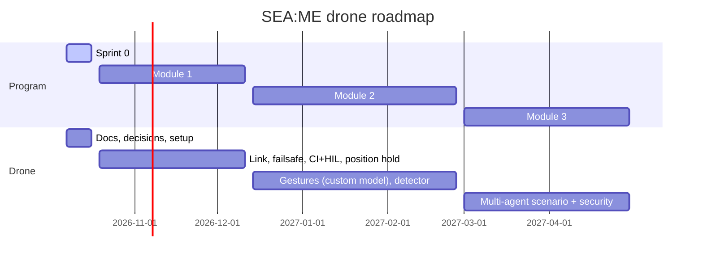

# Roadmap to April 2027

Dates from the SEA:ME 3.0 program README, corrected with the real start date (**7 Oct 2026**). Teams stay on their platform through Module 2 and work **across platforms in Module 3**. That is where "another piece of hardware" naturally happens.

---

## 1. Timeline

Breaks: Christmas 21 Dec – 3 Jan, Carnival 8–12 Feb, Easter 22–26 Mar.

## 2. Milestones and versions

Versions follow [[Dev_Strategy]] §20 (tags on `main`):

| Version | When | Content |
|---|---|---|
| `v0.1.0` | 11 Dec 2026 | Module 1: link, failsafe, position hold, CI+HIL |
| `v0.2.0` | 26 Feb 2027 | Module 2: gesture model, detector, estimation |
| `v0.3.0` | 30 Apr 2027 | Module 3: multi-agent scenario, signed OTA |

## 3. Module 1 (19 Oct – 11 Dec)

See [[Study Plan v2]].

## 4. Module 2 (14 Dec – 26 Feb) · Perception, Edge AI

- **Gestures as edge inference** (accepted by instructors). Grow [[01 Gesture Recognition with OpenCV and MediaPipe|Gesture Recognition Program]] from rule-based static gestures to a **trained classifier on hand landmarks**: versioned dataset, reproducible training, model card, INT8 accuracy before/after, latency and power budget.
- Drone camera (MS210x grabber) **detector producing target coordinates** (e.g., a marker or object) for the inspection-sweep milestone.
- **Portability proof:** run the gesture node on a second hardware class (e.g., command the car's `cmd_vel` or the arm). See [[00 Gesture Pipeline|Gesture Pipeline]].
- Calibration report (camera intrinsics, time offsets). VIO experiments.

## 5. Module 3 (1 Mar – 30 Apr) · Multi-agent

- Likely scenario **A (Drone + Car)** or **E (Drone + Humanoid)**: the drone publishes target coordinates in a shared frame.
- Security package: threat model (`[[Drone Link Threat Model]]`, suggested), SROS 2, and a **signed OTA** update on the D1 mini (the ESP8266 core supports RSA-2048 signed updates), with a tampered one rejected. This resolves OD-23 in [[PC_to_ESP]].
- Interface contract with the partner team, enforced by contract tests in CI.

## 6. Glossary

| Term | Meaning |
| --- | --- |
| **CI** | Continuous Integration: automated validation of proposed changes. |
| **ESP8266** | The Wi-Fi microcontroller of the drone's ESP module (an ESP-12F, Wemos D1 mini class). It bridges the ground PC to the FC over UART4. |
| **Failsafe** | An automatic safe response when control, communication, or a sensor fails. |
| **HIL** | Hardware-in-the-Loop: testing that connects real or emulated hardware to a simulator. |
| **Mermaid** | A text-based diagram syntax rendered by compatible Markdown tools. |
| **OTA** | Over-the-air update: flashing firmware through Wi-Fi instead of USB. |
| **OD-xx / FC-xx / TF-xx** | Open-decision IDs in PC_to_ESP, ESP_to_FC and ThoneFlow. The Decision Register shows which ADR resolves each one. |
