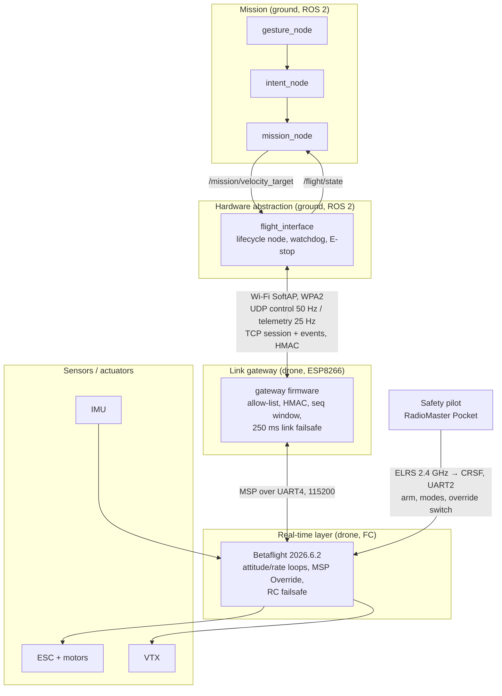
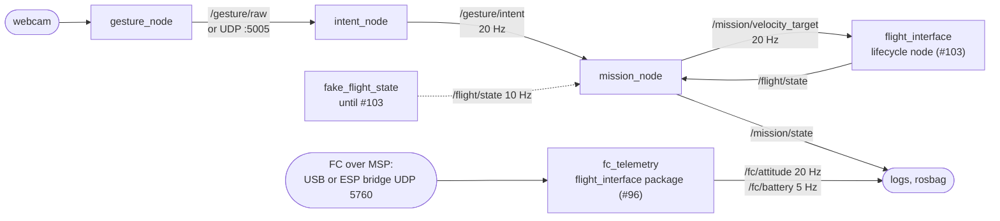

# Architecture Document (Module 1)

> [!warning] Status: DRAFT, due 2026-11-06 (week 3). Final version 2026-12-11.
> Module 1 deliverable, REQ-SYS-001, issue #98. This page brings together what is decided elsewhere and links to the sources instead of copying them: [[System Overview]] (target picture), [[Protocol Spec v0]] (wire format), [[ESP Link State Machine]] (ESP behaviour), the ADRs in the [[Decision Register]].
>
> **Owners per section:** §1 layers Dot99 · §2 node graph **BrunoBMFT** (he wrote the nodes) · §3 message contracts follow the Protocol Spec v0 freeze (ptorrao-git, #97) · §4 timing budget Dot99 with ptorrao-git.

---

## 1. Layer diagram (ground, ESP, FC, radio path)

Module 1 reference layering: mission → ROS 2 → hardware abstraction → real-time layer → sensors/actuators.

Two independent paths reach the FC:

| Path | Carries | Who wins |
|---|---|---|
| Radio: pilot → ELRS → FC (UART2) | arming, flight mode, MSP Override switch, all sticks when override is off | **Always wins** ([[Safety Rules]]) |
| Wi-Fi: ground → ESP → FC (UART4, MSP) | roll, pitch, yaw (and throttle from mask 15) **only while the pilot has override on** | Only inside the override mask ([[ADR-010 MSP Override\|ADR-010]]) |

Authority order (from [[System Overview]] §2): safety pilot (ELRS) > Betaflight failsafe > ESP link failsafe ([[ADR-004 ESP Failsafe|ADR-004]]) > `flight_interface` watchdog > mission / gestures. Gestures never arm.

## 2. ROS 2 node graph (topics and rates)

Checked against the code by BrunoBMFT (2026-11-03). Details per node: [[00 Gesture Pipeline]], [[04 Mission Node]].

| Node | Subscribes | Publishes | Rate | State |
|---|---|---|---|---|
| `gesture_node` | webcam | `/gesture/raw` (`String`, JSON), or UDP to `intent_node` | per frame, with keep-alive; MediaPipe Holistic 14.5 FPS measured 2026-10-27 | in `dev`, CI + Docker |
| `intent_node` | `/gesture/raw` or UDP `:5005` (parameter `input_source`) | `/gesture/intent` (`String`) | 20 Hz (`publish_rate_hz`) | in `dev`, CI + Docker |
| `mission_node` | `/gesture/intent`, `/flight/state` | `/mission/velocity_target` (`TwistStamped`, `frame_id: base_link`), `/mission/state` (`String`) | 20 Hz (`publish_rate_hz`) | in `dev`, fed by `fake_flight_state` |
| `fake_flight_state` (test helper in `mission_node`) | – | `/flight/state` (`String`, JSON: `link_ok`, `esp_state`, `override_active`, `mask`, `airborne`) | 10 Hz (`rate_hz`) | in `dev`, stands in for `flight_interface` |
| `fc_telemetry` (`flight_interface` package) | FC over MSP, read-only: USB (`transport:=usb`) or the ESP transparent bridge (`transport:=udp`, UDP 5760) | `/fc/attitude` (`Vector3Stamped`), `/fc/battery` (`BatteryState`) | 20 Hz (`attitude_hz`), 5 Hz (`battery_hz`) | branch `feature/96-fc-telemetry-node`, not in CI yet (#96) |
| `flight_interface` lifecycle node | `/mission/velocity_target` | `/flight/state` | not set | not built (#103) |

**QoS:** every topic uses the rclpy default for a depth of 10: reliable, volatile, keep last 10.

**What each rate depends on:**

- `gesture_node`: the camera and MediaPipe frame rate. `intent_node` turns it into a steady 20 Hz.
- `mission_node`: 20 Hz, below the 50 Hz `SETPOINT` stream that `flight_interface` will send to the ESP ([[Protocol Spec v0]]).
- `fc_telemetry`: how fast the FC answers MSP. Each poll waits for its reply (100 ms timeout, `request_timeout_sec`) before the next one starts, so attitude and battery requests never interleave.

### `/fc/attitude` and `/fc/battery`

What the two FC telemetry topics carry. These are BrunoBMFT's proposals for #96: the code follows them and each one is a constant or a parameter, so the team can still change them in review. The attitude rate (20 or 25 Hz) is open in #142.

| Item | `/fc/attitude` | `/fc/battery` |
|---|---|---|
| Type | `geometry_msgs/Vector3Stamped`: x roll, y pitch, z yaw, in rad | `sensor_msgs/BatteryState` |
| Source | `MSP_ATTITUDE` | `MSP_ANALOG` (0.01 V field, else the legacy 0.1 V byte) |
| Signs | REP-103: roll + right side down, pitch + nose down, yaw + counter-clockwise seen from above. Yaw sign measured 2026-11-02; roll and pitch signs still to check on the bench (props off) | – |
| Yaw | relative: zero at the first sample after node start, wrapped to (−π, π]. The drone has no magnetometer, so Betaflight's yaw is only the integrated gyro and drifts | – |
| Fields | – | only `voltage` is measured. Every other number is NaN, `cell_voltage` holds 4 NaN (4S pack), technology LIPO. With no battery (FC on USB power, below 1.0 V): `present: false` and voltage NaN |
| `frame_id` | `base_link` | `base_link` |
| `header.stamp` | halfway between MSP request and reply, ROS clock | same |
| No or bad reply | nothing is published; an old value is never sent again with a new stamp. Subscribers judge freshness from the stamp age | same |

Every backend (MSP today, `STATE` from the gateway firmware with #103, PX4 SITL later) must deliver these topics in the same form. Code: `drone/ground/src/flight_interface/flight_interface/telemetry.py`.

## 3. Message contracts

Ground ↔ ESP messages are defined only in [[Protocol Spec v0]]. This document does not repeat them. Summary:

| Contract | Defined in | Transport | Used by |
|---|---|---|---|
| Session: `HELLO`, `ARM_CONTROL_REQUEST`, `RESUME_REQUEST`, `BYE` | Protocol Spec v0 §3 | TCP | `flight_interface` ↔ ESP |
| Control: `SETPOINT` (0x60) | Protocol Spec v0 §3, §5 | UDP, 50 Hz | `flight_interface` → ESP |
| Telemetry: `STATE` (0x80) | Protocol Spec v0 §3 | UDP, 25 Hz | ESP → `flight_interface` |
| Events: `EVENT` (0x40) | Protocol Spec v0 §3 | TCP | ESP → `flight_interface` |
| ESP → FC: `MSP_SET_RAW_RC`, 8 channels AETR | Protocol Spec v0 §5, [[ADR-009 ESP to FC Link\|ADR-009]] | UART4 MSP, 50 Hz | ESP → FC |
| ESP polls `MSP_ATTITUDE` (25 Hz), `MSP_ANALOG` / `MSP_STATUS` (5 Hz) | [[ADR-009 ESP to FC Link\|ADR-009]] | UART4 MSP | ESP ↔ FC |
| ROS 2 topics | §2 above | DDS, ground only | ground nodes |

Both implementations (C++ #99, Python #100) must pass the shared golden vectors in `drone/tests/vectors/`. The contracts are frozen when #97 closes. Until then this table points at v0.1.

## 4. Timing budget (ground → ESP → FC)

Measured in #30 on the custom bridge firmware (ESP Bench Test Plan S1-05 / S1-09, 10 min at 50 Hz, MSP 115200, props off). RTT is ground → ESP → FC → ESP → ground.

| Segment | Budget / measured | Source |
|---|---|---|
| Control period, ground → ESP | 20 ms (50 Hz) | [[System Overview]] §3 |
| `MSP_SET_RAW_RC` on UART4 | ≈ 1.9 ms (22 bytes at 115200 baud) | calculated |
| RTT, PC next to the drone | median 12.2–12.5 ms, p99 58–63 ms, 0–0.013 % loss | #30, S1-05 |
| RTT, cage distance | median 17–19 ms, p99 118–230 ms, 0.14–0.76 % loss | #30, S1-09 |
| Longest silence, close / cage | 163–203 ms / 247–343 ms | #30 |
| **ESP link failsafe `T_loss`** | **250 ms** without an accepted control packet → neutral | [[ADR-004 ESP Failsafe\|ADR-004]] |
| Failsafe trips at cage distance | 0–1 per 10 min normally, 11 in the worst run | #30, accepted: a trip is safe by design |
| `intent_node` neutral / stale timeouts | 0.3 s / 2.0 s | `intent_node` parameters `neutral_timeout_sec`, `stale_timeout_sec` |
| Gesture → motors end to end | **not measured yet** | [[System Overview]] §4: telemetry echoes `last_ctrl_seq` + `t_send_us` to measure it |

Still to measure: the end-to-end gesture → motors latency, `T_fresh` (OD-06, initially = `T_loss`), and the failsafe-timing test on the HIL bench (#106, 250 ms ± tolerance).

## 5. Related pages

[[System Overview]] · [[Protocol Spec v0]] · [[ESP Link State Machine]] · [[MSP Cheat Sheet]] · [[Wiring and Pinout]] · [[Decision Register]] · [[00 Gesture Pipeline]]

## 6. Glossary

| Term | Meaning |
| --- | --- |
| **ADR** | Architecture Decision Record: a documented decision and its rationale. |
| **AETR** | Channel order aileron (roll), elevator (pitch), throttle, rudder (yaw). |
| **`base_link`** | Standard ROS name for the drone's body frame (REP-105), used as `frame_id` on the ground topics. |
| **BatteryState / Vector3Stamped** | Standard ROS message types for a battery reading and for a stamped 3-value vector (here roll, pitch, yaw). |
| **CRSF** | Crossfire serial protocol between the ELRS receiver and the FC (UART2). |
| **DDS** | Data Distribution Service: the middleware ROS 2 topics run on. |
| **ELRS** | ExpressLRS: the radio-control link from the safety pilot's radio to the drone. |
| **ESP8266** | The Wi-Fi microcontroller on the drone that bridges the ground to the FC over UART4. |
| **FC** | Flight Controller: the OddityRC F7 AIO running Betaflight. |
| **HMAC** | Hash-based Message Authentication Code: a keyed tag proving the sender holds the key. |
| **MSP** | MultiWii Serial Protocol, used to talk to Betaflight. |
| **MSP Override** | Betaflight feature that lets MSP replace selected RC channels while the pilot's switch is on. |
| **p99** | 99th percentile: 99 % of samples are at or below this value. |
| **QoS** | Quality of Service: ROS 2 delivery settings of a topic (reliable or best effort, history depth). |
| **REP-103** | ROS convention for units and axes: SI units, x forward, y left, z up. |
| **RTT** | Round-trip time: request sent to reply received. |
| **SoftAP** | The Wi-Fi network the ESP creates itself, which the ground PC joins. |
| **`T_loss`** | Time without an accepted control packet after which the ESP enters link failsafe (250 ms). |
