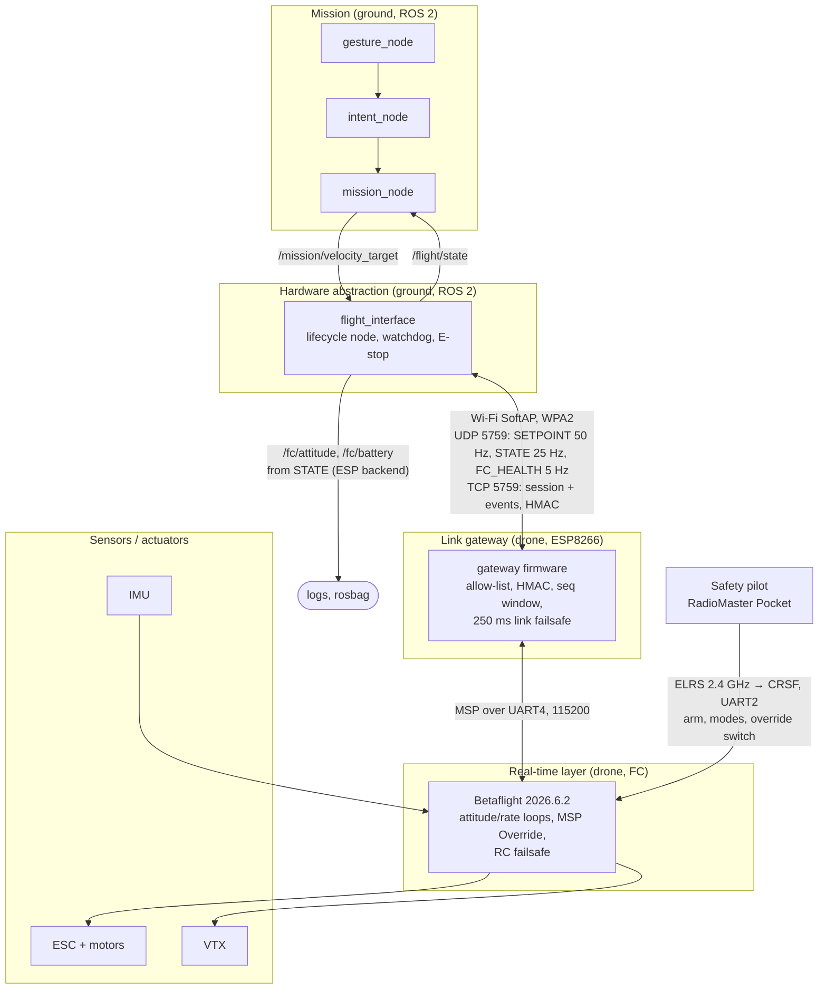
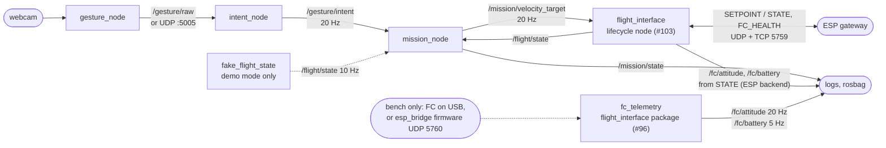

# Architecture Document (Module 1)

> [!info] Status: complete for Module 1 (2026-11-20): every section is filled from merged code and bench results. One figure is still open: the gesture → motors latency (§4), which needs the controller. Final review 2026-12-11.
> Module 1 deliverable, REQ-SYS-001, issue #98. This page brings together what is decided elsewhere and links to the sources instead of copying them: [[System Overview]] (target picture), [[Protocol Spec v0]] (wire format), [[ESP Link State Machine]] (ESP behaviour), the ADRs in the [[Decision Register]].
>
> **Owners per section:** §1 layers Dot99 · §2 node graph **BrunoBMFT** (he wrote the nodes) · §3 message contracts follow the Protocol Spec v0 freeze (ptorrao-git, #97) · §4 timing budget Dot99 with ptorrao-git.

---

## 1. Layer diagram (ground, ESP, FC, radio path)

Module 1 reference layering: mission → ROS 2 → hardware abstraction → real-time layer → sensors/actuators.

Two independent paths reach the FC:

| Path | Carries | Who wins |
|---|---|---|
| Radio: pilot → ELRS → FC (UART2) | arming, flight mode, MSP Override switch, all sticks when override is off | **Always wins** ([[Safety Rules]]) |
| Wi-Fi: ground → ESP → FC (UART4, MSP) | roll, pitch, yaw (and throttle from mask 15) **only while the pilot has override on** | Only inside the override mask ([[ADR-010 MSP Override\|ADR-010]]) |

Authority order (from [[System Overview]] §2): safety pilot (ELRS) > Betaflight failsafe > ESP link failsafe ([[ADR-004 ESP Failsafe|ADR-004]]) > `flight_interface` watchdog > mission / gestures. Gestures never arm.

## 2. ROS 2 node graph (topics and rates)

Checked against the code by BrunoBMFT (2026-11-03). Details per node: [[00 Gesture Pipeline]], [[04 Mission Node]].

| Node | Subscribes | Publishes | Rate | State |
|---|---|---|---|---|
| `gesture_node` | webcam | `/gesture/raw` (`String`, JSON), or UDP to `intent_node` | per frame, with keep-alive; MediaPipe Holistic 14.5 FPS measured 2026-10-27 | in `dev`, CI + Docker |
| `intent_node` | `/gesture/raw` or UDP `:5005` (parameter `input_source`) | `/gesture/intent` (`String`) | 20 Hz (`publish_rate_hz`) | in `dev`, CI + Docker |
| `mission_node` | `/gesture/intent`, `/flight/state` | `/mission/velocity_target` (`TwistStamped`, `frame_id: base_link`), `/mission/state` (`String`) | 20 Hz (`publish_rate_hz`) | in `dev`. Demo mode: `fake_flight_state` feeds `/flight/state`. Real mode: `ground_bringup` `real.launch.py` (`make real`) starts `flight_interface` with `backend: esp` and `mask: 8` (`config/real.yaml`), which publishes the real `/flight/state` |
| `fake_flight_state` (test helper in `mission_node`) | – | `/flight/state` (`String`, JSON: `link_ok`, `esp_state`, `override_active`, `mask`, `airborne`) | 10 Hz (`rate_hz`) | in `dev`, stands in for `flight_interface` in `ground_bringup`'s `demo.launch.py` (`make`) and `mission_node`'s `mission_demo.launch.py` (no ESP needed) |
| `fc_telemetry` (`flight_interface` package) | FC over MSP, read-only: USB (`transport:=usb`) or the ESP transparent bridge (`transport:=udp`, UDP 5760) | `/fc/attitude` (`Vector3Stamped`), `/fc/battery` (`BatteryState`) | 20 Hz (`attitude_hz`), 5 Hz (`battery_hz`) | in `dev` (#96, PR #169), CI `ground-ros2`; bench-tested 2026-11-06. A bench tool now: UDP 5760 needs the `esp_bridge` firmware, and with the gateway `flight_interface` publishes these topics |
| `flight_interface` lifecycle node (`flight_interface` package) | `/mission/velocity_target` (`TwistStamped`, body FLU) | `/flight/state` (JSON as above, plus the fields below); `/fc/attitude`, `/fc/battery` from `STATE` (ESP backend, `publish_fc`); services `~/estop`, `~/reset_estop`, `~/resume`, `~/arm_control` (`std_srvs/Trigger`) | setpoints 50 Hz (`rate_hz`), state 10 Hz (`state_rate_hz`) | in `dev` (#103, PR #187): `loopback` and `esp` backends; every setpoint is neutral until the controller (C1); the PX4 backend has its own issue. Details below and in [[ADR-025 flight_interface Ground Node\|ADR-025]] |

**QoS:** every topic uses the rclpy default for a depth of 10: reliable, volatile, keep last 10.

**What each rate depends on:**

- `gesture_node`: the camera and MediaPipe frame rate. `intent_node` turns it into a steady 20 Hz.
- `mission_node`: 20 Hz, below the 50 Hz `SETPOINT` stream that `flight_interface` sends to the ESP ([[Protocol Spec v0]]).
- `fc_telemetry`: how fast the FC answers MSP. Each poll waits for its reply (100 ms timeout, `request_timeout_sec`) before the next one starts, so attitude and battery requests never interleave.

### `/fc/attitude` and `/fc/battery`

What the two FC telemetry topics carry. Proposed by BrunoBMFT for #96 and merged with PR #169 after review (2026-11-09). Each item is a constant or a parameter in the code.

`attitude_hz` stays at 20 Hz (agreed in the PR #169 review). The 25 Hz set on 2026-11-05 (#142, [[Protocol Spec v0]] §7.3) is a different rate: the `STATE` telemetry the gateway firmware sends, and the ESP's own `MSP_ATTITUDE` poll ([[ADR-009 ESP to FC Link|ADR-009]]). `fc_telemetry` polls the FC itself, through the transparent bridge or USB.

| Item | `/fc/attitude` | `/fc/battery` |
|---|---|---|
| Type | `geometry_msgs/Vector3Stamped`: x roll, y pitch, z yaw, in rad | `sensor_msgs/BatteryState` |
| Source | `MSP_ATTITUDE` | `MSP_ANALOG` (0.01 V field, else the legacy 0.1 V byte) |
| Signs | REP-103: roll + right side down, pitch + nose down, yaw + counter-clockwise seen from above. Measured on the bench (props off, Betaflight 2026.6.2): Betaflight's raw roll and pitch already match REP-103 (2026-11-06), its raw yaw grows clockwise, so the node flips it (2026-11-02) | – |
| Yaw | relative: zero at the first sample after `fc_telemetry` starts, or after each `activate` of `flight_interface`, wrapped to (−π, π]. The drone has no magnetometer, so Betaflight's yaw is only the integrated gyro and drifts | – |
| Fields | – | only `voltage` is measured. Every other number is NaN, `cell_voltage` holds 4 NaN (4S pack), technology LIPO. With no battery (FC on USB power, below 1.0 V): `present: false` and voltage NaN |
| `frame_id` | `base_link` | `base_link` |
| `header.stamp` | halfway between MSP request and reply, ROS clock | same |
| No or bad reply | nothing is published; an old value is never sent again with a new stamp. Subscribers judge freshness from the stamp age. Late replies are dropped if they arrived before the next request; MSP v1 has no sequence number, so one that arrives after that can still be taken (rare: ~0.2 % misses on the bench) | same |

Every backend (MSP in `fc_telemetry`, `STATE` in `flight_interface`'s ESP backend, PX4 SITL with #199) must deliver these topics in the same form. Code: `drone/ground/src/flight_interface/flight_interface/flight_interface/telemetry.py` (conversions) and `fc_telemetry.py` (node).

### `fc_telemetry` node

Run: `ros2 run flight_interface fc_telemetry --ros-args -p transport:=udp` (or `transport:=usb`). Parameters and their defaults are declared at the top of `FcTelemetry.__init__` in `fc_telemetry.py`: transport, serial device, bridge host and ports, the two rates, `request_timeout_sec` (100 ms), `frame_id` and `cell_count` (4).

| Situation | What the node does |
|---|---|
| Ctrl+C or SIGTERM | stops cleanly, exit code 0 |
| Transport can't be opened (no FC on the serial port, UDP port in use) or unknown `transport` | FATAL log, exit code 1 |
| Transport error while running (USB unplugged, network down) | warning, nothing published, keeps running. It does not reopen the port: restart it after plugging the FC back in |
| Every 5 s | logs the MSP round trip (median, max) and the missed replies since start |

Known limits:

- If the FC reboots while the node runs, the yaw zero is wrong until the node restarts.
- A silent FC makes each poll wait the full `request_timeout_sec`.

**Bench result (2026-11-06, #96):** Betaflight 2026.6.2, props off, battery on, UDP through the ESP bridge.

| Topic | Rate (`ros2 topic hz`) | Delay (receive − `header.stamp`) |
|---|---|---|
| `/fc/attitude` | 19.75 Hz (target 20) | avg 11 ms, max 50 ms |
| `/fc/battery` | 4.98 Hz (target 5) | avg 10 ms, max 45 ms |

MSP round trip median 13.5–14.4 ms (bridge baseline 12–15 ms, #30). Missed replies about 0.2 % over 11.5 min. The rosbag `fc_telemetry_2026-11-06_udp` (MCAP, ~60 s, tilted one axis at a time) is attached to #96. Tests: [[Testing Strategy]] §5.

### `flight_interface` node

The decisions behind it are in [[ADR-025 flight_interface Ground Node|ADR-025]]; the code and its parameters in `drone/ground/src/flight_interface/flight_interface/` (`flight_interface/link_node.py`); how to run it in Docker: [[05 Flight Interface Node]].

Run: `make real`, or `ros2 launch ground_bringup real.launch.py` outside Docker. The container mounts only the PSK (`~/.config/seame-drone/psk.json`, written by `make psk-file`), never the whole `secrets.json`, and only one `/flight/state` publisher may run at a time ([[ADR-025 flight_interface Ground Node|ADR-025]] E3.2). To run the node alone: `ros2 launch flight_interface flight_interface.launch.py backend:=esp`. The node starts unconfigured: `ros2 lifecycle set /flight_interface configure`, then `activate`. Setpoints go out only while active, only from a target that arrives after the activation. The launch file defaults to `ROS_DOMAIN_ID=42` and `ROS_AUTOMATIC_DISCOVERY_RANGE=LOCALHOST` (ADR-025 E1, E1.4); in Docker (`make real`) the domain and discovery range come from `drone/ground/env/real.env` (E1.3). Every terminal that talks to the node needs the same two variables.

| Service | What it does |
|---|---|
| `~/estop` | Latches the E-stop, sends one neutral setpoint (if setpoints were going out) and `BYE`, then nothing. Kept through deactivate, cleanup and configure. An unexpected error in the node's tick latches the same E-stop, with `BYE` only (ADR-025 A7). |
| `~/reset_estop` | Clears the latch. Control then needs a new target and, after a new session, an operator ARM. |
| `~/arm_control` | ARM with the `mask` parameter (8, 11, 15), only in `SESSION_IDLE` with a fresh link and the FC link alive. Held until 1.5 s of neutral setpoints went out, then sent once; dropped after 3 s or when its conditions go. |
| `~/resume` | RESUME after the ESP's link failsafe (`LINK_FAILSAFE`), with the same conditions and the same 1.5 s hold. |

The node never sends ARM or RESUME by itself (REQ-SAF-023). The services answer when the request is accepted; the ESP's `ARM_CONTROL_ACK` / `RESUME_ACK` appears in the node's log, a refusal with its reason.

`/flight/state` fields added to `mission_node`'s: `active`, `estop`, `estop_reason`, `resume_pending`, `arm_pending`, `failsafe_output` (the ESP sends its ADR-004 output), `fc_link_ok` (from the FC-link events and `FC_HEALTH`; `null` = unknown, which counts as not OK), `armed` (`FC_HEALTH`'s armed flag, `null` when unknown; `airborne` = armed for now) and `esp_rx_rejected` (the ESP's reject count, wraps counted). `link_ok` is true only while the link is fresh, the node is active, not in E-stop and the FC link is alive.

With the ESP backend `/fc/attitude` and `/fc/battery` come from the FC values in `STATE`, through the same conversion as `fc_telemetry`. Each is published only while `FC_HEALTH` says its value is fresh (attitude under 250 ms, battery under 1 s), so a value the ESP never had or that froze is never published. Don't run `fc_telemetry` on the same graph.

## 3. Message contracts

Ground ↔ ESP messages are defined only in [[Protocol Spec v0]]. This document does not repeat them. Summary:

| Contract | Defined in | Transport | Used by |
|---|---|---|---|
| Session: `HELLO` / `HELLO_ACK`, `ARM_CONTROL_REQUEST` / `ARM_CONTROL_ACK`, `RESUME_REQUEST` / `RESUME_ACK`, `BYE` | Protocol Spec v0 §3 | TCP 5759 | `flight_interface` ↔ ESP |
| Configuration: `CONFIG_GET` / `CONFIG_SET` (0x20 / 0x21), keys in spec §7.3. The reply is `CONFIG_ACK` (0x22, spec §3.1, #142) | Protocol Spec v0 §3, §7.3 | TCP 5759 | `flight_interface` ↔ ESP |
| Control: `SETPOINT` (0x60) | Protocol Spec v0 §3, §5 | UDP 5759, 50 Hz | `flight_interface` → ESP |
| Telemetry: `STATE` (0x80) | Protocol Spec v0 §3 | UDP 5759, 25 Hz | ESP → `flight_interface` |
| FC link health: `FC_HEALTH` (0x81) | Protocol Spec v0 §3 (v1.4) | UDP 5759, 5 Hz | ESP → `flight_interface` |
| Events: `EVENT` (0x40) | Protocol Spec v0 §3 | TCP 5759 | ESP → `flight_interface` |
| ESP → FC: `MSP_SET_RAW_RC`, 8 channels AETR | Protocol Spec v0 §5, [[ADR-009 ESP to FC Link\|ADR-009]] | UART4 MSP, 50 Hz | ESP → FC |
| ESP polls `MSP_ATTITUDE` (25 Hz), `MSP_ANALOG` / `MSP_STATUS` (5 Hz) | [[ADR-009 ESP to FC Link\|ADR-009]] | UART4 MSP | ESP ↔ FC |
| ROS 2 topics | §2 above | DDS, ground only | ground nodes |

Both implementations (C++ #99, Python #100) must pass the shared golden vectors in `drone/tests/vectors/`. The contracts were accepted at the design review of 2026-11-03 (#97); every change since is a dated entry in the spec's §8 changelog. Ports are in spec §7.1: UDP 5759 for control and telemetry, TCP 5759 for the session; 5760 is the transparent bridge's port; the gateway is the default firmware since 2026-11-13 (#106), and the bridge (`esp_bridge`) is a bench tool.

## 4. Timing budget (ground → ESP → FC)

Measured in #30 on the custom bridge firmware (ESP Bench Test Plan S1-05 / S1-09, 10 min at 50 Hz, MSP 115200, props off). RTT is ground → ESP → FC → ESP → ground.

| Segment | Budget / measured | Source |
|---|---|---|
| Control period, ground → ESP | 20 ms (50 Hz) | [[System Overview]] §3 |
| `MSP_SET_RAW_RC` on UART4 | ≈ 1.9 ms (22 bytes at 115200 baud) | calculated |
| RTT, PC next to the drone | median 12.2–12.5 ms, p99 58–63 ms, 0–0.013 % loss | #30, S1-05 |
| RTT, cage distance | median 17–19 ms, p99 118–230 ms, 0.14–0.76 % loss | #30, S1-09 |
| Longest silence, close / cage | 163–203 ms / 247–343 ms | #30 |
| **Setpoint freshness `T_fresh`** | **150 ms** since the last accepted `SETPOINT` → neutral sticks (roll/pitch/yaw 1500); the next valid `SETPOINT` is used at once. No failsafe, no handshake | Protocol Spec v0 §7.2 |
| **ESP link failsafe `T_loss`** | **250 ms** without an accepted control packet → neutral | [[ADR-004 ESP Failsafe\|ADR-004]] |
| Link loss on the HIL bench (gateway firmware, fake FC, props off) | First neutral RC on the UART at `T_fresh` (150 ms, −5/+90 ms), `LINK_FAILSAFE_ENTERED` at `T_loss` (250 ms, −5/+180 ms for Wi-Fi both ways), RC stops 1 s later. Resume only through `RESUME_REQUEST` | #106, `test_link_loss_failsafe_within_250_ms` in `drone/tests/hil/gateway/wifi/test_session.py`; in CI since PR #180 (2026-11-10), last green `dev` run 44568215644 (2026-11-19) |
| FC link lost / back (ESP ↔ FC) | lost after 250 ms without a reply; back only after 250 ms of replies; ARM and RESUME need 1 s of acknowledged RC | #179, #188 (`sd::FcLink`, `drone/lib/protocol/include/sd/fc_link.hpp`) |
| `flight_interface` held ARM / RESUME | sent after 1.5 s of neutral setpoints, dropped after 3 s | [[ADR-025 flight_interface Ground Node\|ADR-025]] K6 |
| Failsafe trips at cage distance | 0–1 per 10 min normally, 11 in the worst run | #30, accepted: a trip is safe by design |
| `intent_node` neutral / stale timeouts | 0.3 s / 2.0 s | `intent_node` parameters `neutral_timeout_sec`, `stale_timeout_sec` |
| FC attitude → ground topic (`/fc/attitude` delay, `fc_telemetry` over the transparent bridge) | avg 11 ms, max 50 ms; MSP round trip median 13.5–14.4 ms | #96, bench 2026-11-06 |
| Gesture → motors end to end | **not measured yet**: every `flight_interface` setpoint is neutral until the controller (C1), so a gesture doesn't reach the motors yet | [[System Overview]] §4: telemetry echoes `last_ctrl_seq` + `t_send_us` to measure it |

Still to measure: the end-to-end gesture → motors latency, once the controller sends real setpoints.

On the HIL bench, Wi-Fi power saving on the Pi delayed TCP connects and `EVENT`s in some runs (#106); the `LINK_FAILSAFE_ENTERED` tolerance above covers normal Wi-Fi delay, not those stalls.

### Real-time profile (REQ-SW-005, #146)

Plotted by `drone/tools/bench/rt_profile.py` from two logs, never by hand. Commands and log format are in the script's docstring.

| Log | How it is captured | Plot |
|---|---|---|
| Betaflight `tasks` | `fc_cli.py dump` (FC on USB, props off) writes it into `drone/config/betaflight/<ver>/cli_read_<date>.txt` | `rt-profile/betaflight_tasks.png` |
| ESP gateway `loop()` period | env `esp_loop_timing_ota` on the drone (`esp_loop_timing` over USB on the HIL bench): the gateway + a histogram of every `loop()` period, sent once a second to UDP 5770, recorded with `rt_profile.py listen` during a UDP control stream, props off | `rt-profile/esp_loop_period.png` (median, p99, max) |

![[betaflight_tasks.png]]

- **Betaflight 4.5.1, 2026-10-16 capture (before the 2026.6.2 upgrade):** PID loop 8 kHz, PID max load 57.9 % (avg 35.5 %), FILTER 30.5 % (13.7 %), total 51.5 % excluding SERIAL. SERIAL's 2161 µs max is the CLI session itself. To redo on 2026.6.2 once the USB connector is repaired (#189).
![[esp_loop_period.png]]

- **ESP loop jitter, drone, 2026-11-17 capture (`sd-gw 0.2.0T`, 704 s UDP control stream, props off, 40 MHz flash clock; raw log `results/esp_loop_2026-11-17.csv`, not committed):** 18 993 758 loops, median 31 µs, p99 88 µs, p99.9 1.47 ms, p99.99 1.98 ms, max 6.17 ms. 55 526 loops (0.3 %) took 1 ms or more; one took 5 ms or more; none reached the 20 ms RC period (`MSP_SET_RAW_RC` at 50 Hz). The worst stall is under a third of that period, so `loop()` keeps up with the control stream. The 0.4–0.6 ms and 1–2 ms bumps are loops that handle a packet or an MSP exchange (assumption, not measured per path). Percentiles are bucket lower edges (buckets are at most 6.25 % wide): median 31 µs means 31–32 µs, p99 88 µs means 88–92 µs. The max is exact. The time spent sending the 1 Hz report is left out of the histogram on purpose; only this build has that cost. The capture was taken at 40 MHz flash; don't compare it with an 80 MHz capture (the HIL spare ESP runs at 80 MHz since #212).

## 5. Related pages

[[System Overview]] · [[Protocol Spec v0]] · [[ESP Link State Machine]] · [[MSP Cheat Sheet]] · [[Wiring and Pinout]] · [[Decision Register]] · [[00 Gesture Pipeline]]

## 6. Glossary

| Term | Meaning |
| --- | --- |
| **ADR** | Architecture Decision Record: a documented decision and its rationale. |
| **AETR** | Channel order aileron (roll), elevator (pitch), throttle, rudder (yaw). |
| **`base_link`** | Standard ROS name for the drone's body frame (REP-105), used as `frame_id` on the ground topics. |
| **BatteryState / Vector3Stamped** | Standard ROS message types for a battery reading and for a stamped 3-value vector (here roll, pitch, yaw). |
| **CRSF** | Crossfire serial protocol between the ELRS receiver and the FC (UART2). |
| **DDS** | Data Distribution Service: the middleware ROS 2 topics run on. |
| **ELRS** | ExpressLRS: the radio-control link from the safety pilot's radio to the drone. |
| **E-stop** | The operator's `~/estop` on `flight_interface`: latched until `~/reset_estop`. |
| **`FC_HEALTH`** | ESP → ground message (0x81, 5 Hz): FC alive, armed flag, value ages, counters. |
| **Held request** | An operator ARM or RESUME that `flight_interface` keeps until 1.5 s of neutral setpoints went out (ADR-025 K6). |
| **Gateway firmware** | The ESP firmware on the drone since 2026-11-13 (#106): the [[ESP Link State Machine]], HMAC-checked frames, and MSP to the FC only from an allow-list. |
| **HIL** | Hardware-in-the-loop: the real ESP on a bench, driven by a Raspberry Pi that plays the ground and a fake FC, run from CI (props off, no LiPo). |
| **Lifecycle node** | A ROS 2 node with explicit states (unconfigured, inactive, active) changed with `ros2 lifecycle set`. |
| **ESP8266** | The Wi-Fi microcontroller on the drone that bridges the ground to the FC over UART4. |
| **FC** | Flight Controller: the OddityRC F7 AIO running Betaflight. |
| **HMAC** | Hash-based Message Authentication Code: a keyed tag proving the sender holds the key. |
| **Jitter** | Variation of a period around its nominal value; here, how much the ESP `loop()` period varies. |
| **MCAP** | The default rosbag file format in ROS 2 Jazzy. |
| **MSP** | MultiWii Serial Protocol, used to talk to Betaflight. |
| **MSP Override** | Betaflight feature that lets MSP replace selected RC channels while the pilot's switch is on. |
| **p99** | 99th percentile: 99 % of samples are at or below this value. |
| **QoS** | Quality of Service: ROS 2 delivery settings of a topic (reliable or best effort, history depth). |
| **REP-103** | ROS convention for units and axes: SI units, x forward, y left, z up. |
| **RTT** | Round-trip time: request sent to reply received. |
| **SoftAP** | The Wi-Fi network the ESP creates itself, which the ground PC joins. |
| **`T_fresh`** | Maximum age of the last accepted setpoint (150 ms). Older → neutral sticks until the next valid setpoint; no failsafe. |
| **`T_loss`** | Time without an accepted control packet after which the ESP enters link failsafe (250 ms). |
| **Transparent bridge** | The first custom ESP firmware (`esp_bridge`): forwards raw MSP between UDP 5760 and the FC unchanged. Replaced by the gateway on the drone (#106); kept as a bench tool. |
| **Yaw zero** | The FC yaw reading taken as 0 at the first attitude sample after `fc_telemetry` starts or `flight_interface` is activated. Needed because the drone has no magnetometer, so Betaflight's yaw only counts from FC power-up and drifts. |
