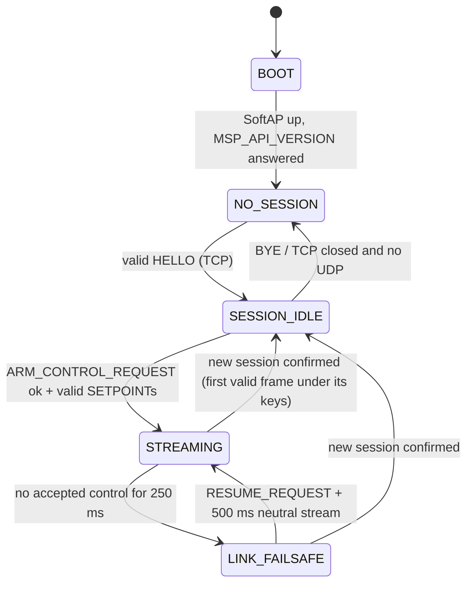

# ESP Link State Machine

> [!warning] Status: DRAFT
> Implements [[ADR-004 ESP Failsafe|ADR-004]] and [[ADR-005 TCP Session|ADR-005]], and REQ-SAF-009 to 016 (were REQ-LOSS and REQ-FS) and REQ-COM-020 to 023 (were REQ-RECON) in [[PC_to_ESP]] §7.

---

## 1. States

**A new `HELLO` does not end the current session** (2026-11-06, #156, [[ADR-005 TCP Session|ADR-005]] entry). In any state the ESP answers a valid `HELLO` with `HELLO_ACK` and keeps its current state and session. The new session is *pending*: it takes over only when its first valid frame under the new keys arrives; then the ESP sends `BYE` reason 3 to the old session and continues in SESSION_IDLE with the new one. A pending session with no valid frame within 2 s is dropped. `HELLO` is rate-limited (at most one per 500 ms). A replayed `HELLO` therefore never ends a live session.

Details of the pending session:
- **TCP:** a new TCP connection by itself changes nothing. While a session holds the one TCP slot, the ESP accepts one extra connection only to carry a `HELLO`, for at most 2 s; TCP keep-alive (seconds) frees a dead connection's slot ([[ADR-005 TCP Session|ADR-005]] entry). UDP and the failsafe are not affected.
- **No current session (NO_SESSION):** there is nothing to protect, so a valid `HELLO` opens the session at once (SESSION_IDLE).
- **First valid frame:** the first frame accepted by a Receiver holding the new session's receiving key, on UDP or TCP.
- **Another `HELLO` while one is pending:** the later one replaces the pending one; the rate limit still applies.
- **After the switch:** the new session starts in SESSION_IDLE. From LINK_FAILSAFE this is not a resume: control needs a new `ARM_CONTROL_REQUEST` and valid setpoints (REQ-COM-020).
- **On the wire:** a pending session is not visible in `STATE.esp_state` (no wire change). #102 may report an expired pending session or a rate-limited `HELLO` with an `EVENT` link code (`0x01xx`).
- **OTA ([[ADR-024 OTA Firmware Updates|ADR-024]]):** a pending session counts as an open session for the D2 gate; a `HELLO` that arrives during an upload is dropped, not kept for later.

## 2. Behaviour per state

| State | Sends to FC | Notes |
|---|---|---|
| BOOT | nothing | Wi-Fi sleep disabled, static IP. Safe at power-up and after a watchdog reset (REQ-SAF-016 (was REQ-FS-04)). |
| NO_SESSION | **neutral frames** (1500, throttle 1000) at 50 Hz | An early override switch-on never sees empty channels |
| SESSION_IDLE | neutral frames | Telemetry flowing |
| STREAMING | ground setpoints | `override_active` read from `MSP_STATUS` and reported (REQ-SAF-007 (was SAF-07)) |
| LINK_FAILSAFE | per [[ADR-004 ESP Failsafe\|ADR-004]] (4.5.1: neutral forever; 2026.6: neutral 1 s then stop) | Event over TCP when possible (REQ-SAF-015 (was REQ-FS-03)) |

> [!important] Neutral throttle
> Throttle is only overridden from mask 15 onwards ([[ADR-010 MSP Override|ADR-010]]). Until then the FC ignores the throttle value because the pilot owns it.

## 3. Implementation rules

- All timeouts take an injected `now_ms()`, so the logic is unit-testable on the host ([[PC_to_ESP]] §9.1).
- Rejected packets never reset the loss timer (REQ-SAF-011 (was REQ-LOSS-03)).
- The main loop never blocks. UART reads are non-blocking. The ESP8266 hardware watchdog stays enabled. Exception: an OTA upload blocks the loop while the image is transferred, and only in NO_SESSION with the FC disarmed and locked ([[ADR-024 OTA Firmware Updates|ADR-024]] D2; #102 adds the UPDATING state).
- Diagnostics traffic is rate-limited so control is never starved (OD-20, limits still to set).

## 4. Glossary

| Term          | Meaning                                                                                    |
| ------------- | ------------------------------------------------------------------------------------------ |
| **ADR**       | Architecture Decision Record: a documented decision and its rationale.                     |
| **ESP8266** | The Wi-Fi microcontroller of the drone's ESP module (an ESP-12F). It bridges the ground PC to the FC over UART4. |
| **Failsafe**  | An automatic safe response when control, communication, or a sensor fails.                 |
| **FC** | Flight Controller: on this project the OddityRC F7 AIO (STM32F722, Betaflight target `ODDITYRCF7AIO`) of the 2.5" drone. It stabilises the aircraft and takes MSP from the ESP on UART4. |
| **Mermaid**   | A text-based diagram syntax rendered by compatible Markdown tools.                         |
| **MSP**       | MultiWii Serial Protocol, used for communication with Betaflight flight controllers.       |
| **TCP**       | Transmission Control Protocol: reliable, ordered, connection-oriented transport.           |
| **Telemetry** | Periodic data sent from a system to report state, measurements, or health. |
| **UDP**       | User Datagram Protocol: connectionless transport suited to refreshed, time-sensitive data. |
| **UART**      | Universal Asynchronous Receiver/Transmitter: an asynchronous serial interface.             |
| **API**       | Application Programming Interface: a defined way for software components to communicate.   |
| **REQ** | Requirement ID of the form `REQ-<SYS, NAV, SEN, COM, CTL, SAF, PWR, SW or HW>-NNN`, used for traceability. |
| **REQ-SAF-001 to 008** | Safety requirements (old IDs SAF-01 to SAF-08) defined in ESP_to_FC §8 and registered in [[Requirements]]: independent ELRS path, pilot takeover, no arming from code. |
| **OD-xx / FC-xx / TF-xx** | Open-decision IDs in PC_to_ESP, ESP_to_FC and ThoneFlow. The Decision Register shows which ADR resolves each one. |
| **STREAMING** | ESP link state in which ground setpoints are being forwarded to the FC ([[ESP Link State Machine]]). |
| **T_loss** | The ESP link-failsafe timeout: no accepted control message for this long enters LINK_FAILSAFE (initial 250 ms, ADR-004). |
| **SoftAP** | Software access point: the ESP creates its own Wi-Fi network that the ground PC joins (ADR-006). |
| **E-stop** | Emergency stop: when something fails, the drone is brought to a safe stop, in the air or on the ground. The faults it must cover are in [[Testing Strategy]] §2. |
