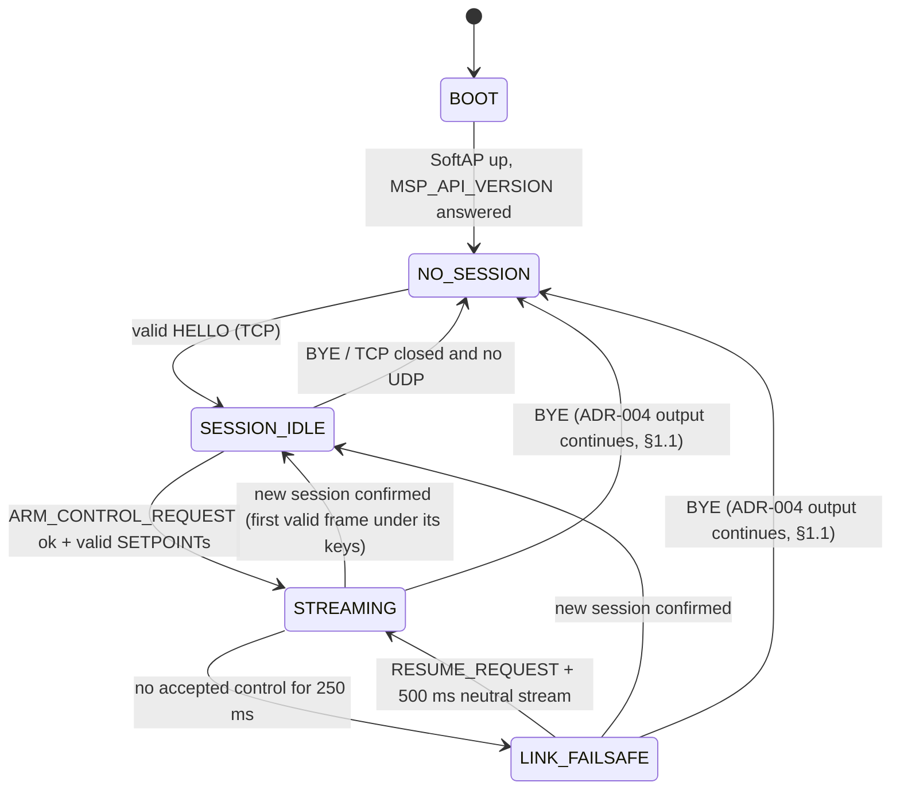

# ESP Link State Machine

> [!warning] Status: DRAFT
> Implements [[ADR-004 ESP Failsafe|ADR-004]] and [[ADR-005 TCP Session|ADR-005]], and REQ-SAF-009 to 016 (were REQ-LOSS and REQ-FS) and REQ-COM-020 to 023 (were REQ-RECON) in [[PC_to_ESP]] §7.

---

## 1. States

**A new `HELLO` does not end the current session** (2026-11-06, #156, [[ADR-005 TCP Session|ADR-005]] entry). In any state the ESP answers a valid `HELLO` with `HELLO_ACK` and keeps its current state and session. The new session is *pending*: it takes over only when its first valid frame under the new keys arrives; then the ESP sends `BYE` reason 3 to the old session and continues in SESSION_IDLE with the new one. A pending session with no valid frame within 2 s is dropped. `HELLO` is rate-limited (at most one per 500 ms). A replayed `HELLO` therefore never ends a live session.

Details of the pending session:
- **TCP:** a new TCP connection by itself changes nothing. While a session holds the one TCP slot, the ESP accepts one extra connection only to carry a `HELLO`, for at most 2 s; TCP keep-alive (seconds) frees a dead connection's slot ([[ADR-005 TCP Session|ADR-005]] entry). UDP and the failsafe are not affected.
- **No current session (NO_SESSION):** there is nothing to protect, so a valid `HELLO` opens the session at once (SESSION_IDLE).
- **First valid frame:** the first frame accepted by a Receiver holding the new session's receiving key, on UDP or TCP.
- **Another `HELLO` while one is pending:** the later one replaces the pending one. At most one accepted `HELLO` per 500 ms; a refused one does not restart the window. Known limit: replaying a `HELLO` every 500 ms can keep a real ground from reconnecting, but never ends the live session ([[ADR-005 TCP Session|ADR-005]] entry).
- **`HELLO` on the current TCP connection:** `BYE` reason 3 for the old session goes out on that same connection, which stays open for the new session.
- **After the switch:** the new session starts in SESSION_IDLE. From LINK_FAILSAFE this is not a resume: control needs a new `ARM_CONTROL_REQUEST` and valid setpoints (REQ-COM-020).
- **Open for #102, safety** (decided below, §1.1, 2026-11-09)**:** SESSION_IDLE sends neutral frames at once (throttle 1000 from mask 15, [[ADR-010 MSP Override|ADR-010]]), so a switch during STREAMING would be a hard throttle cut in flight, without the [[ADR-004 ESP Failsafe|ADR-004]] path; from LINK_FAILSAFE on 2026.6 (neutral 1 s, then stop) it would start sending neutral override frames again. Not new with #156, and only the real ground can confirm a session. #102 decides what the ESP sends at a switch; proposal: the same output as a link loss (ADR-004) until the new session's `ARM_CONTROL_REQUEST`.
- **On the wire:** a pending session is not visible in `STATE.esp_state` (no wire change). #102 may report an expired pending session or a rate-limited `HELLO` with an `EVENT` link code (`0x01xx`).
- **OTA ([[ADR-024 OTA Firmware Updates|ADR-024]]):** a pending session counts as an open session for the D2 gate; a `HELLO` that arrives during an upload is dropped, not kept for later.

### 1.1 Implementation details (2026-11-09, #102 PR 1, `sd::Link`)

Rules the code (`drone/lib/protocol/include/sd/link.hpp`) follows where this note was silent. Each rule has a unit test in `tests/test_link.cpp`; the open points and the known limit at the end are not rules yet.

- **Leaving control never sends neutral frames at once** (the open safety point above). **Confirmed by the safety pilot on 2026-11-09 (BrunoBMFT, review of PR #170).** At mask 8 (and any mask without throttle) this removes the throttle cut; at mask 15 the ADR-004 output still carries throttle 1000, see the open point at the end of this list. Once control was on (STREAMING), the ESP keeps the [[ADR-004 ESP Failsafe|ADR-004]] output (2026.6: neutral for 1 s, then nothing) until the next `ARM_CONTROL_ACK` OK or `RESUME_ACK` OK. It applies to LINK_FAILSAFE, to a confirmed session switch from STREAMING, and to a `BYE` from the ground during STREAMING. A switch from LINK_FAILSAFE keeps the failsafe's timeline (the 1 s does not restart). A switch from SESSION_IDLE changes nothing: neutral frames, as before.
- **`BYE` in any state ends the session** (NO_SESSION). From STREAMING or LINK_FAILSAFE the ADR-004 output continues (above), the same output as a link loss. A pending session survives a `BYE` of the current one: it can still be confirmed (no `BYE` reason 3 then, there is no old session) or it expires after 2 s. If a pending session's first valid frame is a `BYE`, the switch happens first (`BYE` reason 3 to the old session), then the new session ends.
- **After a switch out of LINK_FAILSAFE, control needs only the new session's `ARM_CONTROL_REQUEST`**, not the 500 ms neutral stream of a resume (REQ-COM-020, §1). Only setpoints accepted after that ARM reach the FC. **Confirmed by the safety pilot on 2026-11-09 (BrunoBMFT, review of PR #170), on this condition:** **REQ-SAF-023**: The ground shall never send `ARM_CONTROL_REQUEST` on its own, also not after a reconnect or a session switch; ARM is always an operator action. The ground node (#103) tests it.
- **ARM forgets earlier setpoints:** only `SETPOINT`s accepted after `ARM_CONTROL_ACK` OK reach the FC, so sticks sent while control was off are never applied when it turns on.
- **ARM without setpoints:** `ARM_CONTROL_ACK` OK starts the `T_loss` timer. With no accepted `SETPOINT` within 250 ms the ESP enters LINK_FAILSAFE. A setpoint older than `T_fresh` is sent as neutral sticks, also right after ARM.
- **Resume condition** (spec §3.1 code 3): accepted `SETPOINT`s with `mode 0`, with no gap of `T_fresh` (150 ms) or more, for at least 500 ms, and the last one younger than `T_fresh` when `RESUME_REQUEST` arrives. A `mode 1` setpoint or a gap restarts the 500 ms.
- **Timers start when they are detected:** every input first applies the timers that expired, so a late frame cannot rescue STREAMING. The ADR-004 timeline starts when the loss is detected; the firmware checks every loop (milliseconds).
- **TCP lost, then UDP lost (2026-11-09, review of PR #170):** if TCP drops during STREAMING and UDP is lost afterwards, the ESP enters LINK_FAILSAFE and stays there until a new `HELLO`: `RESUME_REQUEST` is a TCP message, and a TCP connection by itself never carries the old session again. The ADR-004 output runs the whole time, so this is safe; the ground reconnects with a new session and ARM.
- **SESSION_IDLE → NO_SESSION** ("TCP closed and no UDP"): the session's TCP connection is closed and no UDP frame of the session was accepted for `T_loss`. In STREAMING and LINK_FAILSAFE a TCP drop changes nothing ([[ADR-005 TCP Session|ADR-005]]).
- **TCP routing:** a session's TCP frames are checked only on its own connection (the pending session's on the connection that carried its `HELLO`). A non-`HELLO` frame on a connection with no session closes that connection: it carries `HELLO` only (ADR-005 entry). A pending session whose connection closes is dropped.
- **`HELLO.proto`:** only `1` is accepted; any other value is dropped and counted like a bad `HELLO` (the spec does not say yet).
- **Rate limit:** only a `HELLO` that passes every check uses the 500 ms window, so a bad or unknown-`proto` `HELLO` cannot block a reconnect.
- **`rx_rejected`** (provisional until #149): every frame rejected since boot, by every Receiver, plus failed `HELLO`s and frames with no session to check them against; STATE saturates it at 65535.
- **CONFIG:** the §7.3 keys, checked in the §3.1 order; tunable values go back to their defaults at every boot. `event_level` is stored but does not filter events yet.
- **Known limit, accepted by the safety pilot on 2026-11-09 (delayed frames, spike #171):** freshness uses the ESP's receive clock, and `t_send_us` is for latency logging only (spec §1, OD-10). Someone who holds back the ground's frames (jamming the ESP while recording them) and releases them later, in order, gets them accepted: they keep STREAMING alive with old sticks for as long as the recording lasts, instead of a failsafe after 250 ms. Closing it needs a bound on `t_send_us` against the ESP clock, which changes the spec; spike #171 evaluates BrunoBMFT's proposal (clock offset from each session's first frames, then a bound on the lag). The radio pilot keeps priority in every case.
- **OTA and UPDATING (2026-11-09, #102 part 3, [[ADR-024 OTA Firmware Updates|ADR-024]]):** the firmware opens the OTA port only while the D2 gate is open (NO_SESSION, no pending session, FC disarmed per an `MSP_STATUS` under 500 ms old), and closes it when the gate closes. UPDATING is **not a wire state**: during the transfer the main loop is blocked, so nothing goes to the FC and no frame is handled (a `HELLO` gets no reply). `STATE.esp_state` never shows it, and no code is added. After a successful update the ESP reboots into BOOT; after a failed one the loop goes on and releases the lock.
- **Reconnect while STREAMING (2026-11-09, bench case of #102):** after a TCP-only drop, the ground opens a new session on a new connection and sends `ARM_CONTROL_REQUEST` as its first frame under the new keys. That frame confirms the switch, and ARM OK keeps STREAMING. The UDP stream is never interrupted. Because ARM forgets earlier setpoints, the FC gets **one 20 ms tick of neutral sticks** until the first SETPOINT under the new keys arrives. The ARM is the operator's (REQ-SAF-023). A momentary `EVENT 0x0104` may come first: the switch starts the ADR-004 output, and the ARM in the same frame ends it.
- **FC link health (2026-11-10, #179, team decision D1–D3, [[Protocol Spec v0]] v1.4):** the FC counts as lost when no reply to one of the ESP's requests came for 250 ms (an error reply counts). On each change the current session gets `EVENT 0x0201` FC link lost or `0x0202` FC link restored. While the FC is silent, `ARM_CONTROL_REQUEST` is refused with result 4 "FC not answering" (after the state and mask checks). If the FC goes silent while STREAMING, the state is kept: the ESP can do nothing useful at the FC side, the radio pilot and the ground node react. `FC_HEALTH` at 5 Hz carries the FC link's values for the ground. The link starts with the FC not alive, so no ARM before the FC has been seen.
- **Open, not blocking mask 8:** neutral frames carry throttle 1000 (§2). Betaflight uses it only from mask 15 ([[ADR-010 MSP Override|ADR-010]]); what the ADR-004 output does with throttle at mask 15 is still open (#104). **2026-11-09 (safety pilot, review of PR #170):** at mask 15 both the `T_fresh` neutral and the ADR-004 output carry throttle 1000, so a Wi-Fi gap of about 150 ms gives about 1.1 s of throttle cut before the radio takes over. Masks 8 and 11 are not affected (the pilot keeps throttle). Mask 15 stays off until #104 decides this, on top of the altitude-hold condition in ADR-010.
- **Failsafe output visible to the ground (open until 2026-11-09, now done):** while the ADR-004 output runs outside LINK_FAILSAFE (after a `BYE` or a switch from control, until ARM OK), `STATE.esp_state` shows NO_SESSION or SESSION_IDLE and nothing on the wire says the output is the failsafe one. **Required in PR 2** (safety pilot, 2026-11-09, review of PR #170): an `EVENT` when a new session starts while the ADR-004 output is active, so the ground never shows SESSION_IDLE as if the output were neutral. **Done 2026-11-09 (#102 PR 2):** `EVENT 0x0104` failsafe output active, right after `HELLO_ACK` (session opened at once) or after the switch (pending session confirmed) ([[Protocol Spec v0]] §3.1, v1.3.3).

## 2. Behaviour per state

| State | Sends to FC | Notes |
|---|---|---|
| BOOT | nothing | Wi-Fi sleep disabled, static IP. Safe at power-up and after a watchdog reset (REQ-SAF-016 (was REQ-FS-04)). |
| NO_SESSION | **neutral frames** (1500, throttle 1000) at 50 Hz | An early override switch-on never sees empty channels. 2026-11-09: the ADR-004 output instead, if control was on before (§1.1) |
| SESSION_IDLE | neutral frames | Telemetry flowing. 2026-11-09: the ADR-004 output instead, after a switch or `BYE` from control, until ARM OK (§1.1) |
| STREAMING | ground setpoints | `override_active` read from `MSP_STATUS` and reported (REQ-SAF-007 (was SAF-07)) |
| LINK_FAILSAFE | per [[ADR-004 ESP Failsafe\|ADR-004]] (4.5.1: neutral forever; 2026.6: neutral 1 s then stop) | Event over TCP when possible (REQ-SAF-015 (was REQ-FS-03)) |

> [!important] Neutral throttle
> Throttle is only overridden from mask 15 onwards ([[ADR-010 MSP Override|ADR-010]]). Until then the FC ignores the throttle value because the pilot owns it.

## 3. Implementation rules

- All timeouts take an injected `now_ms()`, so the logic is unit-testable on the host ([[PC_to_ESP]] §9.1).
- Rejected packets never reset the loss timer (REQ-SAF-011 (was REQ-LOSS-03)).
- The main loop never blocks. UART reads are non-blocking. The ESP8266 hardware watchdog stays enabled. Exception: an OTA upload blocks the loop while the image is transferred, and only in NO_SESSION with the FC disarmed and locked ([[ADR-024 OTA Firmware Updates|ADR-024]] D2; #102 adds the UPDATING state).
- Diagnostics traffic is rate-limited so control is never starved (OD-20, limits still to set).

## 4. Glossary

| Term          | Meaning                                                                                    |
| ------------- | ------------------------------------------------------------------------------------------ |
| **ADR**       | Architecture Decision Record: a documented decision and its rationale.                     |
| **ESP8266** | The Wi-Fi microcontroller of the drone's ESP module (an ESP-12F). It bridges the ground PC to the FC over UART4. |
| **BYE**       | Message that ends a session; reason 3 = replaced by a confirmed new session ([[Protocol Spec v0]] §3.1). |
| **Failsafe**  | An automatic safe response when control, communication, or a sensor fails.                 |
| **FC** | Flight Controller: on this project the OddityRC F7 AIO (STM32F722, Betaflight target `ODDITYRCF7AIO`) of the 2.5" drone. It stabilises the aircraft and takes MSP from the ESP on UART4. |
| **Mermaid**   | A text-based diagram syntax rendered by compatible Markdown tools.                         |
| **MSP**       | MultiWii Serial Protocol, used for communication with Betaflight flight controllers.       |
| **TCP**       | Transmission Control Protocol: reliable, ordered, connection-oriented transport.           |
| **Telemetry** | Periodic data sent from a system to report state, measurements, or health. |
| **UDP**       | User Datagram Protocol: connectionless transport suited to refreshed, time-sensitive data. |
| **UART**      | Universal Asynchronous Receiver/Transmitter: an asynchronous serial interface.             |
| **API**       | Application Programming Interface: a defined way for software components to communicate.   |
| **Pending session** | A new session after a `HELLO`, not yet confirmed by a valid frame under its keys; the current session keeps running meanwhile (#156). |
| **REQ** | Requirement ID of the form `REQ-<SYS, NAV, SEN, COM, CTL, SAF, PWR, SW or HW>-NNN`, used for traceability. |
| **REQ-SAF-001 to 008** | Safety requirements (old IDs SAF-01 to SAF-08) defined in ESP_to_FC §8 and registered in [[Requirements]]: independent ELRS path, pilot takeover, no arming from code. |
| **OD-xx / FC-xx / TF-xx** | Open-decision IDs in PC_to_ESP, ESP_to_FC and ThoneFlow. The Decision Register shows which ADR resolves each one. |
| **STREAMING** | ESP link state in which ground setpoints are being forwarded to the FC ([[ESP Link State Machine]]). |
| **T_fresh** | Setpoint freshness timeout: a setpoint older than this (150 ms) is replaced by neutral sticks, with no failsafe ([[Protocol Spec v0]] §7.2). |
| **ADR-004 output** | What the ESP sends to the FC once the link failsafe is active: on 2026.6 neutral sticks for 1 s, then nothing, so Betaflight falls back to the radio sticks. |
| **T_loss** | The ESP link-failsafe timeout: no accepted control message for this long enters LINK_FAILSAFE (initial 250 ms, ADR-004). |
| **SoftAP** | Software access point: the ESP creates its own Wi-Fi network that the ground PC joins (ADR-006). |
| **E-stop** | Emergency stop: when something fails, the drone is brought to a safe stop, in the air or on the ground. The faults it must cover are in [[Testing Strategy]] §2. |
