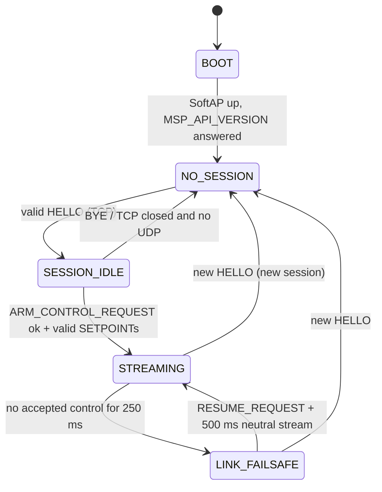

# ESP Link State Machine

> [!warning] Status: DRAFT
> Implements [[ADR-004 ESP Failsafe|ADR-004]] and [[ADR-005 TCP Session|ADR-005]], and REQ-LOSS / REQ-FS / REQ-RECON in [[PC_to_ESP]] §7.

---

## 1. States

## 2. Behaviour per state

| State | Sends to FC | Notes |
|---|---|---|
| BOOT | nothing | Wi-Fi sleep disabled, static IP. Safe at power-up and after a watchdog reset (REQ-FS-04). |
| NO_SESSION | **neutral frames** (1500, throttle 1000) at 50 Hz | An early override switch-on never sees empty channels |
| SESSION_IDLE | neutral frames | Telemetry flowing |
| STREAMING | ground setpoints | `override_active` read from `MSP_STATUS` and reported (SAF-07) |
| LINK_FAILSAFE | per [[ADR-004 ESP Failsafe\|ADR-004]] (4.5.1: neutral forever; 2026.6: neutral 1 s then stop) | Event over TCP when possible (REQ-FS-03) |

> [!important] Neutral throttle
> Throttle is only overridden from mask 15 onwards ([[ADR-010 MSP Override|ADR-010]]). Until then the FC ignores the throttle value because the pilot owns it.

## 3. Implementation rules

- All timeouts take an injected `now_ms()`, so the logic is unit-testable on the host ([[PC_to_ESP]] §9.1).
- Rejected packets never reset the loss timer (REQ-LOSS-03).
- The main loop never blocks. UART reads are non-blocking. The ESP8266 hardware watchdog stays enabled.
- Diagnostics traffic is rate-limited so control is never starved (OD-20, limits still to set).

## 4. Glossary

| Term          | Meaning                                                                                    |
| ------------- | ------------------------------------------------------------------------------------------ |
| **ADR**       | Architecture Decision Record: a documented decision and its rationale.                     |
| **ESP8266**   | A WiFi-enabled microcontroller used as the drone communication module.                     |
| **Failsafe**  | An automatic safe response when control, communication, or a sensor fails.                 |
| **FC**        | Flight Controller: the onboard controller responsible for stabilization and control.       |
| **Mermaid**   | A text-based diagram syntax rendered by compatible Markdown tools.                         |
| **MSP**       | MultiWii Serial Protocol, used for communication with Betaflight flight controllers.       |
| **TCP**       | Transmission Control Protocol: reliable, ordered, connection-oriented transport.           |
| **Telemetry** | Periodic data sent from a system to report state, measurements, or health.                 |
| **UDP**       | User Datagram Protocol: connectionless transport suited to refreshed, time-sensitive data. |
| **UART**      | Universal Asynchronous Receiver/Transmitter: an asynchronous serial interface.             |
| **API**       | Application Programming Interface: a defined way for software components to communicate.   |
