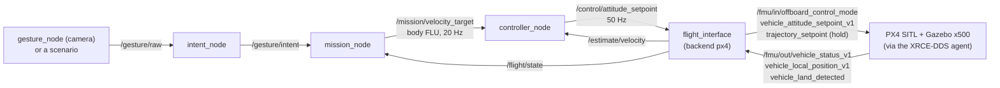

# PX4 SITL Setup

> [!success] Verified 2026-10-15 (issue #29, Track E)
> Default quad (`gz_x500`) arms, takes off to 5 m and holds, flown from the ROS 2 `offboard_control` example. Run in a container, headless and with the Gazebo GUI window (§6).

## 1. What this gives us

PX4 SITL + Gazebo is the flight-behaviour backend of [[ADR-019 Sim Backends|ADR-019]]. The platform follows [[ADR-018 Ground OS and ROS 2|ADR-018]]. The PX4 docs list **Ubuntu 24.04 + ROS 2 Jazzy + Gazebo Harmonic** as the primary combination, which closes the open check in ADR-018. Ubuntu 22.04 also works, but with ROS 2 Humble.

| Part | Version |
|---|---|
| Base | `ros:jazzy` (Ubuntu 24.04) |
| PX4 | `v1.17.0` (latest stable on 2026-10-15) |
| `px4_msgs` | branch `release/1.17`, **must match the PX4 version** |
| Micro XRCE-DDS Agent | `v2.4.3` (Jazzy) |

## 2. Build the image

The `Dockerfile` is in the code repo under `drone/ground/src/simulation/`; its `px4` stage is this image. It runs PX4's `ubuntu.sh --no-nuttx`, builds the ROS 2 workspace and pre-builds `px4_sitl_default`.

```sh
docker build --target px4 -t seame-px4-sim:jazzy-1.17 -f drone/ground/src/simulation/Dockerfile drone/ground
```

Your user must be in the `docker` group (`sudo usermod -aG docker $USER`, then log in again).

## 3. Fly the default quad

```sh
docker run -d --name px4sim --network host -e HEADLESS=1 seame-px4-sim:jazzy-1.17 sleep infinity

# 1) DDS agent
docker exec -d px4sim bash -lc 'source ~/ros2_px4_ws/install/setup.bash; MicroXRCEAgent udp4 -p 8888'
# 2) PX4 + Gazebo x500 (stdin kept open, or the PX4 shell spams the log)
docker exec -d px4sim bash -lc 'cd ~/PX4-Autopilot && tail -f /dev/null | HEADLESS=1 make px4_sitl gz_x500 > /tmp/px4.log 2>&1'
```

Ready when the PX4 log shows `Startup script returned successfully` and `uxrce_dds_client ... successfully created rt/fmu/out/...`.

## 4. Offboard from the ROS 2 example

Arming needs a GCS. Without one, PX4 reports `Preflight Fail: No connection to the GCS`. Either connect QGroundControl (UDP 14550), or in a headless run disable the failsafe:

```sh
docker exec px4sim bash -lc 'cd ~/PX4-Autopilot/build/px4_sitl_default && ./bin/px4-param set NAV_DLL_ACT 0'
```

> [!warning] Sim only
> `NAV_DLL_ACT 0` turns off the data-link-loss failsafe. Never use it for the real drone ([[Safety Rules]]). The parameter resets when the sim state is wiped.

```sh
docker exec -it px4sim bash -lc 'source ~/ros2_px4_ws/install/setup.bash; ros2 run px4_ros_com offboard_control'
```

> [!tip] Start order
> The example sends **one** arm command about a second after it starts. Start it only after PX4 prints `Ready for takeoff!`. If it was too early, the quad stays on the ground: stop the node and start it again.

Expected: `Arm command send`, then `Armed by external command` and `Takeoff detected` in the PX4 log. `ros2 topic echo --once /fmu/out/vehicle_local_position_v1 --field z` gives about `-5.0` (NED: negative is up, so 5 m).

## 5. Result (2026-10-15)

| Acceptance criterion (#29) | State |
|---|---|
| PX4 SITL + Gazebo on Ubuntu 24.04 | Done (24.04 container) |
| Default quad flies in sim | Done, headless and with GUI |
| Offboard from the ROS 2 example | Done, z = −5.003 m |
| Setup steps in the vault | This page |

## 6. Gazebo GUI

Works on this host (X11, `DISPLAY=:0`) with **software rendering**, because `nvidia-smi` reports a driver/library mismatch on the laptop:

```sh
xhost +local:docker
docker run -d --name px4sim --network host -e DISPLAY=$DISPLAY -e LIBGL_ALWAYS_SOFTWARE=1 \
  -v /tmp/.X11-unix:/tmp/.X11-unix --device /dev/dri seame-px4-sim:jazzy-1.17 sleep infinity
```

Then start the agent and `make px4_sitl gz_x500` as in §3, **without** `HEADLESS=1`. The "Gazebo Sim" window opens and the quad flew to 5 m while it ran. Software rendering is slow, so expect a low frame rate. Visually confirmed on 2026-10-15: the quad climbs in the Gazebo window.

## 6.1 Known gaps

- The `px4io/px4-sitl` image on the PX4 quickstart page is headless without Gazebo or ROS 2. It is a smoke test only.
- Clean up with `docker rm -f px4sim`.
- Neutral is calmer here than on the drone. In the simulation, neutral (`active` false) is PX4's position hold of a frozen point ([[ADR-025 flight_interface Ground Node|ADR-025]] F19); on the drone it is mode 0 through the ESP, which hands the sticks back to the safety pilot, and the drone drifts until the pilot holds it. A link loss or an inactive controller therefore looks better in SITL than it will on the drone (2026-11-27, PR #253 review).

## 7. The ground chain in the simulator (`make sim`, `make sim-smoke`, `make sim-hold`)

The ground flies the simulated x500 the way it flies the drone: gestures → `intent_node` → `mission_node` → `controller_node` → `flight_interface` (backend `px4`) → PX4. Only the last hop differs from the real drone, where `flight_interface`'s `esp` backend talks to the ESP ([[ADR-019 Sim Backends|ADR-019]], [[ADR-025 flight_interface Ground Node|ADR-025]] §2.4).

> [!warning] Simulation only
> Here code configures `flight_interface`, arms the drone, takes off and switches to Offboard. That is allowed only in the sim: on the real drone the operator and the safety pilot do it, never code ([[Safety Rules]]). The `px4` backend exists only in the simulation image of `flight_interface` and is never used with the real drone.

### 7.1 What runs



The services, in `drone/ground/docker-compose.yml`:

| Service | Runs |
|---|---|
| `px4` | PX4 SITL + Gazebo (x500) and the Micro XRCE-DDS agent. Its start script, `drone/ground/src/simulation/sim_start.sh`, does the operator's and the safety pilot's steps (§7.2) and then marks the container healthy |
| `flight_interface_sim` | `flight_interface` with the `px4` backend, from the `sim` stage of its Dockerfile (the normal image plus `px4_msgs`). No PSK: there is no ESP |
| `controller` | `controller_node` ([[07 Controller Node]]) |
| `gesture`, `intent`, `mission`, `echo` | the usual ground services ([[01 ROS2 Nodes Installation\|01]] §4.2) |
| `sim_smoke`, `sim_hold` | the scripted tests (§7.4, §7.5) |

The sim is its own mode: profile `sim` and `drone/ground/env/sim.env` (its own ROS domain; copy it from `env.example/sim.env.example` and fill in the safety pilot's values first, [[01 ROS2 Nodes Installation|01]] §4.2). Its parameters are `ground_bringup/config/sim.yaml`: backend `px4`, mask 15 and the hover throttle 0.73 for both the controller and `flight_interface`. To try another mask, edit it there (both sections) and restart `make sim`. `fake_flight_state` (pretend `/flight/state`) never runs with the sim: `flight_interface_sim` publishes the real one from PX4, and `make` / `make up` stop a running sim first.

**Discovery.** The sim runs every container with `ROS_AUTOMATIC_DISCOVERY_RANGE=SUBNET` (`env/sim.env`); the other modes use `LOCALHOST` ([[ADR-025 flight_interface Ground Node|ADR-025]] E1, E1.2, E1.3). With `LOCALHOST` the `px4` container (uid 1000, UDP only) and the others never see each other. With `SUBNET` other PCs on the same network and `ROS_DOMAIN_ID` see the sim's topics: on a shared network, the sim's domain in `env/sim.env` keeps it apart; a host terminal needs the same (`export ROS_DOMAIN_ID=<GROUND_DOMAIN_ID>`).

**What the `px4` backend does** (`flight_interface/px4_backend.py`, the rules in `px4_logic.py`):

- While the controller commands, it sends PX4 an attitude setpoint (quaternion and thrust, body FLU turned into PX4's FRD / NED); while nothing commands (`active` false), it streams the position and heading where that started, with a zero velocity, so PX4 holds that point itself (ADR-025 F19 note, 2026-11-25). Before Offboard the point follows the drone; an axis without a fresh position is a zero-velocity hold until the first fresh value fills it (F19 note, 2026-11-26).
- It turns PX4's status into the drone state the guard reads: `override_active` is "armed and in Offboard", the sim's takeover switch.
- It publishes the measured velocity on `/estimate/velocity` for the controller: horizontal from PX4's velocity, vertical from the rate of PX4's height (`z_deriv`; PX4's own `vz` carries a bias in SITL).
- Under masks 8 and 11 a **simulated pilot** flies the axes the ground does not own (height, and roll / pitch under 8), holding zero velocity on each, as the safety pilot's sticks do on the drone ([[ADR-025 flight_interface Ground Node|ADR-025]] F2). Without it, a fixed hover throttle there let the drone climb away.
- It never arms, disarms or changes PX4's mode.

**Images.** `px4`, `sim_smoke` and `sim_hold` use `rosrangers/px4-sim:jazzy`: the PX4 image of §2 (`seame-px4-sim:jazzy-1.17`) plus `intent_node` and the `sim_smoke` package (the final stage of `drone/ground/src/simulation/Dockerfile`). The Makefile builds the PX4 image the first time; that takes a long time and several GB. `make clean` / `fclean` keep it; `make px4-image` rebuilds it after a change to the `px4` stage. The first `make sim` also builds `flight_interface`'s `sim` stage (`px4_msgs` from source, a few minutes, then cached).

### 7.2 What the start script does

`sim_start.sh` writes each step to `logs/px4/latest.log`:

1. `[sim] 1/6` starts the agent and PX4 + Gazebo.
2. `[sim] 2/6` waits for PX4 and sets `NAV_DLL_ACT 0` (no ground station) and `MIS_TAKEOFF_ALT 2.0`. PX4 calls its heading good for control only after climbing above 1.5 m; without that heading `flight_interface` publishes no `/estimate/velocity` and the controller stays inactive.
3. `[sim] 3/6` configures and activates `flight_interface_sim` (`ros2 lifecycle set`).
4. `[sim] 4/6` waits until PX4 receives its setpoint stream: PX4 refuses Offboard without it.
5. `[sim] 5/6` arms, takes off, waits for PX4's heading, switches to Offboard. Every step checks that PX4 is really armed and in the air: PX4 accepts mode switches while disarmed.
6. `[sim] 6/6 Ready`: the container turns healthy. It logs the height for 12 s after the switch.

PX4's take-off ends at about 1.75 m, a little under 2.0 m.

### 7.3 Fly it with gestures in Gazebo: `make sim`

From `drone/ground/`, with what `make` needs ([[01 ROS2 Nodes Installation|01]] §4.1: Docker, webcam, display):

```sh
make sim              # PX4 + Gazebo window, camera gestures, live table
make sim GUI=0        # the same without the Gazebo window
make sim-down         # stop it (from another terminal; Ctrl+C also stops it)
```

1. **Wait for PX4.** The terminal shows the live table; the start-up is in `logs/px4/latest.log` (§7.2). That takes one to two minutes, more on the first run; the Gazebo window opens on the way. Until then `mission_node` stays `IDLE`. Once PX4 is armed and in Offboard (the sim's override), the mode turns `WAITING` and the table's CONTROL row shows the controller `active` with reason `ok`: it holds zero velocity.
2. **Engage.** From `WAITING`: both arms down, then both open hands. The mission mode turns `ENGAGED`.
3. **Fly** with the gestures of [[00 Gesture Pipeline]] §3. Hands down: the controller holds zero velocity. Commands are in the **drone's** frame: `MOVE_RIGHT` moves to the drone's right, whatever the Gazebo camera shows. The x500 starts facing east.
4. **Stop** with Ctrl+C or `make sim-down`. Closing the Gazebo window leaves the sim running.

Gazebo uses the GPU (`/dev/dri`); the Makefile adds the host's render group to the container. Without GPU access it falls back to software rendering (§6), which is slow.

### 7.4 The smoke test: `make sim-smoke`

One command, headless, no camera, from `drone/ground/`: `make sim-smoke`. It starts the sim's services and `sim_smoke`, waits until `px4` is healthy, runs the scenario and stops everything, pass or fail. The exit code is the result. It is not in GitHub CI: Gazebo is too heavy for hosted runners ([[CI-CD Overview]], level 3).

**Scenario** (`drone/ground/src/simulation/sim_smoke/sim_smoke/smoke_scenario.py`). It starts its own `intent_node` and drives the chain through `/gesture/raw` only (30 Hz), never `/mission/velocity_target`, which `mission_node` publishes:

no hands → `ENGAGE` → no hands → `MOVE_RIGHT` 4 s → no hands → `CLIMB_UP` 3 s → no hands → `MOVE_RIGHT`, then `intent_node` killed (SIGKILL) while the gestures keep coming.

To test REQ-SAF-017 it kills `intent_node` rather than stopping the gestures: with only the gestures stopped, `intent_node` waits `neutral_timeout_sec` (0.3 s) before `NEUTRAL`, which measures the intent filter, not the 0.25 s rule. The mask must be 11 or 15 (the scenario flies right and up; under 8 nothing moves).

**Checks** (`smoke_checks.py`, no ROS, unit-tested in the CI job `sim-smoke-python`):

| Check | Pass when |
|---|---|
| Direction | the commanded body axis moved ≥ 0.3 m the right way, the others ≤ 0.25 m, the heading ≤ 10°; an axis outside the mask does not move |
| REQ-CTL-001 | every target ≤ 0.3 m/s lateral, 0.2 m/s vertical, 20 °/s yaw; measured speed ≤ 0.5 m/s |
| REQ-SAF-017 | the last target before the loss was a move, and `mission_node`'s zero comes ≤ 0.25 s after the last `/gesture/intent` and stays zero; from 2.5 s after the loss, for 4 s, the drone hovers: measured horizontal and vertical speed ≤ 0.1 m/s and ≤ 0.25 m drift. While the controller commands, a zero target is "hold zero velocity", so PX4 gets no zero velocity setpoint: the hover is the proof |
| REQ-SAF-018 | no target on an axis outside the mask, and no active attitude setpoint commanding one (outside the mask: level, hover throttle) |
| REQ-SW-001 | `/mission/velocity_target` at 20 Hz ± 10 %, no gap above 150 ms |

A missing mask in `/flight/state` fails the run (it is never assumed), and so does any non-finite sample a check reads.

**Timing.** The REQ-SAF-017 delay and the REQ-SW-001 rate use the stamp each target was **published** with (`header.stamp`), so the DDS delay to the test container does not count against `mission_node`. The loss is timed from when the scenario received the last `/gesture/intent` (it has no stamp). Every container reads the same host wall clock.

### 7.5 The hold test: `make sim-hold` (REQ-NAV-001)

REQ-NAV-001: at 1.0 m, with zero velocity setpoints, the drone stays within **0.25 m** horizontally and **±0.15 m** vertically of the start point for **60 s**, judged on Gazebo's ground truth ([[ADR-025 flight_interface Ground Node|ADR-025]] F26).

What each part verifies (2026-11-27): the 60 s hold is REQ-NAV-001, flown by the ground's controller with zero velocity setpoints (every setpoint active, PX4 in attitude Offboard). The 20 s neutral phase after it checks PX4's own position hold with the same box; it is not REQ-NAV-001's controller.

```sh
make sim-hold          # 3 runs; passes only if all 3 pass
make sim-hold RUNS=1   # one run (RUNS must be 1 or more)
```

**Scenario** (`sim_smoke/hold_scenario.py`): no hands → `ENGAGE` → the descend gesture until Gazebo's height reads 1.0 m → no hands for 5 s, then the hold: 60 s of no hands. Then the **neutral phase** (2026-11-26): the scenario pauses the controller for 20 s by setting its `hover_throttle` to 0.0 through the parameter service (ADR-025 F28 note), so `flight_interface` sends neutral and PX4 holds the frozen point (F19); then it sets the value back. It reads the true position and heading straight from Gazebo (gz-transport, the model `x500_0`), next to PX4's estimate.

**Checks** (`hold_checks.py`, unit-tested in `sim-smoke-python`): the hold starts at 1.0 ± 0.1 m; 60 s held with no gap in the truth; the largest horizontal distance and vertical deviation from the start point; the controller active for every setpoint of the hold; who held (every `/flight/state` with `override_active`, `mission_node` ENGAGED with intent NEUTRAL, PX4 in Offboard, every Offboard mode attitude: PX4's own hold would pass the distance checks too); the heading within 10°. Neutral phase, judged from 0.5 s after the pause to the resume: the truth watched without gaps (none over 0.5 s at the start, inside or at the end), the same 0.25 m / ±0.15 m box around the true position at the moment of the pause (where PX4 froze its hold point, so drift during the switch counts; 2026-11-27), the heading within 10°, every Offboard mode position, and an active setpoint within 2 s of the resume. A non-finite sample fails the check. `summary.md` also lists, not judged, the start and end of the hold in the truth and in PX4's estimate.

The first runs (2026-11-24, #199): 3 of 3, at most 0.19 m horizontally and 0.08 m vertically, with the controller's starting gains. With the neutral phase (2026-11-26): 3 of 3, 12/12 checks each; the hold at most 0.18 m off, the neutral hold at most 0.11 m and 0.06 m, the controller flying again 0.02 s after the resume. With the review fixes (2026-11-27: integrators only while applied, the neutral box from the pause point, watched without gaps): 3 of 3, 13/13 checks each; the hold at most 0.207 m horizontally and 0.050 m vertically, the neutral hold at most 0.068 m and 0.051 m, the controller flying again within 0.01 s.

### 7.6 Output

Under `drone/ground/logs/`:

| Path | What |
|---|---|
| `sim-smoke/<start time>/`, `sim-hold/<start time>/` | `summary.md` (the checks, PASS/FAIL, the measured values), `bag/` (rosbag, MCAP), `intent_node.log`; `sim-hold` also `truth.csv` (Gazebo's pose for the whole run) |
| `test/sim-smoke.log`, `test/sim-hold-<n>.log` | the whole output of each run |
| `px4/latest.log` | the start script (§7.2) |
| `flight_interface_sim/latest.log`, `controller/latest.log` | the two nodes |
| `px4-sitl/px4.log`, `agent.log` | PX4 and the XRCE-DDS agent |

Read a bag with the `px4` image, which has `px4_msgs` (`ros2 bag play` works the same way):

```sh
docker compose --profile sim run --rm --no-deps px4 ros2 bag info /logs/sim-hold/<start time>/bag
```

To keep a run as evidence, zip its folder and attach it to the issue.

### 7.7 Troubleshooting

| Symptom | Fix |
|---|---|
| `[sim] FAILED: …` (PX4 not ready, no take-off, heading not good, Offboard refused) | read `logs/px4-sitl/px4.log` |
| `[sim] FAILED: flight_interface not active` | read `logs/flight_interface_sim/latest.log`: a configure failure says why |
| CONTROL row inactive, reason `no_velocity` | no `/estimate/velocity`: PX4's heading is not good for control yet (the drone below 1.5 m), or `flight_interface_sim` is not active |
| `ENGAGE` does nothing | wait until the mission mode is `WAITING` (after `[sim] 6/6 Ready`); put both arms down first: `ENGAGE` must be a new gesture |
| sluggish drone, `link_ok` or `airborne` flickering in `/flight/state` | Gazebo runs much slower than real time (software rendering): try `GUI=0`, check `/dev/dri` |
| no Gazebo window | check `echo $DISPLAY`; `make sim` runs `xhost +local:` for you |
| `make` stopped the sim | on purpose: `fake_flight_state` and `flight_interface_sim` would both publish `/flight/state` |
| `sim-smoke` / `sim-hold`: `chain ready` FAIL | `mission_node` was not `WAITING` with no hands within 60 s of PX4 being ready: see `logs/mission/latest.log` |
| PX4 RTL and lands at the end of a run | expected: the scenario's containers stop first, PX4 loses the setpoint stream and runs its Offboard-loss failsafe |

## 8. Related pages

- [[ADR-019 Sim Backends|ADR-019]] · [[ADR-018 Ground OS and ROS 2|ADR-018]] · [[Study Plan v2]] · [[Testing Strategy]]
- [[01 ROS2 Nodes Installation]] · [[04 Mission Node]] · [[05 Flight Interface Node]] · [[07 Controller Node]] · [[00 Gesture Pipeline]] · [[Safety Rules]]

## 9. Glossary

| Term | Meaning |
| --- | --- |
| **SITL** | Software In The Loop: the flight code runs on the PC against a simulator. |
| **Gazebo** | The 3D physics simulator used with PX4 (Harmonic release). |
| **x500** | PX4's default simulated quadcopter. |
| **XRCE-DDS** | Protocol and agent that bridge PX4 uORB topics to ROS 2. |
| **Offboard** | PX4 mode where an external computer streams setpoints. |
| **NED** | North-East-Down frame: negative z is up. |
| **GCS** | Ground Control Station, e.g. QGroundControl. |
| **PX4** | An open-source flight-control stack, used here only in simulation (PX4 SITL + Gazebo). |
| **FLU** | Forward-Left-Up body frame (ROS REP-103), the frame of `/mission/velocity_target`. |
| **px4 backend** | Sim-only backend of `flight_interface`: attitude setpoints (or, when nothing commands, PX4's own hold of a frozen position) → PX4, PX4 state → `/flight/state`, PX4 velocity → `/estimate/velocity`. |
| **Mask** | `msp_override_channels_mask`: which axes the ground commands (8 yaw, 11 roll + pitch + yaw, 15 all four). The simulation's is in `config/sim.yaml`. |
| **Ground truth** | Gazebo's own position of the model, not PX4's estimate of it; `make sim-hold` judges on it. |
| **Hover throttle** | The throttle (0–1) that holds the drone level in the air; 0.73 for the simulated x500. |
| **FRD** | Forward-Right-Down body frame, PX4's. |
| **Compose profile** | A label on a compose service; the service starts only when its profile is asked for (`--profile sim`). |
| **Healthcheck** | A compose test that marks a container ready; `sim_smoke` waits for `px4` to be healthy. |
| **Rosbag** | A recording of ROS 2 topics (`ros2 bag record`), replayable with `ros2 bag play`. |
| **MCAP** | The default rosbag file format in ROS 2 Jazzy. |
| **Smoke test** | A short end-to-end check that the whole chain works (`make sim-smoke`). |
| **Lifecycle node** | A ROS 2 node that starts unconfigured and is configured and activated by command (`ros2 lifecycle set`), like `flight_interface`. |
| **Attitude setpoint** | Roll, pitch, yaw rate and throttle: what the controller asks the drone to hold. |
| **Controller** | `controller_node`: turns the velocity target into an attitude setpoint ([[07 Controller Node]]). |
| **ESP** | The ESP-12F module (ESP8266) on the drone: the Wi-Fi bridge between the ground PC and the FC, wired to FC UART4. |
| **Measured velocity** | The velocity the drone really has, on `/estimate/velocity`: from PX4 in the simulation, from the estimator (#200) on the drone. |
| **PSK** | Pre-shared key: the secret the ground and the ESP use to authenticate the session. |
| **REQ ID** | A requirement identifier, `REQ-<area>-NNN`, registered in [[Requirements]]. |
| **RTL** | Return to launch: PX4's failsafe that flies back and lands; here it fires when the setpoint stream stops. |
