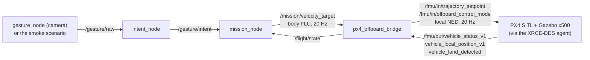

# PX4 SITL Setup

> [!success] Verified 2026-10-15 (issue #29, Track E)
> Default quad (`gz_x500`) arms, takes off to 5 m and holds, flown from the ROS 2 `offboard_control` example. Run in a container, headless and with the Gazebo GUI window (§6).

## 1. What this gives us

PX4 SITL + Gazebo is the flight-behaviour backend of [[ADR-019 Sim Backends|ADR-019]]. The platform follows [[ADR-018 Ground OS and ROS 2|ADR-018]]. The PX4 docs list **Ubuntu 24.04 + ROS 2 Jazzy + Gazebo Harmonic** as the primary combination, which closes the open check in ADR-018. Ubuntu 22.04 also works, but with ROS 2 Humble.

| Part | Version |
|---|---|
| Base | `ros:jazzy` (Ubuntu 24.04) |
| PX4 | `v1.17.0` (latest stable on 2026-10-15) |
| `px4_msgs` | branch `release/1.17`, **must match the PX4 version** |
| Micro XRCE-DDS Agent | `v2.4.3` (Jazzy) |

## 2. Build the image

The `Dockerfile` is in the code repo under `drone/simulation/px4/`. It runs PX4's `ubuntu.sh --no-nuttx`, builds the ROS 2 workspace and pre-builds `px4_sitl_default`.

```sh
docker build -t seame-px4-sim:jazzy-1.17 drone/simulation/px4
```

Your user must be in the `docker` group (`sudo usermod -aG docker $USER`, then log in again).

## 3. Fly the default quad

```sh
docker run -d --name px4sim --network host -e HEADLESS=1 seame-px4-sim:jazzy-1.17 sleep infinity

# 1) DDS agent
docker exec -d px4sim bash -lc 'source ~/ros2_px4_ws/install/setup.bash; MicroXRCEAgent udp4 -p 8888'
# 2) PX4 + Gazebo x500 (stdin kept open, or the PX4 shell spams the log)
docker exec -d px4sim bash -lc 'cd ~/PX4-Autopilot && tail -f /dev/null | HEADLESS=1 make px4_sitl gz_x500 > /tmp/px4.log 2>&1'
```

Ready when the PX4 log shows `Startup script returned successfully` and `uxrce_dds_client ... successfully created rt/fmu/out/...`.

## 4. Offboard from the ROS 2 example

Arming needs a GCS. Without one, PX4 reports `Preflight Fail: No connection to the GCS`. Either connect QGroundControl (UDP 14550), or in a headless run disable the failsafe:

```sh
docker exec px4sim bash -lc 'cd ~/PX4-Autopilot/build/px4_sitl_default && ./bin/px4-param set NAV_DLL_ACT 0'
```

> [!warning] Sim only
> `NAV_DLL_ACT 0` turns off the data-link-loss failsafe. Never use it for the real drone ([[Safety Rules]]). The parameter resets when the sim state is wiped.

```sh
docker exec -it px4sim bash -lc 'source ~/ros2_px4_ws/install/setup.bash; ros2 run px4_ros_com offboard_control'
```

> [!tip] Start order
> The example sends **one** arm command about a second after it starts. Start it only after PX4 prints `Ready for takeoff!`. If it was too early, the quad stays on the ground: stop the node and start it again.

Expected: `Arm command send`, then `Armed by external command` and `Takeoff detected` in the PX4 log. `ros2 topic echo --once /fmu/out/vehicle_local_position_v1 --field z` gives about `-5.0` (NED: negative is up, so 5 m).

## 5. Result (2026-10-15)

| Acceptance criterion (#29) | State |
|---|---|
| PX4 SITL + Gazebo on Ubuntu 24.04 | Done (24.04 container) |
| Default quad flies in sim | Done, headless and with GUI |
| Offboard from the ROS 2 example | Done, z = −5.003 m |
| Setup steps in the vault | This page |

## 6. Gazebo GUI

Works on this host (X11, `DISPLAY=:0`) with **software rendering**, because `nvidia-smi` reports a driver/library mismatch on the laptop:

```sh
xhost +local:docker
docker run -d --name px4sim --network host -e DISPLAY=$DISPLAY -e LIBGL_ALWAYS_SOFTWARE=1 \
  -v /tmp/.X11-unix:/tmp/.X11-unix --device /dev/dri seame-px4-sim:jazzy-1.17 sleep infinity
```

Then start the agent and `make px4_sitl gz_x500` as in §3, **without** `HEADLESS=1`. The "Gazebo Sim" window opens and the quad flew to 5 m while it ran. Software rendering is slow, so expect a low frame rate. Visually confirmed on 2026-10-15: the quad climbs in the Gazebo window.

## 6.1 Known gaps

- The `px4io/px4-sitl` image on the PX4 quickstart page is headless without Gazebo or ROS 2. It is a smoke test only.
- Clean up with `docker rm -f px4sim`.

## 7. The ground chain in the simulator (`make sim`, `make sim-smoke`)

The ground nodes fly the simulated x500: gestures → `intent_node` → `mission_node` → `px4_offboard_bridge` → PX4. It checks topic names, message types, QoS, frames and rates before the real `flight_interface` and the controller depend on them (#86).

> [!warning] Simulation only
> Here code arms the drone, takes off and switches to Offboard. That is allowed only in the sim: on the real drone the safety pilot does it, never code ([[Safety Rules]]). `px4_offboard_bridge` stands in for the PX4 backend of `flight_interface` ([[ADR-019 Sim Backends|ADR-019]]) and is never used with the real drone.

### 7.1 What runs



The services, in `drone/ground/docker-compose.yml`:

| Service | Runs |
|---|---|
| `px4` | PX4 SITL + Gazebo (x500), the Micro XRCE-DDS agent and `px4_offboard_bridge`, in one container. Its start script, `drone/ground/docker/px4/sim_start.sh`, waits for PX4, starts the bridge, arms, takes off and switches to Offboard, then marks the container healthy |
| `gesture`, `intent`, `mission`, `echo` | the usual ground services ([[01 ROS2 Nodes Installation\|01]] §4.2) |
| `sim_smoke` | the scripted test (§7.3) |

The `flight` service (pretend `/flight/state`) never runs with them: the bridge publishes the real one from PX4. `make sim` lists its services by name for that reason, and `make` / `make up` stop a running sim first. The sim services are behind the compose profiles `sim` and `sim-smoke`, so plain `make` never starts them.

**`px4_offboard_bridge`** (`drone/simulation/px4/ros/px4_offboard_bridge/`) turns `/mission/velocity_target` into PX4 offboard velocity setpoints at 20 Hz (body FLU → local NED, using the PX4 heading). It sends zero when the target is older than 0.25 s (REQ-SAF-017), zeroes the axes outside the mask (REQ-SAF-018) and clamps to the ceilings. It publishes `/flight/state` for `mission_node`: `override_active` is "armed and in Offboard", the sim's takeover switch. It never arms or changes mode. Details, the frame formulas and the parameters: its `README.md`.

**Images.** `px4` and `sim_smoke` use `rosrangers/px4-sim:jazzy`: the PX4 image of §2 (`seame-px4-sim:jazzy-1.17`) plus `intent_node`, `mission_node` and the bridge (`drone/ground/docker/px4/Dockerfile`). The Makefile builds the PX4 image the first time; that takes a long time and several GB. `make clean` / `fclean` keep it; `make px4-image` rebuilds it after a change to `drone/simulation/px4/Dockerfile`.

### 7.2 Fly it with gestures in Gazebo: `make sim`

From `drone/ground/`, with what `make` needs ([[01 ROS2 Nodes Installation|01]] §4.1: Docker, webcam, display):

```sh
make sim              # PX4 + Gazebo window, camera gestures, live table
make sim GUI=0        # the same without the Gazebo window
make sim MASK=11      # ground owns x, y and yaw; PX4 holds the altitude (default 15: all axes)
make sim-down         # stop it (from another terminal; Ctrl+C also stops it)
```

1. **Wait for PX4.** The terminal shows the live table. The start-up is in `logs/px4/latest.log`: `[sim] 1/5` … `[sim] 5/5 Ready: armed, hovering in Offboard`. That takes about 30 s headless, more with the window or on the first run; the Gazebo window opens on the way. Until then `mission_node` stays `IDLE`: there is no `/flight/state` yet, or it says the override is off. Once PX4 is armed and in Offboard (the sim's override), the mode turns `WAITING`.
2. **Engage.** From `WAITING`: both arms down, then both open hands. The mission mode in the live table turns `ENGAGED`.
3. **Fly** with the gestures of [[00 Gesture Pipeline]] §3. Hands down: the drone hovers. Commands are in the **drone's** frame: `MOVE_RIGHT` moves to the drone's right, whatever the Gazebo camera shows. The x500 starts facing east.
4. **Stop** with Ctrl+C or `make sim-down`. Closing the Gazebo window leaves the sim running.

Gazebo uses the GPU (`/dev/dri`); the Makefile adds the host's render group to the container. Without GPU access it falls back to software rendering (§6), which is slow.

### 7.3 The smoke test: `make sim-smoke`

One command, headless, no camera. From `drone/ground/`:

```sh
make sim-smoke             # mask 15
make sim-smoke MASK=11     # z left to PX4: the climb must NOT move the drone
```

It starts `px4`, `mission` and `sim_smoke`, waits until `px4` is healthy, runs the scenario and stops everything, pass or fail. The exit code is the result (0 only when every check passed). It is not in GitHub CI: Gazebo is too heavy for hosted runners ([[CI-CD Overview]], level 3).

**Scenario** (`px4_offboard_bridge/smoke_scenario.py`). It starts its own `intent_node` and drives the chain through `/gesture/raw` only (30 Hz), never `/mission/velocity_target`, which `mission_node` publishes:

no hands → `ENGAGE` → no hands → `MOVE_RIGHT` 4 s → no hands → `CLIMB_UP` 3 s → no hands → `MOVE_RIGHT`, then `intent_node` killed (SIGKILL) while the gestures keep coming.

To test REQ-SAF-017 it kills `intent_node` rather than stopping the gestures. With only the gestures stopped, `intent_node` waits `neutral_timeout_sec` (0.3 s) before `NEUTRAL`: that measures the intent filter, not the 0.25 s rule.

**Checks** (`px4_offboard_bridge/smoke_checks.py`, no ROS, unit-tested in the CI job `sim-bridge-python`):

| Check | Pass when |
|---|---|
| Direction | the commanded body axis moved ≥ 0.3 m the right way, the others ≤ 0.25 m; an axis outside the mask does not move |
| REQ-CTL-001 | every target ≤ 0.3 m/s lateral, 0.2 m/s vertical, 20 °/s yaw; measured speed ≤ 0.5 m/s |
| REQ-SAF-017 | zero target from `mission_node` ≤ 0.25 s after the last `/gesture/intent`; zero setpoint at PX4 ≤ 0.30 s (one bridge tick more); hovering 2.5 s after the loss |
| REQ-SAF-018 | no target or PX4 setpoint on an axis outside the mask |
| REQ-SW-001 | `/mission/velocity_target` at 20 Hz ± 10 %, no gap above 150 ms |

**Output**, under `drone/ground/logs/`:

| Path | What |
|---|---|
| `sim-smoke/<start time>/summary.md` | the checks, PASS/FAIL and the measured values |
| `sim-smoke/<start time>/bag/` | rosbag (MCAP) of the chain: gesture, intent, mission, `/flight/state` and the PX4 topics |
| `sim-smoke/<start time>/intent_node.log` | the scenario's `intent_node` |
| `sim-smoke/<start time>.log` | the scenario's own output (the same table at the end) |
| `test/sim-smoke.log` | the whole `make sim-smoke` output |
| `px4/latest.log` | the start script and the bridge |
| `px4-sitl/px4.log`, `agent.log` | PX4 and the XRCE-DDS agent |

Read a bag with the `px4` image, which has `px4_msgs` (`ros2 bag play` works the same way):

```sh
docker compose --profile sim run --rm --no-deps px4 ros2 bag info /logs/sim-smoke/<start time>/bag
```

To keep a run as evidence, zip its `sim-smoke/<start time>/` folder and attach it to the issue. The first runs (masks 15 and 11, 11/11 checks each) are on #86.

### 7.4 Troubleshooting

| Symptom | Fix |
|---|---|
| `[sim] FAILED: PX4 not ready in 300 s` (or no take-off, Offboard refused) | read `logs/px4-sitl/px4.log` |
| `ENGAGE` does nothing | wait until the mission mode is `WAITING` (after `[sim] 5/5 Ready`); put both arms down first: `ENGAGE` must be a new gesture |
| sluggish drone, `link_ok` or `airborne` flickering in `/flight/state` | Gazebo runs much slower than real time (software rendering): try `GUI=0`, check `/dev/dri` |
| no Gazebo window | check `echo $DISPLAY`; `make sim` runs `xhost +local:` for you |
| `make` stopped the sim | on purpose: the pretend `flight` and the bridge would both publish `/flight/state` |
| `sim-smoke`: `chain ready` FAIL | `mission_node` was not `WAITING` with no hands within 60 s of PX4 being ready: see `logs/mission/latest.log` |

### 7.5 By hand: `sim_smoke.sh`

`drone/simulation/px4/sim_smoke.sh` runs the same chain in one container (`px4sim-smoke`, the image of §2 with the repo mounted read-only), for debugging inside it: `up [8|11|15] [gui]`, `gui` (open the window again), `check` (topic rates and the last `/flight/state`), `shell` (ROS sourced), `logs`, `down`. It does not arm, take off or switch to Offboard: you do that yourself, as `make sim` does in `sim_start.sh`. The usage is at the top of the script; details in `drone/simulation/px4/README.md`.

## 8. Related pages

- [[ADR-019 Sim Backends|ADR-019]] · [[ADR-018 Ground OS and ROS 2|ADR-018]] · [[Study Plan v2]] · [[Testing Strategy]]
- [[01 ROS2 Nodes Installation]] · [[04 Mission Node]] · [[00 Gesture Pipeline]] · [[Safety Rules]]

## 9. Glossary

| Term | Meaning |
| --- | --- |
| **SITL** | Software In The Loop: the flight code runs on the PC against a simulator. |
| **Gazebo** | The 3D physics simulator used with PX4 (Harmonic release). |
| **x500** | PX4's default simulated quadcopter. |
| **XRCE-DDS** | Protocol and agent that bridge PX4 uORB topics to ROS 2. |
| **Offboard** | PX4 mode where an external computer streams setpoints. |
| **NED** | North-East-Down frame: negative z is up. |
| **GCS** | Ground Control Station, e.g. QGroundControl. |
| **PX4** | An open-source flight-control stack, used here only in simulation (PX4 SITL + Gazebo). |
| **FLU** | Forward-Left-Up body frame (ROS REP-103), the frame of `/mission/velocity_target`. |
| **px4_offboard_bridge** | Sim-only ROS 2 node: `/mission/velocity_target` → PX4 offboard setpoints, PX4 state → `/flight/state`. |
| **Override mask** | The axes the ground commands: 8 yaw, 11 x y yaw, 15 all (`MASK=`). |
| **Compose profile** | A label on a compose service; the service starts only when its profile is asked for (`--profile sim`). |
| **Healthcheck** | A compose test that marks a container ready; `sim_smoke` waits for `px4` to be healthy. |
| **Rosbag** | A recording of ROS 2 topics (`ros2 bag record`), replayable with `ros2 bag play`. |
| **MCAP** | The default rosbag file format in ROS 2 Jazzy. |
| **Smoke test** | A short end-to-end check that the whole chain works (`make sim-smoke`). |
