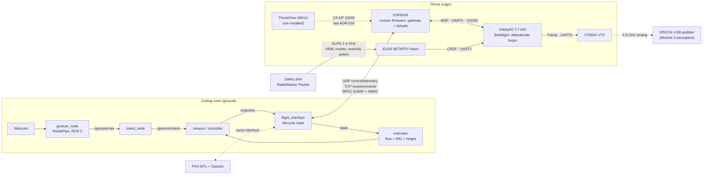

# System Overview

> [!warning] Status: DRAFT
> This is the architecture we are building towards. State on 2026-10-23: since 2026-10-19 the ESP (stock AT firmware, not the custom firmware) is soldered to FC UART4 and the FC answers MSP through it. The gesture nodes `gesture_node` and `intent_node` are built and tested in CI and Docker (2026-10-21), without a drone ([[00 Gesture Pipeline]]). `mission_node` is in `dev` too since 2026-10-23 (#93), with 135 tests and a Docker image, fed by a pretend `/flight/state` ([[04 Mission Node]]). The rest of the chain (controller, failsafe, `flight_interface`) is not built or tested yet.

Follows the Module 1 reference layering: mission → ROS 2 → hardware abstraction → real-time layer → sensors/actuators.

---

## 1. Architecture

## 2. Authority order

Safety pilot (ELRS) > Betaflight failsafe > ESP link failsafe ([[ADR-004 ESP Failsafe|ADR-004]]) > `flight_interface` watchdog > mission/gestures.

## 3. Rates (initial budget, to be measured)

| Link | Rate | Source |
|---|---|---|
| Ground → ESP control | 50 Hz | OD-05 method: confirm by measurement |
| ESP → ground telemetry | 25 Hz | [[ADR-008 Telemetry Transport\|ADR-008]] |
| ESP → FC `MSP_SET_RAW_RC` | 50 Hz, 8 channels, 22 bytes | [[ADR-009 ESP to FC Link\|ADR-009]] |
| ESP polls `MSP_ATTITUDE` | 25 Hz; `MSP_ANALOG`/`MSP_STATUS` 5 Hz | [[ADR-009 ESP to FC Link\|ADR-009]] |
| ThoneFlow | 66 Hz (datasheet) or 25 Hz (ArduPilot), to measure | [[ThoneFlow]] |
| Webcam + MediaPipe | ≥ 20 FPS | [[02 Gesture Node\|Gesture Node]] |

At 115200 baud (about 11.5 kB/s), the MSP traffic above uses under 30% of the UART.

## 4. Latency budget (gesture → motors)

camera frame → inference → intent filter → controller → UDP → ESP validation → UART → Betaflight RC smoothing.
Telemetry echoes the **last applied control seq and its send timestamp**, so the ground can measure the round trip ([[Protocol Spec v0]]).

## 5. Related pages

- [[PC_to_ESP]] · [[ESP_to_FC]] · [[ThoneFlow]] · [[Decision Register]]

## 6. Glossary

| Term | Meaning |
| --- | --- |
| **ADR** | Architecture Decision Record: a documented decision and its rationale. |
| **CRSF** | Crossfire serial protocol: the serial wire format between the ELRS receiver and the FC (UART2), and between the radio and its ELRS module. |
| **ELRS** | ExpressLRS: the open-source radio-control link between the RadioMaster Pocket and the BETAFPV Nano receiver on the drone. |
| **ESP8266** | The Wi-Fi microcontroller of the drone's ESP module (an ESP-12F). It bridges the ground PC to the FC over UART4. |
| **Failsafe** | An automatic safe response when control, communication, or a sensor fails. |
| **FC** | Flight Controller: on this project the OddityRC F7 AIO (STM32F722, Betaflight target `ODDITYRCF7AIO`) of the 2.5" drone. It stabilises the aircraft and takes MSP from the ESP on UART4. |
| **HMAC** | Hash-based Message Authentication Code: a keyed tag that proves a message came from someone holding the key (ADR-002 uses a truncated HMAC-SHA256). |
| **IMU** | Inertial Measurement Unit: the gyroscope and accelerometer on the FC. |
| **MediaPipe** | A framework used here for detecting and interpreting hand landmarks and gestures. |
| **Mermaid** | A text-based diagram syntax rendered by compatible Markdown tools. |
| **MSP** | MultiWii Serial Protocol, used for communication with Betaflight flight controllers. |
| **OD-xx / FC-xx / TF-xx** | Open-decision IDs in PC_to_ESP, ESP_to_FC and ThoneFlow. The Decision Register shows which ADR resolves each one. |
| **ROS 2** | The second-generation Robot Operating System middleware used for robotics integration. |
| **SITL** | Software In The Loop: the flight code runs on the PC against a simulator. |
| **SoftAP** | Software access point: the ESP creates its own Wi-Fi network that the ground PC joins. |
| **TCP** | Transmission Control Protocol: reliable, ordered, connection-oriented transport. |
| **Telemetry** | Periodic data sent from a system to report state, measurements, or health. |
| **UART** | Universal Asynchronous Receiver/Transmitter: an asynchronous serial interface. |
| **UDP** | User Datagram Protocol: connectionless transport suited to refreshed, time-sensitive data. |
| **VTX** | Video transmitter: hardware that sends the aircraft video feed. |
