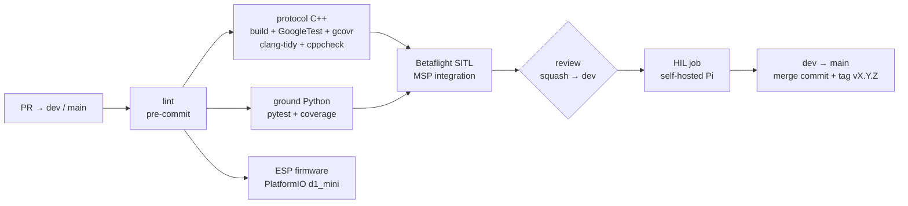

# CI/CD Overview

> [!info] Builds on [[Dev_Strategy]] §10–§13
> The pipeline below is the concrete version of the CI checks and test levels defined there. Branches and merges follow [[ADR-017 Branching Model|ADR-017]] (`main` + `dev`).

Module 1 deliverable: a **green pipeline** with build, unit tests, static analysis, **coverage > 80%**, and a **HIL job on a self-hosted runner** (due 11 Dec). The tools are fixed by the program: GoogleTest, pytest, clang-tidy, cppcheck, coverage gates, GitHub Actions.

---

## 1. Pipeline



| Dev_Strategy level | Where it runs |
|---|---|
| 1 Unit | GitHub-hosted: GoogleTest, pytest |
| 2 Integration | GitHub-hosted: golden vectors C++ ⇄ Python, Betaflight SITL |
| 3 Simulation | Team laptops: PX4 SITL + Gazebo (manual, later nightly) |
| 4 Hardware / bench | **HIL runner** (automated) + manual props-off bench |
| 5 Flight | Cage, with a flight-test report in Obsidian |

## 2. Start now (no open decisions)

1. Software repo with `main` + `dev` and protection ([[Branch_Protection]], [[Repository Layout]]).
2. pre-commit: clang-format, ruff, end-of-file, trailing whitespace.
3. Empty C++ lib + 1 GoogleTest, coverage gate at **50%** → raise to 80% by week 6.
4. pytest skeleton for the ground packages.
5. PlatformIO build of a "hello" firmware for `d1_mini`.
6. `drone/config/betaflight/` with the `diff all` files, reviewed like code.

Then: SITL job (week 3), HIL job (week 4), tag `v0.1.0` on `main` (week 8).

## 3. Before you commit: run pre-commit

Run this from the repo root before every push (ideally before every commit):

```bash
pre-commit run --all-files
```

**Why.** The `lint` job in `ci.yaml` runs exactly this command, and every other job waits for it (`needs: lint`). If it fails locally it fails in the PR, blocks the merge into `dev` and wastes a CI run. Running it first keeps PRs green and review diffs free of whitespace and formatting noise.

**What it checks** (config: `.pre-commit-config.yaml`):

| Hook | What it does |
| --- | --- |
| `end-of-file-fixer` | Files end with exactly one newline (auto-fixes). |
| `trailing-whitespace` | Removes trailing spaces (auto-fixes). |
| `check-yaml` | YAML parses (workflows, issue forms, `labels.yml`). |
| `ruff` | Python lint (Python ground nodes, protocol, tests). |
| `ruff-format` | Python formatting (auto-fixes). |
| `clang-format` | C/C++ formatting for the protocol library and firmware (auto-fixes). |

**Requirements.**

- Python 3 and `pip`. CI uses 3.12.
- `pip install pre-commit` (or `pipx install pre-commit`). Nothing else: hooks (ruff, clang-format) are downloaded into pre-commit's own cache on the first run, so that run needs internet and is slow. Later runs are fast.
- Run from inside the git repo. Hooks only see tracked or staged files, so `git add` new files first.

**If it fails.** Many hooks fix the files themselves and then report "Failed". Run `git diff` to review the fixes, `git add` them and run the command again until everything says `Passed`. `ruff` errors and `check-yaml` errors need a manual fix.

**Optional: run it automatically.** `pre-commit install` registers a git hook so the checks run on every `git commit` (on staged files only). It does not replace `--all-files`, which is what CI runs. Never bypass with `--no-verify` to get a commit through: CI will fail anyway.

**When you change the hooks.** Edit `.pre-commit-config.yaml` in its own PR, run `pre-commit run --all-files` and commit any reformatting it causes. See [[GitHub Actions Starter]] §4 for the starting config.

## 4. Related pages

- [[GitHub Actions Starter]] · [[Testing Strategy]] · [[HIL Runner]] · [[Dev_Strategy]]

## 5. Glossary
## 3. Related pages

- [[GitHub Actions Starter]] · [[Testing Strategy]] · [[HIL Runner]] · [[Dev_Strategy]]

## 4. Glossary

| Term | Meaning |
| --- | --- |
| **ADR** | Architecture Decision Record: a documented decision and its rationale. |
| **Branch** | An independent line of development in version control. |
| **CI** | Continuous Integration: automated validation of proposed changes. |
| **Commit** | A recorded snapshot of changes in a version-control repository. |
| **HIL** | Hardware-in-the-Loop: testing that connects real or emulated hardware to a simulator. |
| **Mermaid** | A text-based diagram syntax rendered by compatible Markdown tools. |
| **MSP** | MultiWii Serial Protocol, used for communication with Betaflight flight controllers. |
| **pre-commit** | Tool that runs lint and format hooks on the repo; the same checks run in CI as `lint`. |
| **PR** | Pull Request: a proposed change submitted for review before merging. |
| **SITL** | Software In The Loop: the flight code runs on the PC against a simulator. |
| **PX4** | An open-source flight-control stack, used here only in simulation (PX4 SITL + Gazebo). |
| **Gazebo** | The 3D physics simulator used with PX4 (Harmonic release). |
| **PlatformIO** | The build system used for the ESP8266 firmware (envs `d1_mini`, `d1_mini_ota`). |
