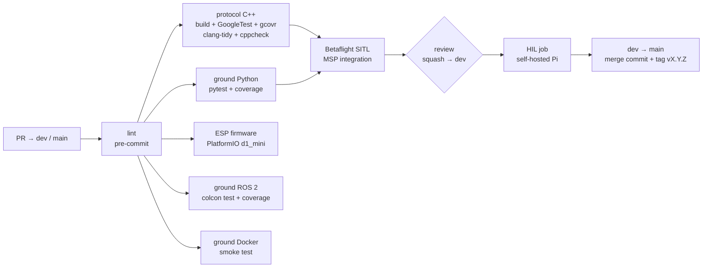

# CI/CD Overview

> [!info] Builds on [[Dev_Strategy]] §10–§13
> The pipeline below is the concrete version of the CI checks and test levels defined there. Branches and merges follow [[ADR-017 Branching Model|ADR-017]] (`main` + `dev`).

Module 1 deliverable: a **green pipeline** with build, unit tests, static analysis, **coverage > 80%**, and a **HIL job on a self-hosted runner** (due 11 Dec). The tools are fixed by the program: GoogleTest, pytest, clang-tidy, cppcheck, coverage gates, GitHub Actions.

---

## 1. Pipeline



| Dev_Strategy level | Where it runs |
|---|---|
| 1 Unit | GitHub-hosted: GoogleTest, pytest |
| 2 Integration | GitHub-hosted: golden vectors C++ ⇄ Python, Betaflight SITL |
| 3 Simulation | Team laptops: PX4 SITL + Gazebo (manual, later nightly) |
| 4 Hardware / bench | **HIL runner** (automated) + manual props-off bench |
| 5 Flight | Cage, with a flight-test report in Obsidian |

Each job is gated by `check-components` and turns on when its component exists (details in [[GitHub Actions Starter]]). The workflow files are `ci.yaml`, `hil.yaml` and `close-linked-issues.yaml` in `.github/workflows/`.

**Ground ROS 2 jobs.**
- `ground-ros2` builds `gesture_node` and `intent_node` in the `ros:jazzy-ros-base` container and runs `colcon test`. A second step runs the package tests again, plus the pipeline tests in `drone/tests/ros`, under pytest with a **90 % coverage gate**. It uploads the JUnit report (artifact `ground-ros2-report`).
- `ground-docker` runs `drone/ground/docker/smoke_test.sh`.
- They turn on when both `package.xml` files exist (`ground-ros2`) or `drone/ground/docker-compose.yml` exists (`ground-docker`).
- On a PR they run only when it changes `drone/ground/`, `drone/tests/ros/` or `ci.yaml`. Pushes to `dev` and `main` always run them. See §4 for why.

Every job in `ci.yaml` has a `timeout-minutes` limit (5–30 min), so a hung job can't hold a runner for GitHub's default of 6 h.

## 2. Start now (no open decisions)

1. Software repo with `main` + `dev` and protection ([[Branch_Protection]]). The tree is in [[Repository Layout]]; the workflow files are summarised in [[GitHub Actions Starter]].
2. pre-commit: end-of-file, trailing whitespace, check-yaml, ruff + ruff-format, clang-format, shellcheck (§3).
3. Empty C++ lib + 1 GoogleTest, coverage gate at **80%** from the start (as in `ci.yaml`). The target is 100%.
4. pytest skeleton for the ground packages.
5. PlatformIO build of a "hello" firmware for `d1_mini`.
6. `drone/config/betaflight/` with the `diff all` files, reviewed like code.

Then: SITL job (week 3), HIL job (week 4), tag `v0.1.0` on `main` (week 8).

## 3. Before you commit: run pre-commit

Run this from the repo root before every push (ideally before every commit):

```bash
pre-commit run --all-files
```

**Why.** The `lint` job in `ci.yaml` runs exactly this command, and every other job waits for it (`needs: lint`). If it fails locally it fails in the PR, blocks the merge into `dev` and wastes a CI run. Running it first keeps PRs green and review diffs free of whitespace and formatting noise.

**What it checks** (config: `.pre-commit-config.yaml`):

| Hook | What it does |
| --- | --- |
| `end-of-file-fixer` | Files end with exactly one newline (auto-fixes). |
| `trailing-whitespace` | Removes trailing spaces (auto-fixes). |
| `check-yaml` | YAML parses (workflows, issue forms, `labels.yml`). |
| `ruff` | Python lint (Python ground nodes, protocol, tests). Rules are in `ruff.toml` at the repo root: `E`, `W` (style), `F` (pyflakes), `B` (bugbear: likely bugs) and `I` (import order). `E501` (long lines) is off because `ruff-format` owns line length. Fix import order with `ruff check --fix` (needs `pip install ruff==0.6.9`, the hook's version); the pre-commit hook only reports it. |
| `ruff-format` | Python formatting (auto-fixes). |
| `clang-format` | C/C++ formatting for the protocol library and firmware (auto-fixes). |
| `shellcheck` | Lints every shell script (today `scripts/sync-labels.sh` and `drone/ground/docker/*.sh`), warnings and errors only. |

**Requirements.**

- Python 3 and `pip`. CI uses 3.12.
- `pip install pre-commit` (or `pipx install pre-commit`). Nothing else: hooks (ruff, clang-format, shellcheck) are downloaded into pre-commit's own cache on the first run, so that run needs internet and is slow. Later runs are fast.
- Run from inside the git repo. Hooks only see tracked or staged files, so `git add` new files first.

**If it fails.** Many hooks fix the files themselves and then report "Failed". Run `git diff` to review the fixes, `git add` them and run the command again until everything says `Passed`. `ruff` errors that `--fix` can't solve, `check-yaml` errors and `shellcheck` warnings need a manual fix.

**Optional: run it automatically.** `pre-commit install` registers a git hook so the checks run on every `git commit` (on staged files only). It does not replace `--all-files`, which is what CI runs. Never bypass with `--no-verify` to get a commit through: CI will fail anyway.

**When you change the hooks.** Edit `.pre-commit-config.yaml` in its own PR, run `pre-commit run --all-files` and commit any reformatting it causes. See [[GitHub Actions Starter]] §4 for the starting config.

## 4. CI decisions for the ROS 2 ground nodes (2026-10-21)

Taken in issue #73 (PR #74), from the review of `drone/ground` on 2026-10-21.

**Done:**
- **Time limits** on every `ci.yaml` job.
- **Coverage gate for `ground-ros2`.** `colcon test` stays, because it runs the tests the way ROS does. A pytest step adds the 90 % gate (measured coverage was 98 % on 2026-10-21, in the `ros:jazzy-ros-base` container on `feature/ros2nodes`) and the JUnit report.
- **Path filter inside `check-components`, not `on: paths`.** A job skipped through `if:` counts as passed for a required check (GitHub reports a skipped job as success), but a workflow that never starts leaves the check pending, and that blocks the merge. Only `ground-ros2` and `ground-docker` are filtered, because they are the slow jobs. The others are fast and always run.
- **shellcheck** in pre-commit.
- **Stricter ruff, repo-wide** (`ruff.toml`), with `E501` left to `ruff-format`.

**Later (not done yet):**
- Run `ground-ros2` inside the gesture image, so one place defines the dependencies.
- Pin `ros:jazzy-ros-base` by digest, with Dependabot proposing updates. It only helps partly while the apt packages are not pinned.
- Docker layer cache for `ground-docker`, once a real run shows how long the job takes.
- hadolint for the Dockerfiles.
- Make `lint`, `ground-ros2` and `ground-docker` required checks on `dev` (repo settings, admin only).

## 5. Related pages

- [[Repository Layout]] · [[GitHub Actions Starter]] · [[Testing Strategy]] · [[HIL Runner]] · [[PX4 SITL Setup]] · [[Dev_Strategy]]

## 6. Glossary

| Term | Meaning |
| --- | --- |
| **ADR** | Architecture Decision Record: a documented decision and its rationale. |
| **Branch** | An independent line of development in version control. |
| **CI** | Continuous Integration: automated validation of proposed changes. |
| **Commit** | A recorded snapshot of changes in a version-control repository. |
| **HIL** | Hardware-in-the-Loop: testing that connects real or emulated hardware to a simulator. |
| **Mermaid** | A text-based diagram syntax rendered by compatible Markdown tools. |
| **MSP** | MultiWii Serial Protocol, used for communication with Betaflight flight controllers. |
| **pre-commit** | Tool that runs lint and format hooks on the repo; the same checks run in CI as `lint`. |
| **PR** | Pull Request: a proposed change submitted for review before merging. |
| **SITL** | Software In The Loop: the flight code runs on the PC against a simulator. |
| **PX4** | An open-source flight-control stack, used here only in simulation (PX4 SITL + Gazebo). |
| **Gazebo** | The 3D physics simulator used with PX4 (Harmonic release). |
| **PlatformIO** | The build system used for the ESP8266 firmware (envs `d1_mini`, `d1_mini_ota`). |
| **colcon** | The build tool for ROS 2 workspaces; `colcon test` runs each package's tests. |
| **Coverage gate** | A CI step that fails when tests run less than a set share of the code (80 % C++/Python, 90 % ROS 2 nodes). |
| **Dependabot** | GitHub bot that opens PRs to update pinned versions (actions, images, packages). |
| **Digest** | A content hash (`sha256:…`) that pins one exact Docker image, unlike a tag such as `jazzy-ros-base`. |
| **Docker** | Tool that runs software in containers: isolated environments built from an image (Dockerfile). |
| **hadolint** | Linter for Dockerfiles. |
| **JUnit report** | An XML file listing each test and its result, which CI tools can display. |
| **Path filter** | A rule that runs a CI job only when a PR changes certain files. |
| **Required check** | A CI job that must pass before a PR can be merged (set in the repo's branch protection). |
| **ROS 2** | The second-generation Robot Operating System middleware used for robotics integration. |
| **ruff** | Python linter and formatter (`ruff` and `ruff-format` hooks). |
| **shellcheck** | Linter for shell scripts (`.sh`), run as a pre-commit hook. |
| **Smoke test** | A quick end-to-end check that the built thing starts and does its basic job. |
