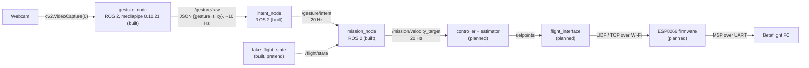

# 🖐️ Gesture Pipeline: from a hand to a drone command

This is the **start page** of the gesture section. It explains the whole chain in one place: a webcam sees the operator's hand, the hand becomes a gesture name, the gesture becomes an intent, and the intent becomes a velocity target for the drone. Each step has its own note (§2).

> [!NOTE] Decision
> Gestures come from a **ground webcam**, not a camera on the drone: [[ADR-015 Gesture Input Source|ADR-015]]. [[ADR-018 Ground OS and ROS 2|ADR-018]] kept the recogniser apart from ROS 2. Since 2026-10-20 it runs as the ROS 2 node `gesture_node`, for the reasons in [[01 Gesture Node]] §2. A new ADR that amends ADR-018 is still to be written.

> [!WARNING] Safety first
> Gestures **never** arm, disarm or touch the override switch. The radio and the safety pilot always win over code ([[Safety Rules]]).

---

## 🔄 1. The chain

Status on 2026-10-20:

| Step | Piece | Question it answers | Built? | Where | Status | Note |
| :---: | :--- | :--- | :---: | :--- | :--- | :--- |
| 1 | `gesture_node` (`gestures.py` + `hand_processing.py` inside) | "Which hand pose is this?" | ✅ | `drone/ground/src/gesture_node/` | ==🟠just created (2026-10-20)==: 6 unit tests; recognition code unchanged from the working prototype; first full run not recorded yet | [[01 Gesture Node\|01]] |
| 2 | `/gesture/raw` (`gesture_sender.py` in `gesture_node`) | "How does the pose reach `intent_node`?" | ✅ | `drone/ground/src/gesture_node/` | ==🟠new==: replaced UDP on 2026-10-20 | [[01 Gesture Node\|01]] §8 |
| 3 | `intent_node` | "What does the **operator** want?" | ✅ | `drone/ground/src/intent_node/` | ==🟢already exists==: 17 unit tests, built and run on ROS 2 Jazzy. Reads `/gesture/raw` with `input_source:=topic` | [[03 Intent_node\|03]] |
| 4 | `mission_node` | "What should the **drone** do now?" | ✅ | `MISSION_NODE_PACKAGE/` (for now) | ==🟠just created (2026-10-19)==: 35 unit tests, built and run on Jazzy alone and with `intent_node`. Not reviewed yet | [[04 Mission_Node\|04]] |
| 4a | `fake_flight_state`, `fake_intent` (in `mission_node`) | "Can we test without a drone?" | ✅ | `MISSION_NODE_PACKAGE/` | ==🟠pretend inputs, tests only==. `fake_flight_state` stands in for `/flight/state` until `flight_interface` exists | [[04 Mission_Node\|04]] §7 |
| 5 | controller + estimator | "Which attitude gives that velocity?" | ❌ | — | ==🔴planned== (Module 1, week 5) | [[05 Future Nodes\|05]] §5 |
| 6 | `flight_interface` | "How do we send it safely?" | ❌ | `drone/ground/src/flight_interface/` (only `info.md`) | ==🔴planned== | [[05 Future Nodes\|05]] §6, [[System Overview]] |
| 7 | ESP8266 firmware | "How does it reach the FC?" | ❌ | `drone/firmware/esp8266/` (only `info.md`) | ==🔴planned== | [[Protocol Spec v0]] |

Steps 1 to 4 are built: `intent_node` already existed, `mission_node` was created on 2026-10-19, and the recogniser became the ROS 2 node `gesture_node` on 2026-10-20 (the old `drone/tools/gesture/` folder was removed). Everything after `/mission/velocity_target` is still a plan.

---

## 🗂️ 2. Map of this section

| Note | What it covers |
| :--- | :--- |
| **00 Gesture Pipeline** (this page) | The whole chain, the gesture vocabulary, the safety rules, where the files live |
| [[01 Gesture Node]] | The recogniser node `gesture_node`: why it is a ROS 2 node, how OpenCV and MediaPipe find the hand, the math, the gesture names, `/gesture/raw`, the venv, the code, tuning |
| [[02 ROS 2 Nodes - Install and Test]] | What ROS 2 and nodes are, installing ROS 2 Jazzy, setting up `~/ros2_ws`, building, running and testing each node (including `/gesture/raw` and `/gesture/intent`) |
| [[03 Intent_node]] | The `intent_node`: inputs, outputs, filter rules, parameters |
| [[04 Mission_Node]] | The `mission_node`: modes, intent → velocity, axis masking, land requests, pretend inputs, how to run and test it |
| [[05 Future Nodes]] | Nodes to add later |

> [!TIP] Reading order
> New to this? Read 00 → 01 → 02, then the node you work on.

---

## 🏷️ 3. Gesture vocabulary v0

One table from hand to motion. The intent names come from `intent_node` ([[03 Intent_node|03]] §5), the velocities from `mission_node` ([[04 Mission_Node|04]] §5.2).

| Gesture (from `recognize()`) | Intent | Meaning | Proposed velocity |
| :--- | :--- | :--- | :--- |
| `OPEN_HAND_UP` (held) | `HOLD_POSITION` | **enable / hold position** (dead-man: control only while it is visible) | 0 |
| `CLOSED_HAND` | `STOP_HOVER` | stop, hover in place | 0 |
| `THUMB_UP` | `CLIMB_SLOWLY` | climb slowly, only once throttle is ours (mask 15) | z +0.2 m/s |
| `THUMB_DOWN` | `DESCEND_SLOWLY_LAND_REQUEST` | descend slowly / land request | z −0.2 m/s |
| `INDEX_LEFT` / `INDEX_RIGHT` | `MOVE_LEFT` / `MOVE_RIGHT` | move left / right. The frame is mirrored, so this is the **operator's** left/right | y ±0.3 m/s |
| `INDEX_MIDDLE_LEFT` / `INDEX_MIDDLE_RIGHT` | `YAW_LEFT` / `YAW_RIGHT` | yaw left / right | ±20 °/s |
| none / unknown / not in the table | `NEUTRAL` | **never** "continue the last command" | 0 |

Movement gestures (wave, swipe) from a planned motion tracker could be added later as mode commands, for example wave = land request ([[05 Future Nodes|05]]).

---

## 🛡️ 4. Safety logic: who does what

| Rule | Where it lives |
| :--- | :--- |
| A gesture must be seen in several packets in a row before it counts (stability filter) | `intent_node` ([[03 Intent_node\|03]] §5) |
| Hand gone briefly → `NEUTRAL`. Hand or recogniser gone for long → `HOVER_LAND_REQUEST` | `intent_node` ([[03 Intent_node\|03]] §5) |
| A deliberate `OPEN_HAND_UP` is needed before anything moves (engage) | `mission_node` ([[04 Mission_Node\|04]] §5.1) |
| Hard speed limits (0.3 m/s lateral) and ramps when speeding up | `mission_node` ([[04 Mission_Node\|04]] §5.5) |
| Only the axes in the override mask are commanded | `mission_node` ([[04 Mission_Node\|04]] §5.3) |
| Never arm, disarm or change the override switch (SAF-03/04) | every node |

`gesture_node` has **no** safety logic. It only reports what it sees. The values for the filter (packet count, timeouts) have one source: [[03 Intent_node|03]] §7.

---

## 📁 5. Where the files live

| File or folder | Repo path | Runs in |
| :--- | :--- | :--- |
| `gesture_node` (ROS 2 package: `gestures.py`, `hand_processing.py`, `gesture_sender.py`, `gesture_node.py`, `requirements.txt`) | `drone/ground/src/gesture_node/` | Venv `~/gesture-venv` (Python 3.12, MediaPipe, OpenCV, `--system-site-packages` so it also sees ROS 2) |
| `intent_node` (ROS 2 package) | `drone/ground/src/intent_node/` | System Python with ROS 2 Jazzy |
| `mission_node` (ROS 2 package) | `MISSION_NODE_PACKAGE/` for now, later `drone/ground/src/mission_node/` | System Python with ROS 2 Jazzy |
| `~/ros2_ws/` (`build/`, `install/`, `log/`) | **Host PC, outside the repo** | Build output of colcon ([[02 ROS 2 Nodes - Install and Test\|02]] §5) |

- `drone/tools/gesture/` (the standalone UDP prototype) was removed on 2026-10-20. Its code lives on in `gesture_node` ([[01 Gesture Node]] §9).
- `gesture_node` must be built with the venv's Python, `intent_node` with the system Python ([[02 ROS 2 Nodes - Install and Test|02]] §6).

---

## 📌 6. Version notes (verified 2026-10-12)

> [!WARNING] Keep `mediapipe==0.10.21` pinned
> It is the last version with the legacy `mp.solutions.hands` API that our code uses, and it works on Ubuntu 24.04 / Python 3.12. MediaPipe 1.1.0 (6 Oct 2026) **removed** `mp.solutions`, so upgrading needs a port to the Tasks API (`HandLandmarker`). Details: [[01 Gesture Node|01]] §3.

---

## ▶️ 7. Quick start

The full steps are in [[02 ROS 2 Nodes - Install and Test|02]]. The short version, with ROS 2 Jazzy and the workspace already built (§6 there), and both `source` lines in every terminal:

| Terminal | Command |
| :---: | :--- |
| 1 | `ros2 run intent_node intent_node --ros-args -p input_source:=topic` |
| 2 | `ros2 run gesture_node gesture_node` (to test without a camera, use the fake publisher in [[02 ROS 2 Nodes - Install and Test\|02]] §9, Level 0) |
| 3 | `python3 ~/gesture_watch.py` (both topics, one line per change) or `ros2 topic echo /gesture/intent --field data` |

With `mission_node` too (its launch file must pass `input_source: topic` to `intent_node`, [[04 Mission_Node|04]] §9.2): terminal 1 becomes `ros2 launch mission_node mission_with_gestures.launch.py` and terminal 2 `ros2 topic echo /mission/state --field data`. To run `mission_node` alone with pretend values: `ros2 launch mission_node mission_demo.launch.py` ([[04 Mission_Node|04]] §9).

---

## 🚀 8. Module 2 extension (accepted by instructors)

Replacing the rule-based `recognize()` with a trained landmark classifier, and the portability proof (the same `/gesture/intent` driving the car or the arm), are planned in [[Roadmap to April 2027]] §4. Candidate nodes for that: [[05 Future Nodes|05]].

---

## Glossary

| Term | Meaning |
| --- | --- |
| **ADR** | Architecture Decision Record: a documented decision and its rationale. |
| **Dead-man** | A control that only works while the operator keeps doing it (here: the hand must stay visible). |
| **Intent** | The action the operator asks for (for example `MOVE_LEFT`), published on `/gesture/intent`. |
| **Mask** | `msp_override_channels_mask`: which stick channels the ground controls (8, 11 or 15). |
| **MediaPipe** | A Google framework used here to find 21 hand landmarks in an image. |
| **Mermaid** | A text-based diagram syntax rendered by Obsidian. |
| **Node** | One ROS 2 program with one job. |
| **ROS 2** | The second-generation Robot Operating System middleware used for robotics integration. |
| **Topic** | A named channel on which ROS 2 nodes publish and subscribe to messages (`/gesture/raw`, `/gesture/intent`). |
| **UDP** | User Datagram Protocol: connectionless transport suited to refreshed, time-sensitive data (the drone link; also the old recogniser before 2026-10-20). |
| **venv** | A Python virtual environment that keeps this project's packages separate from the system. |
