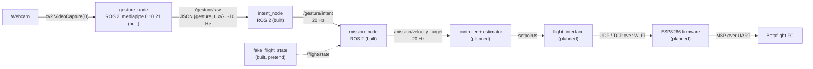
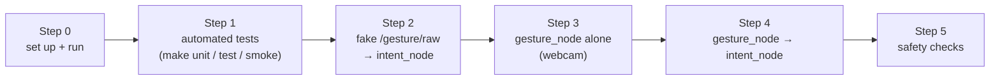

# 🖐️ Gesture Pipeline: from a hand to a drone command

This is the **start page** of the gesture section. It explains the whole chain in one place: a webcam sees the operator's hand, the hand becomes a gesture name, the gesture becomes an intent, and the intent becomes a velocity target for the drone. Each step has its own note (§2).

> [!NOTE] Decision
> Gestures come from a **ground webcam**, not a camera on the drone: [[ADR-015 Gesture Input Source|ADR-015]]. [[ADR-018 Ground OS and ROS 2|ADR-018]] kept the recogniser apart from ROS 2. Since 2026-10-20 it runs as the ROS 2 node `gesture_node`, for the reasons in [[02 Gesture Node]] §2. A new ADR that amends ADR-018 is still to be written.

> [!WARNING] Safety first
> Gestures **never** arm, disarm or touch the override switch. The radio and the safety pilot always win over code ([[Safety Rules]]).

---

## 🔄 1. The chain



Status on 2026-10-23:

| Step | Piece | Question it answers | Built? | Where | Status | Note |
| :---: | :--- | :--- | :---: | :--- | :--- | :--- |
| 1 | `gesture_node` (`gestures.py` + `hand_processing.py` inside) | "Which hand pose is this?" | ✅ | `drone/ground/src/gesture_node/` | ==🟢in `dev` (#78, 2026-10-21)==: 56 tests (unit, node, process), Docker image `rosrangers/gesture:jazzy`. First webcam run not recorded yet | [[02 Gesture Node\|02]] |
| 2 | `/gesture/raw` (`gesture_sender.py` in `gesture_node`) | "How does the pose reach `intent_node`?" | ✅ | `drone/ground/src/gesture_node/` | ==🟢in `dev`==: replaced UDP on 2026-10-20 | [[02 Gesture Node\|02]] §8 |
| 3 | `intent_node` | "What does the **operator** want?" | ✅ | `drone/ground/src/intent_node/` | ==🟢in `dev` (#78)==: 48 tests (unit, node, process), Docker image `rosrangers/intent:jazzy`. Reads `/gesture/raw` with `input_source:=topic` | [[03 Intent Node\|03]] |
| 1–4 | contract, pipeline and launch tests, Docker smoke test | "Do the nodes work together?" | ✅ | `drone/tests/ros/`, `drone/ground/docker/smoke_test.sh` | ==🟢in CI== (`ground-ros2`, `ground-docker`): gesture → intent → mission, in-process and across containers | §8, [[04 Mission Node\|04]] §10 |
| 4 | `mission_node` | "What should the **drone** do now?" | ✅ | `drone/ground/src/mission_node/` | ==🟢in `dev` (#93, 2026-10-23)==: 135 tests (unit, node, process, launch), Docker image `rosrangers/mission:jazzy`. Numbers not reviewed yet, first webcam run not recorded | [[04 Mission Node\|04]] |
| 4a | `fake_flight_state`, `fake_intent` (in `mission_node`) | "Can we test without a drone?" | ✅ | `drone/ground/src/mission_node/` | ==🟠pretend inputs, tests only==. `fake_flight_state` stands in for `/flight/state` until `flight_interface` exists (the `flight` service in Docker) | [[04 Mission Node\|04]] §7 |
| 5 | controller + estimator | "Which attitude gives that velocity?" | ❌ | — | ==🔴planned== (Module 1, week 5) | [[05 Future Nodes\|05]] §5 |
| 6 | `flight_interface` | "How do we send it safely?" | ❌ | `drone/ground/src/flight_interface/` (only `info.md`) | ==🔴planned== | [[05 Future Nodes\|05]] §6, [[System Overview]] |
| 7 | ESP8266 firmware | "How does it reach the FC?" | ❌ | `drone/firmware/esp8266/` (only `info.md`) | ==🔴planned== | [[Protocol Spec v0]] |

Steps 1 to 4 are in `dev`: `intent_node` already existed, the recogniser became the ROS 2 node `gesture_node` on 2026-10-20 (the old `drone/tools/gesture/` folder was removed), and both were merged into `dev` on 2026-10-21 with their tests, Docker images and a `Makefile` (#78). Step 4, `mission_node`, was built on 2026-10-19 and merged into `dev` on 2026-10-23 with its tests, Docker image and the live `echo` table (#93). Everything after `/mission/velocity_target` is still a plan.

> [!TIP] No ROS 2 install needed to run or test the gesture nodes
> The Docker images bring ROS 2 Jazzy, OpenCV and MediaPipe. With Docker and a webcam, `cd drone/ground && make` builds and starts everything, and `make smoke` runs the full ROS 2 tests inside the images (§7, §8). A local Jazzy install is only needed to build and run the nodes natively.

---

## 🗂️ 2. Map of this section

| Note | What it covers |
| :--- | :--- |
| **00 Gesture Pipeline** (this page) | The whole chain, the gesture vocabulary, the safety rules, where the files live, how to run the chain (§7) and test (§8) `gesture_node` + `intent_node` (`mission_node`: [[04 Mission Node\|04]] §10) |
| [[01 ROS2 Nodes Installation]] | What ROS 2 and nodes are, running the nodes in Docker or natively with `make`, installing ROS 2 Jazzy, the workspace, building, running and testing each node (including `/gesture/raw` and `/gesture/intent`), the automated tests |
| [[02 Gesture Node]] | The recogniser node `gesture_node`: why it is a ROS 2 node, how OpenCV and MediaPipe find the hand, the math, the gesture names, `/gesture/raw`, the venv, the code, tuning |
| [[03 Intent Node]] | The `intent_node`: inputs, outputs, filter rules, parameters |
| [[04 Mission Node]] | The `mission_node`: modes, intent → velocity, axis masking, land requests, pretend inputs, how to run and test it |
| [[05 Future Nodes]] | Nodes to add later |

> [!TIP] Reading order
> New to this? Read 00 → 01 → 02, then the node you work on.

---

## 🏷️ 3. Gesture vocabulary v0

One table from hand to motion. The intent names come from `intent_node` ([[03 Intent Node|03]] §5), the velocities from `mission_node` ([[04 Mission Node|04]] §5.2).

| Gesture (from `recognize()`) | Intent | Meaning | Proposed velocity |
| :--- | :--- | :--- | :--- |
| `OPEN_HAND_UP` (held) | `HOLD_POSITION` | **enable / hold position** (dead-man: control only while it is visible) | 0 |
| `CLOSED_HAND` | `STOP_HOVER` | stop, hover in place | 0 |
| `THUMB_UP` | `CLIMB_SLOWLY` | climb slowly, only once throttle is ours (mask 15) | z +0.2 m/s |
| `THUMB_DOWN` | `DESCEND_SLOWLY_LAND_REQUEST` | descend slowly / land request | z −0.2 m/s |
| `INDEX_LEFT` / `INDEX_RIGHT` | `MOVE_LEFT` / `MOVE_RIGHT` | move left / right. The frame is mirrored, so this is the **operator's** left/right | y ±0.3 m/s |
| `INDEX_MIDDLE_LEFT` / `INDEX_MIDDLE_RIGHT` | `YAW_LEFT` / `YAW_RIGHT` | yaw left / right | ±20 °/s |
| none / unknown / not in the table | `NEUTRAL` | **never** "continue the last command" | 0 |

Movement gestures (wave, swipe) from a planned motion tracker could be added later as mode commands, for example wave = land request ([[05 Future Nodes|05]]).

---

## 🛡️ 4. Safety logic: who does what

| Rule | Where it lives |
| :--- | :--- |
| A gesture must be seen in several packets in a row before it counts (stability filter) | `intent_node` ([[03 Intent Node\|03]] §5) |
| Hand gone briefly → `NEUTRAL`. Hand or recogniser gone for long → `HOVER_LAND_REQUEST` | `intent_node` ([[03 Intent Node\|03]] §5) |
| A deliberate `OPEN_HAND_UP` is needed before anything moves (engage) | `mission_node` ([[04 Mission Node\|04]] §5.1) |
| Hard speed limits (0.3 m/s lateral) and ramps when speeding up | `mission_node` ([[04 Mission Node\|04]] §5.5) |
| Only the axes in the override mask are commanded | `mission_node` ([[04 Mission Node\|04]] §5.3) |
| Never arm, disarm or change the override switch (REQ-SAF-003/004) | every node |

`gesture_node` has **no** safety logic. It only reports what it sees. The values for the filter (packet count, timeouts) have one source: [[03 Intent Node|03]] §7.

---

## 📁 5. Where the files live

| File or folder | Repo path | Runs in |
| :--- | :--- | :--- |
| `gesture_node` (ROS 2 package: `gestures.py`, `hand_processing.py`, `gesture_sender.py`, `gesture_node.py`, `requirements.txt`, `test/`) | `drone/ground/src/gesture_node/` | Docker image `rosrangers/gesture:jazzy`, or natively the venv `drone/ground/gesture-venv` (Python 3.12, MediaPipe, OpenCV, `--system-site-packages` so it also sees ROS 2) |
| `intent_node` (ROS 2 package, `test/`) | `drone/ground/src/intent_node/` | Docker image `rosrangers/intent:jazzy`, or natively the system Python with ROS 2 Jazzy |
| `mission_node` (ROS 2 package: `mission_logic.py`, `mission_node.py`, the pretend inputs, two launch files, `test/`) | `drone/ground/src/mission_node/` | Docker image `rosrangers/mission:jazzy` (also runs `fake_flight_state` as the `flight` service), or natively the system Python with ROS 2 Jazzy |
| Contract, pipeline and launch tests (two or three nodes together), tests of the `echo` table and the Docker entrypoint | `drone/tests/ros/` | pytest / unittest, ROS 2 for the pipeline, launch and program tests |
| `Makefile`, `docker-compose.yml`, `docker/` (Dockerfiles, `entrypoint.sh`, `smoke_test.sh`, `echo/monitor.py`) | `drone/ground/` | host shell and Docker |
| `gesture-venv/`, `ros2_ws/` (`src/` symlinks, `build/`, `install/`, `log/`) | `drone/ground/`, **ignored by Git** | made by `make` on a PC with Jazzy ([[01 ROS2 Nodes Installation\|01]] §6) |
| `logs/` (`<service>/latest.log` per node; `test/unit.log`, `test/pkg-test.log`, `test/e2e-test.log`, `test/smoke.log` from the test targets; `smoke/`) | `drone/ground/logs/`, **ignored by Git** (only its `.gitignore` is committed) | written by the containers ([[01 ROS2 Nodes Installation\|01]] §4.2) and the `make` test targets ([[01 ROS2 Nodes Installation\|01]] §4.3) |

- `drone/tools/gesture/` (the standalone UDP prototype) was removed on 2026-10-20. Its code lives on in `gesture_node` ([[02 Gesture Node]] §9).
- Natively, `gesture_node` must be built with the venv's Python, `intent_node` and `mission_node` with the system Python. `make` does both ([[01 ROS2 Nodes Installation|01]] §6). In Docker each image has its own Python, so the problem does not exist.
- `MISSION_NODE_PACKAGE/` (where `mission_node` was written before #93) no longer exists. Its content is `drone/ground/src/mission_node/`.

---

## 📌 6. Version notes (verified 2026-10-12)

> [!WARNING] Keep `mediapipe==0.10.21` pinned
> It is the last version with the legacy `mp.solutions.hands` API that our code uses, and it works on Ubuntu 24.04 / Python 3.12. MediaPipe 1.1.0 (6 Oct 2026) **removed** `mp.solutions`, so upgrading needs a port to the Tasks API (`HandLandmarker`). Details: [[02 Gesture Node|02]] §3. `requirements.txt` also pins `opencv-python==4.11.0.86`, the same version as the `opencv-contrib-python` that MediaPipe pulls in.

---

## ▶️ 7. Quick start

Everything runs from `drone/ground/` with `make`. ROS 2 Jazzy does **not** have to be installed: the Docker images contain ROS 2, OpenCV and MediaPipe, and the `Makefile` builds and starts them. Full details: [[01 ROS2 Nodes Installation|01]] §4.

| You have | Run | What happens |
| :--- | :--- | :--- |
| Docker + a webcam, **no ROS** | `cd ~/ROSRangers/drone/ground && make` | builds the images and starts `gesture`, `intent`, `mission`, `flight` (pretend `/flight/state`) and `echo` with `docker compose up --build`. A "Gestures" window opens; the terminal shows the `echo` live table (gesture, intent, mission mode, velocity target); each node's output goes to `logs/<service>/latest.log` |
| Docker + a webcam + ROS 2 Jazzy | same `make` | also builds the venv and the workspace in `drone/ground/` (so you can run the nodes natively later), then starts the same containers |
| ROS 2 Jazzy, natively | `make ws`, then the three terminals below | builds only the venv and the workspace |

| `make` target | Does |
| :--- | :--- |
| `make` | venv + workspace (only if Jazzy is installed), then the five containers |
| `make down` | stops the containers |
| `make unit` / `make test` / `make smoke` | the tests (§8 Step 1). Each ends with a pass/total summary and keeps its full output in `logs/test/`: `unit.log`; `pkg-test.log` + `e2e-test.log` for `make test` (`unit.log` without Jazzy); `smoke.log` |
| `make clean` | `down` + removes this project's Docker images |
| `make fclean` / `make re` | `clean` + removes the venv, the workspace, `logs/` and Python caches, and runs `docker system prune -af` / `fclean`, then `make` |

> [!WARNING] `make fclean` prunes all of Docker, not only this project
> `docker system prune -af` removes **every** stopped container, unused network, image that no container uses, and the build cache on your PC, also from other projects. Use `make clean` if you only want this project's images gone.

Press `q` in the "Gestures" window to stop `gesture_node`, and Ctrl+C (or `make down` in another terminal) to stop the rest. `MASK=15 make` gives the pretend flight state mask 15, `AIRBORNE=false make` puts the pretend drone on the ground ([[04 Mission Node|04]] §9.4).

**Natively**, after `make ws`, with `source /opt/ros/jazzy/setup.zsh` and `source ~/ROSRangers/drone/ground/ros2_ws/install/setup.zsh` in every terminal:

| Terminal | Command |
| :------: | :--- |
| 1 | `ros2 run intent_node intent_node --ros-args -p input_source:=topic` |
| 2 | `ros2 run gesture_node gesture_node` (to test without a camera, use the fake publisher in [[01 ROS2 Nodes Installation\|01]] §9, Level 0) |
| 3 | `python3 ~/gesture_watch.py` (both topics, one line per change) or `ros2 topic echo /gesture/intent --field data` |

With `mission_node` too: terminal 1 becomes `ros2 launch mission_node mission_with_gestures.launch.py` (it starts `intent_node` with `input_source: topic`, `fake_flight_state` and `mission_node`) and terminal 3 `ros2 topic echo /mission/state --field data` ([[04 Mission Node|04]] §9.3). To run `mission_node` alone with pretend values: `ros2 launch mission_node mission_demo.launch.py` ([[04 Mission Node|04]] §9.1).

---

## 🧪 8. Test the nodes built so far: `gesture_node` + `intent_node`

Do the steps in order: each one proves one more link, so the first step that fails tells you where the problem is. Step 1 is automated and also runs in CI. Steps 2–5 are manual checks with the real nodes. The full checklists are in [[01 ROS2 Nodes Installation|01]] §9. How to read each topic: [[02 Gesture Node|02]] §8 (`/gesture/raw`) and [[03 Intent Node|03]] §4 (`/gesture/intent`).



### Step 0: set up and run

Pick one of the two ways. Both start the same three things: `intent_node`, `gesture_node`, and something that prints `/gesture/intent`.

#### Option A: Docker (no ROS 2 install)

Needs Docker Engine with the Compose plugin (your user in the `docker` group), a webcam at `/dev/video0`, and an X11 or XWayland display.

```bash
cd ~/ROSRangers/drone/ground
make                  # xhost +local:, then docker compose up --build (first build takes a few minutes)
```

`make` also starts `mission` and `flight` ([[04 Mission Node|04]] §9.4). The terminal shows only the `echo` live table, redrawn in place: one block per topic (`/gesture/raw`, `/gesture/intent`, `/mission/state`, `/mission/velocity_target`), each `live`, `waiting` or `STALE`. The nodes' own output goes to `logs/<service>/latest.log`, one timestamped file per run (`tail -f logs/intent/latest.log`, or `docker compose logs -f intent`). `intent` starts with `input_source:=topic` already set in its image. To run them one per terminal instead (from `drone/ground/`):

| Terminal | Command |
| :---: | :--- |
| 1 | `docker compose up --build intent` |
| 2 | `xhost +local:` (once per login), then `docker compose up --build gesture` |
| 3 | `docker compose run --rm --build echo` (the live table) |
| 4 | `docker compose up --build mission flight` (only to see the mission rows) |

Started this way, each service prints its output in its own terminal and still writes `logs/<service>/latest.log`; only a plain `docker compose up` / `make` hides the nodes behind the table.

The `ros2` command line is in the images too, so the checks below work without a local ROS install. Replace `ros2 ...` with:

```bash
docker compose run --rm echo ros2 topic list
docker compose run --rm echo ros2 topic echo /gesture/raw std_msgs/msg/String --field data
docker compose run --rm echo ros2 topic hz /gesture/intent
```

The containers use the host network, so with Jazzy installed a host terminal sees the same topics as long as `ROS_DOMAIN_ID` matches (`make` passes yours, default 0). Stop with Ctrl+C or `make down`.

#### Option B: natively, with ROS 2 Jazzy installed

`ls /opt/ros/jazzy` must list files. If it doesn't, install it first ([[01 ROS2 Nodes Installation|01]] §5, about 10 minutes) or use Option A. The commands are for zsh; on bash, change `setup.zsh` to `setup.bash`.

```bash
# --- first time only: system packages for the camera and the window ---
sudo apt install python3.12-venv python3-pip libgl1 libglib2.0-0 v4l-utils libxcb-cursor0

# --- first time, and after changing setup.py / package.xml / requirements.txt ---
cd ~/ROSRangers/drone/ground
make ws               # venv gesture-venv/ + workspace ros2_ws/, both in drone/ground/
```

`make ws` creates the venv with `--system-site-packages`, installs `requirements.txt`, links the three packages into `ros2_ws/src/`, builds `intent_node` and `mission_node` with the system Python and `gesture_node` with the venv's Python, and stops with an error if the `gesture_node` start script does not use the venv. The steps by hand are in [[01 ROS2 Nodes Installation|01]] §6.

Then, in each of three terminals:

```bash
source /opt/ros/jazzy/setup.zsh
source ~/ROSRangers/drone/ground/ros2_ws/install/setup.zsh
```

| Terminal | Command |
| :---: | :--- |
| T1 | `ros2 run intent_node intent_node --ros-args -p input_source:=topic` |
| T2 | `ros2 run gesture_node gesture_node` (on Wayland: `QT_QPA_PLATFORM=xcb ros2 run gesture_node gesture_node`) |
| T3 | `ros2 topic echo /gesture/intent --field data` |

T1 logs `Intent -> HOVER_LAND_REQUEST (reason: no_packets_yet ...)` and a `No packets` warning every 5 s until T2 starts: that is correct. In T2 a "Gestures" window opens with the webcam; press `q` in it to stop. You don't need to activate the venv to **run** it: the build wrote the venv's Python into the start script.

#### What you should see

Show a hand pose: about 0.4 s later the `intent` changes (for example `INDEX_RIGHT` → `"intent":"MOVE_RIGHT"`). To see what `gesture_node` sends, read `/gesture/raw` instead. T3's native `ros2 topic echo` (not the Docker `echo` table) prints 20 lines a second; to see only the **changes** on both topics, save the watcher once ([[01 ROS2 Nodes Installation|01]] §9, "The watcher") and run `python3 ~/gesture_watch.py` (needs a local Jazzy). Steps 2–5 below use it; in Docker, read the `echo` table (it only changes when a value changes) or the `Intent ->` lines in `logs/intent/latest.log` instead.

> [!WARNING] Three rules that break things if you forget them (native setup)
> - **Never** run a plain `colcon build` of everything in `ros2_ws`: it rebuilds `gesture_node` with the system Python, and `ros2 run gesture_node ...` then fails with `No module named 'mediapipe'`. Rebuild with `make ws` (after `rm ros2_ws/.gesture_node` if nothing changed in the package files).
> - `intent_node` **needs** `-p input_source:=topic`. Without it, it listens on old UDP and stays on `no_packets_yet`. The Docker image already sets it.
> - All terminals (and containers) must use the same `ROS_DOMAIN_ID`. If you set one (for example `export ROS_DOMAIN_ID=42`, to keep teammates' nodes away, [[01 ROS2 Nodes Installation|01]] §5.7), set it in **every** terminal, or put it in `~/.zshrc`. `make` and `docker compose` pass your value to the containers.

A change to a `.py` file needs no rebuild natively (`--symlink-install`): stop the node and run it again. In Docker the code is copied into the image, so `make` (`up --build`) rebuilds the changed image.

### Step 1: automated tests

From `drone/ground/`:

| Command | Needs | Runs | Pass |
| :--- | :--- | :--- | :--- |
| `make unit` | Python 3 only (no ROS, no camera) | the unit tests of the three packages and `drone/tests/ros`. The ROS and real-MediaPipe tests are **skipped** | 286 tests, 173 passed, 113 skipped, `ALL PASSED` on 2026-10-23 |
| `make test` | ROS 2 Jazzy (builds the workspace first). Without Jazzy it is `make unit` | `colcon test` of the three packages (unit + node + process + launch tests, like CI's `ground-ros2`), then `pytest drone/tests/ros` (contract, pipeline, launch, `echo` table, entrypoint) | `239 tests, 0 errors, 0 failures, 0 skipped`, then `47/47` |
| `make smoke` | Docker only | `docker/smoke_test.sh`, like CI's `ground-docker`: builds the images, runs each package's tests **inside** its image with none skipped, sends `INDEX_RIGHT` from the gesture container through the intent container to the mission container, checks the fallbacks, the clean stops and the node logs | `PASS: images, in-image tests, gesture -> intent -> mission across containers, monitor, clean stops, node logs` |

Without a local Jazzy, `make unit` + `make smoke` together run every package test: the ROS tests that `make unit` skips run inside the images in `make smoke`. The ROS tests in `drone/tests/ros/` (pipeline, launch, `echo` table, entrypoint) need `make test` or CI. What each test file checks is in [[01 ROS2 Nodes Installation|01]] §10, and for `mission_node` in [[04 Mission Node|04]] §10.2.

### Step 2: `intent_node` with a fake recogniser (no camera)

> [!TIP] Steps 2–5 in Docker
> The tables use the native commands. In Docker, start the nodes with `docker compose up intent` / `docker compose up gesture` and put `docker compose run --rm echo` in front of every `ros2 ...` command (Step 0, Option A). Stop `gesture_node` with `q` or `docker compose stop gesture`: both are a clean stop (exit code 0).

| Terminal | Command |
| :---: | :--- |
| 1 | `ros2 run intent_node intent_node --ros-args -p input_source:=topic` |
| 2 | `python3 ~/gesture_watch.py` |
| 3 | `ros2 topic pub -r 10 /gesture/raw std_msgs/msg/String "{data: '{\"gesture\": \"INDEX_RIGHT\", \"t\": 0, \"xy\": null}'}"` |

| When | Terminal 2 should show (`intent` / `reason`) |
| :--- | :--- |
| before terminal 3 starts | `HOVER_LAND_REQUEST` / `no_packets_yet` |
| ~1 s after terminal 3 starts | `NEUTRAL` / `unconfirmed`, then `MOVE_RIGHT` / `ok` |
| Ctrl+C in terminal 3 | `NEUTRAL` / `no_hand` after 0.3 s, then `HOVER_LAND_REQUEST` / `no_packets` after 2 s |

For the longer scripted sequence (six gestures and gaps, ~13 s), use the fake camera script in [[01 ROS2 Nodes Installation|01]] §9, Level 0.

### Step 3: `gesture_node` alone (webcam)

| Terminal | Command |
| :---: | :--- |
| 1 | `ros2 run gesture_node gesture_node` (on Wayland: `QT_QPA_PLATFORM=xcb ros2 run gesture_node gesture_node`) |
| 2 | `ros2 topic echo /gesture/raw --field data` |
| 3 | `ros2 topic hz /gesture/raw` |

**Pass:** the "Gestures" window shows the webcam with landmarks on your hand; terminal 2 shows `{"gesture": "<name>", "t": ..., "xy": null}` with the name of your pose, and `"gesture": null` when the hand leaves the picture; terminal 3 stays at ~10 Hz. `q` in the window stops it.

### Step 4: `gesture_node` → `intent_node` (the two together)

| Terminal | Command |
| :---: | :--- |
| 1 | `ros2 run intent_node intent_node --ros-args -p input_source:=topic` (start it first) |
| 2 | `ros2 run gesture_node gesture_node` |
| 3 | `python3 ~/gesture_watch.py` |

1. Terminal 1 logs `First packet from gesture_node`, then `Recogniser link OK: ~50 packets in the last 5 s` every 5 s.
2. `ros2 topic info /gesture/raw` shows 1 publisher and 1 subscriber.
3. Hold each gesture of §3 for 1 s. In terminal 3, each `raw` line must be followed within ~0.5 s by its `intent` line:

| Show | `raw` | `intent` / `reason` |
| :--- | :--- | :--- |
| open hand, fingers up | `OPEN_HAND_UP` | `HOLD_POSITION` / `ok` |
| fist | `CLOSED_HAND` | `STOP_HOVER` / `ok` |
| thumb up / down | `THUMB_UP` / `THUMB_DOWN` | `CLIMB_SLOWLY` / `DESCEND_SLOWLY_LAND_REQUEST` |
| index left / right | `INDEX_LEFT` / `INDEX_RIGHT` | `MOVE_LEFT` / `MOVE_RIGHT` |
| index + middle left / right | `INDEX_MIDDLE_LEFT` / `INDEX_MIDDLE_RIGHT` | `YAW_LEFT` / `YAW_RIGHT` |
| any other pose | for example `INDEX_PINKY_UP` | `NEUTRAL` / `unmapped_gesture` |

Left and right are **your** left and right (the picture is mirrored).

### Step 5: safety checks

| Do | Expected on `/gesture/intent` |
| :--- | :--- |
| `INDEX_RIGHT` until `MOVE_RIGHT`, hide the hand for 1 s, then show a fist | `NEUTRAL` / `no_hand`, then `unconfirmed`, then `STOP_HOVER`. **Never** `MOVE_RIGHT` again |
| hide the hand for 0.1 s while holding `INDEX_RIGHT` | stays `MOVE_RIGHT` |
| hide the hand for 3 s | `NEUTRAL`, then `HOVER_LAND_REQUEST` / `no_hand_long` |
| stop `gesture_node` (`q`, Ctrl+C or `docker compose stop gesture`) while holding a gesture | `NEUTRAL` within 0.3 s, `HOVER_LAND_REQUEST` / `no_packets` after 2 s |
| any time | `ros2 topic hz /gesture/intent` stays at ~20 Hz |

Anything that does not end in `NEUTRAL` or `HOVER_LAND_REQUEST` is a safety bug: stop and report it with the Bug form.

### When a step fails

| Symptom | First thing to check |
| :--- | :--- |
| `HOVER_LAND_REQUEST` / `no_packets_yet` forever | `intent_node` started without `-p input_source:=topic` |
| `No module named 'mediapipe'` from `ros2 run gesture_node ...` | `gesture_node` built without the venv: `make ws` ([[02 Gesture Node\|02]] §10.5) |
| `gesture_node` exits at once with `Cannot open camera 0` (exit code 1) | no webcam, or another program uses it: `ls /dev/video*` |
| `gesture` container: `cannot open display` or no window | `xhost +local:` not run in this login, or `DISPLAY` not set ([[01 ROS2 Nodes Installation\|01]] §12) |
| `docker compose up` fails on `/dev/video0` | no webcam at `/dev/video0`. `docker compose up intent mission flight echo` starts the rest |
| nothing on `/gesture/raw` | `gesture_node` not running, camera not opened, or a different `ROS_DOMAIN_ID` in the two terminals (or containers) |
| a `make unit` / `make test` / `make smoke` failure | the test name says what broke ([[01 ROS2 Nodes Installation\|01]] §10). Fix it before the manual steps |
| intent stays `NEUTRAL` / `unconfirmed` | the gesture name flickers: look at `/gesture/raw`, hold the pose more clearly ([[02 Gesture Node\|02]] §12) |

More: [[01 ROS2 Nodes Installation|01]] §12, [[02 Gesture Node|02]] §14. Record each session (with `ros2 bag record -o gesture_proof /gesture/raw /gesture/intent`) in [[01 ROS2 Nodes Installation|01]] §13.

---

## 🚀 9. Module 2 extension (accepted by instructors)

Replacing the rule-based `recognize()` with a trained landmark classifier, and the portability proof (the same `/gesture/intent` driving the car or the arm), are planned in [[Roadmap to April 2027]] §4. Candidate nodes for that: [[05 Future Nodes|05]].

---

## Glossary

| Term | Meaning |
| --- | --- |
| **ADR** | Architecture Decision Record: a documented decision and its rationale. |
| **CI** | Continuous Integration: GitHub Actions runs the tests on every PR (`ground-ros2`, `ground-docker`). |
| **Dead-man** | A control that only works while the operator keeps doing it (here: the hand must stay visible). |
| **Docker** | Tool that runs software in containers: isolated environments built from an image (Dockerfile). Here each node has an image with ROS 2 Jazzy inside. |
| **Docker Compose** | Starts several containers from one file (`drone/ground/docker-compose.yml`). |
| **HOVER_LAND_REQUEST** | The safe fallback intent of `intent_node`: hover and ask to land. Published before the first packet and when the hand or the recogniser is gone for more than 2 s. |
| **Intent** | The action the operator asks for (for example `MOVE_LEFT`), published on `/gesture/intent`. |
| **Live table** | What the `echo` container shows (`docker/echo/monitor.py`): the latest gesture, intent, mission mode and velocity target, redrawn only when something changes. |
| **Makefile** | The `make` targets in `drone/ground/` that build, start and test the nodes (Docker and native). |
| **Mask** | `msp_override_channels_mask`: which stick channels the ground controls (8, 11 or 15). |
| **MediaPipe** | A Google framework used here to find 21 hand landmarks in an image. |
| **Mermaid** | A text-based diagram syntax rendered by Obsidian. |
| **Node** | One ROS 2 program with one job. |
| **Pretend input** | A small node (`fake_flight_state`, `fake_intent`) that publishes made-up values so a node can be tested without the real source. Never used with a real drone. |
| **REQ ID** | A requirement identifier, `REQ-<area>-NNN` (for example REQ-SAF-019), registered in Requirements. |
| **ROS 2** | The second-generation Robot Operating System middleware used for robotics integration. |
| **Smoke test** | A short end-to-end check that the built images start and work together (`make smoke`). |
| **Topic** | A named channel on which ROS 2 nodes publish and subscribe to messages (`/gesture/raw`, `/gesture/intent`, `/mission/velocity_target`). |
| **UDP** | User Datagram Protocol: connectionless transport suited to refreshed, time-sensitive data (the drone link; also the old recogniser before 2026-10-20). |
| **venv** | A Python virtual environment that keeps this project's packages separate from the system. |
