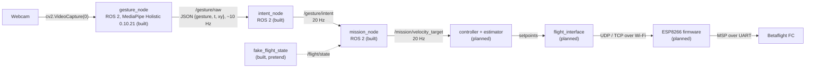

# 🖐️ Gesture Pipeline: from a hand to a drone command

This is the **start page** of the gesture section. It explains the whole chain in one place: a webcam sees the operator's hands, the raised hands become a gesture name, the gesture becomes an intent, and the intent becomes a velocity target for the drone. Each step has its own note (§2).

> [!NOTE] Decision
> Gestures come from a **ground webcam**, not a camera on the drone: [[ADR-015 Gesture Input Source|ADR-015]]. The recogniser runs as the ROS 2 node `gesture_node` ([[02 Gesture Node]] §2), which changes a consequence of [[ADR-018 Ground OS and ROS 2|ADR-018]]; the ADR that amends it is still to be written.

> [!WARNING] Safety first
> Gestures **never** arm, disarm or touch the override switch. The radio and the safety pilot always win over code ([[Safety Rules]]).

---

## 🔄 1. The chain



| Step | Piece | Question it answers | Built? | Where | Status | Note |
| :---: | :--- | :--- | :---: | :--- | :--- | :--- |
| 1 | `gesture_node` (`gestures.py` + `hand_processing.py` inside) | "Which pose is each raised hand in?" | ✅ | `drone/ground/src/gesture_node/` | ==🟢in `dev`==, Docker image `rosrangers/gesture:jazzy` | [[02 Gesture Node\|02]] |
| 2 | `/gesture/raw` (`gesture_sender.py` in `gesture_node`) | "How does the pose reach `intent_node`?" | ✅ | `drone/ground/src/gesture_node/` | ==🟢in `dev`== | [[02 Gesture Node\|02]] §8 |
| 3 | `intent_node` | "What does the **operator** want?" | ✅ | `drone/ground/src/intent_node/` | ==🟢in `dev`==, Docker image `rosrangers/intent:jazzy` | [[03 Intent Node\|03]] |
| 1–4 | contract, pipeline and launch tests, Docker smoke test | "Do the nodes work together?" | ✅ | `drone/tests/ros/`, `drone/ground/docker/smoke_test.sh` | ==🟢in CI== (`ground-ros2`, `ground-docker`) | §7, [[04 Mission Node\|04]] §9 |
| 4 | `mission_node` | "What should the **drone** do now?" | ✅ | `drone/ground/src/mission_node/` | ==🟢in `dev`==, Docker image `rosrangers/mission:jazzy`. Numbers not reviewed yet | [[04 Mission Node\|04]] |
| 4a | `fake_flight_state`, `fake_intent` (in `mission_node`) | "Can we test without a drone?" | ✅ | `drone/ground/src/mission_node/` | ==🟠pretend inputs, tests only==. `fake_flight_state` stands in for `/flight/state` until `flight_interface` exists (the `flight` service in Docker) | [[04 Mission Node\|04]] §7 |
| 5 | controller + estimator | "Which attitude gives that velocity?" | ❌ | — | ==🔴planned== (Module 1, week 5) | [[05 Future Nodes\|05]] §5 |
| 6 | `flight_interface` | "How do we send it safely?" | ❌ | `drone/ground/src/flight_interface/` (only `info.md`) | ==🔴planned== | [[05 Future Nodes\|05]] §6, [[System Overview]] |
| 7 | ESP8266 firmware | "How does it reach the FC?" | ❌ | `drone/firmware/esp8266/` (only `info.md`) | ==🔴planned== | [[Protocol Spec v0]] |

---

## 🗂️ 2. Map of this section

| Note | What it covers |
| :--- | :--- |
| **00 Gesture Pipeline** (this page) | The whole chain, the gesture vocabulary, the safety rules, where the files live, how to run the chain (§6) and the tests (§7) |
| [[01 ROS2 Nodes Installation]] | What ROS 2 and nodes are, running the nodes in Docker with `make`, testing each node, the automated tests |
| [[02 Gesture Node]] | The recogniser node `gesture_node`: why it is a ROS 2 node, how OpenCV and MediaPipe Holistic find the hands, which hands count, the math, the gesture names, `/gesture/raw`, the code, tuning |
| [[03 Intent Node]] | The `intent_node`: inputs, outputs, filter rules, parameters |
| [[04 Mission Node]] | The `mission_node`: modes (engage, lock), intent → velocity, axis masking, hover when the operator is gone, pretend inputs, how to run and test it |
| [[05 Future Nodes]] | Nodes to add later |

---

## 🏷️ 3. Gesture vocabulary

Only a hand whose **wrist is above its elbow** counts as a gesture. With both arms down there is no gesture, and the drone hovers. Commands use **one raised hand** (the other arm down); only engage and lock use both. Left and right are the **operator's** left and right (the picture is mirrored). The intent names come from `intent_node` ([[03 Intent Node|03]] §5), the velocities from `mission_node` ([[04 Mission Node|04]] §5.2).

**Both hands:**

| Gesture | Intent | Meaning | Proposed velocity |
| :--- | :--- | :--- | :--- |
| both open hands, fingers up | `ENGAGE` | **engage**: from `WAITING`, gestures start moving the drone. Must be a new gesture (hands down first) | 0 |
| both fists, held about 1 s | `LOCK_TOGGLE` | **lock / unlock**: `LOCKED` hovers and ignores every other gesture until both fists are held again | 0 |

**One hand** (shown for the right hand):

| Right hand | Intent | Meaning | Proposed velocity |
| :--- | :--- | :--- | :--- |
| index up | `CLIMB_UP` | climb, only once throttle is ours (mask 15) | z +0.2 m/s |
| index down | `DESCEND_ONLY` | descend (mask 15). The gesture way to land | z −0.2 m/s |
| index + middle across the body (`INDEX_MIDDLE_LEFT`) | `MOVE_FORWARD` | move forward | x +0.3 m/s |
| four fingers across the body (`INDEX_MIDDLE_RING_PINKY_LEFT`) | `MOVE_BACKWARD` | move backward | x −0.3 m/s |
| thumb out to the right (`THUMB_RIGHT`) | `MOVE_RIGHT` | move right | y −0.3 m/s |
| index pointing left (`INDEX_LEFT`) | `MOVE_LEFT` | move left | y +0.3 m/s |
| thumb + index up (`THUMB_INDEX_UP`) | `YAW_RIGHT` | yaw right | −20 °/s |
| thumb + index pointing left (`THUMB_INDEX_LEFT`) | `YAW_LEFT` | yaw left | +20 °/s |

The **left hand** makes the mirror image of each pose. Up, down, forward and backward stay the same; for moving and yawing, the mirror image gives the other side. For example, the left index pointing right is `MOVE_RIGHT`, and the left thumb out to the left is `MOVE_LEFT`. The exact names `gesture_node` sends (`L:<left>+R:<right>`) are in [[03 Intent Node|03]] §5.

**Anything else** (both arms down, a single fist, a single open hand, two raised hands that are not one of the two gestures above, an unknown pose) → `NEUTRAL`: **never** "continue the last command", 0.

- **Dropping a hand is always safe.** When one hand of a two-hand gesture drops, what's left is unmapped (`NEUTRAL`), so it never turns into a motion and half of the lock gesture never toggles the lock.
- **No hands, no landing.** No hands, a dead recogniser or a lost `/gesture/intent` make the drone hover, still in its mode ([[04 Mission Node|04]] §5.4). Landing is `DESCEND_ONLY` with mask 15, or the pilot.

---

## 🛡️ 4. Safety logic: who does what

| Rule | Where it lives |
| :--- | :--- |
| Only hands with the wrist above the elbow count | `gesture_node` ([[02 Gesture Node\|02]] §3.2) |
| A gesture must be seen in several packets in a row before it counts (stability filter) | `intent_node` ([[03 Intent Node\|03]] §5) |
| Hands gone or recogniser gone → `NEUTRAL` | `intent_node` ([[03 Intent Node\|03]] §5) |
| Dropping one hand of a two-hand gesture never gives a command | `intent_node`, the gesture table ([[03 Intent Node\|03]] §5) |
| A deliberate `ENGAGE` (both open hands, shown after the hands were down) is needed before anything moves | `mission_node` ([[04 Mission Node\|04]] §5.1) |
| Lock and unlock only with both fists held 1 s; `LOCKED` ignores everything else | `mission_node` ([[04 Mission Node\|04]] §5.1) |
| Only the axes in the override mask are commanded | `mission_node` ([[04 Mission Node\|04]] §5.3) |
| No hands, no recogniser, no intents → hover, mode unchanged | `mission_node` ([[04 Mission Node\|04]] §5.4) |
| Hard speed limits (0.3 m/s lateral) and ramps when speeding up | `mission_node` ([[04 Mission Node\|04]] §5.5) |
| Never arm, disarm or change the override switch (REQ-SAF-003/004) | every node |

---

## 📁 5. Where the files live

| What | Repo path | Runs in |
| :--- | :--- | :--- |
| The three ROS 2 packages (`gesture_node`, `intent_node`, `mission_node`), each with its `test/` folder | `drone/ground/src/` | one Docker image each (`rosrangers/<node>:jazzy`) |
| Tests of the nodes together (contract, pipeline, launch) | `drone/tests/ros/` | CI (`ground-ros2`) |
| `Makefile`, `docker-compose.yml`, `docker/` (Dockerfiles, smoke test, `echo` table) | `drone/ground/` | host shell and Docker |
| `logs/` (one log per node and per test target) | `drone/ground/logs/`, ignored by Git | written by the containers and the `make` test targets |

`gesture_node` pins `mediapipe==0.10.21`, the last version with the `mp.solutions` API it uses ([[02 Gesture Node|02]] §3).

---

## ▶️ 6. Quick start

Everything runs in Docker. With Docker, a webcam and a display:

```bash
cd ~/ROSRangers/drone/ground
make
```

What you need, what starts, the other `make` targets and how to stop: [[01 ROS2 Nodes Installation|01]] §4.

---

## 🧪 7. Tests

`make unit` (host Python) and `make smoke` (Docker) run the tests locally; CI runs all of them on every PR that touches `drone/ground/`. Details: [[01 ROS2 Nodes Installation|01]] §7.

---

## 🚀 8. Module 2 extension (accepted by instructors)

Replacing the rule-based `recognize()` with a trained landmark classifier, and the portability proof (the same `/gesture/intent` driving the car or the arm), are planned in [[Roadmap to April 2027]] §4. Candidate nodes for that: [[05 Future Nodes|05]].

---

## Glossary

| Term | Meaning |
| --- | --- |
| **ADR** | Architecture Decision Record: a documented decision and its rationale. |
| **CI** | Continuous Integration: GitHub Actions runs the tests on every PR (`ground-ros2`, `ground-docker`). |
| **Docker** | Tool that runs software in containers: isolated environments built from an image (Dockerfile). Here each node has an image with ROS 2 Jazzy inside. |
| **Holistic** | MediaPipe Holistic: one model for the body pose and both hands, each hand labelled left or right. |
| **Intent** | The action the operator asks for (for example `MOVE_LEFT`), published on `/gesture/intent`. |
| **Makefile** | The `make` targets in `drone/ground/` that build, start and test the nodes in Docker. |
| **Mask** | `msp_override_channels_mask`: which stick channels the ground controls (8, 11 or 15). |
| **MediaPipe** | A Google framework used here to find the body pose and 21 landmarks on each hand (Holistic). |
| **Mermaid** | A text-based diagram syntax rendered by Obsidian. |
| **Node** | One ROS 2 program with one job. |
| **Pretend input** | A small node (`fake_flight_state`, `fake_intent`) that publishes made-up values so a node can be tested without the real source. Never used with a real drone. |
| **REQ ID** | A requirement identifier, `REQ-<area>-NNN` (for example REQ-SAF-019), registered in Requirements. |
| **ROS 2** | The second-generation Robot Operating System middleware used for robotics integration. |
| **Smoke test** | A short end-to-end check that the built images start and work together (`make smoke`). |
| **Topic** | A named channel on which ROS 2 nodes publish and subscribe to messages (`/gesture/raw`, `/gesture/intent`, `/mission/velocity_target`). |
| **UDP** | User Datagram Protocol: connectionless transport suited to refreshed, time-sensitive data (the drone link). |
