# 🖐️ Gesture Pipeline: from a hand to a drone command

This is the **start page** of the gesture section. It explains the whole chain in one place: a webcam sees the operator's hand, the hand becomes a gesture name, the gesture becomes an intent, and the intent becomes a velocity target for the drone. Each step has its own note (§2).

> [!NOTE] Decision
> Gestures come from a **ground webcam**, not a camera on the drone: [[ADR-015 Gesture Input Source|ADR-015]]. The recogniser runs apart from ROS 2: [[ADR-018 Ground OS and ROS 2|ADR-018]].

> [!WARNING] Safety first
> Gestures **never** arm, disarm or touch the override switch. The radio and the safety pilot always win over code ([[Safety Rules]]).

---

## 🔄 1. The chain

```mermaid
flowchart LR
  W[Webcam] --> R["gestures.py<br/>own venv, mediapipe 0.10.21"]
  R -->|"UDP 127.0.0.1:5005<br/>JSON {gesture, t, xy}"| G["gesture_node<br/>ROS 2"]
  G -->|"/gesture/intent<br/>20 Hz"| M["mission_node<br/>ROS 2 (designed)"]
  M -->|"/mission/velocity_target<br/>20 Hz"| C["controller + estimator<br/>(planned)"]
  C -->|setpoints| FI["flight_interface<br/>(planned)"]
  FI -->|"UDP / TCP over Wi-Fi"| E[ESP8266]
  E -->|"MSP over UART"| FC[Betaflight FC]
```

| Step | Piece | Question it answers | Status | Note |
| :--- | :--- | :--- | :---: | :--- |
| 1 | `gestures.py` + `hand_processing.py` | "Which hand pose is this?" | ==🟢working prototype== | [[01 Gesture Recognition with OpenCV and MediaPipe\|01]] |
| 2 | `gesture_sender.py` | "How does the pose reach ROS 2?" | ==🟢working== | [[03 Gesture_node\|03]] §6 |
| 3 | `gesture_node` | "What does the **operator** want?" | ==🟠draft, tested without real ROS 2== | [[03 Gesture_node\|03]] |
| 4 | `mission_node` | "What should the **drone** do now?" | ==🔴design only== | [[04 Mission_Node\|04]] |
| 5 | controller, `flight_interface`, … | "How do we fly it safely?" | ==🔴planned== | [[05 Future Nodes\|05]], [[System Overview]] |

Only steps 1 to 3 exist in code today. Everything after `/gesture/intent` is design or plan.

---

## 🗂️ 2. Map of this section

| Note | What it covers |
| :--- | :--- |
| **00 Gesture Pipeline** (this page) | The whole chain, the gesture vocabulary, the safety rules, where the files live |
| [[01 Gesture Recognition with OpenCV and MediaPipe]] | How OpenCV and MediaPipe find the hand, the math, the gesture names, the code, tuning |
| [[02 ROS 2 Nodes - Install and Test]] | What ROS 2 and nodes are, installing ROS 2 Jazzy, building, running and testing each node built so far |
| [[03 Gesture_node]] | The `gesture_node`: inputs, outputs, filter rules, parameters |
| [[04 Mission_Node]] | The `mission_node` design: modes, intent → velocity, axis masking, land requests |
| [[05 Future Nodes]] | Nodes to add later, including a MediaPipe node inside ROS 2 |

> [!TIP] Reading order
> New to this? Read 00 → 01 → 02, then the node you work on.

---

## 🏷️ 3. Gesture vocabulary v0

One table from hand to motion. The intent names come from `gesture_node` ([[03 Gesture_node|03]] §5), the velocities from the `mission_node` design ([[04 Mission_Node|04]] §4.2).

| Gesture (from `recognize()`) | Intent | Meaning | Proposed velocity |
| :--- | :--- | :--- | :--- |
| `OPEN_HAND_UP` (held) | `HOLD_POSITION` | **enable / hold position** (dead-man: control only while it is visible) | 0 |
| `CLOSED_HAND` | `STOP_HOVER` | stop, hover in place | 0 |
| `THUMB_UP` | `CLIMB_SLOWLY` | climb slowly, only once throttle is ours (mask 15) | z +0.2 m/s |
| `THUMB_DOWN` | `DESCEND_SLOWLY_LAND_REQUEST` | descend slowly / land request | z −0.2 m/s |
| `INDEX_LEFT` / `INDEX_RIGHT` | `MOVE_LEFT` / `MOVE_RIGHT` | move left / right. The frame is mirrored, so this is the **operator's** left/right | y ±0.3 m/s |
| `INDEX_MIDDLE_LEFT` / `INDEX_MIDDLE_RIGHT` | `YAW_LEFT` / `YAW_RIGHT` | yaw left / right | ±20 °/s |
| none / unknown / not in the table | `NEUTRAL` | **never** "continue the last command" | 0 |

Movement gestures (wave, swipe) from a planned motion tracker could be added later as mode commands, for example wave = land request ([[05 Future Nodes|05]]).

---

## 🛡️ 4. Safety logic: who does what

| Rule | Where it lives |
| :--- | :--- |
| A gesture must be seen in several packets in a row before it counts (stability filter) | `gesture_node` ([[03 Gesture_node\|03]] §5) |
| Hand gone briefly → `NEUTRAL`. Hand or recogniser gone for long → `HOVER_LAND_REQUEST` | `gesture_node` ([[03 Gesture_node\|03]] §5) |
| A deliberate `OPEN_HAND_UP` is needed before anything moves (engage) | `mission_node` ([[04 Mission_Node\|04]] §4.1) |
| Hard speed limits (0.3 m/s lateral) and smooth ramps | `mission_node` ([[04 Mission_Node\|04]] §4) |
| Only the axes in the override mask are commanded | `mission_node` ([[04 Mission_Node\|04]] §4.3) |
| Never arm, disarm or change the override switch (SAF-03/04) | every node |

`gestures.py` has **no** safety logic. It only reports what it sees. The values for the filter (packet count, timeouts) have one source: [[03 Gesture_node|03]] §7.

---

## 📁 5. Where the files live

| File or folder | Repo path | Runs in |
| :--- | :--- | :--- |
| `gestures.py`, `hand_processing.py`, `gesture_sender.py`, `requirements.txt` | `drone/tools/gesture/` | Own venv `drone/tools/gesture/.venv` (MediaPipe, OpenCV). Not part of ROS 2. |
| `gesture_node` (ROS 2 package) | `drone/ground/src/gesture_node/` | System Python with ROS 2 Jazzy |
| `mission_node` (ROS 2 package, not created yet) | `drone/ground/src/mission_node/` | System Python with ROS 2 Jazzy |
| `~/ros2_ws/` (`build/`, `install/`, `log/`) | **Host PC, outside the repo** | Build output of colcon ([[02 ROS 2 Nodes - Install and Test\|02]] §5) |

- `gesture_sender.py` is imported by `gestures.py`, so the two must stay in the same folder.
- MediaPipe stays **out** of the ROS 2 Python environment. The two worlds only meet through UDP on localhost ([[ADR-018 Ground OS and ROS 2|ADR-018]]).

---

## 📌 6. Version notes (verified 2026-10-12)

> [!WARNING] Keep `mediapipe==0.10.21` pinned
> It is the last version with the legacy `mp.solutions.hands` API that our code uses, and it works on Ubuntu 24.04 / Python 3.12. MediaPipe 1.1.0 (6 Oct 2026) **removed** `mp.solutions`, so upgrading needs a port to the Tasks API (`HandLandmarker`). Details: [[01 Gesture Recognition with OpenCV and MediaPipe|01]] §1.

---

## ▶️ 7. Quick start

The full steps are in [[02 ROS 2 Nodes - Install and Test|02]]. The short version, with ROS 2 Jazzy and the workspace already built:

| Terminal | Python | Command |
| :---: | :--- | :--- |
| 1 | system + ROS | `ros2 run gesture_node gesture_node` |
| 2 | system + ROS | `ros2 topic echo /gesture/intent` |
| 3 | venv, **no** ROS | `python3 gestures.py` (or `python3 gesture_sender.py` to test without a camera) |

---

## 🚀 8. Module 2 extension (accepted by instructors)

Replacing the rule-based `recognize()` with a trained landmark classifier, and the portability proof (the same `/gesture/intent` driving the car or the arm), are planned in [[Roadmap to April 2027]] §4. Candidate nodes for that: [[05 Future Nodes|05]].

---

## Glossary

| Term | Meaning |
| --- | --- |
| **ADR** | Architecture Decision Record: a documented decision and its rationale. |
| **Dead-man** | A control that only works while the operator keeps doing it (here: the hand must stay visible). |
| **Intent** | The action the operator asks for (for example `MOVE_LEFT`), published on `/gesture/intent`. |
| **Mask** | `msp_override_channels_mask`: which stick channels the ground controls (8, 11 or 15). |
| **MediaPipe** | A Google framework used here to find 21 hand landmarks in an image. |
| **Mermaid** | A text-based diagram syntax rendered by Obsidian. |
| **Node** | One ROS 2 program with one job. |
| **ROS 2** | The second-generation Robot Operating System middleware used for robotics integration. |
| **UDP** | User Datagram Protocol: connectionless transport suited to refreshed, time-sensitive data. |
| **venv** | A Python virtual environment that keeps this project's packages separate from the system. |
