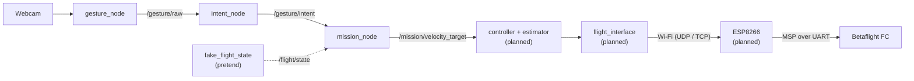

# 🖐️ Gesture Pipeline: from a hand to a drone command

Start page of the gesture section: a webcam sees the operator's raised hands, they become a gesture name, then an intent, then a velocity target for the drone. Each node has its own note (§2).

> [!NOTE] Decision
> Gestures come from a **ground webcam** ([[ADR-015 Gesture Input Source|ADR-015]]). The recogniser runs as a ROS 2 node, which changes a consequence of [[ADR-018 Ground OS and ROS 2|ADR-018]]; the amending ADR is still to be written.

> [!WARNING] Safety first
> Gestures **never** arm, disarm or touch the override switch. The radio and the safety pilot always win over code ([[Safety Rules]]).

---

## 🔄 1. The chain

| Node | Why it exists | In → out | Status |
| :--- | :--- | :--- | :--- |
| `gesture_node` ([[02 Gesture Node\|02]]) | turns the camera picture into a gesture name | webcam → `/gesture/raw` | ==🟢built== |
| `intent_node` ([[03 Intent Node\|03]]) | decides what the **operator** wants; filters noise and lost hands | `/gesture/raw` → `/gesture/intent` | ==🟢built== |
| `mission_node` ([[04 Mission Node\|04]]) | decides what the **drone** does: modes, limits, owned axes | `/gesture/intent` + `/flight/state` → `/mission/velocity_target` | ==🟢built==, numbers not reviewed |
| `fake_flight_state`, `fake_intent` ([[04 Mission Node\|04]] §7) | test without a drone | made-up `/flight/state`, `/gesture/intent` | ==🟠pretend, never with a real drone== |
| controller + estimator ([[05 Future Nodes\|05]] §5) | velocity → attitude | `/mission/velocity_target` → setpoints | ==🔴planned== |
| `flight_interface` ([[05 Future Nodes\|05]] §6) | sends setpoints to the drone safely | setpoints → ESP | ==🔴planned== |
| ESP8266 firmware ([[Protocol Spec v0]]) | bridges Wi-Fi to the FC | packets → MSP | ==🔴planned== |

---

## 🗂️ 2. Notes in this section

- [[01 ROS2 Nodes Installation]]: ROS 2 basics, running everything in Docker, tests, troubleshooting.
- [[02 Gesture Node]], [[03 Intent Node]], [[04 Mission Node]]: one note per node.
- [[05 Future Nodes]]: nodes to add later.

---

## 🏷️ 3. Gesture vocabulary

Only a hand whose **wrist is above its elbow** counts. Both arms down means no gesture: the drone hovers. Commands use **one raised hand**; only engage and lock use both. Left and right are the **operator's** (the picture is mirrored). Intent names: [[03 Intent Node|03]] §5; velocities: [[04 Mission Node|04]] §5.2.

**Both hands:**

| Gesture | Intent | Meaning | Proposed velocity |
| :--- | :--- | :--- | :--- |
| both open hands, fingers up | `ENGAGE` | **engage**: from `WAITING`, gestures start moving the drone. Must be a new gesture (hands down first) | 0 |
| both fists, held about 1 s | `LOCK_TOGGLE` | **lock / unlock**: `LOCKED` hovers and ignores every other gesture until both fists are held again | 0 |

**One hand** (shown for the right hand):

| Right hand | Intent | Meaning | Proposed velocity |
| :--- | :--- | :--- | :--- |
| index up | `CLIMB_UP` | climb, only once throttle is ours (mask 15) | z +0.2 m/s |
| index down | `DESCEND_ONLY` | descend (mask 15). The gesture way to land | z −0.2 m/s |
| index + middle across the body (`INDEX_MIDDLE_LEFT`) | `MOVE_FORWARD` | move forward | x +0.3 m/s |
| four fingers across the body (`INDEX_MIDDLE_RING_PINKY_LEFT`) | `MOVE_BACKWARD` | move backward | x −0.3 m/s |
| thumb out to the right (`THUMB_RIGHT`) | `MOVE_RIGHT` | move right | y −0.3 m/s |
| index pointing left (`INDEX_LEFT`) | `MOVE_LEFT` | move left | y +0.3 m/s |
| thumb + index up (`THUMB_INDEX_UP`) | `YAW_RIGHT` | yaw right | −20 °/s |
| thumb + index pointing left (`THUMB_INDEX_LEFT`) | `YAW_LEFT` | yaw left | +20 °/s |

The **left hand** makes the mirror image of each pose. Up, down, forward and backward stay the same; for moving and yawing the mirror image gives the other side (left index pointing right = `MOVE_RIGHT`, left thumb out to the left = `MOVE_LEFT`). Exact names (`L:<left>+R:<right>`): [[03 Intent Node|03]] §5.

**Anything else** (arms down, a single fist or open hand, other two-hand poses, unknown poses) → `NEUTRAL`, 0: **never** "continue the last command".

- **Dropping a hand is safe.** What's left of a two-hand gesture is unmapped (`NEUTRAL`): never a motion, never half a lock toggle.
- **No hands, no landing.** No hands, a dead recogniser or lost intents → hover, mode unchanged ([[04 Mission Node|04]] §5.4). Landing is `DESCEND_ONLY` with mask 15, or the pilot.

---

## 🛡️ 4. Safety logic: who does what

| Rule | Where it lives |
| :--- | :--- |
| Only hands with the wrist above the elbow count | `gesture_node` ([[02 Gesture Node\|02]] §3.2) |
| A gesture must be seen in several packets in a row before it counts (stability filter) | `intent_node` ([[03 Intent Node\|03]] §5) |
| Hands gone or recogniser gone → `NEUTRAL` | `intent_node` ([[03 Intent Node\|03]] §5) |
| Dropping one hand of a two-hand gesture never gives a command | `intent_node`, the gesture table ([[03 Intent Node\|03]] §5) |
| A deliberate `ENGAGE` (both open hands, shown after the hands were down) is needed before anything moves | `mission_node` ([[04 Mission Node\|04]] §5.1) |
| Lock and unlock only with both fists held 1 s; `LOCKED` ignores everything else | `mission_node` ([[04 Mission Node\|04]] §5.1) |
| Only the axes in the override mask are commanded | `mission_node` ([[04 Mission Node\|04]] §5.3) |
| No hands, no recogniser, no intents → hover, mode unchanged | `mission_node` ([[04 Mission Node\|04]] §5.4) |
| Hard speed limits (0.3 m/s lateral) and ramps when speeding up | `mission_node` ([[04 Mission Node\|04]] §5.5) |
| Never arm, disarm or change the override switch (REQ-SAF-003/004) | every node |

---

## 📁 5. Where the files live

| What | Where |
| :--- | :--- |
| The three ROS 2 packages, each with its `test/` folder | `drone/ground/src/` (one Docker image each) |
| Tests of the nodes together | `drone/tests/ros/` |
| `Makefile`, `docker-compose.yml`, Dockerfiles | `drone/ground/` |
| Node and test logs (not in Git) | `drone/ground/logs/` |

---

## ▶️ 6. Run

`cd drone/ground && make`. Everything else: [[01 ROS2 Nodes Installation|01]] §4.

---

## 🧪 7. Tests

[[01 ROS2 Nodes Installation|01]] §7.

---

## 🚀 8. Module 2 extension (accepted by instructors)

A trained landmark classifier instead of the rule-based `recognize()`, and the same `/gesture/intent` driving a car or an arm ([[Roadmap to April 2027]] §4, [[05 Future Nodes|05]] §8–9).

---

## Glossary

| Term | Meaning |
| --- | --- |
| **ADR** | Architecture Decision Record: a documented decision and its rationale. |
| **Docker** | Tool that runs software in containers: isolated environments built from an image (Dockerfile). Here each node has an image with ROS 2 Jazzy inside. |
| **Intent** | The action the operator asks for (for example `MOVE_LEFT`), published on `/gesture/intent`. |
| **Makefile** | The `make` targets in `drone/ground/` that build, start and test the nodes in Docker. |
| **Mask** | `msp_override_channels_mask`: which stick channels the ground controls (8, 11 or 15). |
| **Mermaid** | A text-based diagram syntax rendered by Obsidian. |
| **Node** | One ROS 2 program with one job. |
| **Pretend input** | A small node (`fake_flight_state`, `fake_intent`) that publishes made-up values so a node can be tested without the real source. Never used with a real drone. |
| **REQ ID** | A requirement identifier, `REQ-<area>-NNN` (for example REQ-SAF-019), registered in Requirements. |
| **ROS 2** | The second-generation Robot Operating System middleware used for robotics integration. |
| **Topic** | A named channel on which ROS 2 nodes publish and subscribe to messages (`/gesture/raw`, `/gesture/intent`, `/mission/velocity_target`). |
| **UDP** | User Datagram Protocol: connectionless transport suited to refreshed, time-sensitive data (the drone link). |
