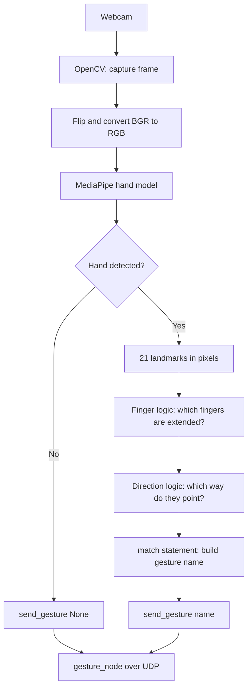
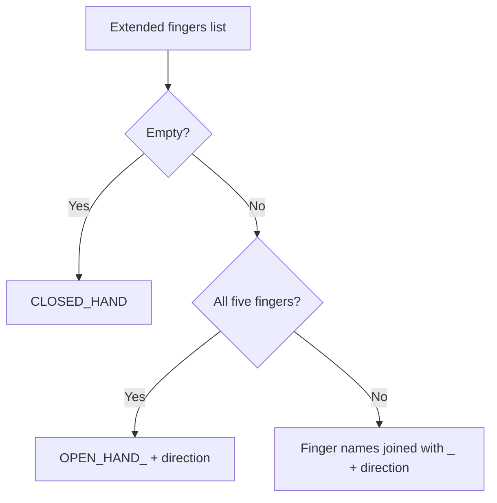

# 🖐️ How we recognize gestures with OpenCV and MediaPipe

This note explains how the webcam program turns a hand into a gesture name such as `THUMB_UP` or `INDEX_MIDDLE_LEFT`. It covers **static gestures**: which fingers are extended and which way they point. It also explains how to install and run the program on Linux.

> [!NOTE] Where this fits
> This is step 1 of the [[00 Gesture Pipeline|Gesture Pipeline]]. What happens to the gesture name after it leaves this program is in [[03 Gesture_node]].

---

## 📌 1. Overview

- **OpenCV** captures the webcam frames and shows the video window.
- **MediaPipe** is an open-source Google framework for machine-learning solutions. It ships pretrained models (hands, face, pose) that run in real time on the CPU. For every frame it finds the hand and returns **21 landmarks** (wrist, knuckles and fingertips), each with `x`, `y` and `z` coordinates.
- MediaPipe only gives us the landmarks. It does **not** recognize our gestures, so **our code does the logic** (angles and directions, §5).
- More info: [MediaPipe on GitHub](https://github.com/google-ai-edge/mediapipe)

> [!NOTE] No compiling needed
> MediaPipe's official C++ API can only be built from source with Bazel, which is slow and fragile. In Python we install the prebuilt `mediapipe` package with pip, so nothing is compiled.

> [!WARNING] Keep `mediapipe==0.10.21` pinned (checked 2026-10-12)
> MediaPipe **1.1.0** (released 6 Oct 2026) **removed** the legacy `mp.solutions` API that this code uses (verified in the wheel). Upgrading needs a port to the Tasks API (`HandLandmarker`). The "Python 3.10 to 3.12 only" limit applies to 0.10.21: 1.1.0 supports Python 3.9–3.14 and ships Linux aarch64 wheels (Raspberry Pi 5). A port is listed in [[05 Future Nodes]].

---

## 🔄 2. How the program works



1. **Capture** (`gestures.py`): OpenCV reads a frame from the webcam.
2. **Preprocess** (`gestures.py`): the frame is flipped (mirror view) and converted from BGR to RGB (MediaPipe uses RGB, OpenCV uses BGR).
3. **Detect** (`hand_processing.py`): `detect_gesture` runs `hands.process(...)`, which returns the 21 landmarks of each detected hand.
4. **Convert** (`hand_processing.py`): the landmarks of the first hand are converted from normalized values (0 to 1) to **pixels**, so angles and distances are not distorted by the frame's aspect ratio.
5. **Interpret** (`hand_processing.py`): `is_finger_extended` decides which fingers are extended.
6. **Direction** (`hand_processing.py`): `pointing_direction` works out which way the extended fingers point.
7. **Classify** (`hand_processing.py`): `recognize` builds the gesture name with a `match` statement.
8. **Output** (`gestures.py`): `draw_hand` draws the landmarks, the name is printed when it changes, and `send_gesture` sends it to `gesture_node` on **every** frame (§7).

### 🖼️ Frames and NumPy

A **frame** is one image from the camera. In Python it is a **NumPy array**: a grid of numbers with one number per pixel colour value.

| Property | Value |
| :--- | :--- |
| Shape | `(height, width, 3)`, for example `(480, 640, 3)` |
| Data type | `uint8` (each value is 0 to 255) |
| Channel order | OpenCV gives **BGR**, MediaPipe needs **RGB** |

In `gestures.py` there are two versions of the same image:
* `frame`: the BGR image from OpenCV, used for drawing and the window.
* `rgb`: a converted RGB copy, passed to MediaPipe.

### 🔌 Feeding other image sources

`hand_processing.py` never imports OpenCV. `detect_gesture(hands, rgb_image)` accepts **any RGB, `uint8`, `(height, width, 3)` NumPy array**, so any software that produces one can feed it:

| Source | How to get the array |
| :--- | :--- |
| OpenCV (camera, video file, `imread`) | `cv2.cvtColor(frame, cv2.COLOR_BGR2RGB)` |
| Pillow (image file) | `np.array(Image.open("hand.jpg").convert("RGB"))` |
| ROS 2 image topic (future) | `cv_bridge` → `sensor_msgs/Image` to a NumPy array ([[05 Future Nodes]]) |
| Other (screen capture, other camera libraries) | Convert the output to an RGB `uint8` array |

> [!WARNING] Things to check when connecting a new source
> * **Channel order:** BGR passed in as RGB does not crash, but detection gets worse.
> * **Grayscale or float images** must be converted to 3 channels and `uint8` first.
> * **Single images:** use `create_hands(static_image_mode=True)`. For video keep the default (`False`) so the hand is tracked between frames.
> * **Mirroring:** the webcam loop flips the frame so `LEFT` and `RIGHT` match the operator's own left and right. Other sources are not flipped unless you do it.

---

## 🦴 3. Landmarks used for finger detection

| Finger | Knuckle (MCP) | Middle joint (PIP / IP) | Tip |
| :--- | :---: | :---: | :---: |
| Thumb | 2 | 3 | 4 |
| Index | 5 | 6 | 8 |
| Middle | 9 | 10 | 12 |
| Ring | 13 | 14 | 16 |
| Pinky | 17 | 18 | 20 |

Landmark **0** is the wrist. In the code each finger is a tuple `(MCP, PIP, tip)`, for example `INDEX = (5, 6, 8)`, and the `FINGERS` dictionary maps each name to its tuple.

> [!NOTE] Image coordinates
> `x` grows to the right and `y` grows **downward**, so "up" on screen means a smaller `y`.

---

## 📐 4. The math

### Finger extended? (index, middle, ring, pinky)

The program measures the angle at the middle joint (PIP) $b$, between the knuckle $a$ and the tip $c$:

$$\vec{v_1} = a - b, \qquad \vec{v_2} = c - b$$

$$\theta = \arccos\left(\frac{\vec{v_1} \cdot \vec{v_2}}{\lVert\vec{v_1}\rVert \, \lVert\vec{v_2}\rVert}\right)$$

A straight finger gives an angle close to $180^\circ$, a curled finger a much smaller one. The finger counts as **extended** when $\theta > 140^\circ$ (`EXTENDED_ANGLE`).

Because this uses an angle and not "tip above joint", it works whichever way the hand is turned.

### Thumb extended?

The thumb bends sideways, so the angle check does not work well for it. Instead the program measures how far the thumb tip $P_4$ sticks out past the index knuckle $P_5$, along the palm's width axis (from the pinky knuckle $P_{17}$ toward the index knuckle):

$$\vec{u} = P_5 - P_{17}$$

$$t = \frac{(P_4 - P_5) \cdot \vec{u}}{\lVert\vec{u}\rVert} \cdot \frac{1}{\lVert P_9 - P_0 \rVert}$$

Dividing by the hand size $\lVert P_9 - P_0 \rVert$ (wrist to middle knuckle) makes the value the same near or far from the camera. Negative or near 0 means the thumb is tucked in. The thumb counts as **extended** when $t > 0.5$ (`THUMB_OUT_RATIO`).

### Pointing direction

The program adds together the knuckle-to-tip vectors of all extended fingers:

$$d_x = \sum (x_{tip} - x_{mcp}), \qquad d_y = \sum (y_{tip} - y_{mcp})$$

$$\alpha = \operatorname{atan2}(d_x, -d_y)$$

$-d_y$ is used because `y` grows downward. This gives $0^\circ$ = up, $90^\circ$ = right, $-90^\circ$ = left, $180^\circ$ = down:

| Angle $\alpha$ | Direction |
| :---: | :---: |
| $-45^\circ$ to $45^\circ$ | `UP` |
| $45^\circ$ to $135^\circ$ | `RIGHT` |
| $-135^\circ$ to $-45^\circ$ | `LEFT` |
| anything else | `DOWN` |

---

## 🏷️ 5. Gesture names

`recognize` turns the list of extended fingers and the direction into a name:



| Hand pose | Gesture name |
| :--- | :--- |
| Fist | `CLOSED_HAND` |
| All fingers out, pointing up | `OPEN_HAND_UP` |
| Thumbs up | `THUMB_UP` |
| Thumbs down | `THUMB_DOWN` |
| Index finger pointing right | `INDEX_RIGHT` |
| Index and middle (peace sign) pointing up | `INDEX_MIDDLE_UP` |
| Index and middle pointing left | `INDEX_MIDDLE_LEFT` |

Finger names always appear in the order thumb, index, middle, ring, pinky (the order of the `FINGERS` dictionary). Which names drive the drone, and how, is the vocabulary in [[00 Gesture Pipeline]] §3.

---

## 🛠️ 6. Install

### 📋 Requirements

1. Linux (X11 or Wayland), Ubuntu 24.04 for the team setup
2. Python 3.10 to 3.12 (3.10+ for the `match` statement; MediaPipe 0.10.21 has no package above 3.12)
3. A webcam that shows up as `/dev/video*`
4. Packages: `mediapipe==0.10.21` and `opencv-python` (in `requirements.txt`)

### ✅ Install checklist

- [ ] Install system packages
- [ ] Check the webcam is detected
- [ ] Create the venv in `drone/tools/gesture/`
- [ ] Install `requirements.txt`
- [ ] Verify the install
- [ ] Run `gestures.py`

### 1. System packages

```bash
sudo apt update
sudo apt install python3 python3-venv python3-pip libgl1 libglib2.0-0 v4l-utils libxcb-cursor0
```

### 2. Webcam access

```bash
v4l2-ctl --list-devices
ls /dev/video*
```

> [!TIP] Permission denied on the camera?
> Add your user to the `video` group, then log out and back in: `sudo usermod -aG video $USER`

### 3. The venv

```bash
cd ~/ROSRangers/drone/tools/gesture
python3 -m venv .venv
source .venv/bin/activate
pip install --upgrade pip
pip install -r requirements.txt
```

> [!WARNING] Pip starts "building wheel"?
> Pip found no prebuilt MediaPipe package for your Python version. Check you are on Python 3.10 to 3.12 inside the venv (`python --version`).

> [!NOTE] Older notes
> The first prototype used a folder `gesture-detector/` and a venv `gesture-env`. In the repo it is `drone/tools/gesture/` and `.venv` (not committed).

### 4. Verify

```bash
python3 -c "import cv2, mediapipe; print(cv2.__version__, mediapipe.__version__)"
```

---

## 💻 7. The program

### 🗂️ Files

```text
drone/tools/gesture/
├── gestures.py          # OpenCV: camera loop, window, sends each frame's gesture
├── hand_processing.py   # MediaPipe + math + finger logic + gesture names
├── gesture_sender.py    # sends the gesture to gesture_node over UDP (standard library only)
├── requirements.txt     # mediapipe==0.10.21, opencv-python
└── .venv/               # your virtual environment (not committed)
```

| File | What it does |
| :--- | :--- |
| `hand_processing.py` | Everything that uses MediaPipe, plus the math, the finger logic and the gesture names. It never imports OpenCV, so it accepts any RGB image. |
| `gestures.py` | The OpenCV part: camera loop and window. Imports `create_hands`, `detect_gesture` and `draw_hand` from `hand_processing.py` and `send_gesture` from `gesture_sender.py`. |
| `gesture_sender.py` | Sends JSON over UDP to `gesture_node`. Explained in [[03 Gesture_node]] §6. |

All three must be in the same folder. The three functions `gestures.py` uses from `hand_processing.py`:

- `create_hands(static_image_mode=False)`: creates the MediaPipe detector.
- `detect_gesture(hands, rgb_image)`: returns `(gesture, hand)`, or `(None, None)` if no hand was found.
- `draw_hand(image, hand)`: draws the landmarks on an image.

### `hand_processing.py`

```python
import math

import mediapipe as mp

mp_hands = mp.solutions.hands
mp_draw = mp.solutions.drawing_utils

# Landmark cheat sheet (MCP = knuckle, PIP = middle joint):
#   0 wrist
#   thumb:  2 MCP, 3 IP,  4 tip
#   index:  5 MCP, 6 PIP, 8 tip
#   middle: 9 MCP, 10 PIP, 12 tip
#   ring:   13 MCP, 14 PIP, 16 tip
#   pinky:  17 MCP, 18 PIP, 20 tip

THUMB = (2, 3, 4)
INDEX = (5, 6, 8)
MIDDLE = (9, 10, 12)
RING = (13, 14, 16)
PINKY = (17, 18, 20)

FINGERS = {"THUMB": THUMB, "INDEX": INDEX, "MIDDLE": MIDDLE, "RING": RING, "PINKY": PINKY}

EXTENDED_ANGLE = 140     # degrees at the middle joint; above this the finger is extended
THUMB_OUT_RATIO = 0.5    # how far the thumb tip sticks out past the palm edge, in hand sizes (a guess)


# ---------- MediaPipe ----------
def create_hands(static_image_mode=False):
    """False = video (tracks the hand between frames), True = single unrelated images."""
    return mp_hands.Hands(
        static_image_mode=static_image_mode,
        max_num_hands=2,
        min_detection_confidence=0.7,
        min_tracking_confidence=0.5,
    )


def detect_gesture(hands, rgb_image):
    """rgb_image: NumPy array, shape (height, width, 3), dtype uint8, RGB order.
    Returns (gesture, hand): the gesture string and the MediaPipe hand object
    (needed for drawing), or (None, None) if no hand was found."""
    results = hands.process(rgb_image)
    if not results.multi_hand_landmarks:
        return None, None

    hand = results.multi_hand_landmarks[0]
    height, width = rgb_image.shape[:2]
    lm = [(p.x * width, p.y * height) for p in hand.landmark]
    return recognize(lm), hand


def draw_hand(image, hand):
    """Draw the landmarks and connections onto the image (in place)."""
    mp_draw.draw_landmarks(image, hand, mp_hands.HAND_CONNECTIONS)


# ---------- Math ----------
def dist(a, b):
    return math.hypot(a[0] - b[0], a[1] - b[1])


def angle(a, b, c):
    """Angle in degrees at point b, between the lines b->a and b->c."""
    v1 = (a[0] - b[0], a[1] - b[1])
    v2 = (c[0] - b[0], c[1] - b[1])
    norm = math.hypot(*v1) * math.hypot(*v2)
    if norm == 0:
        return 0
    cos = (v1[0] * v2[0] + v1[1] * v2[1]) / norm
    return math.degrees(math.acos(max(-1, min(1, cos))))


def hand_size(lm):
    return max(dist(lm[0], lm[9]), 1e-6)  # wrist to middle knuckle


def thumb_out(lm):
    """How far the thumb tip sticks out past the index knuckle, along the palm's width axis.
    Negative or near 0 = tucked, clearly positive = out."""
    ux = lm[5][0] - lm[17][0]   # axis from the pinky knuckle toward the index knuckle
    uy = lm[5][1] - lm[17][1]
    palm_width = max(math.hypot(ux, uy), 1e-6)
    along = ((lm[4][0] - lm[5][0]) * ux + (lm[4][1] - lm[5][1]) * uy) / palm_width
    return along / hand_size(lm)


def is_finger_extended(lm, finger):
    """finger is one of THUMB, INDEX, MIDDLE, RING, PINKY."""
    mcp, pip, tip = finger

    if finger == THUMB:
        return thumb_out(lm) > THUMB_OUT_RATIO

    return angle(lm[mcp], lm[pip], lm[tip]) > EXTENDED_ANGLE


def pointing_direction(lm, fingers):
    """Direction the given fingers point (knuckle to tip, added together):
    UP, DOWN, LEFT or RIGHT."""
    dx = sum(lm[tip][0] - lm[mcp][0] for mcp, pip, tip in fingers)
    dy = sum(lm[tip][1] - lm[mcp][1] for mcp, pip, tip in fingers)
    a = math.degrees(math.atan2(dx, -dy))  # 0 = up, 90 = right, -90 = left, 180 = down
    if -45 <= a < 45:
        return "UP"
    if 45 <= a < 135:
        return "RIGHT"
    if -135 <= a < -45:
        return "LEFT"
    return "DOWN"


# ---------- Gesture recognition ----------
def recognize(lm):
    # Names of the fingers that are extended, e.g. ["INDEX", "MIDDLE"]
    extended = [name for name, finger in FINGERS.items() if is_finger_extended(lm, finger)]

    # Which way the extended fingers point (not used when the hand is closed)
    direction = pointing_direction(lm, [FINGERS[name] for name in extended])

    match extended:
        case []:
            return "CLOSED_HAND"
        case ["THUMB", "INDEX", "MIDDLE", "RING", "PINKY"]:
            return "OPEN_HAND_" + direction
        case _:
            return "_".join(extended) + "_" + direction  # e.g. "INDEX_MIDDLE_LEFT"
```

### `gestures.py` (repo version, 2026-10-16)

```python
import cv2 as opencv
from hand_processing import create_hands, detect_gesture, draw_hand
from gesture_sender import send_gesture


def execute(gesture):
    match gesture:
        case "OPEN_HAND_UP":
            print("Gesture: Open Hand Up -> Enable / Hold Position (check doc)")
        case "CLOSED_HAND":
            print("Gesture: Closed Hand -> Stop / Hover in place")
        # ... one case per gesture of the vocabulary


def main():
    cap = opencv.VideoCapture(2)  # /dev/video*
    last_gesture = None

    with create_hands() as hands:
        while cap.isOpened():
            ok, frame = cap.read()
            if not ok:
                break

            frame = opencv.flip(frame, 1)  # mirror view
            rgb = opencv.cvtColor(frame, opencv.COLOR_BGR2RGB)

            gesture, hand = detect_gesture(hands, rgb)
            if hand:
                draw_hand(frame, hand)

            if gesture and gesture != last_gesture:
                print(gesture)
                last_gesture = gesture
            send_gesture(gesture, None)

            opencv.imshow("Gestures", frame)
            if opencv.waitKey(1) & 0xFF == ord("q"):
                break

    cap.release()
    opencv.destroyAllWindows()


if __name__ == "__main__":
    main()
```

> [!NOTE] Reading the code
> - The `match` statement is the switch case. `case _` is the default for every pattern not listed above it.
> - `recognize` matches on the **list of finger names**, so a case like `["THUMB", "INDEX", "MIDDLE", "RING", "PINKY"]` must list them in the order of `FINGERS`.
> - The name is printed only when it changes, otherwise it would print about 30 times per second.
> - `send_gesture` is called on **every** frame, including `None` when there is no hand. It decides itself when to send (on change, plus a repeat every 0.1 s), and `gesture_node` needs those repeats to know the hand is still there.
> - `VideoCapture(2)` is the camera index on the machine where it was last tested. Change it to `0` or `1` to match your `ls /dev/video*`.
> - `execute()` is kept for local debugging but is no longer called. The real action now happens in `gesture_node` and `mission_node`.
> - The palm position is sent as `None` for now. `gesture_node` accepts an `[x, y]` there if we add it later.

---

## ▶️ 8. Running it

```bash
cd ~/ROSRangers/drone/tools/gesture
source .venv/bin/activate
python3 gestures.py              # on Wayland: QT_QPA_PLATFORM=xcb python3 gestures.py
```

Press `q` in the video window to quit, or `Ctrl+C` in the terminal. With no `gesture_node` running, the UDP packets are simply lost, so the program also works on its own. To run it with ROS 2, see [[02 ROS 2 Nodes - Install and Test]] §7.

---

## 🎚️ 9. Tuning

| Setting | Default | Effect |
| :--- | :---: | :--- |
| `EXTENDED_ANGLE` | `140` | Angle at the middle joint above which a finger counts as extended. Lower = easier. |
| `THUMB_OUT_RATIO` | `0.5` | How far (in hand sizes) the thumb tip must stick out past the index knuckle. Lower = easier. |
| `min_detection_confidence` | `0.7` | How sure MediaPipe must be before it reports a new hand. |
| `min_tracking_confidence` | `0.5` | How sure MediaPipe must be to keep tracking a hand between frames. |

All four are in `hand_processing.py` (the first two at the top, the others in `create_hands()`).

> [!WARNING] Starting values
> `THUMB_OUT_RATIO` is a guess. To tune it, temporarily add `print(thumb_out(lm))` inside `detect_gesture` right after `lm` is built, watch the value with the thumb tucked and stretched out, and pick a value between the two.

---

## ⚠️ 10. Known limitations

- Thumb detection is the least reliable part. `THUMB_OUT_RATIO` needs tuning.
- Lighting and camera quality affect accuracy.
- Up to 2 hands are detected (`max_num_hands=2`), but only the **first** hand is recognized and drawn.
- Gestures that depend on more than "extended or not" (pinch, OK sign) need extra logic using distances between landmarks (§12).
- Only static poses. Movement (wave, swipe) needs a tracker over several frames ([[05 Future Nodes]]).

---

## 🧯 11. Troubleshooting

| Problem | Likely cause / fix |
| :--- | :--- |
| `ModuleNotFoundError: No module named 'hand_processing'` or `'gesture_sender'` | All three `.py` files must be in the same folder, and you must run `python3 gestures.py` from it. |
| Pip tries to build mediapipe | Unsupported Python version. Use 3.10 to 3.12. |
| `SyntaxError` on the `match` line | Python older than 3.10. Check `python --version` inside the venv. |
| `ImportError: libGL.so.1` | Install `libgl1` and `libglib2.0-0`. |
| Camera won't open or empty frames | Check `ls /dev/video*` and change the index in `VideoCapture(...)`. Make sure no other app uses the camera. |
| Permission denied on `/dev/video0` | Add your user to the `video` group, then log out and back in. |
| `Could not load the Qt platform plugin "xcb"` | Install `libxcb-cursor0`. On Wayland run with `QT_QPA_PLATFORM=xcb`. |
| Thumb counted as out when it is tucked (or the other way) | Tune `THUMB_OUT_RATIO` (§9). |
| Bent fingers counted as extended | Raise `EXTENDED_ANGLE`. |
| Gesture name flickers between two values | The hand is near a threshold or a 45° direction boundary. Hold the pose more clearly, or tune. |
| No hand detected | Improve lighting, face the palm at the camera, lower `min_detection_confidence`. |
| `mp.solutions` error | Wrong MediaPipe version. Check `pip show mediapipe` (must be 0.10.21). |

---

## ➕ 12. Adding new gestures

1. **Static:** hold the gesture and read its name in the terminal (for example `INDEX_PINKY_UP`). To make it do something, add it to the gesture → intent table in `gesture_node` ([[03 Gesture_node]] §5) and agree the meaning in [[00 Gesture Pipeline]] §3. If it needs a special name, add a `case` to `recognize()` above `case _`.
2. **Distance based (pinch, OK sign):** compare the distance between two landmarks with `dist()`, for example thumb tip (4) and index tip (8), divided by `hand_size(lm)` so it does not depend on the distance to the camera:

$$d = \frac{\sqrt{(x_8 - x_4)^2 + (y_8 - y_4)^2}}{\lVert P_9 - P_0 \rVert}$$

---

## Glossary

| Term | Meaning |
| --- | --- |
| **BGR / RGB** | Orders of the three colour channels. OpenCV uses BGR, MediaPipe RGB. |
| **Landmark** | One of the 21 tracked points on a hand (wrist, knuckles, finger joints and tips). |
| **MCP / PIP / IP** | Finger joints: knuckle, middle joint, and the thumb's single middle joint. |
| **MediaPipe** | A Google framework used here to detect hands and their landmarks. |
| **NumPy array** | The image format passed to MediaPipe: RGB, `uint8`, shape `(height, width, 3)`. |
| **OpenCV** | A computer-vision library used here to read the webcam and draw the video window. |
| **ROS 2** | The second-generation Robot Operating System middleware used for robotics integration. |
| **Static gesture** | A gesture recognised from a single frame: which fingers are extended and where they point. |
| **Tasks API** | MediaPipe's newer API (`HandLandmarker`) that replaces the removed `mp.solutions`. |
| **UDP** | User Datagram Protocol: connectionless transport suited to refreshed, time-sensitive data. |
| **venv** | A Python virtual environment that keeps this project's packages separate from the system. |
