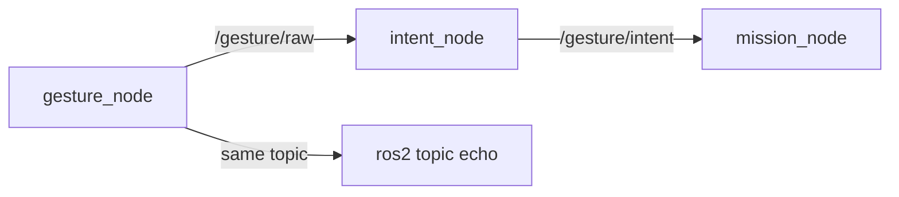

# 🤖 ROS 2 and nodes: run and test each node in Docker

How to run (§4), inspect (§5) and test (§6, §7) the gesture nodes. Everything runs in Docker: ROS 2 is not installed on the PC. What each node does inside: [[02 Gesture Node]], [[03 Intent Node]], [[04 Mission Node]].

> [!WARNING] Status: DRAFT
> All automated tests pass (§7). A full run with the webcam is not recorded yet.

---

## 📚 1. What ROS is

**ROS 2** is a framework for building a robot program out of small programs (**nodes**) that exchange **messages** on named **topics**. A node **publishes** to a topic without knowing who **subscribes**; any number of nodes, or the `ros2` command, can read it. Nodes come in **packages**.



---

## 🐢 2. Why ROS 2 Jazzy

Jazzy is the long-term-support ROS 2 release for Ubuntu 24.04, chosen in [[ADR-018 Ground OS and ROS 2|ADR-018]]. The images and CI use `ros:jazzy-ros-base`, so everyone runs the same ROS 2 whatever the host.

---

## 🧩 3. Why several nodes

- A crash stays in one node; the next one notices the silence and falls back safely (the drone hovers).
- Each node can be tested alone: fake its input, read its output.
- `/gesture/intent` can drive other hardware (simulator, car, arm).
- Every topic can be watched live with `ros2`.

The full chain: [[00 Gesture Pipeline]] §1. Why the recogniser is a node: [[02 Gesture Node]] §2.

---

## 🐳 4. Run the nodes: Docker and `make`

### 4.1 What you need

Docker with the Compose plugin (usable without `sudo`), `make`, a webcam at `/dev/video0` and an X11 or XWayland display for the "Gestures" window.

### 4.2 The services

`drone/ground/docker-compose.yml` defines one service per piece, each built from `ros:jazzy-ros-base`:

| Service | Runs |
| :--- | :--- |
| `gesture` | `gesture_node`: webcam, "Gestures" window, `/gesture/raw` |
| `intent` | `intent_node` on `/gesture/raw` |
| `mission` | `mission_node` |
| `flight` | `fake_flight_state`, a **pretend** `/flight/state` ([[04 Mission Node]] §7.1). Never with a real drone |
| `echo` | the live table of the chain, and the `ros2` CLI (§5) |

The **live table** shows the latest gesture, intent, mission mode and velocity target, and marks a topic `STALE` when it stops. Each node writes its output to `logs/<service>/latest.log` (`tail -f logs/intent/latest.log`).

### 4.3 The `make` targets

From `drone/ground/`:

| Target | Does |
| :--- | :--- |
| `make` | builds the images and starts all five services; the terminal shows the live table |
| `make down` | stops them |
| `make unit` / `make smoke` | the tests (§7) |
| `make clean` | `down` + removes this project's images |
| `make fclean` / `make re` | `clean` + removes `logs/` and this project's other Docker objects / `fclean`, then `make` |

`q` in the "Gestures" window stops `gesture_node`; Ctrl+C stops the rest. To run one service alone: `docker compose up --build <service>` (run `xhost +local:` once per login before `gesture`). `MASK=` and `AIRBORNE=` set the pretend flight state ([[04 Mission Node]] §8.1).

### 4.4 Changing the code

The code is copied into the images, so run `make` again after an edit: it rebuilds the changed image.

### 4.5 `ROS_DOMAIN_ID`

Nodes on the same network see each other. Export your own number (0–101) before `make` and use it in every terminal: `export ROS_DOMAIN_ID=42`.

---

## ⌨️ 5. The `ros2` command line

The `echo` image has the `ros2` CLI. From `drone/ground/`, put `docker compose run --rm echo` in front of any `ros2` command:

```bash
docker compose run --rm echo ros2 topic echo /gesture/raw std_msgs/msg/String --field data
```

| Command | Use |
| :--- | :--- |
| `ros2 topic list` / `ros2 node list` | what is running |
| `ros2 topic echo <topic> <type> --field data` | print messages (give the type; `--field data` prints only the JSON) |
| `ros2 topic hz <topic>` | rate (`/gesture/raw` ~10 Hz, `/gesture/intent` ~20 Hz) |
| `ros2 topic info <topic>` | publishers and subscribers |
| `ros2 topic pub <topic> <type> <data>` | publish by hand (§6) |
| `ros2 param get` / `set <node> <name>` | read or change a parameter |

`intent_node` and `mission_node` read their parameters only at start-up, and they are safety settings: agree changes with the team.

---

## 🧪 6. Test `gesture_node` and `intent_node` by hand

Watch with the live table (`docker compose run --rm echo`) or the `Intent ->` lines in `logs/intent/latest.log`. `mission_node` by hand: [[04 Mission Node]] §9.

### Level 0: `intent_node` without a camera

Start `docker compose up --build intent`, then fake a gesture:

```bash
docker compose run --rm echo ros2 topic pub -r 10 /gesture/raw std_msgs/msg/String "{data: '{\"gesture\": \"L:INDEX_RIGHT+R:NONE\", \"t\": 0, \"xy\": null}'}"
```

**Pass:** `MOVE_RIGHT` / `ok` after about 1 s; after Ctrl+C, `NEUTRAL` (`no_hand`, then `no_packets`). Other names give their intent ([[00 Gesture Pipeline]] §3).

### Level 1: `gesture_node` alone

Start `docker compose up --build gesture`, stand back so the window shows your shoulders and elbows, and echo `/gesture/raw` (§5). **Pass:** names like `L:NONE+R:INDEX_UP` that match your raised hands ([[02 Gesture Node|02]] §7), `null` with both arms down, ~10 Hz.

### Level 2–3: both nodes

Start `intent` and `gesture`. **Pass:** the `intent` log shows `First packet from gesture_node` and a link report every 5 s; each gesture of [[00 Gesture Pipeline]] §3 shows its intent in the live table within about 0.5 s.

### Level 4: safety behaviour

| Do | Expected intent |
| :--- | :--- |
| a motion gesture, lower the arm 1 s, show both fists | `NEUTRAL`, then `LOCK_TOGGLE`; **never** the old motion again |
| drop one hand from both fists or both open hands | `NEUTRAL` / `unmapped_gesture` |
| both arms down 3 s | `NEUTRAL` (`no_hand`, then `no_hand_long`) |
| stop `gesture` while holding a gesture | `NEUTRAL` within 0.3 s |

Anything else is a safety bug: report it with the Bug form.

### Level 5: evidence

Record each session with the Test session issue form and attach `logs/gesture/latest.log` and `logs/intent/latest.log`.

---

## 🤖 7. Automated tests and CI

### 7.1 The commands

From `drone/ground/`:

| Command | Needs | Runs |
| :--- | :--- | :--- |
| `make unit` | Python 3 | the package tests that need no ROS 2 (the others are skipped) |
| `make smoke` | Docker | the smoke test (§7.3) |

Full output in `logs/test/`.

### 7.2 Where the tests are

Package tests in `drone/ground/src/<package>/test/`, tests of nodes together (contract, pipeline, launch) in `drone/tests/ros/`. Each file's docstring says what it checks. Requirement IDs and their tests: [[03 Intent Node]] §9, [[04 Mission Node]] §11.

### 7.3 The smoke test

`docker/smoke_test.sh` builds the images, runs each package's tests inside its image with none skipped, sends a gesture through the gesture, intent and mission containers, and checks the fallbacks, clean stops and logs.

### 7.4 Skipped tests

Tests that need ROS 2 are skipped on the host. With `REQUIRE_ROS_TESTS=1` (set in CI and the smoke test) a skip is a failure.

### 7.5 In CI

`ground-ros2` builds and tests the three packages and `drone/tests/ros` (90 % coverage gate); `ground-docker` runs the smoke test. Both run on PRs that touch `drone/ground/`, `drone/tests/ros/` or `ci.yaml` ([[Testing Strategy]], [[ADR-022 CI Gates and Lint Rules|ADR-022]]).

---

## 🧯 8. Troubleshooting

| Symptom | Fix |
| :--- | :--- |
| `permission denied ... docker.sock` | `sudo usermod -aG docker $USER`, log out and in |
| `gesture`: `cannot open display` | `xhost +local:`, check `echo $DISPLAY` |
| `/dev/video0: no such file or directory` | plug in a webcam, or start the other services only |
| `gesture` log: `Cannot open camera 0` | close other camera apps |
| nothing in the live table or `ros2 topic echo` | same `ROS_DOMAIN_ID` everywhere (§4.5) |
| `Could not determine the type` | give the type to `ros2 topic echo` (§5) |
| intent stays `no_packets_yet` | `gesture` not running (Level 1) |
| intent stays `unconfirmed` | hold the gesture still, both hands in view for two-hand gestures |

Recognition problems: [[02 Gesture Node]] §13. Modes and velocities: [[04 Mission Node]] §9.

---

## Glossary

| Term | Meaning |
| --- | --- |
| **CI** | Continuous Integration: GitHub Actions runs the tests on every PR. |
| **CLI** | Command-line interface: here the `ros2` command. |
| **Docker / image / container** | An image packages Ubuntu + ROS 2 + one node; a container is a running copy. |
| **Jazzy** | ROS 2 Jazzy Jalisco, the ROS 2 release we use. |
| **Live table** | What the `echo` service shows: the latest gesture, intent, mode and velocity. |
| **Makefile** | The `make` targets in `drone/ground/` that build, start and test the nodes. |
| **Node** | A ROS 2 program with one job, talking to others through topics. |
| **Package** | A folder of ROS 2 code that builds into nodes. |
| **Pretend input** | A node that publishes made-up values for testing (`fake_flight_state`). Never with a real drone. |
| **ROS 2** | The robotics framework used for the ground nodes. |
| **ROS_DOMAIN_ID** | A number that separates ROS 2 networks. |
| **Smoke test** | A short end-to-end check of the built images (`make smoke`). |
| **Topic** | A named channel nodes publish and subscribe to. |
