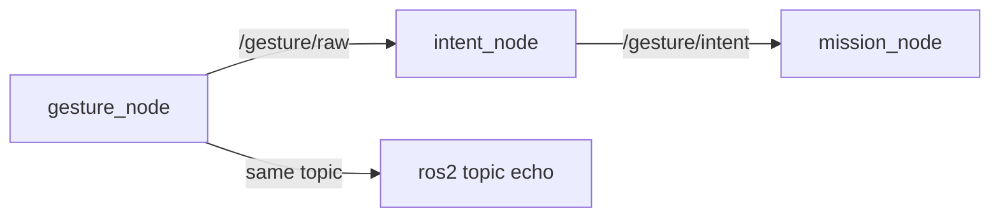

# 🤖 ROS 2 and nodes: run and test each node in Docker

How to run (§4), inspect (§5) and test (§6, §7) the gesture nodes. Everything runs in Docker: ROS 2 is not installed on the PC. What each node does inside: [[02 Gesture Node]], [[03 Intent Node]], [[04 Mission Node]].

> [!WARNING] Status: DRAFT
> All automated tests pass (§7). A full run with the webcam is not recorded yet.

---

## 📚 1. What ROS is

**ROS 2** is a framework for building a robot program out of small programs (**nodes**) that exchange **messages** on named **topics**. A node **publishes** to a topic without knowing who **subscribes**; any number of nodes, or the `ros2` command, can read it. Nodes come in **packages**.



---

## 🐢 2. Why ROS 2 Jazzy

Jazzy is the long-term-support ROS 2 release for Ubuntu 24.04, chosen in [[ADR-018 Ground OS and ROS 2|ADR-018]]. The images and CI use `ros:jazzy-ros-base`, so everyone runs the same ROS 2 whatever the host.

---

## 🧩 3. Why several nodes

- A crash stays in one node; the next one notices the silence and falls back safely (the drone hovers).
- Each node can be tested alone: fake its input, read its output.
- `/gesture/intent` can drive other hardware (simulator, car, arm).
- Every topic can be watched live with `ros2`.

The full chain: [[00 Gesture Pipeline]] §1. Why the recogniser is a node: [[02 Gesture Node]] §2.

---

## 🐳 4. Run the nodes: Docker and `make`

### 4.1 What you need

Docker with the Compose plugin (usable without `sudo`), `make`, a webcam at `/dev/video0` and an X11 or XWayland display for the "Gestures" window.

### 4.2 The services

`drone/ground/docker-compose.yml` defines one service per piece. Each image builds `FROM` the shared base, `docker/base/Dockerfile` (`ros:jazzy-ros-base`, the entrypoint and a non-root user `ros`). That user gets your uid and gid (`make` sets `GROUND_UID` / `GROUND_GID`), so the files in `logs/` are yours. Compose builds the base first by itself (the build-only `base` service).

| Service | Runs |
| :--- | :--- |
| `gesture` | `gesture_node`: webcam, "Gestures" window, `/gesture/raw` |
| `intent` | `intent_node` on `/gesture/raw` |
| `mission` | `mission_node` |
| `controller` | `controller_node`: velocity target → attitude setpoint ([[07 Controller Node]]); inactive until it has a measured velocity |
| `fake_flight_state` | a **pretend** `/flight/state` ([[04 Mission Node]] §7.1), demo mode only. Never with a real drone |
| `echo` | the live table (the drone and the chain, §4.6), and the `ros2` CLI (§5) |
| `flight_interface` | the real `/flight/state`, real mode only ([[05 Flight Interface Node]] §7) |
| `px4`, `flight_interface_sim`, `sim_smoke`, `sim_hold` | the simulation (PX4, `flight_interface` with the `px4` backend) and its tests, sim modes only ([[PX4 SITL Setup]] §7) |

Each **mode** is a compose profile with its env file, `drone/ground/env/<mode>.env`. The file sets the profile, the parameter file (`ground_bringup`'s `config/<mode>.yaml`), the ROS domain and the discovery range together:

| Mode | Services | `/flight/state` from |
| :--- | :--- | :--- |
| `demo` (`make`) | gesture, intent, mission, controller, echo, `fake_flight_state` | `fake_flight_state` (pretend) |
| `sim` (`make sim`) | gesture, intent, mission, controller, echo, `flight_interface_sim`, `px4` | `flight_interface_sim` (backend `px4`) |
| `real` (`make real`) | gesture, intent, mission, controller, echo, `flight_interface` | `flight_interface` |
| `real-dry` (`make real-dry`) | the same as `real`, with `env/real.env` | `flight_interface`, loopback backend: no drone ([[05 Flight Interface Node]] §7.1) |

**Before the first run: the env files.** Git never holds their values ([[ADR-025 flight_interface Ground Node|ADR-025]] E1.3). Copy the templates, then fill in the empty values (the domain and discovery range) with the ones the safety pilot gives you:

```bash
cd drone/ground
mkdir -p env
cp env.example/demo.env.example env/demo.env   # and sim, real when you need them
cp .env.example .env                           # only for a plain `docker compose ...`
```

Until they are filled in, `make` and `docker compose` refuse to start, and say which value is missing.

The **live table** shows the mode, the drone's state and the gesture chain, and raises alerts (§4.6). Each node writes its output to `logs/<service>/latest.log` (`tail -f logs/intent/latest.log`).

### 4.3 The `make` targets

From `drone/ground/`:

| Target | Does |
| :--- | :--- |
| `make` | the demo mode: builds the images and starts its services from scratch (other modes stopped, containers recreated); the terminal shows the live table |
| `make down` | stops the demo and the simulation; refuses while `flight_interface` runs |
| `make test`, `make unit`, `make smoke`, `make test-sitl` | the tests (§7) |
| `make clean` | `down` + removes this project's images |
| `make fclean` / `make re` | `clean` + removes the venv, the workspace, `build/`, `logs/` and this project's other Docker objects / `fclean`, then `make` |
| `make sim` / `make sim-down` | the chain against PX4 SITL + Gazebo instead of the pretend `fake_flight_state`: fly the simulated drone with the webcam ([[PX4 SITL Setup]] §7.3) |
| `make sim-smoke` | the headless simulation test with scripted gestures ([[PX4 SITL Setup]] §7.4) |
| `make sim-hold` | the SITL position-hold test, REQ-NAV-001, 3 runs ([[PX4 SITL Setup]] §7.5) |
| `make real` | the real mode, the drone: checks `env/real.env`, the PSK file and that the ESP answers, then starts the chain and `flight_interface` unconfigured and prints the operator steps ([[05 Flight Interface Node]] §7). Never configures, activates or ARMs |
| `make real-dry` | the same without the drone (`flight_interface` on the loopback backend): to rehearse the operator steps |
| `make real-down` | asks first (it cuts the drone's link), then stops the real mode |

`q` in the "Gestures" window stops `gesture_node`; Ctrl+C stops the rest. To run one service alone: `docker compose up --build <service>` (run `xhost +local:` once per login before `gesture`). The pretend flight state's mask and airborne are in `drone/ground/src/bringup/ground_bringup/config/demo.yaml`: edit it, then `docker compose restart fake_flight_state` ([[04 Mission Node]] §8.1).

### 4.4 Changing the code

The code is copied into the images, so run `make` again after an edit: it rebuilds the changed image.

### 4.5 `ROS_DOMAIN_ID`

Each mode has its own domain ([[ADR-025 flight_interface Ground Node|ADR-025]] E1.3), set by its env file (`GROUND_DOMAIN_ID`, §4.2). `make` refuses a domain another mode uses, the tests' 81–98, and 0 or 42: the domains a plain terminal and the native launch files use, so a native `flight_interface` can't join a mode (E1.4). The containers ignore your terminal's `ROS_DOMAIN_ID`. A host terminal that talks to the nodes needs the mode's values: `export ROS_DOMAIN_ID=<GROUND_DOMAIN_ID> ROS_AUTOMATIC_DISCOVERY_RANGE=<GROUND_DISCOVERY_RANGE>` from `env/<mode>.env`.

### 4.6 The live table

The `echo` service (`drone/ground/src/echo/monitor.py`) redraws it in place. It only reads topics: it never commands the drone. `make real` after `activate`:

```
REAL: DRONE   14:02:11   (Ctrl+C to quit)

FLIGHT    flight_interface  /flight/state            live
    active      True
    link_ok     True
    esp_state   STREAMING
    fc_link_ok  True
    armed       True
    override_active True
    mask        8
    failsafe_output False
    estop       False

ATTITUDE  /fc/attitude                               live
    roll: +1 deg    pitch: -2 deg    yaw: 0 deg (from start)

BATTERY   /fc/battery                                live
    15.60 V    3.90 V/cell (4 cells)

GESTURE   gesture_node  /gesture/raw                 live
    gesture     L:NONE+R:THUMB_INDEX_LEFT

INTENT    intent_node   /gesture/intent              live
    intent      YAW_LEFT
    reason      ok
    gesture     L:NONE+R:THUMB_INDEX_LEFT

MISSION   mission_node  /mission/state               live
    mode        ENGAGED
    airborne    True

VELOCITY  mission_node  /mission/velocity_target     live
    fwd/back    0
    left/right  0
    up/down     0
    yaw         left 20.00 deg/s
    ground owns: yaw only (mask 8)

CONTROL   controller_node  /control/attitude_setpoint live
    active      False
    reason      no_velocity
```

- **Title:** the mode: `DEMO: PRETEND /flight/state`, `REAL: DRONE`, `REAL-DRY: NO DRONE (loopback)` or `SIM: PX4 SITL`. `MODE ?` means it was started outside a mode (§8).
- **Status:** `live` while the topic arrives, `STALE N s` when it stops (the last values stay), `waiting` before the first message, with the reason on the line below (e.g. no `/fc/*` in demo or sim).
- **FLIGHT:** the drone's link and safety state from `/flight/state`; its publisher depends on the mode (§4.2). A value the drone doesn't know shows `unknown`.
- **ATTITUDE:** whole degrees (`?` for a broken sample, NaN or infinite), signs as on `/fc/attitude` (REP-103): roll + right side down, pitch + nose down, yaw + left. Yaw is relative, not a compass: zero at the first sample after `configure`, back to zero at each `activate` ([[Architecture Document]] §2). Only from `flight_interface`'s ESP backend (`make real`), or `fc_telemetry` on the bench.
- **BATTERY:** pack voltage and the average per cell. It can't see single cells: the per-cell check before a session stays ([[Battery Log]]). Same sources as ATTITUDE.
- **MISSION:** `why` appears only in `IDLE`: why the gestures do nothing.
- **VELOCITY:** the target in words; its last line says which axes the ground owns (the mask), so "the gesture does nothing" reads as "yaw only".
- **CONTROL:** the controller's attitude setpoint: `active` and its `reason` (`no_velocity` on the real drone until #200), and while active the roll, pitch, yaw rate and throttle ([[07 Controller Node]] §6).

**Alerts** go on a line under the title, each marked `!!`: red is a fault, yellow is "not OK yet". Colour only on a terminal. The radio and the safety pilot always win over what the table says ([[Safety Rules]]).

| Alert | Means | Do |
| :--- | :--- | :--- |
| `MONITOR ERROR: <exception>` | the table itself failed on a message: rows may be missing data | don't trust the table; restart it (`docker compose run --rm echo`) and file a bug with the traceback from its output |
| `<N> <topic> PUBLISHERS: <nodes>` | more than one node publishes `/flight/state`, `/mission/velocity_target`, `/control/attitude_setpoint` or `/fc/*`, which must have one | stop the extra node it names |
| `<N> <topic> PUBLISHERS: <node> x<N> (restarted? or started twice)` | the same name more than once: a node killed (`docker kill`, OOM) and restarted stays listed until its DDS lease runs out (seconds), or the node was really started twice | wait a few seconds; if it stays, a node runs twice: stop the extra one |
| `E-STOP: <reason>` | `flight_interface` is in E-stop: nothing goes to the drone | find the cause in `logs/flight_interface/latest.log`; `~/reset_estop` ([[05 Flight Interface Node]] §5) |
| `FAILSAFE` | the ESP sends its own failsafe output | the safety pilot flies; check the Wi-Fi and the ground |
| `FC LINK LOST` | the ESP gets no answer from the FC | the safety pilot flies; check the FC wiring and power |
| `NO LINK` | no recent state from the ESP (Wi-Fi lost, ESP off), or the ground can't command the drone and nothing above says why | check the ESP and the Wi-Fi |
| `NO /flight/state (N s)` / `BAD /flight/state` | its publisher stopped / sent something unreadable | check that publisher's log |
| `LOW BATTERY: <V>/cell` | the pack has been at or below 3.5 V per cell for 2 s. Needs `/fc/battery` at 2 Hz or faster (the drone and `fc_telemetry`'s default send 5 Hz); below that (`fc_telemetry` `battery_hz` < 2) it never shows | land ([[Safety Rules]] #8) |
| `FC LINK UNKNOWN` (yellow) | the ESP answers, but no FC health report yet (a new session) | wait a second; if it stays, as `FC LINK LOST` |
| `NOT ACTIVE` (yellow) | `flight_interface` is configured, not activated | `activate` ([[05 Flight Interface Node]] §7) |

Without a terminal (piped, `docker compose run --rm -T echo`) it prints `mode: …` once, then one line per change, alerts first. Attitude and battery are left out there: they change on almost every message. `NO /flight/state` has no seconds there, so it stays one line while the topic stays stopped.

---

## ⌨️ 5. The `ros2` command line

The `echo` image has the `ros2` CLI. From `drone/ground/`, put `docker compose run --rm echo` in front of any `ros2` command:

```bash
docker compose run --rm echo ros2 topic echo /gesture/raw std_msgs/msg/String --field data
```

| Command | Use |
| :--- | :--- |
| `ros2 topic list` / `ros2 node list` | what is running |
| `ros2 topic echo <topic> <type> --field data` | print messages (give the type; `--field data` prints only the JSON) |
| `ros2 topic hz <topic>` | rate (`/gesture/raw` ~10 Hz, `/gesture/intent` ~20 Hz) |
| `ros2 topic info <topic>` | publishers and subscribers |
| `ros2 topic pub <topic> <type> <data>` | publish by hand (§6) |
| `ros2 param get` / `set <node> <name>` | read or change a parameter |

`intent_node` and `mission_node` read their parameters only at start-up, and they are safety settings: agree changes with the team.

---

## 🧪 6. Test `gesture_node` and `intent_node` by hand

Watch with the live table (`docker compose run --rm echo`) or the `Intent ->` lines in `logs/intent/latest.log`. `mission_node` by hand: [[04 Mission Node]] §9.

### Level 0: `intent_node` without a camera

Start `docker compose up --build intent`, then fake a gesture:

```bash
docker compose run --rm echo ros2 topic pub -r 10 /gesture/raw std_msgs/msg/String "{data: '{\"gesture\": \"L:INDEX_RIGHT+R:NONE\", \"t\": 0, \"xy\": null}'}"
```

**Pass:** `MOVE_RIGHT` / `ok` after about 1 s; after Ctrl+C, `NEUTRAL` (`no_hand`, then `no_packets`). Other names give their intent ([[00 Gesture Pipeline]] §3).

### Level 1: `gesture_node` alone

Start `docker compose up --build gesture`, stand back so the window shows your shoulders and elbows, and echo `/gesture/raw` (§5). **Pass:** names like `L:NONE+R:INDEX_UP` that match your raised hands ([[02 Gesture Node|02]] §7), `null` with both arms down, ~10 Hz.

### Level 2–3: both nodes

Start `intent` and `gesture`. **Pass:** the `intent` log shows `First packet from gesture_node` and a link report every 5 s; each gesture of [[00 Gesture Pipeline]] §3 shows its intent in the live table within about 0.5 s.

### Level 4: safety behaviour

| Do | Expected intent |
| :--- | :--- |
| a motion gesture, lower the arm 1 s, show both fists | `NEUTRAL`, then `LOCK_TOGGLE`; **never** the old motion again |
| drop one hand from both fists or both open hands | `NEUTRAL` / `unmapped_gesture` |
| both arms down 3 s | `NEUTRAL` (`no_hand`, then `no_hand_long`) |
| stop `gesture` while holding a gesture | `NEUTRAL` within 0.3 s |

Anything else is a safety bug: report it with the Bug form.

### Level 5: evidence

Record each session with the Test session issue form and attach `logs/gesture/latest.log` and `logs/intent/latest.log`.

---

## 🤖 7. Automated tests and CI

### 7.1 The commands

From `drone/ground/`:

| Command | Needs | Runs |
| :--- | :--- | :--- |
| `make test` | Python 3.12 (the venv); ROS 2 Jazzy for the ROS suites; `cmake` for the C++ library; `pre-commit` | every suite: `colcon test` of each ground package, the coverage gate (package tests + `drone/tests/ros`, 90 %), `sd_protocol_py`, the C++ protocol library, `sim_smoke`'s checks, `drone/tests/tools`, the HIL host part, `pre-commit run --all-files` (it fixes files in place: run again after a fix) |
| `make unit` | Python 3.12 | the suites that need no ROS 2 (the package tests' ROS cases are skipped), no pre-commit |
| `make pkg-test` / `make e2e-test` | ROS 2 Jazzy | `colcon test` only / `drone/tests/ros` only |
| `make test-sitl` | `git`, `gcc`, network on the first run | Betaflight SITL and `drone/tests/sitl`. The first run clones and builds Betaflight into `build/betaflight` (a few minutes); `BF_DIR=<checkout>` uses another one |
| `make smoke` | Docker | the smoke test (§7.3) |
| `make sim-smoke` / `make sim-hold` | Docker, several GB for the PX4 image | the chain / the position hold against PX4 SITL, not in CI ([[PX4 SITL Setup]] §7.4, §7.5) |

The test targets run every suite even if one fails and end with one summary row per suite (per package for `colcon`): `PASS`, `FAIL`, `SKIP` (a tool is missing, e.g. no Jazzy; it does not fail the run) or `TIMEOUT` (each suite is stopped after 20 min, `SUITE_TIMEOUT`). Full output in `logs/test/<suite>.log`. The suites are in `tools/run_tests.sh`. The C++ suite runs `ctest` only: its 80 % coverage gate runs in CI.

### 7.2 Where the tests are

Package tests in `drone/ground/src/<component>/<package>/test/`, tests of nodes together (contract, pipeline, launch) in `drone/tests/ros/`. Each file's docstring says what it checks. Requirement IDs and their tests: [[03 Intent Node]] §9, [[04 Mission Node]] §11.

### 7.3 The smoke test

`tools/smoke_test.sh` builds the images (also `flight_interface`), runs each package's tests inside its image with none skipped, sends a gesture through the gesture, intent and mission containers, and checks the fallbacks, clean stops and logs. Last, `flight_interface` (loopback) publishes `/flight/state` and mission stays `IDLE`.

### 7.4 Skipped tests

Tests that need ROS 2 are skipped where ROS 2 is missing (`make unit`). With `REQUIRE_ROS_TESTS=1` (set in CI, the smoke test and the ROS suites of `make test`) a skip is a failure.

### 7.5 In CI

`ground-ros2` builds and tests the ground packages (`gesture_node`, `intent_node`, `mission_node`, `controller_node`, `flight_interface`, `ground_bringup`) and `drone/tests/ros` (90 % coverage gate); `ground-docker` runs the smoke test. Both run on PRs that touch `drone/ground/`, `drone/tests/ros/` or `ci.yaml` ([[Testing Strategy]], [[ADR-022 CI Gates and Lint Rules|ADR-022]]).

---

## 🧯 8. Troubleshooting

| Symptom | Fix |
| :--- | :--- |
| `permission denied ... docker.sock` | `sudo usermod -aG docker $USER`, log out and in |
| `gesture`: `cannot open display` | `xhost +local:`, check `echo $DISPLAY` |
| `/dev/video0: no such file or directory` | plug in a webcam, or start the other services only |
| `gesture` log: `Cannot open camera 0` | close other camera apps |
| nothing in the live table or `ros2 topic echo` | same `ROS_DOMAIN_ID` everywhere (§4.5) |
| live table title says `MODE ?` | start it through `make`, or with `docker compose --env-file env/<mode>.env` |
| ATTITUDE and BATTERY stay `waiting` in `make real` | `flight_interface` configured and the FC alive: FLIGHT shows `fc_link_ok` true (the values need fresh FC data) |
| `Could not determine the type` | give the type to `ros2 topic echo` (§5) |
| intent stays `no_packets_yet` | `gesture` not running (Level 1) |
| intent stays `unconfirmed` | hold the gesture still, both hands in view for two-hand gestures |

Recognition problems: [[02 Gesture Node]] §13. Modes and velocities: [[04 Mission Node]] §9.

---

## Glossary

| Term | Meaning |
| --- | --- |
| **Alert line** | The live table's line under the title: each alert marked `!!`, red for a fault, yellow for "not OK yet". |
| **ARM** | The operator's request that lets the ground command the drone; never sent by the gestures or the table. |
| **CI** | Continuous Integration: GitHub Actions runs the tests on every PR. |
| **CLI** | Command-line interface: here the `ros2` command. |
| **Docker / image / container** | An image packages Ubuntu + ROS 2 + one node; a container is a running copy. |
| **E-stop** | Emergency stop of `flight_interface`: neutral, then `BYE`, then nothing until reset. |
| **ESP** | The ESP8266 Wi-Fi gateway on the drone, between the ground and the FC. |
| **FC** | Flight controller: the Betaflight board that flies the drone. |
| **Jazzy** | ROS 2 Jazzy Jalisco, the ROS 2 release we use. |
| **Live table** | What the `echo` service shows: the mode, the drone's state (link and safety from `flight_interface`'s `/flight/state`, attitude, battery), the gesture chain and the alerts. |
| **Makefile** | The `make` targets in `drone/ground/` that build, start and test the nodes. |
| **Mask** | Which stick axes the ground commands: 8 yaw, 11 adds roll and pitch, 15 all four. |
| **Mode banner** | The live table's title: which mode runs (demo, real, real-dry, sim), so a demo is never taken for the drone. |
| **Node** | A ROS 2 program with one job, talking to others through topics. |
| **Package** | A folder of ROS 2 code that builds into nodes. |
| **Pretend input** | A node that publishes made-up values for testing (`fake_flight_state`). Never with a real drone. |
| **REP-103** | The ROS convention for units (SI) and axes: x forward, y left, z up. |
| **ROS 2** | The robotics framework used for the ground nodes. |
| **ROS_DOMAIN_ID** | A number that separates ROS 2 networks. |
| **Smoke test** | A short end-to-end check of the built images (`make smoke`). |
| **STALE** | A live-table row whose topic has stopped for more than 1 s; the last values stay. |
| **Topic** | A named channel nodes publish and subscribe to. |
| **Attitude setpoint** | Roll, pitch, yaw rate and throttle: what the controller asks the drone to hold. |
| **Compose profile** | A named group of services in `docker-compose.yml`, started together with `--profile` (one per mode). |
| **Controller** | `controller_node`: turns the velocity target into an attitude setpoint ([[07 Controller Node]]). |
| **Measured velocity** | The velocity the drone really has, on `/estimate/velocity`: from PX4 in the simulation, from the estimator (#200) on the drone. |
| **PX4** | An open-source flight-control stack, used here only in simulation (PX4 SITL + Gazebo). |
| **px4 backend** | Sim-only backend of `flight_interface`: attitude setpoints → PX4, PX4 state → `/flight/state`, PX4 velocity → `/estimate/velocity`. |
| **SITL** | Software In The Loop: the flight code runs on the PC against a simulator. |
