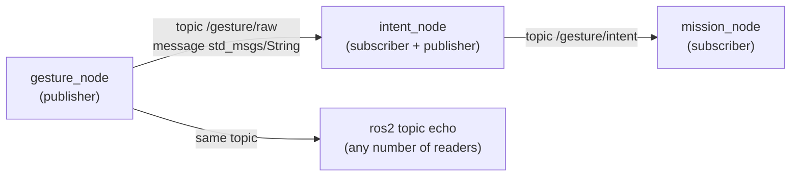
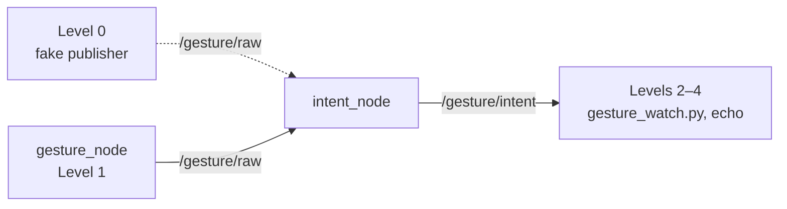

# 🤖 ROS 2 and nodes: run them in Docker or on ROS 2 Jazzy, then build, run and test each node

This is the practical guide. It explains what ROS 2 and nodes are, how to run the gesture nodes in Docker **without installing ROS 2** (§4), how to install ROS 2 Jazzy for the native setup (§5), how to build the workspace (§6), and how to run and **prove** each gesture node that exists so far, by hand (§7–9) and with the automated tests (§10). What each node does inside is in its own note: [[02 Gesture Node]], [[03 Intent Node]], [[04 Mission Node]].

> [!TIP] ROS 2 Jazzy does not have to be installed
> The Docker images contain ROS 2 Jazzy, OpenCV and MediaPipe, and the `Makefile` in `drone/ground/` builds and runs them: `make` starts the nodes, `make smoke` runs their tests inside the images. Install Jazzy (§5) only if you want to build and run the nodes natively, or use the `ros2` tools without a container.

> [!WARNING] Status: DRAFT
> - On 2026-10-19 `intent_node` and `mission_node` were built with `colcon build` on Pop!_OS 24.04 + Jazzy, and the chain fake sender → `intent_node` → `mission_node` ran (test log in §13). At that time the recogniser still sent UDP.
> - Since 2026-10-20 the recogniser is the ROS 2 node `gesture_node`, and `intent_node` reads `/gesture/raw` with `input_source:=topic`.
> - On 2026-10-21 `gesture_node` and `intent_node` were merged into `dev` (#78) with their tests, Docker images, the `Makefile` and CI jobs.
> - On 2026-10-23 `mission_node` was merged into `dev` (#93) at `drone/ground/src/mission_node/`, with its tests, its Docker image, the pretend `flight` service, the `echo` live table and per-node log files (§4, §11). All automated tests pass (§10, §13). A full run with the webcam is not recorded yet.

### Node status (2026-10-23)

| Node | What | Docker | Build (native) | Run | Test |
| :--- | :--- | :---: | :---: | :---: | :---: |
| `gesture_node` | webcam + MediaPipe → `/gesture/raw` | §4 | §6 | §4, §7 | §9, §10 |
| `intent_node` | `/gesture/raw` → filter → `/gesture/intent` | §4 | §6 | §4, §7 | §9, §10 |
| `mission_node` | `/gesture/intent` + `/flight/state` → `/mission/velocity_target` | §4 | §6 | §11, [[04 Mission Node\|04]] §9 | §10, [[04 Mission Node\|04]] §10 |

---

## 📚 1. What ROS is

**ROS** (Robot Operating System) is not an operating system. It is a framework and a set of tools for building a robot program out of many small programs that talk to each other in a standard way. **ROS 2** is the current generation (a rewrite of the original ROS). It provides:

- the way programs find and talk to each other (**topics**, services, actions),
- tools to build, run, inspect and record them (`colcon`, `ros2 topic echo`, `ros2 bag`),
- ready-made messages and libraries (`std_msgs`, `geometry_msgs`, `rclpy`).

| Word | Meaning | In this project |
| :--- | :--- | :--- |
| **Node** | one running program with one job | `gesture_node`, `intent_node`, `mission_node`, `flight_interface` |
| **Topic** | a named channel that carries messages | `/gesture/raw`, `/gesture/intent` |
| **Message** | a typed piece of data on a topic | `std_msgs/msg/String` |
| **Publisher** | a node that sends to a topic | `gesture_node` on `/gesture/raw` |
| **Subscriber** | a node that receives from a topic | `intent_node` on `/gesture/raw` |
| **Package** | a folder of code that builds into nodes | `intent_node` |
| **Workspace** | the folder where packages are built | `drone/ground/ros2_ws` |



A publisher does not know who listens. Any number of nodes, or the `ros2` command, can read the same topic.

---

## 🐢 2. What ROS 2 Jazzy is, and why we use it

ROS 2 comes in **distributions**, each tied to a Ubuntu version. **Jazzy Jalisco** ("Jazzy") was released in May 2024.

| Item | Value |
| :--- | :--- |
| Release type | LTS (long-term support), supported until May 2029 |
| Supported OS | **Ubuntu 24.04 (Noble)**, x86-64 and ARM64 |
| Python | 3.12 (the Ubuntu 24.04 system Python) |

We use it because [[ADR-018 Ground OS and ROS 2|ADR-018]] and the plan ([[Study Plan v2]], Track C) choose Ubuntu 24.04 + Jazzy. It is the LTS release for Ubuntu 24.04, it installs from ready-made `apt` packages, and the same packages cover the Raspberry Pi 5 option in [[Hardware Inventory]]. The instructors confirmed on 2026-10-14 that no distro is mandated.

The Docker images (§4) and CI use the official image `ros:jazzy-ros-base`, which is Ubuntu 24.04 + Jazzy. So every teammate and CI run the same ROS 2, whatever the host OS.

> [!WARNING] Native Jazzy needs Ubuntu 24.04
> There are no Jazzy `apt` packages for Ubuntu 22.04 (that one is for Humble). Run `lsb_release -a` first. If it says 22.04, use Docker (§4), or upgrade or dual-boot to 24.04. Do not mix Humble instructions into this page.

---

## 🧩 3. Why several nodes instead of one big script, and why the recogniser is one of them

| One big script | Several nodes |
| :--- | :--- |
| A bug or freeze anywhere stops everything, including the safety checks | A crash stays inside one node. Its neighbours notice it went silent (timeouts): if `gesture_node` dies, `intent_node` still publishes `HOVER_LAND_REQUEST` |
| Hard to test one part alone | Each node is started, tested and replaced alone: fake the input, read the output (§9, §10) |
| Hard to reuse | The same `/gesture/intent` could drive the simulator, the drone, a car or an arm |
| Hard to see what happened | `ros2 topic echo` shows live data, `ros2 bag` records it for replay |
| Several people editing one file | Five tracks work on separate nodes with agreed message contracts |

The cost is some structure: messages must be defined and nodes started together. For a flight system with a safety story the trade is worth it, and the Module 1 plan expects a ROS 2 node graph. The full chain is in [[00 Gesture Pipeline]] §1.

### Why MediaPipe and OpenCV run in a ROS 2 node

Until 2026-10-20 the recogniser (`gestures.py`) was **not** a node. It ran in its own venv and sent UDP to `intent_node`, to keep MediaPipe's pip packages away from the apt ROS packages ([[ADR-018 Ground OS and ROS 2|ADR-018]]). Now it is `gesture_node`:

- **You can see and record it.** `ros2 topic echo /gesture/raw` shows exactly what the recogniser sends, and `ros2 bag` records `/gesture/raw` and `/gesture/intent` together, so a wrong intent can be traced back to its input and replayed without a camera.
- **You can test `intent_node` without a camera** by publishing on `/gesture/raw` (§9, Level 0, and the tests in §10).
- **No UDP port** to keep free and in sync, and one way to start every node (`ros2 run`, `docker compose`, later one launch file).
- **No extra CPU cost.** The camera is read inside the node with `cv2.VideoCapture(0)`, as before. No image is sent between nodes and `cv_bridge` is not needed, so the clash ADR-018 feared does not happen.
- **The price**, natively, is a venv that sees both ROS 2 and MediaPipe, and building `gesture_node` with that venv's Python (§6). In Docker the gesture image installs MediaPipe next to ROS 2, so there is no venv.

Details, the comparison with a separate camera node, and the open ADR: [[02 Gesture Node]] §2.

---

## 🐳 4. Run without installing ROS 2: Docker and `make`

Since 2026-10-21 (#78) each gesture node has a Docker image built from `ros:jazzy-ros-base`, and `mission_node` too since 2026-10-23 (#93). `drone/ground/docker-compose.yml` starts them, and `drone/ground/Makefile` wraps everything in a few targets.

### 4.1 What you need

| Need | Check |
| :--- | :--- |
| Docker Engine with the Compose plugin | `docker compose version` |
| Your user may run Docker | `docker run --rm hello-world` works without `sudo` (else `sudo usermod -aG docker $USER`, log out and in) |
| A webcam at `/dev/video0` (only for `gesture`) | `ls /dev/video*` |
| An X11 or XWayland display (only for the "Gestures" window) | `echo $DISPLAY` is not empty |
| `make` | `make --version` |

ROS 2, Python 3.12, OpenCV and MediaPipe are **not** needed on the host.

### 4.2 The images and services

| Service | Image | Dockerfile | Starts |
| :--- | :--- | :--- | :--- |
| `gesture` | `rosrangers/gesture:jazzy` | `docker/gesture/Dockerfile` | `gesture_node` (webcam, "Gestures" window, `/gesture/raw`). Adds pip `requirements.txt` (MediaPipe, OpenCV) and the X11/Qt libraries for the window |
| `intent` | `rosrangers/intent:jazzy` | `docker/intent/Dockerfile` | `intent_node` with `input_source:=topic`. Pure `rclpy`, no pip packages |
| `mission` | `rosrangers/mission:jazzy` | `docker/mission/Dockerfile` | `mission_node` ([[04 Mission Node]]). Pure `rclpy`, no pip packages |
| `flight` | `rosrangers/mission:jazzy` (same image) | `docker/mission/Dockerfile` | `fake_flight_state`: a **pretend** `/flight/state` (override on, mask `${MASK:-11}`, airborne `${AIRBORNE:-true}`) until `flight_interface` exists. Never with a real drone |
| `echo` | `rosrangers/echo:jazzy` | `docker/echo/Dockerfile` | `docker/echo/monitor.py`: the live table of the chain. Also the way to use the `ros2` CLI (§4.4) |

- Each node image builds its package with `colcon build` in `/ws`. `docker/entrypoint.sh` sources ROS 2 and `/ws/install/setup.bash`, then runs the command. The node runs directly, not through `ros2 run` (which does not pass SIGTERM on), so `docker stop` stops it cleanly at once with exit code 0. `mission_node` still sends its last zero target.
- All services use `network_mode: host` and `ipc: host`, so DDS discovery works between containers and with a host ROS install. `ROS_DOMAIN_ID` comes from your shell (default 0).
- `gesture` gets `/dev/video0`, `DISPLAY` and `/tmp/.X11-unix`, so OpenCV can open the camera and the window.

**The live table (`echo`).** `docker compose up` shows only this table; the nodes' output goes to log files (below). It is redrawn in place like `top`, only when a value changes:

```text
Ground pipeline monitor   15:10:12   (Ctrl+C to quit)

GESTURE   gesture_node  /gesture/raw                 live
    gesture     INDEX_RIGHT

INTENT    intent_node   /gesture/intent              live
    intent      MOVE_RIGHT
    reason      ok
    gesture     INDEX_RIGHT

MISSION   mission_node  /mission/state               live
    mode        ENGAGED
    why         hold_position
    mask        11
    airborne    True

VELOCITY  mission_node  /mission/velocity_target     live
    fwd/back    0
    left/right  right 0.30 m/s
    up/down     0
    yaw         0
```

A block is `waiting` until its first message and `STALE n s` when its topic stops for more than 1 s. Velocities are in the body frame (left/right is the drone's, [[04 Mission Node|04]] §5.2). Without a terminal (piped, or in the smoke test) it prints one line per change instead. Ctrl+C or SIGTERM exits 0.

**Node logs.** Every node service (not `echo`) writes its output to `drone/ground/logs/<service>/<start time>.log`, every line prefixed with the wall-clock time, and `logs/<service>/latest.log` points to the newest run:

```bash
tail -f logs/mission/latest.log                                          # follow one node live
diff logs/mission/2026-10-23_10-00-00.log logs/mission/latest.log        # compare two runs
docker compose logs -f mission                                           # same output through Docker
```

`logs/` is ignored by Git (only its `.gitignore` is committed). `GROUND_LOG_DIR=./other make` puts the files somewhere else. For this, `entrypoint.sh` stays PID 1 and passes SIGTERM / Ctrl+C on to the node, so lines printed while a node stops still reach the file. Without `LOG_DIR` (CI, the in-image tests) it only runs the command with `exec`, so the node itself is PID 1.

### 4.3 The `make` targets

Run from `drone/ground/`:

| Target | Does |
| :--- | :--- |
| `make` | With Jazzy installed: the venv and the workspace (§6). Then always: `xhost +local:`, `mkdir -p logs` and `docker compose up --build` (gesture, intent, mission, flight, echo). Without Jazzy it prints `ROS 2 Jazzy not found ... running Docker only` |
| `make down` | `docker compose down`: stops the containers |
| `make unit` | the tests that need no ROS (§10) |
| `make test` | with Jazzy: `colcon test` of the three packages + the tests in `drone/tests/ros` (§10). Without Jazzy: `make unit` |
| `make smoke` | the Docker smoke test `docker/smoke_test.sh` (§10) |
| `make clean` | `down` + removes this project's images |
| `make fclean` | `clean` + removes `gesture-venv/`, `ros2_ws/`, everything in `logs/` and Python caches, then runs `docker system prune -af`: `drone/ground/` as it was cloned |
| `make re` | `fclean`, then `make` |

> [!WARNING] `make fclean` prunes all of Docker, not only this project
> `docker system prune -af` removes **every** stopped container, unused network, image that no container uses, and the build cache on your PC, also from other projects. Use `make clean` if you only want this project's images gone.

Every test target ends with a summary, one row per package or test file (`PASS 135/135`), then `ALL PASSED` or `FAILED`, and keeps its full output in `logs/test/`:

| Target | Log file |
| :--- | :--- |
| `make unit` | `logs/test/unit.log` |
| `make test` (with Jazzy) | `logs/test/pkg-test.log` (colcon) and `logs/test/e2e-test.log` (`drone/tests/ros`) |
| `make test` (without Jazzy) | `logs/test/unit.log` (it runs `make unit`) |
| `make smoke` | `logs/test/smoke.log` |

```bash
cd ~/ROSRangers/drone/ground
make              # first build takes a few minutes (MediaPipe), then the five services run
MASK=15 make      # the same, with the pretend flight state on mask 15 (AIRBORNE=false: on the ground)
```

Show a hand to the webcam: in the live table the `INTENT` block changes from `HOVER_LAND_REQUEST` to the intent of your gesture (for example `MOVE_RIGHT`). An open hand engages `mission_node` (`MISSION` → `ENGAGED`), and then the `VELOCITY` block follows your gestures ([[04 Mission Node]] §5). `q` in the "Gestures" window stops `gesture_node`; Ctrl+C stops the rest.

One service per terminal:

```bash
docker compose up --build intent          # terminal 1: filter -> /gesture/intent
docker compose up --build gesture         # terminal 2: camera + "Gestures" window (run `xhost +local:` once per login first)
docker compose run --rm --build echo      # terminal 3: the live table
docker compose up --build mission flight  # terminal 4: mission_node + pretend /flight/state
docker compose down                       # stop everything
```

### 4.4 The `ros2` CLI without a local ROS 2

Every image has ROS 2, so the `echo` service can run any `ros2` command on the same network:

```bash
docker compose run --rm echo ros2 topic list                     # /gesture/intent, /gesture/raw, /mission/..., /flight/state
docker compose run --rm echo ros2 topic echo /gesture/raw std_msgs/msg/String --field data
docker compose run --rm echo ros2 topic hz /gesture/intent       # ~20 Hz
docker compose run --rm echo ros2 node info /intent_node
docker compose run --rm echo ros2 param set /fake_flight_state override_active false   # mission_node -> IDLE
```

Checked on 2026-10-21: with `intent` running, `ros2 topic list` in the `echo` container lists `/gesture/intent` and `/gesture/raw`. Checked on 2026-10-23: `ros2 param set /fake_flight_state override_active false` through the `echo` image puts `mission_node` in `IDLE (override_off)`. Every `ros2 ...` command on the following pages works this way. The watcher `~/gesture_watch.py` (§9) needs a local Jazzy.

### 4.5 Changing the code

The source is copied into the images when they are built. After editing a `.py` file, `make` (or `docker compose up --build`) rebuilds only the changed image. For quick edit-run loops, the native setup (§6, `--symlink-install`) needs no rebuild.

---

## 📦 5. Install ROS 2 Jazzy (native setup only)

Skip this section if you only use Docker (§4). Source: the official *Ubuntu (deb packages)* page of the Jazzy docs (checked 2026-10-14). If a command fails, compare with that page.

### ✅ Checklist

- [ ] 5.1 Check Ubuntu 24.04 and a UTF-8 locale
- [ ] 5.2 Add the ROS 2 apt repository
- [ ] 5.3 Install ROS 2 and the build tools
- [ ] 5.4 Load the environment in every terminal
- [ ] 5.5 Initialise rosdep
- [ ] 5.6 Run the talker/listener demo
- [ ] 5.7 Set your own `ROS_DOMAIN_ID`

### 5.1 Check the system

```bash
lsb_release -a        # must say 24.04 (Noble)
locale                # must show UTF-8
```

If the locale is not UTF-8:

```bash
sudo apt update && sudo apt install locales
sudo locale-gen en_US en_US.UTF-8
sudo update-locale LC_ALL=en_US.UTF-8 LANG=en_US.UTF-8
export LANG=en_US.UTF-8
```

### 5.2 Add the ROS 2 repository

```bash
sudo apt install software-properties-common
sudo add-apt-repository universe

sudo apt update && sudo apt install curl -y
export ROS_APT_SOURCE_VERSION=$(curl -s https://api.github.com/repos/ros-infrastructure/ros-apt-source/releases/latest | grep -F "tag_name" | awk -F\" '{print $4}')
curl -L -o /tmp/ros2-apt-source.deb "https://github.com/ros-infrastructure/ros-apt-source/releases/download/${ROS_APT_SOURCE_VERSION}/ros2-apt-source_${ROS_APT_SOURCE_VERSION}.$(. /etc/os-release && echo ${UBUNTU_CODENAME:-${VERSION_CODENAME}})_all.deb"
sudo dpkg -i /tmp/ros2-apt-source.deb
```

### 5.3 Install ROS 2 and the build tools

```bash
sudo apt update && sudo apt upgrade
sudo apt install ros-jazzy-desktop     # ROS, RViz, demos, tutorials (recommended)
sudo apt install ros-dev-tools         # colcon, rosdep and other build tools
sudo apt install python3-pytest        # for make test / colcon test
```

`ros-jazzy-ros-base` is the smaller install (no GUI tools). It is enough to run the gesture nodes; the Docker images use it.

### 5.4 Load the environment

Every terminal must load ROS 2 before any `ros2` command works:

```bash
source /opt/ros/jazzy/setup.zsh
```

To do it automatically in new terminals:

```bash
echo "source /opt/ros/jazzy/setup.zsh" >> ~/.zshrc
```

> [!NOTE] Using bash?
> Replace `setup.zsh` with `setup.bash` and `~/.zshrc` with `~/.bashrc` everywhere on this page. The `Makefile` itself always uses bash.

### 5.5 Initialise rosdep (once)

```bash
sudo rosdep init
rosdep update
```

### 5.6 Prove the install works

Terminal 1: `ros2 run demo_nodes_cpp talker`. Terminal 2: `ros2 run demo_nodes_py listener`. The listener prints the talker's messages: one node publishes to a topic, another receives it. `ros2 doctor` gives a summary of the setup.

### 5.7 Keep your lab neighbours out of your topics

ROS 2 nodes on the same network find each other automatically, so a teammate's node could appear on your topics. In every terminal (or `~/.zshrc`):

```bash
export ROS_DOMAIN_ID=42                         # your own number, 0-101, different from teammates
export ROS_AUTOMATIC_DISCOVERY_RANGE=LOCALHOST  # Jazzy: only talk to this machine
```

`docker compose` passes `ROS_DOMAIN_ID` to the containers, so set it before `make` too. The tests use their own domains (81–85 and 87–91, the smoke test 86), so they never mix with a running pipeline.

---

## 🏗️ 6. The workspace and the build (native setup)

### 6.1 With `make` (recommended)

```bash
cd ~/ROSRangers/drone/ground
make ws          # or `make`, which also starts the Docker containers afterwards
```

`make ws` makes two folders inside `drone/ground/`, both ignored by Git (`.gitignore`) and removed by `make fclean`:

```text
drone/ground/
├── gesture-venv/   # Python 3.12 venv, --system-site-packages, requirements.txt installed (MediaPipe, OpenCV)
└── ros2_ws/
    ├── src/
    │   ├── gesture_node -> ../../src/gesture_node   (symlink)
    │   ├── intent_node  -> ../../src/intent_node    (symlink)
    │   └── mission_node -> ../../src/mission_node   (symlink)
    ├── build/      # generated by colcon build
    ├── install/    # generated: what `source install/setup.zsh` loads
    └── log/        # generated
```

| Step `make ws` does | Same as by hand |
| :--- | :--- |
| `python3.12 -m venv --system-site-packages gesture-venv`, `pip install -r src/gesture_node/requirements.txt` | §6.2 |
| symlinks in `ros2_ws/src/` (redone when the `Makefile` changes, so an old workspace gets new packages), then `colcon build --symlink-install --packages-select intent_node` and the same for `mission_node`, with the system Python | §6.3 |
| `python3 -m colcon build --symlink-install --packages-select gesture_node` with the venv active | §6.4 |
| checks that the first line of `ros2_ws/install/gesture_node/lib/gesture_node/gesture_node` names `gesture-venv`, else stops with `gesture_node was not built with gesture-venv's Python` | §6.4 `head -1` |

It only rebuilds what changed: `requirements.txt` (venv), `setup.py` or `package.xml` (that package). Edits to `.py` files need no rebuild. To force a rebuild of one package, delete its stamp (`rm ros2_ws/.gesture_node`) and run `make ws` again.

Then, in every terminal:

```bash
source /opt/ros/jazzy/setup.zsh
source ~/ROSRangers/drone/ground/ros2_ws/install/setup.zsh
ros2 pkg list | grep -E "gesture_node|intent_node|mission_node"      # must print all three
```

> [!NOTE] Why the workspace is in `drone/ground/` but not in Git
> - `build/`, `install/` and `log/` are generated, large and specific to one machine and one ROS version, so they are never committed (`.gitignore` lists `drone/ground/gesture-venv/` and `drone/ground/ros2_ws/`).
> - The **source** stays in `drone/ground/src/`. `ros2_ws/src/` only holds symlinks to it. With `--symlink-install`, editing a Python file takes effect without rebuilding.
> - Every teammate (and CI) builds their own workspace from the same repo, so results do not depend on someone's leftover build folder. CI builds with `colcon build --base-paths drone/ground/src` instead.
> - Before 2026-10-21 these pages used `~/ros2_ws` and `~/gesture-venv` in the home folder. Those still work if you already have them, but the commands on these pages use the `make` folders.

### 6.2 By hand: the MediaPipe venv (once)

`gesture_node` needs Python **3.12** with MediaPipe **and** access to the apt ROS packages, and some system packages for the camera and the window ([[02 Gesture Node]] §10):

```bash
sudo apt install python3.12-venv python3-pip libgl1 libglib2.0-0 v4l-utils libxcb-cursor0

cd ~/ROSRangers/drone/ground
python3.12 -m venv --system-site-packages gesture-venv
gesture-venv/bin/pip install --upgrade pip
gesture-venv/bin/pip install -r src/gesture_node/requirements.txt
```

Check it, with ROS loaded:

```bash
source /opt/ros/jazzy/setup.zsh
source ~/ROSRangers/drone/ground/gesture-venv/bin/activate
python3 -c "import mediapipe, cv2, yaml, rclpy; print('ok', mediapipe.__version__)"   # ok 0.10.21
deactivate
```

- `--system-site-packages` is required. Without it the venv can't see `yaml` and the other apt packages `rclpy` needs.
- Already have a venv without it? Set `include-system-site-packages = true` in its `pyvenv.cfg` (that is what the flag writes).

### 6.3 By hand: the workspace, `intent_node` and `mission_node`

```bash
source /opt/ros/jazzy/setup.zsh                      # no venv active
cd ~/ROSRangers/drone/ground
mkdir -p ros2_ws/src
ln -sfn ../../src/intent_node  ros2_ws/src/intent_node    # symlinks, not copies
ln -sfn ../../src/gesture_node ros2_ws/src/gesture_node
ln -sfn ../../src/mission_node ros2_ws/src/mission_node

cd ros2_ws
rosdep install --from-paths src --ignore-src -r -y
colcon build --symlink-install --packages-select intent_node mission_node
```

- `ros2_ws/src/intent_node/package.xml` must exist (through the symlink), not one folder deeper.
- Setuptools deprecation warnings are common and harmless if the build ends with `Summary: 2 packages finished`.

### 6.4 By hand: `gesture_node` with the venv's Python

`ros2 run` starts the script colcon wrote, and its first line names the Python that **ran colcon**. A plain `colcon build` writes `/usr/bin/python3`, which has no MediaPipe, so `ros2 run gesture_node gesture_node` fails with `No module named 'mediapipe'` even with the venv active (seen 2026-10-20). Build this one package from the venv:

```bash
source /opt/ros/jazzy/setup.zsh
source ~/ROSRangers/drone/ground/gesture-venv/bin/activate
cd ~/ROSRangers/drone/ground/ros2_ws
python3 -m colcon build --symlink-install --packages-select gesture_node
deactivate

source install/setup.zsh
head -1 install/gesture_node/lib/gesture_node/gesture_node    # must name .../gesture-venv/bin/python3
ros2 pkg list | grep -E "gesture_node|intent_node|mission_node"   # must print all three
```

| After you change | Rebuild |
| :--- | :--- |
| a Python file (`.py`) | nothing (`--symlink-install`) natively; `make` rebuilds the Docker image |
| `setup.py`, `setup.cfg` or `package.xml` of `intent_node` or `mission_node` | `make ws`, or §6.3 build line |
| a **new** launch file in `mission_node` | `rm ros2_ws/.mission_node && make ws` (launch files are installed by the build) |
| the same files of `gesture_node`, or `requirements.txt` | `make ws`, or §6.4, **always from the venv** |
| a plain `colcon build` of everything by mistake | `rm ros2_ws/.gesture_node && make ws`, or §6.4 again (it reset the `gesture_node` shebang) |

## ▶️ 7. Run the pipeline natively

This is the native way, after §6. The Docker way is §4.3 (`make`). Every terminal starts with the two `source` lines. Start `intent_node` first, so it is listening when the first gestures arrive.

```bash
source /opt/ros/jazzy/setup.zsh
source ~/ROSRangers/drone/ground/ros2_ws/install/setup.zsh
```

| Terminal | Python | Command |
| :---: | :--- | :--- |
| 1 | system | `ros2 run intent_node intent_node --ros-args -p input_source:=topic` |
| 2 | venv (via the shebang, §6.4) | `ros2 run gesture_node gesture_node` (on Wayland: `QT_QPA_PLATFORM=xcb ros2 run gesture_node gesture_node`) |
| 3 | system | `ros2 topic echo /gesture/intent --field data` |

- `input_source:=topic` is required: without it `intent_node` listens on UDP 5005, and nothing sends there any more ([[03 Intent Node]] §7).
- Press `q` in the "Gestures" window to stop `gesture_node`. `q`, Ctrl+C and SIGTERM are a clean stop (exit code 0). No camera, or the camera lost: an error log and exit code 1.

### What to expect

| Check | What you should see |
| :--- | :--- |
| `intent_node` starts | `Listening for gesture_node on /gesture/raw; publishing JSON strings on /gesture/intent at 20 Hz`, then `Intent -> HOVER_LAND_REQUEST (reason: no_packets_yet ...)` and a `No packets` warning every 5 s |
| `gesture_node` starts | `Reading camera 0 with MediaPipe; publishing JSON strings on /gesture/raw`. The "Gestures" window shows the webcam. If it is black, check `ls /dev/video*` |
| Hand tracking | landmarks drawn on your hand; the gesture name printed in terminal 2 when it changes |
| Link works | terminal 1 logs `First packet from gesture_node`, then `Recogniser link OK: ~50 packets in the last 5 s` |
| Intent | about 0.4 s after a stable gesture, terminal 1 logs `Intent -> ...` and terminal 3 shows it |
| Safety fallback | hand out of view briefly → `NEUTRAL`. Out of view for 2 s, or `gesture_node` stopped → `HOVER_LAND_REQUEST` |

---

## ⌨️ 8. The `ros2` command line and `rclpy`

`ros2` is one program with sub-commands. It talks to nodes that are already running, so you can inspect and control them without changing their code. Every terminal needs the two `source` lines first. Without a local ROS 2, put `docker compose run --rm echo` in front of the command (§4.4).

| Command | What it does | Example |
| :--- | :--- | :--- |
| `ros2 run <package> <executable>` | Starts a node | `ros2 run gesture_node gesture_node` |
| `ros2 pkg list` | Lists installed packages | `ros2 pkg list \| grep gesture_node` |
| `ros2 node list` | Lists running nodes | shows `/gesture_node`, `/intent_node` |
| `ros2 node info <node>` | Shows a node's topics and parameters | `ros2 node info /intent_node` |
| `ros2 topic list` | Lists all topics | shows `/gesture/raw`, `/gesture/intent` |
| `ros2 topic echo <topic>` | Prints messages as they arrive | `ros2 topic echo /gesture/raw --field data` |
| `ros2 topic info <topic>` | Shows the type, publishers and subscribers | `ros2 topic info /gesture/raw` (1 publisher, 1 subscriber) |
| `ros2 topic hz <topic>` | Measures the publish rate | `/gesture/raw` ~10 Hz, `/gesture/intent` ~20 Hz |
| `ros2 topic pub <topic> <type> <data>` | Publishes a message by hand | fake one gesture on `/gesture/raw` (§9, Level 0) |
| `ros2 param list <node>` | Lists a node's parameters | `ros2 param list /intent_node` |
| `ros2 param get <node> <name>` | Reads a parameter | `ros2 param get /intent_node input_source` |
| `ros2 param set <node> <name> <value>` | Changes a parameter while running | see the warning below |
| `ros2 bag record <topics>` / `ros2 bag play <file>` | Records topics and replays them | record `/gesture/raw` + `/gesture/intent`, replay without a camera (§9, Level 5) |
| `ros2 launch <package> <file>` | Starts several nodes from one file | `ros2 launch mission_node mission_demo.launch.py` ([[04 Mission Node]] §9) |
| `ros2 pkg executables <package>` | Lists a package's executables | `ros2 pkg executables mission_node` |
| `ros2 service` / `ros2 action` | Same idea for services and actions | not used yet |

Add `--help` to any command, for example `ros2 topic --help`.

> [!WARNING] Parameters are safety settings
> `ros2 param set` changes a value while the node runs, but `intent_node` reads its parameters only at start-up. To use new values, restart it with `--ros-args -p ...` ([[03 Intent Node]] §7). Agree changes with the team first.

### The CLI and `rclpy`

`rclpy` is the Python library the nodes are written with. It creates the node, its publishers, subscribers, timers and parameters, and `rclpy.spin()` keeps it running. `rclpy` has no commands of its own: you see its effects with `ros2`.

| In the code (`rclpy`) | What you see with `ros2` |
| :--- | :--- |
| `super().__init__("intent_node")` | the name in `ros2 node list` |
| `declare_parameter(...)` / `get_parameter(...)` | `ros2 param list` / `get`, and `--ros-args -p` |
| `create_publisher(String, topic, 10)` | `ros2 topic list`, `info` and `echo` |
| `create_subscription(String, "/gesture/raw", ...)` | the subscriber count in `ros2 topic info /gesture/raw` |
| `create_timer(...)` | the 20 Hz rate in `ros2 topic hz` |
| `get_logger().info(...)` | the messages in the terminal where the node runs |
| `executor.spin_once(...)` in a loop (`intent_node`), `executor.spin()` in a thread (`gesture_node`) | the node stays alive until Ctrl+C or SIGTERM, then exits 0 |

`gesture_node` spins in a background thread, because its camera loop owns the main thread ([[02 Gesture Node]] §4). `flight_interface` will be the first lifecycle node.

---

## 🧪 9. Test `gesture_node` and `intent_node`: what is published on `/gesture/raw` and `/gesture/intent`

Work through the levels in order. Each one proves one link of the chain, so a failure tells you where to look. The commands are the native ones; in Docker, start the nodes as in §4.3 and run each `ros2 ...` command through `docker compose run --rm echo` (§4.4). Run the automated tests (§10) first: they check most of these levels without a camera.



### The watcher: both topics in one terminal

`ros2 topic echo` prints every message (10–20 per second), so changes scroll away. This small script subscribes to **both** topics and prints a line only when something **changes**, with the time since it started. Save it once:

```bash
cat > ~/gesture_watch.py <<'EOF'
"""Print /gesture/raw and /gesture/intent, one line per change."""
import json
import time

import rclpy
from std_msgs.msg import String

START = time.monotonic()
last = {}


def watch(name, key):
    def callback(msg):
        try:
            data = json.loads(msg.data)
        except json.JSONDecodeError:
            data = {}
        value = tuple(data.get(k) for k in key)
        if last.get(name) != value:
            last[name] = value
            print(f"{time.monotonic() - START:7.2f} s  {name:<7} {msg.data}", flush=True)

    return callback


rclpy.init()
node = rclpy.create_node("gesture_watch")
node.create_subscription(String, "/gesture/raw", watch("raw", ["gesture"]), 10)
node.create_subscription(String, "/gesture/intent", watch("intent", ["intent", "reason"]), 10)
try:
    rclpy.spin(node)
except KeyboardInterrupt:
    pass
EOF
```

Run it with the system Python (no venv): `python3 ~/gesture_watch.py`. Example output:

```text
   0.21 s  intent  {"intent":"HOVER_LAND_REQUEST","gesture":null,"reason":"no_packets_yet","t":null,"xy":null}
   3.05 s  raw     {"gesture": "INDEX_RIGHT", "t": 1792483203.1, "xy": null}
   3.06 s  intent  {"intent":"NEUTRAL","gesture":null,"reason":"unconfirmed","t":1792483203.1,"xy":null}
   3.46 s  intent  {"intent":"MOVE_RIGHT","gesture":"INDEX_RIGHT","reason":"ok","t":1792483203.5,"xy":null}
```

The gap between the `raw` line and the `ok` intent line is the stability filter (5 packets, ~0.4 s, [[03 Intent Node]] §5).

### Level 0: no camera (fake `/gesture/raw` → `intent_node`)

Proves that `intent_node` reads the topic and applies the rules, without MediaPipe or a webcam.

| Terminal | Command |
| :---: | :--- |
| 1 | `ros2 run intent_node intent_node --ros-args -p input_source:=topic` |
| 2 | `python3 ~/gesture_watch.py` |
| 3 | the fake camera below |

**One gesture by hand** (quick check, 10 Hz like the real keep-alive):

```bash
ros2 topic pub -r 10 /gesture/raw std_msgs/msg/String "{data: '{\"gesture\": \"INDEX_RIGHT\", \"t\": 0, \"xy\": null}'}"
```

Expected: `MOVE_RIGHT` / `ok` about 1 s after starting (the first second is spent connecting). Ctrl+C stops the packets: `NEUTRAL` / `no_hand` after 0.3 s, then `HOVER_LAND_REQUEST` / `no_packets` after 2 s.

**The scripted sequence.** It uses `gesture_node`'s own `send_gesture()` (same JSON, same keep-alive), but publishes from a small script instead of the camera. It does not import MediaPipe, so the system Python is fine:

```bash
python3 - <<'EOF'
import time

import rclpy
from std_msgs.msg import String

from gesture_node import gesture_sender

rclpy.init()
node = rclpy.create_node("fake_camera")
pub = node.create_publisher(String, "/gesture/raw", 10)
gesture_sender.set_publisher(lambda text: pub.publish(String(data=text)))
time.sleep(1.0)  # let intent_node discover this publisher


def hold(gesture, seconds):
    end = time.monotonic() + seconds
    while time.monotonic() < end:
        gesture_sender.send_gesture(gesture)
        time.sleep(1 / 30)  # pretend 30 FPS


hold("OPEN_HAND_UP", 2)
hold("INDEX_RIGHT", 3)
hold(None, 0.6)  # short gap
hold("CLOSED_HAND", 2)
hold(None, 3)  # long gap
hold("INDEX_LEFT", 2)
node.destroy_node()
rclpy.shutdown()
EOF
```

About 13 s of scripted input should give this sequence in the watcher (`intent` / `reason`):

| Time | Fake input on `/gesture/raw` | Expected on `/gesture/intent` |
| :--- | :--- | :--- |
| before | nothing | `HOVER_LAND_REQUEST` / `no_packets_yet` |
| 0 s | `OPEN_HAND_UP` starts | `NEUTRAL` / `unconfirmed`, then `HOLD_POSITION` / `ok` after ~0.4 s |
| 2 s | `INDEX_RIGHT` | `MOVE_RIGHT` / `ok` after ~0.4 s |
| 5 s | `null` for 0.6 s | `NEUTRAL` / `no_hand` |
| 5.6 s | `CLOSED_HAND` | `NEUTRAL` / `unconfirmed`, then `STOP_HOVER` / `ok` |
| 7.6 s | `null` for 3 s | `NEUTRAL` / `no_hand`, then `HOVER_LAND_REQUEST` / `no_hand_long` after 2 s |
| 10.6 s | `INDEX_LEFT` | `NEUTRAL` / `unconfirmed`, then `MOVE_LEFT` / `ok` |
| end | script stops | `NEUTRAL`, then `HOVER_LAND_REQUEST` / `no_packets` |

**Pass:** the watcher shows this sequence, and terminal 1 logs `First packet from gesture_node`.

### Level 1: does `gesture_node` publish the right thing on `/gesture/raw`?

Start only `gesture_node` (`intent_node` is not needed for this level):

```bash
ros2 run gesture_node gesture_node                      # terminal 1
ros2 topic echo /gesture/raw --field data               # terminal 2
ros2 topic hz /gesture/raw                              # terminal 3
ros2 topic info /gesture/raw                            # once: type std_msgs/msg/String, 1 publisher
```

| Check | Pass |
| :--- | :--- |
| Format | every message is `{"gesture": ..., "t": ..., "xy": null}` |
| Gesture names | the name matches your hand and the name printed by `gesture_node` ([[02 Gesture Node\|02]] §7) |
| No hand | `"gesture": null` when the hand leaves the picture (it never just stops) |
| Rate | ~10 Hz while the gesture stays the same; `hz` never drops to 0 while the window is open |
| Stop | `q` in the window → `hz` shows no new messages |

**If nothing prints:** check the topic name (`ros2 topic list`), the `ROS_DOMAIN_ID` in both terminals, and that the window shows the camera.

### Level 2: does `intent_node` receive it?

Start `intent_node` (with `input_source:=topic`), then `gesture_node`. The `intent_node` log must show:

```text
[INFO] [intent_node]: First packet from gesture_node: {'gesture': 'INDEX_RIGHT', ...}
[INFO] [intent_node]: Recogniser link OK: 52 packets in the last 5 s, last gesture seen: INDEX_RIGHT
```

`ros2 topic info /gesture/raw` must show 1 publisher and 1 subscriber. **Pass:** the first-packet line once, then the link report every 5 s with roughly 50 packets. `No packets from gesture_node in the last 5 s` → `gesture_node` is not publishing (back to Level 1). `No packets from gestures.py` → `intent_node` is on UDP (missing `input_source:=topic`).

### Level 3: does `intent_node` publish the right intent on `/gesture/intent`?

Run `python3 ~/gesture_watch.py` next to the two nodes. Hold each gesture of the vocabulary ([[00 Gesture Pipeline]] §3) for 1 s:

| Show | `raw` line | `intent` line (`intent` / `reason`) |
| :--- | :--- | :--- |
| Open hand, fingers up | `OPEN_HAND_UP` | `HOLD_POSITION` / `ok` |
| Fist | `CLOSED_HAND` | `STOP_HOVER` / `ok` |
| Thumb up / down | `THUMB_UP` / `THUMB_DOWN` | `CLIMB_SLOWLY` / `DESCEND_SLOWLY_LAND_REQUEST` |
| Index left / right | `INDEX_LEFT` / `INDEX_RIGHT` | `MOVE_LEFT` / `MOVE_RIGHT` |
| Index + middle left / right | `INDEX_MIDDLE_LEFT` / `INDEX_MIDDLE_RIGHT` | `YAW_LEFT` / `YAW_RIGHT` |
| Any other pose | e.g. `INDEX_PINKY_UP` | `NEUTRAL` / `unmapped_gesture` |

**Pass:** each `intent` line follows its `raw` line within about 0.5 s. `ros2 topic hz /gesture/intent` stays at ~20 Hz the whole time, even with no hand. The picture is mirrored, so left and right are **your** left and right.

### Level 4: the safety behaviour

| Test | Expected on `/gesture/intent` |
| :--- | :--- |
| Show `INDEX_RIGHT` until `MOVE_RIGHT`, remove the hand for 1 s, show `CLOSED_HAND` | `NEUTRAL` / `no_hand` during the gap, `NEUTRAL` / `unconfirmed` when the hand returns (**never** `MOVE_RIGHT` again), then `STOP_HOVER` |
| Hold `INDEX_RIGHT`, hide the hand for 0.1 s, show it again | stays `MOVE_RIGHT` |
| Hide the hand for 3 s | `NEUTRAL`, then `HOVER_LAND_REQUEST` / `no_hand_long` |
| Stop `gesture_node` (`q` or Ctrl+C) while holding a gesture | `NEUTRAL` within 0.3 s, `HOVER_LAND_REQUEST` / `no_packets` after 2 s |
| Start `intent_node` **without** `input_source:=topic` | `HOVER_LAND_REQUEST` / `no_packets_yet` forever: the safe default |

If any of these does not end in `NEUTRAL` or `HOVER_LAND_REQUEST`, stop and report it with the Bug form.

### Level 5: keep evidence

```bash
ros2 bag record -o gesture_proof /gesture/raw /gesture/intent   # Ctrl+C to stop
ros2 bag info gesture_proof                                      # message count and duration per topic
python3 ~/gesture_watch.py > gesture_proof.log                   # plain-text copy, one line per change
```

To replay without a camera, stop `gesture_node`, keep `intent_node` running and play **only** the input; `intent_node` recomputes the intents:

```bash
ros2 bag play gesture_proof --topics /gesture/raw
```

Attach the bag info and the log to the GitHub issue (Test session form).

---

## 🤖 10. Automated tests: `make unit`, `make test`, `make smoke` and CI

The levels of §9 are checked by hand with a webcam. Most of them are also automated, with no camera: a fake camera replaces OpenCV and MediaPipe's detection, and the rest is the real code. Run them before every PR into `dev`.

### 10.1 The three commands

From `drone/ground/`:

| Command | Needs | What runs | Result on 2026-10-23 (Bruno's PC, `dev` after #93) |
| :--- | :--- | :--- | :--- |
| `make unit` | Python 3 only | `python3 -m unittest discover` in `src/gesture_node`, `src/intent_node`, `src/mission_node` and `../tests/ros`. Tests that need `rclpy`, the ROS launch packages or the real MediaPipe are **skipped** | 56 + 48 + 135 + 47 = 286 tests, 173 passed, 113 skipped, `ALL PASSED` |
| `make test` | ROS 2 Jazzy (§5). Builds the workspace first (`make ws`). Without Jazzy it runs `make unit` | `pkg-test`: `colcon test --packages-select gesture_node intent_node mission_node` with the venv's Python and `colcon test-result --verbose`; then `e2e-test`: `python3 -m pytest ../tests/ros -v`. Both parts run even if the first fails | `239 tests, 0 errors, 0 failures, 0 skipped`, then `47/47` |
| `make smoke` | Docker only (§4) | `docker/smoke_test.sh`, six steps (§10.3) | `PASS: images, in-image tests, gesture -> intent -> mission across containers, monitor, clean stops, node logs` |

Each target ends with a summary (one row per package or test file, passed/total, skipped and failed counts) and keeps its full output in `logs/test/` (`unit.log`, `pkg-test.log` + `e2e-test.log`, `smoke.log`, §4.3):

```text
=================== summary: make unit (no ROS needed) ===================
  gesture_node                       PASS    39/56    17 skipped
  intent_node                        PASS    27/48    21 skipped
  mission_node                       PASS    83/135   52 skipped
  drone/tests/ros                    PASS    24/47    23 skipped
ALL PASSED
```

> [!TIP] Without ROS 2 on your PC
> `make unit` and `make smoke` together run every **package** test: the ROS tests that `make unit` skips run inside the images in `make smoke`, with none skipped. The ROS tests in `drone/tests/ros/` (pipeline, launch, `echo` table, entrypoint) only run with `make test` or in CI.

Run one package's tests natively (ROS sourced, from the package folder): `python3 -m unittest discover -s test -v`, or one file: `python3 -m unittest test.test_intent_node_ros -v`.

### 10.2 What each test file checks

| File | Kind | Needs | Checks |
| :--- | :--- | :--- | :--- |
| `src/intent_node/test/test_gesture_filter.py` | unit | nothing | the filter rules of [[03 Intent Node]] §5: 5 consecutive packets, no replay after a gap, short dropouts, `NEUTRAL` / `HOVER_LAND_REQUEST` timeouts, unknown gestures, no gesture maps to arm/disarm/override, value clean-up |
| `src/intent_node/test/test_intent_node_ros.py` | node | `rclpy` | the real `IntentNode` on real topics, both inputs (`/gesture/raw` and UDP): start-up `HOVER_LAND_REQUEST`, `MOVE_RIGHT` after 5 packets (not 4), silence → `NEUTRAL` → `HOVER_LAND_REQUEST`, bad datagrams ignored, ~20 Hz JSON output, link reports, a second node on the same UDP port fails |
| `src/intent_node/test/test_intent_node_process.py` | process | `rclpy` | `intent_node` as a program: Ctrl+C, Ctrl+C twice (as `ros2 launch` forwards one more) and SIGTERM (`docker stop`) exit 0 within seconds with no traceback; unknown `input_source` or a busy UDP port exit 1 with a FATAL log line |
| `src/gesture_node/test/test_hand_processing.py` | unit | nothing (2 tests need the real MediaPipe) | `recognize()` for every gesture of the vocabulary from built landmark sets, at any size and position; the angle, thumb and direction maths; `detect_gesture()` with a fake MediaPipe |
| `src/gesture_node/test/test_gesture_sender.py` | unit | nothing | the JSON format, send on change, the 0.1 s keep-alive (10 Hz at camera frame rates, no burst after a stall), nothing sent without a publisher |
| `src/gesture_node/test/test_gestures_loop.py` | unit | nothing | the camera loop with a fake OpenCV: camera 0 opened, frame mirrored then converted to RGB, one `send_gesture()` per frame, only changes printed, why the loop ends (`q`, stop, no camera, camera lost), camera and window always released |
| `src/gesture_node/test/test_gesture_node_ros.py` | node | `rclpy` | the real `GestureNode` without the camera loop: JSON on `/gesture/raw` (or `raw_topic`), `null` for no hand, keep-alive, nothing after `destroy_node()` or shutdown |
| `src/gesture_node/test/test_gesture_node_process.py` | process | `rclpy` | `gesture_node`'s real `main()` through `test/fake_camera.py`: `q`, Ctrl+C, Ctrl+C twice and SIGTERM exit 0; no camera / camera lost exit 1 with an error log; the gesture arrives on `/gesture/raw` |
| `drone/tests/ros/test_gesture_contract.py` | unit | nothing | every gesture name in `intent_node`'s table can really be produced by `gesture_node`'s `recognize()`, so a rename on one side can't make the drone silently ignore a gesture |
| `drone/tests/ros/test_gesture_pipeline.py` | pipeline | `rclpy` | landmarks → `recognize()` → `send_gesture()` → `gesture_node` → `/gesture/raw` → `intent_node` (default timeouts) → `/gesture/intent`: every gesture reaches its intent; hand lost → `NEUTRAL` → `HOVER_LAND_REQUEST`; recogniser stops → `HOVER_LAND_REQUEST` |
| `src/mission_node/test/` (4 files, 135 tests) | unit, node, process, launch | `rclpy` except the 83 logic tests | every rule of `mission_node`, the real node on real topics, clean stops, the launch files: [[04 Mission Node]] §10.2 |
| `drone/tests/ros/test_mission_contract.py` | unit | nothing | the real `intent_node` filter feeding the real `MissionLogic`: same intents and reasons on both sides, `fake_intent` speaks `intent_node`'s format |
| `drone/tests/ros/test_mission_pipeline.py` | pipeline | `rclpy` | the test above, one link further: … → `/gesture/intent` → `mission_node` (+ `fake_flight_state`) → `/mission/velocity_target`: no motion before the open hand, index moves, mask 11 never climbs, fist stops, hand or recogniser lost → land request |
| `drone/tests/ros/test_mission_launch.py` | launch | `rclpy`, `ros2 launch` | `mission_with_gestures.launch.py` end to end with pretend `/gesture/raw`; Ctrl+C exits 0 and leaves no node running |
| `drone/tests/ros/test_monitor.py` | unit + program | `rclpy` | the `echo` live table (§4.2): what each block shows, bad JSON never crashes it, the text only changes when a message changes it, one line per change without a terminal, synchronized frames on a terminal, cursor back and exit 0 on Ctrl+C / SIGTERM |
| `drone/tests/ros/test_entrypoint.py` | program | bash, ROS 2 at `/opt/ros/jazzy` | `docker/entrypoint.sh` without Docker: without `LOG_DIR` it only runs the command; with it, every line timestamped in `logs/<service>/`, `latest.log`, one file per run, files the host user can delete, SIGTERM and SIGINT reach the command and its last lines are kept |

`test/fake_camera.py` (in `gesture_node`) runs the real `gesture_node` with a fake camera that "sees" `INDEX_RIGHT` at ~30 FPS: `python3 fake_camera.py run|quit|no_camera|camera_lost`. The process tests and the smoke test use it.

The requirement IDs of `intent_node` (REQ-SAF-019, REQ-SAF-020, REQ-SW-002) name the tests that check them: [[03 Intent Node]] §10. Those of `mission_node` (REQ-SAF-017, REQ-SAF-018, REQ-CTL-001, REQ-SW-001): [[04 Mission Node]] §12.

### 10.3 The Docker smoke test

`docker/smoke_test.sh` (`make smoke`, CI job `ground-docker`) checks the images, not only the code:

1. Builds `gesture`, `intent`, `mission` and `echo`.
2. Runs each package's tests **inside its own image** with `REQUIRE_ROS_TESTS=1`, and fails if any test is skipped: the image's own OpenCV, MediaPipe and ROS must work (56 + 48 + 135 tests).
3. Starts `intent`, `mission` and `flight` with Compose, and `gesture_node`'s real `main()` with the fake camera in the gesture image: `MOVE_RIGHT` on `/gesture/intent` within 60 s; `mission_node` shows `MOVE_RIGHT` on `/mission/state` but **never** `ENGAGED` (nobody showed `HOLD_POSITION`); the `echo` image's monitor shows intent `MOVE_RIGHT` and mission `READY`.
4. `docker stop` on the gesture container: it exits 0 at once, `intent_node` falls back to `HOVER_LAND_REQUEST` (`no_packets`) and `mission_node` (airborne, pretend flight state) goes to `LAND_REQUEST`, within 15 s each.
5. `docker stop` on the intent, mission, flight, echo and monitor containers: all stop at once (exit code 0; the two `ros2 topic echo` containers 15).
6. Node logs: `logs/smoke/<service>/latest.log` exists for intent, mission and flight, every line timestamped, with the expected lines in it (`Mode -> LAND_REQUEST (no_packets)` for mission). A container that prints 5000 lines while it stops loses none of them.

It uses its own Compose project (`ground-smoke`), `ROS_DOMAIN_ID=86` and log folder `logs/smoke/`, so a running `make` stack is neither stopped nor mixed in, and its logs stay as they were. With `SMOKE_LOG_DIR=dir` it also saves each container's full log there. The summary at the end has one row per in-image test run and the steps reached (`steps PASS 6/6`).

### 10.4 Skipped tests and `REQUIRE_ROS_TESTS`

Tests that need `rclpy` are skipped when ROS 2 is not sourced, so `make unit` works on any PC. With `REQUIRE_ROS_TESTS=1` a missing `rclpy` is a **failure** instead. CI and the smoke test set it, so a broken ROS install can never pass as "all skipped". Each ROS test uses its own `ROS_DOMAIN_ID` (81–85, 87–91; the smoke test 86): `grep -r TEST_DOMAIN_ID drone/ground/src drone/tests`.

### 10.5 In CI

`.github/workflows/ci.yaml` ([[CI-CD Overview]], [[Testing Strategy]], [[ADR-022 CI Gates and Lint Rules|ADR-022]]):

| Job | Runs | Gate |
| :--- | :--- | :--- |
| `ground-ros2` | in `ros:jazzy-ros-base`: `colcon build` + `colcon test` of `gesture_node`, `intent_node` and `mission_node` (the list comes from `check-components`; `mission_node` joins once its `package.xml` exists, #84), then pytest over the package tests and `drone/tests/ros` with coverage | all tests pass, line coverage ≥ 90 % (98.25 % on 2026-10-21; 99.21 % on `dev` after #93, 2026-10-23: 239 colcon tests, 286 pytest tests) |
| `ground-docker` | `drone/ground/docker/smoke_test.sh` | `PASS` |

On a PR both run only when it changes `drone/ground/`, `drone/tests/ros/` or `ci.yaml`. Pushes to `dev` and `main` always run them. Run `pre-commit run --all-files` before pushing (ruff, shellcheck for `docker/*.sh`).

---

## 🧪 11. Build, run and test `mission_node`

What the node does, and every detail of running and testing it, is in [[04 Mission Node]] §8–10. The short version:

### 11.1 Build

The package is in `drone/ground/src/mission_node/` since #93 (2026-10-23).

- **Docker:** `make` builds `rosrangers/mission:jazzy` and starts the `mission` and `flight` services (§4.2).
- **Natively:** `make ws` links and builds it with the system Python, like `intent_node` (§6.1). By hand: §6.3.

```bash
source /opt/ros/jazzy/setup.zsh                  # no venv active
cd ~/ROSRangers/drone/ground && make ws
source ros2_ws/install/setup.zsh
ros2 pkg executables mission_node      # fake_flight_state, fake_intent, mission_node
```

### 11.2 Run and test

| Level | Command | Pass when |
| :--- | :--- | :--- |
| 0: automated | `make unit`, `make test`, `make smoke` (§10) | `ALL PASSED`; `mission_node` 135/135 in `make test` and inside its image |
| 1: alone, pretend values | `ros2 launch mission_node mission_demo.launch.py` + `ros2 topic echo /mission/state --field data` (Docker: [[04 Mission Node\|04]] §9.4) | the mode sequence of [[04 Mission Node\|04]] §7.2 |
| 2: with `intent_node`, no camera | `ros2 launch mission_node mission_with_gestures.launch.py`, then the scripted sequence of §9 Level 0 | the table in [[04 Mission Node\|04]] §10, Level 2 |
| 3: real gestures | same launch, then `ros2 run gesture_node gesture_node`; or `make` in Docker and watch the live table | [[04 Mission Node\|04]] §10, Level 3 |

`mission_with_gestures.launch.py` starts `intent_node` with `input_source: topic` (#93), so levels 2 and 3 get the gestures from `/gesture/raw`.

`/flight/state` comes from the pretend node `fake_flight_state` (the `flight` service in Docker) until `flight_interface` exists. Never use it with a real drone.

---

## 🧯 12. Troubleshooting

| Symptom | Likely cause | Fix |
| :--- | :--- | :--- |
| `ros2: command not found` | ROS 2 not loaded | `source /opt/ros/jazzy/setup.zsh` |
| `Package 'gesture_node' not found` | workspace not loaded or not built | `make ws`, then `source ~/ROSRangers/drone/ground/ros2_ws/install/setup.zsh` |
| colcon finds no packages | `package.xml` one folder too deep | `src/intent_node/package.xml`, `src/gesture_node/package.xml` and `src/mission_node/package.xml` must exist |
| `Package 'mission_node' not found` in a workspace made before 2026-10-23 | the workspace has no `mission_node` link yet | `make ws` (it redoes the links when the `Makefile` changes) |
| `rosdep` cannot resolve a key | missing rosdep data | `rosdep update`; `-r` lets the build continue |
| `No module named 'mediapipe'` from `ros2 run gesture_node` | `gesture_node` built with plain `colcon build` (shebang `/usr/bin/python3`) | `rm ros2_ws/.gesture_node && make ws` (§6.1) or §6.4, or `ros2 run --prefix 'python3' gesture_node gesture_node` with the venv active |
| `No module named 'yaml'` in `gesture_node` | venv without `--system-site-packages` | `make fclean && make ws`, or §6.2 |
| `gesture_node` exits at once: `Camera loop ended: Cannot open camera 0 ...` (exit code 1) | camera 0 not available | close other camera apps, check `ls /dev/video*` |
| `Camera loop ended: Camera 0 stopped delivering frames` (exit code 1) | webcam unplugged or busy while running | plug it back in and restart the node |
| `make` prints `ROS 2 Jazzy not found ... running Docker only` | no `/opt/ros/jazzy/setup.bash` | expected without Jazzy: only the containers run. For native, install Jazzy (§5) |
| `permission denied ... docker.sock` | your user is not in the `docker` group | `sudo usermod -aG docker $USER`, log out and in |
| `gesture` container: `cannot open display` / `could not connect to display` | X server refuses the container | `xhost +local:` (`make` runs it), check `echo $DISPLAY` |
| `docker compose up` fails with `/dev/video0: no such file or directory` | no webcam at `/dev/video0` | plug one in; `docker compose up intent mission flight echo` runs the rest |
| `docker compose up` shows only the table, no node output | expected since #93: the nodes write to files | `tail -f logs/<service>/latest.log` or `docker compose logs -f <service>` (§4.2) |
| a test target failed and the output scrolled away | | `logs/test/unit.log`, `pkg-test.log` + `e2e-test.log` (`make test`) or `smoke.log` hold all of it (§4.3) |
| containers run but a host `ros2 topic list` shows nothing | different `ROS_DOMAIN_ID` in the host shell and in the shell that started `make` | export the same value in both |
| a test is `skipped` in `make unit` | `rclpy` or MediaPipe not available | expected; `make test` (Jazzy) or `make smoke` (Docker) runs them (§10.4) |
| Watcher prints only `HOVER_LAND_REQUEST` / `no_packets_yet` | nothing reaches `intent_node` | started without `input_source:=topic`, or `gesture_node` not running: Level 1 |
| `No packets ... in the last 5 s` warning | same | same |
| Intent stays `NEUTRAL` / `unconfirmed` | gesture changes every frame, or fewer than 5 packets | hold the gesture still; check `ros2 topic hz /gesture/raw` (~10 Hz) |
| `ros2 topic echo` shows nothing but the node runs | different `ROS_DOMAIN_ID` or discovery range in the two terminals | export the same values in both |
| `Cannot listen on UDP 127.0.0.1:5005 ... in use` | `intent_node` on UDP twice | use `input_source:=topic`; UDP is only kept for old scripts |

---

## 📝 13. Test log

| Date | Who | Environment | Result | Notes |
| :--- | :--- | :--- | :--- | :--- |
| 2026-10-14 | | host, ROS 2 stubbed | 17 unit tests OK; real `gesture_sender.py` into real node code gave the Level 0 sequence | not a real ROS 2 run; UDP version |
| 2026-10-19 | Bruno (with Claude Code) | Pop!_OS 24.04 + Jazzy: `colcon build` | `intent_node` and `mission_node` built (`2 packages finished`) | first real build of both |
| 2026-10-19 | Bruno (with Claude Code) | Pop!_OS 24.04 + Jazzy: `colcon test` | `mission_node`: 35 tests, 0 failures | |
| 2026-10-19 | Bruno (with Claude Code) | `mission_demo.launch.py` (pretend inputs) | mode sequence as in [[04 Mission Node\|04]] §7.2, 20.0 Hz, ramp 0.025 per message | found and fixed: a log call crashed the node on `LAND_REQUEST`; a 0.43 s DDS delivery gap could re-engage ([[04 Mission Node\|04]] §11 #3) |
| 2026-10-19 | Bruno (with Claude Code) | UDP fake camera + `mission_with_gestures.launch.py` | intent and mode sequence as in [[04 Mission Node\|04]] §10 Level 2 | `intent_node` prints a `KeyboardInterrupt` traceback when the launch is stopped with Ctrl+C. Fixed in #78: Ctrl+C twice now exits 0 (§10.2, process tests) |
| 2026-10-20 | Claude Code | no ROS (unit tests only) | `gesture_node`: 6 tests OK; `intent_node`: 17 tests OK after adding `input_source` | `gesture_node` created; `drone/tools/gesture/` removed |
| 2026-10-20 | Bruno (with Claude Code) | Pop!_OS 24.04 + Jazzy: first `ros2 run gesture_node gesture_node` | failed: `No module named 'mediapipe'` | shebang `/usr/bin/python3` and venv without system packages; fixed by §6.2 + §6.4 (now `make ws`) |
| 2026-10-20 | Bruno | `gesture_node`: shutdown | `terminate called without an active exception` on exit | fixed in `gesture_node.py`: stop ROS 2 and join the spin thread before closing |
| 2026-10-21 | Bruno (#78, with Claude Code) | Ubuntu 24.04 + Jazzy; `ros:jazzy-ros-base` container | `make unit` 109 OK (2 skipped, no real MediaPipe); `make test` 104 + 5 passed; `make smoke` PASS; coverage 98.25 % | merged into `dev` (#78, #79) |
| 2026-10-21 | Claude Code (for #26) | Bruno's PC, Pop!_OS 24.04 + Jazzy + Docker, branch `dev` after #78/#79 | `make unit`: 109 tests OK, 41 skipped (system Python, no `rclpy`); `make test`: `104 tests, 0 errors, 0 failures, 0 skipped`, then `5 passed`; `make smoke`: PASS (56 + 48 tests inside the images) | `docker compose run --rm echo ros2 topic list` lists `/gesture/raw` and `/gesture/intent` (§4.4) |
| 2026-10-21 | Bruno | Pop!_OS 24.04 + Jazzy: `ros2 doctor` (§5.6) and the official tutorials | `All 5 checks passed`; all Jazzy *Beginner: CLI tools* and *Beginner: Client libraries* tutorials on docs.ros.org done | #26 |
| 2026-10-23 | CI (`dev` push after #93) | `ros:jazzy-ros-base` container, GitHub Actions | `ground-ros2`: `239 tests, 0 errors, 0 failures, 0 skipped`, pytest `286 passed`, coverage 99.21 %; `ground-docker`: in-image 56/56, 48/48, 135/135, steps 6/6 | `mission_node` in `dev` at `drone/ground/src/mission_node/` |
| 2026-10-23 | Claude Code (for #94) | Bruno's PC, Pop!_OS 24.04 + Jazzy + Docker, branch from `dev` after #93 | `make unit`: 286 tests, 173 passed, 113 skipped; `make test`: `239 tests, 0 errors, 0 failures, 0 skipped`, then `47/47`; `make smoke`: `ALL PASSED` (56 + 48 + 135 in the images, 6/6 steps) | in Docker: the `fake_intent` demo against the `mission` and `flight` containers gave the mode sequence of [[04 Mission Node\|04]] §7.2; `ros2 param set /fake_flight_state override_active false` through `echo` gave `IDLE (override_off)` |
| | | Level 0 (fake `/gesture/raw`) + watcher | | |
| | | Level 1 (`/gesture/raw` from the webcam) | | |
| | | Levels 2 to 4 (real gestures → `/gesture/intent`) | | |

---

## Glossary

| Term | Meaning |
| --- | --- |
| **CI** | Continuous Integration: GitHub Actions runs the tests on every PR (`ground-ros2`, `ground-docker`). |
| **CLI** | Command-line interface: here the `ros2` command and its sub-commands. |
| **colcon** | The build tool for ROS 2 workspaces. |
| **Container / image** | A Docker image is a packaged file system (here Ubuntu 24.04 + ROS 2 Jazzy + one node); a container is one running copy of it. |
| **Coverage** | The share of code lines the tests run; CI requires at least 90 % for the ROS 2 nodes. |
| **DDS** | The middleware ROS 2 uses to find nodes and move messages between them. |
| **Docker** | Tool that runs software in containers: isolated environments built from an image (Dockerfile). |
| **Docker Compose** | Starts several containers from one file (`drone/ground/docker-compose.yml`). |
| **Jazzy** | ROS 2 Jazzy Jalisco, the ROS 2 release we use (paired with Ubuntu 24.04). |
| **Lifecycle node** | A ROS 2 node with managed states (configure, activate, deactivate), planned for `flight_interface`. |
| **Live table** | What the `echo` container shows (`docker/echo/monitor.py`): the latest gesture, intent, mission mode and velocity target, redrawn only when something changes. |
| **LTS** | Long-term support: a release maintained for several years. |
| **Makefile** | The `make` targets in `drone/ground/` that build, start and test the nodes (Docker and native). |
| **MediaPipe** | A framework used here for detecting hand landmarks. |
| **Node** | A single ROS 2 process that does one job and talks to others through topics. |
| **Package** | A folder of ROS 2 code (`package.xml`, `setup.py`) that builds into one or more nodes. |
| **PID 1** | The first process in a container. `docker stop` sends its signal to it. Under compose (`LOG_DIR` set) it is `entrypoint.sh`, which passes the signal on to the node and waits until the log file has every line; without `LOG_DIR` (CI, in-image tests) the node itself. |
| **Pretend input** | A small node (`fake_flight_state`, `fake_intent`) that publishes made-up values so a node can be tested without the real source. Never used with a real drone. |
| **rclpy** | The ROS 2 Python client library used to write nodes. It has no commands of its own. |
| **REQ ID** | A requirement identifier, `REQ-<area>-NNN` (for example REQ-SAF-019), registered in Requirements. |
| **ROS 2** | The second-generation Robot Operating System middleware used for robotics integration. |
| **rosbag** | A file of recorded topic messages that can be replayed (`ros2 bag`). |
| **rosdep** | A tool that installs the system dependencies a ROS 2 package declares. |
| **ROS_DOMAIN_ID** | A number that separates ROS 2 networks, so teammates' nodes don't mix. |
| **Shebang** | The first line of a script (`#!/usr/bin/python3`) that names the program that runs it. |
| **SIGTERM** | The signal `docker stop` sends to ask a program to stop. The ground nodes treat it like Ctrl+C: clean stop, exit code 0 (`mission_node` first sends a last zero target). |
| **Smoke test** | A short end-to-end check that the built images start and work together (`make smoke`). |
| **Stability filter** | The rule that a gesture must be seen in several packets in a row before it counts. |
| **Topic** | A named channel on which ROS 2 nodes publish and subscribe to messages. |
| **UDP** | User Datagram Protocol: connectionless transport, used by the old recogniser and still accepted by `intent_node` (`input_source:=udp`). |
| **venv** | A Python virtual environment; `drone/ground/gesture-venv` holds MediaPipe for `gesture_node`. |
| **Workspace** | The folder where colcon builds packages (`drone/ground/ros2_ws`). |
| **X11 / XWayland** | The display system that lets the container open the "Gestures" window on your screen (`xhost +local:`). |
