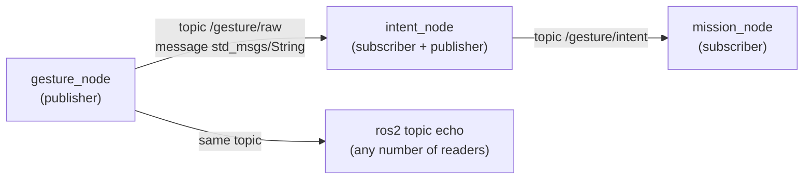
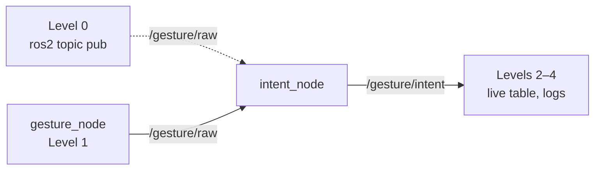

# 🤖 ROS 2 and nodes: run and test each node in Docker

This is the practical guide, and the one place that explains how to run and test the gesture nodes: what ROS 2 and nodes are, running them in Docker (§4), the `ros2` command line (§5), checking them by hand (§6), the automated tests (§7) and troubleshooting (§8). What each node does inside is in its own note: [[02 Gesture Node]], [[03 Intent Node]], [[04 Mission Node]].

> [!TIP] Everything runs in Docker
> ROS 2 is not installed on the PC. The Docker images contain ROS 2 Jazzy, OpenCV and MediaPipe, and the `Makefile` in `drone/ground/` builds and runs them (§4).

> [!WARNING] Status: DRAFT
> All automated tests pass (§7). A full run with the webcam is not recorded yet.

### Node status

| Node | What | Run | Test |
| :--- | :--- | :---: | :---: |
| `gesture_node` | webcam + MediaPipe Holistic → `/gesture/raw` (two hands) | §4 | §6, §7 |
| `intent_node` | `/gesture/raw` → filter → `/gesture/intent` | §4 | §6, §7 |
| `mission_node` | `/gesture/intent` + `/flight/state` → `/mission/velocity_target` | §4, [[04 Mission Node\|04]] §8 | §7, [[04 Mission Node\|04]] §9 |

---

## 📚 1. What ROS is

**ROS** (Robot Operating System) is not an operating system. It is a framework and a set of tools for building a robot program out of many small programs that talk to each other in a standard way. **ROS 2** is the current generation (a rewrite of the original ROS). It provides:

- the way programs find and talk to each other (**topics**, services, actions),
- tools to build, run, inspect and record them (`colcon`, `ros2 topic echo`, `ros2 bag`),
- ready-made messages and libraries (`std_msgs`, `geometry_msgs`, `rclpy`).

| Word | Meaning | In this project |
| :--- | :--- | :--- |
| **Node** | one running program with one job | `gesture_node`, `intent_node`, `mission_node`, `flight_interface` |
| **Topic** | a named channel that carries messages | `/gesture/raw`, `/gesture/intent` |
| **Message** | a typed piece of data on a topic | `std_msgs/msg/String` |
| **Publisher** | a node that sends to a topic | `gesture_node` on `/gesture/raw` |
| **Subscriber** | a node that receives from a topic | `intent_node` on `/gesture/raw` |
| **Package** | a folder of code that builds into nodes | `intent_node` |
| **Workspace** | the folder where packages are built | `/ws` inside each Docker image |



A publisher does not know who listens. Any number of nodes, or the `ros2` command, can read the same topic.

---

## 🐢 2. What ROS 2 Jazzy is, and why we use it

ROS 2 comes in **distributions**, each tied to a Ubuntu version. **Jazzy Jalisco** ("Jazzy") is the LTS (long-term support) release for **Ubuntu 24.04**, supported until May 2029, with Python 3.12.

We use it because [[ADR-018 Ground OS and ROS 2|ADR-018]] and the plan ([[Study Plan v2]], Track C) choose Ubuntu 24.04 + Jazzy, and the same packages cover the Raspberry Pi 5 option in [[Hardware Inventory]]. The Docker images (§4) and CI use the official image `ros:jazzy-ros-base`, so every teammate and CI run the same ROS 2, whatever the host OS.

---

## 🧩 3. Why several nodes instead of one big script, and why the recogniser is one of them

| One big script | Several nodes |
| :--- | :--- |
| A bug or freeze anywhere stops everything, including the safety checks | A crash stays inside one node. Its neighbours notice it went silent (timeouts): if `gesture_node` dies, `intent_node` still publishes `NEUTRAL` (`no_packets`) and the drone hovers |
| Hard to test one part alone | Each node is started, tested and replaced alone: fake the input, read the output (§6, §7) |
| Hard to reuse | The same `/gesture/intent` could drive the simulator, the drone, a car or an arm |
| Hard to see what happened | `ros2 topic echo` shows live data, `ros2 bag` records it for replay |
| Several people editing one file | Five tracks work on separate nodes with agreed message contracts |

The cost is some structure: messages must be defined and nodes started together. For a flight system with a safety story the trade is worth it, and the Module 1 plan expects a ROS 2 node graph. The full chain is in [[00 Gesture Pipeline]] §1.

Why the recogniser itself is a ROS 2 node and reads the camera inside it: [[02 Gesture Node]] §2.

---

## 🐳 4. Run the nodes: Docker and `make`

Each node has a Docker image built from `ros:jazzy-ros-base`. `drone/ground/docker-compose.yml` starts them, and `drone/ground/Makefile` wraps everything in a few targets.

### 4.1 What you need

| Need | Check |
| :--- | :--- |
| Docker Engine with the Compose plugin | `docker compose version` |
| Your user may run Docker | `docker run --rm hello-world` works without `sudo` (else `sudo usermod -aG docker $USER`, log out and in) |
| A webcam at `/dev/video0` (only for `gesture`) | `ls /dev/video*` |
| An X11 or XWayland display (only for the "Gestures" window) | `echo $DISPLAY` is not empty |
| `make` | `make --version` |

ROS 2, OpenCV and MediaPipe are **not** needed on the host.

### 4.2 The images and services

| Service | Image | Dockerfile | Starts |
| :--- | :--- | :--- | :--- |
| `gesture` | `rosrangers/gesture:jazzy` | `docker/gesture/Dockerfile` | `gesture_node` (webcam, "Gestures" window, `/gesture/raw`). Adds pip `requirements.txt` (MediaPipe, OpenCV) and the X11/Qt libraries for the window |
| `intent` | `rosrangers/intent:jazzy` | `docker/intent/Dockerfile` | `intent_node` with `input_source:=topic` |
| `mission` | `rosrangers/mission:jazzy` | `docker/mission/Dockerfile` | `mission_node` ([[04 Mission Node]]) |
| `flight` | `rosrangers/mission:jazzy` (same image) | `docker/mission/Dockerfile` | `fake_flight_state`, a **pretend** `/flight/state` ([[04 Mission Node]] §7.1). Never with a real drone |
| `echo` | `rosrangers/echo:jazzy` | `docker/echo/Dockerfile` | `docker/echo/monitor.py`: the live table of the chain. Also the way to use the `ros2` CLI (§5) |

- Each node image builds its package with `colcon build` in `/ws`. `docker/entrypoint.sh` sources ROS 2 and `/ws/install/setup.bash`, then runs the node directly, so `docker stop` stops it cleanly at once with exit code 0. `mission_node` still sends its last zero target.
- All services use `network_mode: host` and `ipc: host`, so the containers find each other. `ROS_DOMAIN_ID` comes from your shell (default 0, §4.5).
- `gesture` gets `/dev/video0`, `DISPLAY` and `/tmp/.X11-unix`, so OpenCV can open the camera and the window.

**The live table (`echo`).** `docker compose up` shows only this table; the nodes' output goes to log files (below). It is redrawn in place like `top`, only when a value changes:

```text
Ground pipeline monitor   15:10:12   (Ctrl+C to quit)

GESTURE   gesture_node  /gesture/raw                 live
    gesture     L:NONE+R:THUMB_RIGHT

INTENT    intent_node   /gesture/intent              live
    intent      MOVE_RIGHT
    reason      ok
    gesture     L:NONE+R:THUMB_RIGHT

MISSION   mission_node  /mission/state               live
    mode        ENGAGED
    why         engage
    mask        11
    airborne    True

VELOCITY  mission_node  /mission/velocity_target     live
    fwd/back    0
    left/right  right 0.30 m/s
    up/down     0
    yaw         0
```

A block is `waiting` until its first message and `STALE n s` when its topic stops for more than 1 s. Velocities are in the body frame (left/right is the drone's, [[04 Mission Node|04]] §5.2). Ctrl+C exits 0.

**Node logs.** Every node service (not `echo`) writes its output to `drone/ground/logs/<service>/<start time>.log`, every line prefixed with the wall-clock time, and `logs/<service>/latest.log` points to the newest run:

```bash
tail -f logs/mission/latest.log                                          # follow one node live
diff logs/mission/<older run>.log logs/mission/latest.log                # compare two runs
docker compose logs -f mission                                           # same output through Docker
```

`logs/` is ignored by Git. `GROUND_LOG_DIR=./other make` puts the files somewhere else.

### 4.3 The `make` targets

Run from `drone/ground/`:

| Target | Does |
| :--- | :--- |
| `make` | `xhost +local:`, `mkdir -p logs`, then `docker compose up --build` (gesture, intent, mission, flight, echo) |
| `make down` | `docker compose down`: stops the containers |
| `make unit` | the tests that need no ROS, on the host (§7) |
| `make smoke` | the Docker smoke test `docker/smoke_test.sh` (§7) |
| `make clean` | `down` + removes this project's images |
| `make fclean` | `clean` + removes `logs/`, Python caches and the rest of this project's Docker objects (nothing else on your PC) |
| `make re` | `fclean`, then `make` |

The test targets end with a pass/fail summary and keep their full output in `logs/test/unit.log` and `logs/test/smoke.log`.

```bash
cd ~/ROSRangers/drone/ground
make              # first build takes a few minutes (MediaPipe), then the five services run
```

`MASK=` and `AIRBORNE=` set the pretend flight state ([[04 Mission Node]] §8.1). What the gestures do: [[00 Gesture Pipeline]] §3. `q` in the "Gestures" window stops `gesture_node`; Ctrl+C stops the rest.

One service per terminal:

```bash
docker compose up --build intent          # terminal 1: filter -> /gesture/intent
docker compose up --build gesture         # terminal 2: camera + "Gestures" window (run `xhost +local:` once per login first)
docker compose run --rm --build echo      # terminal 3: the live table
docker compose up --build mission flight  # terminal 4: mission_node + pretend /flight/state
docker compose down                       # stop everything
```

Named on the command line, each service prints its output in its own terminal, and still writes `logs/<service>/latest.log`. A plain `docker compose up` / `make` hides the nodes behind the table.

### 4.4 Changing the code

The source is copied into the images when they are built. After editing a file, `make` (or `docker compose up --build`) rebuilds only the changed image.

### 4.5 Keep your lab neighbours out of your topics

ROS 2 nodes on the same network find each other automatically, so a teammate's nodes could appear on your topics. Pick your own number (0–101, different from teammates) and export it before `make`; `docker compose` passes it to every container:

```bash
export ROS_DOMAIN_ID=42
```

Use the same value in every terminal that runs `make` or `docker compose`. The tests use their own domains, so they never mix with a running pipeline.

---

## ⌨️ 5. The `ros2` command line

`ros2` is one program with sub-commands. It talks to nodes that are already running, so you can inspect and control them without changing their code. The `echo` image has ROS 2, so every `ros2` command in these notes runs through it, from `drone/ground/`:

```bash
docker compose run --rm echo ros2 topic list
docker compose run --rm echo ros2 topic echo /gesture/raw std_msgs/msg/String --field data
```

Give the message type to `topic echo` (`std_msgs/msg/String`): a fresh container may not know it yet. `--field data` prints only the JSON text instead of a YAML string around it.

| Command | What it does | Example |
| :--- | :--- | :--- |
| `ros2 node list` | Lists running nodes | shows `/gesture_node`, `/intent_node` |
| `ros2 node info <node>` | Shows a node's topics and parameters | `ros2 node info /intent_node` |
| `ros2 topic list` | Lists all topics | shows `/gesture/raw`, `/gesture/intent` |
| `ros2 topic echo <topic> <type>` | Prints messages as they arrive | `ros2 topic echo /gesture/raw std_msgs/msg/String --field data` |
| `ros2 topic info <topic>` | Shows the type, publishers and subscribers | `ros2 topic info /gesture/raw` (1 publisher, 1 subscriber) |
| `ros2 topic hz <topic>` | Measures the publish rate | `/gesture/raw` ~10 Hz, `/gesture/intent` ~20 Hz |
| `ros2 topic pub <topic> <type> <data>` | Publishes a message by hand | fake one gesture on `/gesture/raw` (§6, Level 0) |
| `ros2 param list <node>` | Lists a node's parameters | `ros2 param list /intent_node` |
| `ros2 param get <node> <name>` | Reads a parameter | `ros2 param get /intent_node input_source` |
| `ros2 param set <node> <name> <value>` | Changes a parameter while running | see the warning below |

Add `--help` to any command, for example `ros2 topic --help`.

> [!WARNING] Parameters are safety settings
> `ros2 param set` changes a value while the node runs, but `intent_node` and `mission_node` read their parameters only at start-up ([[03 Intent Node]] §7, [[04 Mission Node]] §3.3). Agree changes with the team first. `fake_flight_state` is the exception: it reads its parameters on every tick.

---

## 🧪 6. Test `gesture_node` and `intent_node` by hand

Work through the levels in order. Each one proves one link of the chain, so a failure tells you where to look. Run the automated tests (§7) first: they check most of these levels without a camera. `mission_node` by hand: [[04 Mission Node]] §9.



Two ways to watch: the **live table** (`docker compose run --rm echo`, only changes), and the **`intent_node` log**, which has one `Intent -> ... (reason: ...)` line per change (in its terminal, or `tail -f logs/intent/latest.log`).

### Level 0: no camera (fake `/gesture/raw` → `intent_node`)

Proves that `intent_node` reads the topic and applies the rules, without MediaPipe or a webcam.

| Terminal | Command |
| :---: | :--- |
| 1 | `docker compose up --build intent` |
| 2 | `docker compose run --rm echo` (the live table) |
| 3 | the fake gesture below |

```bash
docker compose run --rm echo ros2 topic pub -r 10 /gesture/raw std_msgs/msg/String "{data: '{\"gesture\": \"L:INDEX_RIGHT+R:NONE\", \"t\": 0, \"xy\": null}'}"
```

Expected: `MOVE_RIGHT` / `ok` about 1 s after starting. Ctrl+C stops the packets: `NEUTRAL` / `no_hand`, then `NEUTRAL` / `no_packets`. What each reason means and its timeout: [[03 Intent Node]] §4–5.

Change the gesture name in the command to try others (`L:OPEN_HAND_UP+R:OPEN_HAND_UP` → `ENGAGE`, `L:CLOSED_HAND+R:CLOSED_HAND` → `LOCK_TOGGLE`, `L:NONE+R:CLOSED_HAND` → `NEUTRAL` / `unmapped_gesture`). Each restart has a short gap, so you see `NEUTRAL` / `no_hand` in between. **Pass:** terminal 1 logs `First packet from gesture_node` and the intents follow the names.

### Level 1: does `gesture_node` publish the right thing on `/gesture/raw`?

Start only `gesture_node` (`intent_node` is not needed for this level). Stand back so the window shows your shoulders and elbows:

```bash
xhost +local:                                                                         # once per login
docker compose up --build gesture                                                     # terminal 1
docker compose run --rm echo ros2 topic echo /gesture/raw std_msgs/msg/String --field data   # terminal 2
docker compose run --rm echo ros2 topic hz /gesture/raw                               # terminal 3
docker compose run --rm echo ros2 topic info /gesture/raw                             # once: 1 publisher
```

| Check | Pass |
| :--- | :--- |
| Format | every message is `{"gesture": ..., "t": ..., "xy": null}` |
| Gesture names | `L:<left>+R:<right>`, matching your raised hands and the name printed by `gesture_node` ([[02 Gesture Node\|02]] §7) |
| Raised arms only | a lowered arm shows as `NONE`; a raised arm (wrist above elbow) shows its gesture ([[02 Gesture Node\|02]] §3.2) |
| Left and right | raise only your **right** arm: the name is `L:NONE+R:...` |
| No hand | `"gesture": null` with both arms down or nobody in view (it never just stops) |
| Rate | ~10 Hz while the gesture stays the same; `hz` never drops to 0 while the window is open |
| Stop | `q` in the window → `hz` shows no new messages |

**If nothing prints:** check the topic name (`ros2 topic list`), that `ROS_DOMAIN_ID` is the same in every terminal (§4.5), and that the window shows the camera.

### Level 2: does `intent_node` receive it?

Start `intent` (terminal 1 of Level 0), then `gesture`. The `intent_node` log must show:

```text
[INFO] [intent_node]: First packet from gesture_node: {'gesture': 'L:NONE+R:THUMB_RIGHT', ...}
[INFO] [intent_node]: Recogniser link OK: 52 packets in the last 5 s, last gesture seen: L:NONE+R:THUMB_RIGHT
```

`ros2 topic info /gesture/raw` must show 1 publisher and 1 subscriber. **Pass:** the first-packet line once, then the link report every 5 s with roughly 50 packets. `No packets from gesture_node in the last 5 s` → `gesture_node` is not publishing (back to Level 1).

### Level 3: does `intent_node` publish the right intent on `/gesture/intent`?

Watch the live table with the two nodes running. Hold each gesture of the vocabulary ([[00 Gesture Pipeline]] §3) for 1 s, the other arm down for the one-hand gestures. **Pass:** the `INTENT` block shows the intent listed there within about 0.5 s, and any other pose gives `NEUTRAL` / `unmapped_gesture`. `ros2 topic hz /gesture/intent` stays at ~20 Hz the whole time, even with no hand.

### Level 4: the safety behaviour

| Test | Expected on `/gesture/intent` |
| :--- | :--- |
| Show the right thumb out until `MOVE_RIGHT`, lower the arm for 1 s, show both fists | `NEUTRAL` / `no_hand` during the gap, `NEUTRAL` / `unconfirmed` when the hands return (**never** `MOVE_RIGHT` again), then `LOCK_TOGGLE` |
| Hold the right thumb out, hide the hand for 0.1 s, show it again | stays `MOVE_RIGHT` |
| Both fists until `LOCK_TOGGLE`, then lower one arm | `NEUTRAL` / `unmapped_gesture`: a single fist does nothing |
| Both open hands until `ENGAGE`, then lower one arm | `NEUTRAL` / `unmapped_gesture`: never a motion |
| Lower both arms for 3 s | `NEUTRAL` / `no_hand`, then `NEUTRAL` / `no_hand_long` |
| Stop `gesture_node` (`q`, or `docker compose stop gesture`) while holding a gesture | `NEUTRAL` within 0.3 s, `NEUTRAL` / `no_packets` after 2 s |

If any of these does not end in `NEUTRAL`, stop and report it with the Bug form.

### Level 5: keep evidence

Record each manual test session with the Test session issue form on GitHub. The node logs are the evidence: `logs/gesture/latest.log` and `logs/intent/latest.log` hold every gesture change and every `Intent -> ...` line with its time. Attach them to the issue.

---

## 🤖 7. Automated tests: `make unit`, `make smoke` and CI

Most of §6 is also automated, with no camera: a fake camera replaces OpenCV and MediaPipe's detection, and the rest is the real code. Run them before every PR into `dev`.

### 7.1 The commands

From `drone/ground/`:

| Command | Needs | What runs |
| :--- | :--- | :--- |
| `make unit` | Python 3 on the host | `python3 -m unittest discover` in `src/gesture_node`, `src/intent_node`, `src/mission_node` and `../tests/ros`. Tests that need ROS 2 or the real MediaPipe are **skipped** |
| `make smoke` | Docker | `docker/smoke_test.sh` (§7.3): every package test inside its own image, none skipped, then the chain across containers |

Each target ends with a summary (one row per package or test file, with passed, skipped and failed counts) and keeps its full output in `logs/test/` (§4.3). Together they run every package test. The ROS tests in `drone/tests/ros/` (pipeline, launch, `echo` table, entrypoint) run in CI (§7.5).

### 7.2 What each test file checks

The tests are in `src/<package>/test/` and `drone/tests/ros/`. Each file's docstring says what it checks.

| File | Kind |
| :--- | :--- |
| `src/gesture_node/test/test_hand_processing.py` | unit: recognition, the maths, which hands count (2 tests need the real MediaPipe) |
| `src/gesture_node/test/test_gesture_sender.py` | unit: JSON and keep-alive |
| `src/gesture_node/test/test_gestures_loop.py` | unit: the camera loop with a fake OpenCV |
| `src/gesture_node/test/test_gesture_node_ros.py` | node (`rclpy`): the real node on `/gesture/raw` |
| `src/gesture_node/test/test_gesture_node_process.py` | process (`rclpy`): exit codes and clean stops |
| `src/intent_node/test/test_gesture_filter.py` | unit: the filter rules of [[03 Intent Node]] §5 |
| `src/intent_node/test/test_intent_node_ros.py` | node (`rclpy`): the real node on its inputs |
| `src/intent_node/test/test_intent_node_process.py` | process (`rclpy`): exit codes and clean stops |
| `src/mission_node/test/` | unit, node, process and launch tests of `mission_node`: [[04 Mission Node]] §9.2 |
| `drone/tests/ros/test_gesture_contract.py`, `test_mission_contract.py` | unit: two nodes' real logic together, so a rename on one side fails the build |
| `drone/tests/ros/test_gesture_pipeline.py`, `test_mission_pipeline.py` | pipeline (`rclpy`): landmarks → `/gesture/raw` → `/gesture/intent` (→ `/mission/velocity_target`) |
| `drone/tests/ros/test_mission_launch.py` | launch: `mission_with_gestures.launch.py` end to end |
| `drone/tests/ros/test_monitor.py`, `test_entrypoint.py` | program: the `echo` live table and `docker/entrypoint.sh` |

`test/fake_camera.py` (in `gesture_node`) runs the real `gesture_node` with a fake camera that always "sees" `L:INDEX_RIGHT+R:NONE`. The process tests and the smoke test use it.

The tests that check each requirement ID: [[03 Intent Node]] §10 and [[04 Mission Node]] §11.

### 7.3 The Docker smoke test

`docker/smoke_test.sh` (`make smoke`, CI job `ground-docker`) checks the images, not only the code. It builds them, runs each package's tests **inside its own image** with none skipped, sends a gesture from the gesture container through the intent container to the mission container (mission must not engage without `ENGAGE`), checks the fallback when the gesture container stops (`NEUTRAL`, no land request), the clean `docker stop`s and the node logs. The steps are commented at the top of the script.

It uses its own Compose project (`ground-smoke`), its own `ROS_DOMAIN_ID` and log folder `logs/smoke/`, so a running `make` stack is neither stopped nor mixed in. With `SMOKE_LOG_DIR=dir` it also saves each container's full log there.

### 7.4 Skipped tests and `REQUIRE_ROS_TESTS`

Tests that need `rclpy` are skipped when ROS 2 is not available, so `make unit` works on any PC. With `REQUIRE_ROS_TESTS=1` a missing `rclpy` is a **failure** instead. CI and the smoke test set it, so a broken ROS install can never pass as "all skipped".

### 7.5 In CI

`.github/workflows/ci.yaml` ([[CI-CD Overview]], [[Testing Strategy]], [[ADR-022 CI Gates and Lint Rules|ADR-022]]):

| Job | Runs | Gate |
| :--- | :--- | :--- |
| `ground-ros2` | in `ros:jazzy-ros-base`: `colcon build` + `colcon test` of `gesture_node`, `intent_node` and `mission_node`, then pytest over the package tests and `drone/tests/ros` with coverage | all tests pass, line coverage ≥ 90 % |
| `ground-docker` | `drone/ground/docker/smoke_test.sh` | `PASS` |

On a PR both run only when it changes `drone/ground/`, `drone/tests/ros/` or `ci.yaml`. Pushes to `dev` and `main` always run them. Run `pre-commit run --all-files` before pushing (ruff, shellcheck for `docker/*.sh`).

---

## 🧯 8. Troubleshooting

| Symptom | Likely cause | Fix |
| :--- | :--- | :--- |
| `permission denied ... docker.sock` | your user is not in the `docker` group | `sudo usermod -aG docker $USER`, log out and in |
| `gesture` container: `cannot open display` / `could not connect to display` | X server refuses the container | `xhost +local:` (`make` runs it), check `echo $DISPLAY` |
| `docker compose up` fails with `/dev/video0: no such file or directory` | no webcam at `/dev/video0` | plug one in; `docker compose up intent mission flight echo` runs the rest |
| `gesture` log: `Camera loop ended: Cannot open camera 0 ...` (exit code 1) | camera 0 not available | close other camera apps, check `ls /dev/video*` |
| `gesture` log: `Camera loop ended: Camera 0 stopped delivering frames` (exit code 1) | webcam unplugged or busy while running | plug it back in and start the service again |
| `docker compose up` shows only the table, no node output | expected: the nodes write to files | `tail -f logs/<service>/latest.log` or `docker compose logs -f <service>` (§4.2) |
| a test target failed and the output scrolled away | | `logs/test/unit.log` or `logs/test/smoke.log` hold all of it (§4.3) |
| a test is `skipped` in `make unit` | ROS 2 or the real MediaPipe not on the host | expected; `make smoke` runs them inside the images (§7.4) |
| `ros2 topic echo` or the live table shows nothing, but the nodes run | a different `ROS_DOMAIN_ID` in the two terminals | export the same value in both (§4.5) |
| `ros2 topic echo` says `Could not determine the type` | the `echo` container started before the publisher | give the type: `ros2 topic echo <topic> <type>` (§5) |
| live table: intent stays `NEUTRAL` / `no_packets_yet` | nothing reaches `intent_node` | `gesture` not running, or a different `ROS_DOMAIN_ID`: §6, Level 1 |
| `No packets ... in the last 5 s` warning in the `intent` log | same | same |
| Intent stays `NEUTRAL` / `unconfirmed` | gesture changes every frame, or fewer than 5 packets | hold the gesture still; for two-hand gestures keep both hands raised and in view; check `ros2 topic hz /gesture/raw` (~10 Hz) |

Problems with the recognition itself (no hand, wrong hand, low frame rate): [[02 Gesture Node]] §13. With modes and velocities: [[04 Mission Node]] §9 (Troubleshooting).

---

## Glossary

| Term | Meaning |
| --- | --- |
| **CI** | Continuous Integration: GitHub Actions runs the tests on every PR (`ground-ros2`, `ground-docker`). |
| **CLI** | Command-line interface: here the `ros2` command and its sub-commands. |
| **colcon** | The build tool for ROS 2 workspaces; the Dockerfiles and CI use it. |
| **Container / image** | A Docker image is a packaged file system (here Ubuntu 24.04 + ROS 2 Jazzy + one node); a container is one running copy of it. |
| **Coverage** | The share of code lines the tests run; CI requires at least 90 % for the ROS 2 nodes. |
| **Docker** | Tool that runs software in containers: isolated environments built from an image (Dockerfile). |
| **Docker Compose** | Starts several containers from one file (`drone/ground/docker-compose.yml`). |
| **Holistic** | MediaPipe Holistic: one model for the body pose and both hands, each labelled left or right. |
| **Jazzy** | ROS 2 Jazzy Jalisco, the ROS 2 release we use (paired with Ubuntu 24.04). |
| **Live table** | What the `echo` container shows (`docker/echo/monitor.py`): the latest gesture, intent, mission mode and velocity target, redrawn only when something changes. |
| **LTS** | Long-term support: a release maintained for several years. |
| **Makefile** | The `make` targets in `drone/ground/` that build, start and test the nodes. |
| **MediaPipe** | A framework used here for detecting the body pose and hand landmarks (Holistic). |
| **Node** | A single ROS 2 process that does one job and talks to others through topics. |
| **Package** | A folder of ROS 2 code (`package.xml`, `setup.py`) that builds into one or more nodes. |
| **Pretend input** | A small node (`fake_flight_state`, `fake_intent`) that publishes made-up values so a node can be tested without the real source. Never used with a real drone. |
| **rclpy** | The ROS 2 Python client library used to write nodes. |
| **REQ ID** | A requirement identifier, `REQ-<area>-NNN` (for example REQ-SAF-019), registered in Requirements. |
| **ROS 2** | The second-generation Robot Operating System middleware used for robotics integration. |
| **rosbag** | A file of recorded topic messages that can be replayed (`ros2 bag`). |
| **ROS_DOMAIN_ID** | A number that separates ROS 2 networks, so teammates' nodes don't mix. |
| **Smoke test** | A short end-to-end check that the built images start and work together (`make smoke`). |
| **Topic** | A named channel on which ROS 2 nodes publish and subscribe to messages. |
| **X11 / XWayland** | The display system that lets the container open the "Gestures" window on your screen (`xhost +local:`). |
