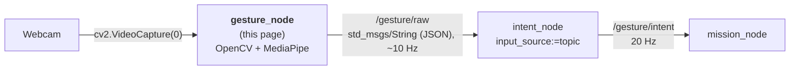
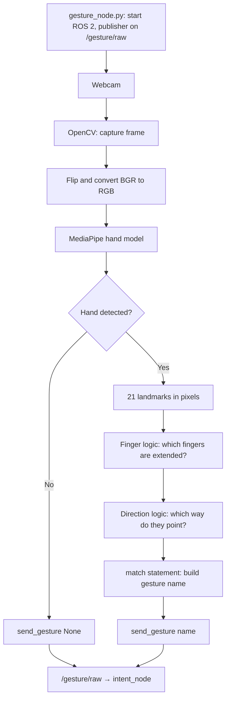
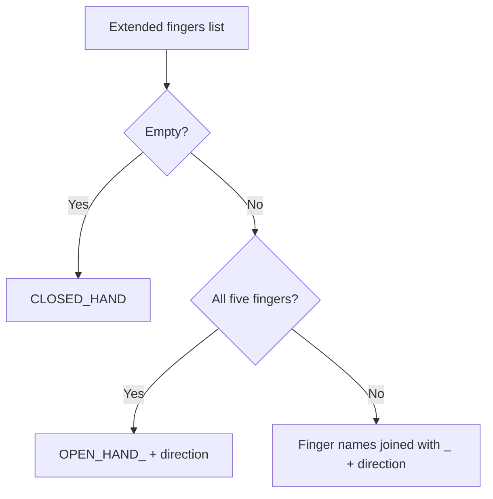

# 📷 Gesture Node: webcam + OpenCV + MediaPipe → `/gesture/raw`

`gesture_node` (v0.1) is the recogniser of the [[00 Gesture Pipeline|Gesture Pipeline]] as a ROS 2 node. It opens the webcam with **OpenCV**, finds the hand with **MediaPipe**, turns it into a gesture name such as `THUMB_UP` or `INDEX_MIDDLE_LEFT`, and publishes that name on `/gesture/raw`. `intent_node` reads that topic ([[03 Intent Node]]).

This page covers everything about the recogniser: why it is a ROS 2 node (§2), how OpenCV and MediaPipe find the hand and how our code names the gesture (§3–7), what it publishes (§8), the code (§9), installing and running it (§10–11), tuning and troubleshooting (§12–15). It covers **static gestures**: which fingers are extended and which way they point.

It replaces the standalone prototype `gestures.py` + `gesture_sender.py` (UDP), which used to live in `drone/tools/gesture/` and was removed on 2026-10-20. It is the `mediapipe_node` idea of [[05 Future Nodes]] §2, renamed. This page also replaces the old note *01 Gesture Recognition with OpenCV and MediaPipe* (merged here on 2026-10-20).

> [!NOTE] Related notes
> How to run it in Docker without installing ROS 2: [[01 ROS2 Nodes Installation|01]] §4. How to build, run and test it natively with the others: [[01 ROS2 Nodes Installation|01]] §6–10. Who reads its output: [[03 Intent Node]].

> [!INFO] Same name, new node
> Until 2026-10-20 `intent_node` was called `gesture_node` ([[03 Intent Node]]). Since 2026-10-20 the name `gesture_node` means **this** recogniser node.

> [!WARNING] Status: DRAFT
> - Code written on 2026-10-20 (package `drone/ground/src/gesture_node/`), merged into `dev` on 2026-10-21 (#78) with 56 tests (unit, node and process, §9), a Docker image and CI. A first native build on Pop!_OS 24.04 + Jazzy found the venv problem in §10; `make ws` now checks for it. A full run with the webcam and `intent_node` is not recorded yet ([[01 ROS2 Nodes Installation|01]] §13).
> - Running MediaPipe inside a ROS 2 node changes a consequence of [[ADR-018 Ground OS and ROS 2|ADR-018]] ("keep the recogniser in its own venv/process, talk to ROS 2 through a thin node"). A new ADR that amends ADR-018 is still needed (§16).

---

## 📍 1. Where it sits



| | |
| :--- | :--- |
| **Answers** | "Which hand pose is this?" |
| **Knows about** | the camera, hands, gesture names. **No** safety logic: it only reports what it sees. |
| **Package** | `drone/ground/src/gesture_node/` |
| **Runs in** | the Docker image `rosrangers/gesture:jazzy` (no local ROS 2 needed), or natively the MediaPipe venv `drone/ground/gesture-venv`, created with `--system-site-packages` so it also sees ROS 2 (§10) |

---

## ❓ 2. Why the recogniser is now a ROS 2 node

Before 2026-10-20 the recogniser was a plain Python program in its own venv. It sent UDP datagrams to `intent_node` on `127.0.0.1:5005`, because [[ADR-018 Ground OS and ROS 2|ADR-018]] feared that MediaPipe's pip packages (`numpy`, OpenCV) would clash with the apt ROS packages, mainly `cv_bridge`.

`gesture_node` keeps the recogniser code and moves the transport to ROS 2:

| Before: `gestures.py` + UDP | Now: `gesture_node` + `/gesture/raw` |
| :--- | :--- |
| Invisible to ROS: you can't `echo`, `hz` or record what the recogniser sends | `ros2 topic echo /gesture/raw`, `ros2 topic hz`, `ros2 node info /gesture_node` work like on every other node |
| Recognition bugs can't be replayed | `ros2 bag record /gesture/raw /gesture/intent` records input **and** output of `intent_node` together, and `ros2 bag play` replays them without a camera |
| A second world to start by hand (`cd`, venv, `python3 gestures.py`) | `ros2 run gesture_node gesture_node` or `docker compose up gesture`, and later one launch file for the whole chain ([[05 Future Nodes]] §11) |
| A UDP port to keep free and in sync on both sides (`PORT` = `udp_port`) | A topic name. Several readers can listen at once, and nothing fails because a port is taken |
| A test sender needed its own UDP code | A test can publish on `/gesture/raw` with `ros2 topic pub` or a few lines of `rclpy` ([[01 ROS2 Nodes Installation\|01]] §9) |
| Packets only on this PC (localhost) | ROS 2 discovery: the recogniser could run on another machine on the same `ROS_DOMAIN_ID` later |

### Why the camera is read inside the node

A separate camera node (`v4l2_camera` or `usb_cam` publishing `/image_raw`, [[05 Future Nodes]] §3) was the first idea. `gesture_node` reads the camera itself with `cv2.VideoCapture(0)`, exactly as `gestures.py` did:

| | Camera inside `gesture_node` (chosen) | Separate `camera_node` + `/image_raw` |
| :--- | :--- | :--- |
| Extra CPU per frame | **none**: the frame stays in the same process, as before | each frame (about 0.9 MB at 640×480 RGB, ~27 MB/s at 30 FPS) is packed, sent through DDS and unpacked in Python: a few ms per frame |
| Extra delay | none | a few ms, and old frames pile up unless QoS is "best effort, depth 1" |
| `cv_bridge` needed | **no**, so the clash ADR-018 worried about does not happen | yes |
| See or record the camera picture | only the "Gestures" window | `rqt_image_view`, `ros2 bag` |

MediaPipe itself costs about 10–30 ms per frame on a laptop CPU, so the work that matters stays exactly the same as with `gestures.py`. These numbers are estimates, not measured on our laptops.

### What it costs

- MediaPipe now runs inside a ROS 2 process. A MediaPipe crash ends `gesture_node`, but not `intent_node`: that is a separate process and treats the silence as "recogniser gone" (`HOVER_LAND_REQUEST` after 2 s, [[03 Intent Node]] §5). The safety rules do not change.
- Natively, the node needs a venv that sees **both** ROS 2 and MediaPipe, and colcon must use that venv's Python (§10). This is the part that broke on the first build; `make ws` now does it and checks it. The Docker image installs MediaPipe straight into the image's Python next to ROS 2, so it has no venv.
- `mediapipe` and `opencv-python` come from pip (`requirements.txt`), not from `rosdep`.

---

## 📌 3. OpenCV and MediaPipe: overview

- **OpenCV** captures the webcam frames and shows the video window.
- **MediaPipe** is an open-source Google framework for machine-learning solutions. It ships pretrained models (hands, face, pose) that run in real time on the CPU. For every frame it finds the hand and returns **21 landmarks** (wrist, knuckles and fingertips), each with `x`, `y` and `z` coordinates.
- MediaPipe only gives us the landmarks. It does **not** recognize our gestures, so **our code does the logic** (angles and directions, §6).
- More info: [MediaPipe on GitHub](https://github.com/google-ai-edge/mediapipe)

> [!NOTE] No compiling needed
> MediaPipe's official C++ API can only be built from source with Bazel, which is slow and fragile. In Python we install the prebuilt `mediapipe` package with pip, so nothing is compiled.

> [!WARNING] Keep `mediapipe==0.10.21` pinned (checked 2026-10-12)
> MediaPipe **1.1.0** (released 6 Oct 2026) **removed** the legacy `mp.solutions` API that this code uses (verified in the wheel). Upgrading needs a port to the Tasks API (`HandLandmarker`). The "Python 3.10 to 3.12 only" limit applies to 0.10.21: 1.1.0 supports Python 3.9–3.14 and ships Linux aarch64 wheels (Raspberry Pi 5). A port is listed in [[05 Future Nodes]].

---

## 🔄 4. How the node works



0. **Start** (`gesture_node.py`): creates the ROS 2 node `gesture_node` and a publisher on `/gesture/raw`, then runs the camera loop of `gestures.py`.
1. **Capture** (`gestures.py`): OpenCV reads a frame from the webcam (`cv2.VideoCapture(0)`).
2. **Preprocess** (`gestures.py`): the frame is flipped (mirror view) and converted from BGR to RGB (MediaPipe uses RGB, OpenCV uses BGR).
3. **Detect** (`hand_processing.py`): `detect_gesture` runs `hands.process(...)`, which returns the 21 landmarks of each detected hand.
4. **Convert** (`hand_processing.py`): the landmarks of the first hand are converted from normalized values (0 to 1) to **pixels**, so angles and distances are not distorted by the frame's aspect ratio.
5. **Interpret** (`hand_processing.py`): `is_finger_extended` decides which fingers are extended.
6. **Direction** (`hand_processing.py`): `pointing_direction` works out which way the extended fingers point.
7. **Classify** (`hand_processing.py`): `recognize` builds the gesture name with a `match` statement.
8. **Output** (`gestures.py`): `draw_hand` draws the landmarks, the name is printed when it changes, the "Gestures" window is updated, and `send_gesture` is called on **every** frame. It publishes a message on `/gesture/raw` at once when the gesture changes, and otherwise repeats it every 0.1 s as a keep-alive (10 messages/s, §8). The repeats matter: `intent_node` treats silence as "the recogniser died or the hand is gone".
9. **Stop**: press `q` in the window, Ctrl+C in the terminal, or SIGTERM (`docker stop`). `gestures.main()` returns why it ended, and `gesture_node.py` turns that into the exit code and a log line:

| Ending | Exit code | Log (`Camera loop ended: ...`) |
| :--- | :---: | :--- |
| `q` in the window | 0 | `q pressed in the Gestures window` |
| Ctrl+C or SIGTERM | 0 | `stopped (Ctrl+C or SIGTERM)` |
| camera 0 can't be opened | 1 (error log) | `Cannot open camera 0. Is a webcam connected, and not used by another program?` |
| camera 0 stops delivering frames | 1 (error log) | `Camera 0 stopped delivering frames (unplugged?)` |

The camera and the window are released on every ending (a `finally` in `gestures.main()`).

The camera loop owns the main thread, because OpenCV windows must stay there. ROS 2 spins in a background thread, so `ros2 param` and `ros2 node info` still answer. Ctrl+C and SIGTERM only set a flag that the loop checks once per frame; rclpy's own signal handler is off, because it would shut ROS 2 down under the spin thread. A repeated signal (`ros2 launch` forwards one more) changes nothing. On exit the node stops the executor first, waits for the spin thread, then shuts ROS 2 down (otherwise the process can abort with `terminate called without an active exception`). The process tests check all of this (§9).

### 🖼️ Frames and NumPy

A **frame** is one image from the camera. In Python it is a **NumPy array**: a grid of numbers with one number per pixel colour value.

| Property | Value |
| :--- | :--- |
| Shape | `(height, width, 3)`, for example `(480, 640, 3)` |
| Data type | `uint8` (each value is 0 to 255) |
| Channel order | OpenCV gives **BGR**, MediaPipe needs **RGB** |

In `gestures.py` there are two versions of the same image:
* `frame`: the BGR image from OpenCV, used for drawing and the window.
* `rgb`: a converted RGB copy, passed to MediaPipe.

### 🔌 Feeding other image sources

`hand_processing.py` never imports OpenCV. `detect_gesture(hands, rgb_image)` accepts **any RGB, `uint8`, `(height, width, 3)` NumPy array**, so any software that produces one can feed it:

| Source | How to get the array |
| :--- | :--- |
| OpenCV (camera, video file, `imread`) | `cv2.cvtColor(frame, cv2.COLOR_BGR2RGB)` |
| Pillow (image file) | `np.array(Image.open("hand.jpg").convert("RGB"))` |
| ROS 2 image topic (not used: `gesture_node` reads the camera itself) | `cv_bridge` → `sensor_msgs/Image` to a NumPy array ([[05 Future Nodes]] §3) |
| Other (screen capture, other camera libraries) | Convert the output to an RGB `uint8` array |

> [!WARNING] Things to check when connecting a new source
> * **Channel order:** BGR passed in as RGB does not crash, but detection gets worse.
> * **Grayscale or float images** must be converted to 3 channels and `uint8` first.
> * **Single images:** use `create_hands(static_image_mode=True)`. For video keep the default (`False`) so the hand is tracked between frames.
> * **Mirroring:** the webcam loop flips the frame so `LEFT` and `RIGHT` match the operator's own left and right. Other sources are not flipped unless you do it.

---

## 🦴 5. Landmarks used for finger detection

| Finger | Knuckle (MCP) | Middle joint (PIP / IP) | Tip |
| :--- | :---: | :---: | :---: |
| Thumb | 2 | 3 | 4 |
| Index | 5 | 6 | 8 |
| Middle | 9 | 10 | 12 |
| Ring | 13 | 14 | 16 |
| Pinky | 17 | 18 | 20 |

Landmark **0** is the wrist. In the code each finger is a tuple `(MCP, PIP, tip)`, for example `INDEX = (5, 6, 8)`, and the `FINGERS` dictionary maps each name to its tuple.

> [!NOTE] Image coordinates
> `x` grows to the right and `y` grows **downward**, so "up" on screen means a smaller `y`.

---

## 📐 6. The math

### Finger extended? (index, middle, ring, pinky)

The program measures the angle at the middle joint (PIP) $b$, between the knuckle $a$ and the tip $c$:

$$\vec{v_1} = a - b, \qquad \vec{v_2} = c - b$$

$$\theta = \arccos\left(\frac{\vec{v_1} \cdot \vec{v_2}}{\lVert\vec{v_1}\rVert \, \lVert\vec{v_2}\rVert}\right)$$

A straight finger gives an angle close to $180^\circ$, a curled finger a much smaller one. The finger counts as **extended** when $\theta > 140^\circ$ (`EXTENDED_ANGLE`).

Because this uses an angle and not "tip above joint", it works whichever way the hand is turned.

### Thumb extended?

The thumb bends sideways, so the angle check does not work well for it. Instead the program measures how far the thumb tip $P_4$ sticks out past the index knuckle $P_5$, along the palm's width axis (from the pinky knuckle $P_{17}$ toward the index knuckle):

$$\vec{u} = P_5 - P_{17}$$

$$t = \frac{(P_4 - P_5) \cdot \vec{u}}{\lVert\vec{u}\rVert} \cdot \frac{1}{\lVert P_9 - P_0 \rVert}$$

Dividing by the hand size $\lVert P_9 - P_0 \rVert$ (wrist to middle knuckle) makes the value the same near or far from the camera. Negative or near 0 means the thumb is tucked in. The thumb counts as **extended** when $t > 0.5$ (`THUMB_OUT_RATIO`).

### Pointing direction

The program adds together the knuckle-to-tip vectors of all extended fingers:

$$d_x = \sum (x_{tip} - x_{mcp}), \qquad d_y = \sum (y_{tip} - y_{mcp})$$

$$\alpha = \operatorname{atan2}(d_x, -d_y)$$

$-d_y$ is used because `y` grows downward. This gives $0^\circ$ = up, $90^\circ$ = right, $-90^\circ$ = left, $180^\circ$ = down:

| Angle $\alpha$ | Direction |
| :---: | :---: |
| $-45^\circ$ to $45^\circ$ | `UP` |
| $45^\circ$ to $135^\circ$ | `RIGHT` |
| $-135^\circ$ to $-45^\circ$ | `LEFT` |
| anything else | `DOWN` |

---

## 🏷️ 7. Gesture names

`recognize` turns the list of extended fingers and the direction into a name:



| Hand pose | Gesture name |
| :--- | :--- |
| Fist | `CLOSED_HAND` |
| All fingers out, pointing up | `OPEN_HAND_UP` |
| Thumbs up | `THUMB_UP` |
| Thumbs down | `THUMB_DOWN` |
| Index finger pointing right | `INDEX_RIGHT` |
| Index and middle (peace sign) pointing up | `INDEX_MIDDLE_UP` |
| Index and middle pointing left | `INDEX_MIDDLE_LEFT` |

Finger names always appear in the order thumb, index, middle, ring, pinky (the order of the `FINGERS` dictionary). Which names drive the drone, and how, is the vocabulary in [[00 Gesture Pipeline]] §3.

---

## 📤 8. Output: `/gesture/raw`

Type `std_msgs/msg/String`. `data` holds the **same JSON** the UDP prototype sent, so `intent_node` parses it with the same code:

```json
{"gesture": "INDEX_RIGHT", "t": 1792483200.12, "xy": null}
```

No hand or nothing recognised:

```json
{"gesture": null, "t": 1792483200.52, "xy": null}
```

| Field | Meaning |
| :--- | :--- |
| `gesture` | name from `recognize()` (§7), or `null` when no hand is found |
| `t` | sender time in seconds (`time.time()`). Information only: `intent_node` uses its own clock for timeouts |
| `xy` | palm position `[x, y]` in 0..1. Always `null` today (`gestures.py` passes `None`) |

| Rate | When |
| :--- | :--- |
| ~10 Hz | the gesture (or "no hand") stays the same |
| one extra message at once | the gesture changes |
| silence | the node stopped, crashed, or the camera loop stalled |

### 👀 How to read `/gesture/raw`

Run these in a terminal with both `source` lines (system Python, no venv needed to **read**):

| Command | Shows |
| :--- | :--- |
| `ros2 topic info /gesture/raw` | type `std_msgs/msg/String`, 1 publisher (this node), and the subscribers (`intent_node` if it runs) |
| `ros2 topic echo /gesture/raw --field data` | only the JSON text, one message after another (separated by `---`) |
| `ros2 topic echo --once /gesture/raw --field data` | one message, then exits |
| `ros2 topic hz /gesture/raw` | the rate: ~10 Hz while the window is open |
| `python3 ~/gesture_watch.py` | one line per **change** of gesture, with the time ([[01 ROS2 Nodes Installation\|01]] §9) |

> [!TIP] Use `--field data`
> Without it, `ros2 topic echo /gesture/raw` prints `data: '{"gesture": ...}'`: the JSON wrapped in a YAML string, sometimes with escaped quotes. `--field data` prints the JSON text itself.

What you see, and what it means:

| You see | Meaning |
| :--- | :--- |
| `"gesture": "INDEX_RIGHT"` repeated ~10 times a second | the hand is held still in that pose |
| the name changes | the pose changed (one message at once, then the 10 Hz repeats again) |
| `"gesture": null` | the camera works but sees no hand, or the pose could not be named |
| `"t"` growing by about 0.1 each message | the keep-alive is running |
| nothing at all, `hz` shows no new messages | the node is not running, or the camera loop is stuck. Check its terminal |
| a name that is not in the vocabulary (for example `INDEX_PINKY_UP`) | normal: `gesture_node` names every pose. `intent_node` turns unknown names into `NEUTRAL` |

Reading it in code (a new node that wants the raw gesture): the message is a `String`, so parse `msg.data` as JSON.

```python
import json
from std_msgs.msg import String


def on_raw(msg: String) -> None:
    packet = json.loads(msg.data)
    gesture = packet["gesture"]   # str or None
    xy = packet.get("xy")         # None today


node.create_subscription(String, "/gesture/raw", on_raw, 10)
```

To read it later from a recording: `ros2 bag record -o raw_test /gesture/raw`, then `ros2 bag play raw_test` and the same `echo` commands.

---

## 📁 9. Code layout, and what changed from `drone/tools/gesture/`

```text
drone/ground/src/gesture_node/
├── package.xml              # rclpy, std_msgs; mediapipe/OpenCV come from pip
├── setup.py, setup.cfg
├── requirements.txt         # mediapipe==0.10.21, opencv-python
├── resource/gesture_node
├── gesture_node/
│   ├── __init__.py
│   ├── gesture_node.py      # rclpy wrapper: node, publisher, spin thread, runs gestures.main()
│   ├── gestures.py          # OpenCV: camera loop, window, sends each frame's gesture
│   ├── hand_processing.py   # MediaPipe + math + finger logic + gesture names
│   └── gesture_sender.py    # keep-alive rule, publishes on /gesture/raw
└── test/
    ├── fake_camera.py                 # runs the real main() with a fake camera (process tests, smoke test)
    ├── test_hand_processing.py        # unit: recognize(), the maths, detect_gesture() (2 tests need real MediaPipe)
    ├── test_gesture_sender.py         # unit: JSON, keep-alive
    ├── test_gestures_loop.py          # unit: camera loop with a fake OpenCV, endings, release
    ├── test_gesture_node_ros.py       # node: real GestureNode, JSON on /gesture/raw (needs rclpy)
    └── test_gesture_node_process.py   # process: exit codes for q, Ctrl+C, SIGTERM, no camera (needs rclpy)
```

56 tests in total (2026-10-21). Without ROS 2 the 15 node and process tests are skipped, and without MediaPipe 2 more. What each file checks, and how to run them (`make unit`, `make test`, `make smoke`): [[01 ROS2 Nodes Installation|01]] §10. The tests that need both nodes are in `drone/tests/ros/`.

The Docker image is `drone/ground/docker/gesture/Dockerfile`: `ros:jazzy-ros-base`, `pip3 install -r requirements.txt`, the X11/Qt libraries for the window, `colcon build` of this package, and the node started directly (not through `ros2 run`), so `docker stop` stops it cleanly. Under compose `entrypoint.sh` is PID 1 and passes the signal on ([[01 ROS2 Nodes Installation|01]] §4.2).

| File | What it does | Change from the prototype |
| :--- | :--- | :--- |
| `hand_processing.py` | Everything that uses MediaPipe, plus the math, the finger logic and the gesture names. It never imports OpenCV, so it accepts any RGB image. | **none** (byte-for-byte copy) |
| `gestures.py` | The OpenCV part: camera loop and window. Imports `create_hands`, `detect_gesture` and `draw_hand` from `.hand_processing` and `send_gesture` from `.gesture_sender`. | the two imports (`from hand_processing import ...` → `from .hand_processing import ...`: inside a Python package the plain form can't find the file next to it). Since #78 `main(should_stop)` also returns why it ended (`QUIT`, `STOPPED`, `NO_CAMERA`, `CAMERA_LOST`), checks `should_stop()` once per frame, releases the camera and window in a `finally`, and flushes its prints so they show at once in `docker logs`. The recognition is unchanged. |
| `gesture_sender.py` | Publishes the JSON of §8 (on change, then every 0.1 s). Also explained in [[03 Intent Node]] §6. | same `send_gesture(gesture, xy)` call, same JSON, same 0.1 s keep-alive. The UDP socket is replaced by a publish function that `gesture_node.py` sets with `set_publisher()`. It has no ROS imports, so it is unit-tested without ROS. |
| `gesture_node.py` | The ROS 2 node around the camera loop (§4): publisher, spin thread, signal handling, exit codes. | new |

---

## 🛠️ 10. Install

There are two ways. **Docker** needs no ROS 2, Python, OpenCV or MediaPipe on the PC. **Native** needs ROS 2 Jazzy and a venv.

### 10.0 Docker (no local ROS 2)

Needs Docker with the Compose plugin, a webcam at `/dev/video0` and an X11 or XWayland display ([[01 ROS2 Nodes Installation|01]] §4.1).

```bash
cd ~/ROSRangers/drone/ground
make                          # the whole chain (five services, live table); or only this node:
xhost +local:                 # once per login: lets the container open its window
docker compose up --build gesture
```

The image `rosrangers/gesture:jazzy` has ROS 2 Jazzy, `mediapipe==0.10.21`, `opencv-python` and the X11/Qt libraries. Compose gives it `/dev/video0`, `DISPLAY` and `/tmp/.X11-unix`, and the host network so `intent` and any `ros2` command see `/gesture/raw`. Nothing in §10.1–10.5 is needed. To read the topic without a local ROS 2: `docker compose run --rm echo ros2 topic echo /gesture/raw std_msgs/msg/String --field data`.

### 📋 Requirements (native)

1. Linux (X11 or Wayland), Ubuntu 24.04 for the team setup
2. Python 3.12, the ROS 2 Jazzy Python (3.10+ for the `match` statement; MediaPipe 0.10.21 has no package above 3.12, and Jazzy is built for 3.12)
3. A webcam that shows up as `/dev/video*`
4. Packages: `mediapipe==0.10.21` and `opencv-python==4.11.0.86` (in `requirements.txt`)
5. ROS 2 Jazzy ([[01 ROS2 Nodes Installation|01]] §5)

### ✅ Install checklist (native)

- [ ] Install system packages (§10.1)
- [ ] Check the webcam is detected (§10.2)
- [ ] `make ws` in `drone/ground/`: creates the venv `gesture-venv` with `--system-site-packages`, installs `requirements.txt`, builds `gesture_node` with the venv's Python and checks it (§10.3–10.5)
- [ ] Verify the install (§10.4)

### 10.1 System packages

```bash
sudo apt update
sudo apt install python3.12-venv python3-pip libgl1 libglib2.0-0 v4l-utils libxcb-cursor0
```

### 10.2 Webcam access

```bash
v4l2-ctl --list-devices
ls /dev/video*
```

> [!TIP] Permission denied on the camera?
> Add your user to the `video` group, then log out and back in: `sudo usermod -aG video $USER`

### 10.3 The venv: why `--system-site-packages`

The node imports **both** `rclpy` (installed by apt, for the system Python 3.12) and `mediapipe` (from pip). So it needs a venv that uses Python **3.12** and is created with `--system-site-packages`, so it also sees the apt packages `rclpy` needs (for example `yaml`). Sourcing ROS adds `rclpy` itself, but not those. `make ws` (or `make venv` for the venv alone) does this; by hand:

```bash
cd ~/ROSRangers/drone/ground
python3.12 -m venv --system-site-packages gesture-venv
gesture-venv/bin/pip install --upgrade pip
gesture-venv/bin/pip install -r src/gesture_node/requirements.txt
```

> [!WARNING] Pip starts "building wheel"?
> Pip found no prebuilt MediaPipe package for your Python version. Check you are on Python 3.12 inside the venv (`python --version`).

> [!NOTE] Older notes
> The first prototype used a folder `gesture-detector/` and a venv `gesture-env`. Then it lived in `drone/tools/gesture/` with a venv `.venv` and sent UDP to `intent_node`. On 2026-10-20 that folder was removed: the code is now in `drone/ground/src/gesture_node/`. The venv was `~/gesture-venv` until the `Makefile` (2026-10-21) moved it to `drone/ground/gesture-venv` (ignored by Git).

### 10.4 Verify

```bash
source /opt/ros/jazzy/setup.zsh
source ~/ROSRangers/drone/ground/gesture-venv/bin/activate
python3 -c "import cv2, mediapipe, yaml, rclpy; print(cv2.__version__, mediapipe.__version__)"   # 4.11.0 0.10.21
deactivate
```

### 10.5 Build with the venv's Python

`ros2 run` starts the script written by colcon, and its first line (shebang) names the Python that **ran colcon**. With a plain `colcon build` that is `/usr/bin/python3`, which has no MediaPipe: `ModuleNotFoundError: No module named 'mediapipe'` even with the venv active (seen on 2026-10-20). So `gesture_node` is built with the venv's Python. `make ws` does it and stops with `gesture_node was not built with gesture-venv's Python` if the shebang is wrong. By hand:

```bash
source /opt/ros/jazzy/setup.zsh
source ~/ROSRangers/drone/ground/gesture-venv/bin/activate
cd ~/ROSRangers/drone/ground/ros2_ws
python3 -m colcon build --symlink-install --packages-select gesture_node
head -1 install/gesture_node/lib/gesture_node/gesture_node   # must name .../gesture-venv/bin/python3
```

The full workspace steps are in [[01 ROS2 Nodes Installation|01]] §6. `intent_node` keeps its plain `colcon build` (no venv).

> [!NOTE] The old rule changed
> The earlier pages said "never activate the MediaPipe venv in a ROS terminal". That was for the UDP setup, where the two worlds never met. `gesture_node` needs both in one process, so it is built from the venv on purpose. All the other ROS packages still use the system Python.

---

## ▶️ 11. Run and parameters

In Docker: `docker compose up --build gesture` from `drone/ground/` (§10.0). Natively, after `make ws` ([[01 ROS2 Nodes Installation|01]] §6):

```bash
source /opt/ros/jazzy/setup.zsh
source ~/ROSRangers/drone/ground/ros2_ws/install/setup.zsh
ros2 run gesture_node gesture_node     # on Wayland: QT_QPA_PLATFORM=xcb ros2 run gesture_node gesture_node
```

Press `q` in the video window to quit, `Ctrl+C` in the terminal, or `docker compose stop gesture`: all three exit with code 0 (§4). With no `intent_node` running, the messages on `/gesture/raw` are simply not read, so the node also works on its own: `ros2 topic echo /gesture/raw --field data` shows what it sends ([[01 ROS2 Nodes Installation|01]] §9, Level 1). With `intent_node`: [[01 ROS2 Nodes Installation|01]] §4.3 (Docker) or §7 (native).

| Parameter | Default | Meaning |
| :--- | :--- | :--- |
| `raw_topic` | `/gesture/raw` | topic to publish on (must match `intent_node`'s `raw_topic`) |

```bash
ros2 run gesture_node gesture_node --ros-args -p raw_topic:=/gesture/raw
```

Camera index (`VideoCapture(0)`) and keep-alive (`KEEPALIVE_SEC = 0.1`) are constants in `gestures.py` and `gesture_sender.py`, as in the prototype. The Docker service maps the host's `/dev/video0` to the container's camera 0.

---

## 🎚️ 12. Tuning

| Setting | Default | Effect |
| :--- | :---: | :--- |
| `EXTENDED_ANGLE` | `140` | Angle at the middle joint above which a finger counts as extended. Lower = easier. |
| `THUMB_OUT_RATIO` | `0.5` | How far (in hand sizes) the thumb tip must stick out past the index knuckle. Lower = easier. |
| `min_detection_confidence` | `0.7` | How sure MediaPipe must be before it reports a new hand. |
| `min_tracking_confidence` | `0.5` | How sure MediaPipe must be to keep tracking a hand between frames. |

All four are in `hand_processing.py` (the first two at the top, the others in `create_hands()`). With `--symlink-install`, an edit takes effect the next time the node starts; no rebuild.

> [!WARNING] Starting values
> `THUMB_OUT_RATIO` is a guess. To tune it, temporarily add `print(thumb_out(lm))` inside `detect_gesture` right after `lm` is built, watch the value with the thumb tucked and stretched out, and pick a value between the two.

---

## ⚠️ 13. Known limitations

- Thumb detection is the least reliable part. `THUMB_OUT_RATIO` needs tuning.
- Lighting and camera quality affect accuracy.
- Up to 2 hands are detected (`max_num_hands=2`), but only the **first** hand is recognized and drawn.
- Gestures that depend on more than "extended or not" (pinch, OK sign) need extra logic using distances between landmarks (§15).
- Only static poses. Movement (wave, swipe) needs a tracker over several frames ([[05 Future Nodes]]).
- The node always opens a window, so it needs a display, also in Docker (§16).

---

## 🧯 14. Troubleshooting

| Symptom | Likely cause | Fix |
| :--- | :--- | :--- |
| `No module named 'mediapipe'` from `ros2 run`, venv active | built with plain `colcon build`: the shebang is `/usr/bin/python3` | `rm ros2_ws/.gesture_node && make ws`, or rebuild with the venv's Python by hand (§10.5), or run `ros2 run --prefix 'python3' gesture_node gesture_node` |
| `No module named 'yaml'` (or another apt package) | venv created without `--system-site-packages` | `make fclean && make ws` (§10.3), or set `include-system-site-packages = true` in `gesture-venv/pyvenv.cfg` |
| `No module named 'rclpy'` | ROS not sourced in this terminal | `source /opt/ros/jazzy/setup.zsh` and `install/setup.zsh` first |
| Pip tries to build mediapipe | the venv is not Python 3.12 | recreate it with `python3.12 -m venv ...` |
| `SyntaxError` on the `match` line | Python older than 3.10 | check `python --version` inside the venv |
| `ImportError: libGL.so.1` | missing system libraries | install `libgl1` and `libglib2.0-0` |
| The node exits at once with code 1: `Camera loop ended: Cannot open camera 0 ...` | camera 0 can't be opened (in use, or another `/dev/video*`) | close other camera apps, check `ls /dev/video*` |
| Exit code 1: `Camera 0 stopped delivering frames (unplugged?)` | the webcam was unplugged or taken by another program | plug it back in, restart |
| `docker compose up gesture`: `/dev/video0: no such file or directory` | no webcam at `/dev/video0` | plug one in, or change the `devices` line in `docker-compose.yml` locally |
| `gesture` container: `could not connect to display` / `cannot open display` | the X server refuses the container | run `xhost +local:` in this login (`make` does it), check `echo $DISPLAY` |
| Camera won't open or empty frames | wrong index or busy camera | check `ls /dev/video*` and change the index in `VideoCapture(...)` |
| Permission denied on `/dev/video0` | not in the `video` group | add your user to it, then log out and back in |
| `Could not load the Qt platform plugin "xcb"` | Wayland / missing library | install `libxcb-cursor0`; run with `QT_QPA_PLATFORM=xcb` |
| Window works, `intent_node` says `No packets` | `intent_node` still on UDP | start it with `-p input_source:=topic` ([[03 Intent Node]] §7) |
| Thumb counted as out when it is tucked (or the other way) | threshold | tune `THUMB_OUT_RATIO` (§12) |
| Bent fingers counted as extended | threshold | raise `EXTENDED_ANGLE` |
| Gesture name flickers between two values | the hand is near a threshold or a 45° direction boundary | hold the pose more clearly, or tune |
| No hand detected | light, angle, confidence | improve lighting, face the palm at the camera, lower `min_detection_confidence` |
| `mp.solutions` error | wrong MediaPipe version | `pip show mediapipe` must say 0.10.21 |

---

## ➕ 15. Adding new gestures

1. **Static:** hold the gesture and read its name in the terminal or with `ros2 topic echo /gesture/raw --field data` (for example `INDEX_PINKY_UP`). To make it do something, add it to the gesture → intent table in `intent_node` ([[03 Intent Node]] §5) and agree the meaning in [[00 Gesture Pipeline]] §3. If it needs a special name, add a `case` to `recognize()` in `hand_processing.py`, above `case _`.
2. **Distance based (pinch, OK sign):** compare the distance between two landmarks with `dist()`, for example thumb tip (4) and index tip (8), divided by `hand_size(lm)` so it does not depend on the distance to the camera:

$$d = \frac{\sqrt{(x_8 - x_4)^2 + (y_8 - y_4)^2}}{\lVert P_9 - P_0 \rVert}$$

---

## ❓ 16. Open points

- [ ] **ADR.** Write the ADR that amends [[ADR-018 Ground OS and ROS 2|ADR-018]]: recogniser inside ROS 2, camera read in the node, venv with `--system-site-packages`, no `cv_bridge`. Never edit ADR-018 silently.
- [ ] **First full run** with the webcam, `intent_node` and `mission_node`, recorded in [[01 ROS2 Nodes Installation|01]] §13.
- [ ] **CPU numbers.** Measure CPU and frame time against the old `gestures.py` instead of the estimates in §2.
- [x] **Launch file.** `mission_with_gestures.launch.py` starts `intent_node` with `input_source: topic` (#93, 2026-10-23, [[04 Mission Node]] §9.2).
- [ ] **Headless run.** `gestures.py` always opens a window; on a PC without a display the node fails, in Docker too. Add a parameter if the recogniser moves to the Raspberry Pi. (The tests and the smoke test use `test/fake_camera.py`, so they need no display.)
- [x] **Ctrl+C** no longer skips `cap.release()` / `destroyAllWindows()`: the loop checks a stop flag and releases in a `finally` (#78, 2026-10-21, `test_camera_and_window_released_on_every_ending`).
- [x] **Formatting.** `pre-commit` (ruff, ruff-format) is clean on the package (#78, 2026-10-21).
- [x] **Maintainer fields** in `package.xml` and `setup.py` are filled in (2026-10-21).
- [x] **Tests.** 56 package tests and the pipeline tests in `drone/tests/ros/`, run in CI with a 90 % coverage gate and inside the Docker image ([[01 ROS2 Nodes Installation|01]] §10, 2026-10-21).

---

## Glossary

| Term | Meaning |
| --- | --- |
| **ADR** | Architecture Decision Record: a documented decision and its rationale. |
| **BGR / RGB** | Orders of the three colour channels. OpenCV uses BGR, MediaPipe RGB. |
| **colcon** | The build tool for ROS 2 workspaces. |
| **cv_bridge** | ROS package that converts between `sensor_msgs/Image` and OpenCV / NumPy images. Not used by `gesture_node`. |
| **DDS** | The middleware ROS 2 uses to move messages between nodes. |
| **Docker** | Tool that runs software in containers: isolated environments built from an image (Dockerfile). `rosrangers/gesture:jazzy` is this node's image. |
| **Exit code** | The number a program returns when it ends: 0 = normal stop, 1 = error (here: no camera). |
| **JSON** | A text format for structured data, used inside the `/gesture/raw` and `/gesture/intent` messages. |
| **Keep-alive** | A small periodic message that proves the sender is still running. |
| **Landmark** | One of the 21 tracked points on a hand (wrist, knuckles, finger joints and tips). |
| **MCP / PIP / IP** | Finger joints: knuckle, middle joint, and the thumb's single middle joint. |
| **MediaPipe** | A Google framework used here to detect hands and their 21 landmarks. |
| **Node** | A single ROS 2 process that does one job and talks to others through topics. |
| **NumPy array** | The image format passed to MediaPipe: RGB, `uint8`, shape `(height, width, 3)`. |
| **OpenCV** | A computer-vision library used here to read the webcam and draw the video window. |
| **QoS** | Quality of Service: ROS 2 delivery settings of a topic (reliable or best effort, queue depth). |
| **rclpy** | The ROS 2 Python client library used to write nodes. |
| **ROS 2** | The second-generation Robot Operating System middleware used for robotics integration. |
| **Shebang** | The first line of a script (`#!/usr/bin/python3`) that names the program that runs it. |
| **SIGTERM** | The signal `docker stop` sends to ask a program to stop. The gesture nodes treat it like Ctrl+C: clean stop, exit code 0. |
| **Static gesture** | A gesture recognised from a single frame: which fingers are extended and where they point. |
| **Tasks API** | MediaPipe's newer API (`HandLandmarker`) that replaces the removed `mp.solutions`. |
| **Topic** | A named channel on which ROS 2 nodes publish and subscribe to messages. |
| **UDP** | User Datagram Protocol: connectionless transport, used by the old standalone recogniser before 2026-10-20. |
| **venv** | A Python virtual environment that keeps this project's packages separate from the system. |
| **Wayland** | A Linux display system. OpenCV's window needs XWayland there (`QT_QPA_PLATFORM=xcb`). |
