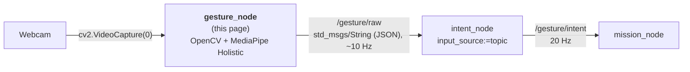
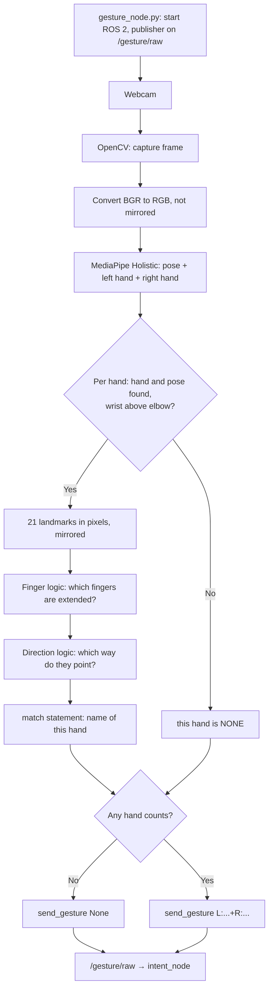
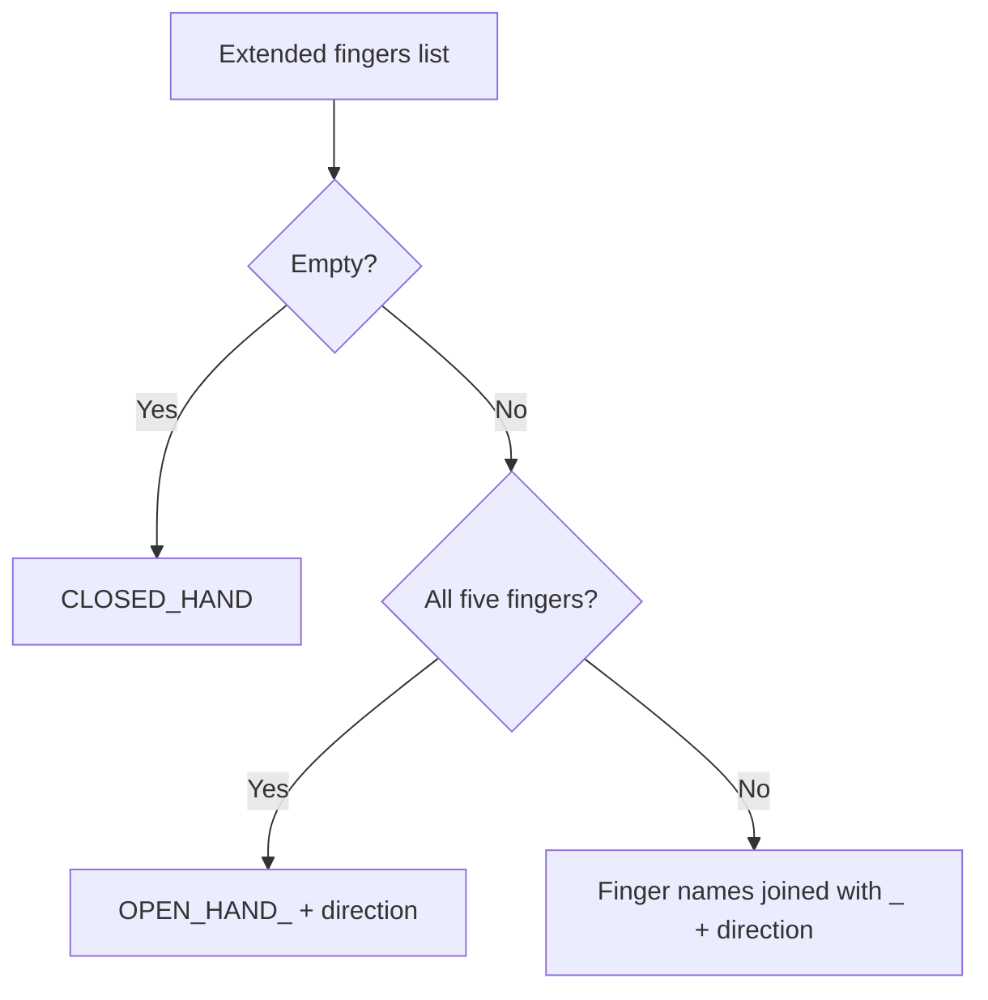

# 📷 Gesture Node: webcam + OpenCV + MediaPipe Holistic → `/gesture/raw`

`gesture_node` is the recogniser of the [[00 Gesture Pipeline|Gesture Pipeline]]. It opens the webcam with **OpenCV**, finds the body and both hands with **MediaPipe Holistic**, keeps only the hands whose wrist is above the elbow, names each one (`INDEX_UP`, `CLOSED_HAND`, ...) and publishes one combined name such as `L:NONE+R:INDEX_UP` on `/gesture/raw`. `intent_node` reads that topic ([[03 Intent Node]]).

This page covers why it is a ROS 2 node (§2), how the hands are found and named (§3–7), what it publishes (§8), where the code is (§9), running it in Docker (§10), and tuning and troubleshooting (§11–14). It covers **static gestures**: which fingers are extended and which way they point.

> [!NOTE] Related notes
> How to run the whole chain in Docker: [[01 ROS2 Nodes Installation|01]] §4. The tests: [[01 ROS2 Nodes Installation|01]] §7. Who reads its output: [[03 Intent Node]].

> [!WARNING] Status: DRAFT
> - A full run with the webcam, `intent_node` and `mission_node` is not recorded yet.
> - Running MediaPipe inside a ROS 2 node changes a consequence of [[ADR-018 Ground OS and ROS 2|ADR-018]] ("keep the recogniser in its own venv/process"). An ADR that amends ADR-018 is still needed (§15).

---

## 📍 1. Where it sits



| | |
| :--- | :--- |
| **Answers** | "Which pose is each raised hand in?" |
| **Knows about** | the camera, the body pose, both hands, gesture names. **No** safety logic: it only reports what it sees. |
| **Package** | `drone/ground/src/gesture_node/` |
| **Runs in** | the Docker image `rosrangers/gesture:jazzy`, the `gesture` service (§10) |

---

## ❓ 2. Why the recogniser is a ROS 2 node

The recogniser publishes on a ROS 2 topic so it works like every other node (the `ros2` commands run through the `echo` container, [[01 ROS2 Nodes Installation|01]] §5):

- `ros2 topic echo /gesture/raw`, `ros2 topic hz` and `ros2 node info /gesture_node` show what it sends.
- `ros2 bag record /gesture/raw /gesture/intent` records the input **and** output of `intent_node` together, and `ros2 bag play` replays them without a camera.
- A test can publish on `/gesture/raw` with `ros2 topic pub` ([[01 ROS2 Nodes Installation|01]] §6).
- Several readers can listen at once, and the recogniser could run on another machine on the same `ROS_DOMAIN_ID`.

### Why the camera is read inside the node

`gesture_node` reads the camera itself with `cv2.VideoCapture(0)` instead of using a separate camera node publishing `/image_raw` ([[05 Future Nodes]] §3). The frame stays in the same process, so there is no extra CPU or delay for sending images through DDS, and no `cv_bridge`, so the package clash [[ADR-018 Ground OS and ROS 2|ADR-018]] worried about does not happen. The cost: the picture is only visible in the "Gestures" window, not on a topic.

### What it costs

- A MediaPipe crash ends `gesture_node`. `intent_node` is a separate process and treats the silence as "recogniser gone" (`NEUTRAL`, reason `no_packets`, [[03 Intent Node]] §5), and `mission_node` hovers.
- `mediapipe` and `opencv-python` come from pip (`requirements.txt`), not from `rosdep`. The Docker image installs them next to ROS 2.

---

## 📌 3. OpenCV and MediaPipe Holistic: overview

- **OpenCV** captures the webcam frames and shows the video window.
- **MediaPipe** is an open-source Google framework with pretrained models (hands, face, pose) that run in real time on the CPU.
- `gesture_node` uses **MediaPipe Holistic**. For every frame it returns the **body pose** (33 landmarks: shoulders, elbows, wrists, ...) and the **21 landmarks of each hand** (wrist, knuckles and fingertips). Each hand is labelled as the person's **left** or **right** hand, and both belong to the same body.
- MediaPipe only gives us the landmarks. **Our code does the logic**: which hands count, angles and directions (§6).
- More info: [MediaPipe on GitHub](https://github.com/google-ai-edge/mediapipe)

### 3.1 Why Holistic

Holistic gives each hand a fixed left/right label and the arm it belongs to. That lets the node name both hands in a fixed order, so the gesture doesn't flip between frames, and ignore a hand whose arm is down (§3.2). Two-hand gestures (both open hands to engage, both fists to lock, [[00 Gesture Pipeline]] §3) are also easier to make and to tell apart.

What it costs:

- **Frame rate.** Holistic runs a pose model and two hand models: about 14.5 FPS at 640×480 on the ground laptop, lower under load. The keep-alive needs the loop at 10 FPS or more (§8), so close heavy programs and keep the laptop on mains power before flying. `model_complexity=0` is the fallback if it drops (§11).
- **Camera placement.** The camera must see the operator's shoulders and elbows, so the operator may need to stand further back.
- **More `NEUTRAL` flicker.** A two-hand gesture needs both hands detected and raised in 5 packets in a row ([[03 Intent Node]] §5).

### 3.2 Only raised arms count

A hand counts only when its **wrist is above its elbow** in the image (pose landmarks 13/15 for the left arm, 14/16 for the right, `is_arm_raised()` in `hand_processing.py`). Otherwise, or when no pose is found, the hand is `NONE` in the combined name (§7). With both arms down the gesture is `null`: `intent_node` turns it into `NEUTRAL` and `mission_node` hovers.

> [!NOTE] No compiling needed
> MediaPipe's official C++ API can only be built from source with Bazel. In Python we install the prebuilt `mediapipe` package with pip.

> [!WARNING] Keep `mediapipe==0.10.21` pinned
> MediaPipe 1.1.0 removed the `mp.solutions` API this code uses (`mp.solutions.holistic`), so upgrading needs a port of Holistic to the Tasks API. 0.10.21 only has packages for Python 3.10–3.12. A port is listed in [[05 Future Nodes]].

---

## 🔄 4. How the node works



0. **Start** (`gesture_node.py`): creates the node and a publisher on `/gesture/raw`, then runs the camera loop of `gestures.py`.
1. **Capture** (`gestures.py`): OpenCV reads a frame from the webcam.
2. **Preprocess** (`gestures.py`): the frame is converted from BGR to RGB. It is **not** mirrored, so Holistic's left and right are the person's own.
3. **Detect** (`hand_processing.py`): `detect_gesture` runs Holistic, which returns the pose and the landmarks of each hand.
4. **Raised arms only** (`hand_processing.py`): `raised_hand_gesture` drops a hand that is missing, has no pose, or whose wrist is not above the elbow (§3.2).
5. **Convert** (`hand_processing.py`): each remaining hand's landmarks are converted to **pixels**, so angles are not distorted by the aspect ratio, and mirrored, so `RIGHT` is the operator's right, as in the window.
6. **Interpret**: `is_finger_extended` decides which fingers are extended.
7. **Direction**: `pointing_direction` works out which way the hand points (§6).
8. **Classify**: `recognize` names each hand, and `combine_hands` builds one name for both, left first (§7).
9. **Output** (`gestures.py`): `draw_body` draws the pose and both hands, the frame is mirrored for the window, the name is printed when it changes, and `send_gesture` is called on **every** frame. It publishes at once when the gesture changes and otherwise repeats it every 0.1 s as a keep-alive (§8). `intent_node` treats silence as "the recogniser died or the hand is gone".
10. **Stop**: `q` in the window, Ctrl+C, or SIGTERM (`docker stop`) exit with code 0. Exit code 1 means camera 0 couldn't be opened or stopped delivering frames; the log line `Camera loop ended: ...` says which. The camera and the window are always released.

The camera loop owns the main thread, because OpenCV windows must stay there. ROS 2 spins in a background thread, so `ros2 param` and `ros2 node info` still answer. Ctrl+C and SIGTERM only set a flag that the loop checks once per frame (`gesture_node.py`).

### 🖼️ Frames and NumPy

A **frame** is one image from the camera. In Python it is a **NumPy array** of shape `(height, width, 3)`, type `uint8`. OpenCV gives **BGR**, MediaPipe needs **RGB**, so `gestures.py` keeps two versions: `frame` (BGR, for drawing and the window) and `rgb` (passed to MediaPipe).

### 🔌 Feeding other image sources

`hand_processing.py` never imports OpenCV. `detect_gesture(holistic, rgb_image)` accepts **any RGB, `uint8`, `(height, width, 3)` NumPy array**: an OpenCV frame after `cv2.cvtColor(frame, cv2.COLOR_BGR2RGB)`, a Pillow image after `np.array(img.convert("RGB"))`, and so on.

> [!WARNING] Things to check when connecting a new source
> * **Channel order:** BGR passed in as RGB does not crash, but detection gets worse.
> * **Grayscale or float images** must be converted to 3 channels and `uint8` first.
> * **Single images:** use `create_holistic(static_image_mode=True)`. For video keep the default so the body is tracked between frames.
> * **Mirroring:** pass the image **as the camera took it**. `detect_gesture` mirrors the hand landmarks itself; a mirrored image swaps the `L:` and `R:` hands.
> * **The whole upper body** must be in the image: without the pose, no hand counts (§3.2).

---

## 🦴 5. Landmarks used for finger detection

| Finger | Knuckle (MCP) | Middle joint (PIP / IP) | Tip |
| :--- | :---: | :---: | :---: |
| Thumb | 2 | 3 | 4 |
| Index | 5 | 6 | 8 |
| Middle | 9 | 10 | 12 |
| Ring | 13 | 14 | 16 |
| Pinky | 17 | 18 | 20 |

Landmark **0** is the wrist. In the code each finger is a tuple `(MCP, PIP, tip)` in the `FINGERS` dictionary of `hand_processing.py`. The pose landmarks for the arm check (elbows and wrists) are the constants at the top of the same file.

> [!NOTE] Image coordinates
> `x` grows to the right and `y` grows **downward**, so "up" on screen means a smaller `y`.

---

## 📐 6. The math

### Finger extended? (index, middle, ring, pinky)

The program measures the angle at the middle joint (PIP) $b$, between the knuckle $a$ and the tip $c$:

$$\vec{v_1} = a - b, \qquad \vec{v_2} = c - b$$

$$\theta = \arccos\left(\frac{\vec{v_1} \cdot \vec{v_2}}{\lVert\vec{v_1}\rVert \, \lVert\vec{v_2}\rVert}\right)$$

A straight finger gives an angle close to $180^\circ$, a curled finger a much smaller one. The finger counts as **extended** when $\theta > 140^\circ$ (`EXTENDED_ANGLE`). Because this uses an angle and not "tip above joint", it works whichever way the hand is turned.

### Thumb extended?

The thumb bends sideways, so the angle check does not work well for it. Instead the program measures how far the thumb tip $P_4$ sticks out past the index knuckle $P_5$, along the palm's width axis (from the pinky knuckle $P_{17}$ toward the index knuckle):

$$\vec{u} = P_5 - P_{17}$$

$$t = \frac{(P_4 - P_5) \cdot \vec{u}}{\lVert\vec{u}\rVert} \cdot \frac{1}{\lVert P_9 - P_0 \rVert}$$

Dividing by the hand size $\lVert P_9 - P_0 \rVert$ (wrist to middle knuckle) makes the value the same near or far from the camera. The thumb counts as **extended** when $t > 0.5$ (`THUMB_OUT_RATIO`).

### Pointing direction

The program adds together the knuckle-to-tip vectors of the extended fingers, **without the thumb**: the thumb can't point straight out sideways, so it only says whether it is out. When the **thumb is the only** extended finger, the program uses the knuckle line instead, from the pinky knuckle $P_{17}$ to the index knuckle $P_5$, which points where the thumb sticks out:

$$d_x = \sum (x_{tip} - x_{mcp}), \qquad d_y = \sum (y_{tip} - y_{mcp})$$

$$\alpha = \operatorname{atan2}(d_x, -d_y)$$

$-d_y$ is used because `y` grows downward. This gives $0^\circ$ = up, $90^\circ$ = right, $-90^\circ$ = left, $180^\circ$ = down:

| Angle $\alpha$ | Direction |
| :---: | :---: |
| $-45^\circ$ to $45^\circ$ | `UP` |
| $45^\circ$ to $135^\circ$ | `RIGHT` |
| $-135^\circ$ to $-45^\circ$ | `LEFT` |
| anything else | `DOWN` |

---

## 🏷️ 7. Gesture names

### One hand

`recognize` turns the list of extended fingers and the direction into the name of one hand:



For example: fist `CLOSED_HAND`, all fingers up `OPEN_HAND_UP`, index pointing right `INDEX_RIGHT`, thumb and index up `THUMB_INDEX_UP`. Finger names always appear in the order thumb, index, middle, ring, pinky.

### Both hands: the published name

`combine_hands` builds one name for both hands, **always left first**, so the name doesn't flip between frames:

```text
L:<left hand>+R:<right hand>
```

A hand that doesn't count (not found, no pose, or arm down) is `NONE`. When neither hand counts, the gesture is `None` (`null` in the JSON). For example, right arm up with the index up and left arm down gives `L:NONE+R:INDEX_UP`.

Which names drive the drone is the vocabulary in [[00 Gesture Pipeline]] §3 and `GESTURE_TO_INTENT` in `intent_node` ([[03 Intent Node]] §5).

---

## 📤 8. Output: `/gesture/raw`

Type `std_msgs/msg/String`. `data` holds one JSON object:

```json
{"gesture": "L:NONE+R:INDEX_UP", "t": 1792483200.12, "xy": null}
```

| Field | Meaning |
| :--- | :--- |
| `gesture` | combined name `L:...+R:...` (§7), or `null` when no hand counts |
| `t` | sender time in seconds (`time.time()`). Information only: `intent_node` uses its own clock for timeouts |
| `xy` | palm position `[x, y]` in 0..1. Always `null` today |

| Rate | When |
| :--- | :--- |
| ~10 Hz | the gesture (or "no hand") stays the same |
| one extra message at once | the gesture changes |
| silence | the node stopped, crashed, or the camera loop stalled |

### 👀 How to read `/gesture/raw`

With the `gesture` service running, read it in the live table ([[01 ROS2 Nodes Installation|01]] §4.2) or with the `ros2` CLI through `echo` ([[01 ROS2 Nodes Installation|01]] §5):

| Command | Shows |
| :--- | :--- |
| `ros2 topic echo /gesture/raw std_msgs/msg/String --field data` | only the JSON text, one message after another |
| `ros2 topic hz /gesture/raw` | the rate: ~10 Hz while the window is open |
| `ros2 topic info /gesture/raw` | type, publisher and subscribers |

| You see | Meaning |
| :--- | :--- |
| the same name repeated ~10 times a second | a raised hand is held still in that pose |
| `"gesture": null` | no hand counts: both arms down, no hand found, or the body out of view (§3.2) |
| nothing at all, `hz` shows no new messages | the node is not running, or the camera loop is stuck |
| a name not in the vocabulary (for example `L:INDEX_PINKY_UP+R:NONE`) | normal: `gesture_node` names every pose; `intent_node` turns unknown names into `NEUTRAL` |

To read it in code, subscribe to `std_msgs/String` and parse `msg.data` as JSON.

---

## 📁 9. Code layout

```text
drone/ground/src/gesture_node/
├── package.xml, setup.py, setup.cfg, requirements.txt
├── gesture_node/
│   ├── gesture_node.py      # ROS 2 node: publisher, spin thread, signals, exit codes
│   ├── gestures.py          # OpenCV camera loop and window
│   ├── hand_processing.py   # MediaPipe Holistic, raised-arm check, math, gesture names
│   └── gesture_sender.py    # keep-alive rule, publishes on /gesture/raw
└── test/                    # unit, node and process tests; fake_camera.py runs the node without a webcam
```

`hand_processing.py` and `gesture_sender.py` have no ROS imports, so they are unit-tested without ROS. How to run the tests (`make unit`, `make smoke`) and what each file checks: [[01 ROS2 Nodes Installation|01]] §7. Tests with `intent_node` are in `drone/tests/ros/`.

The Docker image is built from `drone/ground/docker/gesture/Dockerfile` ([[01 ROS2 Nodes Installation|01]] §4.2).

---

## ▶️ 10. Run in Docker

`make` starts it with the rest of the chain; `docker compose up --build gesture` starts it alone ([[01 ROS2 Nodes Installation|01]] §4). The service gets the host's `/dev/video0` as camera 0 and opens the "Gestures" window on your display. Its output goes to `logs/gesture/latest.log`.

Stand back so the window shows your shoulders and elbows. Stop with `q` in the window, Ctrl+C, or `docker compose stop gesture`. The node works on its own: without `intent_node`, `/gesture/raw` still shows what it sends (§8).

| Parameter | Default | Meaning |
| :--- | :--- | :--- |
| `raw_topic` | `/gesture/raw` | topic to publish on (must match `intent_node`'s `raw_topic`) |

The camera index and the keep-alive period are constants in `gestures.py` and `gesture_sender.py`.

---

## 🎚️ 11. Tuning

| Setting | Default | Effect |
| :--- | :---: | :--- |
| `EXTENDED_ANGLE` | `140` | Angle at the middle joint above which a finger counts as extended. Lower = easier. |
| `THUMB_OUT_RATIO` | `0.5` | How far (in hand sizes) the thumb tip must stick out past the index knuckle. Lower = easier. |
| `min_detection_confidence` | `0.7` | How sure MediaPipe must be before it reports a new body. |
| `min_tracking_confidence` | `0.5` | How sure MediaPipe must be to keep tracking the body between frames. |
| `model_complexity` | `1` | Size of Holistic's pose model. `0` is faster: use it if the frame rate drops below 10 FPS. |

All five are in `hand_processing.py` (the first two at the top, the others in `create_holistic()`). Rebuild the image after an edit ([[01 ROS2 Nodes Installation|01]] §4.4).

> [!WARNING] Starting values
> `THUMB_OUT_RATIO` is a guess. To tune it, temporarily print `thumb_out(lm)` in `raised_hand_gesture`, rebuild, watch the value in `logs/gesture/latest.log` with the thumb tucked and stretched out, and pick a value between the two.

---

## ⚠️ 12. Known limitations

- Thumb detection is the least reliable part. `THUMB_OUT_RATIO` needs tuning.
- Lighting and camera quality affect accuracy.
- Holistic's frame rate and the camera placement it needs (§3.1).
- The arm check only compares heights: a hand held just above the elbow, for example while scratching your chin, counts.
- Only one person: Holistic follows one body. A second person in view can be picked up instead.
- Gestures that depend on more than "extended or not" (pinch, OK sign) need extra logic (§14).
- Only static poses. Movement (wave, swipe) needs a tracker over several frames ([[05 Future Nodes]]).
- The node always opens a window, so it needs a display, also in Docker (§15).

---

## 🧯 13. Troubleshooting

Docker, camera and display problems: [[01 ROS2 Nodes Installation|01]] §8. Problems with the recognition:

| Symptom | Likely cause | Fix |
| :--- | :--- | :--- |
| Thumb counted as out when it is tucked (or the other way) | threshold | tune `THUMB_OUT_RATIO` (§11) |
| Bent fingers counted as extended | threshold | raise `EXTENDED_ANGLE` |
| Gesture name flickers between two values | the hand is near a threshold or a 45° direction boundary | hold the pose more clearly, or tune |
| `gesture` stays `null` with a hand clearly up | the elbow is out of view, so there is no pose | step back until shoulders and elbows are in the window (the pose is drawn when found) |
| One hand shows as `NONE` | that wrist is not above its elbow | raise the forearm; the hand must be higher than the elbow |
| `L:` and `R:` swapped | the image was mirrored before `detect_gesture` | pass the camera frame as it is (§4) |
| `ros2 topic hz /gesture/raw` under 10 Hz | Holistic is too slow on this laptop | close heavy programs, plug in the charger, or set `model_complexity=0` (§11) |
| No hand detected | light, angle, confidence | improve lighting, face the palm at the camera, lower `min_detection_confidence` |

---

## ➕ 14. Adding new gestures

1. **Static:** raise the arm, hold the gesture and read its name on `/gesture/raw` (§8), for example `L:NONE+R:INDEX_PINKY_UP`. To make it do something, add the full two-hand name to `GESTURE_TO_INTENT` in `intent_node` ([[03 Intent Node]] §5) and agree the meaning in [[00 Gesture Pipeline]] §3. If it needs a special name, add a `case` to `recognize()` in `hand_processing.py`, above `case _`.
2. **Distance based (pinch, OK sign):** compare the distance between two landmarks with `dist()`, for example thumb tip (4) and index tip (8), divided by `hand_size(lm)` so it does not depend on the distance to the camera:

$$d = \frac{\sqrt{(x_8 - x_4)^2 + (y_8 - y_4)^2}}{\lVert P_9 - P_0 \rVert}$$

---

## ❓ 15. Open points

- [ ] **ADR.** Write the ADR that amends [[ADR-018 Ground OS and ROS 2|ADR-018]]: recogniser inside ROS 2, camera read in the node, no `cv_bridge`.
- [ ] **First full run** with the webcam, `intent_node` and `mission_node`.
- [ ] **Frame rate under load.** Measure on the ground computer used for flying, and decide whether `model_complexity=0` becomes the default.
- [ ] **Headless run.** `gestures.py` always opens a window; on a PC without a display the node fails. Add a parameter if the recogniser moves to the Raspberry Pi.

---

## Glossary

| Term | Meaning |
| --- | --- |
| **ADR** | Architecture Decision Record: a documented decision and its rationale. |
| **BGR / RGB** | Orders of the three colour channels. OpenCV uses BGR, MediaPipe RGB. |
| **cv_bridge** | ROS package that converts between `sensor_msgs/Image` and OpenCV / NumPy images. Not used by `gesture_node`. |
| **DDS** | The middleware ROS 2 uses to move messages between nodes. |
| **Docker** | Tool that runs software in containers: isolated environments built from an image (Dockerfile). `rosrangers/gesture:jazzy` is this node's image. |
| **Exit code** | The number a program returns when it ends: 0 = normal stop, 1 = error (here: no camera). |
| **Holistic** | MediaPipe Holistic: one model for the body pose (33 landmarks) and both hands (21 each), with each hand labelled left or right. |
| **JSON** | A text format for structured data, used inside the `/gesture/raw` and `/gesture/intent` messages. |
| **Keep-alive** | A small periodic message that proves the sender is still running. |
| **Landmark** | One tracked point: 21 on each hand (wrist, knuckles, finger joints and tips), 33 on the body pose (shoulders, elbows, wrists, ...). |
| **MCP / PIP / IP** | Finger joints: knuckle, middle joint, and the thumb's single middle joint. |
| **MediaPipe** | A Google framework used here to detect the body pose and both hands (Holistic). |
| **Node** | A single ROS 2 process that does one job and talks to others through topics. |
| **NumPy array** | The image format passed to MediaPipe: RGB, `uint8`, shape `(height, width, 3)`. |
| **OpenCV** | A computer-vision library used here to read the webcam and draw the video window. |
| **Pose** | The body landmarks Holistic finds (shoulders, elbows, wrists, ...). The raised-arm check uses them. |
| **ROS 2** | The second-generation Robot Operating System middleware used for robotics integration. |
| **SIGTERM** | The signal `docker stop` sends to ask a program to stop. The node treats it like Ctrl+C: clean stop, exit code 0. |
| **Static gesture** | A gesture recognised from a single frame: which fingers are extended and where they point. |
| **Tasks API** | MediaPipe's newer API that replaces the removed `mp.solutions`. A port must cover Holistic (pose and both hands). |
| **Topic** | A named channel on which ROS 2 nodes publish and subscribe to messages. |
