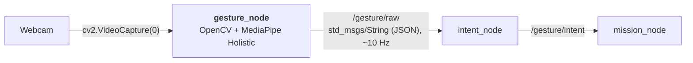

# 📷 Gesture Node: webcam + OpenCV + MediaPipe Holistic → `/gesture/raw`

`gesture_node` is the recogniser of the [[00 Gesture Pipeline|Gesture Pipeline]]. It reads the webcam, finds the body and both hands with **MediaPipe Holistic**, names the pose of each raised hand and publishes one combined name such as `L:NONE+R:INDEX_UP` on `/gesture/raw` for `intent_node` ([[03 Intent Node]]).

> [!WARNING] Status: DRAFT
> - A full run with the webcam, `intent_node` and `mission_node` is not recorded yet.
> - Running MediaPipe inside a ROS 2 node changes a consequence of [[ADR-018 Ground OS and ROS 2|ADR-018]]; the ADR that amends it is still needed (§15).

---

## 📍 1. Where it sits



| | |
| :--- | :--- |
| **Input** | webcam frames (camera 0) |
| **Processing** | find the pose and both hands, keep raised hands, name each hand's pose |
| **Output** | `/gesture/raw`: one gesture name (or `null`), ~10 Hz (§8) |
| **Safety logic** | none: it only reports what it sees. Filtering is `intent_node`'s job |
| **Package / image** | `drone/ground/src/gesture_node/`, Docker image `rosrangers/gesture:jazzy` |

---

## ❓ 2. Why this node

It turns the camera picture into a plain gesture name, so the rest of the chain never deals with images. Being a ROS 2 node, its output can be read, recorded and faked like any topic ([[01 ROS2 Nodes Installation|01]] §5), which is how `intent_node` is tested without a camera.

It reads the camera itself instead of subscribing to a separate camera node: the frame stays in one process, so there is no image transport and no `cv_bridge`. If MediaPipe crashes, only this node stops; `intent_node` sees the silence and the drone hovers ([[03 Intent Node]] §5).

---

## 📌 3. MediaPipe Holistic

**OpenCV** reads the frames and shows the "Gestures" window. **MediaPipe Holistic** returns, for every frame, the **body pose** (33 landmarks: shoulders, elbows, wrists, ...) and the **21 landmarks of each hand**, each hand labelled as the person's left or right. MediaPipe only gives landmarks; our code decides which hands count and what pose they show.

`mediapipe` is pinned to `0.10.21` (`requirements.txt`): 1.x removed the `mp.solutions` API this code uses, so upgrading needs a port to the Tasks API ([[05 Future Nodes]] §2).

### 3.1 Why Holistic

Holistic ties each hand to a fixed side and to its arm. That gives a stable left-then-right name that doesn't flip between frames, makes two-hand gestures possible ([[00 Gesture Pipeline]] §3), and lets the node ignore lowered arms (§3.2).

The cost: about 14.5 FPS at 640×480 on the ground laptop (lower under load; at least 10 FPS is needed for the keep-alive, `model_complexity=0` is the fallback, §11), and the camera must see the operator's shoulders and elbows.

### 3.2 Only raised arms count

A hand counts only when its **wrist is above its elbow** (`is_arm_raised()` in `hand_processing.py`). A lowered hand, or a hand with no pose found, is `NONE` in the name. With both arms down the gesture is `null`, which `intent_node` turns into `NEUTRAL`, so the drone hovers.

---

## 🔄 4. How it works

Each camera frame goes through these steps (`gestures.py` for the loop, `hand_processing.py` for the rest):

1. **Read** a frame and convert it from BGR to RGB. It is **not** mirrored, so Holistic's left and right are the operator's own.
2. **Detect** the pose and both hands with Holistic (`detect_gesture`).
3. **Keep raised hands** only (§3.2).
4. **Name each hand** from which fingers are extended and where they point (§6, `recognize`), with the landmarks mirrored so `RIGHT` is the operator's right, as in the window.
5. **Combine** both names, left first (§7, `combine_hands`).
6. **Publish** on `/gesture/raw`: at once when the name changes, otherwise every 0.1 s (§8). Draw the pose and hands in the mirrored "Gestures" window.

`q` in the window, Ctrl+C or `docker stop` end the node with exit code 0; exit code 1 means camera 0 couldn't be opened or stopped delivering frames.

---

## 🦴 5. Landmarks

Each finger is described by its knuckle, middle joint and tip (the `FINGERS` table in `hand_processing.py`); landmark 0 is the wrist. Image `y` grows downward, so "up" means a smaller `y`.

---

## 📐 6. Finger and direction logic

- **Finger extended:** the angle at the middle joint is above 140° (`EXTENDED_ANGLE`). An angle works whichever way the hand is turned.
- **Thumb extended:** the thumb bends sideways, so instead the node checks how far the thumb tip sticks out past the index knuckle, in hand sizes; out when above 0.5 (`THUMB_OUT_RATIO`).
- **Direction:** the extended fingers' knuckle-to-tip vectors are added up (thumb excluded) and the angle is sorted into `UP`, `RIGHT`, `DOWN` or `LEFT` (45° sectors). A thumb alone points along the knuckles, where it sticks out.

---

## 🏷️ 7. Gesture names

**One hand** (`recognize`): `CLOSED_HAND` for a fist, `OPEN_HAND_<direction>` for all five fingers, otherwise the extended fingers in the order thumb, index, middle, ring, pinky plus the direction, for example `INDEX_RIGHT` or `THUMB_INDEX_UP`.

**Both hands** (`combine_hands`): `L:<left>+R:<right>`, always left first, `NONE` for a hand that doesn't count, and `null` when neither counts. Example: `L:NONE+R:INDEX_UP`.

Which names drive the drone: [[00 Gesture Pipeline]] §3.

---

## 📤 8. Output: `/gesture/raw`

`std_msgs/msg/String` holding JSON:

```json
{"gesture": "L:NONE+R:INDEX_UP", "t": 1792483200.12, "xy": null}
```

| Field | Meaning |
| :--- | :--- |
| `gesture` | combined name (§7), or `null` when no hand counts |
| `t` | sender time, information only (`intent_node` uses its own clock) |
| `xy` | palm position, always `null` for now |

The message goes out at once when the gesture changes and is repeated every 0.1 s (~10 Hz) as a **keep-alive**. Silence means the node stopped or the camera loop is stuck, which `intent_node` treats as "recogniser gone". Any pose gets a name; names that aren't in the vocabulary become `NEUTRAL` in `intent_node`.

Read it in the live table or with `ros2 topic echo /gesture/raw` ([[01 ROS2 Nodes Installation|01]] §5).

---

## 📁 9. Code

| File (`drone/ground/src/gesture_node/gesture_node/`) | Does |
| :--- | :--- |
| `gesture_node.py` | the ROS 2 node: publisher, spin thread, clean stop |
| `gestures.py` | camera loop and window |
| `hand_processing.py` | Holistic, raised-arm check, finger logic, names |
| `gesture_sender.py` | keep-alive and publishing |

Tests: `test/` in the package and `drone/tests/ros/` ([[01 ROS2 Nodes Installation|01]] §7).

---

## ▶️ 10. Run

It runs as the `gesture` service: `make` starts it with the chain, `docker compose up --build gesture` alone ([[01 ROS2 Nodes Installation|01]] §4). It uses the host's `/dev/video0` and opens the "Gestures" window. Stand back so the window shows your shoulders and elbows.

---

## 🎚️ 11. Tuning

| Setting (in `hand_processing.py`) | Default | Effect |
| :--- | :---: | :--- |
| `EXTENDED_ANGLE` | `140` | lower = fingers count as extended more easily |
| `THUMB_OUT_RATIO` | `0.5` | lower = thumb counts as out more easily (a starting guess) |
| `min_detection_confidence` / `min_tracking_confidence` | `0.7` / `0.5` | how sure Holistic must be to find / keep the body |
| `model_complexity` | `1` | `0` is faster if the frame rate drops below 10 FPS |

Rebuild the image after an edit ([[01 ROS2 Nodes Installation|01]] §4).

---

## ⚠️ 12. Known limitations

- Thumb detection is the least reliable part.
- The arm check only compares heights, so a hand just above the elbow counts.
- One person only: a second person in view can be picked up instead.
- Static poses only.
- The node needs a display for its window.

---

## 🧯 13. Troubleshooting

Docker, camera and display: [[01 ROS2 Nodes Installation|01]] §8.

| Symptom | Fix |
| :--- | :--- |
| `gesture` stays `null` with a hand up | step back until shoulders and elbows are in view; raise the forearm above the elbow |
| One hand shows as `NONE` | that wrist is below its elbow |
| Name flickers, or thumb / bent fingers wrong | hold the pose more clearly, or tune (§11) |
| Under 10 Hz on `/gesture/raw` | close heavy programs, plug in the charger, or `model_complexity=0` |

---

## ➕ 14. Adding a gesture

Hold it and read its name on `/gesture/raw`, then add the full two-hand name to `GESTURE_TO_INTENT` in `intent_node` ([[03 Intent Node]] §5) and agree the meaning in [[00 Gesture Pipeline]] §3. A special name needs a `case` in `recognize()`.

---

## ❓ 15. Open points

- [ ] ADR that amends [[ADR-018 Ground OS and ROS 2|ADR-018]] (recogniser inside ROS 2, camera read in the node).
- [ ] First full run with the webcam, `intent_node` and `mission_node`.
- [ ] Measure the frame rate on the flying laptop; decide whether `model_complexity=0` becomes the default.
- [ ] Headless option if the recogniser moves to the Raspberry Pi.

---

## Glossary

| Term | Meaning |
| --- | --- |
| **ADR** | Architecture Decision Record: a documented decision and its rationale. |
| **BGR / RGB** | Orders of the three colour channels. OpenCV uses BGR, MediaPipe RGB. |
| **cv_bridge** | ROS package that converts between ROS image messages and OpenCV images. Not used here. |
| **Docker** | Tool that runs software in containers built from an image. `rosrangers/gesture:jazzy` is this node's image. |
| **Exit code** | The number a program returns when it ends: 0 = normal stop, 1 = error. |
| **Holistic** | MediaPipe Holistic: one model for the body pose and both hands, each hand labelled left or right. |
| **JSON** | A text format for structured data, used inside the `/gesture/raw` messages. |
| **Keep-alive** | A periodic repeat that proves the sender is still running. |
| **Landmark** | One tracked point: 21 on each hand, 33 on the body pose. |
| **MediaPipe** | A Google framework used here to detect the body pose and both hands. |
| **Node** | A single ROS 2 process that does one job and talks to others through topics. |
| **OpenCV** | A computer-vision library used here to read the webcam and draw the window. |
| **Pose** | The body landmarks Holistic finds (shoulders, elbows, wrists, ...). |
| **Tasks API** | MediaPipe's newer API that replaces the removed `mp.solutions`. |
| **Topic** | A named channel on which ROS 2 nodes publish and subscribe to messages. |
