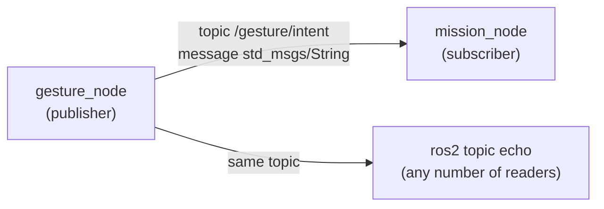

# 🤖 ROS 2 and nodes: install ROS 2 Jazzy, then build, run and test each node

This is the practical guide. It explains what ROS 2 and nodes are, how to install ROS 2 Jazzy, and how to build, run and **prove** each gesture node that exists so far. What each node does inside is in its own note: [[03 Gesture_node]], [[04 Mission_Node]].

> [!WARNING] Status: DRAFT. Tested with ROS 2 stubbed on the host, not yet built on real Jazzy
> The `gesture_node` filter has 17 unit tests, and the real `gesture_sender.py` fed into the real node code behaved as described in §9. Nobody has run `colcon build` on a real Jazzy install yet. Record the first real build in the test log (§12).

### Node status (2026-10-16)

| Node | Build | Run | Test |
| :--- | :---: | :---: | :---: |
| `gesture_node` | §6 | §7 | §9 |
| `mission_node` | ==🔴not created yet== | | test plan in §10 |

---

## 📚 1. What ROS is

**ROS** (Robot Operating System) is not an operating system. It is a framework and a set of tools for building a robot program out of many small programs that talk to each other in a standard way. **ROS 2** is the current generation (a rewrite of the original ROS). It provides:

- the way programs find and talk to each other (**topics**, services, actions),
- tools to build, run, inspect and record them (`colcon`, `ros2 topic echo`, `ros2 bag`),
- ready-made messages and libraries (`std_msgs`, `geometry_msgs`, `rclpy`).

| Word | Meaning | In this project |
| :--- | :--- | :--- |
| **Node** | one running program with one job | `gesture_node`, `mission_node`, `flight_interface` |
| **Topic** | a named channel that carries messages | `/gesture/intent` |
| **Message** | a typed piece of data on a topic | `std_msgs/msg/String` |
| **Publisher** | a node that sends to a topic | `gesture_node` |
| **Subscriber** | a node that receives from a topic | `mission_node` |
| **Package** | a folder of code that builds into nodes | `gesture_node` |
| **Workspace** | the folder where packages are built | `~/ros2_ws` |



A publisher does not know who listens. Any number of nodes, or the `ros2` command, can read the same topic.

---

## 🐢 2. What ROS 2 Jazzy is, and why we use it

ROS 2 comes in **distributions**, each tied to a Ubuntu version. **Jazzy Jalisco** ("Jazzy") was released in May 2024.

| Item | Value |
| :--- | :--- |
| Release type | LTS (long-term support), supported until May 2029 |
| Supported OS | **Ubuntu 24.04 (Noble)**, x86-64 and ARM64 |
| Python | 3.12 (the Ubuntu 24.04 system Python) |

We use it because [[ADR-018 Ground OS and ROS 2|ADR-018]] and the plan ([[Study Plan v2]], Track C) choose Ubuntu 24.04 + Jazzy. It is the LTS release for Ubuntu 24.04, it installs from ready-made `apt` packages, and the same packages cover the Raspberry Pi 5 option in [[Hardware Inventory]].

> [!WARNING] Jazzy needs Ubuntu 24.04
> There are no Jazzy `apt` packages for Ubuntu 22.04 (that one is for Humble). Run `lsb_release -a` first. If it says 22.04, upgrade or dual-boot to 24.04, use a container, or ask the team. Do not mix Humble instructions into this page.

---

## 🧩 3. Why several nodes instead of one big script

| One big script | Several nodes |
| :--- | :--- |
| A bug or freeze anywhere stops everything, including the safety checks | A crash stays inside one node. Its neighbours notice it went silent (timeouts) |
| MediaPipe, ROS and flight code share one Python environment and its version conflicts | MediaPipe 0.10.21 stays in its own venv. UDP on localhost joins the two worlds |
| Hard to test one part alone | Each node is started, tested and replaced alone: fake the input, read the output |
| Hard to reuse | The same `/gesture/intent` could drive the simulator, the drone, a car or an arm |
| Hard to see what happened | `ros2 topic echo` shows live data, `ros2 bag` records it for replay |
| Several people editing one file | Five tracks work on separate nodes with agreed message contracts |

The cost is some structure: messages must be defined and nodes started together. For a flight system with a safety story the trade is worth it, and the Module 1 plan expects a ROS 2 node graph. The full chain is in [[00 Gesture Pipeline]] §1.

---

## 📦 4. Install ROS 2 Jazzy

Source: the official *Ubuntu (deb packages)* page of the Jazzy docs (checked 2026-10-14). If a command fails, compare with that page.

### ✅ Checklist

- [ ] 4.1 Check Ubuntu 24.04 and a UTF-8 locale
- [ ] 4.2 Add the ROS 2 apt repository
- [ ] 4.3 Install ROS 2 and the build tools
- [ ] 4.4 Load the environment in every terminal
- [ ] 4.5 Initialise rosdep
- [ ] 4.6 Run the talker/listener demo
- [ ] 4.7 Set your own `ROS_DOMAIN_ID`

### 4.1 Check the system

```bash
lsb_release -a        # must say 24.04 (Noble)
locale                # must show UTF-8
```

If the locale is not UTF-8:

```bash
sudo apt update && sudo apt install locales
sudo locale-gen en_US en_US.UTF-8
sudo update-locale LC_ALL=en_US.UTF-8 LANG=en_US.UTF-8
export LANG=en_US.UTF-8
```

### 4.2 Add the ROS 2 repository

```bash
sudo apt install software-properties-common
sudo add-apt-repository universe

sudo apt update && sudo apt install curl -y
export ROS_APT_SOURCE_VERSION=$(curl -s https://api.github.com/repos/ros-infrastructure/ros-apt-source/releases/latest | grep -F "tag_name" | awk -F\" '{print $4}')
curl -L -o /tmp/ros2-apt-source.deb "https://github.com/ros-infrastructure/ros-apt-source/releases/download/${ROS_APT_SOURCE_VERSION}/ros2-apt-source_${ROS_APT_SOURCE_VERSION}.$(. /etc/os-release && echo ${UBUNTU_CODENAME:-${VERSION_CODENAME}})_all.deb"
sudo dpkg -i /tmp/ros2-apt-source.deb
```

### 4.3 Install ROS 2 and the build tools

```bash
sudo apt update && sudo apt upgrade
sudo apt install ros-jazzy-desktop     # ROS, RViz, demos, tutorials (recommended)
sudo apt install ros-dev-tools         # colcon, rosdep and other build tools
```

`ros-jazzy-ros-base` is the smaller install (no GUI tools). It is enough to run `gesture_node`.

### 4.4 Load the environment

Every terminal must load ROS 2 before any `ros2` command works:

```bash
source /opt/ros/jazzy/setup.bash
```

To do it automatically in new terminals:

```bash
echo "source /opt/ros/jazzy/setup.bash" >> ~/.bashrc
```

> [!NOTE] Using zsh?
> Replace `setup.bash` with `setup.zsh` and `~/.bashrc` with `~/.zshrc` everywhere on this page.

### 4.5 Initialise rosdep (once)

```bash
sudo rosdep init
rosdep update
```

### 4.6 Prove the install works

Terminal 1: `ros2 run demo_nodes_cpp talker`. Terminal 2: `ros2 run demo_nodes_py listener`. The listener prints the talker's messages: one node publishes to a topic, another receives it.

### 4.7 Keep your lab neighbours out of your topics

ROS 2 nodes on the same network find each other automatically, so a teammate's node could appear on your topics. In every terminal (or `~/.bashrc`):

```bash
export ROS_DOMAIN_ID=42                         # your own number, 0-101, different from teammates
export ROS_AUTOMATIC_DISCOVERY_RANGE=LOCALHOST  # Jazzy: only talk to this machine
```

---

## 🏗️ 5. The workspace `~/ros2_ws`

A **workspace** is the folder where colcon builds packages. It lives on your PC, **outside the repo**:

```text
~/ros2_ws/
├── src/
│   ├── gesture_node -> ~/ROSRangers/drone/ground/src/gesture_node   (symlink)
│   └── mission_node -> ~/ROSRangers/drone/ground/src/mission_node   (later)
├── build/      # generated by colcon build
├── install/    # generated: what `source install/setup.bash` loads
└── log/        # generated
```

> [!NOTE] Why `ros2_ws` stays on the host and not in the repo
> - `build/`, `install/` and `log/` are generated, large and specific to one machine and one ROS version, so they are never committed.
> - The **source** is in the repo. `src/` only holds symlinks to it. With `--symlink-install`, editing a Python file in the repo takes effect without rebuilding.
> - Every teammate (and the CI runner) builds their own workspace from the same repo, so results do not depend on someone's leftover build folder.
> - Want it inside the project anyway? Build with `colcon build --base-paths drone/ground/src` and add `build/`, `install/` and `log/` to `.gitignore`.

---

## 🔨 6. Build `gesture_node`

### 6.1 Where the files are

| File or folder | Repo path | Notes |
| :--- | :--- | :--- |
| `package.xml`, `setup.py`, `setup.cfg`, `resource/gesture_node`, `gesture_node/` (`__init__.py`, `gesture_filter.py`, `gesture_node.py`), `test/test_gesture_filter.py` | `drone/ground/src/gesture_node/` | The ROS 2 package. `package.xml` must be directly in this folder. |
| `gesture_sender.py` | `drone/tools/gesture/` | Plain Python for the MediaPipe side, next to `gestures.py`. |
| `udp_listen.py` (proof tool without ROS) | not in the repo yet | Optional. If you add it, put it in `drone/tools/gesture/`. |

### 6.2 Build

```bash
source /opt/ros/jazzy/setup.bash
mkdir -p ~/ros2_ws/src
ln -s ~/ROSRangers/drone/ground/src/gesture_node ~/ros2_ws/src/gesture_node   # symlink, not a copy

cd ~/ros2_ws
rosdep install --from-paths src --ignore-src -r -y
colcon build --packages-select gesture_node --symlink-install
source install/setup.bash
ros2 pkg list | grep gesture_node      # must print gesture_node
```

- `~/ros2_ws/src/gesture_node/package.xml` must exist (through the symlink), not one folder deeper.
- Rebuild only after changing `setup.py` or `package.xml`. Python edits do not need it.
- Setuptools deprecation warnings are common and harmless if the build ends with `Summary: 1 package finished`.
- ==🔴Do not activate the MediaPipe venv in terminals that run ROS 2.==

### 6.3 Unit tests

With colcon:

```bash
cd ~/ros2_ws
colcon test --packages-select gesture_node && colcon test-result --verbose
```

Or without ROS at all:

```bash
cd ~/ROSRangers/drone/ground/src/gesture_node
python3 -m unittest discover -s test -v      # 17 tests, all OK
```

---

## ▶️ 7. Run the pipeline

Use three terminals and start the node first. The two ROS terminals use the **system** Python (no venv). The recogniser terminal uses the venv (no ROS).

**Terminal 1: the node**

```bash
source /opt/ros/jazzy/setup.bash
source ~/ros2_ws/install/setup.bash
ros2 run gesture_node gesture_node
```

`source ~/ros2_ws/install/setup.bash` makes ROS 2 find `gesture_node`. It must come after the `/opt/ros` line and be repeated in every new terminal and after every rebuild (or added to `~/.bashrc`). Expected: `Listening for gestures.py on UDP 127.0.0.1:5005`, then a warning `No packets from gestures.py` every 5 s until the recogniser starts.

**Terminal 2: watch the topic**

```bash
source /opt/ros/jazzy/setup.bash
source ~/ros2_ws/install/setup.bash
ros2 topic echo /gesture/intent
```

**Terminal 3: the recogniser** (setup in [[01 Gesture Recognition with OpenCV and MediaPipe|01]] §6)

```bash
cd ~/ROSRangers/drone/tools/gesture
source .venv/bin/activate
python3 gestures.py                   # on Wayland: QT_QPA_PLATFORM=xcb python3 gestures.py
```

Press `q` in the window to quit.

### What to expect

| Check | What you should see |
| :--- | :--- |
| Window opens | A window titled `Gestures` shows the webcam. If it is black, change the index in `VideoCapture(...)` and check `ls /dev/video*`. |
| Hand tracking | Landmarks drawn on your hand. The gesture name printed in terminal 3 when it changes. |
| Link works | Terminal 1 logs `First packet from gestures.py`, then `Recogniser link OK` every 5 s. |
| Node publishes | After about 0.4 s of a stable gesture, terminal 1 logs `Intent -> ...` and terminal 2 shows it. ~20 Hz (`ros2 topic hz /gesture/intent`). |
| Safety fallback | Hand out of view briefly → `NEUTRAL`. Out of view for a few seconds, or window closed → `HOVER_LAND_REQUEST`. |

---

## ⌨️ 8. The `ros2` command line and `rclpy`

`ros2` is one program with sub-commands. It talks to nodes that are already running, so you can inspect and control them without changing their code. Every terminal needs the two `source` lines first.

| Command | What it does | Example |
| :--- | :--- | :--- |
| `ros2 run <package> <executable>` | Starts a node | `ros2 run gesture_node gesture_node` |
| `ros2 pkg list` | Lists installed packages | `ros2 pkg list \| grep gesture_node` |
| `ros2 node list` | Lists running nodes | shows `/gesture_node` |
| `ros2 node info <node>` | Shows a node's topics and parameters | `ros2 node info /gesture_node` |
| `ros2 topic list` | Lists all topics | shows `/gesture/intent` |
| `ros2 topic echo <topic>` | Prints messages as they arrive | `ros2 topic echo /gesture/intent` |
| `ros2 topic info <topic>` | Shows the type, publishers and subscribers | `ros2 topic info /gesture/intent` |
| `ros2 topic hz <topic>` | Measures the publish rate | `ros2 topic hz /gesture/intent` (expect ~20 Hz) |
| `ros2 topic pub <topic> <type> <data>` | Publishes a message by hand | fake an input to another node (§10) |
| `ros2 param list <node>` | Lists a node's parameters | `ros2 param list /gesture_node` |
| `ros2 param get <node> <name>` | Reads a parameter | `ros2 param get /gesture_node stable_packets` |
| `ros2 param set <node> <name> <value>` | Changes a parameter while running | see the warning below |
| `ros2 bag record <topics>` / `ros2 bag play <file>` | Records topics and replays them | record `/gesture/intent` once, replay it without a camera |
| `ros2 launch <package> <file>` | Starts several nodes from one file | later, for `gesture_node` + `mission_node` ([[05 Future Nodes]]) |
| `ros2 service` / `ros2 action` | Same idea for services and actions | not used yet |

Add `--help` to any command, for example `ros2 topic --help`.

> [!WARNING] Parameters are safety settings
> `ros2 param set` changes a value while the node runs, but `gesture_node` reads its parameters only at start-up. To use new values, restart it with `--ros-args -p ...` ([[03 Gesture_node]] §7). Agree changes with the team first.

### The CLI and `rclpy`

`rclpy` is the Python library the nodes are written with. It creates the node, its publishers, timers and parameters, and `rclpy.spin()` keeps it running. `rclpy` has no commands of its own: you see its effects with `ros2`.

| In `gesture_node.py` (`rclpy`) | What you see with `ros2` |
| :--- | :--- |
| `super().__init__("gesture_node")` | the name in `ros2 node list` |
| `declare_parameter(...)` / `get_parameter(...)` | `ros2 param list` / `get`, and `--ros-args -p` |
| `create_publisher(String, topic, 10)` | `ros2 topic list`, `info` and `echo` |
| `create_timer(...)` | the 20 Hz rate in `ros2 topic hz` |
| `get_logger().info(...)` | the messages in the terminal where the node runs |
| `rclpy.spin(node)` | the node stays alive until Ctrl+C |

`gesture_node` has no subscriber, service or lifecycle yet. `mission_node` will add the first subscriber (to `/gesture/intent`), and `flight_interface` will be a lifecycle node.

---

## 🧪 9. Test `gesture_node`: prove that `gestures.py` is processed

Work through the levels in order. Each one proves one link of the chain, so a failure tells you where to look.

### Level 0: no camera at all (sender + node)

Start the node (§7, terminal 1) and `ros2 topic echo /gesture/intent` (terminal 2). In terminal 3, run the fake camera. It uses only the standard library, so no venv is needed:

```bash
cd ~/ROSRangers/drone/tools/gesture && python3 gesture_sender.py
```

About 13 s of scripted input should produce this sequence (`intent` / `reason`):

| Time | Fake input | Expected intent |
| :--- | :--- | :--- |
| before | nothing | `HOVER_LAND_REQUEST` / `no_packets_yet` |
| 0 s | `OPEN_HAND_UP` starts | `NEUTRAL` / `unconfirmed`, then `HOLD_POSITION` after ~0.4 s |
| 2 s | `INDEX_RIGHT` | `MOVE_RIGHT` after ~0.4 s |
| 5 s | no hand for 0.6 s | `NEUTRAL` / `no_hand` |
| 5.6 s | `CLOSED_HAND` | `NEUTRAL` / `unconfirmed`, then `STOP_HOVER` |
| 7.6 s | no hand for 3 s | `NEUTRAL`, then `HOVER_LAND_REQUEST` / `no_hand_long` after 2 s |
| 10.6 s | `INDEX_LEFT` | `MOVE_LEFT` |
| end | sender stops | `NEUTRAL`, then `HOVER_LAND_REQUEST` / `no_packets` |

### Level 1: does `gestures.py` send? (no ROS)

Stop the node (the UDP port is shared) and run:

```bash
python3 udp_listen.py   # from the folder where you keep it; not in the repo yet
```

Start `gestures.py`. Every packet is printed with a rate:

```text
#   42   9.8 pkt/s  {'gesture': 'INDEX_RIGHT', 't': 1791976551.56, 'xy': None}
```

**Pass:** about 10 pkt/s while a gesture is held, and `gesture` matches your hand. **If nothing prints:** `send_gesture` is not called, or the port differs (`PORT` in `gesture_sender.py`).

### Level 2: does the node receive it?

Stop `udp_listen.py`, start the node and `gestures.py`. The node log must show:

```text
[INFO] [gesture_node]: First packet from gestures.py: {'gesture': 'INDEX_RIGHT', ...}
[INFO] [gesture_node]: Recogniser link OK: 52 packets in the last 5 s, last gesture seen: INDEX_RIGHT
```

**Pass:** the first-packet line once, then the link report every 5 s with roughly 50 packets. `No packets from gestures.py in the last 5 s` → back to Level 1.

### Level 3: does the node publish the right intent?

```bash
ros2 topic echo /gesture/intent --field data     # just the JSON, one line per message
```

Hold each gesture of the vocabulary ([[00 Gesture Pipeline]] §3) for 1 s. **Pass:** each shows the expected intent within about 0.5 s.

### Level 4: the safety behaviour

| Test | Expected |
| :--- | :--- |
| Show `INDEX_RIGHT` until `MOVE_RIGHT`, remove the hand for 1 s, show `CLOSED_HAND` | `NEUTRAL` during the gap, `NEUTRAL` / `unconfirmed` when the hand returns (**never** `MOVE_RIGHT` again), then `STOP_HOVER` |
| Hold `INDEX_RIGHT`, hide the hand for 0.1 s, show it again | stays `MOVE_RIGHT` |
| Hide the hand for 3 s | `NEUTRAL`, then `HOVER_LAND_REQUEST` / `no_hand_long` |
| Stop `gestures.py` (Ctrl+C) while holding a gesture | `NEUTRAL` within 0.3 s, `HOVER_LAND_REQUEST` / `no_packets` after 2 s |
| Show a gesture not in the table | `NEUTRAL` / `unmapped_gesture` |

### Level 5: keep evidence

```bash
ros2 bag record -o gesture_proof /gesture/intent    # Ctrl+C to stop
ros2 bag info gesture_proof                          # message count and duration
ros2 bag play gesture_proof                          # replay it later
ros2 topic echo /gesture/intent --field data > gesture_proof.log   # plain-text copy
```

Attach the result to the GitHub issue (Test session form).

---

## 🧪 10. Test `mission_node` (when it exists)

==🟠The package is not created yet.== Once it is, it is built and run the same way as `gesture_node` (symlink into `~/ros2_ws/src`, `colcon build --packages-select mission_node`). The rules it must pass are in [[04 Mission_Node]] §8. The first test needs no other node, only fake inputs:

```bash
ros2 topic pub -r 20 /gesture/intent std_msgs/msg/String \
  "{data: '{\"intent\":\"MOVE_RIGHT\",\"reason\":\"ok\"}'}"
ros2 topic echo /mission/velocity_target
```

Fill this section in with real steps when the node is built.

---

## 🧯 11. Troubleshooting

| Symptom | Likely cause | Fix |
| :--- | :--- | :--- |
| `ros2: command not found` | ROS 2 not loaded | `source /opt/ros/jazzy/setup.bash` |
| `Package 'gesture_node' not found` | workspace not loaded or not built | `source ~/ros2_ws/install/setup.bash`, rerun `colcon build` |
| colcon finds no packages | `package.xml` one folder too deep | `src/gesture_node/package.xml` must exist |
| `rosdep` cannot resolve a key | missing rosdep data | `rosdep update`; `-r` lets the build continue |
| `Cannot listen on UDP 127.0.0.1:5005 ... in use` | another `gesture_node` or `udp_listen.py` runs | stop it, or use another port on **both** sides |
| Echo prints only `HOVER_LAND_REQUEST` / `no_packets_yet` | no UDP arrives | do Level 1 |
| `No packets ... in the last 5 s` warning | sender stopped or wrong port | do Level 1 |
| Intent stays `NEUTRAL` / `unconfirmed` | gesture changes every frame, or fewer than 5 packets | hold the gesture still; check the sender's rate at Level 1 |
| `ros2 topic echo` shows nothing but the node runs | different `ROS_DOMAIN_ID` or discovery range in the two terminals | export the same values in both |
| MediaPipe import errors | the venv is active in a ROS terminal | `deactivate`, open a clean terminal |

---

## 📝 12. Test log

| Date | Who | Environment | Result | Notes |
| :--- | :--- | :--- | :--- | :--- |
| 2026-10-14 | | host, ROS 2 stubbed | 17 unit tests OK; real `gesture_sender.py` into real node code gave the Level 0 sequence | not a real ROS 2 run |
| | | Ubuntu 24.04 + Jazzy: `colcon build` | | |
| | | Level 0 (fake camera) | | |
| | | Level 1 (`gestures.py` sends) | | |
| | | Levels 2 to 4 (real gestures) | | |

---

## Glossary

| Term | Meaning |
| --- | --- |
| **CLI** | Command-line interface: here the `ros2` command and its sub-commands. |
| **colcon** | The build tool for ROS 2 workspaces. |
| **Jazzy** | ROS 2 Jazzy Jalisco, the ROS 2 release we use (paired with Ubuntu 24.04). |
| **LTS** | Long-term support: a release maintained for several years. |
| **MediaPipe** | A framework used here for detecting hand landmarks. |
| **Node** | A single ROS 2 process that does one job and talks to others through topics. |
| **Package** | A folder of ROS 2 code (`package.xml`, `setup.py`) that builds into one or more nodes. |
| **rclpy** | The ROS 2 Python client library used to write nodes. It has no commands of its own. |
| **ROS 2** | The second-generation Robot Operating System middleware used for robotics integration. |
| **ROS_DOMAIN_ID** | A number that separates ROS 2 networks, so teammates' nodes don't mix. |
| **rosbag** | A file of recorded topic messages that can be replayed (`ros2 bag`). |
| **rosdep** | A tool that installs the system dependencies a ROS 2 package declares. |
| **Topic** | A named channel on which ROS 2 nodes publish and subscribe to messages. |
| **UDP** | User Datagram Protocol: connectionless transport suited to refreshed, time-sensitive data. |
| **Workspace** | The folder where colcon builds packages (`~/ros2_ws`). |
