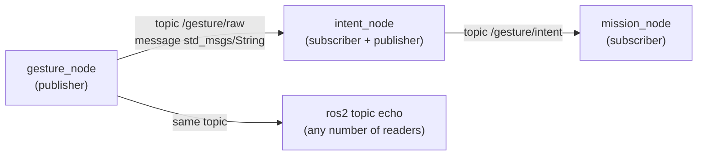
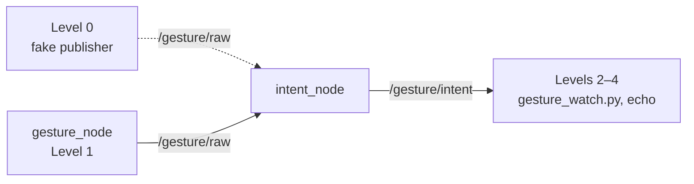

# 🤖 ROS 2 and nodes: install ROS 2 Jazzy, then build, run and test each node

This is the practical guide. It explains what ROS 2 and nodes are, how to install ROS 2 Jazzy, how to set up the workspace `~/ros2_ws`, and how to build, run and **prove** each gesture node that exists so far. What each node does inside is in its own note: [[01 Gesture Node]], [[03 Intent_node]], [[04 Mission_Node]].

> [!WARNING] Status: DRAFT
> - On 2026-10-19 `intent_node` and `mission_node` were built with `colcon build` on Pop!_OS 24.04 + Jazzy, and the chain fake sender → `intent_node` → `mission_node` ran (test log in §12). At that time the recogniser still sent UDP.
> - Since 2026-10-20 the recogniser is the ROS 2 node `gesture_node`, and `intent_node` reads `/gesture/raw` with `input_source:=topic`. The steps in §5–9 describe this new setup. Its first build found the venv problem fixed in §6.3. A full run with the webcam is not recorded yet.

### Node status (2026-10-20)

| Node | What | Build | Run | Test |
| :--- | :--- | :---: | :---: | :---: |
| `gesture_node` | webcam + MediaPipe → `/gesture/raw` | §6.3 | §7 | §9 |
| `intent_node` | `/gesture/raw` → filter → `/gesture/intent` | §6.2 | §7 | §9 |
| `mission_node` | `/gesture/intent` → `/mission/velocity_target` | §10 ([[04 Mission_Node\|04]] §8) | [[04 Mission_Node\|04]] §9 | [[04 Mission_Node\|04]] §10 |

---

## 📚 1. What ROS is

**ROS** (Robot Operating System) is not an operating system. It is a framework and a set of tools for building a robot program out of many small programs that talk to each other in a standard way. **ROS 2** is the current generation (a rewrite of the original ROS). It provides:

- the way programs find and talk to each other (**topics**, services, actions),
- tools to build, run, inspect and record them (`colcon`, `ros2 topic echo`, `ros2 bag`),
- ready-made messages and libraries (`std_msgs`, `geometry_msgs`, `rclpy`).

| Word | Meaning | In this project |
| :--- | :--- | :--- |
| **Node** | one running program with one job | `gesture_node`, `intent_node`, `mission_node`, `flight_interface` |
| **Topic** | a named channel that carries messages | `/gesture/raw`, `/gesture/intent` |
| **Message** | a typed piece of data on a topic | `std_msgs/msg/String` |
| **Publisher** | a node that sends to a topic | `gesture_node` on `/gesture/raw` |
| **Subscriber** | a node that receives from a topic | `intent_node` on `/gesture/raw` |
| **Package** | a folder of code that builds into nodes | `intent_node` |
| **Workspace** | the folder where packages are built | `~/ros2_ws` |



A publisher does not know who listens. Any number of nodes, or the `ros2` command, can read the same topic.

---

## 🐢 2. What ROS 2 Jazzy is, and why we use it

ROS 2 comes in **distributions**, each tied to a Ubuntu version. **Jazzy Jalisco** ("Jazzy") was released in May 2024.

| Item | Value |
| :--- | :--- |
| Release type | LTS (long-term support), supported until May 2029 |
| Supported OS | **Ubuntu 24.04 (Noble)**, x86-64 and ARM64 |
| Python | 3.12 (the Ubuntu 24.04 system Python) |

We use it because [[ADR-018 Ground OS and ROS 2|ADR-018]] and the plan ([[Study Plan v2]], Track C) choose Ubuntu 24.04 + Jazzy. It is the LTS release for Ubuntu 24.04, it installs from ready-made `apt` packages, and the same packages cover the Raspberry Pi 5 option in [[Hardware Inventory]].

> [!WARNING] Jazzy needs Ubuntu 24.04
> There are no Jazzy `apt` packages for Ubuntu 22.04 (that one is for Humble). Run `lsb_release -a` first. If it says 22.04, upgrade or dual-boot to 24.04, use a container, or ask the team. Do not mix Humble instructions into this page.

---

## 🧩 3. Why several nodes instead of one big script, and why the recogniser is one of them

| One big script | Several nodes |
| :--- | :--- |
| A bug or freeze anywhere stops everything, including the safety checks | A crash stays inside one node. Its neighbours notice it went silent (timeouts): if `gesture_node` dies, `intent_node` still publishes `HOVER_LAND_REQUEST` |
| Hard to test one part alone | Each node is started, tested and replaced alone: fake the input, read the output (§9) |
| Hard to reuse | The same `/gesture/intent` could drive the simulator, the drone, a car or an arm |
| Hard to see what happened | `ros2 topic echo` shows live data, `ros2 bag` records it for replay |
| Several people editing one file | Five tracks work on separate nodes with agreed message contracts |

The cost is some structure: messages must be defined and nodes started together. For a flight system with a safety story the trade is worth it, and the Module 1 plan expects a ROS 2 node graph. The full chain is in [[00 Gesture Pipeline]] §1.

### Why MediaPipe and OpenCV run in a ROS 2 node

Until 2026-10-20 the recogniser (`gestures.py`) was **not** a node. It ran in its own venv and sent UDP to `intent_node`, to keep MediaPipe's pip packages away from the apt ROS packages ([[ADR-018 Ground OS and ROS 2|ADR-018]]). Now it is `gesture_node`:

- **You can see and record it.** `ros2 topic echo /gesture/raw` shows exactly what the recogniser sends, and `ros2 bag` records `/gesture/raw` and `/gesture/intent` together, so a wrong intent can be traced back to its input and replayed without a camera.
- **You can test `intent_node` without a camera** by publishing on `/gesture/raw` (§9, Level 0).
- **No UDP port** to keep free and in sync, and one way to start every node (`ros2 run`, later one launch file).
- **No extra CPU cost.** The camera is read inside the node with `cv2.VideoCapture(0)`, as before. No image is sent between nodes and `cv_bridge` is not needed, so the clash ADR-018 feared does not happen.
- **The price** is a venv that sees both ROS 2 and MediaPipe, and building `gesture_node` with that venv's Python (§6.3).

Details, the comparison with a separate camera node, and the open ADR: [[01 Gesture Node]] §2.

---

## 📦 4. Install ROS 2 Jazzy

Source: the official *Ubuntu (deb packages)* page of the Jazzy docs (checked 2026-10-14). If a command fails, compare with that page.

### ✅ Checklist

- [ ] 4.1 Check Ubuntu 24.04 and a UTF-8 locale
- [ ] 4.2 Add the ROS 2 apt repository
- [ ] 4.3 Install ROS 2 and the build tools
- [ ] 4.4 Load the environment in every terminal
- [ ] 4.5 Initialise rosdep
- [ ] 4.6 Run the talker/listener demo
- [ ] 4.7 Set your own `ROS_DOMAIN_ID`

### 4.1 Check the system

```bash
lsb_release -a        # must say 24.04 (Noble)
locale                # must show UTF-8
```

If the locale is not UTF-8:

```bash
sudo apt update && sudo apt install locales
sudo locale-gen en_US en_US.UTF-8
sudo update-locale LC_ALL=en_US.UTF-8 LANG=en_US.UTF-8
export LANG=en_US.UTF-8
```

### 4.2 Add the ROS 2 repository

```bash
sudo apt install software-properties-common
sudo add-apt-repository universe

sudo apt update && sudo apt install curl -y
export ROS_APT_SOURCE_VERSION=$(curl -s https://api.github.com/repos/ros-infrastructure/ros-apt-source/releases/latest | grep -F "tag_name" | awk -F\" '{print $4}')
curl -L -o /tmp/ros2-apt-source.deb "https://github.com/ros-infrastructure/ros-apt-source/releases/download/${ROS_APT_SOURCE_VERSION}/ros2-apt-source_${ROS_APT_SOURCE_VERSION}.$(. /etc/os-release && echo ${UBUNTU_CODENAME:-${VERSION_CODENAME}})_all.deb"
sudo dpkg -i /tmp/ros2-apt-source.deb
```

### 4.3 Install ROS 2 and the build tools

```bash
sudo apt update && sudo apt upgrade
sudo apt install ros-jazzy-desktop     # ROS, RViz, demos, tutorials (recommended)
sudo apt install ros-dev-tools         # colcon, rosdep and other build tools
```

`ros-jazzy-ros-base` is the smaller install (no GUI tools). It is enough to run the gesture nodes.

### 4.4 Load the environment

Every terminal must load ROS 2 before any `ros2` command works:

```bash
source /opt/ros/jazzy/setup.zsh
```

To do it automatically in new terminals:

```bash
echo "source /opt/ros/jazzy/setup.zsh" >> ~/.zshrc
```

> [!NOTE] Using bash?
> Replace `setup.zsh` with `setup.bash` and `~/.zshrc` with `~/.bashrc` everywhere on this page.

### 4.5 Initialise rosdep (once)

```bash
sudo rosdep init
rosdep update
```

### 4.6 Prove the install works

Terminal 1: `ros2 run demo_nodes_cpp talker`. Terminal 2: `ros2 run demo_nodes_py listener`. The listener prints the talker's messages: one node publishes to a topic, another receives it.

### 4.7 Keep your lab neighbours out of your topics

ROS 2 nodes on the same network find each other automatically, so a teammate's node could appear on your topics. In every terminal (or `~/.zshrc`):

```bash
export ROS_DOMAIN_ID=42                         # your own number, 0-101, different from teammates
export ROS_AUTOMATIC_DISCOVERY_RANGE=LOCALHOST  # Jazzy: only talk to this machine
```

---

## 🏗️ 5. The workspace `~/ros2_ws`

A **workspace** is the folder where colcon builds packages. It lives on your PC, **outside the repo**:

```text
~/ros2_ws/
├── src/
│   ├── gesture_node -> ~/ROSRangers/drone/ground/src/gesture_node   (symlink)
│   ├── intent_node  -> ~/ROSRangers/drone/ground/src/intent_node    (symlink)
│   └── mission_node -> ~/ROSRangers/MISSION_NODE_PACKAGE             (optional, §10; later drone/ground/src/mission_node)
├── build/      # generated by colcon build
├── install/    # generated: what `source install/setup.zsh` loads
└── log/        # generated

~/gesture-venv/  # MediaPipe venv for gesture_node (§6.1), outside the workspace
```

> [!NOTE] Why `ros2_ws` stays on the host and not in the repo
> - `build/`, `install/` and `log/` are generated, large and specific to one machine and one ROS version, so they are never committed.
> - The **source** is in the repo. `src/` only holds symlinks to it. With `--symlink-install`, editing a Python file in the repo takes effect without rebuilding.
> - Every teammate (and the CI runner) builds their own workspace from the same repo, so results do not depend on someone's leftover build folder.
> - Want it inside the project anyway? Build with `colcon build --base-paths drone/ground/src` and add `build/`, `install/` and `log/` to `.gitignore`.

---

## 🔨 6. Set up the workspace and build

### ✅ Checklist

- [ ] 6.1 Create the MediaPipe venv (once)
- [ ] 6.2 Create the workspace, link the packages, build `intent_node`
- [ ] 6.3 Build `gesture_node` with the venv's Python
- [ ] 6.4 Run the unit tests

### 6.1 The MediaPipe venv (once)

`gesture_node` needs Python **3.12** with MediaPipe **and** access to the apt ROS packages, and some system packages for the camera and the window ([[01 Gesture Node]] §10):

```bash
sudo apt install python3.12-venv python3-pip libgl1 libglib2.0-0 v4l-utils libxcb-cursor0

python3.12 -m venv --system-site-packages ~/gesture-venv
~/gesture-venv/bin/pip install --upgrade pip
~/gesture-venv/bin/pip install -r ~/ROSRangers/drone/ground/src/gesture_node/requirements.txt
```

Check it, with ROS loaded:

```bash
source /opt/ros/jazzy/setup.zsh
source ~/gesture-venv/bin/activate
python3 -c "import mediapipe, cv2, yaml, rclpy; print('ok', mediapipe.__version__)"   # ok 0.10.21
deactivate
```

- `--system-site-packages` is required. Without it the venv can't see `yaml` and the other apt packages `rclpy` needs.
- Already have `~/gesture-venv` without it? Set `include-system-site-packages = true` in `~/gesture-venv/pyvenv.cfg` (that is what the flag writes).
- The venv is outside `~/ros2_ws`, so deleting the workspace does not delete it.

### 6.2 Create the workspace and build `intent_node`

To start over, delete the old workspace first: `rm -rf ~/ros2_ws`.

```bash
source /opt/ros/jazzy/setup.zsh                      # no venv active
mkdir -p ~/ros2_ws/src
ln -s ~/ROSRangers/drone/ground/src/intent_node  ~/ros2_ws/src/intent_node    # symlinks, not copies
ln -s ~/ROSRangers/drone/ground/src/gesture_node ~/ros2_ws/src/gesture_node

cd ~/ros2_ws
rosdep install --from-paths src --ignore-src -r -y
colcon build --symlink-install --packages-select intent_node
```

- `~/ros2_ws/src/intent_node/package.xml` must exist (through the symlink), not one folder deeper.
- Setuptools deprecation warnings are common and harmless if the build ends with `Summary: 1 package finished`.

### 6.3 Build `gesture_node` with the venv's Python

`ros2 run` starts the script colcon wrote, and its first line names the Python that **ran colcon**. A plain `colcon build` writes `/usr/bin/python3`, which has no MediaPipe, so `ros2 run gesture_node gesture_node` fails with `No module named 'mediapipe'` even with the venv active (seen 2026-10-20). Build this one package from the venv:

```bash
source /opt/ros/jazzy/setup.zsh
source ~/gesture-venv/bin/activate
cd ~/ros2_ws
python3 -m colcon build --symlink-install --packages-select gesture_node
deactivate

source install/setup.zsh
head -1 install/gesture_node/lib/gesture_node/gesture_node    # must name ~/gesture-venv/bin/python3
ros2 pkg list | grep -E "gesture_node|intent_node"           # must print both
```

| After you change | Rebuild |
| :--- | :--- |
| a Python file (`.py`) | nothing (`--symlink-install`) |
| `setup.py`, `setup.cfg` or `package.xml` of `intent_node` | §6.2 build line |
| the same files of `gesture_node` | §6.3, **always from the venv** |
| a plain `colcon build` of everything by mistake | §6.3 again (it reset the `gesture_node` shebang) |

### 6.4 Unit tests

With colcon:

```bash
cd ~/ros2_ws
colcon test --packages-select intent_node gesture_node && colcon test-result --verbose
```

Or without ROS at all:

```bash
cd ~/ROSRangers/drone/ground/src/intent_node  && python3 -m unittest discover -s test -v   # 17 tests OK
cd ~/ROSRangers/drone/ground/src/gesture_node && python3 -m unittest discover -s test -v   # 6 tests OK
```

The `gesture_node` tests check the sender only (JSON format, keep-alive rule). They need no ROS, MediaPipe or camera.

---

## ▶️ 7. Run the pipeline

Every terminal starts with the two `source` lines. Start `intent_node` first, so it is listening when the first gestures arrive.

```bash
source /opt/ros/jazzy/setup.zsh
source ~/ros2_ws/install/setup.zsh
```

| Terminal | Python | Command |
| :---: | :--- | :--- |
| 1 | system | `ros2 run intent_node intent_node --ros-args -p input_source:=topic` |
| 2 | venv (via the shebang, §6.3) | `ros2 run gesture_node gesture_node` (on Wayland: `QT_QPA_PLATFORM=xcb ros2 run gesture_node gesture_node`) |
| 3 | system | `ros2 topic echo /gesture/intent --field data` |

- `input_source:=topic` is required: without it `intent_node` listens on UDP 5005, and nothing sends there any more ([[03 Intent_node]] §7).
- Press `q` in the "Gestures" window to stop `gesture_node`.

### What to expect

| Check | What you should see |
| :--- | :--- |
| `intent_node` starts | `Listening for gesture_node on /gesture/raw; publishing JSON strings on /gesture/intent at 20 Hz`, then `Intent -> HOVER_LAND_REQUEST (reason: no_packets_yet ...)` and a `No packets` warning every 5 s |
| `gesture_node` starts | `Reading camera 0 with MediaPipe; publishing JSON strings on /gesture/raw`. The "Gestures" window shows the webcam. If it is black, check `ls /dev/video*` |
| Hand tracking | landmarks drawn on your hand; the gesture name printed in terminal 2 when it changes |
| Link works | terminal 1 logs `First packet from gestures.py`, then `Recogniser link OK: ~50 packets in the last 5 s` (the wording still says `gestures.py`) |
| Intent | about 0.4 s after a stable gesture, terminal 1 logs `Intent -> ...` and terminal 3 shows it |
| Safety fallback | hand out of view briefly → `NEUTRAL`. Out of view for 2 s, or `gesture_node` stopped → `HOVER_LAND_REQUEST` |

---

## ⌨️ 8. The `ros2` command line and `rclpy`

`ros2` is one program with sub-commands. It talks to nodes that are already running, so you can inspect and control them without changing their code. Every terminal needs the two `source` lines first.

| Command | What it does | Example |
| :--- | :--- | :--- |
| `ros2 run <package> <executable>` | Starts a node | `ros2 run gesture_node gesture_node` |
| `ros2 pkg list` | Lists installed packages | `ros2 pkg list \| grep gesture_node` |
| `ros2 node list` | Lists running nodes | shows `/gesture_node`, `/intent_node` |
| `ros2 node info <node>` | Shows a node's topics and parameters | `ros2 node info /intent_node` |
| `ros2 topic list` | Lists all topics | shows `/gesture/raw`, `/gesture/intent` |
| `ros2 topic echo <topic>` | Prints messages as they arrive | `ros2 topic echo /gesture/raw --field data` |
| `ros2 topic info <topic>` | Shows the type, publishers and subscribers | `ros2 topic info /gesture/raw` (1 publisher, 1 subscriber) |
| `ros2 topic hz <topic>` | Measures the publish rate | `/gesture/raw` ~10 Hz, `/gesture/intent` ~20 Hz |
| `ros2 topic pub <topic> <type> <data>` | Publishes a message by hand | fake one gesture on `/gesture/raw` (§9, Level 0) |
| `ros2 param list <node>` | Lists a node's parameters | `ros2 param list /intent_node` |
| `ros2 param get <node> <name>` | Reads a parameter | `ros2 param get /intent_node input_source` |
| `ros2 param set <node> <name> <value>` | Changes a parameter while running | see the warning below |
| `ros2 bag record <topics>` / `ros2 bag play <file>` | Records topics and replays them | record `/gesture/raw` + `/gesture/intent`, replay without a camera (§9, Level 5) |
| `ros2 launch <package> <file>` | Starts several nodes from one file | `ros2 launch mission_node mission_demo.launch.py` ([[04 Mission_Node]] §9) |
| `ros2 pkg executables <package>` | Lists a package's executables | `ros2 pkg executables mission_node` |
| `ros2 service` / `ros2 action` | Same idea for services and actions | not used yet |

Add `--help` to any command, for example `ros2 topic --help`.

> [!WARNING] Parameters are safety settings
> `ros2 param set` changes a value while the node runs, but `intent_node` reads its parameters only at start-up. To use new values, restart it with `--ros-args -p ...` ([[03 Intent_node]] §7). Agree changes with the team first.

### The CLI and `rclpy`

`rclpy` is the Python library the nodes are written with. It creates the node, its publishers, subscribers, timers and parameters, and `rclpy.spin()` keeps it running. `rclpy` has no commands of its own: you see its effects with `ros2`.

| In the code (`rclpy`) | What you see with `ros2` |
| :--- | :--- |
| `super().__init__("intent_node")` | the name in `ros2 node list` |
| `declare_parameter(...)` / `get_parameter(...)` | `ros2 param list` / `get`, and `--ros-args -p` |
| `create_publisher(String, topic, 10)` | `ros2 topic list`, `info` and `echo` |
| `create_subscription(String, "/gesture/raw", ...)` | the subscriber count in `ros2 topic info /gesture/raw` |
| `create_timer(...)` | the 20 Hz rate in `ros2 topic hz` |
| `get_logger().info(...)` | the messages in the terminal where the node runs |
| `rclpy.spin(node)` | the node stays alive until Ctrl+C |

`gesture_node` spins in a background thread, because its camera loop owns the main thread ([[01 Gesture Node]] §4). `flight_interface` will be the first lifecycle node.

---

## 🧪 9. Test `gesture_node` and `intent_node`: what is published on `/gesture/raw` and `/gesture/intent`

Work through the levels in order. Each one proves one link of the chain, so a failure tells you where to look.



### The watcher: both topics in one terminal

`ros2 topic echo` prints every message (10–20 per second), so changes scroll away. This small script subscribes to **both** topics and prints a line only when something **changes**, with the time since it started. Save it once:

```bash
cat > ~/gesture_watch.py <<'EOF'
"""Print /gesture/raw and /gesture/intent, one line per change."""
import json
import time

import rclpy
from std_msgs.msg import String

START = time.monotonic()
last = {}


def watch(name, key):
    def callback(msg):
        try:
            data = json.loads(msg.data)
        except json.JSONDecodeError:
            data = {}
        value = tuple(data.get(k) for k in key)
        if last.get(name) != value:
            last[name] = value
            print(f"{time.monotonic() - START:7.2f} s  {name:<7} {msg.data}", flush=True)

    return callback


rclpy.init()
node = rclpy.create_node("gesture_watch")
node.create_subscription(String, "/gesture/raw", watch("raw", ["gesture"]), 10)
node.create_subscription(String, "/gesture/intent", watch("intent", ["intent", "reason"]), 10)
try:
    rclpy.spin(node)
except KeyboardInterrupt:
    pass
EOF
```

Run it with the system Python (no venv): `python3 ~/gesture_watch.py`. Example output:

```text
   0.21 s  intent  {"intent":"HOVER_LAND_REQUEST","gesture":null,"reason":"no_packets_yet","t":null,"xy":null}
   3.05 s  raw     {"gesture": "INDEX_RIGHT", "t": 1792483203.1, "xy": null}
   3.06 s  intent  {"intent":"NEUTRAL","gesture":null,"reason":"unconfirmed","t":1792483203.1,"xy":null}
   3.46 s  intent  {"intent":"MOVE_RIGHT","gesture":"INDEX_RIGHT","reason":"ok","t":1792483203.5,"xy":null}
```

The gap between the `raw` line and the `ok` intent line is the stability filter (5 packets, ~0.4 s, [[03 Intent_node]] §5).

### Level 0: no camera (fake `/gesture/raw` → `intent_node`)

Proves that `intent_node` reads the topic and applies the rules, without MediaPipe or a webcam.

| Terminal | Command |
| :---: | :--- |
| 1 | `ros2 run intent_node intent_node --ros-args -p input_source:=topic` |
| 2 | `python3 ~/gesture_watch.py` |
| 3 | the fake camera below |

**One gesture by hand** (quick check, 10 Hz like the real keep-alive):

```bash
ros2 topic pub -r 10 /gesture/raw std_msgs/msg/String "{data: '{\"gesture\": \"INDEX_RIGHT\", \"t\": 0, \"xy\": null}'}"
```

Expected: `MOVE_RIGHT` / `ok` about 1 s after starting (the first second is spent connecting). Ctrl+C stops the packets: `NEUTRAL` / `no_hand` after 0.3 s, then `HOVER_LAND_REQUEST` / `no_packets` after 2 s.

**The scripted sequence.** It uses `gesture_node`'s own `send_gesture()` (same JSON, same keep-alive), but publishes from a small script instead of the camera. It does not import MediaPipe, so the system Python is fine:

```bash
python3 - <<'EOF'
import time

import rclpy
from std_msgs.msg import String

from gesture_node import gesture_sender

rclpy.init()
node = rclpy.create_node("fake_camera")
pub = node.create_publisher(String, "/gesture/raw", 10)
gesture_sender.set_publisher(lambda text: pub.publish(String(data=text)))
time.sleep(1.0)  # let intent_node discover this publisher


def hold(gesture, seconds):
    end = time.monotonic() + seconds
    while time.monotonic() < end:
        gesture_sender.send_gesture(gesture)
        time.sleep(1 / 30)  # pretend 30 FPS


hold("OPEN_HAND_UP", 2)
hold("INDEX_RIGHT", 3)
hold(None, 0.6)  # short gap
hold("CLOSED_HAND", 2)
hold(None, 3)  # long gap
hold("INDEX_LEFT", 2)
node.destroy_node()
rclpy.shutdown()
EOF
```

About 13 s of scripted input should give this sequence in the watcher (`intent` / `reason`):

| Time | Fake input on `/gesture/raw` | Expected on `/gesture/intent` |
| :--- | :--- | :--- |
| before | nothing | `HOVER_LAND_REQUEST` / `no_packets_yet` |
| 0 s | `OPEN_HAND_UP` starts | `NEUTRAL` / `unconfirmed`, then `HOLD_POSITION` / `ok` after ~0.4 s |
| 2 s | `INDEX_RIGHT` | `MOVE_RIGHT` / `ok` after ~0.4 s |
| 5 s | `null` for 0.6 s | `NEUTRAL` / `no_hand` |
| 5.6 s | `CLOSED_HAND` | `NEUTRAL` / `unconfirmed`, then `STOP_HOVER` / `ok` |
| 7.6 s | `null` for 3 s | `NEUTRAL` / `no_hand`, then `HOVER_LAND_REQUEST` / `no_hand_long` after 2 s |
| 10.6 s | `INDEX_LEFT` | `NEUTRAL` / `unconfirmed`, then `MOVE_LEFT` / `ok` |
| end | script stops | `NEUTRAL`, then `HOVER_LAND_REQUEST` / `no_packets` |

**Pass:** the watcher shows this sequence, and terminal 1 logs `First packet from gestures.py`.

### Level 1: does `gesture_node` publish the right thing on `/gesture/raw`?

Start only `gesture_node` (`intent_node` is not needed for this level):

```bash
ros2 run gesture_node gesture_node                      # terminal 1
ros2 topic echo /gesture/raw --field data               # terminal 2
ros2 topic hz /gesture/raw                              # terminal 3
ros2 topic info /gesture/raw                            # once: type std_msgs/msg/String, 1 publisher
```

| Check | Pass |
| :--- | :--- |
| Format | every message is `{"gesture": ..., "t": ..., "xy": null}` |
| Gesture names | the name matches your hand and the name printed by `gesture_node` ([[01 Gesture Node\|01]] §7) |
| No hand | `"gesture": null` when the hand leaves the picture (it never just stops) |
| Rate | ~10 Hz while the gesture stays the same; `hz` never drops to 0 while the window is open |
| Stop | `q` in the window → `hz` shows no new messages |

**If nothing prints:** check the topic name (`ros2 topic list`), the `ROS_DOMAIN_ID` in both terminals, and that the window shows the camera.

### Level 2: does `intent_node` receive it?

Start `intent_node` (with `input_source:=topic`), then `gesture_node`. The `intent_node` log must show:

```text
[INFO] [intent_node]: First packet from gestures.py: {'gesture': 'INDEX_RIGHT', ...}
[INFO] [intent_node]: Recogniser link OK: 52 packets in the last 5 s, last gesture seen: INDEX_RIGHT
```

`ros2 topic info /gesture/raw` must show 1 publisher and 1 subscriber. **Pass:** the first-packet line once, then the link report every 5 s with roughly 50 packets. `No packets from gestures.py in the last 5 s` → `intent_node` is on UDP (missing `input_source:=topic`), or back to Level 1.

### Level 3: does `intent_node` publish the right intent on `/gesture/intent`?

Run `python3 ~/gesture_watch.py` next to the two nodes. Hold each gesture of the vocabulary ([[00 Gesture Pipeline]] §3) for 1 s:

| Show | `raw` line | `intent` line (`intent` / `reason`) |
| :--- | :--- | :--- |
| Open hand, fingers up | `OPEN_HAND_UP` | `HOLD_POSITION` / `ok` |
| Fist | `CLOSED_HAND` | `STOP_HOVER` / `ok` |
| Thumb up / down | `THUMB_UP` / `THUMB_DOWN` | `CLIMB_SLOWLY` / `DESCEND_SLOWLY_LAND_REQUEST` |
| Index left / right | `INDEX_LEFT` / `INDEX_RIGHT` | `MOVE_LEFT` / `MOVE_RIGHT` |
| Index + middle left / right | `INDEX_MIDDLE_LEFT` / `INDEX_MIDDLE_RIGHT` | `YAW_LEFT` / `YAW_RIGHT` |
| Any other pose | e.g. `INDEX_PINKY_UP` | `NEUTRAL` / `unmapped_gesture` |

**Pass:** each `intent` line follows its `raw` line within about 0.5 s. `ros2 topic hz /gesture/intent` stays at ~20 Hz the whole time, even with no hand. The picture is mirrored, so left and right are **your** left and right.

### Level 4: the safety behaviour

| Test | Expected on `/gesture/intent` |
| :--- | :--- |
| Show `INDEX_RIGHT` until `MOVE_RIGHT`, remove the hand for 1 s, show `CLOSED_HAND` | `NEUTRAL` / `no_hand` during the gap, `NEUTRAL` / `unconfirmed` when the hand returns (**never** `MOVE_RIGHT` again), then `STOP_HOVER` |
| Hold `INDEX_RIGHT`, hide the hand for 0.1 s, show it again | stays `MOVE_RIGHT` |
| Hide the hand for 3 s | `NEUTRAL`, then `HOVER_LAND_REQUEST` / `no_hand_long` |
| Stop `gesture_node` (`q` or Ctrl+C) while holding a gesture | `NEUTRAL` within 0.3 s, `HOVER_LAND_REQUEST` / `no_packets` after 2 s |
| Start `intent_node` **without** `input_source:=topic` | `HOVER_LAND_REQUEST` / `no_packets_yet` forever: the safe default |

If any of these does not end in `NEUTRAL` or `HOVER_LAND_REQUEST`, stop and report it with the Bug form.

### Level 5: keep evidence

```bash
ros2 bag record -o gesture_proof /gesture/raw /gesture/intent   # Ctrl+C to stop
ros2 bag info gesture_proof                                      # message count and duration per topic
python3 ~/gesture_watch.py > gesture_proof.log                   # plain-text copy, one line per change
```

To replay without a camera, stop `gesture_node`, keep `intent_node` running and play **only** the input; `intent_node` recomputes the intents:

```bash
ros2 bag play gesture_proof --topics /gesture/raw
```

Attach the bag info and the log to the GitHub issue (Test session form).

---

## 🧪 10. Build, run and test `mission_node`

What the node does, and every detail of running and testing it, is in [[04 Mission_Node]] §8–10. The short version:

### 10.1 Build

The package is in `MISSION_NODE_PACKAGE/` at the repo root for now (later `drone/ground/src/mission_node/`):

```bash
source /opt/ros/jazzy/setup.zsh                  # no venv active
ln -s ~/ROSRangers/MISSION_NODE_PACKAGE ~/ros2_ws/src/mission_node
cd ~/ros2_ws
colcon build --symlink-install --packages-select intent_node mission_node   # not gesture_node (§6.3)
source install/setup.zsh
ros2 pkg executables mission_node      # fake_flight_state, fake_intent, mission_node
```

### 10.2 Run and test

| Level | Command | Pass when |
| :--- | :--- | :--- |
| 0: unit | `cd ~/ROSRangers/MISSION_NODE_PACKAGE && python3 -m unittest discover -s test -v` (or `colcon test --packages-select mission_node`) | 35 tests OK |
| 1: alone, pretend values | `ros2 launch mission_node mission_demo.launch.py` + `ros2 topic echo /mission/state --field data` | the mode sequence of [[04 Mission_Node\|04]] §7.2 |
| 2: with `intent_node`, no camera | `ros2 launch mission_node mission_with_gestures.launch.py`, then the scripted sequence of §9 Level 0 | the table in [[04 Mission_Node\|04]] §10, Level 2 |
| 3: real gestures | same launch, then `ros2 run gesture_node gesture_node` | [[04 Mission_Node\|04]] §10, Level 3 |

> [!WARNING] The launch file still starts `intent_node` on UDP
> `mission_with_gestures.launch.py` starts `intent_node` with its default `input_source` (`udp`). Until the launch file passes `input_source: topic`, levels 2 and 3 get no gestures ([[04 Mission_Node]] §9.2).

`/flight/state` comes from the pretend node `fake_flight_state` until `flight_interface` exists. Never use it with a real drone.

---

## 🧯 11. Troubleshooting

| Symptom | Likely cause | Fix |
| :--- | :--- | :--- |
| `ros2: command not found` | ROS 2 not loaded | `source /opt/ros/jazzy/setup.zsh` |
| `Package 'gesture_node' not found` | workspace not loaded or not built | `source ~/ros2_ws/install/setup.zsh`, rerun §6.2 / §6.3 |
| colcon finds no packages | `package.xml` one folder too deep | `src/intent_node/package.xml` and `src/gesture_node/package.xml` must exist |
| `rosdep` cannot resolve a key | missing rosdep data | `rosdep update`; `-r` lets the build continue |
| `No module named 'mediapipe'` from `ros2 run gesture_node` | `gesture_node` built with plain `colcon build` (shebang `/usr/bin/python3`) | rebuild it from the venv (§6.3), or `ros2 run --prefix 'python3' gesture_node gesture_node` with the venv active |
| `No module named 'yaml'` in `gesture_node` | venv without `--system-site-packages` | §6.1 |
| `gesture_node` exits at once: `Camera loop ended` | camera 0 not available | close other camera apps, check `ls /dev/video*` |
| Watcher prints only `HOVER_LAND_REQUEST` / `no_packets_yet` | nothing reaches `intent_node` | started without `input_source:=topic`, or `gesture_node` not running: Level 1 |
| `No packets ... in the last 5 s` warning | same | same |
| Intent stays `NEUTRAL` / `unconfirmed` | gesture changes every frame, or fewer than 5 packets | hold the gesture still; check `ros2 topic hz /gesture/raw` (~10 Hz) |
| `ros2 topic echo` shows nothing but the node runs | different `ROS_DOMAIN_ID` or discovery range in the two terminals | export the same values in both |
| `Cannot listen on UDP 127.0.0.1:5005 ... in use` | `intent_node` on UDP twice | use `input_source:=topic`; UDP is only kept for old scripts |

---

## 📝 12. Test log

| Date | Who | Environment | Result | Notes |
| :--- | :--- | :--- | :--- | :--- |
| 2026-10-14 | | host, ROS 2 stubbed | 17 unit tests OK; real `gesture_sender.py` into real node code gave the Level 0 sequence | not a real ROS 2 run; UDP version |
| 2026-10-19 | Bruno (with Claude Code) | Pop!_OS 24.04 + Jazzy: `colcon build` | `intent_node` and `mission_node` built (`2 packages finished`) | first real build of both |
| 2026-10-19 | Bruno (with Claude Code) | Pop!_OS 24.04 + Jazzy: `colcon test` | `mission_node`: 35 tests, 0 failures | |
| 2026-10-19 | Bruno (with Claude Code) | `mission_demo.launch.py` (pretend inputs) | mode sequence as in [[04 Mission_Node\|04]] §7.2, 20.0 Hz, ramp 0.025 per message | found and fixed: a log call crashed the node on `LAND_REQUEST`; a 0.43 s DDS delivery gap could re-engage ([[04 Mission_Node\|04]] §11 #3) |
| 2026-10-19 | Bruno (with Claude Code) | UDP fake camera + `mission_with_gestures.launch.py` | intent and mode sequence as in [[04 Mission_Node\|04]] §10 Level 2 | `intent_node` prints a `KeyboardInterrupt` traceback when the launch is stopped with Ctrl+C ([[03 Intent_node]] §9) |
| 2026-10-20 | Claude Code | no ROS (unit tests only) | `gesture_node`: 6 tests OK; `intent_node`: 17 tests OK after adding `input_source` | `gesture_node` created; `drone/tools/gesture/` removed |
| 2026-10-20 | Bruno (with Claude Code) | Pop!_OS 24.04 + Jazzy: first `ros2 run gesture_node gesture_node` | failed: `No module named 'mediapipe'` | shebang `/usr/bin/python3` and venv without system packages; fixed by §6.1 + §6.3 |
| 2026-10-20 | Bruno | `gesture_node`: shutdown | `terminate called without an active exception` on exit | fixed in `gesture_node.py`: stop ROS 2 and join the spin thread before closing |
| | | Level 0 (fake `/gesture/raw`) + watcher | | |
| | | Level 1 (`/gesture/raw` from the webcam) | | |
| | | Levels 2 to 4 (real gestures → `/gesture/intent`) | | |

---

## Glossary

| Term | Meaning |
| --- | --- |
| **CLI** | Command-line interface: here the `ros2` command and its sub-commands. |
| **colcon** | The build tool for ROS 2 workspaces. |
| **Jazzy** | ROS 2 Jazzy Jalisco, the ROS 2 release we use (paired with Ubuntu 24.04). |
| **LTS** | Long-term support: a release maintained for several years. |
| **MediaPipe** | A framework used here for detecting hand landmarks. |
| **Node** | A single ROS 2 process that does one job and talks to others through topics. |
| **Package** | A folder of ROS 2 code (`package.xml`, `setup.py`) that builds into one or more nodes. |
| **rclpy** | The ROS 2 Python client library used to write nodes. It has no commands of its own. |
| **ROS 2** | The second-generation Robot Operating System middleware used for robotics integration. |
| **ROS_DOMAIN_ID** | A number that separates ROS 2 networks, so teammates' nodes don't mix. |
| **rosbag** | A file of recorded topic messages that can be replayed (`ros2 bag`). |
| **rosdep** | A tool that installs the system dependencies a ROS 2 package declares. |
| **Shebang** | The first line of a script (`#!/usr/bin/python3`) that names the program that runs it. |
| **Topic** | A named channel on which ROS 2 nodes publish and subscribe to messages. |
| **UDP** | User Datagram Protocol: connectionless transport, used by the old recogniser and still accepted by `intent_node` (`input_source:=udp`). |
| **venv** | A Python virtual environment; `~/gesture-venv` holds MediaPipe for `gesture_node`. |
| **Workspace** | The folder where colcon builds packages (`~/ros2_ws`). |
