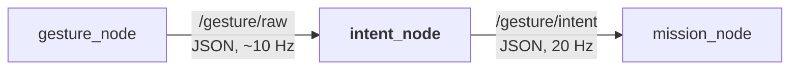

# 🖐️ Intent_node: gesture name → operator intent

`intent_node` turns the gesture names from `gesture_node` into what the operator wants, and only passes on a gesture once it is stable. It never knows about drones. Running it: [[01 ROS2 Nodes Installation|01]] §4. Tests: [[01 ROS2 Nodes Installation|01]] §7.

---

## 📍 1. Why this node



- **It answers "what does the operator want?"**: hands, the recogniser and timeouts, nothing about drones. So `/gesture/intent` could also drive the simulator, a car or an arm ([[Roadmap to April 2027]] §4).
- **It keeps noise away from the drone**: a gesture counts only after 5 packets in a row, and a gap never replays an old gesture.
- **It turns silence into `NEUTRAL`**: no hand, or no recogniser, never means "keep going".

---

## ⚙️ 2. How it works

On every packet from `/gesture/raw` it updates the filter (§5). A 20 Hz timer publishes the current intent on `/gesture/intent`, even when nothing changes, so `mission_node` can detect a dead `intent_node`. It logs the first packet, every intent change and a link report every 5 s (`logs/intent/latest.log`).

The rules are in `gesture_filter.py`, which has no ROS imports. `intent_node.py` is only the ROS wrapper (§7).

---

## 📥 3. Input: `/gesture/raw`

JSON packets from `gesture_node`. The format and the 10 Hz keep-alive are described in [[02 Gesture Node]] §8. This node uses the `gesture` field: case and outer spaces are ignored, and `null`, `""`, `NONE`, `NO_HAND`, `UNKNOWN` and `NEUTRAL` all mean "no hand". Packets that aren't JSON objects are ignored. Timeouts use this node's own clock, not the packet's `t`.

`input_source` must be `topic` (the Docker image sets it). The default `udp` is a legacy input that nothing sends to.

---

## 📤 4. Output: `/gesture/intent`

`std_msgs/msg/String` at 20 Hz, one JSON object:

```json
{"intent":"MOVE_RIGHT","gesture":"L:NONE+R:THUMB_RIGHT","reason":"ok","t":1791976551.56,"xy":null}
```

| Field | Meaning |
| :--- | :--- |
| `intent` | what the operator wants: a mapped intent (§5) or `NEUTRAL` |
| `gesture` | the **accepted** gesture (it keeps the old name while a new gesture is being confirmed), or `null` |
| `reason` | why: see below |
| `t`, `xy` | copied from the latest packet, or `null` |

| `intent` / `reason` | Meaning |
| :--- | :--- |
| a mapped intent / `ok` | the gesture was seen 5 packets in a row |
| `NEUTRAL` / `unconfirmed` | a new gesture, not yet 5 in a row (normal for ~0.4 s) |
| `NEUTRAL` / `unmapped_gesture` | a name that isn't in the table (§5) |
| `NEUTRAL` / `no_hand` | no hand for more than 0.3 s (arms down or out of view) |
| `NEUTRAL` / `no_hand_long` | no hand for more than 2 s |
| `NEUTRAL` / `no_packets` | no packets for more than 2 s: `gesture_node` stopped |
| `NEUTRAL` / `no_packets_yet` | nothing received since start |

Every fallback is `NEUTRAL`, and `mission_node` hovers in all of them ([[04 Mission Node]] §5). Silence on this topic is a fault. To read the topic: the live table or the `ros2` CLI ([[01 ROS2 Nodes Installation|01]] §5).

---

## 🛡️ 5. Rules

**Gesture → intent.** The table is `GESTURE_TO_INTENT` in `gesture_filter.py`. Names are matched exactly as `gesture_node` sends them (`L:<left>+R:<right>`, [[02 Gesture Node]] §7). Anything else is `NEUTRAL` (`unmapped_gesture`). What each gesture means: [[00 Gesture Pipeline]] §3.

**Filter and timeouts:**

| Situation | Intent | `reason` |
| :--- | :--- | :--- |
| nothing received yet | `NEUTRAL` | `no_packets_yet` |
| a new gesture, seen fewer than 5 packets in a row, none accepted | `NEUTRAL` | `unconfirmed` |
| a new gesture, seen fewer than 5 packets in a row, another one accepted | the **old** intent | `ok` |
| a gesture seen 5 packets in a row | its intent | `ok` |
| hand gone > 0.3 s | `NEUTRAL` | `no_hand` |
| hand gone > 2 s | `NEUTRAL` | `no_hand_long` |
| no packets > 2 s | `NEUTRAL` | `no_packets` |

- A dropout under 0.3 s keeps the current gesture, so one lost frame doesn't stop a movement.
- After a gap over 0.3 s the old gesture is forgotten and never replayed.
- A two-hand gesture needs both hands in the same 5 packets in a row.

**Safety:**

- Dropping one hand of a two-hand gesture never gives a command: what's left is unmapped.
- No gesture arms, disarms, touches the override switch or asks for a landing ([[Safety Rules]] #5).

---

## 🎚️ 6. Parameters

| Parameter | Default | Meaning |
| :--- | :--- | :--- |
| `input_source` | `udp` | `topic` reads `raw_topic` (the Docker image sets it); `udp` is the legacy input |
| `raw_topic` / `intent_topic` | `/gesture/raw` / `/gesture/intent` | input and output topics |
| `stable_packets` | `5` | packets in a row to accept a gesture |
| `neutral_timeout_sec` | `0.3` | hand gone → `no_hand` |
| `stale_timeout_sec` | `2.0` | hand or packets gone → `no_hand_long` / `no_packets` |
| `publish_rate_hz` | `20.0` | output rate |

`stable_packets` and the two timeouts are safety settings: agree changes with the team. To try other values, run the node in its image: `docker compose run --rm intent /ws/install/intent_node/lib/intent_node/intent_node --ros-args -p input_source:=topic -p stable_packets:=3`.

---

## 📁 7. Code

`drone/ground/src/intent_node/`: `intent_node/gesture_filter.py` (the rules and `GESTURE_TO_INTENT`), `intent_node/intent_node.py` (the ROS wrapper) and `test/`.

---

## ❓ 8. Open points

- [ ] **Message type.** JSON in `std_msgs/String` is untyped; `drone_msgs` is proposed in [[05 Future Nodes]].
- [ ] **Default input.** Make `topic` the default, or remove the UDP input.
- [ ] **Keep-alive rate.** Confirm 10 Hz with the team.

---

## 🔖 9. Requirement IDs

Registered in [[Requirements]]. Checked in `test_gesture_filter.py` and `test_intent_node_ros.py`.

| ID | Requirement |
|---|---|
| **REQ-SAF-019** | `intent_node` shall never relay a stale gesture: with the hand gone for more than 0.3 s, with the hand or the packets gone for more than 2 s, or before the first packet, it publishes `NEUTRAL`. A gesture is never replayed after a gap. |
| **REQ-SAF-020** | `intent_node` shall change the intent only for a known gesture seen in 5 consecutive packets, no gesture shall map to arming, disarming or the override switch ([[Safety Rules]] #5), and the hand left over when one hand of a two-hand gesture drops shall never map to a command. |
| **REQ-SW-002** | `/gesture/intent` shall be published at 20 Hz as a JSON string with the keys `intent`, `reason`, `gesture`, `t`, `xy`, whatever the input. |

---

## Glossary

| Term | Meaning |
| --- | --- |
| **Intent** | The action the operator asks for (for example `MOVE_LEFT`), published on `/gesture/intent`. |
| **JSON** | A text format for structured data, used inside the `/gesture/raw` and `/gesture/intent` messages. |
| **Keep-alive** | A small periodic message that proves the sender is still running. |
| **Node** | A single ROS 2 process that does one job and talks to others through topics. |
| **REQ ID** | A requirement identifier, `REQ-<area>-NNN` (for example REQ-SAF-019), registered in Requirements. |
| **ROS 2** | The second-generation Robot Operating System middleware used for robotics integration. |
| **Topic** | A named channel on which ROS 2 nodes publish and subscribe to messages. |
| **UDP** | User Datagram Protocol: connectionless transport, used by the legacy input (`input_source:=udp`). |
