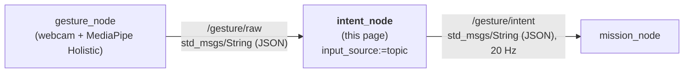
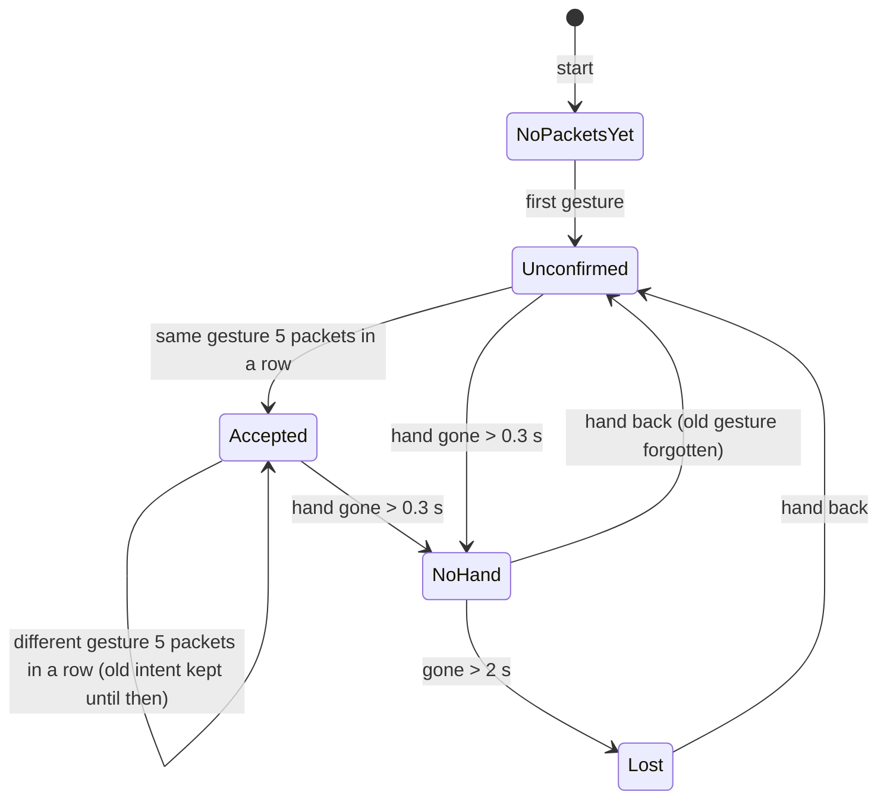

# 🖐️ Intent_node: gesture name → operator intent

`intent_node` is the ROS 2 node after the recogniser in the [[00 Gesture Pipeline|Gesture Pipeline]]. It receives gesture names from `gesture_node` on `/gesture/raw`, filters them with safety rules, and publishes what the operator wants on `/gesture/intent`.

> [!NOTE] Related notes
> Who sends the gesture names and how they are made: [[02 Gesture Node]]. How to run it in Docker: [[01 ROS2 Nodes Installation|01]] §4. How to test it: [[01 ROS2 Nodes Installation|01]] §7. Who reads its output: [[04 Mission Node]].

> [!WARNING] Status: DRAFT
> Built and tested (unit, node and process tests, Docker image, CI). Real webcam gestures through the node are not recorded yet.

---

## 📍 1. Where it sits



| | |
| :--- | :--- |
| **Answers** | "What does the **operator** want?" |
| **Knows about** | hands, the recogniser, timeouts. Nothing about drones. |
| **Package** | `drone/ground/src/intent_node/` |
| **Runs in** | the Docker image `rosrangers/intent:jazzy` (`input_source:=topic` already set) |

Keeping drone knowledge out of this node means `/gesture/intent` can also drive the simulator, a car or an arm ([[Roadmap to April 2027]] §4).

---

## ⚙️ 2. What it does

1. **Receives** gesture packets (§3) from `/gesture/raw`.
2. **Filters** them with the safety rules of §5.
3. **Publishes** the result on `/gesture/intent` at 20 Hz: a steady heartbeat even when nothing changes, so the next node can detect silence.
4. **Logs** the first packet, every intent change and a link report every 5 s. That is how you prove it works ([[01 ROS2 Nodes Installation|01]] §6).
5. **Stops** cleanly on Ctrl+C or SIGTERM (`docker stop`): exit code 0. A bad configuration (unknown `input_source`, UDP port in use) logs a FATAL line and exits with code 1.

> [!TIP] Testable without ROS
> The decision logic is in `gesture_filter.py`, which has **no ROS imports**, so it can be unit-tested anywhere. `intent_node.py` is only the ROS wrapper (subscriber, timers, publisher, parameters).

---

## 📥 3. Input: JSON gesture packets

The parameter `input_source` picks where they come from (§7):

| `input_source` | Source | Sender |
| :--- | :--- | :--- |
| `topic` | `/gesture/raw` (`std_msgs/msg/String`, JSON in `data`) | `gesture_node` ([[02 Gesture Node]]): use this |
| `udp` (default) | UDP datagrams on `127.0.0.1:5005` | legacy input, nothing sends there |

The packet format (`gesture`, `t`, `xy`) and the keep-alive are described with the sender: [[02 Gesture Node]] §8. What this node does with them:

- `gesture`: case and spaces at the ends are ignored. `""`, `NONE`, `NO_HAND`, `UNKNOWN`, `NEUTRAL` count as no hand.
- `t` is information only: freshness uses this node's own clock.
- Anything that is not a JSON object is ignored and counted. NaN or infinite numbers in `t` / `xy` become `null`.

---

## 📤 4. Output: `/gesture/intent`

Type `std_msgs/msg/String`, 20 Hz. `data` holds one JSON object:

```json
{"intent":"MOVE_RIGHT","gesture":"L:NONE+R:THUMB_RIGHT","reason":"ok","t":1791976551.56,"xy":null}
```

| Field | Meaning |
| :--- | :--- |
| `intent` | what the operator wants (§5) |
| `gesture` | the accepted gesture, or `null` |
| `reason` | why this intent: `ok`, `unconfirmed`, `no_hand`, `no_hand_long`, `no_packets`, `no_packets_yet`, `unmapped_gesture` |
| `t`, `xy` | from the latest packet, or `null` |

Receivers parse the JSON. A typed custom message would be cleaner (§9).

### 👀 How to read `/gesture/intent`

Read it in the live table ([[01 ROS2 Nodes Installation|01]] §4.2) or with the `ros2` CLI through `echo` ([[01 ROS2 Nodes Installation|01]] §5):

| Command | Shows |
| :--- | :--- |
| `ros2 topic info /gesture/intent` | type `std_msgs/msg/String`, 1 publisher (this node; 2 means `fake_intent` is running too, [[04 Mission Node]] §7.2), and the subscribers |
| `ros2 topic echo /gesture/intent --field data` | only the JSON text, 20 messages a second |
| `ros2 topic echo --once /gesture/intent --field data` | one message, then exits |
| `ros2 topic hz /gesture/intent` | the rate: ~20 Hz **always**, also with no hand and no recogniser |
| `logs/intent/latest.log` | `Intent -> ... (reason: ...)` on every change, and the link report every 5 s |

> [!TIP] Prefer the live table or the log
> At 20 Hz `ros2 topic echo` scrolls fast and the messages look the same. The live table and the `Intent ->` log lines only show changes.

Read **`intent`** to know what the operator asks for, and **`reason`** to know why. The reason tells you where a problem is:

| `intent` / `reason` | What it tells you |
| :--- | :--- |
| `MOVE_RIGHT` (or any mapped intent) / `ok` | the gesture was seen 5 packets in a row and accepted |
| `NEUTRAL` / `unconfirmed` | a gesture arrived, but not yet 5 in a row. Normal for ~0.4 s after each change; if it stays, the gesture name flickers (look at `/gesture/raw`) |
| `NEUTRAL` / `unmapped_gesture` | the recogniser sends a name that is not in the table of §5. `gesture` shows `null`; the name is on `/gesture/raw` |
| `NEUTRAL` / `no_hand` | packets arrive with `"gesture": null` for more than 0.3 s: both arms are down, or the hands are out of view |
| `NEUTRAL` / `no_hand_long` | no hand for more than 2 s |
| `NEUTRAL` / `no_packets` | packets stopped for more than 2 s: `gesture_node` stopped or crashed |
| `NEUTRAL` / `no_packets_yet` | nothing received since start: `gesture_node` not started, wrong `raw_topic`, or `input_source` still `udp` (§7) |

Every fallback is `NEUTRAL`: the `reason` is the only thing that tells "hands down" from "recogniser gone". `mission_node` hovers in all of them ([[04 Mission Node]] §5).

`gesture` is the **accepted** gesture, not the latest one: while you switch gestures it keeps the old name until the new one is accepted. To see the latest raw name, read `/gesture/raw` ([[02 Gesture Node]] §8).

A reader should also treat **silence** on this topic as a fault (it is published at 20 Hz on purpose, §2).

---

## 🛡️ 5. Rules

### Gesture → intent

The table is `GESTURE_TO_INTENT` in `drone/ground/src/intent_node/intent_node/gesture_filter.py`. Names are matched **exactly**, as `gesture_node` sends them: `L:<left hand>+R:<right hand>`, with `NONE` for a hand that doesn't count (arm down, [[02 Gesture Node]] §3.2). Engage and lock use both hands; every motion uses one raised hand and has a right-hand and a left-hand form. Any other name is `NEUTRAL` (`unmapped_gesture`).

What each gesture looks like and what it does to the drone: [[00 Gesture Pipeline]] §3. What `mission_node` does with `ENGAGE` and `LOCK_TOGGLE`: [[04 Mission Node]] §5.

Two safety properties of the table:

- **Dropping one hand never gives a command**: what's left of a two-hand gesture is unmapped, so it is `NEUTRAL`.
- **No gesture arms, disarms, touches the override switch or asks for a landing** ([[Safety Rules]] #5).

### Filter and timeouts

| Situation | Intent | `reason` |
| :--- | :--- | :--- |
| nothing received since the node started | `NEUTRAL` | `no_packets_yet` |
| no gesture accepted yet (or the last one was forgotten after a gap), and the new one seen in fewer than 5 consecutive packets | `NEUTRAL` | `unconfirmed` |
| a gesture is accepted and a different one is seen in fewer than 5 consecutive packets | the **old** gesture's intent | `ok` |
| a gesture seen in 5 consecutive packets | its intent | `ok` |
| hand gone for more than 0.3 s | `NEUTRAL` | `no_hand` |
| hand gone for more than 2 s | `NEUTRAL` | `no_hand_long` |
| no packets at all for more than 2 s | `NEUTRAL` | `no_packets` |



Details that matter:

- A **short dropout** (under 0.3 s) keeps the current gesture, so one lost camera frame does not interrupt a movement.
- A two-hand gesture needs **both** hands detected and raised in the same 5 packets in a row. If one hand drops out for a packet, the name changes and the count starts again.
- After a gap longer than 0.3 s, the old gesture is **forgotten**. It is never replayed when the hand comes back.
- While you switch from one gesture to another, the old intent stays until the new gesture has 5 consecutive packets (about 0.4 s at the 10 Hz keep-alive).

> [!WARNING] What this node never does
> It only filters and relays intent. It never arms or disarms, never touches the override switch ([[Safety Rules]], rule 5), and never asks for a landing.

---

## 📡 6. The sender

The sender and its keep-alive are part of `gesture_node` ([[02 Gesture Node]] §8). If its frame loop stalls, this node treats the silence as "hand gone" after 0.3 s. That is intended. `gesture_node`'s `raw_topic` must match this node's `raw_topic`. To test without a camera: [[01 ROS2 Nodes Installation|01]] §6, Level 0.

---

## 🎚️ 7. Parameters

The Docker image starts `intent_node --ros-args -p input_source:=topic` (`docker/intent/Dockerfile`). To try other values, stop the `intent` service and run the node in its image:

```bash
docker compose run --rm intent /ws/install/intent_node/lib/intent_node/intent_node --ros-args -p input_source:=topic -p stable_packets:=3
```

| Parameter | Default | Meaning |
| :--- | :--- | :--- |
| `input_source` | `udp` | `topic` = read `/gesture/raw` from `gesture_node` (**use this**; the Docker image sets it). `udp` = legacy UDP input. Anything else stops the node with a FATAL log and exit code 1 |
| `raw_topic` | `/gesture/raw` | topic to read when `input_source` is `topic` |
| `udp_host`, `udp_port` | `127.0.0.1`, `5005` | where to listen when `input_source` is `udp` |
| `intent_topic` | `/gesture/intent` | topic to publish on |
| `stable_packets` | `5` | consecutive identical packets to accept a gesture |
| `neutral_timeout_sec` | `0.3` | hand gone this long → `NEUTRAL` (`no_hand`) |
| `stale_timeout_sec` | `2.0` | hand or packets gone this long → `NEUTRAL` (`no_hand_long` / `no_packets`) |
| `publish_rate_hz` | `20.0` | publish rate |

> [!WARNING] Safety settings
> `stable_packets` and the two timeouts are safety settings. They are read only at start-up. Agree changes with the team.

The code also corrects values that make no sense: `stable_packets` is at least 1, `neutral_timeout_sec` at least 0, `stale_timeout_sec` is never shorter than `neutral_timeout_sec`, and `publish_rate_hz` is at least 1.

---

## 📁 8. Code layout

In `drone/ground/src/intent_node/`:

| Where | What |
| :--- | :--- |
| `intent_node/gesture_filter.py` | the rules of §5 and `GESTURE_TO_INTENT`, no ROS imports |
| `intent_node/intent_node.py` | the rclpy wrapper: subscriber or UDP socket, timers, publisher, parameters |
| `test/` | unit tests of the filter (no ROS), node and process tests (need `rclpy`) |

The tests and how to run them: [[01 ROS2 Nodes Installation|01]] §7. The image: [[01 ROS2 Nodes Installation|01]] §4.2.

---

## ❓ 9. Open points

- [ ] **Message type.** `std_msgs/String` holding JSON works but is untyped. A custom message package (`drone_msgs`) is proposed in [[05 Future Nodes]].
- [ ] **Keep-alive rate.** The code and every gesture note use 10 Hz (accept in about 0.4 s). Confirm 10 Hz with the team.
- [ ] **Default input.** `input_source` defaults to `udp`, but nothing sends UDP. The Docker image and `mission_with_gestures.launch.py` pass `topic`. Decide whether to make `topic` the default, or remove the UDP input (and `udp_host` / `udp_port`).
- [ ] **Palm position.** `gesture_node` sends `xy = None`. Fill it if a later node needs it.

---

## 🔖 10. Requirement IDs

Registered in [[Requirements]]. Checked in `test_gesture_filter.py` / `test_intent_node_ros.py` (`drone/ground/src/intent_node/test/`).

| ID | Requirement |
|---|---|
| **REQ-SAF-019** | `intent_node` shall never relay a stale gesture: with the hand gone for more than 0.3 s, with the hand or the packets gone for more than 2 s, or before the first packet, it publishes `NEUTRAL` (reasons `no_hand`, `no_hand_long`, `no_packets`, `no_packets_yet`). A gesture is never replayed after a gap. |
| **REQ-SAF-020** | `intent_node` shall change the intent only for a known gesture seen in 5 consecutive packets (unknown or unconfirmed gestures give `NEUTRAL`), no gesture shall map to arming, disarming or the override switch ([[Safety Rules]] #5), and the hand left over when one hand of a two-hand gesture drops shall never map to a command. |
| **REQ-SW-002** | `/gesture/intent` shall be published at 20 Hz (`publish_rate_hz`) as a JSON string with the keys `intent`, `reason`, `gesture`, `t`, `xy`, whatever the input. |

---

## Glossary

| Term | Meaning |
| --- | --- |
| **Docker** | Tool that runs software in containers: isolated environments built from an image (Dockerfile). `rosrangers/intent:jazzy` is this node's image. |
| **ENGAGE / LOCK_TOGGLE** | The two two-hand intents: both open hands (engage), both fists (lock and unlock in `mission_node`). |
| **Intent** | The action the operator asks for (for example `MOVE_LEFT`), published on `/gesture/intent`. |
| **JSON** | A text format for structured data, used inside the `/gesture/raw` and `/gesture/intent` messages. |
| **Keep-alive** | A small periodic message that proves the sender is still running. |
| **Node** | A single ROS 2 process that does one job and talks to others through topics. |
| **rclpy** | The ROS 2 Python client library used to write nodes. |
| **REQ ID** | A requirement identifier, `REQ-<area>-NNN` (for example REQ-SAF-019), registered in Requirements. |
| **ROS 2** | The second-generation Robot Operating System middleware used for robotics integration. |
| **Topic** | A named channel on which ROS 2 nodes publish and subscribe to messages. |
| **Two-hand name** | The gesture name `gesture_node` sends: `L:<left hand>+R:<right hand>`, `NONE` for a hand that doesn't count. |
| **UDP** | User Datagram Protocol: connectionless transport, used by the legacy input (`input_source:=udp`). |
