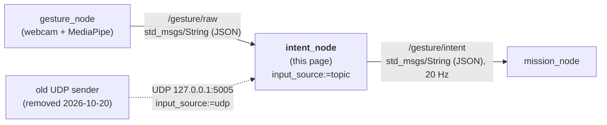
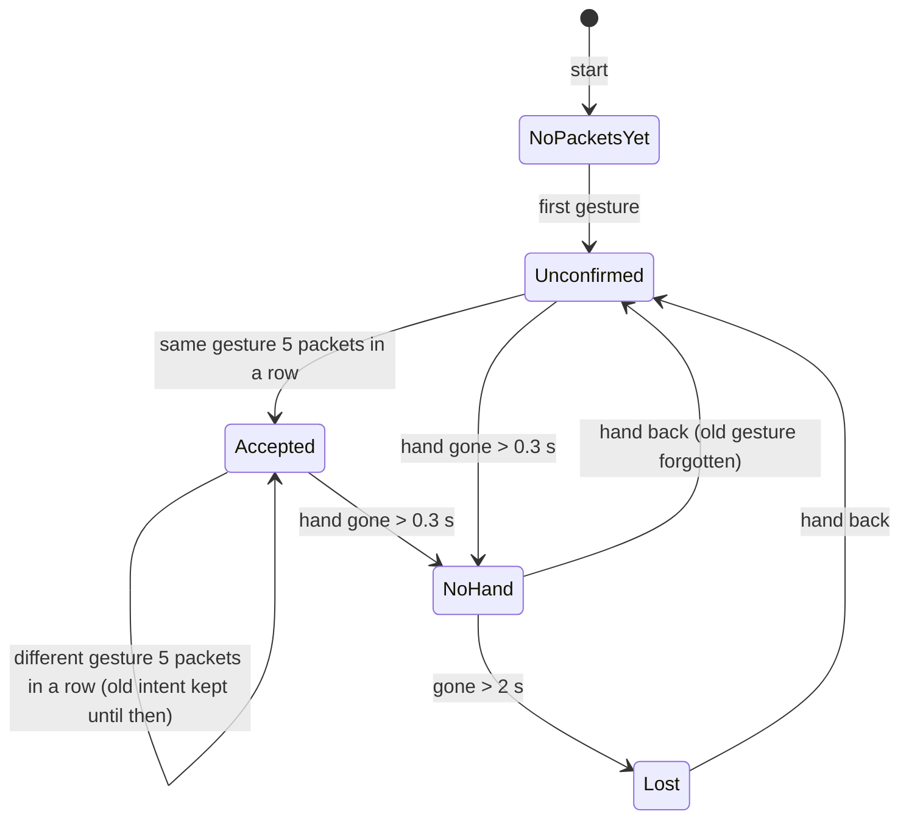

# 🖐️ Intent_node: gesture name → operator intent

`intent_node` (v0.2) is the ROS 2 node after the recogniser in the [[00 Gesture Pipeline|Gesture Pipeline]]. It receives gesture names from `gesture_node` on `/gesture/raw` (or, the old way, over UDP), filters them with safety rules, and publishes what the operator wants on `/gesture/intent`.

> [!NOTE] Related notes
> Who sends the gesture names and how they are made: [[02 Gesture Node]]. How to build, run and test this node: [[01 ROS2 Nodes Installation|01]] §6–9. Who reads its output: [[04 Mission Node]].

> [!INFO] Renamed on 2026-10-20
> This node was called `gesture_node` until 2026-10-20 (package, executable and node name). Later the same day the name `gesture_node` was given to the **recogniser** node (camera + MediaPipe → `/gesture/raw`), first proposed as `mediapipe_node` ([[02 Gesture Node]], [[05 Future Nodes]] §2). Old logs that say `gesture_node` before 2026-10-20 mean this node.

> [!WARNING] Status: DRAFT
> 17 unit tests pass. On 2026-10-19 the node was built with `colcon build` on Pop!_OS 24.04 + ROS 2 Jazzy and ran with the UDP fake camera, feeding `mission_node` ([[01 ROS2 Nodes Installation|01]] §12). On 2026-10-20 the topic input (`input_source:=topic`, §3) was added for `gesture_node`. Real webcam gestures through the built node are not recorded yet.

---

## 📍 1. Where it sits



| | |
| :--- | :--- |
| **Answers** | "What does the **operator** want?" |
| **Knows about** | hands, the recogniser, timeouts. Nothing about drones. |
| **Package** | `drone/ground/src/intent_node/` |
| **Runs in** | System Python with ROS 2 Jazzy (no MediaPipe) |

Keeping drone knowledge out of this node means `/gesture/intent` can also drive the simulator, a car or an arm ([[Roadmap to April 2027]] §4).

---

## ⚙️ 2. What it does

1. **Receives** gesture packets (§3): from `/gesture/raw` with `input_source:=topic`, or from UDP with `input_source:=udp` (the default), where a timer drains the socket 100 times a second. Both go through the same `_handle_datagram()`. There are no threads.
2. **Filters** them with the safety rules of §5.
3. **Publishes** the result on `/gesture/intent` at 20 Hz: a steady heartbeat even when nothing changes, so the next node can detect silence.
4. **Logs** the first packet, every intent change and a link report every 5 s. That is how you prove it works ([[01 ROS2 Nodes Installation|01]] §9).

> [!TIP] Testable without ROS
> The decision logic is in `gesture_filter.py`, which has **no ROS imports**, so it can be unit-tested anywhere. `intent_node.py` is only the ROS wrapper (subscriber or socket, timers, publisher, parameters).

---

## 📥 3. Input: JSON gesture packets

The parameter `input_source` picks where they come from (§7):

| `input_source` | Source | Sender |
| :--- | :--- | :--- |
| `topic` | `/gesture/raw` (`std_msgs/msg/String`, JSON in `data`) | `gesture_node` ([[02 Gesture Node]]): use this |
| `udp` (default) | UDP datagrams on `127.0.0.1:5005` | the old `gestures.py` + `gesture_sender.py`, removed on 2026-10-20. Kept so the default behaviour did not change |

Both carry the **same JSON** and are handled by the same code. One packet when the gesture **changes**, then a repeat every 0.1 s while it stays the same (the keep-alive; `gesture_sender.py` does this, §6).

```json
{"gesture":"INDEX_RIGHT","t":1791976551.56,"xy":[0.51,0.42]}
```

No hand or nothing recognised:

```json
{"gesture":null,"t":1791976551.9,"xy":null}
```

| Field | Meaning |
| :--- | :--- |
| `gesture` | name from `recognize()`, or `null`. Case and spaces are ignored. `""`, `NONE`, `NO_HAND`, `UNKNOWN`, `NEUTRAL` count as no hand. |
| `t` | sender time in seconds (information only; freshness uses the node's own clock) |
| `xy` | optional palm position `[x, y]` in 0..1, or `null` (today `gesture_node` always sends `null`) |

Anything that is not a JSON object is ignored and counted (on the topic too). NaN or infinite numbers in `t` / `xy` become `null`.

---

## 📤 4. Output: `/gesture/intent`

Type `std_msgs/msg/String`, 20 Hz. `data` holds one JSON object:

```json
{"intent":"MOVE_RIGHT","gesture":"INDEX_RIGHT","reason":"ok","t":1791976551.56,"xy":[0.51,0.42]}
```

| Field | Meaning |
| :--- | :--- |
| `intent` | what the operator wants (§5) |
| `gesture` | the accepted gesture, or `null` |
| `reason` | why this intent: `ok`, `unconfirmed`, `no_hand`, `no_hand_long`, `no_packets`, `no_packets_yet`, `unmapped_gesture` |
| `t`, `xy` | from the latest packet, or `null` |

Receivers parse the JSON. A typed custom message would be cleaner (§9).

---

## 🛡️ 5. Rules

### Gesture → intent

| Gesture | `intent` |
| :--- | :--- |
| `OPEN_HAND_UP` | `HOLD_POSITION` |
| `CLOSED_HAND` | `STOP_HOVER` |
| `THUMB_UP` | `CLIMB_SLOWLY` |
| `THUMB_DOWN` | `DESCEND_SLOWLY_LAND_REQUEST` |
| `INDEX_LEFT` / `INDEX_RIGHT` | `MOVE_LEFT` / `MOVE_RIGHT` |
| `INDEX_MIDDLE_LEFT` / `INDEX_MIDDLE_RIGHT` | `YAW_LEFT` / `YAW_RIGHT` |
| any other name | `NEUTRAL` (`unmapped_gesture`) |

What each gesture means for the drone, and its conditions (for example, climb only once throttle is ours), is in [[00 Gesture Pipeline]] §3.

### Filter and timeouts

| Situation | Intent | `reason` |
| :--- | :--- | :--- |
| nothing received since the node started | `HOVER_LAND_REQUEST` | `no_packets_yet` |
| no gesture accepted yet (or the last one was forgotten after a gap), and the new one seen in fewer than 5 consecutive packets | `NEUTRAL` | `unconfirmed` |
| a gesture is accepted and a different one is seen in fewer than 5 consecutive packets | the **old** gesture's intent | `ok` |
| a gesture seen in 5 consecutive packets | its intent | `ok` |
| hand gone for more than 0.3 s | `NEUTRAL` | `no_hand` |
| hand gone for more than 2 s | `HOVER_LAND_REQUEST` | `no_hand_long` |
| no packets at all for more than 2 s | `HOVER_LAND_REQUEST` | `no_packets` |



Three details that matter:

- A **short dropout** (under 0.3 s) keeps the current gesture, so one lost camera frame does not interrupt a movement.
- After a gap longer than 0.3 s, the old gesture is **forgotten**. It is never replayed when the hand comes back (this was a bug in v0.1).
- While you switch from one gesture to another, the old intent stays until the new gesture has 5 consecutive packets (about 0.4 s at the 10 Hz keep-alive).

> [!WARNING] What this node never does
> It only filters and relays intent. It never arms or disarms and never touches the override switch ([[Safety Rules]], rule 5). `mission_node` must treat the start-up `HOVER_LAND_REQUEST` / `no_packets_yet` as "no recogniser yet", not as a real land request ([[04 Mission Node]] §5.4).

---

## 📡 6. The sender: `gesture_sender.py` in `gesture_node`

`gesture_sender.py` is part of `gesture_node` (`drone/ground/src/gesture_node/gesture_node/`). `gestures.py` calls it once per camera frame:

```python
from .gesture_sender import send_gesture

# gesture: "INDEX_RIGHT", "CLOSED_HAND", ... or None when no hand / unknown
# xy: [x, y] palm position in 0..1, or None
send_gesture(gesture, None)
```

| Setting | Value | Meaning |
| :--- | :--- | :--- |
| `KEEPALIVE_SEC` | `0.1` | repeat rate while the gesture stays the same (10 packets/s) |
| topic | `/gesture/raw` | `gesture_node`'s `raw_topic` parameter, must match this node's `raw_topic` |

`send_gesture` publishes immediately when the gesture **changes** and repeats every 0.1 s while it stays the same. If the frame loop stalls (for example waiting for the camera), this node treats the silence as "hand gone" after 0.3 s. That is intended.

Until 2026-10-20 the sender was a standalone file in `drone/tools/gesture/` that sent the same JSON over UDP to `127.0.0.1:5005`. Only the transport changed ([[02 Gesture Node]] §9). To test without a camera, publish on `/gesture/raw` from a small script that uses `send_gesture` ([[01 ROS2 Nodes Installation|01]] §9, Level 0).

---

## 🎚️ 7. Parameters

```bash
ros2 run intent_node intent_node --ros-args -p input_source:=topic -p stable_packets:=3
```

| Parameter | Default | Meaning |
| :--- | :--- | :--- |
| `input_source` | `udp` | `topic` = read `/gesture/raw` from `gesture_node` (**use this**). `udp` = the old UDP input. Anything else stops the node with an error |
| `raw_topic` | `/gesture/raw` | topic to read when `input_source` is `topic` |
| `udp_host` | `127.0.0.1` | address to listen on when `input_source` is `udp` |
| `udp_port` | `5005` | UDP port when `input_source` is `udp` |
| `intent_topic` | `/gesture/intent` | topic to publish on |
| `stable_packets` | `5` | consecutive identical packets to accept a gesture |
| `neutral_timeout_sec` | `0.3` | hand gone this long → `NEUTRAL` |
| `stale_timeout_sec` | `2.0` | hand or packets gone this long → `HOVER_LAND_REQUEST` |
| `publish_rate_hz` | `20.0` | publish rate |

> [!WARNING] Safety settings
> `stable_packets` and the two timeouts are safety settings. They are read only at start-up. Agree changes with the team.

The code also corrects values that make no sense: `stable_packets` is at least 1, `neutral_timeout_sec` at least 0, `stale_timeout_sec` is never shorter than `neutral_timeout_sec`, and `publish_rate_hz` is at least 1.

---

## 📁 8. Code layout

```text
drone/ground/src/intent_node/
├── package.xml              # must be directly here
├── setup.py, setup.cfg
├── resource/intent_node
├── intent_node/
│   ├── __init__.py
│   ├── gesture_filter.py    # rules of §5, no ROS imports
│   └── intent_node.py      # rclpy wrapper: /gesture/raw subscriber or UDP socket, timers, publisher, parameters
└── test/
    └── test_gesture_filter.py   # 17 unit tests
```

Only `__init__.py`, `gesture_filter.py` and `intent_node.py` go in the inner `intent_node/` folder.

---

## ❓ 9. Open points

- [ ] **Message type.** `std_msgs/String` holding JSON works but is untyped. A custom message package (`drone_msgs`) is proposed in [[05 Future Nodes]].
- [x] **Start-up intent.** `HOVER_LAND_REQUEST` / `no_packets_yet` is published until the recogniser starts. `mission_node` treats it as `NEUTRAL`, also when airborne ([[04 Mission Node]] §5.4).
- [ ] **Shutdown traceback.** Stopping `mission_with_gestures.launch.py` with Ctrl+C makes `intent_node` print a `KeyboardInterrupt` traceback: Ctrl+C reaches it twice (terminal + launch) and the second one lands in `destroy_node()`. Harmless, but noisy. `mission_node` handles it by ignoring further SIGINTs once shutdown starts (seen 2026-10-19).
- [ ] **Keep-alive rate.** The code uses 10 Hz (accept in about 0.4 s). An earlier version of the pipeline page said 5 Hz. Confirm 10 Hz with the team.
- [ ] **Default input.** `input_source` defaults to `udp`, but nothing sends UDP since 2026-10-20. Decide whether to make `topic` the default, or remove the UDP input (and `udp_host` / `udp_port`).
- [ ] **Log wording.** The logs still say `First packet from gestures.py` and `No packets from gestures.py` with the topic input too.
- [ ] **Tests.** The node wrapper (subscriber, socket and timers) is only checked by hand. The filter has unit tests ([[Testing Strategy]]).
- [ ] **Palm position.** `gesture_node` sends `xy = None`. Fill it if a later node needs it.
- [ ] **Maintainer fields** in `package.xml` and `setup.py` are placeholders.

---

## Glossary

| Term | Meaning |
| --- | --- |
| **Dead-man** | A control that only works while the operator keeps doing it (here: the hand must stay visible). |
| **Intent** | The action the operator asks for (for example `MOVE_LEFT`), published on `/gesture/intent`. |
| **JSON** | A text format for structured data, used inside the `/gesture/raw` and `/gesture/intent` messages (and the old UDP packets). |
| **Keep-alive** | A small periodic message that proves the sender is still running. |
| **Node** | A single ROS 2 process that does one job and talks to others through topics. |
| **rclpy** | The ROS 2 Python client library used to write nodes. |
| **ROS 2** | The second-generation Robot Operating System middleware used for robotics integration. |
| **Stability filter** | The rule that a gesture must be seen in several packets in a row before it counts. |
| **Topic** | A named channel on which ROS 2 nodes publish and subscribe to messages. |
| **UDP** | User Datagram Protocol: connectionless transport, used by the old recogniser (`input_source:=udp`). |
