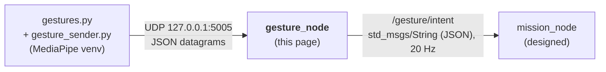
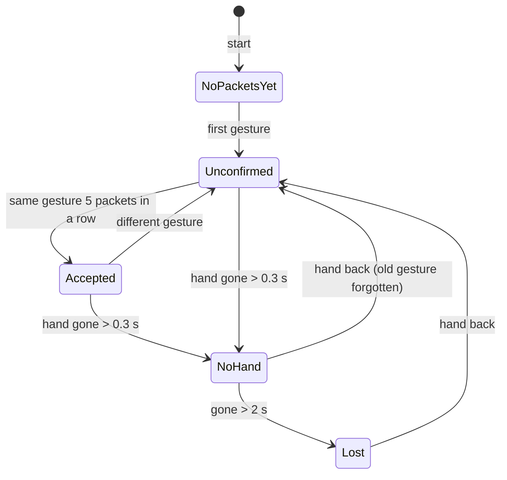

# 🖐️ Gesture_node: gesture name → operator intent

`gesture_node` (v0.2) is the first ROS 2 node of the [[00 Gesture Pipeline|Gesture Pipeline]]. It receives gesture names from `gestures.py` over UDP, filters them with safety rules, and publishes what the operator wants on `/gesture/intent`.

> [!NOTE] Related notes
> How the gesture names are made: [[01 Gesture Recognition with OpenCV and MediaPipe|01]]. How to build, run and test this node: [[02 ROS 2 Nodes - Install and Test|02]] §6–9. Who reads its output: [[05 Mission_Node]].

> [!WARNING] Status: DRAFT
> 17 unit tests pass and the node logic was checked with ROS 2 stubbed. It has not been built on a real Jazzy install yet ([[02 ROS 2 Nodes - Install and Test|02]] §12).

---

## 📍 1. Where it sits



| | |
| :--- | :--- |
| **Answers** | "What does the **operator** want?" |
| **Knows about** | hands, the recogniser, timeouts. Nothing about drones. |
| **Package** | `drone/ground/src/gesture_node/` |
| **Runs in** | System Python with ROS 2 Jazzy (no MediaPipe) |

Keeping drone knowledge out of this node means `/gesture/intent` can also drive the simulator, a car or an arm ([[Roadmap to April 2027]] §4).

---

## ⚙️ 2. What it does

1. **Receives** UDP datagrams from `gestures.py` (§3). A timer drains the socket 100 times a second. There are no threads.
2. **Filters** them with the safety rules of §5.
3. **Publishes** the result on `/gesture/intent` at 20 Hz: a steady heartbeat even when nothing changes, so the next node can detect silence.
4. **Logs** the first packet, every intent change and a link report every 5 s. That is how you prove it works ([[02 ROS 2 Nodes - Install and Test|02]] §9).

> [!TIP] Testable without ROS
> The decision logic is in `gesture_filter.py`, which has **no ROS imports**, so it can be unit-tested anywhere. `gesture_node.py` is only the ROS wrapper (socket, timers, publisher, parameters).

---

## 📥 3. Input: UDP JSON from `gestures.py`

Sent to `127.0.0.1:5005`. One datagram when the gesture **changes**, then a repeat every 0.1 s while it stays the same (the keep-alive; `gesture_sender.py` does this, §6).

```json
{"gesture":"INDEX_RIGHT","t":1791976551.56,"xy":[0.51,0.42]}
```

No hand or nothing recognised:

```json
{"gesture":null,"t":1791976551.9,"xy":null}
```

| Field | Meaning |
| :--- | :--- |
| `gesture` | name from `recognize()`, or `null`. Case and spaces are ignored. `""`, `NONE`, `NO_HAND`, `UNKNOWN`, `NEUTRAL` count as no hand. |
| `t` | sender time in seconds (information only; freshness uses the node's own clock) |
| `xy` | optional palm position `[x, y]` in 0..1, or `null` (today `gestures.py` always sends `null`) |

Anything that is not a JSON object is ignored and counted. NaN or infinite numbers in `t` / `xy` become `null`.

---

## 📤 4. Output: `/gesture/intent`

Type `std_msgs/msg/String`, 20 Hz. `data` holds one JSON object:

```json
{"intent":"MOVE_RIGHT","gesture":"INDEX_RIGHT","reason":"ok","t":1791976551.56,"xy":[0.51,0.42]}
```

| Field | Meaning |
| :--- | :--- |
| `intent` | what the operator wants (§5) |
| `gesture` | the accepted gesture, or `null` |
| `reason` | why this intent: `ok`, `unconfirmed`, `no_hand`, `no_hand_long`, `no_packets`, `no_packets_yet`, `unmapped_gesture` |
| `t`, `xy` | from the latest packet, or `null` |

Receivers parse the JSON. A typed custom message would be cleaner (§9).

---

## 🛡️ 5. Rules

### Gesture → intent

| Gesture | `intent` |
| :--- | :--- |
| `OPEN_HAND_UP` | `HOLD_POSITION` |
| `CLOSED_HAND` | `STOP_HOVER` |
| `THUMB_UP` | `CLIMB_SLOWLY` |
| `THUMB_DOWN` | `DESCEND_SLOWLY_LAND_REQUEST` |
| `INDEX_LEFT` / `INDEX_RIGHT` | `MOVE_LEFT` / `MOVE_RIGHT` |
| `INDEX_MIDDLE_LEFT` / `INDEX_MIDDLE_RIGHT` | `YAW_LEFT` / `YAW_RIGHT` |
| any other name | `NEUTRAL` (`unmapped_gesture`) |

What each gesture means for the drone, and its conditions (for example, climb only once throttle is ours), is in [[00 Gesture Pipeline]] §3.

### Filter and timeouts

| Situation | Intent | `reason` |
| :--- | :--- | :--- |
| nothing received since the node started | `HOVER_LAND_REQUEST` | `no_packets_yet` |
| a new gesture seen in fewer than 5 consecutive packets | `NEUTRAL` | `unconfirmed` |
| a gesture seen in 5 consecutive packets | its intent | `ok` |
| hand gone for more than 0.3 s | `NEUTRAL` | `no_hand` |
| hand gone for more than 2 s | `HOVER_LAND_REQUEST` | `no_hand_long` |
| no packets at all for more than 2 s | `HOVER_LAND_REQUEST` | `no_packets` |



Three details that matter:

- A **short dropout** (under 0.3 s) keeps the current gesture, so one lost camera frame does not interrupt a movement.
- After a gap longer than 0.3 s, the old gesture is **forgotten**. It is never replayed when the hand comes back (this was a bug in v0.1).
- While you switch from one gesture to another, the old intent stays until the new gesture has 5 consecutive packets (about 0.4 s at the 10 Hz keep-alive).

> [!WARNING] What this node never does
> It only filters and relays intent. It never arms or disarms and never touches the override switch ([[Safety Rules]], rule 5). `mission_node` must treat the start-up `HOVER_LAND_REQUEST` / `no_packets_yet` as "no recogniser yet", not as a real land request ([[05 Mission_Node]] §4.4).

---

## 📡 6. The sender: `gesture_sender.py`

`gesture_sender.py` sits next to `gestures.py` in `drone/tools/gesture/`. It uses only the standard library, so it runs in the MediaPipe venv or on the system Python with nothing to install.

| Setting | Value | Meaning |
| :--- | :--- | :--- |
| `HOST` | `127.0.0.1` | where `gesture_node` listens |
| `PORT` | `5005` | must match the node's `udp_port` |
| `KEEPALIVE_SEC` | `0.1` | repeat rate while the gesture stays the same (10 packets/s) |

`gestures.py` calls it once per camera frame:

```python
from gesture_sender import send_gesture

# gesture: "INDEX_RIGHT", "CLOSED_HAND", ... or None when no hand / unknown
# xy: [x, y] palm position in 0..1, or None
send_gesture(gesture, None)
```

`send_gesture` sends immediately when the gesture **changes** and repeats every 0.1 s while it stays the same. If the frame loop stalls (for example waiting for the camera), the node treats the silence as "hand gone" after 0.3 s. That is intended.

Run on its own (`python3 gesture_sender.py`), it plays a 13 s scripted demo: the fake camera used for Level 0 testing ([[02 ROS 2 Nodes - Install and Test|02]] §9).

---

## 🎚️ 7. Parameters

```bash
ros2 run gesture_node gesture_node --ros-args -p udp_port:=5006 -p stable_packets:=3
```

| Parameter | Default | Meaning |
| :--- | :--- | :--- |
| `udp_host` | `127.0.0.1` | address to listen on |
| `udp_port` | `5005` | UDP port (must match `PORT` in `gesture_sender.py`) |
| `intent_topic` | `/gesture/intent` | topic to publish on |
| `stable_packets` | `5` | consecutive identical packets to accept a gesture |
| `neutral_timeout_sec` | `0.3` | hand gone this long → `NEUTRAL` |
| `stale_timeout_sec` | `2.0` | hand or packets gone this long → `HOVER_LAND_REQUEST` |
| `publish_rate_hz` | `20.0` | publish rate |

> [!WARNING] Safety settings
> `stable_packets` and the two timeouts are safety settings. They are read only at start-up. Agree changes with the team.

---

## 📁 8. Code layout

```text
drone/ground/src/gesture_node/
├── package.xml              # must be directly here
├── setup.py, setup.cfg
├── resource/gesture_node
├── gesture_node/
│   ├── __init__.py
│   ├── gesture_filter.py    # rules of §5, no ROS imports
│   └── gesture_node.py      # rclpy wrapper: UDP socket, timers, publisher, parameters
└── test/
    └── test_gesture_filter.py   # 17 unit tests
```

Only `__init__.py`, `gesture_filter.py` and `gesture_node.py` go in the inner `gesture_node/` folder.

---

## ❓ 9. Open points

- [ ] **Message type.** `std_msgs/String` holding JSON works but is untyped. A custom message package (`drone_msgs`) is proposed in [[06 Future Nodes]].
- [ ] **Start-up intent.** `HOVER_LAND_REQUEST` / `no_packets_yet` is published until the recogniser starts. `mission_node` must not land from it on the ground.
- [ ] **Keep-alive rate.** The code uses 10 Hz (accept in about 0.4 s). An earlier version of the pipeline page said 5 Hz. Confirm 10 Hz with the team.
- [ ] **Tests.** The node wrapper (socket and timers) is only checked by hand. The filter has unit tests ([[Testing Strategy]]).
- [ ] **Palm position.** `gestures.py` sends `xy = None`. Fill it if a later node needs it.
- [ ] **Maintainer fields** in `package.xml` and `setup.py` are placeholders.

---

## Glossary

| Term | Meaning |
| --- | --- |
| **Dead-man** | A control that only works while the operator keeps doing it (here: the hand must stay visible). |
| **Intent** | The action the operator asks for (for example `MOVE_LEFT`), published on `/gesture/intent`. |
| **JSON** | A text format for structured data, used inside the UDP packets and the `String` messages. |
| **Keep-alive** | A small periodic message that proves the sender is still running. |
| **Node** | A single ROS 2 process that does one job and talks to others through topics. |
| **rclpy** | The ROS 2 Python client library used to write nodes. |
| **ROS 2** | The second-generation Robot Operating System middleware used for robotics integration. |
| **Stability filter** | The rule that a gesture must be seen in several packets in a row before it counts. |
| **Topic** | A named channel on which ROS 2 nodes publish and subscribe to messages. |
| **UDP** | User Datagram Protocol: connectionless transport suited to refreshed, time-sensitive data. |
