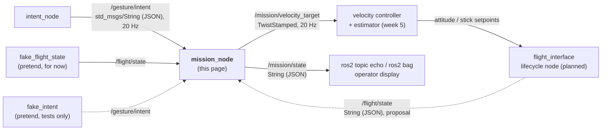
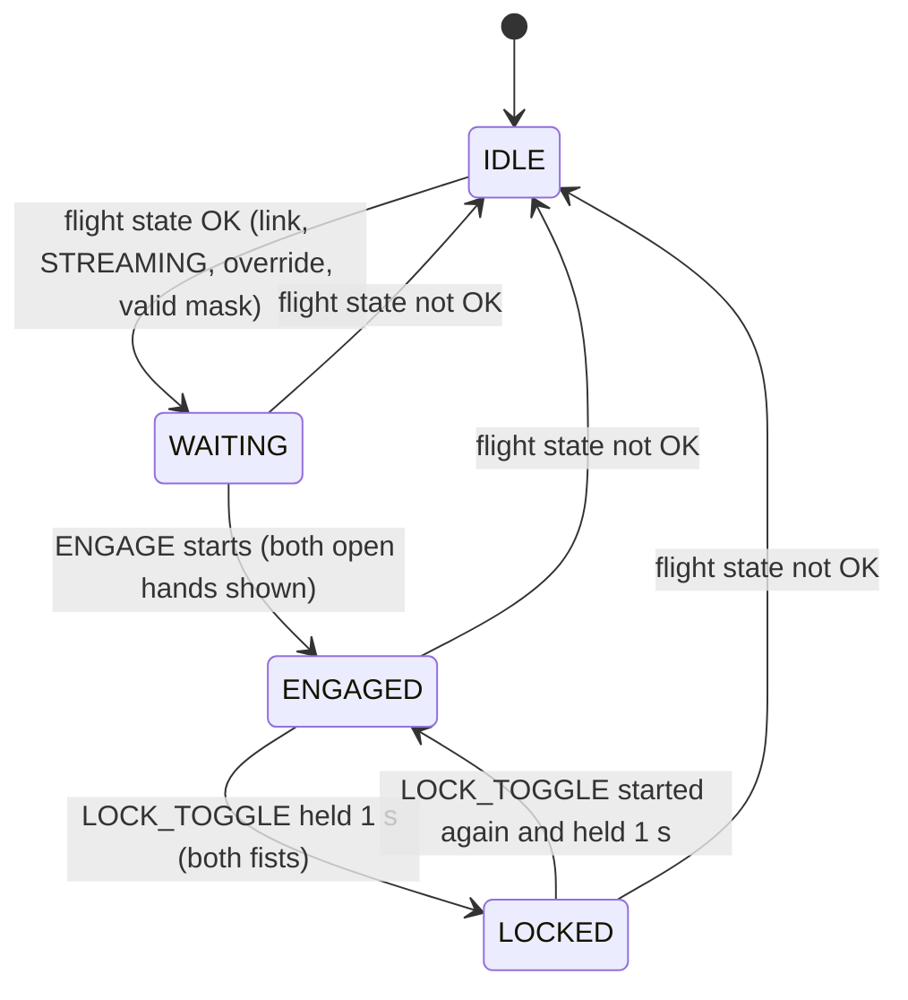

# 🎯 Mission_Node: gesture intent → velocity target

`mission_node` (v0.1) is the third ROS 2 node of the [[00 Gesture Pipeline|Gesture Pipeline]], after `gesture_node` and `intent_node`. It reads what the operator wants from `/gesture/intent` ([[03 Intent Node]]) and what the drone is doing from `/flight/state`. It publishes a safe velocity target on `/mission/velocity_target`: limited, ramped, and only on the axes the ground owns.

> [!WARNING] Status: DRAFT, numbers not reviewed yet
> - The package is `drone/ground/src/mission_node/`. The Docker image `rosrangers/mission:jazzy` runs it, and `make` starts it next to `gesture_node` and `intent_node` (§8.1).
> - Topic names, `/flight/state` fields and every number are still **proposals**. The team must agree them (§12). The design decisions to review are in §10.
> - `/flight/state` does not exist yet (no `flight_interface`). Until it does, the package ships a **pretend** publisher, `fake_flight_state` (§7). The Docker stack runs it as the `flight` service. Never use it with a real drone.
> - Not run yet with the real webcam (§9, Level 3), and not with a controller or a drone.

---

## 📍 1. Where it sits



| Node | Answers the question | Knows about |
|---|---|---|
| `intent_node` | "What does the **operator** want?" | hands, cameras, timeouts. Nothing about drones |
| **`mission_node`** | "What should the **drone** do, given what it is doing now?" | flight state, speed limits, which axes the ground controls |
| controller + estimator | "Which attitude gives that velocity?" | flow, IMU, baro height, gains |
| `flight_interface` | "How do I send it safely?" | protocol, session, watchdog, sim or real backend |

Why it is separate from `intent_node`:
- `/gesture/intent` stays drone-independent, so the same intents can drive a car or an arm in Module 2 ([[00 Gesture Pipeline|Gesture Pipeline]] §8).
- All drone-specific limits live in one place, which makes them easy to review and test.

---

## 📦 2. What was built

One ROS 2 Python package, `mission_node`, with **three executables** and **two launch files**:

| Piece | Kind | What it does |
| :--- | :--- | :--- |
| `mission_node` | executable (the real node) | `/gesture/intent` + `/flight/state` → `/mission/velocity_target` + `/mission/state` |
| `fake_flight_state` | executable (pretend input) | publishes a pretend `/flight/state` at 10 Hz. Every field is a parameter you can change while it runs (§7.1) |
| `fake_intent` | executable (pretend input) | publishes pretend `/gesture/intent` messages in `intent_node`'s format: a 29 s scripted demo, or one constant intent you change by hand (§7.2) |
| `mission_demo.launch.py` | launch file | `fake_flight_state` + `mission_node` + `fake_intent`: **the node on its own with pretend values** |
| `mission_with_gestures.launch.py` | launch file | `intent_node` (with `input_source: topic`) + `fake_flight_state` + `mission_node`: **the real gesture chain**, used by the CI tests (the mission image has no `intent_node`, so in Docker the chain runs as separate services, §8.3) |

### 2.1 Files

```text
drone/ground/src/mission_node/
├── package.xml                       # rclpy, std_msgs, geometry_msgs, rcl_interfaces; launch, launch_ros, intent_node (for the gestures launch)
├── setup.py, setup.cfg               # three console scripts, installs launch/*.launch.py
├── resource/mission_node
├── launch/
│   ├── mission_demo.launch.py        # on its own, pretend inputs
│   └── mission_with_gestures.launch.py   # with intent_node on /gesture/raw
├── mission_node/
│   ├── __init__.py
│   ├── mission_logic.py              # all the rules of §5. NO ROS imports, injectable clock
│   ├── mission_node.py               # rclpy wrapper: subscriptions, 20 Hz timer, publishers, logs
│   ├── spin.py                       # run(): spin until Ctrl+C / SIGTERM, then a clean stop (§5.6). Used by all three executables
│   ├── fake_inputs.py                # demo script + JSON builders. NO ROS imports
│   ├── fake_flight_state.py          # pretend /flight/state publisher
│   └── fake_intent.py                # pretend /gesture/intent publisher
└── test/                             # §9.2
    ├── test_mission_logic.py         # unit: every rule of §5, the demo script, random inputs
    ├── test_mission_node_ros.py      # node: the real node and the pretend inputs on real topics
    ├── test_mission_node_process.py  # process: Ctrl+C, SIGTERM, bad parameters, the demo launch
    └── test_launch_files.py          # the launch files start the right nodes
```

Its Docker image (`docker/mission/Dockerfile`), the `mission` and `flight` services and the `make` targets: [[01 ROS2 Nodes Installation|01]] §4.

Tests that use `mission_node` together with `intent_node` or `gesture_node` live in `drone/tests/ros/` (§9.2).

Same pattern as `intent_node` ([[03 Intent Node]] §8): the decisions live in a ROS-free module (`mission_logic.py`), so they can be unit-tested anywhere. `mission_node.py` only wires them to ROS.

---

## 📥 3. What it reads

### 3.1 `/gesture/intent` (from `intent_node`)

Type `std_msgs/msg/String`, 20 Hz. Format: [[03 Intent Node]] §4.

```json
{"intent":"MOVE_RIGHT","gesture":"L:NONE+R:THUMB_RIGHT","reason":"ok","t":1791976551.56,"xy":[0.51,0.42]}
```

The node uses `intent` and `reason`. `gesture` is copied to `/mission/state` for people. `t` and `xy` are ignored. Intent names are case-insensitive. Bad JSON or an unknown intent becomes `NEUTRAL` and is counted and logged (§5.6).

### 3.2 `/flight/state` (proposal; `fake_flight_state` for now)

Type `std_msgs/msg/String` holding JSON. The real publisher will be `flight_interface` ([[05 Future Nodes]] §6).

```json
{"link_ok":true,"esp_state":"STREAMING","override_active":true,"mask":11,"airborne":true}
```

| Field | Source (real system) | Used for |
|---|---|---|
| `link_ok` | ESP session + STATE freshness ([[Protocol Spec v0]]) | `false` → `IDLE`, zero |
| `esp_state` | STATE `esp_state` | anything but `"STREAMING"` → `IDLE` ([[ADR-010 MSP Override\|ADR-010]] condition 3) |
| `override_active` | STATE `override_active` | `false` → `IDLE`: the pilot has not handed control over |
| `mask` | expected override mask | 8 / 11 / 15 decide which axes may be commanded (§5.3). Any other value → `IDLE` |
| `airborne` | estimator / baro height above a threshold | shown in `/mission/state` only; kept for a later land request from the flight controller (§5.4) |

The parsing is strict: only a real JSON `true` counts as true (`"true"` or `1` are false), a missing field counts as false, and `mask` must be an integer. `esp_state` is case-insensitive. A message that is not a JSON object is ignored and counted, so the last good one goes stale. A `/flight/state` older than `flight_state_timeout_sec` (0.5 s) counts as lost → `IDLE`. The node never reads ARM state in order to change it.

### 3.3 Parameters

Read once at start-up. To try other values, run the node in its image with `--ros-args -p name:=value` (stop the `mission` service first, so only one `mission_node` runs):

```bash
docker compose run --rm mission /ws/install/mission_node/lib/mission_node/mission_node --ros-args -p max_lateral_mps:=0.2 -p intent_lost_sec:=1.5
```

The number parameters also take an integer (`-p intent_lost_sec:=3`). Anything else (`-p max_lateral_mps:=fast`) stops the node at start-up: a `FATAL` log line that names the parameter, exit code 1, no traceback.

| Parameter | Default | Meaning |
|---|---|---|
| `intent_topic` | `/gesture/intent` | input topic |
| `flight_state_topic` | `/flight/state` | input topic |
| `velocity_topic` | `/mission/velocity_target` | output topic |
| `state_topic` | `/mission/state` | output topic |
| `frame_id` | `base_link` | `header.frame_id` of the velocity target |
| `intent_timeout_sec` | `0.25` | no intent for this long → `NEUTRAL` (zero) |
| `intent_lost_sec` | `2.0` | no intent for this long → reason `intent_topic_lost` in `/mission/state` (still `NEUTRAL` and zero; the mode doesn't change). Never shorter than `intent_timeout_sec` |
| `flight_state_timeout_sec` | `0.5` | no `/flight/state` for this long → `IDLE` |
| `max_lateral_mps` | `0.3` | speed for `MOVE_LEFT/RIGHT` and `MOVE_FORWARD/BACKWARD` (hard ceiling 0.5) |
| `max_vertical_mps` | `0.2` | speed for `CLIMB_UP` / `DESCEND_ONLY` (hard ceiling 0.5) |
| `max_yaw_rate_dps` | `20.0` | yaw rate for `YAW_LEFT/RIGHT` (hard ceiling 45) |
| `max_accel_mps2` | `0.5` | how fast linear speed may **increase** (§5.5) |
| `max_yaw_accel_dps2` | `40.0` | how fast yaw rate may **increase** |
| `lock_hold_sec` | `1.0` | both fists (`LOCK_TOGGLE`) held this long, counted after `intent_node` confirms them (about 1.2 s in all), lock or unlock (§5.1) |
| `publish_rate_hz` | `20.0` | output rate, always on (at least 1 Hz) |

> [!WARNING] Safety settings
> The speed limits, timeouts and ramps are safety settings. Agree changes with the team. A value above the hard ceiling is clamped to the ceiling with a warning at start-up. A negative or NaN limit becomes 0. The limits are clamped again downstream (controller, `flight_interface`, ESP), as [[Protocol Spec v0]] §5 requires.

---

## ⚙️ 4. What it does

Subscriptions only store the latest message. One timer runs at 20 Hz and does everything, so there are no threads or locks (same pattern as `intent_node`). On every tick:

1. **Check intent freshness.** Last intent older than `intent_timeout_sec` → `NEUTRAL` (`intent_stale`). Older than `intent_lost_sec` → still `NEUTRAL`, reason `intent_topic_lost`. This catches a crashed `intent_node`, which can't report itself. An intent that would go stale before the **next** tick already counts as stale, so the zero target is never late, whatever the tick phase (at 20 Hz: zero 0.20–0.25 s after the last message).
2. **Check the flight state** (§3.2). Missing, stale, link lost, not `STREAMING`, override off or bad mask → `IDLE`.
3. **Update the mode** (§5.1).
4. **Map** the intent to a raw velocity target (§5.2). Zero unless `ENGAGED`.
5. **Mask** the axes the ground doesn't own (§5.3).
6. **Ramp** up at `max_accel_mps2` and **clamp** to the limits (§5.5).
7. **Publish** `/mission/velocity_target` (always, even zero) and `/mission/state` (§6).

---

## 🛡️ 5. Rules

### 5.1 Modes



| Mode | Output | Meaning |
|---|---|---|
| `IDLE` | zero | not allowed to command: no or stale flight state, no link, ESP not `STREAMING`, override off, or bad mask |
| `WAITING` | zero (hover) | override is on, but the operator hasn't engaged |
| `ENGAGED` | from the intent | gestures move the drone |
| `LOCKED` | zero (hover) | the operator locked the drone in place: every gesture except the unlock is ignored, no timeout |

- **Engaging needs a deliberate `ENGAGE`** (both open hands up). It must **start** while in `WAITING`: the previous message about the hands said something else. If the hands were already up, they must go down and be shown again. This holds after any fall back to `IDLE` (→ `WAITING` again), when the pilot flips override while the operator already shows both open hands, and when `mission_node` (re)starts while the hands are already up: the first message it ever gets is never a "start". So **the camera must see the hands down first** after start-up. A stray gesture never starts motion.
- **Only messages about the hands count for "start".** Only the reasons `ok`, `no_hand`, `no_hand_long` and `unmapped_gesture` say what the hands are doing. A delivery gap (`intent_stale`, made up by this node), bad JSON, `intent_node` starting (`no_packets_yet`), a dead recogniser (`no_packets`) or a gesture still being confirmed (`unconfirmed`) never look like "hands dropped, then shown again". Without this rule, a short network hiccup could engage the drone.
- **Lock and unlock: both fists held for `lock_hold_sec` (1 s).** The hold counts from when `intent_node` confirms `LOCK_TOGGLE` (5 packets, about 0.4 s), so about 1.2 s in all. The drone hovers during the hold (`LOCK_TOGGLE` is zero velocity). One toggle per hold: keeping the fists up does not toggle again; they must drop and start again. A dropout under 0.3 s is absorbed by `intent_node` and doesn't break the hold; anything that gives `NEUTRAL` does. A **single fist does nothing** (unmapped, [[03 Intent Node]] §5), so dropping one hand can never toggle the lock.
- **`LOCKED`** hovers, ignores every other gesture and has **no timeout**. Only both fists held again unlock it (→ `ENGAGED`, no new `ENGAGE` needed), or a bad flight state (→ `IDLE`).
- **Dead-man rule:** in `ENGAGED`, `NEUTRAL` (hands down or gone > 0.3 s, from `intent_node`) gives zero at once, but **stays engaged, however long it lasts**, so lowering the arms is the normal way to hover. When the hands come back with a motion gesture, the drone moves again without a new `ENGAGE`. There is no land request (§5.4).
- Flight state not OK → `IDLE` from any mode, then `WAITING` once it is OK again (a new `ENGAGE` is needed). The pilot always wins ([[System Overview]] §2).

### 5.2 Intent → velocity target

Body frame, ROS convention (REP-103): x forward, y **left**, z up, yaw positive = counter-clockwise (left). SI units on the topic.

| Intent | `linear.x` | `linear.y` | `linear.z` | `angular.z` |
|---|---|---|---|---|
| `ENGAGE` | 0 | 0 | 0 | 0 (and engage from `WAITING`) |
| `LOCK_TOGGLE` | 0 | 0 | 0 | 0 (and lock / unlock after 1 s) |
| `MOVE_FORWARD` | +0.3 m/s | 0 | 0 | 0 |
| `MOVE_BACKWARD` | −0.3 m/s | 0 | 0 | 0 |
| `MOVE_LEFT` | 0 | +0.3 m/s | 0 | 0 |
| `MOVE_RIGHT` | 0 | −0.3 m/s | 0 | 0 |
| `CLIMB_UP` | 0 | 0 | +0.2 m/s | 0 |
| `DESCEND_ONLY` | 0 | 0 | −0.2 m/s | 0 |
| `YAW_LEFT` | 0 | 0 | 0 | +0.349 rad/s (20 °/s) |
| `YAW_RIGHT` | 0 | 0 | 0 | −0.349 rad/s |
| `NEUTRAL`, unknown, bad JSON | 0 | 0 | 0 | 0 |

- `MOVE_FORWARD` / `MOVE_BACKWARD` use `max_lateral_mps`, like left and right.
- "Left/right" is the **operator's** left/right ([[00 Gesture Pipeline|Gesture Pipeline]] §3). It only matches the drone's left when both face the same way (§12).
- Zero velocity means "hold position" (the controller drives flow to zero), not "let go of the sticks".
- `DESCEND_ONLY` is only a descent (mask 15). It is how the operator lands with gestures; otherwise the pilot lands.

### 5.3 Axis masking (who owns which stick)

The ground may only command the axes in the override mask ([[ADR-010 MSP Override|ADR-010]] condition 4). The node zeroes the rest and adds `axis_not_owned:<axis>` to `limited` in `/mission/state`:

| Mask | Ground owns | Mission node may send |
|---|---|---|
| 8 | yaw | `angular.z` only |
| 11 | roll, pitch, yaw | `linear.x`, `linear.y`, `angular.z`. **`linear.z` is forced to 0**: the pilot has throttle |
| 15 | all four | everything, **only** with altitude hold or a validated altitude loop |

So `CLIMB_UP` / `DESCEND_ONLY` do nothing until mask 15. Mask 11 owns `linear.x`, so `MOVE_FORWARD` / `MOVE_BACKWARD` work there.

### 5.4 Operator or recogniser gone: hover, no land request

The node **never asks for a landing**. When the operator or the recogniser is gone, the drone hovers and the mode does not change (§10).

| Situation | `intent` / `reason` seen | Action |
|---|---|---|
| Hands down or out of view | `NEUTRAL` / `no_hand`, then `no_hand_long` (from `intent_node`) | zero (hover), mode unchanged |
| Recogniser dead (`gesture_node` stopped) | `NEUTRAL` / `no_packets` | zero (hover), mode unchanged |
| `intent_node` not started yet | `NEUTRAL` / `no_packets_yet`, or this node's `no_intent_yet` | zero |
| `intent_node` dead, `/gesture/intent` lost | `NEUTRAL` / `intent_stale` within 0.25 s, then `intent_topic_lost` after 2 s | zero (hover), mode unchanged |

- In all of them the drone hovers in place, also when it is `ENGAGED`. It is still engaged when the hands come back.
- `land_request` in `/mission/state` is always `false`. It is kept for a later trigger from the flight controller's telemetry (not built yet).
- **Landing** is the descend gesture (`DESCEND_ONLY`, mask 15) or the pilot. **Motors off** is the pilot's SA switch (REQ-SAF-022).

The node never disarms. Touchdown and disarm stay with the pilot or the Betaflight failsafe ([[Safety Rules]] rule 5).

### 5.5 Ramp and clamp

- **Speeding up** is limited to `max_accel_mps2` (0.5 m/s²: 0 → 0.3 m/s in 0.6 s) and `max_yaw_accel_dps2` (40 °/s²: 0 → 20 °/s in 0.5 s). So a new gesture never steps the target.
- **Slowing down and stopping are immediate.** Stopping is the safe direction, and REQ-SAF (§11) wants zero within 0.25 s of losing the input. A gradual stop would break that.
- **Reversing** (`MOVE_RIGHT` → `MOVE_LEFT`) drops to zero at once, then ramps up the other way.
- **Clamp** to the limits, which can never exceed the hard ceilings (0.5 m/s, 45 °/s) in `mission_logic.py`.
- While an axis is still ramping, `limited` in `/mission/state` shows `ramping:<axis>`.

### 5.6 Things it never does

- It never arms, disarms or touches any AUX channel or the override switch (REQ-SAF-003/004, [[ADR-015 Gesture Input Source|ADR-015]]).
- It never keeps moving on stale, unknown or bad input.
- It never sends a target above the limits or the hard ceilings, whatever the parameters say.
- It never stops publishing while it runs. On Ctrl+C or SIGTERM (`docker stop`) it publishes one last zero target, then exits with code 0 and no traceback, even while the operator still shows a motion gesture. Signals that arrive while it is stopping (`ros2 launch` forwards a second Ctrl+C) are ignored. The pretend nodes stop the same way (`spin.py`).
- It never starts with a bad configuration: a parameter that is not a number gives a `FATAL` log line and exit code 1 (§3.3).
- It never moves the wrong way on a timing fault: a stalled timer cannot make one large ramp step (the step is capped at 0.2 s), and a clock that jumps backwards does not speed anything up.

---

## 📤 6. What it publishes

### 6.1 `/mission/velocity_target`

Type **`geometry_msgs/msg/TwistStamped`**, 20 Hz, always published (zeros when not engaged), so the controller can treat silence as a fault.

```yaml
header:
  stamp: {sec: 1792420240, nanosec: 560000000}
  frame_id: base_link        # body frame, FLU (x forward, y left, z up)
twist:
  linear:  {x: 0.0, y: -0.3, z: 0.0}   # m/s  (MOVE_RIGHT)
  angular: {x: 0.0, y: 0.0, z: 0.0}    # rad/s (20 °/s = 0.349 rad/s)
```

### 6.2 `/mission/state`

Type `std_msgs/msg/String` (JSON). Published on every change, and at 2 Hz otherwise. For people and logs, not for control.

```json
{"mode":"ENGAGED","mode_reason":"engage","intent":"CLIMB_UP","reason":"ok","gesture":"L:NONE+R:INDEX_UP","mask":11,"airborne":true,"land_request":false,"limited":["axis_not_owned:z"],"intent_age_ms":42}
```

| Field | Meaning |
| :--- | :--- |
| `mode` | `IDLE`, `WAITING`, `ENGAGED`, `LOCKED` (§5.1) |
| `mode_reason` | why the node is in that mode: `no_flight_state`, `flight_state_stale`, `link_lost`, `not_streaming`, `override_off`, `bad_mask`, `override_on` (→ `WAITING`), `engage`, `lock`, `unlock` |
| `intent`, `reason` | the intent after the checks of §4, and why: `intent_node`'s reason, or this node's `no_intent_yet`, `intent_stale`, `intent_topic_lost`, `unknown_intent`, `bad_json` |
| `gesture` | the gesture from the last message (information only) |
| `mask`, `airborne` | from `/flight/state` (`null` / `false` while it is not OK) |
| `land_request` | always `false` (§5.4). Kept for a later flight controller telemetry trigger |
| `limited` | what was held back: `axis_not_owned:<axis>`, `ramping:<axis>` |
| `intent_age_ms` | age of the last intent message |

### 6.3 Logs

The node logs its topics at start-up, every mode change (`Mode -> ENGAGED (engage)`), every intent change (`Intent -> MOVE_RIGHT (reason: ok)`), axes it held back, bad input (warnings, at most one every 2 s), a parameter clamped to its ceiling, and a health report every 5 s (a warning when an input went silent). The messages are in `mission_node.py`.

In Docker they go to `logs/mission/latest.log` (and `logs/flight/latest.log` for `fake_flight_state`, [[01 ROS2 Nodes Installation|01]] §4.2).

### 6.4 How to read the outputs

The live table shows the mission mode and the velocity target in words ([[01 ROS2 Nodes Installation|01]] §4.2). For the details, use the `ros2` CLI through `echo` ([[01 ROS2 Nodes Installation|01]] §5):

| Command | Shows |
| :--- | :--- |
| `ros2 topic echo /mission/state --field data` | the JSON of §6.2: mode, intent, reason, limits. Start here |
| `ros2 topic echo /mission/velocity_target --field twist` | the numbers only (`linear` in m/s, `angular` in rad/s), without the header |
| `ros2 topic echo /mission/velocity_target --field twist.linear.y` | one axis, one number per message (good for watching a ramp) |
| `ros2 topic echo --once /mission/velocity_target` | one full message, with `header.stamp` and `frame_id` |
| `ros2 topic hz /mission/velocity_target` | ~20 Hz in every mode, zeros included |
| `ros2 topic echo /flight/state --field data` | the pretend drone state from `fake_flight_state` (§7.1) |
| `logs/mission/latest.log` | `Mode ->` and `Intent ->` on every change, the health report every 5 s (§6.3) |

**Reading `/mission/velocity_target`.** The axes follow §5.2 (x forward, y **left**, z up, yaw positive = left), so the signs look reversed for "right":

| You see | Means |
| :--- | :--- |
| all zeros | hold position, or not `ENGAGED` (check `mode` on `/mission/state`: `WAITING` and `LOCKED` hover) |
| `linear.x` +0.3 / −0.3 | moving forward / backward |
| `linear.y` negative (down to −0.3) | moving **right** |
| `linear.y` positive (up to +0.3) | moving **left** |
| `linear.z` +0.2 / −0.2 | climbing / descending (only with mask 15) |
| `angular.z` +0.349 / −0.349 | yaw left / right (20 °/s) |
| a value growing by 0.025 per message | the ramp (§5.5), not a bug |

**Reading `/mission/state`.** Look at `mode` and `mode_reason` first: if the mode is not `ENGAGED`, the velocity is zero whatever the gesture. If it is `ENGAGED` but an axis stays zero, `limited` says why (`axis_not_owned:z` = the mask does not give us that stick). `intent` and `reason` are what this node accepted from `/gesture/intent` (§3.1).

In code, subscribe to `TwistStamped` on `/mission/velocity_target`. `/mission/state` is JSON for people and logs; control code should only use `/mission/velocity_target`.

### 6.5 What happens downstream (not this node's job)

1. **Velocity controller** (week 5, tracks C + E, [[Study Plan v2]] §7) reads `/mission/velocity_target` and the estimator velocity (flow + IMU + baro), and outputs roll/pitch angles, yaw rate and throttle.
2. **`flight_interface`** packs those into `SETPOINT` (0x60): `mode 1` (attitude), `roll`, `pitch`, `yaw_rate` in −1000..1000, `throttle` 0..1000 ([[Protocol Spec v0]] §3). It sends at 50 Hz and its own watchdog sends `mode 0` (neutral) if the controller goes silent.
3. **ESP** checks, clamps and maps to `MSP_SET_RAW_RC` (1000–2000 µs, AETR, 8 channels).
4. **In simulation** the PX4 backend of `flight_interface` takes the velocity setpoint more directly ([[ADR-019 Sim Backends|ADR-019]]).

Until the controller exists, the node is tested on its own by watching its two topics (§9).

---

## 🎭 7. Pretend inputs

### 7.1 `fake_flight_state`

Publishes `/flight/state` at 10 Hz. It reads its parameters on every tick, so you can change the "drone" while everything runs:

| Parameter | Default | Try |
| :--- | :--- | :--- |
| `link_ok` | `true` | `false` → `IDLE` (`link_lost`) |
| `esp_state` | `STREAMING` | `FAILSAFE` → `IDLE` (`not_streaming`) |
| `override_active` | `true` | `false` → `IDLE` (`override_off`): the pilot takes over |
| `mask` | `11` | `8` (yaw only), `15` (all axes, climb and descend work) |
| `airborne` | `true` | `false`: only shown in `/mission/state` |
| `publish` | `true` | `false`: sends nothing at all, like a dead `flight_interface` → `IDLE` (`flight_state_stale`) within 0.5 s. `true` again resumes |
| `raw` | `''` | any text: sent **as is** instead of the fields, to try bad messages. `''` goes back to the fields |
| `rate_hz`, `topic` | `10.0`, `/flight/state` | read at start-up only |

```bash
docker compose run --rm echo ros2 param set /fake_flight_state override_active false
docker compose run --rm echo ros2 param set /fake_flight_state mask 15
docker compose run --rm echo ros2 param set /fake_flight_state publish false     # flight_interface died
docker compose run --rm echo ros2 param set /fake_flight_state raw 'not json'    # ignored and counted -> stale -> IDLE
docker compose run --rm echo ros2 param set /fake_flight_state raw "'{\"link_ok\": \"true\"}'"   # a string, not a boolean -> IDLE
docker compose run --rm echo ros2 param set /fake_flight_state raw ''            # back to the fields
```

JSON in `raw` needs the extra single quotes, or `ros2 param` reads it as YAML. At start-up the node warns `PRETEND flight state on /flight/state at 10 Hz. Not for use with a real drone.`, and it logs each new message text once. Each fault drops `mission_node` to `IDLE`, and after the fault a new deliberate `ENGAGE` is needed (`test_every_pretend_fault_stops_and_needs_a_new_engage`).

Stopping it (`docker compose stop flight`) is also a test: `mission_node` goes `IDLE` (`flight_state_stale`) within 0.5 s.

### 7.2 `fake_intent`

Publishes `/gesture/intent` at 20 Hz in `intent_node`'s exact format. **Never run it together with `intent_node`**: both would publish on the same topic.

| Parameter | Default | Meaning |
| :--- | :--- | :--- |
| `mode` | `demo` | `demo` plays the script below. `constant` publishes `intent` until stopped |
| `intent` | `NEUTRAL` | the intent in `constant` mode. Change it live with `docker compose run --rm echo ros2 param set /fake_intent intent MOVE_RIGHT` |
| `reason` | `ok` | the `reason` in `constant` mode, also live (for example `no_hand_long` with `NEUTRAL`) |
| `loop` | `false` | `demo`: start again at the end instead of exiting |
| `rate_hz`, `topic` | `20.0`, `/gesture/intent` | |

The `gesture` field is filled with the gesture `intent_node` maps to that intent (`MOVE_RIGHT` → `L:NONE+R:THUMB_RIGHT`, the right-hand form). A contract test checks that `fake_intent` uses `intent_node`'s exact format and gesture names (§9.2). At the end of the demo (without `loop`) it logs `Demo finished` and exits with code 0.

The **demo script** (29 s) and what `mission_node` should do with the default fake flight state (mask 11, airborne):

| Step | Time (s) | Fake intent | Expected mode | Expected `/mission/velocity_target` |
| :---: | :---: | :--- | :--- | :--- |
| 1 | 0–2 | `NEUTRAL` / `no_hand` | `WAITING` | zero |
| 2 | 2–4 | `ENGAGE` | `ENGAGED` | zero |
| 3 | 4–7 | `MOVE_RIGHT` | `ENGAGED` | `linear.y` ramps 0 → −0.3 in 0.6 s, then holds |
| 4 | 7–9 | `YAW_LEFT` | `ENGAGED` | `linear.y` 0 at once, `angular.z` ramps to +0.349 |
| 5 | 9–11 | `CLIMB_UP` | `ENGAGED` | zero, `axis_not_owned:z` (with mask 15: `linear.z` +0.2) |
| 6 | 11–12 | `BANANA` (unknown) | `ENGAGED` | zero, warning `unknown_intent` |
| 7 | 12–14 | `LOCK_TOGGLE` | `ENGAGED`, then `LOCKED` after 1 s | zero |
| 8 | 14–16 | `MOVE_LEFT` | `LOCKED` | **zero**: locked |
| 9 | 16–18 | `LOCK_TOGGLE` | `LOCKED`, then `ENGAGED` after 1 s | zero |
| 10 | 18–20 | `MOVE_LEFT` | `ENGAGED` | `linear.y` ramps to +0.3 |
| 11 | 20–21 | `NEUTRAL` / `no_hand` | `ENGAGED` | zero at once (dead-man) |
| 12 | 21–24 | `NEUTRAL` / `no_hand_long` | `ENGAGED` | zero: hovers, no land request |
| 13 | 24–26 | `MOVE_LEFT` | `ENGAGED` | `linear.y` ramps to +0.3: hands back, no new engage needed |
| 14 | 26–29 | nothing published | `ENGAGED` | zero (`intent_stale`, then `intent_topic_lost`) |

The unit test `test_demo_sequence` plays this same script through `mission_logic.py`, so the table is checked on every test run.

---

## ▶️ 8. Run (Docker)

How to start the services, read topics and logs: [[01 ROS2 Nodes Installation|01]] §4–5. This section only covers what is specific to `mission_node`.

### 8.1 The whole chain with the webcam

`make` starts `mission` and `flight` (= `fake_flight_state`, §7.1) with the rest of the chain. The pretend flight state comes from the shell:

```bash
MASK=15 make                             # mask 15: throttle is ours (climb and descend work)
AIRBORNE=false make                      # on the ground (only shown in /mission/state)
```

Try it (the gestures are in [[00 Gesture Pipeline]] §3): both arms down (`WAITING`) → both open hands up (engage) → lower the left arm, right thumb out to the right (moves right) → both fists for about 1 s (`LOCKED`) → right index pointing left (nothing: locked) → both fists again for 1 s (`ENGAGED`) → lower both arms for 3 s (hover, still `ENGAGED`, no land request) → right index pointing left (moves left, no new engage).

### 8.2 On its own, with pretend values (no `intent_node`, no camera, no drone)

**The scripted demo**, one command. It starts `fake_flight_state`, `mission_node` and `fake_intent` inside the mission image, so don't run it next to the `mission` and `flight` services:

```bash
docker compose run --rm mission ros2 launch mission_node mission_demo.launch.py
docker compose run --rm mission ros2 launch mission_node mission_demo.launch.py mask:=15        # throttle is ours: climb and descend work
docker compose run --rm mission ros2 launch mission_node mission_demo.launch.py airborne:=false # on the ground (only shown in /mission/state)
docker compose run --rm mission ros2 launch mission_node mission_demo.launch.py loop:=true      # repeat the demo forever
```

The output shows `fake_intent`'s `Step n/14` lines next to `mission_node`'s `Mode ->` and `Intent ->` lines. Compare them with the table in §7.2, and watch the topics as in §6.4.

**The demo against the services.** `fake_intent` has no service of its own (it would fight `intent_node`). Run it in the mission image, next to `mission` and `flight`, without the `intent` service:

```bash
docker compose up -d mission flight
docker compose run --rm -e LOG_NAME=fake_intent mission /ws/install/mission_node/lib/mission_node/fake_intent
docker compose down
```

`LOG_NAME=fake_intent` keeps its output in `logs/fake_intent/`, so `logs/mission/latest.log` stays the node's log. Compare it with the table in §7.2.

**By hand**, one intent at a time: start `fake_intent` in `constant` mode instead, then change the intent and the pretend drone from another terminal:

```bash
docker compose up -d mission flight
docker compose run --rm -e LOG_NAME=fake_intent mission /ws/install/mission_node/lib/mission_node/fake_intent --ros-args -p mode:=constant

# another terminal
docker compose run --rm echo ros2 param set /fake_intent intent ENGAGE                    # -> ENGAGED
docker compose run --rm echo ros2 param set /fake_intent intent MOVE_RIGHT                # linear.y ramps to -0.3
docker compose run --rm echo ros2 param set /fake_flight_state mask 8                     # y is not ours any more: zero, axis_not_owned:y
docker compose run --rm echo ros2 param set /fake_flight_state override_active false      # -> IDLE
```

> [!NOTE] Why not `ros2 topic pub`?
> `ros2 topic pub -r 20 /gesture/intent ...` works too, but each new `ros2 topic pub` needs about a second to connect, so between two commands the node sees `intent_stale`, then `intent_topic_lost`, and sends zero. That is correct behaviour, but it gets in the way of a manual test. `fake_intent` in `constant` mode publishes without gaps.

### 8.3 With `intent_node`, no camera (fake `/gesture/raw`)

Start the chain without the `gesture` service, then publish pretend gestures on `/gesture/raw`:

```bash
docker compose up -d --build intent mission flight
docker compose run --rm echo                     # the live table, in its own terminal
docker compose run --rm echo ros2 topic pub -r 10 /gesture/raw std_msgs/msg/String "{data: '{\"gesture\": \"L:OPEN_HAND_UP+R:OPEN_HAND_UP\", \"t\": 0, \"xy\": null}'}"
```

Stop the `topic pub` with Ctrl+C before you change the gesture. Publish `"gesture": null` (hands down) first: a gesture that is already up when the nodes start never engages (§5.1). Don't start `fake_intent` here: it would fight `intent_node` on `/gesture/intent`.

### 8.4 Stopping

However it is stopped ([[01 ROS2 Nodes Installation|01]] §4.3), `mission_node` sends one last zero target and exits with code 0 (§5.6).

---

## 🧪 9. Test

Most of this section is automated (§9.1, §9.2) and runs in CI on every PR that touches `drone/ground/`. The manual levels below show the same behaviour with your own eyes, and Level 3 (real gestures) can only be done by hand. Work through the levels in order. Each one adds one link of the chain.

### 9.1 Automated tests

`make unit`, `make smoke` and CI run them ([[01 ROS2 Nodes Installation|01]] §7). Without ROS, `make unit` runs `test_mission_logic.py`; the rest runs in the image (`make smoke`) and in CI.

### 9.2 What each test file checks

| File | Kind | Checks |
| :--- | :--- | :--- |
| `test/test_mission_logic.py` | unit, no ROS | every rule of §5 with a fake clock, the demo script of §7.2, and random inputs that never break the safety rules |
| `test/test_mission_node_ros.py` | node, `rclpy` | the real node and the pretend inputs on real topics: rates, ramp, masks, watchdogs, `/mission/state`, logs, parameters |
| `test/test_mission_node_process.py` | process, `rclpy` | the executables as programs: clean stops with a last zero target, bad parameters, the demo launch |
| `test/test_launch_files.py` | static | both launch files start the right executables |

Tests with the other nodes (contract, pipeline, launch) and the smoke test: [[01 ROS2 Nodes Installation|01]] §7.2–7.3.

### Level 0: automated tests (no camera)

Run §9.1. **Pass:** every summary ends with `ALL PASSED`.

### Level 1: the node on its own, pretend values

Run §8.2 (the demo). `test_demo_engages_moves_and_stops_cleanly` and the `FakeInputsDriveMissionTests` automate most of these checks. **Pass:**

| Check | How | Expected |
| :--- | :--- | :--- |
| Mode sequence | the demo output, or `logs/mission/latest.log` | `IDLE → WAITING → ENGAGED → LOCKED → ENGAGED`, as in §7.2. No `LAND_REQUEST` |
| Rate | `ros2 topic hz /mission/velocity_target` | ~20 Hz in every mode |
| Ramp | `ros2 topic echo /mission/velocity_target geometry_msgs/msg/TwistStamped --field twist.linear.y` during step 3 | steps of 0.025 per message up to −0.3 (0.5 m/s² at 20 Hz) |
| Masking | `/mission/state` during step 5 | `"limited":["axis_not_owned:z"]`, `linear.z` 0 |
| Pilot wins | `ros2 param set /fake_flight_state override_active false` | `IDLE` (`override_off`) and zero on the next message |
| Intent watchdog | Ctrl+C on `fake_intent` (constant mode, §8.2) while `MOVE_RIGHT` | zero within 0.25 s (`intent_stale`), reason `intent_topic_lost` after 2 s, mode stays `ENGAGED` |
| Flight watchdog | `docker compose stop flight` | `IDLE` (`flight_state_stale`) within 0.5 s |

### Level 2: full chain, no camera

Run §8.3 and publish these on `/gesture/raw` one after another, with Ctrl+C between them. `test_mission_pipeline.py` and `test_mission_launch.py` check the same steps automatically ([[01 ROS2 Nodes Installation|01]] §7.2).

| Publish on `/gesture/raw` | `intent_node` intent | `mission_node` mode | Velocity |
| :--- | :--- | :--- | :--- |
| nothing yet | `NEUTRAL` / `no_packets_yet` | `WAITING` | zero |
| `null` (hands down) | `NEUTRAL` / `no_hand` or `no_hand_long` | `WAITING` | zero |
| `L:OPEN_HAND_UP+R:OPEN_HAND_UP` | `NEUTRAL` / `unconfirmed`, then `ENGAGE` | `ENGAGED` | zero |
| `L:INDEX_RIGHT+R:NONE` | `MOVE_RIGHT` | `ENGAGED` | `linear.y` ramps to −0.3 |
| Ctrl+C, wait 1 s | `NEUTRAL` / `no_hand` | `ENGAGED` | zero at once |
| `L:CLOSED_HAND+R:CLOSED_HAND` | `NEUTRAL` / `unconfirmed`, then `LOCK_TOGGLE` | `LOCKED` about 1 s after `LOCK_TOGGLE` | zero |
| `L:NONE+R:INDEX_LEFT` | `MOVE_LEFT` | `LOCKED`: ignored | zero |
| Ctrl+C, wait 3 s | `NEUTRAL` / `no_hand`, then `no_packets` | `LOCKED` (no timeout) | zero |

### Level 3: real gestures

Run §8.1 and hold each gesture of the vocabulary ([[00 Gesture Pipeline]] §3) for 1 s, plus the sequence at the end of §8.1. **Pass:** the mode and velocity follow §5 within about 0.5 s of each gesture. Keep `logs/intent/latest.log` and `logs/mission/latest.log` of the run as evidence and attach them to the GitHub issue (Test session form).

### Level 4: simulation (later)

PX4 SITL behind `flight_interface` (week 6): gestures drive the sim drone: hover, move, lock ([[Study Plan v2]] §8). Needs the controller and `flight_interface` first.

Real-drone use is a **stretch** goal (week 7), only at low limits, with the pilot on the kill switch ([[Safety Rules]]). Never with `fake_flight_state`.

### Troubleshooting

Docker, CLI and `ROS_DOMAIN_ID` problems: [[01 ROS2 Nodes Installation|01]] §8.

| Symptom | Likely cause | Fix |
| :--- | :--- | :--- |
| Mode stays `IDLE` / `no_flight_state` | the `flight` service not started | `docker compose up mission flight`, or `make` |
| `mission_node` exits at once with `FATAL ... must be a number` (exit code 1) | a number parameter got text | fix the `--ros-args -p` value (§3.3) |
| `echo` table: `MISSION ... STALE` or `waiting` | the `mission` container stopped or never started | `docker compose ps`, then `logs/mission/latest.log` |
| Mode stays `WAITING` with both open hands | the hands were already up when the node became `WAITING` or started | lower both arms until `no_hand` shows, then show both open hands again (§5.1) |
| Gestures do nothing, mode `LOCKED` | both fists were held 1 s | hold both fists about 1 s again to unlock (§5.1) |
| Both fists don't lock | one hand drops out, so the name changes and the hold restarts | keep both forearms up and both hands in view; the elbows must be visible ([[02 Gesture Node]] §3.2) |
| `CLIMB_UP` does nothing | mask 11: the pilot owns throttle | expected. Try `MASK=15 make`, or `mask:=15` with the demo |
| Velocity drops to zero between manual commands | gaps over 0.25 s between `ros2 topic pub` runs | use `fake_intent` `constant` mode (§8.2) |
| Intents jump between two values | `fake_intent` and `intent_node` both running | run only one of them |
| Two `mission_node`s answer | the demo launch or a `docker compose run --rm mission ...` next to the `mission` service | `docker compose stop mission flight` first |

---

## 🧭 10. Decisions made while coding (for review)

Choices made in the code where the original design was silent or had to change. Each needs a team review before the numbers or rules are final. None changes an accepted ADR.

| Decision | Why |
| :--- | :--- |
| **No land request.** No hands, a dead recogniser or a lost `/gesture/intent` → hover, mode unchanged. **`safety-critical`: needs a team review** | Lowering both arms is the normal way to say "nothing", so no hands doesn't mean the operator has gone. Landing stays with the descend gesture (mask 15) or the pilot |
| Engage only when `ENGAGE` **starts** while `WAITING`, judged on messages about the hands only | A gesture already shown, or a delivery gap, must never start motion |
| `LOCK_TOGGLE` must be held 1 s to toggle, once per hold; `LOCKED` has no timeout; a single fist does nothing | Hard to do by accident, and a locked drone never moves by itself |
| `NEUTRAL` while `ENGAGED` stays `ENGAGED` | Lowering the arms is the normal hover; no re-engage needed when the hands come back |
| After `IDLE`, a new `ENGAGE` is needed | A pilot hand-back never resumes motion by itself |
| Only speeding up is ramped; slowing down and stopping are immediate | Zero must arrive within 0.25 s of losing the input (REQ-SAF-017) |
| A yaw ramp (`max_yaw_accel_dps2`) next to the linear one | The design had no ramp for yaw |
| No intent ever received → `no_intent_yet`, never `intent_topic_lost` | "Not started yet" is not "crashed" |
| An intent that would go stale before the next tick counts as stale now | The 20 Hz timer must not send the zero late |
| `intent_lost_sec` is never shorter than `intent_timeout_sec` | "Lost" can't come before "stale" |
| Stale `/flight/state` (0.5 s), a mask other than 8/11/15, or a non-`true` boolean → `IDLE` | A dead `flight_interface` must not leave "override on" in place |
| Hard ceilings (0.5 m/s, 45 °/s) in `mission_logic.py`; higher parameters are clamped, NaN or negative → 0 | No parameter can pass the ceiling |
| The ramp step uses at most 0.2 s; a clock going backwards gives no step | A stalled timer must not jump the speed |
| A parameter that is not a number stops the node at start-up | A typo in a safety setting must not start with a guessed value |
| One last zero target on Ctrl+C and SIGTERM | A reader never keeps the last non-zero target, also on `docker stop` |
| `/mission/state` has `mode_reason`, `gesture`, `airborne` and `limited` | The logs explain themselves |
| `fake_flight_state` has `publish` and `raw` parameters | To test a dead `flight_interface` and bad messages (§7.1) |

---

## 🔖 11. Requirement IDs

Registered in [[Requirements]] (status `draft`).

| ID | Requirement | Checked in |
|---|---|---|
| REQ-SAF-017 | The mission node outputs zero velocity within 0.25 s of losing `/gesture/intent`. | `test_mission_logic.py`, `test_mission_node_ros.py` |
| REQ-SAF-018 | The mission node never commands an axis outside the active override mask. | `test_mission_logic.py`, `test_mission_node_ros.py` |
| not registered | Motion only starts after a deliberate `ENGAGE` (both open hands). Proposed as a REQ-SAF (§12). | `test_mission_logic.py`, `test_mission_node_ros.py` |
| REQ-CTL-001 | Gesture speeds are limited to 0.3 m/s lateral, 0.2 m/s vertical and 20 °/s yaw (parameters), with a hard ceiling of 0.5 m/s and 45 °/s. | `test_mission_logic.py`, `test_mission_node_ros.py` |
| REQ-SW-001 | `/mission/velocity_target` is published at 20 Hz in every mode. | `test_mission_node_ros.py`; by hand: `ros2 topic hz` through the `echo` image |

---

## ❓ 12. Open points

- [ ] **Review §10** and agree the numbers: `max_vertical_mps`, `max_yaw_rate_dps`, `max_accel_mps2`, `max_yaw_accel_dps2`, `lock_hold_sec`, the ceilings, `flight_state_timeout_sec`.
- [ ] **Team review of the no-land-request decision** (§10). `safety-critical`: the drone hovers instead of asking for a landing when the operator disappears.
- [ ] **Land request from the flight controller.** Decide what telemetry sets `land_request` (battery, link?) and what the pilot sees.
- [ ] **Register the engage rule** ("motion only starts after a deliberate `ENGAGE`", §11) as a REQ-SAF in [[Requirements]].
- [ ] **First run with the webcam** (§9, Level 3), with its logs attached to a Test session issue.
- [ ] **Topic names and types.** `/mission/velocity_target` (TwistStamped), `/mission/state` and `/flight/state` (JSON strings). A typed message package (`drone_msgs`) would also fix `/gesture/intent` ([[03 Intent Node]] §9, [[05 Future Nodes]] §4).
- [ ] **Who publishes `/flight/state`** (planned: `flight_interface`), and how `airborne` is decided (baro height threshold?). Until then, `fake_flight_state`.
- [ ] **Left/right convention** in the cage: operator frame vs drone frame.
- [ ] **Mission vs controller in one node?** [[System Overview]] draws "mission / controller" as one box. This page keeps them apart. Confirm in the architecture review.
- [ ] **Launch files and parameters** should move to a `gesture_bringup` package with one reviewed YAML ([[05 Future Nodes]] §11).

---

## 🔗 13. Related pages

[[00 Gesture Pipeline]] · [[01 ROS2 Nodes Installation]] · [[02 Gesture Node]] · [[03 Intent Node]] · [[05 Future Nodes]] · [[Requirements]] · [[Testing Strategy]] · [[System Overview]] · [[Protocol Spec v0]] · [[ADR-010 MSP Override|ADR-010]] · [[ADR-015 Gesture Input Source|ADR-015]] · [[ADR-019 Sim Backends|ADR-019]] · [[Study Plan v2]] · [[Safety Rules]]

---

## Glossary

| Term | Meaning |
| --- | --- |
| **ADR** | Architecture Decision Record: a documented decision and its rationale. |
| **Body frame** | Axes fixed to the drone: x forward, y left, z up (FLU). |
| **Ceiling** | A hard-coded maximum that no parameter can exceed. |
| **Contract test** | A test that runs two nodes' real logic together, so a renamed intent or reason on one side fails the build instead of the drone. |
| **Dead-man** | A control that only works while the operator keeps doing it (here: a raised hand must keep showing the gesture; hands down = hover). |
| **DDS** | The middleware under ROS 2 that finds nodes and carries messages. Discovery of new nodes can briefly delay delivery. |
| **Docker image / container** | A packaged Ubuntu 24.04 + ROS 2 Jazzy + one node (`rosrangers/mission:jazzy`); a container is one running copy of it. |
| **Engage** | Going from `WAITING` to `ENGAGED` with both open hands: from then on gestures move the drone. |
| **Estimator** | Ground code that combines flow, IMU and baro height into a velocity estimate. |
| **Intent** | The action the operator asks for (for example `MOVE_LEFT`), published on `/gesture/intent`. |
| **Launch file** | A Python file that starts several nodes with their parameters (`ros2 launch`). |
| **Lock** | `LOCKED` mode: both fists held 1 s. The drone hovers and ignores gestures until both fists are held again. |
| **Mask** | `msp_override_channels_mask`: which stick channels the ground controls (8, 11 or 15). |
| **MSP** | MultiWii Serial Protocol, used for communication with Betaflight flight controllers. |
| **Pretend input** | A small node (`fake_flight_state`, `fake_intent`) that publishes made-up values so a node can be tested alone. |
| **Ramp** | Limiting how fast a target can change, so motion starts smoothly. |
| **REP-103** | The ROS convention for units (SI) and axis directions. |
| **ROS 2** | The second-generation Robot Operating System middleware used for robotics integration. |
| **SIGTERM** | The signal `docker stop` sends to ask a program to stop. `mission_node` treats it like Ctrl+C: last zero target, exit code 0. |
| **Smoke test** | A short end-to-end check that the built images start and work together (`make smoke`). |
| **TwistStamped** | Standard ROS 2 message holding a linear and angular velocity with a timestamp and frame. |
| **Watchdog** | A timer that triggers a safe action when expected messages stop arriving. |
