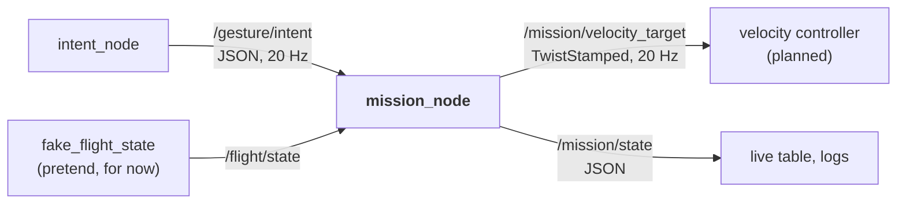
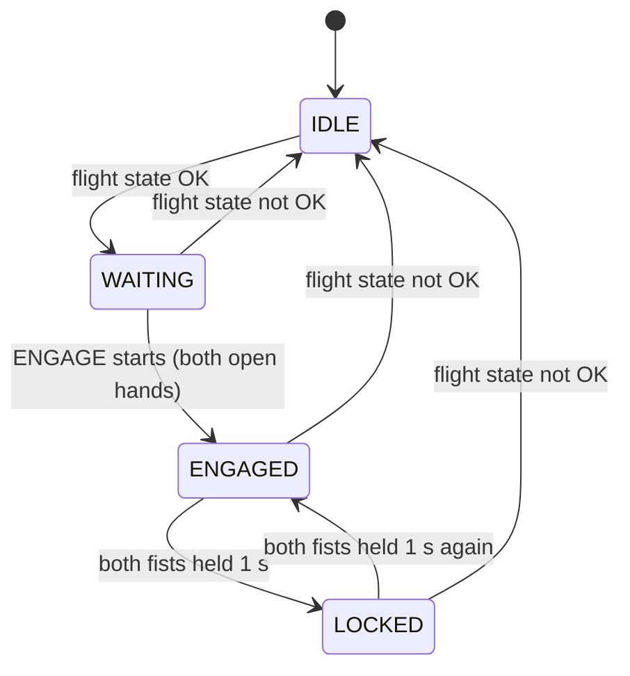

# 🎯 Mission_Node: gesture intent → velocity target

`mission_node` is the third ROS 2 node of the [[00 Gesture Pipeline|Gesture Pipeline]]. It reads what the operator wants from `/gesture/intent` ([[03 Intent Node]]) and what the drone is doing from `/flight/state`, and publishes a safe velocity target on `/mission/velocity_target`: limited, ramped, and only on the axes the ground owns.

> [!WARNING] Status: DRAFT
> - Topic names, `/flight/state` fields and every number are **proposals** (§12). The design decisions to review are in §10.
> - `/flight/state` comes from the **pretend** `fake_flight_state` (§7) until `flight_interface` exists. Never use it with a real drone.
> - Not run yet with the real webcam, a controller or a drone.

---

## 📍 1. Where it sits, and why it exists



`intent_node` answers "what does the **operator** want?" and knows nothing about drones. `mission_node` answers "what should the **drone** do, given what it is doing now?". Keeping them apart means:
- `/gesture/intent` stays drone-independent, so the same intents can drive a car or an arm ([[00 Gesture Pipeline|Gesture Pipeline]] §8).
- All drone-specific rules and limits live in one place, easy to review and test.

---

## 📦 2. The package

`drone/ground/src/mission_node/`, image `rosrangers/mission:jazzy`:

| Piece | What it does |
| :--- | :--- |
| `mission_logic.py` | all the rules of §5, no ROS imports, so they are unit-tested anywhere |
| `mission_node.py` | the ROS wrapper: subscriptions, the 20 Hz timer, publishers, logs |
| `fake_flight_state`, `fake_intent` | pretend inputs for testing without a drone or `intent_node` (§7) |
| `launch/` | `mission_demo.launch.py` (the node with pretend inputs) and `mission_with_gestures.launch.py` (with `intent_node`, used by the CI tests) |

---

## 📥 3. Input

### 3.1 `/gesture/intent` (from `intent_node`)

JSON in a `std_msgs/String`, 20 Hz, format in [[03 Intent Node]] §4. The node uses `intent` and `reason`; `gesture` is copied to `/mission/state`. Bad JSON or an unknown intent counts as `NEUTRAL`.

### 3.2 `/flight/state` (proposal; `fake_flight_state` for now)

JSON in a `std_msgs/String`, later published by `flight_interface` ([[05 Future Nodes]] §6):

```json
{"link_ok":true,"esp_state":"STREAMING","override_active":true,"mask":11,"airborne":true}
```

| Field | Used for |
|---|---|
| `link_ok` | `false` → `IDLE` |
| `esp_state` | anything but `STREAMING` → `IDLE` ([[ADR-010 MSP Override\|ADR-010]] condition 3) |
| `override_active` | `false` → `IDLE`: the pilot has not handed control over |
| `mask` | 8 / 11 / 15 decide which axes may be commanded (§5.3); any other value → `IDLE` |
| `airborne` | shown in `/mission/state` only, kept for a later land request from the flight controller |

Parsing is strict: only a real JSON `true` counts, a missing field is false. A message older than 0.5 s counts as lost → `IDLE`.

### 3.3 Parameters

Read once at start-up, declared in `mission_node.py`. A value that is not a number stops the node; a value above a hard ceiling is clamped with a warning.

| Parameter | Default | Meaning |
|---|---|---|
| `intent_timeout_sec` | `0.25` | no intent for this long → zero |
| `intent_lost_sec` | `2.0` | no intent for this long → reason `intent_topic_lost` (still zero) |
| `flight_state_timeout_sec` | `0.5` | no `/flight/state` for this long → `IDLE` |
| `max_lateral_mps` | `0.3` | forward/back/left/right speed (ceiling 0.5) |
| `max_vertical_mps` | `0.2` | climb/descend speed (ceiling 0.5) |
| `max_yaw_rate_dps` | `20.0` | yaw rate (ceiling 45) |
| `max_accel_mps2`, `max_yaw_accel_dps2` | `0.5`, `40.0` | how fast speed may **increase** (§5.5) |
| `lock_hold_sec` | `1.0` | how long both fists must be held to lock or unlock |
| `publish_rate_hz` | `20.0` | output rate |

Topic names and `frame_id` are parameters too. The limits are safety settings: agree changes with the team.

---

## ⚙️ 4. Processing

One 20 Hz timer does everything. On every tick:

1. **Intent freshness.** No intent for 0.25 s → `NEUTRAL` (zero). This catches a crashed `intent_node`.
2. **Flight state.** Missing, stale, link lost, not `STREAMING`, override off or bad mask → `IDLE`.
3. **Mode** (§5.1).
4. **Intent → raw velocity** (§5.2). Zero unless `ENGAGED`.
5. **Mask** the axes the ground doesn't own (§5.3).
6. **Ramp and clamp** (§5.5).
7. **Publish** both outputs (§6), always, even when zero.

---

## 🛡️ 5. Rules

### 5.1 Modes



| Mode | Output | Meaning |
|---|---|---|
| `IDLE` | zero | not allowed to command (flight state not OK) |
| `WAITING` | zero (hover) | override on, operator hasn't engaged |
| `ENGAGED` | from the intent | gestures move the drone |
| `LOCKED` | zero (hover) | every gesture except the unlock is ignored, no timeout |

- **Engage only on a new `ENGAGE`.** Both open hands must *start* while `WAITING`; hands already up (at start-up, or through `IDLE`) don't count, so the camera must see the hands down first. Only messages about the hands count as a start, never a delivery gap or a recogniser starting.
- **Lock / unlock:** both fists held 1 s, once per hold. A single fist does nothing.
- **Hands down while `ENGAGED`:** zero at once, still `ENGAGED`. Moving again needs no new `ENGAGE`.
- **Flight state not OK** → `IDLE` from any mode, then `WAITING`; a new `ENGAGE` is needed. The pilot always wins.

### 5.2 Intent → velocity target

Body frame (REP-103): x forward, y **left**, z up, yaw positive = left.

| Intent | `linear.x` | `linear.y` | `linear.z` | `angular.z` |
|---|---|---|---|---|
| `MOVE_FORWARD` / `MOVE_BACKWARD` | ±0.3 m/s | 0 | 0 | 0 |
| `MOVE_LEFT` / `MOVE_RIGHT` | 0 | ±0.3 m/s | 0 | 0 |
| `CLIMB_UP` / `DESCEND_ONLY` | 0 | 0 | ±0.2 m/s | 0 |
| `YAW_LEFT` / `YAW_RIGHT` | 0 | 0 | 0 | ±20 °/s |
| `ENGAGE`, `LOCK_TOGGLE`, `NEUTRAL`, unknown | 0 | 0 | 0 | 0 |

Left/right is the **operator's** (§12). Zero means "hold position", not "let go of the sticks".

### 5.3 Axis masking

The ground only commands the axes in the override mask ([[ADR-010 MSP Override|ADR-010]] condition 4); the rest are zeroed and reported as `axis_not_owned:<axis>`:

| Mask | Ground owns |
|---|---|
| 8 | yaw |
| 11 | roll, pitch, yaw (throttle stays with the pilot, so climb/descend do nothing) |
| 15 | all four, only with altitude hold or a validated altitude loop |

### 5.4 Operator or recogniser gone: hover

The node **never asks for a landing**. Hands down, a dead recogniser or a lost `/gesture/intent` all give `NEUTRAL`: zero velocity, mode unchanged. `land_request` in `/mission/state` stays `false`, kept for a later flight-controller trigger. Landing is the descend gesture (mask 15) or the pilot; motors off is the pilot's SA switch.

### 5.5 Ramp and clamp

Speeding up is ramped (0 → 0.3 m/s in 0.6 s, 0 → 20 °/s in 0.5 s). Slowing down, stopping and reversing are immediate, because zero must arrive within 0.25 s of losing the input. No value ever exceeds the limits or the hard ceilings (0.5 m/s, 45 °/s).

### 5.6 Never

It never arms, disarms or touches the override switch, never keeps moving on stale or bad input, and on stop (Ctrl+C, `docker stop`) it sends one last zero target.

---

## 📤 6. Output

### 6.1 `/mission/velocity_target`

`geometry_msgs/TwistStamped`, 20 Hz, always published (zeros when not engaged), so the controller can treat silence as a fault. `frame_id` is `base_link`.

### 6.2 `/mission/state`

JSON for people and logs, not for control. Published on every change and at 2 Hz:

```json
{"mode":"ENGAGED","mode_reason":"engage","intent":"CLIMB_UP","reason":"ok","gesture":"L:NONE+R:INDEX_UP","mask":11,"airborne":true,"land_request":false,"limited":["axis_not_owned:z"],"intent_age_ms":42}
```

Read `mode` and `mode_reason` first: not `ENGAGED` means zero whatever the gesture. If an axis stays zero while `ENGAGED`, `limited` says why.

### 6.3 Logs

Mode and intent changes, bad input and a health report every 5 s, in `logs/mission/latest.log`. The live table shows the mode and the velocity in words ([[01 ROS2 Nodes Installation|01]] §4).

### 6.5 Downstream (not this node's job)

The velocity controller turns the target into attitude setpoints, and `flight_interface` sends them to the drone ([[05 Future Nodes]] §5–6).

---

## 🎭 7. Pretend inputs

### 7.1 `fake_flight_state`

The `flight` service. Publishes `/flight/state` at 10 Hz; every field is a parameter you can change live with `ros2 param set /fake_flight_state <field> <value>` ([[01 ROS2 Nodes Installation|01]] §5): `link_ok`, `esp_state`, `override_active`, `mask`, `airborne`. `publish false` simulates a dead `flight_interface`; `raw` sends any text to try bad messages. Each fault drops the node to `IDLE`.

### 7.2 `fake_intent`

Publishes `/gesture/intent` in `intent_node`'s format: a 29 s demo (`mode:=demo`) or one intent you change live (`mode:=constant`, then `ros2 param set /fake_intent intent <INTENT>`). Never run it next to `intent_node`. The demo, with the default flight state (mask 11, airborne):

| Time (s) | Fake intent | Mode | Velocity |
| :---: | :--- | :--- | :--- |
| 0–2 | `NEUTRAL` | `WAITING` | zero |
| 2–4 | `ENGAGE` | `ENGAGED` | zero |
| 4–7 | `MOVE_RIGHT` | `ENGAGED` | `linear.y` ramps to −0.3 |
| 7–9 | `YAW_LEFT` | `ENGAGED` | `angular.z` ramps to +20 °/s |
| 9–11 | `CLIMB_UP` | `ENGAGED` | zero: mask 11 (`axis_not_owned:z`) |
| 11–12 | `BANANA` (unknown) | `ENGAGED` | zero |
| 12–14 | `LOCK_TOGGLE` | `LOCKED` after 1 s | zero |
| 14–16 | `MOVE_LEFT` | `LOCKED` | zero: locked |
| 16–18 | `LOCK_TOGGLE` | `ENGAGED` after 1 s | zero |
| 18–20 | `MOVE_LEFT` | `ENGAGED` | `linear.y` ramps to +0.3 |
| 20–24 | `NEUTRAL` | `ENGAGED` | zero: hovers |
| 24–26 | `MOVE_LEFT` | `ENGAGED` | moves again, no new engage |
| 26–29 | nothing | `ENGAGED` | zero (intent lost) |

---

## ▶️ 8. Run (Docker)

Starting the services, the CLI and the logs: [[01 ROS2 Nodes Installation|01]] §4–5.

### 8.1 With the webcam

`make` starts `mission` and `flight` with the rest of the chain. `MASK=15 make` gives the ground throttle; `AIRBORNE=false make` puts the pretend drone on the ground.

### 8.2 On its own: the demo

```bash
docker compose run --rm mission ros2 launch mission_node mission_demo.launch.py   # mask:=15, loop:=true also work
```

Compare the output with the table in §7.2. Don't run it next to the `mission` and `flight` services.

### 8.3 With `intent_node`, no camera

`docker compose up -d --build intent mission flight`, then publish gestures on `/gesture/raw` with `ros2 topic pub` (one at a time, `null` first so the engage counts).

---

## 🧪 9. Test

### 9.1 Automated tests

`make unit`, `make smoke` and CI ([[01 ROS2 Nodes Installation|01]] §7).

### 9.2 Test files

`test/test_mission_logic.py` (every rule of §5 and the demo, no ROS), `test_mission_node_ros.py` (the real node on topics), `test_mission_node_process.py` (clean stops, bad parameters), `test_launch_files.py`. Tests with the other nodes: [[01 ROS2 Nodes Installation|01]] §7.2.

### Manual checks

| Check | Expected |
| :--- | :--- |
| The demo (§8.2) | modes and velocities as in §7.2 |
| `ros2 param set /fake_flight_state override_active false` | `IDLE` and zero at once |
| `docker compose stop flight` | `IDLE` within 0.5 s |
| Real gestures (§8.1), each held 1 s ([[00 Gesture Pipeline]] §3) | mode and velocity follow §5 within about 0.5 s |

Attach `logs/intent/latest.log` and `logs/mission/latest.log` of a webcam run to a Test session issue.

### Troubleshooting

| Symptom | Fix |
| :--- | :--- |
| Mode stays `IDLE` / `no_flight_state` | start the `flight` service |
| Mode stays `WAITING` with both open hands | lower both arms, then show them again (§5.1) |
| Gestures do nothing, mode `LOCKED` | hold both fists 1 s to unlock |
| `CLIMB_UP` does nothing | expected with mask 11; use `MASK=15 make` |
| Intents jump between two values | `fake_intent` and `intent_node` both running: stop one |

---

## 🧭 10. Design decisions (for review)

| Decision | Why |
| :--- | :--- |
| **No land request**: operator or recogniser gone → hover. **`safety-critical`, needs a team review** | Hands down is the normal "nothing"; landing stays with the descend gesture or the pilot |
| Engage only on a new `ENGAGE` | A gesture already shown, or a delivery gap, never starts motion |
| Lock needs both fists held 1 s; no timeout; one fist does nothing | Hard to do by accident; a locked drone never moves by itself |
| Hands down keeps `ENGAGED` | Lowering the arms is the normal hover |
| A new `ENGAGE` after `IDLE` | A pilot hand-back never resumes motion by itself |
| Only speeding up is ramped | Zero within 0.25 s of losing input (REQ-SAF-017) |
| Stale or invalid `/flight/state` → `IDLE` | A dead `flight_interface` must not leave "override on" in place |
| Hard ceilings in code; bad parameters stop the node | No setting can pass the limits or start with a guessed value |
| Last zero target on stop | A reader never keeps a non-zero target |

---

## 🔖 11. Requirement IDs

Registered in [[Requirements]] (status `draft`).

| ID | Requirement | Checked in |
|---|---|---|
| REQ-SAF-017 | Zero velocity within 0.25 s of losing `/gesture/intent`. | `test_mission_logic.py`, `test_mission_node_ros.py` |
| REQ-SAF-018 | Never command an axis outside the override mask. | `test_mission_logic.py`, `test_mission_node_ros.py` |
| not registered | Motion only starts after a deliberate `ENGAGE` (§12). | `test_mission_logic.py`, `test_mission_node_ros.py` |
| REQ-CTL-001 | Speeds limited to 0.3 m/s lateral, 0.2 m/s vertical, 20 °/s yaw; ceilings 0.5 m/s and 45 °/s. | `test_mission_logic.py`, `test_mission_node_ros.py` |
| REQ-SW-001 | `/mission/velocity_target` at 20 Hz in every mode. | `test_mission_node_ros.py` |

---

## ❓ 12. Open points

- [ ] **Review §10** and agree the numbers (speeds, ramps, `lock_hold_sec`, ceilings, timeouts).
- [ ] **Team review of the no-land-request decision** (`safety-critical`).
- [ ] **Land request from the flight controller**: what telemetry sets `land_request`, and what the pilot sees.
- [ ] **Register the engage rule** as a REQ-SAF in [[Requirements]].
- [ ] **First run with the webcam**, logs attached to a Test session issue.
- [ ] **Topic types**: a typed message package instead of JSON strings ([[05 Future Nodes]] §4).
- [ ] **Who publishes `/flight/state`**, and how `airborne` is decided.
- [ ] **Left/right convention** in the cage: operator frame vs drone frame.
- [ ] **Mission and controller in one node?** [[System Overview]] draws them as one box.
- [ ] **Launch files and parameters** move to a `gesture_bringup` package ([[05 Future Nodes]] §11).

---

## 🔗 13. Related pages

[[00 Gesture Pipeline]] · [[01 ROS2 Nodes Installation]] · [[02 Gesture Node]] · [[03 Intent Node]] · [[05 Future Nodes]] · [[Requirements]] · [[System Overview]] · [[ADR-010 MSP Override|ADR-010]] · [[Safety Rules]]

---

## Glossary

| Term | Meaning |
| --- | --- |
| **ADR** | Architecture Decision Record: a documented decision and its rationale. |
| **Body frame** | Axes fixed to the drone: x forward, y left, z up. |
| **Ceiling** | A hard-coded maximum that no parameter can exceed. |
| **Engage** | Going from `WAITING` to `ENGAGED` with both open hands: from then on gestures move the drone. |
| **Intent** | The action the operator asks for (for example `MOVE_LEFT`), published on `/gesture/intent`. |
| **Launch file** | A Python file that starts several nodes with their parameters (`ros2 launch`). |
| **Lock** | `LOCKED` mode: the drone hovers and ignores gestures until both fists are held again. |
| **Mask** | `msp_override_channels_mask`: which stick channels the ground controls (8, 11 or 15). |
| **Pretend input** | A small node (`fake_flight_state`, `fake_intent`) that publishes made-up values so a node can be tested alone. |
| **Ramp** | Limiting how fast a target can increase, so motion starts smoothly. |
| **REP-103** | The ROS convention for units (SI) and axis directions. |
| **ROS 2** | The second-generation Robot Operating System middleware used for robotics integration. |
| **TwistStamped** | Standard ROS 2 message holding a linear and angular velocity with a timestamp and frame. |
