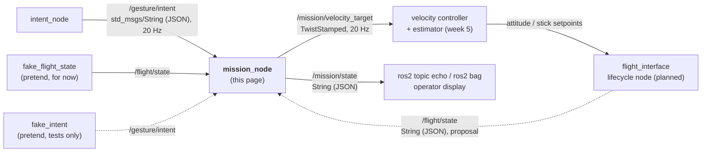
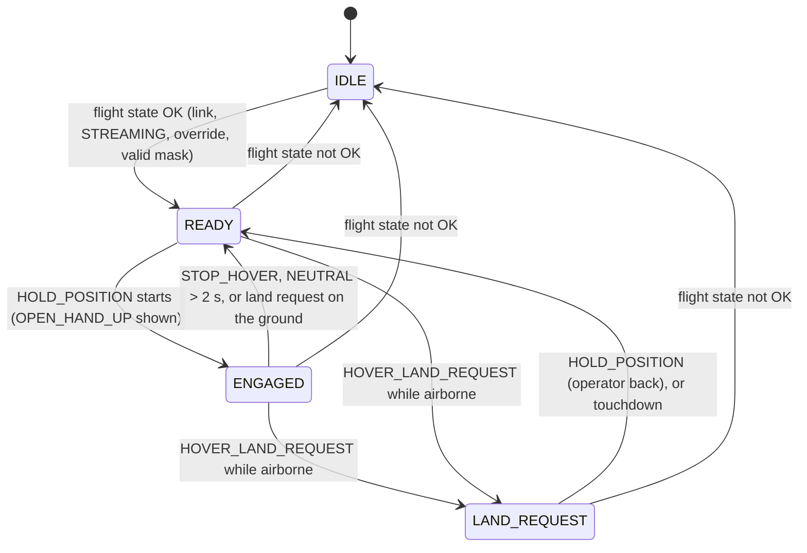

# 🎯 Mission_Node: gesture intent → velocity target

`mission_node` (v0.1) is the second ROS 2 node of the [[00 Gesture Pipeline|Gesture Pipeline]]. It reads what the operator wants from `/gesture/intent` ([[03 Intent Node]]) and what the drone is doing from `/flight/state`. It publishes a safe velocity target on `/mission/velocity_target`: limited, ramped, and only on the axes the ground owns.

> [!WARNING] Status: DRAFT. Built and tested on real ROS 2 Jazzy, not reviewed yet
> - The package exists and runs. It has 35 unit tests and passed `colcon build` + `colcon test` on Pop!_OS 24.04 + Jazzy on 2026-10-19. It also ran end to end with `intent_node` and the UDP fake camera (§10, test log in [[01 ROS2 Nodes Installation|01]] §13). Since 2026-10-20 the recogniser is `gesture_node` on `/gesture/raw` ([[02 Gesture Node]]); that chain has not run with `mission_node` yet.
> - It lives in **`MISSION_NODE_PACKAGE/`** at the repo root **for now**. Its final place is `drone/ground/src/mission_node/` ([[00 Gesture Pipeline]] §5). Only the folder moves. The package name stays `mission_node`.
> - Topic names, `/flight/state` fields and every number are still **proposals**. The team must agree them (§13). Choices made while coding are listed in §11 for review. Nothing here changes an accepted ADR.
> - `/flight/state` does not exist yet (no `flight_interface`). Until it does, the package ships a **pretend** publisher, `fake_flight_state` (§7). Never use it with a real drone.

---

## 📍 1. Where it sits



| Node | Answers the question | Knows about |
|---|---|---|
| `intent_node` | "What does the **operator** want?" | hands, cameras, timeouts. Nothing about drones |
| **`mission_node`** | "What should the **drone** do, given what it is doing now?" | flight state, speed limits, which axes the ground controls |
| controller + estimator | "Which attitude gives that velocity?" | flow, IMU, baro height, gains |
| `flight_interface` | "How do I send it safely?" | protocol, session, watchdog, sim or real backend |

Why it is separate from `intent_node`:
- `/gesture/intent` stays drone-independent, so the same intents can drive a car or an arm in Module 2 ([[00 Gesture Pipeline|Gesture Pipeline]] §9).
- All drone-specific limits live in one place, which makes them easy to review and test.

---

## 📦 2. What was built

One ROS 2 Python package, `mission_node`, with **three executables** and **two launch files**:

| Piece | Kind | What it does |
| :--- | :--- | :--- |
| `mission_node` | executable (the real node) | `/gesture/intent` + `/flight/state` → `/mission/velocity_target` + `/mission/state` |
| `fake_flight_state` | executable (pretend input) | publishes a pretend `/flight/state` at 10 Hz. Every field is a parameter you can change while it runs (§7.1) |
| `fake_intent` | executable (pretend input) | publishes pretend `/gesture/intent` messages in `intent_node`'s format: a 29 s scripted demo, or one constant intent you change by hand (§7.2) |
| `mission_demo.launch.py` | launch file | `fake_flight_state` + `mission_node` + `fake_intent`: **the node on its own with pretend values** |
| `mission_with_gestures.launch.py` | launch file | `intent_node` + `fake_flight_state` + `mission_node`: **the real gesture chain**. You add `gesture_node` or the fake `/gesture/raw` publisher (§9.2) |

### 2.1 Files

```text
MISSION_NODE_PACKAGE/                 # later: drone/ground/src/mission_node/
├── package.xml                       # must be directly here (rclpy, std_msgs, geometry_msgs, launch_ros)
├── setup.py, setup.cfg
├── resource/mission_node
├── launch/
│   ├── mission_demo.launch.py        # on its own, pretend inputs
│   └── mission_with_gestures.launch.py   # with intent_node
├── mission_node/
│   ├── __init__.py
│   ├── mission_logic.py              # all the rules of §5. NO ROS imports, injectable clock
│   ├── mission_node.py               # rclpy wrapper: subscriptions, 20 Hz timer, publishers, logs
│   ├── fake_inputs.py                # demo script + JSON builders. NO ROS imports
│   ├── fake_flight_state.py          # pretend /flight/state publisher
│   └── fake_intent.py                # pretend /gesture/intent publisher
└── test/
    └── test_mission_logic.py         # 35 unit tests, incl. the demo script played through the logic
```

Same pattern as `intent_node` ([[03 Intent Node]] §8): the decisions live in a ROS-free module (`mission_logic.py`), so they can be unit-tested anywhere. `mission_node.py` only wires them to ROS.

---

## 📥 3. What it reads

### 3.1 `/gesture/intent` (from `intent_node`)

Type `std_msgs/msg/String`, 20 Hz. Format: [[03 Intent Node]] §4.

```json
{"intent":"MOVE_RIGHT","gesture":"INDEX_RIGHT","reason":"ok","t":1791976551.56,"xy":[0.51,0.42]}
```

The node uses `intent` and `reason`. `gesture` is copied to `/mission/state` for people. `t` and `xy` are ignored. Intent names are case-insensitive. Bad JSON or an unknown intent becomes `NEUTRAL` and is counted and logged (§5.6).

### 3.2 `/flight/state` (proposal; `fake_flight_state` for now)

Type `std_msgs/msg/String` holding JSON. The real publisher will be `flight_interface` ([[05 Future Nodes]] §6).

```json
{"link_ok":true,"esp_state":"STREAMING","override_active":true,"mask":11,"airborne":true}
```

| Field | Source (real system) | Used for |
|---|---|---|
| `link_ok` | ESP session + STATE freshness ([[Protocol Spec v0]]) | `false` → `IDLE`, zero |
| `esp_state` | STATE `esp_state` | anything but `"STREAMING"` → `IDLE` ([[ADR-010 MSP Override\|ADR-010]] condition 3) |
| `override_active` | STATE `override_active` | `false` → `IDLE`: the pilot has not handed control over |
| `mask` | expected override mask | 8 / 11 / 15 decide which axes may be commanded (§5.3). Any other value → `IDLE` |
| `airborne` | estimator / baro height above a threshold | land requests are ignored on the ground (§5.4) |

The parsing is strict: only a real JSON `true` counts as true (`"true"` or `1` are false), and `mask` must be an integer. A `/flight/state` older than `flight_state_timeout_sec` (0.5 s) counts as lost → `IDLE`. The node never reads ARM state in order to change it.

### 3.3 Parameters

Read once at start-up. Change them with `--ros-args -p name:=value`:

```bash
ros2 run mission_node mission_node --ros-args -p max_lateral_mps:=0.2 -p intent_lost_sec:=1.5
```

| Parameter | Default | Meaning |
|---|---|---|
| `intent_topic` | `/gesture/intent` | input topic |
| `flight_state_topic` | `/flight/state` | input topic |
| `velocity_topic` | `/mission/velocity_target` | output topic |
| `state_topic` | `/mission/state` | output topic |
| `frame_id` | `base_link` | `header.frame_id` of the velocity target |
| `intent_timeout_sec` | `0.25` | no intent for this long → `NEUTRAL` (zero) |
| `intent_lost_sec` | `2.0` | no intent for this long → `HOVER_LAND_REQUEST` (`intent_topic_lost`). Also: `NEUTRAL` for this long while `ENGAGED` → `READY` |
| `flight_state_timeout_sec` | `0.5` | no `/flight/state` for this long → `IDLE` |
| `max_lateral_mps` | `0.3` | speed for `MOVE_LEFT/RIGHT` (hard ceiling 0.5) |
| `max_vertical_mps` | `0.2` | speed for `CLIMB_SLOWLY` / `DESCEND_…` and the mask-15 landing (hard ceiling 0.5) |
| `max_yaw_rate_dps` | `20.0` | yaw rate for `YAW_LEFT/RIGHT` (hard ceiling 45) |
| `max_accel_mps2` | `0.5` | how fast linear speed may **increase** (§5.5) |
| `max_yaw_accel_dps2` | `40.0` | how fast yaw rate may **increase** |
| `land_hover_sec` | `2.0` | mask 15 land request: hover this long, then descend |
| `publish_rate_hz` | `20.0` | output rate, always on |

> [!WARNING] Safety settings
> The speed limits, timeouts and ramps are safety settings. Agree changes with the team. A value above the hard ceiling is clamped to the ceiling with a warning at start-up. A negative or NaN limit becomes 0. The limits are clamped again downstream (controller, `flight_interface`, ESP), as [[Protocol Spec v0]] §5 requires.

---

## ⚙️ 4. What it does

Subscriptions only store the latest message. One timer runs at 20 Hz and does everything, so there are no threads or locks (same pattern as `intent_node`). On every tick:

1. **Check intent freshness.** Last intent older than `intent_timeout_sec` → `NEUTRAL` (`intent_stale`). Older than `intent_lost_sec` → `HOVER_LAND_REQUEST` (`intent_topic_lost`). This catches a crashed `intent_node`, which can't report itself.
2. **Check the flight state** (§3.2). Missing, stale, link lost, not `STREAMING`, override off or bad mask → `IDLE`.
3. **Update the mode** (§5.1).
4. **Map** the intent to a raw velocity target (§5.2). Zero unless `ENGAGED` (or a mask-15 landing).
5. **Mask** the axes the ground doesn't own (§5.3).
6. **Ramp** up at `max_accel_mps2` and **clamp** to the limits (§5.5).
7. **Publish** `/mission/velocity_target` (always, even zero) and `/mission/state` (§6).

---

## 🛡️ 5. Rules

### 5.1 Modes



| Mode | Output | Meaning |
|---|---|---|
| `IDLE` | zero | not allowed to command: no or stale flight state, no link, ESP not `STREAMING`, override off, or bad mask |
| `READY` | zero (hover) | override is on, but the operator hasn't engaged |
| `ENGAGED` | from the intent | gestures move the drone |
| `LAND_REQUEST` | hover; with mask 15, descend after `land_hover_sec` (§5.4) | operator gone, or `intent_node` gone |

- **Engaging needs a deliberate `OPEN_HAND_UP`.** `HOLD_POSITION` must **start** while in `READY`. If the hand was already showing it, it must go away and be shown again. This holds after `STOP_HOVER`, after a land request, and when the pilot flips override while the operator already holds an open hand. A stray gesture never starts motion.
- **Only real messages count for "start".** A delivery gap (`intent_stale`, made up by this node) never looks like "hand removed and shown again". Without this rule, a 0.3 s network hiccup could engage the drone (found in the first real run, §11).
- **Dead-man rule:** in `ENGAGED`, `NEUTRAL` (hand gone > 0.3 s, from `intent_node`) gives zero at once, but stays engaged, so a short loss doesn't force re-engaging. `NEUTRAL` for more than `intent_lost_sec` → `READY`. Hand gone > 2 s → `intent_node` sends `HOVER_LAND_REQUEST`.
- Flight state not OK → `IDLE` from any mode. The pilot always wins ([[System Overview]] §2).

### 5.2 Intent → velocity target

Body frame, ROS convention (REP-103): x forward, y **left**, z up, yaw positive = counter-clockwise (left). SI units on the topic.

| Intent | `linear.x` | `linear.y` | `linear.z` | `angular.z` |
|---|---|---|---|---|
| `HOLD_POSITION` | 0 | 0 | 0 | 0 |
| `STOP_HOVER` | 0 | 0 | 0 | 0 (and leave `ENGAGED`) |
| `MOVE_LEFT` | 0 | +0.3 m/s | 0 | 0 |
| `MOVE_RIGHT` | 0 | −0.3 m/s | 0 | 0 |
| `CLIMB_SLOWLY` | 0 | 0 | +0.2 m/s | 0 |
| `DESCEND_SLOWLY_LAND_REQUEST` | 0 | 0 | −0.2 m/s | 0 |
| `YAW_LEFT` | 0 | 0 | 0 | +0.349 rad/s (20 °/s) |
| `YAW_RIGHT` | 0 | 0 | 0 | −0.349 rad/s |
| `NEUTRAL`, unknown, bad JSON | 0 | 0 | 0 | 0 |
| `HOVER_LAND_REQUEST` | see §5.4 | | | |

- Vocabulary v0 has **no forward/back gesture**, so `linear.x` is always 0.
- "Left/right" is the **operator's** left/right ([[00 Gesture Pipeline|Gesture Pipeline]] §3). It only matches the drone's left when both face the same way (§13).
- Zero velocity means "hold position" (the controller drives flow to zero), not "let go of the sticks".
- `DESCEND_SLOWLY_LAND_REQUEST` is only a slow descent. It does not enter `LAND_REQUEST`.

### 5.3 Axis masking (who owns which stick)

The ground may only command the axes in the override mask ([[ADR-010 MSP Override|ADR-010]] condition 4). The node zeroes the rest and adds `axis_not_owned:<axis>` to `limited` in `/mission/state`:

| Mask | Ground owns | Mission node may send |
|---|---|---|
| 8 | yaw | `angular.z` only |
| 11 | roll, pitch, yaw | `linear.x`, `linear.y`, `angular.z`. **`linear.z` is forced to 0**: the pilot has throttle |
| 15 | all four | everything, **only** with altitude hold or a validated altitude loop |

So `CLIMB_SLOWLY` / `DESCEND_…` do nothing until mask 15.

### 5.4 Land requests

`HOVER_LAND_REQUEST` comes from `intent_node` (hand or recogniser gone > 2 s) or from this node's own watchdog (`intent_topic_lost`).

| Situation | Action |
|---|---|
| `intent_node` start-up (`HOVER_LAND_REQUEST` / `no_packets_yet`) | treated as `NEUTRAL`: "no recogniser yet", never a land request ([[03 Intent Node]] §5) |
| No intent ever received since `mission_node` started | `NEUTRAL` / `no_intent_yet`, never `intent_topic_lost`: `intent_node` hasn't started, it didn't crash |
| Not `airborne` | ignored. `READY` stays `READY`, `ENGAGED` goes to `READY` (`land_request_on_ground`). Never "land" a drone that is on the ground |
| Airborne, mask 8 or 11 | zero velocity (hover) and `land_request: true` in `/mission/state`. The **pilot** lands, because they own throttle |
| Airborne, mask 15 | hover for `land_hover_sec` (2 s), then descend at `max_vertical_mps` until `airborne` goes false (→ `READY`, `landed`). The pilot can take over at any time |

The node never disarms. Touchdown and disarm stay with the pilot or the Betaflight failsafe ([[Safety Rules]] rule 5).

### 5.5 Ramp and clamp

- **Speeding up** is limited to `max_accel_mps2` (0.5 m/s²: 0 → 0.3 m/s in 0.6 s) and `max_yaw_accel_dps2` (40 °/s²: 0 → 20 °/s in 0.5 s). So a new gesture never steps the target.
- **Slowing down and stopping are immediate.** Stopping is the safe direction, and REQ-SAF (§12) wants zero within 0.25 s of losing the input. A gradual stop would break that.
- **Reversing** (`MOVE_RIGHT` → `MOVE_LEFT`) drops to zero at once, then ramps up the other way.
- **Clamp** to the limits, which can never exceed the hard ceilings (0.5 m/s, 45 °/s) in `mission_logic.py`.
- While an axis is still ramping, `limited` in `/mission/state` shows `ramping:<axis>`.

### 5.6 Things it never does

- It never arms, disarms or touches any AUX channel or the override switch (SAF-03/04, [[ADR-015 Gesture Input Source|ADR-015]]).
- It never keeps moving on stale, unknown or bad input.
- It never sends a target above the limits or the hard ceilings, whatever the parameters say.
- It never stops publishing while it runs. On Ctrl+C it publishes one last zero target before it exits.

---

## 📤 6. What it publishes

### 6.1 `/mission/velocity_target`

Type **`geometry_msgs/msg/TwistStamped`**, 20 Hz, always published (zeros when not engaged), so the controller can treat silence as a fault.

```yaml
header:
  stamp: {sec: 1792420240, nanosec: 560000000}
  frame_id: base_link        # body frame, FLU (x forward, y left, z up)
twist:
  linear:  {x: 0.0, y: -0.3, z: 0.0}   # m/s  (MOVE_RIGHT)
  angular: {x: 0.0, y: 0.0, z: 0.0}    # rad/s (20 °/s = 0.349 rad/s)
```

### 6.2 `/mission/state`

Type `std_msgs/msg/String` (JSON). Published on every change, and at 2 Hz otherwise. For people and logs, not for control.

```json
{"mode":"ENGAGED","mode_reason":"hold_position","intent":"CLIMB_SLOWLY","reason":"ok","gesture":"THUMB_UP","mask":11,"airborne":true,"land_request":false,"limited":["axis_not_owned:z"],"intent_age_ms":42}
```

| Field | Meaning |
| :--- | :--- |
| `mode` | `IDLE`, `READY`, `ENGAGED`, `LAND_REQUEST` (§5.1) |
| `mode_reason` | why the node is in that mode: `no_flight_state`, `flight_state_stale`, `link_lost`, `not_streaming`, `override_off`, `bad_mask`, `override_on`, `hold_position`, `stop_hover`, `neutral_too_long`, `land_request_on_ground`, `no_hand_long`, `no_packets`, `intent_topic_lost`, `operator_back`, `landed` |
| `intent`, `reason` | the intent after the checks of §4, and why: `intent_node`'s reason, or this node's `no_intent_yet`, `intent_stale`, `intent_topic_lost`, `unknown_intent`, `bad_json` |
| `gesture` | the gesture from the last message (information only) |
| `mask`, `airborne` | from `/flight/state` (`null` / `false` while it is not OK) |
| `land_request` | `true` in `LAND_REQUEST`: the pilot should land (masks 8, 11) |
| `limited` | what was held back: `axis_not_owned:<axis>`, `ramping:<axis>` |
| `intent_age_ms` | age of the last intent message |

### 6.3 Logs

The node logs every mode change (`LAND_REQUEST` as a warning), every intent change, each new `axis_not_owned`, bad input (throttled), and a health report every 5 s:

```text
[INFO] [mission_node]: Mode -> ENGAGED (hold_position)
[INFO] [mission_node]: Intent -> MOVE_RIGHT (reason: ok)
[INFO] [mission_node]: Not commanded, mask 11: ['axis_not_owned:z']
[WARN] [mission_node]: Mode -> LAND_REQUEST (no_hand_long)
[INFO] [mission_node]: Health: 100 intents and 50 flight states in the last 5 s; mode ENGAGED, last intent MOVE_RIGHT; bad: json 0, unknown intents 0, flight states 0
```

The health report is a warning when one of the two inputs got no messages in the last 5 s.

### 6.4 How to read the outputs

Run these in a terminal with both `source` lines:

| Command | Shows |
| :--- | :--- |
| `ros2 topic echo /mission/state --field data` | the JSON of §6.2: mode, intent, reason, limits. Start here |
| `ros2 topic echo /mission/velocity_target --field twist` | the numbers only (`linear` in m/s, `angular` in rad/s), without the header |
| `ros2 topic echo /mission/velocity_target --field twist.linear.y` | one axis, one number per message (good for watching a ramp) |
| `ros2 topic echo --once /mission/velocity_target` | one full message, with `header.stamp` and `frame_id` |
| `ros2 topic hz /mission/velocity_target` | ~20 Hz in every mode, zeros included |
| `ros2 topic echo /flight/state --field data` | the pretend drone state from `fake_flight_state` (§7.1) |
| the `mission_node` terminal | `Mode ->` and `Intent ->` on every change, the health report every 5 s (§6.3) |

**Reading `/mission/velocity_target`.** The axes follow §5.2 (x forward, y **left**, z up, yaw positive = left), so the signs look reversed for "right":

| You see | Means |
| :--- | :--- |
| all zeros | hold position, or not `ENGAGED` (check `mode` on `/mission/state`) |
| `linear.y` negative (down to −0.3) | moving **right** |
| `linear.y` positive (up to +0.3) | moving **left** |
| `linear.z` +0.2 / −0.2 | climbing / descending (only with mask 15) |
| `angular.z` +0.349 / −0.349 | yaw left / right (20 °/s) |
| a value growing by 0.025 per message | the ramp (§5.5), not a bug |

**Reading `/mission/state`.** Look at `mode` and `mode_reason` first: if the mode is not `ENGAGED`, the velocity is zero whatever the gesture. If it is `ENGAGED` but an axis stays zero, `limited` says why (`axis_not_owned:z` = the mask does not give us that stick). `intent` and `reason` are what this node accepted from `/gesture/intent` (§3.1).

Reading the velocity in code (as the controller will):

```python
from geometry_msgs.msg import TwistStamped


def on_target(msg: TwistStamped) -> None:
    vy = msg.twist.linear.y        # m/s, + = left
    vz = msg.twist.linear.z        # m/s, + = up
    yaw_rate = msg.twist.angular.z  # rad/s, + = left


node.create_subscription(TwistStamped, "/mission/velocity_target", on_target, 10)
```

`/mission/state` is read like `/gesture/intent`: `json.loads(msg.data)` ([[03 Intent Node]] §4). It is for people and logs; control code should only use `/mission/velocity_target`.

### 6.5 What happens downstream (not this node's job)

1. **Velocity controller** (week 5, tracks C + E, [[Study Plan v2]] §7) reads `/mission/velocity_target` and the estimator velocity (flow + IMU + baro), and outputs roll/pitch angles, yaw rate and throttle.
2. **`flight_interface`** packs those into `SETPOINT` (0x60): `mode 1` (attitude), `roll`, `pitch`, `yaw_rate` in −1000..1000, `throttle` 0..1000 ([[Protocol Spec v0]] §3). It sends at 50 Hz and its own watchdog sends `mode 0` (neutral) if the controller goes silent.
3. **ESP** checks, clamps and maps to `MSP_SET_RAW_RC` (1000–2000 µs, AETR, 8 channels).
4. **In simulation** the PX4 backend of `flight_interface` takes the velocity setpoint more directly ([[ADR-019 Sim Backends|ADR-019]]).

Until the controller exists, the node is tested on its own by watching its two topics (§10).

---

## 🎭 7. Pretend inputs

### 7.1 `fake_flight_state`

Publishes `/flight/state` at 10 Hz. It reads its parameters on every tick, so you can change the "drone" while everything runs:

| Parameter | Default | Try |
| :--- | :--- | :--- |
| `link_ok` | `true` | `false` → `IDLE` (`link_lost`) |
| `esp_state` | `STREAMING` | `FAILSAFE` → `IDLE` (`not_streaming`) |
| `override_active` | `true` | `false` → `IDLE` (`override_off`): the pilot takes over |
| `mask` | `11` | `8` (yaw only), `15` (all axes, climb works, mask-15 landing) |
| `airborne` | `true` | `false`: land requests are ignored |
| `rate_hz`, `topic` | `10.0`, `/flight/state` | |

```bash
ros2 param set /fake_flight_state override_active false
ros2 param set /fake_flight_state mask 15
```

Stopping `fake_flight_state` (Ctrl+C) is also a test: `mission_node` goes `IDLE` (`flight_state_stale`) within 0.5 s.

### 7.2 `fake_intent`

Publishes `/gesture/intent` at 20 Hz in `intent_node`'s exact format. **Never run it together with `intent_node`**: both would publish on the same topic.

| Parameter | Default | Meaning |
| :--- | :--- | :--- |
| `mode` | `demo` | `demo` plays the script below. `constant` publishes `intent` until stopped |
| `intent` | `NEUTRAL` | the intent in `constant` mode. Change it live with `ros2 param set /fake_intent intent MOVE_RIGHT` |
| `loop` | `false` | `demo`: start again at the end instead of exiting |
| `rate_hz`, `topic` | `20.0`, `/gesture/intent` | |

The **demo script** (29 s) and what `mission_node` should do with the default fake flight state (mask 11, airborne):

| Step | Time (s) | Fake intent | Expected mode | Expected `/mission/velocity_target` |
| :---: | :---: | :--- | :--- | :--- |
| 1 | 0–2 | `NEUTRAL` / `no_hand` | `READY` | zero |
| 2 | 2–4 | `HOLD_POSITION` | `ENGAGED` | zero |
| 3 | 4–7 | `MOVE_RIGHT` | `ENGAGED` | `linear.y` ramps 0 → −0.3 in 0.6 s, then holds |
| 4 | 7–9 | `YAW_LEFT` | `ENGAGED` | `linear.y` 0 at once, `angular.z` ramps to +0.349 |
| 5 | 9–11 | `CLIMB_SLOWLY` | `ENGAGED` | zero, `axis_not_owned:z` (with `mask:=15`: `linear.z` +0.2) |
| 6 | 11–12 | `BANANA` (unknown) | `ENGAGED` | zero, warning `unknown_intent` |
| 7 | 12–14 | `STOP_HOVER` | `READY` | zero |
| 8 | 14–16 | `MOVE_LEFT` | `READY` | **zero**: not engaged |
| 9 | 16–18 | `HOLD_POSITION` | `ENGAGED` | zero |
| 10 | 18–20 | `MOVE_LEFT` | `ENGAGED` | `linear.y` ramps to +0.3 |
| 11 | 20–21 | `NEUTRAL` / `no_hand` | `ENGAGED` | zero at once (dead-man) |
| 12 | 21–24 | `HOVER_LAND_REQUEST` / `no_hand_long` | `LAND_REQUEST` | zero (with `mask:=15`: `linear.z` −0.2 after 2 s) |
| 13 | 24–26 | `HOLD_POSITION` | `READY` (`operator_back`) | zero |
| 14 | 26–29 | nothing published | `READY`, then `LAND_REQUEST` (`intent_topic_lost`) | zero |

The unit test `test_demo_sequence` plays this same script through `mission_logic.py`, so the table is checked on every test run.

---

## 🔨 8. Build

Same steps as `intent_node` ([[01 ROS2 Nodes Installation|01]] §6). Since 2026-10-21 the workspace is `drone/ground/ros2_ws`, made by `make ws` (ignored by Git). `src/` holds symlinks; `make ws` links `gesture_node` and `intent_node`, and `mission_node` is added by hand. `mission_node` has no Docker image yet, so it needs a local ROS 2 Jazzy:

```bash
source /opt/ros/jazzy/setup.zsh
cd ~/ROSRangers/drone/ground && make ws                                            # if not done yet
ln -sfn ~/ROSRangers/MISSION_NODE_PACKAGE ros2_ws/src/mission_node                 # symlink, not a copy; make fclean removes it

cd ros2_ws
rosdep install --from-paths src --ignore-src -r -y
colcon build --packages-select intent_node mission_node --symlink-install
source install/setup.zsh
ros2 pkg executables mission_node
```

> [!NOTE] Using bash?
> Replace `setup.zsh` with `setup.bash` everywhere on this page ([[01 ROS2 Nodes Installation|01]] §5.4).

Expected: `Summary: 2 packages finished`, then:

```text
mission_node fake_flight_state
mission_node fake_intent
mission_node mission_node
```

- `~/ROSRangers` is wherever you cloned the repo.
- When the package moves to `drone/ground/src/mission_node/`, delete the symlink and point a new one there. Nothing else changes.
- Rebuild after changing `setup.py` or `package.xml`, or after **adding** a launch file. Edits to existing Python and launch files take effect without a rebuild (`--symlink-install`).
- Build `mission_node` with the system Python (no venv). Only `gesture_node` is built from the MediaPipe venv ([[01 ROS2 Nodes Installation|01]] §6.4).

Every ROS terminal below starts with:

```bash
source /opt/ros/jazzy/setup.zsh
source ~/ROSRangers/drone/ground/ros2_ws/install/setup.zsh
```

---

## ▶️ 9. Run

### 9.1 On its own, with pretend values (no `intent_node`, no camera, no drone)

**The scripted demo**, one command:

```bash
ros2 launch mission_node mission_demo.launch.py
```

Watch it in a second terminal:

```bash
ros2 topic echo /mission/state --field data              # mode, intent, reason, limits
ros2 topic echo /mission/velocity_target --field twist   # the numbers
```

The launch log shows `fake_intent`'s `Step n/14` lines next to `mission_node`'s `Mode ->` and `Intent ->` lines. Compare them with the table in §7.2. Launch arguments:

```bash
ros2 launch mission_node mission_demo.launch.py mask:=15        # throttle is ours: climb + landing descent
ros2 launch mission_node mission_demo.launch.py airborne:=false # on the ground: land requests ignored
ros2 launch mission_node mission_demo.launch.py loop:=true      # repeat the demo forever
```

**By hand**, one intent at a time (four terminals):

| Terminal | Command |
| :---: | :--- |
| 1 | `ros2 run mission_node mission_node` |
| 2 | `ros2 run mission_node fake_flight_state` |
| 3 | `ros2 run mission_node fake_intent --ros-args -p mode:=constant` |
| 4 | `ros2 topic echo /mission/state --field data` |

Then, in a fifth terminal (or in terminal 4 after Ctrl+C):

```bash
ros2 param set /fake_intent intent HOLD_POSITION      # -> ENGAGED
ros2 param set /fake_intent intent MOVE_RIGHT         # linear.y ramps to -0.3
ros2 param set /fake_flight_state mask 8              # y is not ours any more: zero, axis_not_owned:y
ros2 param set /fake_flight_state override_active false   # -> IDLE
```

> [!NOTE] Why not `ros2 topic pub`?
> `ros2 topic pub -r 20 /gesture/intent std_msgs/msg/String "{data: '{\"intent\":\"MOVE_RIGHT\",\"reason\":\"ok\"}'}"` works too, but each new `ros2 topic pub` needs about a second to connect, and switching takes you longer than `intent_lost_sec` (2 s). So the node sees `intent_topic_lost` between two commands, and with `airborne: true` it goes to `LAND_REQUEST`. That is correct behaviour, but it gets in the way of a manual test. `fake_intent` in `constant` mode publishes without gaps.

### 9.2 With `intent_node` and the fake camera (fake `/gesture/raw`)

| Terminal | Command |
| :---: | :--- |
| 1 | `ros2 launch mission_node mission_with_gestures.launch.py` |
| 2 | `ros2 topic echo /mission/state --field data` |
| 3 | the scripted fake camera of [[01 ROS2 Nodes Installation\|01]] §9, Level 0 (publishes on `/gesture/raw`) |

The launch file starts `intent_node`, `fake_flight_state` and `mission_node`. It accepts the same `mask:=` and `airborne:=` arguments. Don't start `fake_intent` here.

> [!WARNING] The launch file must switch `intent_node` to the topic
> Since 2026-10-20 the recogniser publishes on `/gesture/raw` and nothing sends UDP any more. `intent_node` still defaults to `input_source: udp`, so the launch file must start it with `parameters=[{"input_source": "topic"}]`. Until that is changed, this section and §9.3 get no gestures (`HOVER_LAND_REQUEST` / `no_packets_yet` forever, which `mission_node` treats as `NEUTRAL`).

### 9.3 With `intent_node` and the webcam (`gesture_node`)

As 9.2, but terminal 3 is the real recogniser, built as in [[01 ROS2 Nodes Installation|01]] §6:

```bash
ros2 run gesture_node gesture_node    # on Wayland: QT_QPA_PLATFORM=xcb ros2 run gesture_node gesture_node
```

Try it: open hand up (engage) → index pointing right (moves right) → fist (stop, `READY`) → index right again (nothing: not engaged) → open hand (engage again) → hide your hand for 3 s (`LAND_REQUEST`) → open hand (`READY`, operator back).

---

## 🧪 10. Test

Work through the levels in order. Each one adds one link of the chain.

### Level 0: unit tests (no ROS needed)

```bash
cd ~/ROSRangers/MISSION_NODE_PACKAGE
python3 -m unittest discover -s test -v      # 35 tests, all OK
```

Or with colcon:

```bash
cd ~/ROSRangers/drone/ground/ros2_ws
colcon test --packages-select mission_node && colcon test-result --verbose
```

What is covered (every rule of §5): starts `IDLE`; `IDLE` for each flight-state problem (link, `STREAMING`, override, bad mask, stale); engage only on a fresh `HOLD_POSITION`; a delivery gap never re-engages; `STOP_HOVER` and long `NEUTRAL` disengage; stale intent → zero within 0.25 s; lost topic → `LAND_REQUEST` when airborne; never-received is not "lost"; unknown intent and bad JSON → zero; strict `/flight/state` parsing; land request ignored on the ground and at `intent_node` start-up; mask 11 / mask 15 landing; touchdown; the full intent table; masks 8 and 11; ramp never above `max_accel_mps2`; stopping immediate; reversing through zero; ceilings hold with absurd parameters; NaN/negative limits; the demo script (§7.2).

### Level 1: the node on its own, pretend values

Run §9.1 (the demo). **Pass:**

| Check | How | Expected |
| :--- | :--- | :--- |
| Mode sequence | launch log | `IDLE → READY → ENGAGED → READY → ENGAGED → LAND_REQUEST → READY → LAND_REQUEST`, as in §7.2 |
| Rate | `ros2 topic hz /mission/velocity_target` | ~20 Hz in every mode |
| Ramp | `ros2 topic echo /mission/velocity_target --field twist.linear.y` during step 3 | steps of 0.025 per message up to −0.3 (0.5 m/s² at 20 Hz) |
| Masking | `/mission/state` during step 5 | `"limited":["axis_not_owned:z"]`, `linear.z` 0 |
| Pilot wins | by hand (§9.1): `ros2 param set /fake_flight_state override_active false` | `IDLE` (`override_off`) and zero on the next message |
| Intent watchdog | by hand: Ctrl+C on `fake_intent` while `MOVE_RIGHT` | zero within 0.25 s (`intent_stale`), `LAND_REQUEST` (`intent_topic_lost`) after 2 s |
| Flight watchdog | Ctrl+C on `fake_flight_state` | `IDLE` (`flight_state_stale`) within 0.5 s |

### Level 2: full chain, no camera

Run §9.2. The Level 0 fake-camera sequence ([[01 ROS2 Nodes Installation|01]] §9) should give (checked on 2026-10-19 with the UDP sender; the topic version sends the same sequence):

| Fake camera | `intent_node` intent | `mission_node` mode | Velocity |
| :--- | :--- | :--- | :--- |
| before it starts | `HOVER_LAND_REQUEST` / `no_packets_yet` | `READY` (seen as `NEUTRAL`) | zero |
| `OPEN_HAND_UP` 2 s | `NEUTRAL` / `unconfirmed`, then `HOLD_POSITION` | `ENGAGED` | zero |
| `INDEX_RIGHT` 3 s | `MOVE_RIGHT` | `ENGAGED` | `linear.y` ramps to −0.3 |
| no hand 0.6 s | `NEUTRAL` / `no_hand` | `ENGAGED` | zero at once |
| `CLOSED_HAND` 2 s | `STOP_HOVER` | `READY` | zero |
| no hand 3 s | `NEUTRAL`, then `HOVER_LAND_REQUEST` / `no_hand_long` | `LAND_REQUEST` | zero |
| `INDEX_LEFT` 2 s | `MOVE_LEFT` | `LAND_REQUEST` (needs an open hand first) | zero |
| sender ends | `HOVER_LAND_REQUEST` / `no_packets` | `LAND_REQUEST` | zero |

### Level 3: real gestures

Run §9.3 and hold each gesture of the vocabulary ([[00 Gesture Pipeline]] §3) for 1 s, plus the sequence at the end of §9.3. **Pass:** the mode and velocity follow §5 within about 0.5 s of each gesture. Keep evidence:

```bash
ros2 bag record -o mission_proof /gesture/intent /mission/state /mission/velocity_target /flight/state
```

Attach the result to the GitHub issue (Test session form).

### Level 4: simulation (later)

PX4 SITL behind `flight_interface` (week 6): gestures drive the sim drone: hover, move, land request ([[Study Plan v2]] §8). Needs the controller and `flight_interface` first.

Real-drone use is a **stretch** goal (week 7), only at low limits, with the pilot on the kill switch ([[Safety Rules]]). Never with `fake_flight_state`.

### Troubleshooting

| Symptom | Likely cause | Fix |
| :--- | :--- | :--- |
| `Package 'mission_node' not found` | workspace not loaded or not built | `source ~/ROSRangers/drone/ground/ros2_ws/install/setup.zsh`, rerun `colcon build` |
| `file 'mission_demo.launch.py' was not found` | built before the launch files existed | rebuild once: new launch files are only installed by `colcon build` |
| Mode stays `IDLE` / `no_flight_state` | `fake_flight_state` not running | start it, or use a launch file |
| Mode stays `READY` with an open hand | the hand was already open when the node became `READY` | close it or take it away, then show it again (§5.1) |
| `CLIMB_SLOWLY` does nothing | mask 11: the pilot owns throttle | expected. Try `mask:=15` |
| Goes `LAND_REQUEST` between manual commands | gaps over 2 s between `ros2 topic pub` runs | use `fake_intent` `constant` mode (§9.1) |
| Intents jump between two values | `fake_intent` and `intent_node` both running | run only one of them |
| `ros2 topic echo` says `Could not determine the type` | the echo started before the node | start it after, or give the type: `ros2 topic echo /mission/velocity_target geometry_msgs/msg/TwistStamped` |
| Echo shows nothing but the node runs | different `ROS_DOMAIN_ID` in the terminals | export the same value everywhere ([[01 ROS2 Nodes Installation\|01]] §5.7) |

---

## 🧭 11. Decisions made while coding (for review)

These fill gaps in the original design, or change it. Each needs a team review before the numbers or rules are final. None changes an accepted ADR.

| # | Decision | Why |
| :---: | :--- | :--- |
| 1 | Only **speeding up** is ramped. Slowing down and stopping are immediate | The design said motion "starts and stops smoothly", but REQ-SAF (§12) needs zero within 0.25 s of losing input. A 0.5 m/s² stop from 0.3 m/s takes 0.6 s |
| 2 | New parameter `max_yaw_accel_dps2` (40 °/s²) | The design had no ramp for yaw |
| 3 | Engage = `HOLD_POSITION` **starting** while `READY`, from real messages only | Answers the open point "must `OPEN_HAND_UP` be re-shown after every `STOP_HOVER`?" with **yes**. The first real run had a 0.43 s delivery gap while DDS discovered new nodes. With a "level" rule that gap could have engaged the drone without a deliberate gesture |
| 4 | `intent_node`'s start-up `HOVER_LAND_REQUEST` / `no_packets_yet` → `NEUTRAL` | Required by [[03 Intent Node]] §5, also when airborne |
| 5 | No intent **ever** received → `NEUTRAL` / `no_intent_yet`, never `intent_topic_lost` | The watchdog is there to catch a `intent_node` that **died**. Without this, starting `mission_node` 2 s before `intent_node` gave a land request |
| 6 | Land request on the ground while `ENGAGED` → `READY` | Operator gone: require a new engage, but nothing to land |
| 7 | `LAND_REQUEST` → `READY` when `airborne` goes false (`landed`) | The design only had "until the estimator reports the ground" |
| 8 | `/flight/state` older than 0.5 s, or a mask other than 8/11/15 → `IDLE`. Booleans must be real JSON `true` | A dead `flight_interface` must not leave the last "override on" in place |
| 9 | Hard ceilings 0.5 m/s and 45 °/s are constants in `mission_logic.py`. Higher parameters are clamped with a warning, NaN or negative → 0 | The design asked for a ceiling that no parameter can pass |
| 10 | `/mission/state` adds `mode_reason`, `gesture`, `airborne`, and `ramping:<axis>` in `limited` | Makes the logs explain themselves |
| 11 | One last zero target is published on Ctrl+C | So a reader never keeps the last non-zero target |
| 12 | Unknown intents count as `NEUTRAL` for the "`NEUTRAL` > 2 s → `READY`" rule | Unknown is never "keep moving" |

---

## 🔖 12. Requirement IDs (proposal)

To be registered in [[Dev_Strategy]] §15 style. The unit test that checks each one is in brackets.

| ID | Requirement |
|---|---|
| REQ-SAF-0xx | The mission node outputs zero velocity within 0.25 s of losing `/gesture/intent` (`test_stale_intent_gives_zero_within_0_25_s`). |
| REQ-SAF-0xx | The mission node never commands an axis outside the active override mask (`test_mask_11_zeroes_z`, `test_mask_8_only_yaw`). |
| REQ-SAF-0xx | Motion only starts after a deliberate `HOLD_POSITION` (`test_engage_only_after_hold_position`, `test_delivery_gap_while_holding_does_not_engage`). |
| REQ-CTL-0xx | Gesture speeds are limited to 0.3 m/s lateral, 0.2 m/s vertical and 20 °/s yaw (parameters), with a hard ceiling of 0.5 m/s and 45 °/s (`test_intent_table`, `test_ceiling_holds_even_with_high_parameters`). |
| REQ-SW-0xx | `/mission/velocity_target` is published at 20 Hz in every mode (checked by hand, Level 1: `ros2 topic hz`). |

---

## ❓ 13. Open points

- [ ] **Review §11** and agree the numbers: `max_vertical_mps`, `max_yaw_rate_dps`, `max_accel_mps2`, `max_yaw_accel_dps2`, `land_hover_sec`, the ceilings, `flight_state_timeout_sec`.
- [ ] **Move the package** from `MISSION_NODE_PACKAGE/` to `drone/ground/src/mission_node/` (and update the symlink in §8 and the paths on this page).
- [ ] **Topic names and types.** `/mission/velocity_target` (TwistStamped), `/mission/state` and `/flight/state` (JSON strings). A typed message package (`drone_msgs`) would also fix `/gesture/intent` ([[03 Intent Node]] §9, [[05 Future Nodes]] §4).
- [ ] **Who publishes `/flight/state`** (planned: `flight_interface`), and how `airborne` is decided (baro height threshold?). Until then, `fake_flight_state`.
- [ ] **Left/right convention** in the cage: operator frame vs drone frame.
- [ ] **Forward/back.** Vocabulary v0 has no gesture for it. Add one, or keep `linear.x = 0` for Module 1.
- [ ] **Mission vs controller in one node?** [[System Overview]] draws "mission / controller" as one box. This page keeps them apart. Confirm in the architecture review.
- [ ] **Launch files and parameters** should move to a `gesture_bringup` package with one reviewed YAML ([[05 Future Nodes]] §11).
- [ ] **Node wrapper tests.** `mission_logic.py` has unit tests. The ROS wrapper (`mission_node.py`) is only checked by hand (Levels 1–2). A `launch_testing` test could automate Level 1.
- [ ] **CI.** `ci.yaml` does not run these tests yet ([[Testing Strategy]]). `gesture_node` and `intent_node` have their CI jobs since #78; `mission_node` needs to be committed to `drone/ground/src/mission_node/` first, then added to `ground-ros2` and given a Docker image like the other two ([[01 ROS2 Nodes Installation|01]] §4, §10).
- [ ] **Maintainer fields** in `package.xml` and `setup.py` are placeholders.

---

## 🔗 14. Related pages

[[00 Gesture Pipeline]] · [[01 ROS2 Nodes Installation]] · [[03 Intent Node]] · [[05 Future Nodes]] · [[System Overview]] · [[Protocol Spec v0]] · [[ADR-010 MSP Override|ADR-010]] · [[ADR-015 Gesture Input Source|ADR-015]] · [[ADR-019 Sim Backends|ADR-019]] · [[Study Plan v2]] · [[Safety Rules]]

---

## Glossary

| Term | Meaning |
| --- | --- |
| **ADR** | Architecture Decision Record: a documented decision and its rationale. |
| **Body frame** | Axes fixed to the drone: x forward, y left, z up (FLU). |
| **Ceiling** | A hard-coded maximum that no parameter can exceed. |
| **colcon** | The build tool for ROS 2 workspaces. |
| **Dead-man** | A control that only works while the operator keeps doing it (here: the hand must stay visible). |
| **DDS** | The middleware under ROS 2 that finds nodes and carries messages. Discovery of new nodes can briefly delay delivery. |
| **Engage** | Going from `READY` to `ENGAGED`: from then on gestures move the drone. |
| **Estimator** | Ground code that combines flow, IMU and baro height into a velocity estimate. |
| **Intent** | The action the operator asks for (for example `MOVE_LEFT`), published on `/gesture/intent`. |
| **Launch file** | A Python file that starts several nodes with their parameters (`ros2 launch`). |
| **Mask** | `msp_override_channels_mask`: which stick channels the ground controls (8, 11 or 15). |
| **MSP** | MultiWii Serial Protocol, used for communication with Betaflight flight controllers. |
| **Pretend input** | A small node (`fake_flight_state`, `fake_intent`) that publishes made-up values so a node can be tested alone. |
| **Ramp** | Limiting how fast a target can change, so motion starts smoothly. |
| **REP-103** | The ROS convention for units (SI) and axis directions. |
| **ROS 2** | The second-generation Robot Operating System middleware used for robotics integration. |
| **TwistStamped** | Standard ROS 2 message holding a linear and angular velocity with a timestamp and frame. |
| **Watchdog** | A timer that triggers a safe action when expected messages stop arriving. |
