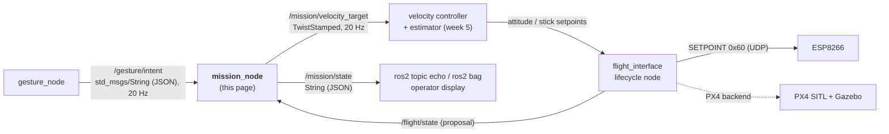
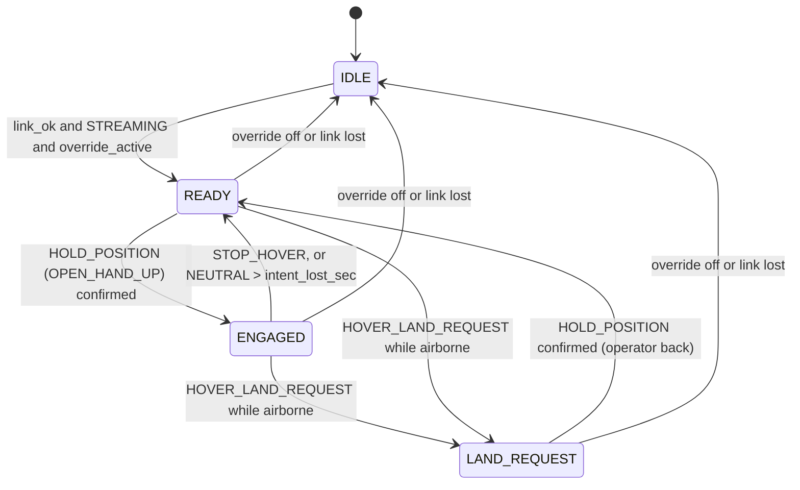

# 🎯 Mission_Node: gesture intent → velocity target

> [!WARNING] Status: DRAFT. This is a proposal and nothing has been built yet.
> This page designs the node that comes after `gesture_node` in [[00 Gesture Pipeline|Gesture Pipeline]] §1. Its input comes from [[03 Gesture_node]]. Topic names, message types and numbers marked **(proposal)** must be agreed by the team before coding (§10). Nothing here changes an accepted ADR.

---

## 📍 1. Where it sits



| Node | Answers the question | Knows about |
|---|---|---|
| `gesture_node` | "What does the **operator** want?" | hands, cameras, timeouts. Nothing about drones |
| **`mission_node`** | "What should the **drone** do, given what it is doing now?" | flight state, speed limits, which axes the ground controls |
| controller + estimator | "Which attitude gives that velocity?" | flow, IMU, baro height, gains |
| `flight_interface` | "How do I send it safely?" | protocol, session, watchdog, sim or real backend |

Why keep it separate from `gesture_node`:
- `/gesture/intent` stays drone-independent, so the same intents can drive a car or an arm in Module 2 ([[00 Gesture Pipeline|Gesture Pipeline]] §8).
- All drone-specific limits live in one place, which makes them easy to review and test.

## 📥 2. What it reads

### 2.1 `/gesture/intent` (exists)

Type `std_msgs/msg/String`, 20 Hz, published by `gesture_node`. Format: [[03 Gesture_node]] §4.

```json
{"intent":"MOVE_RIGHT","gesture":"INDEX_RIGHT","reason":"ok","t":1791976551.56,"xy":[0.51,0.42]}
```

The node only uses `intent` and `reason`. `gesture`, `t` and `xy` are logged and otherwise ignored.

### 2.2 `/flight/state` (proposal, published by `flight_interface`)

The mission node needs to know what the drone is doing. Gestures alone can't tell. Minimum fields (JSON in a `String` until a typed message exists):

| Field | Source | Used for |
|---|---|---|
| `link_ok` | ESP session + STATE freshness ([[Protocol Spec v0]]) | no link → output zero, disengage |
| `esp_state` | STATE `esp_state` (`STREAMING`, failsafe, …) | engage only when `STREAMING` ([[ADR-010 MSP Override|ADR-010]] condition 3) |
| `override_active` | STATE `override_active` | engage only when the pilot handed control over |
| `mask` | expected override mask (8 / 11 / 15) | decides which axes the mission node may command (§4.3) |
| `airborne` | estimator / baro height above a threshold | ignore the start-up land request on the ground (§4.4) |

The node never reads ARM state in order to change it. It reads state only to decide whether to send motion or zero.

### 2.3 Parameters (proposal)

| Parameter | Default | Meaning |
|---|---|---|
| `intent_topic` | `/gesture/intent` | input topic |
| `intent_timeout_sec` | `0.25` | no intent message for this long → zero velocity (5 missed messages at 20 Hz) |
| `intent_lost_sec` | `2.0` | no intent message for this long → disengage + land request |
| `max_lateral_mps` | `0.3` | speed for `MOVE_LEFT/RIGHT` ([[00 Gesture Pipeline|Gesture Pipeline]] §4) |
| `max_vertical_mps` | `0.2` | speed for `CLIMB_SLOWLY` / `DESCEND_…` |
| `max_yaw_rate_dps` | `20.0` | yaw rate for `YAW_LEFT/RIGHT` |
| `max_accel_mps2` | `0.5` | ramp limit, so a new gesture never steps the target |
| `publish_rate_hz` | `20.0` | output rate, always on |

Speed limits are **safety settings**. They are clamped again downstream (controller, `flight_interface`, ESP), as [[Protocol Spec v0]] §5 requires.

## ⚙️ 3. What it does

On every 20 Hz tick:

1. **Check freshness.** Has an intent message arrived in the last `intent_timeout_sec`? If not, the input is treated as `NEUTRAL`. After `intent_lost_sec` it is treated as `HOVER_LAND_REQUEST` with reason `intent_topic_lost`. This catches a crashed `gesture_node`, which `gesture_node` can't report itself.
2. **Validate.** Parse the JSON. Bad JSON or an unknown `intent` string → `NEUTRAL`, counted and logged. "Unknown" is never "keep moving".
3. **Update the mode** (state machine, §4.1).
4. **Map** the intent to a raw velocity target (§4.2). Zero unless the mode is `ENGAGED`.
5. **Mask the axes** the ground doesn't own (§4.3).
6. **Ramp** from the last output towards the target at `max_accel_mps2`, then **clamp** to the limits.
7. **Publish** `/mission/velocity_target` (always, even when zero) and `/mission/state` (§5).

There are no threads. One timer does all of this, the same pattern as `gesture_node`. As in `gesture_filter.py`, the logic goes in a ROS-free module (`mission_logic.py`) with an injectable clock, so it can be unit-tested.

## 🛡️ 4. Rules

### 4.1 Modes



| Mode | Output | Meaning |
|---|---|---|
| `IDLE` | zero | not allowed to command: no link, ESP not `STREAMING`, or the pilot hasn't flipped override |
| `READY` | zero (hover) | override is on, but the operator hasn't engaged yet |
| `ENGAGED` | from the intent | gestures move the drone |
| `LAND_REQUEST` | hover, then descend if allowed (§4.4) | operator gone or asked to land |

- **Engaging needs a deliberate `OPEN_HAND_UP`.** A stray gesture never starts motion.
- **The dead-man rule:** in `ENGAGED`, a confirmed gesture must stay visible. `NEUTRAL` (hand gone > 0.3 s, from `gesture_node`) gives zero velocity at once, but stays engaged so a short loss doesn't force re-engaging. If the hand is gone for long, `gesture_node` sends `HOVER_LAND_REQUEST`.
- Override off or link lost → `IDLE` from any mode. The pilot always wins ([[System Overview]] §2).

### 4.2 Intent → velocity target

Body frame, ROS convention (REP-103): x forward, y **left**, z up, yaw positive = counter-clockwise (left).

| Intent | `linear.x` | `linear.y` | `linear.z` | `angular.z` |
|---|---|---|---|---|
| `HOLD_POSITION` | 0 | 0 | 0 | 0 |
| `STOP_HOVER` | 0 | 0 | 0 | 0 (and leave `ENGAGED`) |
| `MOVE_LEFT` | 0 | +0.3 m/s | 0 | 0 |
| `MOVE_RIGHT` | 0 | −0.3 m/s | 0 | 0 |
| `CLIMB_SLOWLY` | 0 | 0 | +0.2 m/s | 0 |
| `DESCEND_SLOWLY_LAND_REQUEST` | 0 | 0 | −0.2 m/s | 0 |
| `YAW_LEFT` | 0 | 0 | 0 | +20 °/s |
| `YAW_RIGHT` | 0 | 0 | 0 | −20 °/s |
| `NEUTRAL` | 0 | 0 | 0 | 0 |
| `HOVER_LAND_REQUEST` | see §4.4 | | | |

- The vocabulary v0 has **no forward/back gesture**, so `linear.x` is always 0 for now.
- "Left/right" is the **operator's** left/right ([[00 Gesture Pipeline|Gesture Pipeline]] §3). The drone's left only matches if the operator and the drone face the same way. Agree a convention for the cage (§10).
- Zero velocity means "hold position" (the controller drives flow to zero), not "let go of the sticks".

### 4.3 Axis masking (who owns which stick)

The ground may only command the axes in the override mask ([[ADR-010 MSP Override|ADR-010]] condition 4). The mission node zeroes the rest, so it never "asks" for an axis it doesn't have:

| Mask | Ground owns | Mission node may send |
|---|---|---|
| 8 | yaw | `angular.z` only |
| 11 | roll, pitch, yaw | `linear.x`, `linear.y`, `angular.z`. **`linear.z` is forced to 0**, because the pilot has throttle. |
| 15 | all four | everything, **only** with altitude hold or a validated altitude loop |

So `CLIMB_SLOWLY` / `DESCEND_…` do nothing until mask 15 ([[00 Gesture Pipeline|Gesture Pipeline]] §3: "only once throttle is ours"). The node logs `axis_not_owned` so the operator knows why.

### 4.4 Land requests

`HOVER_LAND_REQUEST` comes from `gesture_node` when the recogniser or the hand is gone for > 2 s, or from this node's own intent watchdog.

| Situation | Action |
|---|---|
| Not `airborne` (on the ground, incl. start-up `no_packets_yet`) | ignore. Stay `IDLE`/`READY`. Never "land" a drone that is on the ground ([[03 Gesture_node]] §9). |
| Airborne, mask 8 or 11 | zero velocity (hover in place) and set `land_request: true` in `/mission/state`. The **pilot** lands, because they own throttle. |
| Airborne, mask 15 | hover for 2 s (proposal), then descend at `max_vertical_mps` until the estimator reports the ground. The pilot can still take over at any time. |

The mission node never disarms. Touchdown and disarm stay with the pilot or the Betaflight failsafe ([[Safety Rules]] rule 5).

### 4.5 Things it never does

- It never arms, disarms or touches any AUX channel or the override switch (REQ-SAF-003 (was SAF-03), REQ-SAF-004 (was SAF-04), [[ADR-015 Gesture Input Source|ADR-015]]).
- It never keeps moving on stale or unknown input.
- It never sends a target above the limits, even if a parameter is set higher. A hard-coded ceiling applies (proposal: 0.5 m/s, 45 °/s).

## 📤 5. What it publishes

### 5.1 `/mission/velocity_target` (proposal)

Type **`geometry_msgs/msg/TwistStamped`**, 20 Hz, always published (zeros when not engaged), so the controller can use silence as a fault.

```yaml
header:
  stamp: {sec: 1791976551, nanosec: 560000000}
  frame_id: base_link        # body frame, FLU (x forward, y left, z up)
twist:
  linear:  {x: 0.0, y: -0.3, z: 0.0}   # m/s  (MOVE_RIGHT)
  angular: {x: 0.0, y: 0.0, z: 0.0}    # rad/s (20 °/s = 0.349 rad/s)
```

- A standard message: any ROS tool, PX4 bridge or plot can read it without our code.
- Units are SI (m/s, rad/s). Degrees appear only in parameters.

Watch it:

```bash
ros2 topic echo /mission/velocity_target
ros2 topic hz /mission/velocity_target     # expect ~20 Hz
```

### 5.2 `/mission/state` (proposal)

Type `std_msgs/msg/String` (JSON), published on every change and at 2 Hz otherwise. This is for people and logs, not for control.

```json
{"mode":"ENGAGED","intent":"MOVE_RIGHT","reason":"ok","mask":11,"land_request":false,"limited":["axis_not_owned:z"],"intent_age_ms":42}
```

### 5.3 Logs

The node logs the same kind of messages as `gesture_node`: every mode change, every land request, bad input counters, and a 5 s health report (intent rate, last intent).

## ⬇️ 6. What happens downstream (not this node's job)

1. **Velocity controller** (week 5, tracks C + E, [[Study Plan v2]] §7) reads `/mission/velocity_target` and the estimator velocity (flow + IMU + baro), and outputs roll/pitch angles, yaw rate and throttle.
2. **`flight_interface`** packs those into `SETPOINT` (0x60): `mode 1` (attitude), `roll`, `pitch`, `yaw_rate` in −1000..1000, `throttle` 0..1000 ([[Protocol Spec v0]] §3). It sends at 50 Hz and its own watchdog sends `mode 0` (neutral) if the controller goes silent.
3. **ESP** checks, clamps and maps to `MSP_SET_RAW_RC` (1000–2000 µs, AETR, 8 channels).
4. **In simulation** the PX4 backend of `flight_interface` takes the velocity setpoint more directly ([[ADR-019 Sim Backends|ADR-019]]).

Until the controller exists, the mission node can be tested on its own: run it and watch its two topics.

## 📁 7. Package layout (proposal)

Same structure as `gesture_node` ([[03 Gesture_node]] §8):

| Path | Content |
|---|---|
| `drone/ground/src/mission_node/package.xml`, `setup.py`, `setup.cfg`, `resource/` | ROS 2 Python package (depends on `rclpy`, `std_msgs`, `geometry_msgs`) |
| `drone/ground/src/mission_node/mission_node/mission_logic.py` | modes, mapping, masking, ramp, clamp. **No ROS imports** |
| `drone/ground/src/mission_node/mission_node/mission_node.py` | subscriptions, timer, publishers |
| `drone/ground/src/mission_node/test/` | pytest for `mission_logic.py` |

## 🧪 8. How to test it

| Level | Setup | Pass when |
|---|---|---|
| 0: unit | `colcon test --packages-select mission_node` (build steps: [[02 ROS 2 Nodes - Install and Test|02]] §10) | every rule in §4 has a test: stale intent → zero, unknown intent → zero, engage only after `HOLD_POSITION`, land request ignored on the ground, z zeroed under mask 11, ramp never exceeds `max_accel_mps2`, clamp ceiling holds |
| 1: fake intents | `ros2 topic pub -r 20 /gesture/intent std_msgs/msg/String "{data: '{\"intent\":\"MOVE_RIGHT\",\"reason\":\"ok\"}'}"` + a fake `/flight/state` | `linear.y` ramps to −0.3 and holds. Stop the publisher → zero within 0.25 s |
| 2: full chain, no camera | `gesture_sender.py` → `gesture_node` → `mission_node` ([[02 ROS 2 Nodes - Install and Test|02]] §9, Level 0) | the Level 0 intent sequence gives the expected velocity sequence |
| 3: real gestures | `gestures.py` + webcam | as level 2 with your hand. Record a `ros2 bag` of both topics as evidence |
| 4: simulation | PX4 SITL behind `flight_interface` (week 6) | gestures drive the sim drone: hover, move, land request ([[Study Plan v2]] §8) |

Real-drone use is a **stretch** goal (week 7), only at low limits, with the pilot on the kill switch ([[Safety Rules]]).

## 🔖 9. Requirement IDs (proposal)

To be registered in [[Dev_Strategy]] §15 style:

| ID | Requirement |
|---|---|
| REQ-SAF-017 (was REQ-SAF-0xx) | The mission node outputs zero velocity within 0.25 s of losing `/gesture/intent`. |
| REQ-SAF-018 (was REQ-SAF-0xx) | The mission node never commands an axis outside the active override mask. |
| REQ-CTL-001 (was REQ-CTL-0xx) | Gesture speeds are limited to 0.3 m/s lateral, 0.2 m/s vertical and 20 °/s yaw (parameters, with a hard ceiling). |
| REQ-SW-001 (was REQ-SW-0xx) | `/mission/velocity_target` is published at 20 Hz in every mode. |

## ❓ 10. Open points (decide before coding)

- **Topic names and types.** `/mission/velocity_target` (TwistStamped) and `/mission/state`, `/flight/state` (JSON strings) are proposals. A typed custom message package (`drone_msgs`) would also fix `/gesture/intent` ([[03 Gesture_node]] §9, [[05 Future Nodes]]).
- **Who publishes `/flight/state`,** and how `airborne` is decided (baro height threshold?).
- **Left/right convention** in the cage: operator frame vs drone frame.
- **Engage rule.** Is `OPEN_HAND_UP` once enough, or must it be re-shown after every `STOP_HOVER`?
- **Numbers.** `max_vertical_mps`, `max_yaw_rate_dps`, `max_accel_mps2`, the 2 s hover before descent and the hard ceilings all need team agreement and a sim check.
- **Forward/back.** Vocabulary v0 has no gesture for it. Add one, or keep `linear.x = 0` for Module 1.
- **Mission vs controller in one node?** [[System Overview]] draws "mission / controller" as one box. This page keeps them apart (the controller needs the estimator and its own tests). Confirm in the architecture review.

## 🔗 11. Related pages

[[00 Gesture Pipeline]] · [[02 ROS 2 Nodes - Install and Test]] · [[03 Gesture_node]] · [[05 Future Nodes]] · [[System Overview]] · [[Protocol Spec v0]] · [[ADR-010 MSP Override|ADR-010]] · [[ADR-015 Gesture Input Source|ADR-015]] · [[ADR-019 Sim Backends|ADR-019]] · [[Study Plan v2]] · [[Safety Rules]]

---

## Glossary

| Term | Meaning |
| --- | --- |
| **ADR** | Architecture Decision Record: a documented decision and its rationale. |
| **Body frame** | Axes fixed to the drone: x forward, y left, z up (FLU). |
| **Dead-man** | A control that only works while the operator keeps doing it (here: the hand must stay visible). |
| **Estimator** | Ground code that combines flow, IMU and baro height into a velocity estimate. |
| **Intent** | The action the operator asks for (for example `MOVE_LEFT`), published on `/gesture/intent`. |
| **Mask** | `msp_override_channels_mask`: which stick channels the ground controls (8, 11 or 15). |
| **MSP** | MultiWii Serial Protocol, used for communication with Betaflight flight controllers. |
| **Ramp** | Limiting how fast a target can change, so motion starts and stops smoothly. |
| **REP-103** | The ROS convention for units (SI) and axis directions. |
| **ROS 2** | The second-generation Robot Operating System middleware used for robotics integration. |
| **TwistStamped** | Standard ROS 2 message holding a linear and angular velocity with a timestamp and frame. |
| **Watchdog** | A timer that triggers a safe action when expected messages stop arriving. |
| **SITL** | Software In The Loop: the flight code runs on the PC against a simulator. |
| **PX4** | An open-source flight-control stack, used here only in simulation (PX4 SITL + Gazebo). |
| **REQ** | Requirement ID of the form `REQ-<SYS, NAV, SEN, COM, CTL, SAF, PWR, SW or HW>-NNN`, used for traceability. |
| **IMU** | Inertial Measurement Unit: the gyro and accelerometer on the FC. |
| **JSON** | A text format for structured data. |
| **REQ-SAF-001 to 008** | Safety requirements (were REQ-SAF-001 (was SAF-01) to REQ-SAF-008 (was SAF-08)) defined in ESP_to_FC section 8 and registered in Requirements (independent ELRS path, pilot takeover, no arming from code). |
