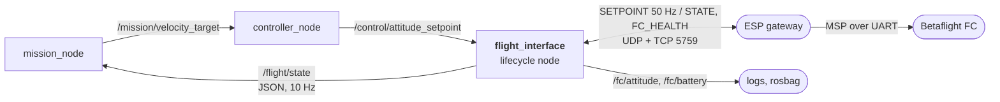

# 📡 Flight_Interface: the ground ↔ drone link

`flight_interface` is the last ground node of the [[00 Gesture Pipeline|Gesture Pipeline]]. It sends setpoints to the drone and publishes the drone's real state on `/flight/state`, which `mission_node` reads ([[04 Mission Node]] §3.2). The same ROS 2 package also holds `fc_telemetry` (§9) and the MSP library `msp.py` (§10).

> [!WARNING] Status: DRAFT
> - Backends: `loopback` (no drone), `esp` (the gateway firmware) and `px4` (PX4 SITL, simulation only; [[PX4 SITL Setup]] §7).
> - Its input is the controller's attitude setpoint ([[07 Controller Node]]). On the real drone the controller stays inactive until there is a measured velocity (#200), and the `esp` backend sends every setpoint as mode 0 (neutral) for now, so nothing that reaches the drone has changed. `override_active` comes from the ESP (#176, PR #198): true only when the ESP reports the pilot's override on.
> - Its rules are accepted decisions: [[ADR-025 flight_interface Ground Node|ADR-025]].

---

## 📍 1. Where it sits, and why it exists



In the simulation the `px4` backend replaces the ESP and the FC: it talks to PX4 SITL and also publishes the measured velocity the controller needs ([[PX4 SITL Setup]] §7).

The gesture nodes know nothing about the radio link. `flight_interface` is the one place that talks to the drone, so every rule about when the ground may command it (link, E-stop, ARM, failsafe) lives in one node, under the ESP's own failsafe and the safety pilot ([[Architecture Document]] §1, authority order).

---

## 📦 2. The package

`drone/ground/src/flight_interface/flight_interface/`, image `rosrangers/flight_interface:jazzy`. The simulation uses the `sim` stage of the same Dockerfile, `rosrangers/flight_interface-sim:jazzy`: the same image plus `px4_msgs`, which only the `px4` backend imports.

| Piece | What it does |
| :--- | :--- |
| `guard.py` | every rule of §5, no ROS imports |
| `link_node.py` | the lifecycle node: timers, topics, services |
| `backends.py`, `esp_backend.py` | `loopback` and `esp` (sessions over `sd_protocol.ground`) |
| `px4_backend.py`, `px4_logic.py` | `px4`, simulation only: the frames, PX4's state, the measured velocity, and the simulated pilot that flies the axes the ground does not own (`px4_logic.py` has no ROS imports) |
| `telemetry.py` | MSP and `STATE` values → `/fc/attitude`, `/fc/battery` (shared with `fc_telemetry`) |
| `fc_telemetry.py`, `msp.py` | §9 and §10 |
| `launch/flight_interface.launch.py` | the node outside Docker, no respawn on purpose |

---

## 📥 3. Input

- `/control/attitude_setpoint` from `controller_node`: JSON on `std_msgs/String`, `roll`, `pitch` (deg), `yaw_rate` (°/s), `throttle` (0–1), `active`, `reason`, body FLU with REP-103 signs ([[07 Controller Node]]). Only a setpoint that arrives after the activation counts; one older than 0.25 s gives neutral. A malformed one (a missing or non-finite number, `throttle` outside 0–1, `active` not a bool) is dropped with a warning and so goes stale.
- From the drone: `STATE`, `FC_HEALTH`, events and acks over [[Protocol Spec v0]].
- The PSK, from `~/.config/seame-drone/secrets.json` (never a ROS parameter, never in the image). In Docker, only `psk.json` (the PSK alone) is mounted there ([[ADR-025 flight_interface Ground Node|ADR-025]] E3.2, §7.2).
- Parameters, declared at the top of `link_node.py`: `backend`, `mask` (8 / 11 / 15, default 8), `hover_throttle` (0.0 = not measured), `setpoint_topic`, `esp_host`, `esp_port`, `rate_hz`, `state_rate_hz`, the timeouts, `publish_fc`. A bad value fails `configure`. `mask` and `hover_throttle` must equal the controller's: each mode file repeats them in both sections and `test_config.py` checks they agree.

---

## ⚙️ 4. Processing

The node starts **unconfigured**. The operator runs `configure`, then `activate`. While active, a timer at `rate_hz` (50 Hz) checks the link and the drone state, decides the setpoint through the guard and hands it to the backend. Inactive, it sends nothing. `deactivate` sends one last zero.

---

## 🛡️ 5. Rules

| Rule | In short |
| :--- | :--- |
| Watchdog | no valid drone state for 0.5 s → zero setpoints and `link_ok` false, so `mission_node` goes `IDLE`; no latch |
| Gate | a commanding setpoint needs `STREAMING`, override on, a known mask and the FC link alive; otherwise neutral |
| Limits | roll / pitch ≤ 15°, yaw rate ≤ 45 °/s, throttle within hover ± 0.15 (only under mask 15). Beyond them: clamped, with a throttled warning. Axes outside the mask: level and the hover throttle. Mask 15 with no measured hover throttle: neutral |
| Neutral | `active` false. The `esp` backend sends mode 0 (the pilot's sticks); the `px4` backend streams the position where neutral started (zero velocity), so PX4 holds that point |
| ARM | only the operator's `~/arm_control`, in `SESSION_IDLE`, with a fresh link and the FC alive. Never by itself, also not after a reconnect (REQ-SAF-023) |
| RESUME | only the operator's `~/resume`, after the ESP's link failsafe. Never by itself |
| Held requests | ARM and RESUME go out after 1.5 s of neutral setpoints; dropped after 3 s or when their conditions go |
| E-stop | `~/estop` (or an unexpected error): one neutral setpoint, then `BYE`, then nothing. Latched until `~/reset_estop` |
| Sessions | the `esp` backend reconnects by itself, never with ARM |
| No restart | a dead node stays dead; the ESP's failsafe takes over |
| ROS stays on this PC | the real mode's domain from `env/real.env` and `LOCALHOST` discovery, so another laptop on the drone's Wi-Fi can't call its services. A native `ros2 launch` on the host defaults to `ROS_DOMAIN_ID=42` (ADR-025 E1.4) |

Every rule with its reason: [[ADR-025 flight_interface Ground Node|ADR-025]].

---

## 📤 6. Output

- `/flight/state`: JSON, 10 Hz. `mission_node`'s fields plus `active`, `estop`, `arm_pending`, `fc_link_ok`, `armed` and others ([[Architecture Document]] §2).
- `/fc/attitude`, `/fc/battery` from the FC values in `STATE`, only while they are fresh (`publish_fc`). Don't run `fc_telemetry` at the same time: both publish these topics.
- Services (`std_srvs/Trigger`): `~/estop`, `~/reset_estop`, `~/arm_control`, `~/resume`. They answer when the request is accepted; the ESP's answer appears in the log.
- With the `px4` backend: `/estimate/velocity` (`TwistStamped`, body FLU) from PX4, for the controller.
- Logs in `logs/flight_interface/latest.log` (`logs/flight_interface_sim/` in the simulation).

---

## ▶️ 7. Run (Docker)

The `flight_interface` service belongs to the **real** mode only (the simulation has its own, §7.3): profile `real`, `drone/ground/env/real.env` (its ROS domain and `LOCALHOST`; copy it from `env.example/real.env.example` and fill in the values the safety pilot gives you, [[01 ROS2 Nodes Installation|01]] §4.2) and `ground_bringup`'s `config/real.yaml` (backend `esp`). Without a filled-in `env/real.env`, compose refuses to start. `make` (demo) and `make sim` never start it, and refuse to start while it runs. The demo's `fake_flight_state` and the sim's `flight_interface_sim` never run next to it, so `/flight/state` has one publisher. Every command below passes `--env-file env/real.env`, `echo` included (the `ros2` CLI, [[01 ROS2 Nodes Installation|01]] §5). Without it, `echo` is on the demo's domain and never sees the node.

### 7.1 Without the drone: `make real-dry`

From `drone/ground/`. The real mode with `flight_interface` on the loopback backend: no drone, no PSK, nothing leaves the PC. Use it to rehearse the steps of §7.2 at a desk.

```bash
make real-dry
```

It starts gesture, intent, mission and `flight_interface` (unconfigured), prints the operator steps and shows the live table. Run the steps in another terminal: after `configure` and `activate`, `/flight/state` shows `link_ok` true and `esp_state` `SESSION_IDLE`, and `mission_node` stays `IDLE`. Stop with `make real-down`.

In the live table ([[01 ROS2 Nodes Installation|01]] §4.6) the title says `REAL-DRY: NO DRONE (loopback)`. FLIGHT is `waiting` until `configure`, then shows the yellow `NOT ACTIVE` alert until `activate`. ATTITUDE and BATTERY say `no data: loopback has no FC`. To open the table again after Ctrl+C, use the `$R` that `make real-steps` prints: in a dry run (the running `flight_interface` has `backend:=loopback`) its `R` adds `-e GROUND_DRY=1`, so the title stays `REAL-DRY`. A plain `R` from §7.2 would show `REAL: DRONE`.

### 7.2 With the drone: `make real`

Follow [[Safety Rules]]: props off on the bench, the safety pilot holds the radio.

```bash
make real
```

1. **Checks, and refuses on any failure:** `env/real.env` is filled in, the PSK file (§ below) exists with mode 600 and holds a valid key, and the ESP (`esp_host` in `ground_bringup`'s `config/real.yaml`) answers ping. It never opens a TCP connection to the gateway.
2. **Starts** the chain and `flight_interface` with `real.yaml` (backend `esp`), **unconfigured**. It never configures, activates or ARMs it (REQ-SAF-023).
3. **Prints the operator steps** (again any time: `make real-steps`) and shows the live table. Ctrl+C closes only the table: the stack keeps running.

In the live table ([[01 ROS2 Nodes Installation|01]] §4.6) the title says `REAL: DRONE`. After `configure`, FLIGHT shows `fc_link_ok` true and `esp_state` `SESSION_IDLE` (`link_ok` stays false until `activate`), `STREAMING` once armed; ATTITUDE and BATTERY fill in while the FC data is fresh. Any red alert means stop and check it before the next step; `LOW BATTERY` means land.

The operator steps, in another terminal in `drone/ground/`:

```bash
R='docker compose --env-file env/real.env run --rm echo'
L='ros2 lifecycle set --no-daemon --spin-time 5'   # waits for discovery: each run is a fresh container
$R $L /flight_interface configure
$R $L /flight_interface activate
$R ros2 service call /flight_interface/arm_control std_srvs/srv/Trigger   # ARM: by hand only
$R ros2 service call /flight_interface/estop std_srvs/srv/Trigger         # E-stop
```

**Stop:** `make real-down`. It cuts the drone's link on purpose (the ESP's failsafe takes over), so it asks you to type `stop` first, and the safety pilot must be ready. It stops `flight_interface` first (one last zero setpoint, then BYE), then the chain.

The container mounts only the PSK, never the whole `secrets.json` (it also holds the Wi-Fi and OTA passwords, [[ADR-025 flight_interface Ground Node|ADR-025]] E3.2). Create that file once, and again after the PSK changes:

```bash
make psk-file   # ~/.config/seame-drone/secrets.json -> psk.json (PSK only, mode 600)
```

- A missing `psk.json` stops the container from starting. `SEAME_SECRETS_FILE=<path>` mounts another file.
- The container keeps the file it started with. After the PSK changes (`make psk-file` says so), stop the container and start it again; otherwise `configure` fails with no `HELLO_ACK`.
- While `flight_interface` runs, `make`, `make sim`, `make sim-smoke`, `make down` and `make clean` refuse: each would add a second `/flight/state` publisher or stop its chain. Stop the real mode with `make real-down`.

---

### 7.3 In the simulation

`make sim`, `make sim-smoke` and `make sim-hold` run it as the compose service `flight_interface_sim` (backend `px4`, `config/sim.yaml`), and the simulation's start script configures and activates it. How, and what to look at: [[PX4 SITL Setup]] §7.

---

## 🧪 8. Test

`make smoke` runs the package tests inside the image and checks that the loopback node's `/flight/state` reaches `mission_node`; CI runs them in `ground-ros2` ([[01 ROS2 Nodes Installation|01]] §7). Test doubles: `test/fake_esp.py` (an ESP on localhost with fault controls) and `test/fake_fc.py`. What each test file checks is in its docstring.

---

## 📈 9. `fc_telemetry`

A second node in the package: polls the FC over MSP, read-only, through the FC USB or the ESP's transparent bridge (UDP 5760), and publishes `/fc/attitude` (20 Hz) and `/fc/battery` (5 Hz). It is the bench and USB path; with the gateway firmware, `flight_interface` publishes the same topics from `STATE` (§6).

It has no compose service, so today it runs only from a sourced Jazzy workspace with the package built:

```bash
ros2 run flight_interface fc_telemetry --ros-args -p transport:=udp   # or transport:=usb
```

Topic contract, signs, exit codes and bench results: [[Architecture Document]] §2. Tests: [[Testing Strategy]] §5.

---

## 🔌 10. `msp.py`

The MSP v1 client. It lives in this package so `fc_telemetry` can import it; the bench tools in `drone/tools/bench/` (`msp_check.py`, `esp_at.py`) and `drone/tests/hil/bench.py` add its folder to `sys.path` and still run without ROS ([[Repository Layout]]).

---

## 🧭 11. Design decisions

The decisions are in [[ADR-025 flight_interface Ground Node|ADR-025]]. The ones that shape how you run it:

| Decision | Why |
| :--- | :--- |
| Lifecycle node, starts unconfigured | Nothing goes to the drone until the operator says so |
| ARM and RESUME only from the operator | The ground never takes control by itself |
| The container runs the node itself, not the launch file | `ros2 launch` ignores `docker stop`'s SIGTERM, so the last zero setpoint would be lost |
| PSK mounted read-only, never in the environment or the image | The key stays a file only the operator can read |
| One `/flight/state` publisher | `fake_flight_state` (demo) and `flight_interface` (real, and `flight_interface_sim` in the simulation) are in different modes and never run together |
| Attitude setpoints in, one code path for every backend | The guard's limits and the mask rules are the same for the drone and the simulation (ADR-025 F8, F13) |

---

## 🔖 12. Requirement IDs

| ID | Requirement | Checked in |
|---|---|---|
| REQ-SAF-023 | The ground never sends ARM on its own. | `test_guard*.py`, `test_link_node*.py` |
| REQ-SAF-017 | Neutral within 0.25 s of losing the setpoint. | `test_guard.py`, `test_link_node_ros.py` |
| REQ-NAV-001 | Position hold in SITL (with the controller and the `px4` backend). | `make sim-hold` ([[PX4 SITL Setup]] §7.5) |

---

## ❓ 13. Open points

- [x] **Controller and PX4 backend** ([[06 Final Connections and Missing Parts|06]] §2.1–2.2; #199).
- [x] **`override_active` from the ESP** ([[06 Final Connections and Missing Parts|06]] §2.4; #176, PR #198).
- [ ] **E-stop time** measured end to end on the bench (ADR-025 C3).
- [ ] **A compose service for `fc_telemetry`**, if the bench needs it outside a native workspace.

---

## 🔗 14. Related pages

[[00 Gesture Pipeline]] · [[01 ROS2 Nodes Installation]] · [[04 Mission Node]] · [[07 Controller Node]] · [[06 Final Connections and Missing Parts]] · [[PX4 SITL Setup]] · [[ADR-025 flight_interface Ground Node|ADR-025]] · [[Architecture Document]] · [[Protocol Spec v0]] · [[Safety Rules]]

---

## Glossary

| Term | Meaning |
| --- | --- |
| **ARM** | Here `ARM_CONTROL_REQUEST`: asks the ESP to start sending the ground's setpoints to the FC. Not the FC's motor arm, which stays with the pilot. |
| **Backend** | The part of the node that talks to one kind of drone: `loopback`, `esp`, `px4` (simulation only). |
| **Attitude setpoint** | Roll, pitch, yaw rate and throttle: what the controller asks the drone to hold. |
| **Hover throttle** | The throttle (0–1) that holds the drone level in the air; 0.0 means not measured. |
| **Neutral** | `active` false: no command. The `esp` backend sends mode 0, the `px4` backend PX4's position hold where neutral started. |
| **E-stop** | Emergency stop: the node sends neutral and `BYE`, then nothing until reset. |
| **FLU** | Body frame with x forward, y left, z up (REP-103). |
| **Lifecycle node** | A ROS 2 node with managed states (unconfigured, inactive, active), changed with `ros2 lifecycle set`. |
| **Loopback** | A backend with no drone: it reports an idle link, so the node can be tried alone. |
| **MSP** | MultiWii Serial Protocol: how the ground and the ESP talk to the Betaflight FC. |
| **PSK** | Pre-shared key: the secret the ground and the ESP use to authenticate the session. |
| **Setpoint** | One command frame to the drone (sticks or attitude), sent at 50 Hz. |
| **SITL** | Software In The Loop: the flight code runs on the PC against a simulator. |
| **Watchdog** | A timer that zeroes the output when the drone state stops arriving. |
| **ADR** | Architecture Decision Record: a documented decision and its rationale. |
| **ESP** | The ESP-12F module (ESP8266) on the drone: the Wi-Fi bridge between the ground PC and the FC, wired to FC UART4. |
| **FC** | Flight Controller: on this project the OddityRC F7 AIO (STM32F722, Betaflight target `ODDITYRCF7AIO`) of the 2.5" drone. It stabilises the aircraft and takes MSP from the ESP on UART4. |
| **Guard** | The rules in `guard.py` that decide whether a setpoint may go to the drone (gate, limits, mask, timeouts). |
| **Mask** | `msp_override_channels_mask`: which axes the ground commands (8 yaw, 11 roll + pitch + yaw, 15 all four). |
| **Measured velocity** | The velocity the drone really has, on `/estimate/velocity`: from PX4 in the simulation, from the estimator (#200) on the drone. |
| **PX4** | An open-source flight-control stack, used here only in simulation (PX4 SITL + Gazebo). |
| **REQ ID** | A requirement identifier, `REQ-<area>-NNN`, registered in [[Requirements]]. |
