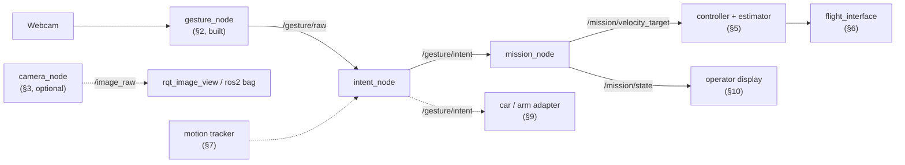
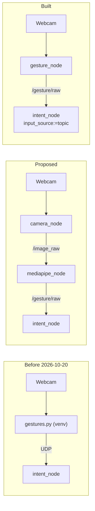

# 🔭 Future nodes to add

Nodes and packages that the gesture chain will need after `intent_node` and `mission_node`, and some that would make it better. Each one says why we would add it, what it reads and publishes, and what must be decided first.

> [!WARNING] Status: ideas and proposals
> Nothing on this page is decided or built, except §2, which was built as `gesture_node` on 2026-10-20 ([[02 Gesture Node]]). Until §11 exists, `docker-compose.yml` starts `gesture_node` and `intent_node` together. Topic names and message types are **proposals**. A node that changes an accepted decision (for example the MediaPipe node vs [[ADR-018 Ground OS and ROS 2|ADR-018]]) needs a new ADR; for §2 it is still to be written. Turn an item into work with the Spike or Task issue form, not here.

---

## 🗺️ 1. Overview



| § | Node or package | Why | When (proposal) | Status |
| :---: | :--- | :--- | :--- | :---: |
| 2 | `mediapipe_node` → built as **`gesture_node`** | recogniser inside ROS 2 instead of UDP | done 2026-10-20 | ==🟢built, ADR still needed== |
| 3 | `camera_node` | camera frames as a ROS topic | only if we need to see or record the picture | ==🟣idea, optional== |
| 4 | `drone_msgs` | typed messages instead of JSON strings | before the topics are frozen | ==🟠proposed== |
| 5 | controller + estimator | velocity target → attitude setpoints | Module 1, week 5 | ==🟠planned== |
| 6 | `flight_interface` | ground ↔ drone link, sim and real backends | Module 1 | ==🟠planned== |
| 7 | motion tracker | wave / swipe gestures | after vocabulary v0 is stable | ==🟣idea== |
| 8 | trained classifier | replace the rule-based `recognize()` | Module 2 | ==🟠accepted in roadmap== |
| 9 | car / arm adapter | portability proof | Module 2 | ==🟠accepted in roadmap== |
| 10 | operator display | show the mode and the reason to the operator | any time | ==🟣idea== |
| 11 | `gesture_bringup` | start everything with one launch file | as soon as there are 2 nodes | ==🟠proposed== |

---

## 🖐️ 2. `mediapipe_node`: MediaPipe inside ROS 2 (built as `gesture_node`)

> [!SUCCESS] Built on 2026-10-20 as `gesture_node`
> This idea was built under the name `gesture_node`, with one change: the node reads the camera itself with `cv2.VideoCapture(0)` instead of subscribing to `/image_raw` from a `camera_node`. That avoids `cv_bridge` (the clash ADR-018 feared) and the cost of sending every frame between processes. Everything about it is in [[02 Gesture Node]]. The proposal below is kept for the record.



### Proposal vs what was built

| | Proposal | Built (`gesture_node`) |
| :--- | :--- | :--- |
| **Reads** | `/image_raw` from `camera_node` (§3), via `cv_bridge` | the webcam directly, `cv2.VideoCapture(0)`, in the same process |
| **Does** | `create_hands()` and `detect_gesture()` from `hand_processing.py`, unchanged | same: `hand_processing.py` is a byte-for-byte copy, `gestures.py` only changed its imports |
| **Publishes** | `/gesture/raw`: gesture name, palm `xy`, timestamp. Optional `/gesture/landmarks` | `/gesture/raw`: the same JSON the UDP sender used (`gesture`, `t`, `xy`), ~10 Hz. No `/gesture/landmarks` yet |
| **Then** | `intent_node` subscribes to `/gesture/raw` | `intent_node` subscribes with `input_source:=topic`; `gesture_filter.py` unchanged, so the safety rules are **exactly** the same |

### How the dependency clash was solved

Option 1 of the spike list: **a venv with system packages** (`python3.12 -m venv --system-site-packages`, since 2026-10-21 `drone/ground/gesture-venv` made by `make ws`), MediaPipe from pip, ROS from apt, and `gesture_node` built with the venv's Python so `ros2 run` uses it ([[02 Gesture Node]] §10). `cv_bridge` is not used, so its `numpy` question does not apply.

Option 3, **a container** with ROS 2 Jazzy and MediaPipe pinned together, is built too: the image `rosrangers/gesture:jazzy` (#78, 2026-10-21, [[01 ROS2 Nodes Installation|01]] §4). Not tried yet: option 2, **port to the Tasks API on MediaPipe 1.1.0** (needed anyway, because 0.10.21 is the last version with `mp.solutions`, [[00 Gesture Pipeline]] §6).

### Still to do

- [ ] New ADR that amends or supersedes [[ADR-018 Ground OS and ROS 2|ADR-018]] (never edit it silently)
- [x] Unit, node, process and pipeline tests, a Docker image and CI (#78, 2026-10-21, [[01 ROS2 Nodes Installation|01]] §4, §10)
- [ ] Record the first full run with the webcam ([[01 ROS2 Nodes Installation|01]] §9, §13)
- [ ] Optional `/gesture/landmarks` (21 points) for logging and the classifier (§8)

The old `gestures.py` + UDP prototype (`drone/tools/gesture/`) was removed on 2026-10-20, before the node passed the tests of [[01 ROS2 Nodes Installation|01]] §9. Git history still has it.

---

## 📷 3. `camera_node`: the webcam as a ROS topic

Not needed by `gesture_node`, which reads the camera itself (§2). Useful only to **see or record the picture** (`rqt_image_view`, `ros2 bag`). Two processes can't open the same webcam at once, so this would replace the capture in `gesture_node`. No code to write: use an existing package.

| Option | Install | Publishes |
| :--- | :--- | :--- |
| `v4l2_camera` | `sudo apt install ros-jazzy-v4l2-camera` | `/image_raw`, `/camera_info` |
| `usb_cam` | `sudo apt install ros-jazzy-usb-cam` | `/image_raw`, `/camera_info` |

```bash
ros2 run v4l2_camera v4l2_camera_node --ros-args -p video_device:=/dev/video0   # same camera as VideoCapture(0) in gestures.py
ros2 run rqt_image_view rqt_image_view     # check the picture
```

Mirroring: `gestures.py` flips the frame so left and right match the operator ([[02 Gesture Node|02]] §4). With a camera node, `gesture_node` would have to flip the image itself. Cost: each frame is sent between processes (about 0.9 MB at 640×480), a few ms per frame in Python ([[02 Gesture Node]] §2).

---

## 📨 4. `drone_msgs`: typed messages

`/gesture/intent`, `/mission/state` and `/flight/state` are JSON inside `std_msgs/String` ([[03 Intent Node]] §9, [[04 Mission Node]] §13). A message package would make them typed and checked.

```text
drone/ground/src/drone_msgs/
├── package.xml          # ament_cmake + rosidl_default_generators
├── CMakeLists.txt
└── msg/
    ├── GestureIntent.msg    # string intent, string gesture, string reason, builtin_interfaces/Time stamp, float32[] xy
    ├── MissionState.msg
    └── FlightState.msg
```

- Interface packages must be **CMake** (`ament_cmake`), even if every node using them is Python.
- Changing a message changes a contract between tracks. Agree it in a PR reviewed by both tracks.

---

## 🎛️ 5. Velocity controller + estimator

Reads `/mission/velocity_target` and the estimator velocity (flow + IMU + baro), and outputs roll/pitch angles, yaw rate and throttle. Planned for Module 1 week 5 (tracks C + E, [[Study Plan v2]]). What it receives is in [[04 Mission Node]] §6.5. Open question there: keep mission and controller as two nodes, or one.

---

## 📡 6. `flight_interface`: the link to the drone

A ROS 2 **lifecycle** node that packs setpoints into `SETPOINT` packets for the ESP8266 ([[Protocol Spec v0]]), with its own watchdog, and a PX4 SITL backend for simulation ([[ADR-019 Sim Backends|ADR-019]]). The folder `drone/ground/src/flight_interface/` exists but holds only `info.md`. It would also publish `/flight/state` for `mission_node` ([[04 Mission Node]] §3.2). Until then the pretend node `fake_flight_state` in the `mission_node` package publishes it.

---

## 👋 7. Motion tracker: wave and swipe

Static poses only cover "which fingers, which way". A tracker that follows the palm position over several frames could add movement gestures as **mode commands** (for example wave = land request), never as direct motion.

- Needs the palm `xy`, which `gesture_node` does not send yet ([[02 Gesture Node]] §8).
- Could live inside the recogniser, or as a small node between it and `intent_node`.
- Any new gesture must go through the same stability filter and be added to the vocabulary ([[00 Gesture Pipeline]] §3).

---

## 🧠 8. Trained gesture classifier (Module 2)

Replace the rule-based `recognize()` with a classifier trained on the 21 landmarks: versioned dataset, reproducible training, model card, INT8 accuracy before/after, latency and power budget ([[Roadmap to April 2027]] §4). It keeps the same output names, so `intent_node` does not change. Recording `/gesture/landmarks` (§2) with `ros2 bag` is an easy way to build the dataset.

---

## 🚗 9. Car / arm adapter (Module 2)

The portability proof: the same `/gesture/intent` drives a second hardware class. A small node maps intents to the car's `cmd_vel` (`geometry_msgs/Twist`) or to arm commands, with its own limits, the same way `mission_node` does for the drone ([[Roadmap to April 2027]] §4).

---

## 🖥️ 10. Operator display

Shows the operator what the system thinks: current mode, intent, `reason`, land request, `axis_not_owned`. It reads `/mission/state` and `/gesture/intent`. Start simple (`ros2 topic echo`, `rqt`), or draw an overlay in the camera window. Display only: it never sends commands.

---

## 🚀 11. `gesture_bringup`: one launch file

A package with a launch file and a parameter YAML that starts `gesture_node`, `intent_node` (with `input_source: topic`) and `mission_node` with agreed values:

```bash
ros2 launch gesture_bringup gestures.launch.py
```

The safety parameters ([[03 Intent Node]] §7, [[04 Mission Node]] §3.3) then live in one reviewed YAML file instead of command lines.

Until then, `drone/ground/docker-compose.yml` already starts `gesture_node` and `intent_node` (with `input_source:=topic`) together, in Docker (`make`, [[01 ROS2 Nodes Installation|01]] §4). Two launch files live inside the `mission_node` package: `mission_demo.launch.py` and `mission_with_gestures.launch.py` ([[04 Mission Node]] §9). Move them here when this package is created.

---

## Glossary

| Term | Meaning |
| --- | --- |
| **ADR** | Architecture Decision Record: a documented decision and its rationale. |
| **cv_bridge** | ROS package that converts between `sensor_msgs/Image` and OpenCV / NumPy images. |
| **Docker** | Tool that runs software in containers: isolated environments built from an image (Dockerfile). |
| **Interface package** | A ROS 2 package that only defines messages, services or actions. |
| **JSON** | A text format for structured data, used inside the `/gesture/raw` and `/gesture/intent` messages. |
| **Launch file** | A Python file that starts several nodes with their parameters (`ros2 launch`). |
| **Lifecycle node** | A ROS 2 node with managed states (configure, activate, deactivate), used for `flight_interface`. |
| **MediaPipe** | A Google framework used here to detect hand landmarks. |
| **SITL** | Software In The Loop: the flight code runs on the PC against a simulator. |
| **Spike** | A short, time-boxed investigation to answer a question before building. |
| **Tasks API** | MediaPipe's newer API (`HandLandmarker`) that replaces the removed `mp.solutions`. |
| **UDP** | User Datagram Protocol: connectionless transport, used by the old recogniser before 2026-10-20; `intent_node` still accepts it with `input_source:=udp`. |
| **v4l2** | Video4Linux2, the Linux camera interface (`/dev/video*`). |
| **venv** | A Python virtual environment that keeps this project's packages separate from the system. |
