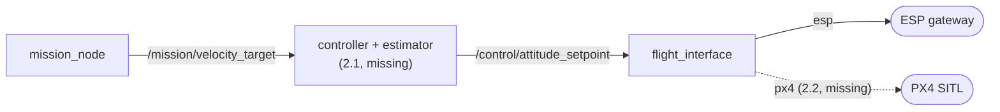

# 🔭 Final connections and missing parts

What the gesture chain still needs before a gesture moves the real drone (§2), and nodes that would make it better later (§3). Turn an item into work with the Spike or Task issue form.

## 🗺️ 1. Overview

| § | Part | Why | Status |
| :---: | :--- | :--- | :---: |
| 2.1 | controller + estimator | velocity target → attitude setpoints | ==🟠planned, Module 1== |
| 2.2 | PX4 backend for `flight_interface` | the simulator through the real node | ==🟠planned, Module 1== |
| 2.3 | gestures driving `flight_interface` in the simulator | the whole chain end to end | ==🟠planned, Module 1== |
| 2.4 | `override_active` from the ESP | the gate in `mission_node` and `flight_interface` | ==🟠in progress== |
| 2.5 | `gesture_node` leftovers | ADR and the MediaPipe Tasks API | ==🟠to do== |
| 3.1 | `camera_node` | camera frames as a ROS topic | ==🟣idea, optional== |
| 3.2 | `drone_msgs` | typed messages instead of JSON strings | ==🟠proposed== |
| 3.3 | motion tracker | wave / swipe gestures | ==⚪not planned== |
| 3.4 | trained classifier | replace the rule-based `recognize()` | ==🟠Module 2== |
| 3.5 | car / arm adapter | portability proof | ==🟠Module 2== |
| 3.6 | operator display | show mode and reason to the operator | ==🟣idea== |

---

## 🔗 2. Missing connections

### 2.1 Controller + estimator

Turns `/mission/velocity_target` and the estimated velocity (flow, IMU, baro) into attitude and throttle on `/control/attitude_setpoint`, which `flight_interface` sends. Yaw only (mask 8) first; roll and pitch once there is a velocity estimate. Until it exists, `flight_interface` sends neutral sticks. Its contract: [[ADR-025 flight_interface Ground Node|ADR-025]] C1.

### 2.2 PX4 backend for `flight_interface`

A `px4` backend that sends the attitude setpoints to PX4 SITL and publishes `/flight/state` from PX4. It replaces `px4_offboard_bridge` in `make sim`; the two never run together, since both publish `/flight/state` ([[PX4 SITL Setup]], [[ADR-019 Sim Backends|ADR-019]]).

### 2.3 Gestures driving `flight_interface` in the simulator

The whole chain, webcam → gesture → intent → mission → controller → `flight_interface` → PX4, with the gesture speed limits, hand loss → hover, and no gesture ever arming, each checked by a test.

### 2.4 `override_active` from the ESP

The ESP reports whether the pilot has handed control to the ground (from `MSP_BOXIDS` and `MSP_STATUS`). Until it does, `override_active` is false, so `mission_node` stays `IDLE` and `flight_interface` sends only neutral ([[05 Flight Interface Node|05]] §5).

### 2.5 `gesture_node` leftovers

`gesture_node` is built ([[02 Gesture Node]]). Still to do: the ADR that amends [[ADR-018 Ground OS and ROS 2|ADR-018]] (MediaPipe inside a ROS 2 node), and a port of Holistic to MediaPipe's Tasks API before moving past `mediapipe==0.10.21`.

---

## 🧩 3. Nodes to add later

### 3.1 `camera_node`

Publishes the webcam as `/image_raw`, only if we need to see or record the picture. It would replace the capture inside `gesture_node` (one webcam, one reader) and cost a frame copy between processes. An existing package (`v4l2_camera` or `usb_cam`) in its own container.

### 3.2 `drone_msgs`

A message package so `/gesture/intent`, `/mission/state` and `/flight/state` are typed instead of JSON strings. Must be an `ament_cmake` package; a message change is a contract change between tracks.

### 3.3 Motion tracker

Not planned: the vocabulary uses static poses only ([[00 Gesture Pipeline]] §3).

### 3.4 Trained classifier (Module 2)

A classifier on the hand landmarks instead of `recognize()`, with the same output names so `intent_node` doesn't change ([[Roadmap to April 2027]] §4).

### 3.5 Car / arm adapter (Module 2)

The same `/gesture/intent` driving a car (`cmd_vel`) or an arm, with its own limits ([[Roadmap to April 2027]] §4).

### 3.6 Operator display

Shows the mode, intent and reason from `/mission/state` to the operator. Display only, never sends commands.

---

## Glossary

| Term | Meaning |
| --- | --- |
| **ADR** | Architecture Decision Record: a documented decision and its rationale. |
| **Backend** | The part of `flight_interface` that talks to one kind of drone: `loopback`, `esp`, later `px4`. |
| **Bringup package** | A ROS 2 package that holds only launch and parameter files to start a whole system. |
| **Compose profile** | A named group of services in `docker-compose.yml`, started together with `--profile`. |
| **JSON** | A text format for structured data, used inside the gesture topics. |
| **Launch file** | A Python file that starts several nodes with their parameters (`ros2 launch`). |
| **MediaPipe** | A Google framework used here to detect the body pose and hand landmarks (Holistic). |
| **Override** | MSP override: the pilot's switch that hands chosen stick channels to the ground. |
| **SITL** | Software In The Loop: the flight code runs on the PC against a simulator. |
| **Spike** | A short, time-boxed investigation to answer a question before building. |
| **Tasks API** | MediaPipe's newer API that replaces the removed `mp.solutions`. |
